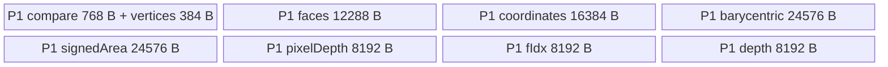
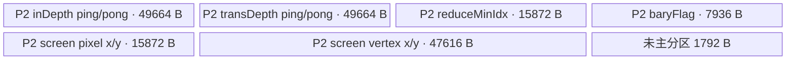

# Rasterizer A2/A3 ACLNN 算子知识

## 算子速览

| 项目 | 内容 |
|---|---|
| 实际入口 | `aclnnRasterizerGetWorkspaceSize` + `aclnnRasterizer`，公开 ACLNN 两段式接口，无显式版本后缀 |
| 计算语义 | 对三角面片构建每核私有 Z-buffer，跨核取每像素最小深度，再输出对应面索引和透视矫正重心坐标 |
| 输入输出 | `v:[numVertices,4] float32`、`f:[numFaces,3] int32`、可选但不生效的 `d`；输出 `findices:[H,W] int32`、`barycentric:[H,W,3] float32`，均为 ND |
| 执行类型 | 单个 Device entry；阶段 P1 `NsRasterizer::Rasterizer<float>` 与阶段 P2 `BarycentricFromImgcoordAIV<float>` 均为 `AIV_VECTOR`，中间以 `SyncAll` 连接；无 AIC/Cube/MIX_CV 节点 |
| Kernel 路线 | R-001：TilingKey 1、float32 单 Kernel 双阶段实现 |
| 核心资源 | GM 输入/输出；用户 workspace 中每核 Z-buffer 与 gather mask；P1 103552 B 多 TBuf；P2 单个 184 KiB TBuf；HardEvent、PipeBarrier、跨核 `SyncAll` |
| 来源闭包 | `source_closed`：公开 ACLNN 文档→框架生成的两段式 bridge 边界→`Rasterizer` OpDef/Tiling/POD→key 1 entry→两个 AIV body→平台注册与构建接线均已闭合 |
| 验证状态 | 已完成源码闭包检查；本次知识提取未执行编译、真机、数值或性能测试。 |

## 接口与语义

### 计算语义

令顶点齐次坐标为 `v=(x,y,z,w)`。屏幕坐标为 `xs=(x/w*0.5+0.5)*(width-1)+0.5`、`ys=(0.5+0.5*y/w)*(height-1)+0.5`、`zs=z/w*0.49999+0.5`。对每个三角形包围盒中的像素中心 `(px+0.5,py+0.5)` 计算有向面积与重心坐标 `(alpha,beta,gamma)`；只对三个分量均在 `[0,1]` 且深度严格小于当前 Z-buffer 的 lane 更新深度与 `faceIdx+1`。各 Vector 核的 Z-buffer 互相独立。

跨核同步后，P2 对同一像素的所有核私有深度做 `WholeReduceMin(..., ORDER_ONLY_INDEX)`，用得到的核索引读取相同位置的面索引；无命中像素输出 `findices=0`、`barycentric=(0,0,0)`。有效面重新计算像素重心坐标，并按 `lambda_i / w_i / sum_j(lambda_j/w_j)` 做透视矫正。固定 Device 源码把 P1 保存的 `faceIdx+1` 原样写到 `findices`，只在内部 gather 顶点时减 1；这与公开文档将输出描述为原始面索引的语义存在可见偏差，复用时不可擅自消除。

### 输入、输出与属性

| 参数 | shape/layout | dtype | 约束、默认值与语义 |
|---|---|---|---|
| `v` | `[numVertices,4]` / ND | FLOAT32 | 必选、非空；第二维必须为 4；面索引合法性由调用者保证 |
| `f` | `[numFaces,3]` / ND | INT32 | 必选、非空；第二维必须为 3 |
| `dOptional` | 文档为二维 / ND | FLOAT32 | 可选；公开接口与实现均声明当前不生效，Kernel P1 虽接收 `d` 但未绑定或读取 |
| `width` | 标量 | INT64（ACLNN）→Tiling `uint32_t` | `[1,4096]`；输出第二维必须相等 |
| `height` | 标量 | INT64（ACLNN）→Tiling `uint32_t` | `[1,4096]`；输出第一维必须相等 |
| `occlusionTruncation` | 标量 | DOUBLE（ACLNN）→Tiling `float` | 当前不生效；POD 写入且 P1 读取成员，但计算未消费 |
| `useDepthPrior` | 标量 | INT64（ACLNN）→Tiling `uint32_t` | 必须为 0；非 0 在 Tiling 失败 |
| `findicesOut` | `[height,width]` / ND | INT32 | 必选、非空；未命中像素最终为 0 |
| `barycentricOut` | `[height,width,3]` / ND | FLOAT32 | 必选、非空；未命中像素最终为 0 |

### 入口与版本

固定 Commit 公开文档只声明无版本后缀的 `aclnnRasterizerGetWorkspaceSize` 与 `aclnnRasterizer`，没有更高版本族。目录 `CMakeLists.txt` 以 `add_all_modules_sources(OPTYPE rasterizer ACLNNTYPE aclnn)` 接入框架生成的 ACLNN bridge；固定仓未提供手写 bridge 源文件，因此指针空值、dtype 等通用第一段校验以公开文档为准，算子拥有的 shape/属性校验继续闭合到 `CheckParam`。

公开产品表明确支持 Atlas A2 与 A3，明确不支持 Ascend 950PR/950DT；OpDef 与 binary config 分别接入 `ascend910b`、`ascend910_93`，与公开表一致。故本卡覆盖 A2/A3，不发布 950 卡。

## Host/Launcher 执行流程

### 参数校验与前处理

ACLNN 第一段先按公开契约检查 `v/f/findicesOut/barycentricOut` 非空和 dtype；OpDef 对三个输入及两个输出声明 `AutoContiguous()`，非连续输入不在接口文档支持范围。随后 `RasterizerTilingFunc` 取得 `v/f` shape，`CheckParam` 按顺序检查：四个相关张量 rank 分别为 2/2/2/3；`f.dim1==3`、`barycentric.dim2==3`；`v.dim1==4`；`height,width` 在 `[1,4096]`；两个输出的前两维相同且等于属性；`useDepthPrior==0`。任一条件不满足返回 `GRAPH_FAILED`，映射为公开的 inner tiling error。

### 参数、Workspace 与生命周期

设 `P=height*width`，`C=PlatformAscendC::GetCoreNumAiv()`。`FillTilingData` 写六字段 POD，设置 `key=1`、`blockDim=C`，并返回：

```text
workspace_size = P * (sizeof(int32)+sizeof(float)) * C
               + 3 * 1920 * sizeof(uint32)
               + 2 * 64 * sizeof(uint32)
               + 32 MiB
               = 8*P*C + 23040 + 512 + 33554432 bytes
```

入口通过 `GetUserWorkspace(workspace)` 跳过框架保留区；用户 workspace 由 ACLNN 调用者按第一段返回值分配，executor 保存计算流程，第二段在调用者提供的 stream 上发射。`userWS==nullptr` 时 Device entry 直接返回，不产生输出。

### 启动图与失败传播

```text
aclnnRasterizerGetWorkspaceSize
  -> framework ACLNN bridge / Rasterizer OpDef
  -> RasterizerTilingFunc: validate, POD, key=1, blockDim=C, workspace
aclnnRasterizer(workspace, workspaceSize, executor, stream)
  -> rasterizer<<<blockDim=C, same stream>>>(v,f,d,findices,barycentric,workspace,tiling)
       P1 NsRasterizer::Rasterizer<float>: 每核构建私有 zBufIdx/zBufDepth
       -> AscendC::SyncAll()
       P2 BarycentricFromImgcoordAIV<float>: 跨核最小深度归约、输出面索引与重心坐标
```

这是一个 Kernel entry 内的两阶段 launch graph，不是两个 Host Kernel launch。P1→P2 边为同一 `userWS`：`zBufIdx=[C,P] int32` 和 `zBufDepth=[C,P] float32`；`SyncAll` 保证全部 P1 写完成后 P2 读取。mask 区由 P2 各核分片写入，每核只有本地 `PipeBarrier<PIPE_ALL>`，固定源码在分片 GM 写与各核读取全表之间没有第二个显式跨核同步；该边的跨核可见性保证在固定仓不可见。entry 仅对 key 1 执行；固定源码没有 unknown-key fallback body。

## Route 与参数设计

### 分核与资源计算

P1 按 `numFaces/C` 和余数做连续面片分核，前 `numFaces%C` 个核多处理一个面；每核 `numPreFaces` 保留其全局面起点。P1 也按 `P/C` 初始化一段最终 `findices`，但核心中间数据是每核覆盖完整 P 像素的私有 Z-buffer。

P1 面片分两层切块：每次从 GM 搬 1024 个面索引，内部每 8 个面收集顶点并转屏幕坐标；每个三角形按截断到画布的包围盒逐行扫描，每行按 2048 像素切块。P2 使用 `vecCoreNum=GetBlockNum()*GetSubBlockNum()` 按像素连续均分，主 tile 1920 像素；每 tile 再按 96 像素搬入全部核的深度并转置、归约。

### Route 选择

| 顺序 | Route | Key/模板 | 精确选择条件与优先级 | 不适用去向 |
|---:|---|---|---|---|
| 1 | R-001 float32 两阶段 AIV | key 1；`Rasterizer<float>` + `BarycentricFromImgcoordAIV<float>` | `CheckParam` 全部通过；公开 dtype 固定为 `v=float32,f=int32,outputs=int32/float32`；A2/A3 config 可用 | 参数失败返回 Tiling 错误；unknown key 在 entry 中无操作 |

```text
if CheckParam(...) fails: GRAPH_FAILED
else:
  SetTilingKey(1)
  SetBlockDim(GetCoreNumAiv())
  if userWS == nullptr: return
  if TILING_KEY_IS(1): execute R-001
```

### 模板/实现执行矩阵

| Route | key/selector | dtype/shape/platform 完整命中条件 | 执行拓扑与 Kernel 节点 | 实际模板/body | 内存与同步特征 | tail/fallback |
|---|---|---|---|---|---|---|
| R-001 float32 两阶段 AIV | 1 | 文档与 OpDef dtype；`v[* ,4]`、`f[* ,3]`、输出 `[H,W]`/`[H,W,3]`；`1<=H,W<=4096`；`useDepthPrior=0`；A2/A3 | 单 entry：P1→`SyncAll`→P2 | `NsRasterizer::Rasterizer<float>::Process`；`BarycentricFromImgcoordAIV<float>::Process` | P1 私有 `[C,P]` Z-buffer；P2 184 KiB UB 和共享 mask；HardEvent/PipeBarrier/SyncAll | 面 1024/8、像素 2048/1920/96 均有 tail；无其它 Route |

### 隐藏性能 Guard

| Guard | Host/Tiling 条件 | Device/资源原因 | 影响 Route | 不满足时去向 | 源码符号 |
|---|---|---|---|---|---|
| 画布上界 | `1<=height,width<=4096` | 限制 P、workspace 与 Device `int32_t height*width` 地址计算域 | R-001 | `GRAPH_FAILED` | `rasterizer_tiling.cpp::CheckParam` |
| 深度先验关闭 | `useDepthPrior==0` | Device 没有绑定/消费 `d` 的路径 | R-001 | `GRAPH_FAILED` | `CheckParam`、`Rasterizer::Init` |
| 固定 P2 tile | `MAX_PROC_ELENUM=1920` | mask 区固定为 `3*1920*4` B，UB 分区也按 1920+64 | R-001 | 最后 tile 取 `tailNum` | `BarycentricFromImgcoordAIV::Process/InitUbuf` |
| P2 转置子块 | `TRANS_COL_ELENUM=96` | `DataCopyPad`、`TransDataTo5HD` 与 `WholeReduceMin` 的行列布局 | R-001 | 最后子块取 `preTailNum` | `PreProcess/TransposeDepth` |
| 平台核数 | `blockDim=GetCoreNumAiv()` | workspace 的 `[C,P]` 与归约 `blockCnt=vecCoreNum` 必须一致 | R-001 | 无 fallback | `FillTilingData`、`InitParam` |
| entry key | `TILING_KEY_IS(1)` | 只有 float32 模板实例 | R-001 | 无操作 | `rasterizer.cpp::rasterizer` |

### POD/ABI

宏生成结构按声明顺序包含六个连续 32-bit 字段；固定仓没有展开宏后的 `sizeof/alignof/offsetof` 定义，故仅能确定源码字段类型/顺序，不能把推导偏移当成可移植 ABI 事实。

| 结构 | 字段 | 类型/位宽 | ABI 布局 | 单位 | Host/launcher producer | Device consumer | 边界 |
|---|---|---|---|---|---|---|---|
| `RasterizerTilingData` | `numFaces` | `uint32_t`/32 | 宏展开偏移固定仓不可见 | 面 | `FillTilingData: fShape.dim0` | P1 `Init` 分面；P2 `ParseTilingData` 保存但不再读取 | `f.dim0` 转 `uint32_t`，Host 未显式检查窄化 |
| 同上 | `numVertices` | `uint32_t`/32 | 同上 | 顶点 | `vShape.dim0` | P2 保存但计算按 `f` 索引访问 `v` | Host 未显式检查窄化/索引合法性 |
| 同上 | `height` | `uint32_t`/32 | 同上 | 像素 | 属性 `height` | P1/P2 画布与地址计算 | `[1,4096]` |
| 同上 | `width` | `uint32_t`/32 | 同上 | 像素 | 属性 `width` | P1/P2 画布与地址计算 | `[1,4096]` |
| 同上 | `occlusionTruncation` | `float`/32 | 同上 | 深度 | 属性 `occlusion_truncation` | P1 `Init` 仅保存成员 | inactive：当前 Route 不参与计算 |
| 同上 | `useDepthPrior` | `uint32_t`/32 | 同上 | 布尔标志 | 属性 `use_depth_prior` | P1 `Init` 仅保存成员 | 只允许 0；inactive |

### Route 源码闭包

| Route | Key/selector | Host/Tiling producer | POD/参数 | Kernel entry/router 节点 | Kernel body/直接依赖 | 构建接线 |
|---|---|---|---|---|---|---|
| R-001 | key 1 | `op_host/rasterizer_tiling.cpp::RasterizerTilingFunc/FillTilingData` | `op_host/rasterizer_tiling.h::RasterizerTilingData` | `op_kernel/rasterizer.cpp::rasterizer` | `rasterizer.h::Rasterizer<float>`；`barycentric_from_imgcoord_kernel.h::BarycentricFromImgcoordAIV<float>` | `CMakeLists.txt::add_all_modules_sources`；`rasterizer_def.cpp::AddConfig`；`ascendc_config.json::Rasterizer` |

## Kernel 实现

### 公共执行流程

entry 声明 `KERNEL_TASK_TYPE_DEFAULT(KERNEL_TYPE_MIX_AIV_1_0)`，但实际可达两个类均只调用 Vector/搬运/标量控制 primitive，没有 Cube API、AIC body 或 `KERNEL_TYPE_MIX_AIC_*`。P1 对面片并行，写每核独立 Z-buffer；销毁 P1 对象后执行 `SyncAll`；P2 对像素并行，从所有核的深度平面归约出胜者并生成两个输出。两阶段共享同一 POD 和 user workspace，没有第二次 Host launch。

### Route R-001：float32 两阶段 AIV

#### 适用条件

##### 选择证据

| 层级 | 文件 | 符号 | 源码谓词/参数 | 结果/下一跳 |
|---|---|---|---|---|
| API | `docs/aclnnRasterizer.md` | `aclnnRasterizerGetWorkspaceSize/aclnnRasterizer` | A2/A3；固定 dtype/shape；`useDepthPrior=0` | 进入框架 bridge |
| Host/Tiling | `op_host/rasterizer_tiling.cpp` | `CheckParam` | rank、尾维、H/W、输出 shape、属性依次校验 | 成功后 `FillTilingData` |
| Host/Tiling | 同上 | `FillTilingData` | 无分支 | key 1、`blockDim=aivCoreNum` |
| Router | `op_kernel/rasterizer.cpp` | `rasterizer` | `userWS!=nullptr && TILING_KEY_IS(1)` | P1→SyncAll→P2；否则返回/无操作 |

#### Device 数据流

##### 函数级调用链

```text
rasterizer(v,f,d,findices,barycentric,workspace,tiling)
  -> GetUserWorkspace; GET_TILING_DATA
  -> Rasterizer<float>::Init
       -> InitBuf -> InitGM
  -> Rasterizer<float>::Process
       -> ProcessZBuffer
          -> CopyInFaces
          -> ComputeZBuffer
             -> CopyInVertices -> ToScreenCoordinate
             -> CalcTriangle
                -> CopyInZBuffer -> CalcSignedArea -> CalcBaryCoordinate
                -> CalcPixelDepth -> CalcZBufferMask -> UpdateZBuffer -> CopyOutZBuffer
  -> SyncAll
  -> BarycentricFromImgcoordAIV<float>::Init
       -> ParseTilingData -> InitParam -> InitUbuf -> ReuseUbuf
  -> BarycentricFromImgcoordAIV<float>::Process
       -> GenMaskDataInGM
       -> PreProcess: CopyInDepth -> TransposeDepth -> ReduceMinDepth
       -> GenFindicesAndPreVertData -> GetVertData
       -> CalculateBarycentric
          -> GenScreenVertData -> CalcSignedArea -> GenBarycentricCoord
       -> CopyOutRslt
```

##### 源码等价伪码

```text
# P1：每个 AIV 核处理连续 face 区间，拥有完整 P 像素私有 Z-buffer
faces_this_core, first_face = balanced_split(numFaces, blockNum, blockIdx)
fill zBufIdx[blockIdx, 0:P] = INT_MAX
fill zBufDepth[blockIdx, 0:P] = FLOAT_MAX
for face_chunk in chunks(faces_this_core, 1024):
  DMA f[face_chunk] -> facesLocal
  for face8 in chunks(face_chunk, 8):
    scalar_gather v[f] -> verticesLocal
    vector homogeneous_to_screen(verticesLocal)
    for triangle in face8:
      if signed_area == 0: continue
      for y in clipped_bbox_rows:
        for x_chunk in chunks(clipped_bbox_width, 2048):
          generate pixel centers; DMA current private z-buffer to UB
          beta,gamma,alpha = signed_areas / triangle_area
          depth = trunc((alpha*z0 + beta*z1 + gamma*z2) * MAGN)
          mask = all(alpha,beta,gamma in [0,1]) AND depth < old_depth
          masked update depth and globalFaceIndex+1
          DMA updated private z-buffer to GM

SyncAll()

# P2：每个 AIV 核处理连续 pixel 区间
calPixNum,startPixId = balanced_split(P, vecCoreNum, vecIdx)
cooperatively build gather mask[1920,3] in workspace
for pixel_tile in chunks(calPixNum, 1920):
  for pixel96 in chunks(pixel_tile, 96):
    2D DMA zBufDepth[all cores, pixel96] -> ping UB
    transpose core-major depth to pixel-major
    winnerCore[pixel96] = WholeReduceMin(..., ORDER_ONLY_INDEX)
  for pixel in tile:
    encoded = zBufIdx[winnerCore[pixel], pixel]
    if encoded == INT_MAX or encoded-1 < 0: findices=0; valid=0
    else: findices=encoded; valid=1; scalar gather triangle x,y,w
  recompute screen vertices and pixel centers
  alpha,beta,gamma = signed areas / area; zero-area selects -1
  corrected = (lambda/w) / sum(lambda/w)
  bitwise-zero corrected lanes where valid==0
  Gather with workspace mask to interleave planar alpha/beta/gamma
  DMA findices and barycentric to GM
```

#### 内存与数据搬运

##### 资源与搬运表

| 层级/缓冲区 | offset/地址公式 | extent/容量公式 | dtype/layout | producer | consumer | owner/lifetime | 对齐/复用 |
|---|---|---|---|---|---|---|---|
| GM `v` | face vertex index `*4+k` | `[numVertices,4]` | float32 ND | caller | P1/P2 scalar gather | caller，整次调用 | 索引合法由 caller 保证 |
| GM `f` | P1 核连续面 offset；P2 `3*faceIdx+j` | `[numFaces,3]` | int32 ND | caller | 两阶段 | caller | P1 每 1024 面 DMA；P2 scalar gather |
| WS `zBufIdx` | `4*(core*P+pixel)` | `4*C*P + 256` B（P2 将 64 元素 reserve 计入下一段基址） | int32 `[C,P]` | P1 | P2 | executor user workspace | 每核独占平面；值编码为 face+1/INT_MAX |
| WS `zBufDepth` | `4*(C*P+64)+4*(core*P+pixel)` | `4*C*P + 256` B | float32 `[C,P]` | P1 | P2 | 同上 | P1→P2 由 SyncAll |
| WS `maskGM` | `8*(C*P+64)+4*(3*column+coord)` | `3*1920*4=23040` B | uint32 gather byte offsets | P2 `GenMaskDataInGM` | P2 `CopyOutRslt` | 同上 | 各核写列子集、后续读取全表；源码无显式跨核 barrier |
| P1 `facesBuf` | 0 | `1024*3*4=12288` B | int32 | `CopyInFaces` | `CopyInVertices` | P1 TPipe | 单 TBuf |
| P1 `verticesBuf` | planar x/y/z/w | `8*3*4*4=384` B | float32 | scalar gather | screen transform/triangle | P1 TPipe | 每 8 面覆盖 |
| P1 `coordinates/bary/signedArea` | 各自 TBuf | 16384/24576/24576 B | float32 planar | triangle loop | Vector compute | P1 TPipe | signedArea 三个 2048 子区 |
| P1 `compareBuf` | 3 个 256 B packed mask | 768 B | uint8/uint16 alias | Compare | And/masked update | P1 TPipe | ReinterpretCast alias |
| P1 `pixelDepth/fIdx/depth` | 各自 TBuf | 各 8192 B | float32/int32/float32 | compute/DMA | mask/update/DMA | P1 TPipe | tile 2048，tail 用有效 count |
| P2 `uBuf` | 单一基址，见下图 | `184*1024=188416` B | float32 + reinterpret aliases | P2 methods | P2 methods | P2 TPipe | 大量阶段复用；有效静态主分区 186624 B |

##### 分层内存布局





##### 字节账与复用顺序

```text
P1_UB_total = 768 + 384 + 12288 + 16384 + 24576 + 24576 + 8192 + 8192 + 8192
            = 103552 bytes
P2_UB_alloc = 184 * 1024 = 188416 bytes
P2_main_partition = 2*(64*96+64)*4 * 2
                  + 2*(1920+64)*4
                  + (1920+64)*4
                  + 2*(1920+64)*4
                  + 6*(1920+64)*4
                  = 186624 bytes <= 188416 bytes
dynamic_ub = N/A（AIV 静态 TBuf）
workspace_total = 8*P*C + 23040 + 512 + 32 MiB
```

| 复用子区 | 写入者 | 读取者/消费点 | 下一次覆盖 | 同步或释放依据 | 安全条件 |
|---|---|---|---|---|---|
| P1 `signedAreaBuf` 三子区 | `CalcSignedArea` | `CalcBaryCoordinate/CalcPixelDepth` | 下一三角/像素块 | `PipeBarrier<PIPE_V>` | 消费完成后覆盖 |
| P1 packed compare mask | 多次 `CompareScalar/Compare` | `And/UpdateZBuffer` | 下一 mask 步骤 | `PipeBarrier<PIPE_V/ALL>` | 3 个子区和 uint16 alias 偏移不变 |
| P2 `inDepth/transDepth` ping-pong | MTE2/transpose | transpose/reduce | `pingFlag=1-pingFlag` 后隔次覆盖 | `MTE2_V` 与 `V_MTE2` event | 96 像素子块及 tail stride 公式保持 |
| P2 `uBuf[0,...]` 原顶点/area mask | `GetVertData/CalcSignedArea` | 重心计算 | 进入下一 tile | 阶段间 `PIPE_ALL/V` | P2 的 depth 归约和 winner 读取已结束 |
| P2 `baryCentricx` 作为临时 findices | `GenFindicesAndPreVertData` | 先 DMA findices | `CalcSignedArea/GenBarycentricCoord` | 后续 `ArithProgression` 前的 `PIPE_ALL` | findices 搬出先于重心覆盖 |
| P2 planar barycentric→`vert0w` interleaved | `GenBarycentricCoord`→`Gather` | `CopyOutRslt` | 下一 tile | `PIPE_ALL`、`MTE3_MTE2` event | gather mask 全表已可见 |

#### 同步、精度与尾块

##### 同步与数值边界表

| 阶段 | primitive/机制 | producer | consumer/等待点 | 保护对象 | 精度/尾块 |
|---|---|---|---|---|---|
| P1 初始化/回写 | `V_MTE3`、`MTE3_V` | Duplicate/GM write | 下一 UB 覆盖/Vector | 私有 Z-buffer tile | 完整 2048 用 `DataCopy`，remainder 用 byte `blockLen` |
| P1 face/vertex | `MTE2_S`、`S_V`、`V_S` | face DMA/scalar gather/Vector | 下一处理级 | faces/vertices | 1024、8 面 tail 保留 `curNum` |
| P1 三角计算 | `PIPE_V` + HardEvent | Vector/GM/scalar | 后继 Vector/标量/搬运 | bary/depth/mask | float32；退化面积 0 直接跳过；bbox clamp 到画布 |
| P1 深度 tie | `CMPMODE::LT` + masked `Adds/Duplicate` | 新深度 | Z-buffer | depth/face | 深度乘 `MAGN=2<<17` 后 `CAST_TRUNC`；严格小于才覆盖，同核保留先处理面 |
| P1→P2 | `AscendC::SyncAll` | 所有核 P1 GM 写 | 所有核 P2 | `[C,P]` workspace | 跨核全局可见性边 |
| P2 深度归约 | `MTE2_V`、`V_MTE2`、`TransDataTo5HD`、`WholeReduceMin` | GM depth matrix | winner core index | 96 像素 depth tile | `mask=vecCoreNum`、`repeatNum=curPrePixNum`；tail 由 byte/stride 参数保护 |
| P2 无效像素 | scalar flag + int32 `Mul` | winner/面索引判断 | output | barycentric bit pattern | float 位模式 reinterpret 成 int32 后乘 0/1；无效输出精确清零 |
| P2 mask 交接 | 每核 `PipeBarrier<PIPE_ALL>`，无第二次 `SyncAll` | 各核 `GenMaskDataInGM` 分片 GM 写 | 各核 `CopyOutRslt` 全表 MTE2 | gather offset 表 | 固定仓不能证明跨核写入在读取前全部可见 |
| P2 输出 | `Gather`、`MTE3_MTE2` | planar bary | GM output/下一 tile | interleaved `[pixel,3]` | `calCount` 向 64 元素上取整，GM 仅写 `curCalPixNum*3` 有效元素 |

#### 关键实现

##### 符号证据表

| 阶段 | 文件 | 符号/模板实例 | 实现事实 |
|---|---|---|---|
| Host/Tiling producer | `op_host/rasterizer_tiling.cpp` | `CheckParam/FillTilingData/RasterizerTilingFunc` | 校验、workspace、key、blockDim、POD |
| Kernel entry/router | `op_kernel/rasterizer.cpp` | `rasterizer` | `MIX_AIV_1_0`、key 1、P1→SyncAll→P2 |
| Device body/helper | `op_kernel/rasterizer.h` | `Rasterizer<float>::Init/ProcessZBuffer/CalcTriangle` | 私有 Z-buffer、2048 tile、深度 mask 与写回 |
| Device body/helper | `op_kernel/barycentric_from_imgcoord_kernel.h` | `BarycentricFromImgcoordAIV<float>::Init/Process` | 1920/96 tile、跨核归约、透视矫正与输出 |

## 算子特定优化

### Trick T-001：每核私有 Z-buffer 后一次跨核归约

#### 触发与源码依据

- 适用 Route：R-001
- 触发条件：key 1 的全部合法输入；`blockDim=aivCoreNum`
- Golden 来源：[`op_kernel/rasterizer.cpp:30-39`](../../../../../../../cann-ops-raw/ascendc/ops-cv/bb717d075d129fd1fc7b96b2886824a1d153ed2f/image/rasterizer/op_kernel/rasterizer.cpp#L30-L39)

**官方源码（固定 Commit 连续逐字摘录）**：

```cpp
if (TILING_KEY_IS(1)) {
    {
        NsRasterizer::Rasterizer<float> op;
        op.Init(v, f, d, findices, barycentric, userWS, &tilingData);
        op.Process();
    }
    AscendC::SyncAll();
    BarycentricFromImgcoord::BarycentricFromImgcoordAIV<float> op;
    op.Init(v, f, findices, barycentric, userWS, &tilingData);
    op.Process();
}
```

#### 机制与设计原因

P1 将面片均匀分给核，每核对完整画布维护私有深度/面索引，避免不同核在逐三角逐像素更新时争用同一 GM 元素或使用 Atomic。一次 `SyncAll` 后，P2 把 `[core,pixel]` 深度矩阵按 96 像素块搬入、转置为 pixel-major，再以 `WholeReduceMin` 找胜者。代价是 `8*P*C` workspace，但同步从每次面片更新收敛为阶段边界。

#### 迁移边界

- 适用：多个生产核更新同一输出域、可接受按核复制中间状态且最终能做归约的 AIV 算法。
- 前提：workspace 容纳 `C*P` 的两张表；P1 写入完全私有；P2 前有跨核同步；归约 tie 规则与业务确定性一致。
- 失效：workspace 不足、状态不可归约或需要 P1 在线共享时，必须改为其它并发协议；固定源码没有该 fallback。
- 未验证：本次知识提取未执行编译、真机、数值或性能测试。

#### 错误做法

去掉 `SyncAll` 会让 P2 读取尚未完成的私有 Z-buffer；固定源码未提供无同步 fallback。

### Trick T-002：P2 单 TBuf 的阶段复用与 ping-pong 深度搬运

#### 触发与源码依据

- 适用 Route：R-001
- 触发条件：P2 每个 1920 像素 tile，内部按 96 像素子块执行
- Golden 来源：[`op_kernel/barycentric_from_imgcoord_kernel.h:64-98`](../../../../../../../cann-ops-raw/ascendc/ops-cv/bb717d075d129fd1fc7b96b2886824a1d153ed2f/image/rasterizer/op_kernel/barycentric_from_imgcoord_kernel.h#L64-L98)

**官方源码（固定 Commit 连续逐字摘录）**：

```cpp
this->pipe.InitBuffer(this->uBuf, 184 * 1024); // revserve 8k for select
this->ubufLocal = uBuf.Get<float>();

uint32_t offset = 0;
this->inDepthLocal = this->ubufLocal[offset];
offset += BUFFER_NUM * (ELENUM_REPEAT_FP32 * TRANS_COL_ELENUM + rsv);
this->transDepthLocal = this->ubufLocal[offset];
offset += BUFFER_NUM * (ELENUM_REPEAT_FP32 * TRANS_COL_ELENUM + rsv);
this->reduceMinIdxLocal = this->ubufLocal[offset];
```

#### 机制与设计原因

两个 depth 子区均按 `BUFFER_NUM=2` 分配，`pingFlag` 在 EVENT_ID0/1 间切换，使 MTE2 搬入、转置和归约具备明确的隔代覆盖协议。归约完成后，同一 `uBuf` 的低地址又映射为顶点坐标、area mask 和重心坐标，避免为两大不重叠阶段分别分配 UB；主分区使用 186624 B，落在 188416 B 分配内。

#### 迁移边界

- 适用：先做批量搬运/归约、后做逐元素几何计算，两个阶段生命周期不重叠的 AIV 流水。
- 前提：所有 alias 偏移保持；归约结果消费完再覆盖；ping/pong event 与实际 `pingFlag` 一致；tile 不超过 1920、子块不超过 96。
- 失效：增大核数、tile、坐标临时量或改变阶段交叠时必须重新做完整 UB 字节账，不能直接沿用 184 KiB。
- 未验证：本次知识提取未执行编译、真机、数值或性能测试。

#### 错误做法

在 `GenFindicesAndPreVertData` 尚未消费完 `reduceMinIdxLocal` 时提前写覆盖其重叠区，会破坏 winner-core 索引；固定仓未提供可验证 fallback。

## 模板与实现对比

| 对比维度 | R-001 float32 两阶段 AIV | R-002 | 设计选择依据 |
|---|---|---|---|
| 命中条件/优先级 | 唯一 key 1；合法 A2/A3 ACLNN 输入 | N/A | 固定仓无其它 Host 可达 Route |
| 模板与 dtype | 两个 `<float>` body；面索引 int32 | N/A | 公开 dtype 固定 |
| 循环与分核 | P1 按面分核、1024/8/2048；P2 按像素分核、1920/96 | N/A | 面片更新私有化，像素阶段跨核归约 |
| Queue/TBuf/寄存器/dynamic UB/通信 window | P1 103552 B 多 TBuf；P2 188416 B 单 TBuf；无 TQue/dynamic UB/通信 | N/A | 两阶段对象作用域分离，UB 不并存 |
| 内存总占用与复用 | `8*P*C+23552` B 用户算法 workspace，加框架 32 MiB；P2 重 alias | N/A | 以 workspace 换无 Atomic 的并行更新 |
| 搬运/Vector/SIMT/NDDMA/通信 API | DataCopyPad、TransDataTo5HD、WholeReduceMin、Gather、Vector 算术 | N/A | 全部为 AIV Vector；无 SIMT/NDDMA/通信/Cube |
| 同步、精度与 tail | HardEvent/PipeBarrier/SyncAll；float32；多级 tail | N/A | 唯一路线完整覆盖 |
| fallback/失败边界 | Host 参数失败、null userWS 返回、unknown key 无操作 | N/A | 无 Device fallback |

## 平台差异

| 项目 | A2 | A3 | 950 |
|---|---|---|---|
| 支持状态 | 支持；公开文档与 `ascend910b` config | 支持；公开文档与 `ascend910_93` config | 明确不支持；不生成 `_950` 卡 |
| Host/Launcher | 共用同一 Tiling；核数运行时取 `GetCoreNumAiv()` | 共用同一 Tiling；核数运行时取 `GetCoreNumAiv()` | 无公开 Route |
| Kernel/资源 | 同一 key 1 binary schema 与两个 AIV body | 同一 key 1 binary schema 与两个 AIV body | `ascend950` 未出现在 OpDef、binary config 或构建列表 |

## 限制与失败边界

- `useDepthPrior` 只允许 0；`dOptional`、`occlusionTruncation` 和 `useDepthPrior` 不参与当前计算。
- 文档要求 `v/f` 非空且 `numVertices/numFaces` 为正；Tiling 自身只校验 rank/尾维，通用 ACLNN bridge 的完整生成源码固定仓不可见。
- `f` 的元素必须落在 `[0,numVertices-1]`，由调用者保证；Device scalar gather 不做索引保护。
- P1 用 `currFIdx+1` 编码有效面，P2 向 `findices` 搬出该编码值，却只在访问 `f` 前做 `-1`；因此固定实现的有效输出是 1-based 编码，而公开文档描述的是面索引。固定仓未提供 bridge 后处理，二者冲突必须由集成者验证，不能在复用实现时自行假定已修正。
- P2 的 `GenMaskDataInGM` 由各核分片生成 1920×3 gather mask，随后每核在 `CopyOutRslt` 读取全表；二者之间只有核内 `PipeBarrier<PIPE_ALL>`，没有显式跨核 `SyncAll`。固定仓不能证明此 GM 交接边的跨核可见性。
- Host 将 `numFaces/numVertices` 的 shape 维度窄化为 `uint32_t`，没有显式溢出检查；`height*width` 的部分 Device 表达式先按 `int32_t/uint32_t` 计算，公开 `[1,4096]` 上界使画布元素数不超过 16777216。
- entry 对 null user workspace 直接返回，对未知 TilingKey 无操作；固定源码没有 Device 错误回传或 fallback。
- 950 被公开文档明确标为不支持，不能仅凭通用 AscendC 语法外推。
- 本次知识提取未执行编译、真机、数值或性能测试。

## 源码索引

### 链路索引

| 链路阶段 | 文件 | 关键符号 | 支撑内容 |
|---|---|---|---|
| 入口声明/约束 | `image/rasterizer/docs/aclnnRasterizer.md` | 两段式原型、产品表、参数与错误表 | 公开 API、A2/A3 支持、950 不支持、接口约束 |
| 入口实现 | `image/rasterizer/CMakeLists.txt` | `add_all_modules_sources(... ACLNNTYPE aclnn)` | ACLNN 框架生成 bridge 接线 |
| Host/Tiling/Launcher | `image/rasterizer/op_host/rasterizer_tiling.cpp` | `CheckParam/FillTilingData/RasterizerTilingFunc` | 校验、POD、workspace、key、blockDim |
| Host/Tiling/Launcher | `image/rasterizer/op_host/rasterizer_tiling.h` | `RasterizerTilingData` | POD 字段顺序、类型 |
| Kernel entry/body | `image/rasterizer/op_kernel/rasterizer.cpp` | `rasterizer` | 路由、两阶段顺序、SyncAll |
| Kernel entry/body | `image/rasterizer/op_kernel/rasterizer.h` | `Rasterizer<float>` | P1 私有 Z-buffer 实现 |
| Kernel entry/body | `image/rasterizer/op_kernel/barycentric_from_imgcoord_kernel.h` | `BarycentricFromImgcoordAIV<float>` | P2 跨核归约与重心输出 |
| Kernel entry/body | `image/rasterizer/op_kernel/barycentric_from_imgcoord_kernel_base.h` | `BarycentricFromImgcoordAIV`、tile 常量 | P2 成员、资源与 1920/96 tile 定义 |
| 构建接线 | `image/rasterizer/op_host/rasterizer_def.cpp` | `Rasterizer::Rasterizer` | dtype/layout/AutoContiguous 与 A2/A3 config |
| 构建接线 | `scripts/kernel/binary_config/ascendc_config.json` | `Rasterizer` 条目 | `ascend910b/ascend910_93` binary 平台 |

### 实现复用检查

| 检查项 | 可复用事实 | 不得改变的约束 | 源码符号 |
|---|---|---|---|
| ABI/POD | 六字段 POD 与 key 1 | 字段顺序、32-bit 类型、shape→uint32 窄化、inactive 属性 | `RasterizerTilingData/FillTilingData` |
| 调用顺序 | 单 entry 的 P1→SyncAll→P2 | P1 对象先结束；跨核同步不能删除 | `rasterizer` |
| workspace/内存 | `[C,P]` idx/depth + reserve + mask | offset、`C` 一致性、32 MiB 框架余量、owner/lifetime | `FillTilingData`、两个 `Init` |
| 同步 | HardEvent/PipeBarrier/SyncAll 协议 | producer→consumer event 方向与 alias 覆盖顺序 | 两个 Kernel body |
| 精度与尾块 | float32、P1 深度截断、严格 LT、1920/96/2048 tails | mask、有效 GM blockLen、zero-area 与无效像素语义 | `CalcPixelDepth/CalcZBufferMask/Process` |
| 失败边界 | Host 校验失败；null WS/unknown key 无输出 | 不得把缺失 fallback 推测为支持 | `CheckParam/rasterizer` |
