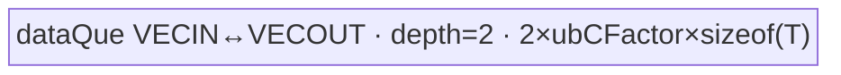
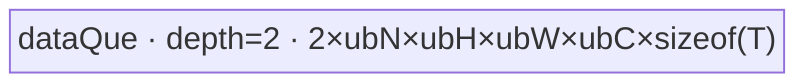
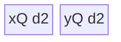
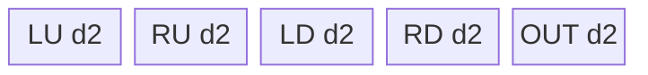

# Resize 950 ACLNN 算子知识

## 算子速览

| 项目 | 内容 |
|---|---|
| 实际入口 | `aclnnResizeGetWorkspaceSize` / `aclnnResize`，公开 ACLNN，两段式、无版本后缀 |
| 计算语义 | `mode="nearest"` 取映射源点；`mode="bilinear"` 对源图四邻点做二维线性插值；输出 H/W 为 `floor(input_dim * scales)` |
| 输入输出 | 950：4D NCHW/NHWC；self/out 同 dtype 与 format；dtype 为 FP16/FP32/BF16；N/C 相同，非空 |
| 执行类型 | 单 Device 节点；bilinear 与 nearest 均由 `KERNEL_TYPE_AIV_ONLY` entry 路由到 AIV_VECTOR 或 SIMT |
| Kernel 路线 | R-001～R-008 为 bilinear；R-010～R-013 为 nearest |
| 核心资源 | AIV 路线使用 GM、UB、TQue/TBuf/寄存器；SIMT 直接 GM；bilinear 节点 workspace 32 B，nearest 节点 workspace 16 MiB |
| 来源闭包 | source_closed：公开 ACLNN、RegBase API 分支、两个 L0 节点、Host/Tiling/POD、全部可达 entry/body、workspace 与构建接线均已闭合 |
| 验证状态 | 已完成源码闭包检查；本次知识提取未执行编译、真机、数值或性能测试。 |

## 接口与语义

### 计算语义

令输出位置为 `(n,c,ho,wo)`。Host 先生成 `size=[Ho,Wo]`，其中 `Ho=floor(Hi*scales[H])`、`Wo=floor(Wi*scales[W])`。`nearest` 的 950 ACLNN 固定 `align_corners=false, half_pixel_centers=false`，源坐标为 `hi=min(floor(ho*Hi/Ho),Hi-1)`、`wi=min(floor(wo*Wi/Wo),Wi-1)`。`bilinear` 固定 `align_corners=false, half_pixel_centers=true`，令 `fh=(ho+0.5)*scaleH-0.5`、`fw=(wo+0.5)*scaleW-0.5`，坐标先夹到非负域，再由 floor/ceil 四点和 `(1-dh)(1-dw), (1-dh)dw, dh(1-dw), dhdw` 加权。两种模式都只改变 H/W，保持 N/C。

### 输入、输出与属性

| 参数 | shape/layout | dtype | 约束、默认值与语义 |
|---|---|---|---|
| `self` | 4D NCHW 或 NHWC | FP16/FP32/BF16 | 非空；支持非连续，先过 `Contiguous`；N/C 与 out 相同 |
| `scales` | 长度 4 | FloatArray | N/C 分量应为 1；H/W 分量决定输出尺寸；Host 以 `±1e-5` 容差校验 out H/W |
| `mode` | C 字符串 | `char*` | 代码按 `strncmp` 前缀接受 `nearest...` 或 `bilinear...` |
| `out` | 4D，format 与 self 相同 | dtype 与 self 相同 | 非空、支持非连续；N/C 相同，H/W 与 scales 对应 |
| `workspaceSize` | 标量 | uint64 | executor 内全部节点所需 workspace；精确总值由框架 executor 汇总 |
| `executor` | opaque | `aclOpExecutor**` | 第一段创建并转移所有权，第二段消费 |

### 入口与版本

固定仓只公开无版本后缀的 `aclnnResizeGetWorkspaceSize/aclnnResize`，因此它是 950 实际支持的最新公开版本。950 命中 `GetExtendPathFlag() && IsRegBase()`：`self/out` 连续化后，`CreateSizesRegBase` 生成 `[Ho,Wo]`；nearest 调 `ResizeNearestNeighborV2(..., false, false)`，bilinear 调 `ResizeBilinearV2With4d(..., false, nullptr)`，后者在 L0 内转成 `half_pixel_centers=true`。不进入旧平台的 NC1HWC0 `TransData` 分支。

## Host/Launcher 执行流程

### 参数校验与前处理

顺序固定为：公共输出指针检查；`self/scales/mode/out` 非空；mode 前缀；950 dtype 集 FP16/FP32/BF16 且 out dtype 相同；format 同为 NCHW 或 NHWC；N/C 一致与 H/W 容差校验；4D 与 scales 长度 4。之后创建 executor，依次对 self、out 调 `l0op::Contiguous`，由 self 的 storage format 选择 H/W 轴，将 `self_dim*scales` 向 `int64_t` 截断，再把两个值转成 INT32 tensor。任何空返回或 launcher 添加失败立即返回错误，不再提交后续节点。

### 参数、Workspace 与生命周期

executor 持有 Contiguous、INT32 size tensor、Resize 节点和最终 `ViewCopy`；第一段通过 `GetWorkspaceSize()` 汇总并 `ReleaseTo(executor)`，第二段在用户 stream 上 `CommonOpExecutorRun`。核心 bilinear Tiling 固定请求 32 B；nearest 固定请求 16 MiB，entry 先 `SetSysWorkspace` 再取得 `GetUserWorkspace`，空指针直接返回。固定仓外的 executor/system-workspace 前缀布局属于框架边界；两个核心 Kernel 都不在用户 workspace 中保存跨 Kernel 中间结果。

### 启动图与失败传播

```text
aclnnResizeGetWorkspaceSize
  -> Contiguous(self), Contiguous(out)
  -> CreateSizesRegBase -> size[2]
  -> mode == nearest
       ? ResizeNearestNeighborV2 AIV-only node (workspace=16 MiB)
       : ResizeBilinearV2 AIV-only node (workspace=32 B)
  -> ViewCopy(resizeRet, out)
aclnnResize(workspace, executor, stream) -> CommonOpExecutorRun
```

核心路径每次只启动一个 Resize Device 节点；`ViewCopy` 是框架后处理节点。节点输入/输出均为 NCHW/NHWC GM tensor，size 为 executor 所有的 INT32 `[Ho,Wo]`。同一 executor/stream 保证添加顺序；任何 producer 返回 null 会阻断后续添加，运行期状态由 `CommonOpExecutorRun` 返回。

## Route 与参数设计

### 分核与资源计算

bilinear 从平台取得 AIV core 数和 UB 字节，保留 8 个 32 B block，`ubBlockNum=ceil(UB/32)-8`。各 Vector 路线再按 `N/C/H/W` 或 `NC/HW` 分核，double buffer 均显式乘 2；SIMT flattened 路线按输出元素，HW 路线只按 `Ho*Wo` 切块，32 位索引用 1024 threads，64 位用 512 threads。nearest 也取 AIV core/UB/block size；Vector 路线按 N、HW、NH 或 NC 切分，SIMT 按输出元素均分；其 16 MiB workspace 与 UB tile 无关。

### Route 选择

| 顺序 | Route | Key/模板 | 精确选择条件与优先级 | 不适用去向 |
|---:|---|---|---|---|
| 1 | R-001 Bilinear all-copy | 40000 | `dtypeX==dtypeY && Hi==Ho && Wi==Wo` | R-002 |
| 2 | R-002 Bilinear point-copy | 40001 | NHWC、C字节≥128、scaleH/W≥1、两 scale 为整数；ACLNN 的 half-pixel=true 使最后属性分支成立 | R-003 |
| 3 | R-003 Bilinear NCHW broadcast | 40002 | NCHW、dtype 同、`Hi=Wi=1`、`Ho*Wo*sizeof(Y)>=128` | R-004 |
| 4 | R-004 Bilinear NHWC broadcast | 40003 | NHWC、dtype 同、`Hi=Wi=1`、`C*sizeof(X)>=128` | R-005 |
| 5 | R-005 Bilinear C-parallel | 10000 + `cFactor==lenC` | NHWC、C字节≥128、scaleH/W≥2，且 Tiling 未切 C | R-006 |
| 6 | R-006 Bilinear NC-vector | 10000 + `cFactor<lenC` | 同上但 Host 为填核切 C | R-007/R-008 |
| 7 | R-007 Bilinear SIMT flattened | 30000～30003 | 前述均失败；NHWC 总是 flattened；NCHW 在无需 HW split；idx32 需所有相关 size < 32 位上界 | R-008/失败 |
| 8 | R-008 Bilinear SIMT HW | 30004/30005 | NCHW，非同尺寸，input size≠1，`Ho*Wo >= core*threads` | 失败 |
| 9 | R-010 Nearest NHWC integer UB2UB | sch 6/7/8 | 第一优先：NHWC、属性均 false、整数放大、scales attr 为 0、C/UB/32位/最小 WC guard 全满足 | R-011 |
| 10 | R-011 Nearest NHWC direct-copy | sch 2/0/1 | NHWC 且 C字节≥128；依次 JH (`C` 对齐且 N×C 可放或 C字节<256)、small-C (`CAlign<=maxUbNum`)、big-C | R-012 |
| 11 | R-012 Nearest NCHW gather | sch 9/10 | NCHW 放大、无显式 scales、scale≥0.25、32位、NC 用核率≥0.67、最小 UB 可容纳 W buffers | R-013 |
| 12 | R-013 Nearest SIMT | sch 4/5/3 | fallback；同尺寸→4，输入 HW=1→5，否则 3；按 size 选 32/64 位索引 | 失败 |

```text
mode=bilinear -> all-copy -> point-copy -> NCHW broadcast -> NHWC broadcast -> C-parallel/Nc -> SIMT
mode=nearest  -> NHWC integer UB2UB -> NHWC direct-copy -> NCHW gather -> SIMT fallback
```

### 模板/实现执行矩阵

| Route | key/selector | dtype/shape/platform 完整命中条件 | 执行拓扑与 Kernel 节点 | 实际模板/body | 内存与同步特征 | tail/fallback |
|---|---|---|---|---|---|---|
| R-001 | 40000 | 同 dtype/shape | 单 AIV | `ResizeBilinearV2AllCopy<T>` | bind queue depth2 | former/tail core + UB tail |
| R-002 | 40001 | NHWC 整数缩小采样 | 单 AIV | `ResizeBilinearV2PointCopy<T>` | bind queue depth2，DMA loop mode | H/W 越界复制边缘点 |
| R-003 | 40002 | NCHW 1×1 source | 单 AIV | `ResizeBilinearV2BroadcastNCHW<T>` | x/y queue depth2，MicroAPI Duplicate | N/C/HW tail |
| R-004 | 40003 | NHWC 1×1 source | 单 AIV | `ResizeBilinearV2BroadcastNHWC<T>` | x/y queue depth2，Copy mask | N/HW/C tail |
| R-005 | 10000 | NHWC, `cFactor==C` | 单 AIV | `ResizeBilinearV2CParallel<X,Y>` | 4-source x queue + y queue，FP32 regs | N/C tail |
| R-006 | 10000 | NHWC, `cFactor<C` | 单 AIV | `ResizeBilinearV2Nc<X,Y>` | 4×input + output queues，均 depth2 | C tile tail |
| R-007 | 30000～30003 | NCHW/NHWC fallback | 单 SIMT | `ResizeBilinearV2SimtNCHW/NHWC<...,uint32/64>` | 直接 GM，1024/512 threads | 每线程 stride，block tail |
| R-008 | 30004/30005 | NCHW 大 HW | 单 SIMT | `ResizeBilinearV2SimtHW<...,uint32/64>` | 直接 GM，线程处理 HW 后循环 N/C | HW block tail |
| R-010 | sch6/7/8 | NHWC 整数放大 | 单 AIV | `ResizeNearestNeighborV2NHWC<T,1/0/2>` | in/out queue depth2，UB 内 W/H 复制 | N/H/NH core tail |
| R-011 | sch2/0/1 | NHWC C 向量 DMA | 单 AIV | `...JH` / `...S_C` / `...BIG_C` | bind queue depth2 | N/HW/C tail |
| R-012 | sch9/10 | NCHW 放大 gather | 单 AIV | `ResizeGather<T,uint16/32,sch,align>` | queues + idx TBuf，MicroAPI gather | all-HW 或 cut-H |
| R-013 | sch3/4/5 | 通用 fallback | 单 SIMT | `ResizeNearestNeighborV2Simt<T,uint32/64,...>` | 直接 GM，1024/512 threads | 输出元素 tail |

### 隐藏性能 Guard

| Guard | Host/Tiling 条件 | Device/资源原因 | 影响 Route | 不满足时去向 | 源码符号 |
|---|---|---|---|---|---|
| bilinear UB reserve | `ceil(UB/32)-8` | 为系统/对齐预留 256 B | R-001～R-006 | 更小 tile | `ResizeBilinearV2AscendCTilingImpl::Init` |
| 32-bit index | input/output size 与各 H/W 小于 32 位上界 | SIMT magic division 与地址类型匹配 | R-007/R-008/R-013 | 64-bit + 512 threads | `MatchTilingStrategyAndSetTilingKey` |
| C-parallel | `C*sizeof(X)>=128 && scaleH>=2 && scaleW>=2` | 四点连续 C 搬运可摊销 DMA | R-005/R-006 | SIMT | `IsMatchCParallel` |
| nearest UB2UB | 整数放大、`needUb<=UB`、32位、WC 阈值 | 输入行在 UB 复制到多输出行 | R-010 | R-011/R-012/R-013 | `IsMatchTiling_NHWC_UB2UB` |
| nearest gather | `needCore/core>=0.67` 且三类 W buffer 可容纳 | NCHW 的 HW 索引表与 gather 数据必须驻留 UB | R-012 | R-013 | `IsMatchTiling_NCHW_Gather` |

### POD/ABI

两个结构都由 `BEGIN_TILING_DATA_DEF` 生成序列化 ABI；固定仓未展开宏，因此 `sizeof/alignof/offsetof` 不可见。以下每行类型/位宽、producer 和 consumer 可见，ABI 布局统一记为“宏生成，偏移不可见”。

| 结构 | 字段 | 类型/位宽 | ABI 布局 | 单位 | Host/launcher producer | Device consumer | 边界 |
|---|---|---|---|---|---|---|---|
| Bilinear | `tilingKey` | int64/64 | 宏生成 | key | selector | entry router | 10000/30000～30005/40000～40003 |
| Bilinear | `realCoreNum` | int64/64 | 宏生成 | core | 各 DoTiling | 全部 Process | `blockIdx>=realCoreNum` 返回 |
| Bilinear | `ubSize` | int64/64 | 宏生成 | byte | platform UB | 记录/资源依据 | >0 |
| Bilinear | `alignCorners` | int64/64 | 宏生成 | bool | ACLNN 固定 0 | 坐标公式/router | 本入口 0 |
| Bilinear | `halfPixelCenters` | int64/64 | 宏生成 | bool | L0 固定 1 | 坐标公式/router | 本 bilinear 入口 1 |
| Bilinear | `lenN` | int64/64 | 宏生成 | element | shape | 地址/循环 | >0 |
| Bilinear | `lenC` | int64/64 | 宏生成 | element | shape | 地址/循环 | >0 |
| Bilinear | `lenSrcH` | int64/64 | 宏生成 | element | input shape | 坐标/地址 | >0 |
| Bilinear | `lenSrcW` | int64/64 | 宏生成 | element | input shape | 坐标/地址 | >0 |
| Bilinear | `lenDesH` | int64/64 | 宏生成 | element | output shape | 分核/地址 | >0 |
| Bilinear | `lenDesW` | int64/64 | 宏生成 | element | output shape | 分核/地址 | >0 |
| Bilinear | `nFactor` | int64/64 | 宏生成 | element/core | DoTiling | Vector 分核 | inactive 路线可保留初值 |
| Bilinear | `hFactor` | int64/64 | 宏生成 | element/core | DoTiling | point-copy | 同上 |
| Bilinear | `wFactor` | int64/64 | 宏生成 | element/core | DoTiling | point-copy | 同上 |
| Bilinear | `cFactor` | int64/64 | 宏生成 | element/core | DoTiling | 10000 router/body | 决定 R-005/R-006 |
| Bilinear | `hwFactor` | int64/64 | 宏生成 | element/core | DoTiling | broadcast/C parallel | inactive 路线不读 |
| Bilinear | `ubNFactor` | int64/64 | 宏生成 | element/tile | UB 公式 | Vector body | ≥1 |
| Bilinear | `ubHFactor` | int64/64 | 宏生成 | element/tile | UB 公式 | point-copy | ≥1 |
| Bilinear | `ubWFactor` | int64/64 | 宏生成 | element/tile | UB 公式 | point-copy | ≥1 |
| Bilinear | `ubCFactor` | int64/64 | 宏生成 | element/tile | UB 公式 | Vector buffers/loops | ≥1 |
| Bilinear | `splitBlockFactor` | int64/64 | 宏生成 | element/core | SIMT/all-copy tiling | block slice | quotient |
| Bilinear | `splitBlockTailFactor` | int64/64 | 宏生成 | core count | remainder | block slice | `<realCoreNum` |
| Bilinear | `scaleW` | float/32 | 宏生成 | ratio | SetDims/attrs | coordinate map | positive |
| Bilinear | `scaleH` | float/32 | 宏生成 | ratio | SetDims/attrs | coordinate map | positive |
| Bilinear | `ubHWFactor` | int64/64 | 宏生成 | element/tile | broadcast tiling | broadcast body | ≥1 |
| Nearest | `realCoreNum` | int64/64 | 宏生成 | core | TilingStrategy | all bodies | >0 |
| Nearest | `ubSize` | int64/64 | 宏生成 | byte | route-specific buffer budget | base/gather InitBuffer | route-local含义 |
| Nearest | `alignCorners` | int64/64 | 宏生成 | element/byte alias | `lenDstHwcNum_` 写入 | JH 用作输出 N stride | 字段名与该 route 用途不一致 |
| Nearest | `halfPixelCenters` | int64/64 | 宏生成 | bool | ACLNN 0 | base/SIMT/gather | 本入口 0 |
| Nearest | `lenN` | int64/64 | 宏生成 | element | input shape N | 全部地址 | >0 |
| Nearest | `lenC` | int64/64 | 宏生成 | element | input shape C | 全部地址 | >0 |
| Nearest | `lenSrcH` | int64/64 | 宏生成 | element | input shape H | 坐标/地址 | >0 |
| Nearest | `lenSrcW` | int64/64 | 宏生成 | element | input shape W | 坐标/地址 | >0 |
| Nearest | `lenDesH` | int64/64 | 宏生成 | element | output shape H | 坐标/地址 | >0 |
| Nearest | `lenDesW` | int64/64 | 宏生成 | element | output shape W | 坐标/地址 | >0 |
| Nearest | `condition` | int64/64 | 宏生成 | enum | attrs/分核 | copy/UB2UB | 0/1/2 |
| Nearest | `switchParams` | int64/64 | 宏生成 | enum | DoTiling copy | small/big/JH | 0～5 |
| Nearest | `splitBlockFactor` | int64/64 | 宏生成 | element/core | route tiling | core slice | ≥0 |
| Nearest | `splitBlockTailFactor` | int64/64 | 宏生成 | count | route tiling | core tail | route-local |
| Nearest | `lenCAlign` | int64/64 | 宏生成 | element | ceil(C bytes/block) | DMA/UB2UB | block aligned |
| Nearest | `hwcNum` | int64/64 | 宏生成 | element | `Hi*Wi*C` | GM input N stride | >0 |
| Nearest | `dstHwcNum` | int64/64 | 宏生成 | element | `Ho*Wo*C` | GM output N stride | >0 |
| Nearest | `wcNum` | int64/64 | 宏生成 | element | `Wi*C` | GM input H stride | >0 |
| Nearest | `dstWcNum` | int64/64 | 宏生成 | element | `Wo*C` | GM output H stride | >0 |
| Nearest | `nLoop` | int64/64 | 宏生成 | loop/tile | route tiling | copy/gather | route-local |
| Nearest | `nLoopTimesBefore` | int64/64 | 宏生成 | loop count | route tiling | former-core N/NC loop | route-local |
| Nearest | `nLoopTimesLast` | int64/64 | 宏生成 | loop count | route tiling | last-core N/NC loop | route-local |
| Nearest | `nLoopTailLast` | int64/64 | 宏生成 | element count | route tiling | last loop tail | route-local |
| Nearest | `wcLoop` | int64/64 | 宏生成 | element/tile | route tiling | copy/UB2UB | route-local |
| Nearest | `wcLoopTimesBefore` | int64/64 | 宏生成 | loop count | route tiling | former-core WC/H loop | route-local |
| Nearest | `wcLoopTailBefore` | int64/64 | 宏生成 | element count | route tiling | former-core tail | route-local |
| Nearest | `wcLoopTimesLast` | int64/64 | 宏生成 | loop count | route tiling | last-core WC/H loop | route-local |
| Nearest | `wcLoopTailLast` | int64/64 | 宏生成 | element count | route tiling | last-core tail | route-local |
| Nearest | `splitBlockFullCount` | int64/64 | 宏生成 | core count | gather tiling | 当前 body 不读 | inactive consumer |
| Nearest | `splitFactorDesH` | int64/64 | 宏生成 | H/tile | UB/gather tiling | H tile/ubFactor | route-local |
| Nearest | `splitFactorTailDesH` | int64/64 | 宏生成 | H count | UB/gather tiling | H tail | route-local |
| Nearest | `splitCountDesH` | int64/64 | 宏生成 | loop count | UB/gather tiling | H loops | route-local |
| Nearest | `splitFactorDesW` | int64/64 | 宏生成 | byte | UB/gather tiling | output buffer size | route-local |
| Nearest | `splitFactorTailDesW` | int64/64 | 宏生成 | byte | UB/gather tiling | input buffer size | route-local |
| Nearest | `splitCountDesW` | int64/64 | 宏生成 | loop count | gather tiling | W loops | route-local |
| Nearest | `scaleW` | float/32 | 宏生成 | ratio | SetScales | W coordinate/replication | >0 except degenerate aligned corners |
| Nearest | `scaleH` | float/32 | 宏生成 | ratio | SetScales | H coordinate/replication | >0 except degenerate aligned corners |

### Route 源码闭包

| Route | Key/selector | Host/Tiling producer | POD/参数 | Kernel entry/router 节点 | Kernel body/直接依赖 | 构建接线 |
|---|---|---|---|---|---|---|
| R-001～R-008 | bilinear decision tree | `resize_bilinear_v2_tiling_arch35.cpp` | `ResizeBilinearV2TilingData` | `resize_bilinear_v2_apt.cpp::resize_bilinear_v2` | 对应 all_copy/point_copy/broadcast/c_parallel/nc/simt headers | bilinear `CMakeLists.txt` ascend950+arch35 |
| R-010～R-013 | nearest decision tree + template key | `resize_nearest_neighbor_v2_tiling_base.cpp` | `ResizeNearestNeighborV2TilingData` | `resize_nearest_neighbor_v2_apt.cpp::resize_nearest_neighbor_v2` | data_copy_nhwc/small/big/jh/gather/simt headers | nearest `CMakeLists.txt` ascend950+arch35 |

## Kernel 实现

### 公共执行流程

公开 mode 只决定一个核心节点。两个 entry 都先解析 POD，再按 key/template 编译路由；所有可达节点均标记 `KERNEL_TYPE_AIV_ONLY`，无 Cube/MIX_CV。AIV 路线遵循 GM→TQue/TBuf→MicroAPI/DMA→GM，queue 的 EnQue/DeQue/FreeTensor 建立生产消费与复用边；SIMT 路线由 `asc_vf_call` 直接读写 GM，不分配 AIV UB。未知 bilinear key 落到函数末尾不写输出；nearest key 由编译期 template selection 限定。

### Route R-001：Bilinear all-copy

#### 适用条件

##### 选择证据

| 层级 | 文件 | 符号 | 源码谓词/参数 | 结果/下一跳 |
|---|---|---|---|---|
| Tiling | bilinear tiling cpp | `IsMatchAllCopy` | dtype 同且源/目标 HW 同 | key 40000 |
| Router | bilinear apt cpp | `resize_bilinear_v2` | `TILING_KEY_IS(40000)` | `ResizeBilinearV2AllCopy<DTYPE_X>` |

#### Device 数据流

##### 函数级调用链

```text
resize_bilinear_v2 -> AllCopy::Init -> Process -> CopyIn -> CopyOut
```

##### 源码等价伪码

```text
core slice = quotient + (core < remainder); offset = balanced prefix
for p in [0, slice) step ubCFactor: DMA x[offset+p:length] -> bindQ -> DMA -> y[offset+p:length]
```

#### 内存与数据搬运

##### 资源与搬运表

| 层级/缓冲区 | offset/地址公式 | extent/容量公式 | dtype/layout | producer | consumer | owner/lifetime | 对齐/复用 |
|---|---|---|---|---|---|---|---|
| bind `dataQue` | balanced element offset | `2*ubCFactor*sizeof(T)` | T | CopyIn | CopyOut | pipe/kernel | depth2，tail 用 DataCopyPad |

##### 分层内存布局



##### 字节账与复用顺序

`UB_total=2*ubCFactor*sizeof(T)<=可用UB；dynamic_ub=N/A；workspace_total=32 B。` 同一 bind queue tensor 在 CopyOut 后 FreeTensor 才可复用。

#### 同步、精度与尾块

##### 同步与数值边界表

| 阶段 | primitive/机制 | producer | consumer/等待点 | 保护对象 | 精度/尾块 |
|---|---|---|---|---|---|
| copy | queue + DataCopyPad | CopyIn | CopyOut DeQue | UB tile | 位拷贝，无 cast；最后 tile 仅搬有效 length |

#### 关键实现

##### 符号证据表

| 阶段 | 文件 | 符号/模板实例 | 实现事实 |
|---|---|---|---|
| Host/Tiling producer | bilinear tiling cpp | `DoTilingAllCopy` | 平衡分核与 UB factor |
| Kernel entry/router | bilinear apt cpp | key 40000 | 单 AIV body |
| Device body/helper | bilinear all_copy h | `Process/CopyIn/CopyOut` | depth2 bind queue 与有效尾长 |

### Route R-002：Bilinear point-copy

#### 适用条件

##### 选择证据

| 层级 | 文件 | 符号 | 源码谓词/参数 | 结果/下一跳 |
|---|---|---|---|---|
| Tiling | bilinear tiling cpp | `IsMatchPointCopy` | NHWC、C≥128B、整数 scale≥1、dtype 同 | 40001 |

#### Device 数据流

##### 函数级调用链

`resize_bilinear_v2 -> PointCopy::CalcTile -> CopyIn(ComputeParams/CopyInOverstepH) -> CopyOut`

##### 源码等价伪码

```text
map output tile to integer-spaced source points; half-pixel uses ((2*out+1)*stride-1)/2
DMA strided H/W/C samples into bindQ; if H/W exceeds source edge, explicitly repeat last valid point; DMA tile to output
```

#### 内存与数据搬运

##### 资源与搬运表

| 层级/缓冲区 | offset/地址公式 | extent/容量公式 | dtype/layout | producer | consumer | owner/lifetime | 对齐/复用 |
|---|---|---|---|---|---|---|---|
| `dataQue` | NHWC N/H/W/C tile | `2*ubN*ubH*ubW*ubC*sizeof(T)` | T/NHWC | strided GM DMA | output DMA | pipe/kernel | WC block aligned，越界显式补边 |

##### 分层内存布局



##### 字节账与复用顺序

`UB_total=2*ubN*ubH*ubW*ubC*sizeof(T)`；queue 在 CopyOut 后释放；workspace 32 B。

#### 同步、精度与尾块

##### 同步与数值边界表

| 阶段 | primitive/机制 | producer | consumer/等待点 | 保护对象 | 精度/尾块 |
|---|---|---|---|---|---|
| point copy | loop-mode DMA | CopyIn | CopyOut | bind queue | 无算术；H/W 边界 clamp/repeat；N/H/W/C 分别取 tail |

#### 关键实现

##### 符号证据表

| 阶段 | 文件 | 符号/模板实例 | 实现事实 |
|---|---|---|---|
| Host/Tiling producer | bilinear tiling cpp | `DoTilingPointCopy` | 2D 分核及 UB 轴切分 |
| Kernel entry/router | bilinear apt cpp | key 40001 | PointCopy |
| Device body/helper | point_copy h | `ComputeParams/CopyInOverstepH` | 整数网格与边缘复制 |

### Route R-003：Bilinear NCHW broadcast

#### 适用条件

##### 选择证据

见 Route 表：NCHW、源 HW=1、输出 HW 字节≥128、dtype 同，key 40002。

#### Device 数据流

##### 函数级调用链

`entry -> BroadcastNCHW::Process -> CopyIn -> Compute<int16/int32> -> CopyOut`

##### 源码等价伪码

`每个 NC 标量装入寄存器，按 vector mask Duplicate 到 HW 行；MicroAPI UpdateMask 只提交有效 tail。`

#### 内存与数据搬运

##### 资源与搬运表

| 层级/缓冲区 | offset/地址公式 | extent/容量公式 | dtype/layout | producer | consumer | owner/lifetime | 对齐/复用 |
|---|---|---|---|---|---|---|---|
| xQ/yQ | NC 与 NCHW 输出片 | `2*ubN*ubC*sizeof(T)`；`2*ubN*ubC*align(ubHW*sizeof(T),32)` | T/NCHW | DMA/Duplicate | MicroAPI/DMA | pipe | depth2 |

##### 分层内存布局


##### 字节账与复用顺序

`UB_total` 为图中两项之和；x tile 覆盖多个 HW 子 tile，最后才 FreeTensor；workspace 32 B。

#### 同步、精度与尾块

##### 同步与数值边界表

| 阶段 | primitive/机制 | producer | consumer/等待点 | 保护对象 | 精度/尾块 |
|---|---|---|---|---|---|
| vector broadcast | queue + mask | xQ | yQ | NC/HW tile | 位宽不变，mask 保护 HW tail |

#### 关键实现

##### 符号证据表

Tiling：`DoTilingBroadCastNCHW`；router：key 40002；body：`ResizeBilinearV2BroadcastNCHW::Compute/Process`。

### Route R-004：Bilinear NHWC broadcast

#### 适用条件

##### 选择证据

NHWC、源 HW=1、C 字节≥128、dtype 同，key 40003。

#### Device 数据流

##### 函数级调用链

`entry -> BroadcastNHWC::Process -> CopyIn -> Compute/CopyLine -> CopyOut`

##### 源码等价伪码

`每个 N 的源 C 行搬入一次；对每个输出 HW 用计数 mask Copy<int16_t> 复制该行，再按 NHWC stride 写出。`

#### 内存与数据搬运

##### 资源与搬运表

| 层级/缓冲区 | offset/地址公式 | extent/容量公式 | dtype/layout | producer | consumer | owner/lifetime | 对齐/复用 |
|---|---|---|---|---|---|---|---|
| xQ/yQ | N/C 与 N/HW/C | `2*ubN*align(ubC*s,32)`；`2*ubN*ubHW*align(ubC*s,32)` | T/NHWC | DMA/CopyLine | DMA | pipe | C 行 block aligned |

##### 分层内存布局



##### 字节账与复用顺序

`UB_total=2*ubN*align(ubC*s,32)+2*ubN*ubHW*align(ubC*s,32)`；workspace 32 B。

#### 同步、精度与尾块

##### 同步与数值边界表

Queue 保护 DMA/Vector 阶段；计数 mask 为 `cLength*sizeof(T)/2`，C tail 不写 padding。

#### 关键实现

##### 符号证据表

Tiling：`DoTilingBroadCastNHWC`；router：key 40003；body：`BroadcastNHWC::CopyLine/Process`。

### Route R-005：Bilinear C-parallel

#### 适用条件

##### 选择证据

key 10000 且 router 判 `cFactor>=lenC`，实例 `ResizeBilinearV2CParallel<X,Y>`。

#### Device 数据流

##### 函数级调用链

`entry -> CParallel::Process -> CopyIn(四邻点) -> Compute(MicroAPI) -> CopyOut`

##### 源码等价伪码

`每个输出 HW 计算 top/bottom/left/right 与四权重；按 N×C 连续片搬四份；16-bit 输入 unpack/cast FP32，四路 Muls+Add，16-bit 输出 RINT cast+pack。`

#### 内存与数据搬运

##### 资源与搬运表

| 层级/缓冲区 | offset/地址公式 | extent/容量公式 | dtype/layout | producer | consumer | owner/lifetime | 对齐/复用 |
|---|---|---|---|---|---|---|---|
| xQ/yQ | 四邻点 N×C / 输出 N×C | `2*4*bufferLen*sizeof(X)`；`2*bufferLen*sizeof(Y)` | X/Y NHWC | four DMA | FP32 vector/DMA | pipe | `bufferLen=align(ubN*ubC,32/sX)` |

##### 分层内存布局


##### 字节账与复用顺序

`UB_total=8*bufferLen*sX+2*bufferLen*sY`；xQ 在四路权重消费后释放，yQ 写回后释放；workspace 32 B。

#### 同步、精度与尾块

##### 同步与数值边界表

| 阶段 | primitive/机制 | producer | consumer/等待点 | 保护对象 | 精度/尾块 |
|---|---|---|---|---|---|
| interpolation | queue + FP32 RegTensor | 4 DMA | vector | four-point tile | 16-bit→FP32；FP32 加权；RINT 降精度；UpdateMask 保护 tail |

#### 关键实现

##### 符号证据表

Tiling：`DoTilingCParallel`；router：10000/cFactor；body：`CParallel::CopyIn/Compute`。

### Route R-006：Bilinear NC-vector

#### 适用条件

##### 选择证据

key 10000 且 `cFactor<lenC`，实例 `ResizeBilinearV2Nc<X,Y>`。

#### Device 数据流

##### 函数级调用链

`entry -> Nc::Process -> DivideNhwc -> 4×DataCopyPadGm2Ub -> ComputeDstValueWith4SrcDot -> DataCopyPadUb2Gm`

##### 源码等价伪码

`按 core 的 N/HW/C 域，对每个输出点与 C tile 依次搬四邻点；在 FP32 RegTensor 中加权求和；tail mask 后写 GM。`

#### 内存与数据搬运

##### 资源与搬运表

| 层级/缓冲区 | offset/地址公式 | extent/容量公式 | dtype/layout | producer | consumer | owner/lifetime | 对齐/复用 |
|---|---|---|---|---|---|---|---|
| 4 input queues + outQ | 四邻点 C tile | 每个 `2*dataUbSize`，共 `10*dataUbSize` | X/Y | DMA | FP32 MicroAPI/DMA | pipe | `dataUbSize=max(sX,sY)*ubC` |

##### 分层内存布局



##### 字节账与复用顺序

`UB_total=10*ubC*max(sizeof(X),sizeof(Y))`；每次 C tile 后四 input 与 output 均释放；workspace 32 B。

#### 同步、精度与尾块

##### 同步与数值边界表

同 R-005 的 FP32 权重顺序；四 queue 分别保护源片，`UpdateMask<float>(process_length)` 屏蔽 C tail。

#### 关键实现

##### 符号证据表

Tiling：`DoTilingCParallel`；router：10000/cFactor；body：`Nc::DivideNhwc/ComputeDstValueWith4SrcDot`。

### Route R-007：Bilinear flattened SIMT

#### 适用条件

##### 选择证据

keys 30000～30003；NCHW/NHWC 与 32/64 位由 Host 选择。ACLNN bilinear 的 half-pixel=true，router 固定实例 `halfPixel=true, mode=0`。

#### Device 数据流

##### 函数级调用链

`entry -> SimtNCHW/NHWC::Process -> asc_vf_call<calleeInt32/64> -> SimtCompute`

##### 源码等价伪码

`thread idx 以 blockDim.x 步进输出线性域；magic division 解出 N/C/H/W；计算四邻点与 FP32 权重，直接 GM load/store。`

#### 内存与数据搬运

##### 资源与搬运表

| 层级/缓冲区 | offset/地址公式 | extent/容量公式 | dtype/layout | producer | consumer | owner/lifetime | 对齐/复用 |
|---|---|---|---|---|---|---|---|
| GM only | NCHW/NHWC 线性公式 | 每线程一个输出 | X/Y | GM loads | GM store | kernel | 无 AIV UB |

##### 分层内存布局

N/A：SIMT 直接 GM，固定仓未分配 dynamic UB/shared buffer。

##### 字节账与复用顺序

`UB_total=N/A；dynamic_ub=0（代码未传动态 UB）；workspace_total=32 B。`

#### 同步、精度与尾块

##### 同步与数值边界表

线程输出地址互斥，无 barrier/atomic；FP32 坐标与加权，赋值时按 Y dtype 转换；线程循环与 block quotient/remainder 保护 tail。

#### 关键实现

##### 符号证据表

Tiling：keys 30000～30003；router：对应实例；body：`SimtNCHW/NHWC::SimtCompute`。

### Route R-008：Bilinear HW SIMT

#### 适用条件

##### 选择证据

NCHW 大 HW，keys 30004/30005；阈值为 core×1024 或 core×512。

#### Device 数据流

##### 函数级调用链

`entry -> SimtHW::Process -> asc_vf_call -> SimtCompute(HW thread; nested N,C)`

##### 源码等价伪码

`每线程负责一个或多个输出 HW，复用该 HW 的坐标/权重，然后循环全部 N/C 直接写各平面。`

#### 内存与数据搬运

##### 资源与搬运表

GM only；HW 线性 slice，输出地址 `n*C*HoWo+c*HoWo+hw`。

##### 分层内存布局

N/A：SIMT 直接 GM。

##### 字节账与复用顺序

`UB_total=N/A；dynamic_ub=0；workspace_total=32 B。`

#### 同步、精度与尾块

##### 同步与数值边界表

线程间 HW 不重叠；无 barrier/atomic；同一线程串行 N/C；HW tail 由 `blkProcessNum` 限制。

#### 关键实现

##### 符号证据表

Tiling：`DoTilingSIMT_HW`；router：30004/30005；body：`ResizeBilinearV2SimtHW::SimtCompute`。

### Route R-010：Nearest NHWC integer UB2UB

#### 适用条件

##### 选择证据

sch6/7/8 是最高优先级；由输出 H 倍对应的 y UB 是否一次放下，以及 N/H 是否能更好填核选择 `cutNH=1/0/2`。

#### Device 数据流

##### 函数级调用链

`nearest entry -> ResizeNearestNeighborV2NHWC::Process -> DataCopyIn -> DataCopyOutNorH/NH -> DataCopyOut`

##### 源码等价伪码

`搬一个输入 H tile；DataCopy 在 UB 内把每个 C 行按整数 wScale 重复，再把输出 W 行按 hScale 重复或逐行写出。`

#### 内存与数据搬运

##### 资源与搬运表

| 层级/缓冲区 | offset/地址公式 | extent/容量公式 | dtype/layout | producer | consumer | owner/lifetime | 对齐/复用 |
|---|---|---|---|---|---|---|---|
| inQ/outQ | NHWC H×W×C | `2*xUb + 2*yUb` | T | GM/UB DataCopy | UB replication/GM | pipe | CAlign 与 block 对齐 |

##### 分层内存布局


##### 字节账与复用顺序

`UB_total=2*xUb+2*yUb<=platform UB`；每个输入 tile 出队后才复用；workspace 16 MiB。

#### 同步、精度与尾块

##### 同步与数值边界表

纯数据复制，无 cast；queue 保证 GM→UB→GM；N/H/NH 末核和 H tile tail 由 POD 四组 loop/tail 字段保护。

#### 关键实现

##### 符号证据表

Tiling：`IsMatchTiling_NHWC_UB2UB/DoTilingUb2Ub*`；router：sch6/7/8；body：`ResizeNearestNeighborV2NHWC`。

### Route R-011：Nearest NHWC direct-copy

#### 适用条件

##### 选择证据

sch2(JH)、sch0(small-C)、sch1(big-C) 按对齐、C 与 UB 条件依次选择；本入口属性固定 false/false。

#### Device 数据流

##### 函数级调用链

`entry -> JH/S_C/BIG_C::Process -> coordinate floor -> DataCopyPad GM→bindQ→GM`

##### 源码等价伪码

`按输出 H/W 算 nearest 源 H/W；small-C 合并多个 N，big-C 切 C，JH 合并 N×HW DMA；每个输出点只复制选中 C 行。`

#### 内存与数据搬运

##### 资源与搬运表

三实例共享 base `xQue`：`TQueBind` depth2，每块 `tilingData.ubSize` bytes；JH 以 dstStride 拼成连续 N×HW，big-C 用 C tile，small-C 用 blockCount=N tile。

##### 分层内存布局


##### 字节账与复用顺序

`UB_total=2*tilingData.ubSize<=platform UB`；每次 DMA 输出后 FreeTensor；workspace 16 MiB。

#### 同步、精度与尾块

##### 同步与数值边界表

纯位复制；源坐标 floor 并 clamp；N/HW/C tail 由 route-specific loop 字段控制。无显式 event。

#### 关键实现

##### 符号证据表

Tiling：`DoTilingSmallC/BigC/JHC`；router：sch0/1/2；body：三个 data_copy headers。

### Route R-012：Nearest NCHW gather

#### 适用条件

##### 选择证据

NCHW 放大且 gather guards 满足；整 HW 驻留用 sch9，否则 Host `ComputeGatherCutH` 选 sch10。

#### Device 数据流

##### 函数级调用链

`entry -> ResizeGather::Process -> ComputeAllHw/ComputeCutH -> coordinate MicroAPI -> DataCopyGather -> CopyOut`

##### 源码等价伪码

`预计算 H/W 源索引并合成 HW 索引；搬入连续 source HW；DataCopyGather 按索引向量收集输出；cut-H 时每 tile 重建局部 H 索引。`

#### 内存与数据搬运

##### 资源与搬运表

| 层级/缓冲区 | offset/地址公式 | extent/容量公式 | dtype/layout | producer | consumer | owner/lifetime | 对齐/复用 |
|---|---|---|---|---|---|---|---|
| inQ/outQ | NC×source/output HW | `2*xUb + 2*yUb` | T/NCHW | DMA | gather/DMA | pipe | depth2 |
| idx buffers | H/W/HW indices | `idsUb + align(W)*sizeof(T1) + align(H)*sizeof(T1)`，cut-H 另加 H1 | uint16/32 | coordinate MicroAPI | DataCopyGather | kernel | 按 UB block 对齐 |

##### 分层内存布局


##### 字节账与复用顺序

`UB_total=2*xUb+2*yUb+idx buffers<=UB`，Host 以 allUb/while 缩小 H factor 证明上界；workspace 16 MiB。

#### 同步、精度与尾块

##### 同步与数值边界表

索引以 FP32 scale 计算，alignCorners 用 round，否则 floor，再 clamp；gather mask 保护 W/H tail；queue 保护输入输出 tile。

#### 关键实现

##### 符号证据表

Tiling：`DoTilingGatherNchw/ComputeGatherCutH`；router：sch9/10；body：`ResizeGather::ComputeAllHw/ComputeCutH/GatherOutput`。

### Route R-013：Nearest SIMT fallback

#### 适用条件

##### 选择证据

前述 nearest Vector 路线失败；同 HW 为 sch4，源 HW=1 为 sch5，否则 sch3；idx32 guard 决定 1024 或 512 threads。

#### Device 数据流

##### 函数级调用链

`entry -> ResizeNearestNeighborV2Simt::Process -> asc_vf_call -> SimtCompute`

##### 源码等价伪码

`thread 遍历输出线性 index；sch4 直接同 index copy；sch5 固定 H=W=0；sch3 解 N/C/H/W，floor 映射并读一个源元素。`

#### 内存与数据搬运

##### 资源与搬运表

GM only；无 queue/shared/dynamic UB，线程写地址互斥。

##### 分层内存布局

N/A：SIMT 直接 GM。

##### 字节账与复用顺序

`UB_total=N/A；dynamic_ub=0；workspace_total=16 MiB。`

#### 同步、精度与尾块

##### 同步与数值边界表

无 barrier/atomic；magic division 解轴；本入口使用 floor 且无 half-pixel；block tail 与每线程 stride 双重保护。

#### 关键实现

##### 符号证据表

Tiling：nearest fallback selector；router：sch3/4/5；body：`ResizeNearestNeighborV2Simt::SimtCompute/Process`。

## 算子特定优化

### Trick T-001：Bilinear 四邻点沿 C 连续搬运并在 FP32 寄存器插值

#### 触发与源码依据

- 适用 Route：R-005/R-006
- 触发条件：NHWC、C 字节≥128、scaleH/W≥2；R-005 不切 C，R-006 切 C
- Golden 来源：[`image/resize_bilinear_v2/op_kernel/arch35/resize_bilinear_v2_c_parallel.h:224-257`](../../../../../../../cann-ops-raw/ascendc/ops-cv/bb717d075d129fd1fc7b96b2886824a1d153ed2f/image/resize_bilinear_v2/op_kernel/arch35/resize_bilinear_v2_c_parallel.h#L224-L257)

**官方源码（固定 Commit 连续逐字摘录）**：

```cpp
if constexpr (sizeof(T_X) == sizeof(int16_t)) {
    MicroAPI::UnPack((RegTensor<int32_t>&)regTmp, (RegTensor<int16_t>&)regNW);
    MicroAPI::Cast<float, T_X, castTrait0>(regNWFp32, regTmp, pregFp32);
}
MicroAPI::Muls(regNWFp32, regNWFp32, weightNW, pregFp32);
MicroAPI::Add(regSumFp32, regSumTopFp32, regSumBotFp32, pregFp32);
```

#### 机制与设计原因

NHWC 使一个输出点的 C 通道连续，四次 DMA 分别装入 NW/NE/SW/SE；权重仅按输出 HW 计算一次并复用于 N×C tile。16-bit 数据先升到 FP32，四路乘法和三次加法都在 FP32，最后仅在输出为 16-bit 时 RINT cast+pack，减少重复坐标计算并限定降精度点。

#### 迁移边界

- 适用：四邻点插值且通道连续的 NHWC 类算子
- 前提：C 字节达到 DMA 摊销阈值，UB 能容纳 4×input + output double buffer
- 失效：C 小、非 NHWC 或 scale 条件不成立时必须走 SIMT/broadcast/point-copy
- 未验证：本次知识提取未执行编译、真机、数值或性能测试。

#### 错误做法

固定仓未提供可验证反例；不得把 16-bit 输入直接按 16-bit 累加后声称等价。

### Trick T-002：Nearest 整数放大在 UB 内复用输入行

#### 触发与源码依据

- 适用 Route：R-010
- 触发条件：NHWC、属性 false/false、H/W 整数放大、无显式 scales、UB/32位/WC guards 满足
- Golden 来源：[`image/resize_nearest_neighbor_v2/op_kernel/arch35/resize_nearest_neighbor_v2_data_copy_nhwc.h:204-232`](../../../../../../../cann-ops-raw/ascendc/ops-cv/bb717d075d129fd1fc7b96b2886824a1d153ed2f/image/resize_nearest_neighbor_v2/op_kernel/arch35/resize_nearest_neighbor_v2_data_copy_nhwc.h#L204-L232)

**官方源码（固定 Commit 连续逐字摘录）**：

```cpp
for (int64_t jj = 0; jj < wScale_; jj++) {
    AscendC::DataCopy(yLocal[jj*lenCAlign_], xLocal[h*wcAlign_], repeatParams_);
}
if constexpr(cutNH == 1) {
    for (int64_t gg = 0; gg < (hScale_ - 1); gg++) {
        AscendC::DataCopy(yLocal[dstWcAlign_ + gg * dstWcAlign_], yLocal[0], dstWcAlign_);
    }
}
```

#### 机制与设计原因

输入行只从 GM 搬入一次，W 放大通过 UB→UB `DataCopy` 重复 C 行，若多个输出 H 行可同时驻留，再从首输出行复制其余行；因此放大倍数不会等比例增加 GM 输入读取。Host 先用精确 `inputUb+outUb` 公式决定一次写出或逐行写出。

#### 迁移边界

- 适用：nearest 的整数倍 NHWC 放大
- 前提：源/目标尺寸整除、scales attr 为零、C alignment 与 UB 条件满足
- 失效：非整数映射、显式 scales 或资源不足时转 direct-copy/gather/SIMT
- 未验证：本次知识提取未执行编译、真机、数值或性能测试。

#### 错误做法

固定仓未提供可验证反例。

## 模板与实现对比

| 对比维度 | Bilinear Vector | Bilinear SIMT | Nearest Vector | Nearest SIMT | 设计选择依据 |
|---|---|---|---|---|---|
| 命中条件/优先级 | all-copy→point→broadcast→C | fallback/大 HW | integer UB2UB→copy→gather | fallback | Host 决策树顺序不可交换 |
| 模板与 dtype | X/Y，16-bit 升 FP32 | X/Y + idx32/64 | T + gather idx16/32 | T + idx32/64 | 地址与精度需求 |
| 循环与分核 | N/C/H/W/HW | 输出元素或 HW | N/H/NH/NC/HW | 输出元素 | 连续维优先填核 |
| Queue/TBuf/寄存器/dynamic UB/通信 window | 多 queue + FP32 regs | GM only | bind queue 或 queue+idx TBuf | GM only | route-specific |
| 内存总占用与复用 | 2× buffers，四点复用 | N/A | 2× buffers，索引复用 | N/A | Host UB 上界 |
| 搬运/Vector/SIMT/NDDMA/通信 API | DataCopyPad/MicroAPI | asc_vf_call | DataCopy/Pad/Gather | asc_vf_call | 无 NDDMA/通信 |
| 同步、精度与 tail | queue、FP32 interpolation | 地址互斥 | queue、位复制/索引 FP32 | 地址互斥 | mask/loop tail |
| fallback/失败边界 | SIMT | unknown key 无写 | SIMT | 最终路线 | workspace null 直接返回 |

## 平台差异

| 项目 | A2 | A3 | 950 |
|---|---|---|---|
| 支持状态 | 公开 API 文档支持；固定仓实现闭包不足 | 公开 API 文档支持；固定仓实现闭包不足 | 公开文档、OpDef/config、Host/Kernel/CMake 全部支持 |
| Host/Launcher | 进入 NC1HWC0 TransData 分支，旧平台核心实现固定仓不可见 | 同 A2 | RegBase 直接 NCHW/NHWC，无 TransData |
| Kernel/资源 | 固定仓不可见，未发布无后缀卡 | 固定仓不可见，未发布无后缀卡 | arch35 AIV Vector/SIMT；32 B 或 16 MiB workspace |

## 限制与失败边界

- `mode` 使用前缀比较，固定源码会接受以 `nearest`/`bilinear` 开头的更长字符串；公开文档只承诺两个标准值。
- API 先用 `±1e-5` 容差校验输出 H/W，随后 `CreateSizesRegBase` 直接截断 `self_dim*scale`；调用方应按公开公式构造 out。
- bilinear Tiling 拒绝空 tensor、非 4D、format 不一致与 `alignCorners && halfPixelCenters`；nearest 还校验 size 必须为 INT32 两元素且等于输出 HW。
- nearest entry 要求 framework workspace 与 user workspace 均非空；固定仓只公开请求 16 MiB，不公开 system workspace 前缀布局。
- POD 宏未展开，结构精确 `sizeof/alignof/offsetof` 固定仓不可见；不得自行重排字段。
- A2/A3 虽有公开支持声明，但固定仓没有旧平台 NC1HWC0 链路的 Host/Tiling/Kernel，故不生成 `resize.md`。
- 本次知识提取未执行编译、真机、数值或性能测试。

## 源码索引

### 链路索引

| 链路阶段 | 文件 | 关键符号 | 支撑内容 |
|---|---|---|---|
| 入口声明/约束 | `image/resize_bilinear_v2/docs/aclnnResize.md` | API 原型/产品表 | 950 与接口约束 |
| 入口实现 | `image/resize_bilinear_v2/op_api/aclnn_resize.cpp` | `aclnnResizeGetWorkspaceSize/aclnnResize` | 校验、RegBase 分支、mode launch graph |
| 入口实现 | `image/resize_bilinear_v2/op_api/resize_bilinear_v2.cpp` | `ResizeBilinearV2With4d` | bilinear L0 launcher 与 attrs |
| Host/Tiling/Launcher | `image/resize_bilinear_v2/op_host/arch35/resize_bilinear_v2_tiling_arch35.h` | `ResizeBilinearV2TilingData` | POD 字段 |
| Host/Tiling/Launcher | `image/resize_bilinear_v2/op_host/arch35/resize_bilinear_v2_tiling_arch35.cpp` | `Tiling4ResizeBilinearV2` | bilinear selector/tiling/workspace |
| Kernel entry/body | `image/resize_bilinear_v2/op_kernel/resize_bilinear_v2_apt.cpp` | `resize_bilinear_v2` | AIV-only router |
| Kernel entry/body | `image/resize_bilinear_v2/op_kernel/arch35/resize_bilinear_v2_all_copy.h` | `AllCopy` | R-001 |
| Kernel entry/body | `image/resize_bilinear_v2/op_kernel/arch35/resize_bilinear_v2_point_copy.h` | `PointCopy` | R-002 |
| Kernel entry/body | `image/resize_bilinear_v2/op_kernel/arch35/resize_bilinear_v2_broadcast_nchw.h` | `BroadcastNCHW` | R-003 |
| Kernel entry/body | `image/resize_bilinear_v2/op_kernel/arch35/resize_bilinear_v2_broadcast_nhwc.h` | `BroadcastNHWC` | R-004 |
| Kernel entry/body | `image/resize_bilinear_v2/op_kernel/arch35/resize_bilinear_v2_c_parallel.h` | `CParallel` | R-005 |
| Kernel entry/body | `image/resize_bilinear_v2/op_kernel/arch35/resize_bilinear_v2_nc.h` | `Nc` | R-006 |
| Kernel entry/body | `image/resize_bilinear_v2/op_kernel/arch35/resize_bilinear_v2_simt_nchw.h` | `SimtNCHW` | R-007 |
| Kernel entry/body | `image/resize_bilinear_v2/op_kernel/arch35/resize_bilinear_v2_simt_nhwc.h` | `SimtNHWC` | R-007 |
| Kernel entry/body | `image/resize_bilinear_v2/op_kernel/arch35/resize_bilinear_v2_simt_hw.h` | `SimtHW` | R-008 |
| 构建接线 | `image/resize_bilinear_v2/CMakeLists.txt` | `SUPPORT_COMPUTE_UNIT` | ascend950/arch35 |
| 入口实现 | `image/resize_nearest_neighbor_v2/op_api/resize_nearest_neighbor_v2.cpp` | `ResizeNearestNeighborV2` | nearest L0 launcher |
| Host/Tiling/Launcher | `image/resize_nearest_neighbor_v2/op_host/arch35/resize_nearest_neighbor_v2_tiling_base.h` | `ResizeNearestNeighborV2TilingData` | nearest POD |
| Host/Tiling/Launcher | `image/resize_nearest_neighbor_v2/op_host/arch35/resize_nearest_neighbor_v2_tiling_base.cpp` | `Tiling4ResizeNearestNeighborV2ForAscendC` | nearest selector/tiling/workspace |
| Kernel entry/body | `image/resize_nearest_neighbor_v2/op_kernel/resize_nearest_neighbor_v2_apt.cpp` | `resize_nearest_neighbor_v2` | AIV-only template router |
| Kernel entry/body | `image/resize_nearest_neighbor_v2/op_kernel/arch35/resize_nearest_neighbor_v2_data_copy_small_c.h` | `...S_C` | nearest small-C |
| Kernel entry/body | `image/resize_nearest_neighbor_v2/op_kernel/arch35/resize_nearest_neighbor_v2_data_copy_big_c.h` | `...BIG_C` | nearest big-C |
| Kernel entry/body | `image/resize_nearest_neighbor_v2/op_kernel/arch35/resize_nearest_neighbor_v2_data_copy_jh.h` | `...JH` | nearest JH |
| Kernel entry/body | `image/resize_nearest_neighbor_v2/op_kernel/arch35/resize_nearest_neighbor_v2_data_copy_nhwc.h` | `ResizeNearestNeighborV2NHWC` | nearest integer UB2UB |
| Kernel entry/body | `image/resize_nearest_neighbor_v2/op_kernel/arch35/resize_nearest_neighbor_v2_nchw_gather.h` | `ResizeGather` | nearest gather |
| Kernel entry/body | `image/resize_nearest_neighbor_v2/op_kernel/arch35/resize_nearest_neighbor_v2_simt.h` | `ResizeNearestNeighborV2Simt` | nearest fallback |
| 构建接线 | `image/resize_nearest_neighbor_v2/CMakeLists.txt` | `SUPPORT_COMPUTE_UNIT` | ascend950/arch35 |

### 实现复用检查

| 检查项 | 可复用事实 | 不得改变的约束 | 源码符号 |
|---|---|---|---|
| ABI/POD | 两套 tiling 字段与 template key | 字段顺序、位宽、route-local 单位 | 两个 tiling headers/FillTilingData |
| 调用顺序 | Contiguous→size→单 Resize→ViewCopy | mode 分支与失败阻断 | `aclnnResizeGetWorkspaceSize` |
| workspace/内存 | bilinear 32 B；nearest 16 MiB；各 route UB 公式 | depth2 必须计入；nearest workspace 非空 | 两个 DoTiling/entry |
| 同步 | AIV queue 生命周期；SIMT 地址互斥 | EnQue/DeQue/FreeTensor 顺序 | 各 body |
| 精度与尾块 | bilinear FP32 插值后 RINT；nearest floor；idx32/64 fallback | half-pixel 与 layout 地址公式 | CParallel/Nc/SIMT/Gather |
| 失败边界 | Host 校验、Tiling GRAPH_FAILED、workspace null、unknown key | 不可静默补默认 route | API/Tiling/entry |
