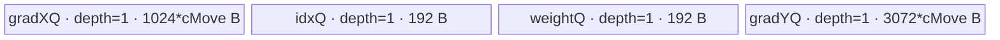

# ThreeInterpolateBackward A2/A3 ACLNN 算子知识

## 算子速览

| 项目 | 内容 |
|---|---|
| 实际入口 | 无版本后缀的两段式公开接口 `aclnnThreeInterpolateBackwardGetWorkspaceSize` / `aclnnThreeInterpolateBackward`（ACLNN） |
| 计算语义 | 对每个 `(b,c,n)` 与三个邻点 `i`，执行 `grad_y[b,c,idx[b,n,i]] += grad_x[b,c,n] * weight[b,n,i]` |
| 输入输出 | 公开视图：`grad_x [B,C,N]`、`idx/weight [B,N,3]`、`grad_y [B,C,M]`；算子自有 Kernel 使用 `NC1HWC0`，`C0=16` |
| 执行类型 | 算子自有节点为单 `AIV_VECTOR` Kernel；公开 executor 前后另有通用 `Contiguous`、`TransDataSpecial`、`ViewCopy` 框架边界 |
| Kernel 路线 | R-001/R-003：FP32 按 N 轴分核；R-002/R-004：FP32 按 B 轴分核；R-005/R-006：FP16 强制按 B 轴分核；INT32/INT64 索引分别实例化 |
| 核心资源 | GM、四个 depth=1 的 `TQue`、Vector `Muls`、原子 GM `DataCopy`；Tiling 声明 16 MiB system workspace，但算子 body 不使用 user workspace |
| 来源闭包 | `source_closed`：公开 ACLNN→L0 launcher→Tiling/POD→四个 key/router→单 AIV body 与 A2/A3 binary 接线闭合；通用布局转换仅闭合到公开框架声明边界 |
| 验证状态 | 已完成源码闭包检查；本次知识提取未执行编译、真机、数值或性能测试。 |

## 接口与语义

### 计算语义

令 `grad_x` 的逻辑域为 `[B,C,N]`，`idx` 与 `weight` 为 `[B,N,3]`，属性 `m=M` 决定输出最后一维。输出先清零，再对 `b∈[0,B)`、`c∈[0,C)`、`n∈[0,N)`、`i∈{0,1,2}` 做散射累加：

```text
grad_y[b,c,idx[b,n,i]] += grad_x[b,c,n] * weight[b,n,i]
```

Kernel 内部把通道变为 `C1×C0`，其中固定 `C0=16`；每个 `n` 先生成三个 `C0` 向量乘积，再以 `SetAtomicAdd<dataType>()` 写到三个索引位置。相同索引或不同核的冲突依赖 GM 原子加，因此公开文档明确该接口默认非确定性且不支持开启确定性实现。

### 输入、输出与属性

| 参数 | shape/layout | dtype | 约束、默认值与语义 |
|---|---|---|---|
| `grad_x` | 公开文档 `[B,C,N]`、NCHW；L2 转为 storage `[B,C1,N,1,16]`、NC1HWC0 | FLOAT32/FLOAT16 | 非空路径进入计算；提供被加权的上游梯度 |
| `idx` | `[B,N,3]`、ND | INT32/INT64 | 文档要求非空且值 `<m`；源码仅检查 dtype，未检查值域与 shape |
| `weight` | `[B,N,3]`、ND | FLOAT32/FLOAT16 | binary/OpDef 只接线与 `grad_x` 同 dtype 的组合；L2 检查仅验证其 dtype 属于支持集合，未显式验证相等 |
| `m` | 标量属性 | C `int` / Host attr `int` | 决定输出 M 轴；固定源码未显式校验正值或与 `idx` 值域关系 |
| `grad_y` | 文档 `[B,C,M]`、NCHW；L0 中间 view 实际构造成 `[B,C,M,1]`，storage `[B,C1,M,1,16]` | FLOAT32/FLOAT16 | 中间 tensor dtype 取 `grad_x`；L2 未显式检查调用者输出 dtype/shape，最终由 `ViewCopy` 边界交付 |

### 入口与版本

固定 Commit 只有无版本后缀的公开 `aclnnThreeInterpolateBackward*` 两段式接口，没有更新的 `V2/V3` 入口。第一段创建 executor、做有限校验并编排节点，第二段调用 `CommonOpExecutorRun` 在传入 stream 上执行。README 与 ACLNN 文档均公开支持 Atlas A2、Atlas A3，明确将 Ascend 950PR/950DT 标为不支持；OpDef、binary config 与 `ascendc_config.json` 分别接线 `ascend910b`、`ascend910_93`，与公开支持表一致。

## Host/Launcher 执行流程

### 参数校验与前处理

`aclnnThreeInterpolateBackwardGetWorkspaceSize` 的真实顺序如下：

1. `OP_CHECK_COMM_INPUT` 检查 `workspaceSize` 与 `executor` 输出指针；创建 `aclOpExecutor`。
2. `CheckParams` 检查四个 tensor 指针非空；只检查 `grad_x/weight∈{FLOAT,FLOAT16}` 与 `idx∈{INT32,INT64}`。它不检查 `grad_y` dtype，也不检查 shape、`m`、索引值域或 `grad_x==weight` dtype。
3. 任一 `grad_x/idx/weight` 为空 tensor 时直接返回 `workspaceSize=0` 和空计算 executor，不启动 Kernel，也没有源码可见的 `grad_y` 写入。
4. 非空路径按顺序加入 `Contiguous(grad_x)`、`Contiguous(idx)`、`Contiguous(weight)`；`idx_contiguous` 后的空指针检查误用了 `grad_x_contiguous`，这是固定源码的真实失败边界。
5. `TransDataSpecial(..., FORMAT_NC1HWC0, groups=0)` 把 `grad_x` 转为 5HD；`l0op::ThreeInterpolateBackward` 分配中间输出并加入算子自有 AIV launcher。
6. `TransDataSpecial(..., FORMAT_NCHW, groups=0)` 恢复公开布局，最后 `ViewCopy` 写入调用者 `grad_y`。

通用 `Contiguous/TransDataSpecial/ViewCopy` 的实际 Device router/body 位于固定仓外；固定仓只提供声明/测试 stub，故这里把它们保留为框架边界，不推测其 Kernel 数量、workspace 切片或执行族。

### 参数、Workspace 与生命周期

L0 `ThreeInterpolateBackward` 以 `grad_x` storage shape 生成 `[B,C1,m,1,16]`，以 view shape 生成 `[B,C,m,1]`，dtype/storage format 继承 `grad_x`，中间 tensor 由 executor 持有。`ADD_TO_LAUNCHER_LIST_AICORE` 把三输入、输出和 attr `m` 加入 launcher。

算子 Tiling 固定 `context->GetWorkspaceSizes(1)[0]=16*1024*1024` 字节。entry 要求原始 `workspace` 与 `GetUserWorkspace(workspace)` 均非空，但 `user_ws` 只传入 `Init`，body 没有绑定或读写它；因此不存在算子自有 producer→consumer workspace slice。整个 executor 的实际 workspace 还可能包含三个 `Contiguous`、两个 `TransDataSpecial` 和 `ViewCopy` 的框架需求，最终总量只由 `uniqueExecutor->GetWorkspaceSize()` 在运行时给出，固定仓无法分解。

### 启动图与失败传播

```text
ACLNN phase 1 / executor owner
  -> Contiguous(grad_x), Contiguous(idx), Contiguous(weight)       [框架边界，可按输入连续性退化为 view]
  -> TransDataSpecial(grad_x, NC1HWC0, groups=0)                  [框架布局转换边界]
  -> ThreeInterpolateBackwardAicore                               [算子自有单 AIV Kernel]
       entry: three_interpolate_backward
       blockDim: used_core_num
       POD: ThreeInterpolateBackwardTilingData
       GM edge: grad_x_5d/idx/weight -> out_5d
  -> TransDataSpecial(out_5d, NCHW, groups=0)                     [框架布局转换边界]
  -> ViewCopy(out_4d, grad_y)                                     [框架边界]
ACLNN phase 2: CommonOpExecutorRun(workspace, size, executor, stream)
```

所有节点由同一 executor 按加入顺序提交到传入 stream；中间 tensor 与 framework workspace 由 executor 生命周期持有。L2 每步返回空指针即停止构图并返回错误；第二段的精确逐节点运行失败清理策略属于 `CommonOpExecutorRun` 外部边界。算子自有节点内部先由 block 0 清零全部输出，再 `SyncAll()`，随后各核计算；binary config 的 `auto_sync=true` 是该跨核同步的构建接线。entry 遇到空 workspace/user workspace 直接返回且不写输出，未知 key 也静默无 body。

## Route 与参数设计

### 分核与资源计算

记 `A=GetCoreNumAiv()`，当 `context->GetDeterministic()==0` 时 `Aused=A`，否则 `Aused=1`；文档虽然声明不支持确定性配置，Tiling 仍保留此收缩逻辑。

- FP32 且 `B < 6N`：N 轴模式。`used=min(N,Aused)`，普通核处理 `q=floor(N/used)` 个 n，最后核处理 `N-q*(used-1)` 个 n；每个核遍历全部 B。
- FP32 且 `B >= 6N`：B 轴模式。`used=min(B,Aused)`，`batchBase=floor(B/used)`，前 `B mod used` 个核多处理一个 batch；每核的 N tile 域为完整 N。
- FP16：`force_multi_core_mode_1_flag=true`，无条件使用 B 轴模式。

每核 N tile 固定上限 `N0=16`：`loop=ceil(procN/16)`，普通 tile 16 个 n，尾 tile `procN-16*(loop-1)`。通道以 `c_move_num` 个 C1 分块，尾通道块为 `c_last_loop_move_num`。

Host 先按源码原式估计：

```text
sD = sizeof(DATA_T); sI = sizeof(IDX_T); U = UB bytes
weightBlocks = 3*16*sD/32
idxBlocks    = 3*16*sI/32
Ufree        = U - (weightBlocks + 3*16*16*sD)  # 源码原式混用了 block 数与 byte
cMove        = min(C1, floor(Ufree / (16*16*sD + 3*16*16*sD)))
Xbytes       = cMove*16*16*sD
Ybytes       = 3*Xbytes
actualTotal  = 3*16*sD + 3*16*sI + Xbytes + Ybytes
```

`cMove==0` 或 `actualTotal>U` 时 Tiling 失败。所有乘法与 shape 均窄化到 `uint32_t`；固定源码未做溢出检查。

### Route 选择

| 顺序 | Route | Key/模板 | 精确选择条件与优先级 | 不适用去向 |
|---:|---|---|---|---|
| 1 | R-001 FP32-INT32 N轴 | key 0 / `<float,int32_t>` | `grad_x=FLOAT && idx=INT32 && B<6N` | 同 key 的 R-002 |
| 2 | R-002 FP32-INT32 B轴 | key 0 / `<float,int32_t>` | `grad_x=FLOAT && idx=INT32 && B>=6N` | dtype 分支失败 |
| 3 | R-003 FP32-INT64 N轴 | key 1 / `<float,int64_t>` | `grad_x=FLOAT && idx=INT64 && B<6N` | 同 key 的 R-004 |
| 4 | R-004 FP32-INT64 B轴 | key 1 / `<float,int64_t>` | `grad_x=FLOAT && idx=INT64 && B>=6N` | dtype 分支失败 |
| 5 | R-005 FP16-INT32 B轴 | key 2 / `<half,int32_t>` | `grad_x=FLOAT16 && idx=INT32`；force flag 恒真 | dtype 分支失败 |
| 6 | R-006 FP16-INT64 B轴 | key 3 / `<half,int64_t>` | `grad_x=FLOAT16 && idx=INT64`；force flag 恒真 | 不支持 dtype→Tiling 失败 |

```text
if grad_x=float32 && idx=int32: key=0; mode = (B>=6*N ? B_AXIS : N_AXIS)
else if grad_x=float32 && idx=int64: key=1; mode = (B>=6*N ? B_AXIS : N_AXIS)
else if grad_x=float16 && idx=int32: key=2; mode = B_AXIS
else if grad_x=float16 && idx=int64: key=3; mode = B_AXIS
else: GRAPH_FAILED
then if cMove==0 || actualTotal>UB: GRAPH_FAILED
```

### 模板/实现执行矩阵

| Route | key/selector | dtype/shape/platform 完整命中条件 | 执行拓扑与 Kernel 节点 | 实际模板/body | 内存与同步特征 | tail/fallback |
|---|---|---|---|---|---|---|
| R-001 | 0 | FP32/INT32，`B<6N`，A2/A3 | 单 AIV；N 轴分核 | `KernelThreeInterpolateBackward<float,int32_t>` | idxQ 192 B；output 原子加；先清零/全核同步 | 最后一核与最后 N/C tile 单独计数；UB 不足失败 |
| R-002 | 0 | FP32/INT32，`B>=6N`，A2/A3 | 单 AIV；B 轴分核 | 同 key 0 模板，走 mode 1 | 同 R-001；batch 域无核间重叠，索引冲突仍在核内原子累加 | 前余数核多一个 batch |
| R-003 | 1 | FP32/INT64，`B<6N`，A2/A3 | 单 AIV；N 轴分核 | `KernelThreeInterpolateBackward<float,int64_t>` | idxQ 384 B；其余同 R-001 | 同 R-001 |
| R-004 | 1 | FP32/INT64，`B>=6N`，A2/A3 | 单 AIV；B 轴分核 | 同 key 1 模板，走 mode 1 | idxQ 384 B；其余同 R-002 | 同 R-002 |
| R-005 | 2 | FP16/INT32，A2/A3 | 单 AIV；强制 B 轴分核 | `KernelThreeInterpolateBackward<half,int32_t>` | idxQ 192 B；FP16 `Muls`/atomic，无升精度 | B/N 比例不改变 Route；batch tail |
| R-006 | 3 | FP16/INT64，A2/A3 | 单 AIV；强制 B 轴分核 | `KernelThreeInterpolateBackward<half,int64_t>` | idxQ 384 B；FP16 `Muls`/atomic，无升精度 | 同 R-005 |

### 隐藏性能 Guard

| Guard | Host/Tiling 条件 | Device/资源原因 | 影响 Route | 不满足时去向 | 源码符号 |
|---|---|---|---|---|---|
| AIV 核数 | `GetCoreNumAiv()>0` | `blockDim` 与分核除数必须非零 | 全部 | TilingParse 失败 | `TilingPrepare4ThreeInterpolateBackward` |
| UB 可用量 | `UB>0`、`cMove>0`、`actualTotal<=UB` | 四个 depth=1 Queue 必须同时分配 | 全部 | `GRAPH_FAILED`，无 fallback | `TilingProcess` |
| N tile | 固定 `N0=16` | Queue 与 Vector repeat stride 均按 16 n 槽位布局 | 全部 | 最后 tile 用 `*_last_loop_n_cnt` 限制有效计算/写回 | `TilingProcess/CopyIn/Compute/CopyOut` |
| C tail | `move_c_cnt = last ? c_last : cMove` | 最后 C1 chunk 只搬出有效通道；Vector 仍按计划 `cMove` repeats | 全部 | 无额外 Route | `CopyIn/Compute/CopyOut` |
| 输出清零同步 | block 0 `InitOutput` 后 `SyncAll()` | 原子加前所有核必须看到零基值 | 全部 | 无 fallback；构建需 `auto_sync=true` | `CleanOutputGm` / `ascendc_config.json` |
| workspace 非空 | `workspace!=nullptr && GetUserWorkspace(workspace)!=nullptr` | entry 即使不消费 user workspace，也以它作为启动前置 | 全部 | entry 静默返回 | `three_interpolate_backward` |
| dtype/key guard | key 0..3 | 决定 `dataType/idxType` 解释与 Queue 字节数 | 全部 | Host dtype 不支持则失败；未知 Device key 静默不执行 | `TilingMainProcess/three_interpolate_backward` |
| 32 B DMA | 所有 block size 使用 `/32`，`C0=16` | FP16 一个 C0 为 32 B，FP32 为 64 B；搬运 API 以 32 B block 计 | 全部 | 固定源码无 unaligned fallback | `TilingProcess/CopyIn/CopyOut` |

### POD/ABI

`ThreeInterpolateBackwardTilingData` 的字段全是 `uint32_t`。宏 `BEGIN_TILING_DATA_DEF/TILING_DATA_FIELD_DEF` 的实现不在固定仓，因此不能从固定源码严谨给出 `sizeof/alignof/offsetof`；下表以声明顺序标识 ABI 槽位，Host `SaveToBuffer` 与 Device `GET_TILING_DATA` 使用同名结构。

| 结构 | 字段 | 类型/位宽 | ABI 布局 | 单位 | Host/launcher producer | Device consumer | 边界 |
|---|---|---|---|---|---|---|---|
| `ThreeInterpolateBackwardTilingData` | `used_core_num` | uint32/32 | 顺序槽 0；精确 offset 不可见 | core | `min(B或N,Aused)` | blockDim、末核/批分配 | 必须 >0 |
| 同上 | `bs` | uint32/32 | 顺序槽 1 | batch | storage dim0 | 清零、B 循环/地址 | shape 窄化未检查 |
| 同上 | `c1` | uint32/32 | 顺序槽 2 | C1 | storage dim1 | 清零、C loop/地址 | 必须使 cMove>0 |
| 同上 | `ms` | uint32/32 | 顺序槽 3 | element | output storage dim2 | 输出 extent/stride | `m` 非法未显式拦截 |
| 同上 | `ns` | uint32/32 | 顺序槽 4 | element | input storage dim2 | 输入 extent/分核 | 非空 ACLNN 路径应 >0 |
| 同上 | `each_core_proc_num` | uint32/32 | 顺序槽 5 | n | N轴 `N/used`；B轴 `N` | 普通核/全部 B轴核 procN | N轴最后核不用此值作 procN |
| 同上 | `each_core_loop_times` | uint32/32 | 顺序槽 6 | loop | `ceil(eachProc/16)` | `core_loop_times` | 必须至少 1 |
| 同上 | `each_core_each_loop_n_cnt` | uint32/32 | 顺序槽 7 | n | 16 | 非尾 tile 有效 n | 常量 16 |
| 同上 | `each_core_last_loop_n_cnt` | uint32/32 | 顺序槽 8 | n | `eachProc-16*(loop-1)` | 尾 tile | 1..16 |
| 同上 | `last_core_proc_num` | uint32/32 | 顺序槽 9 | n | N轴余数；B轴 `N` | N轴最后核 | B轴虽写入但 mode1 不读 |
| 同上 | `last_core_loop_times` | uint32/32 | 顺序槽 10 | loop | `ceil(lastProc/16)` | N轴最后核 | B轴 inactive |
| 同上 | `last_core_each_loop_n_cnt` | uint32/32 | 顺序槽 11 | n | 16 | N轴最后核非尾 tile | B轴 inactive |
| 同上 | `last_core_last_loop_n_cnt` | uint32/32 | 顺序槽 12 | n | `lastProc-16*(loop-1)` | N轴最后核尾 tile | B轴 inactive |
| 同上 | `weight_move_block_size` | uint32/32 | 顺序槽 13 | 32 B block | `3*16*sD/32` | weightQ `InitBuffer` | 48 个 weight 元素 |
| 同上 | `idx_move_block_size` | uint32/32 | 顺序槽 14 | 32 B block | `3*16*sI/32` | idxQ `InitBuffer` | 48 个 index 元素 |
| 同上 | `grad_x_move_block_size` | uint32/32 | 顺序槽 15 | 32 B block | `cMove*16*16*sD/32` | gradXQ `InitBuffer` | 计划 C chunk 容量 |
| 同上 | `grad_y_move_block_size` | uint32/32 | 顺序槽 16 | 32 B block | `3*gradXBlocks` | gradYQ `InitBuffer` | 三邻点乘积容量 |
| 同上 | `c_move_num` | uint32/32 | 顺序槽 17 | C1 | UB 公式后 `min(...,c1)` | Vector repeat、地址/容量 | 尾 C loop 仍作 repeatTimes |
| 同上 | `c_last_loop_move_num` | uint32/32 | 顺序槽 18 | C1 | `c1-cMove*(cLoops-1)` | 最后 C loop DMA blockCount | 1..cMove |
| 同上 | `c_move_loop_times` | uint32/32 | 顺序槽 19 | loop | `ceil(c1/cMove)` | C 外层循环 | cMove=0 时 Host 失败 |
| 同上 | `mulit_core_mode` | uint32/32 | 顺序槽 20 | enum | N轴=0，B轴=1 | `Init/Process` 路由 | 拼写是固定 ABI |
| 同上 | `each_core_proc_batch_num` | uint32/32 | 顺序槽 21 | batch | B轴 `B/used` | mode1 batch 分配 | N轴未显式赋值且不读 |
| 同上 | `core_proc_batch_padding_idx` | uint32/32 | 顺序槽 22 | core index | B轴 `B%used` | mode1 前缀余数分配 | N轴未显式赋值且不读 |
| 同上 | `rsv` | uint32/32 | 顺序槽 23 | N/A | 固定源码未显式赋值 | Device 不读 | 保留 ABI 字段 |

### Route 源码闭包

| Route | Key/selector | Host/Tiling producer | POD/参数 | Kernel entry/router 节点 | Kernel body/直接依赖 | 构建接线 |
|---|---|---|---|---|---|---|
| R-001/R-002 | key 0 | `three_interpolate_backward_tiling.cpp::TilingMainProcess/TilingProcess<float,int32_t>` | `ThreeInterpolateBackwardTilingData` | `three_interpolate_backward` key 0 | `KernelThreeInterpolateBackward<float,int32_t>` 全部方法 | ascend910b/ascend910_93 binary JSON + `ascendc_config.json` |
| R-003/R-004 | key 1 | `TilingProcess<float,int64_t>` | 同 POD，idx block 较大 | entry key 1 | `KernelThreeInterpolateBackward<float,int64_t>` | 同上 |
| R-005 | key 2 | `TilingProcess<uint16_t,int32_t>(...,true)` | 同 POD，FP16 block 较小 | entry key 2 | `KernelThreeInterpolateBackward<half,int32_t>` | 同上 |
| R-006 | key 3 | `TilingProcess<uint16_t,int64_t>(...,true)` | 同 POD | entry key 3 | `KernelThreeInterpolateBackward<half,int64_t>` | 同上 |

## Kernel 实现

### 公共执行流程

四个 key 都进入单个 `three_interpolate_backward` entry：先验证 workspace，解析 POD，再实例化对应 `<dataType,idxType>`。`Init` 根据 `mulit_core_mode` 绑定 GM 基址与本核域，block 0 清零 `B*C1*M*16` 个输出元素并 `SyncAll`，随后初始化四个 depth=1 Queue。`Process` 按 B/C-chunk/N-tile 三层域循环，每 tile 依次 `CopyIn→Compute→CopyOut`。

`CopyIn` 把最多 `cMove×16×16` 个 grad_x、固定 48 个 idx 与固定 48 个 weight 搬入 UB。`Compute` 对每个有效 n 读取三个标量权重，以 `Muls(mask=16, repeatTimes=cMove)` 同时处理多个 C1。`CopyOut` 只遍历有效 n 与有效 C1，读取三个 idx，开启 `SetAtomicAdd<dataType>()`，用三次 UB→GM `DataCopy` 完成散射累加，每次后用 `PipeBarrier<PIPE_MTE3>()`，最后关闭 atomic。

### Route R-001：FP32-INT32 N轴

#### 适用条件

##### 选择证据

| 层级 | 文件 | 符号 | 源码谓词/参数 | 结果/下一跳 |
|---|---|---|---|---|
| ACLNN | `op_host/op_api/aclnn_three_interpolate_backward.cpp` | `CheckDtypeValid` | grad_x/weight 支持 FLOAT，idx 支持 INT32 | 加入 L0 节点 |
| Tiling | `op_host/three_interpolate_backward_tiling.cpp` | `TilingMainProcess` | `grad_x==DT_FLOAT && idx==DT_INT32` | key 0 |
| Tiling | 同上 | `TilingProcess<float,int32_t>` | `B < 6*N` 且 force=false | `mulit_core_mode=0` |
| Router | `op_kernel/three_interpolate_backward.cpp` | `three_interpolate_backward` | `TILING_KEY_IS(0)` | `<float,int32_t>` |

#### Device 数据流

##### 函数级调用链

```text
ThreeInterpolateBackwardAicore -> three_interpolate_backward(key=0, blockDim=min(N,Aused))
  -> KernelThreeInterpolateBackward<float,int32_t>::Init
    -> InitMuiltCoreMode0 -> CleanOutputGm -> InitBuffer×4
  -> ProcessMuiltCoreMode0
    -> for each B/C-chunk/N-tile: CopyIn -> Compute(Muls×3 per n) -> CopyOut(atomic DataCopy×3 per n)
```

##### 源码等价伪码

```text
coreN0 = blockIdx * floor(N/used); procN = (lastCore ? N-coreN0 : floor(N/used))
bind grad_x += coreN0*16; idx += coreN0*3; weight += coreN0*3; bind grad_y at base 0
if blockIdx==0: zero grad_y[B*C1*M*16]; SyncAll()
for b in [0,B), cj in C1 chunks, nt in ceil(procN/16):
  validN = tail ? procN-16*(loops-1) : 16; validC = C-tail ? cLast : cMove
  CopyIn grad_x[b,cj,coreN0+nt*16], idx[b,coreN0+nt*16,:], weight[...] into fixed tile slots
  for n in [0,validN): for i in 0..2:
    gradYLocal[c-repeat,n,i,16] = gradXLocal[c-repeat,n,16] * weightLocal[n,i]
  atomic-add only validC blocks to grad_y[b,c,idxLocal[n,i],16]
```

#### 内存与数据搬运

##### 资源与搬运表

| 层级/缓冲区 | offset/地址公式 | extent/容量公式 | dtype/layout | producer | consumer | owner/lifetime | 对齐/复用 |
|---|---|---|---|---|---|---|---|
| grad_x GM | base `coreN0*16`；tile `b*C1*16*N+cj*N*16*cMove+nt*16*16` | `B*C1*N*16` | FP32/NC1HWC0 | TransData boundary | CopyIn | executor tensor，全 Kernel | 32 B block；多 block copy |
| idx GM | base `coreN0*3`；tile `b*N*3+nt*16*3` | `B*N*3` | INT32/ND | caller/Contiguous | CopyIn/CopyOut | executor tensor | 固定搬 48 元素，尾部只消费 validN |
| weight GM | 同 idx 元素 offset | `B*N*3` | FP32/ND | caller/Contiguous | CopyIn/Compute | executor tensor | 固定搬 48 元素 |
| grad_y GM | `b*C1*M*16+cj*M*16*cMove+idx*16` | `B*C1*M*16` | FP32/NC1HWC0 | CleanOutput/atomic CopyOut | post TransData | executor tensor | 64 B/C0；atomic add |
| gradXQ | 0 | `cMove*16*16*4` B | FP32/tile | CopyIn | Muls | pipe，Alloc→EnQue→DeQue→Free | depth=1 |
| idxQ | 0 | `48*4=192` B | INT32 | CopyIn | CopyOut | 同上 | depth=1 |
| weightQ | 0 | `48*4=192` B | FP32 | CopyIn | scalar GetValue | 同上 | depth=1 |
| gradYQ | 0 | `3*cMove*16*16*4` B | FP32 | Muls | atomic CopyOut | 同上 | depth=1 |

##### 分层内存布局



##### 字节账与复用顺序

```text
UB_total = 1024*cMove + 192 + 192 + 3072*cMove
         = 4096*cMove + 384 bytes
UB_total <= platform UB (Host actualTotal guard)
dynamic_ub = N/A
workspace_total = 16 MiB system workspace；operator-owned user slice = 0
```

| 复用子区 | 写入者 | 读取者/消费点 | 下一次覆盖 | 同步或释放依据 | 安全条件 |
|---|---|---|---|---|---|
| 四个 Queue slot | `CopyIn`/`Compute` | `Compute`/`CopyOut` | 下一 tile | EnQue/DeQue/FreeTensor；depth=1 | 严格顺序 Process，释放后才能复用 |
| gradYQ 尾 C repeat | `Muls` 仍写 cMove repeats | CopyOut 只读 validC | 下一 tile | CopyOut 完成后 FreeTensor | 无效 repeat 不得写出 GM |

#### 同步、精度与尾块

##### 同步与数值边界表

| 阶段 | primitive/机制 | producer | consumer/等待点 | 保护对象 | 精度/尾块 |
|---|---|---|---|---|---|
| 输出初始化 | block0 `InitOutput` + `SyncAll` | block 0 | 全部 block | grad_y 零基值 | FP32 零值；覆盖全 storage extent |
| CopyIn→标量/Vector | Queue + `MTE2_S` event | MTE2 | scalar/vector | grad_x/weight UB | 固定 tile，Compute 只循环 validN |
| 标量权重→Muls | `S_V` event | scalar GetValue | Vector Muls | 三个 weight 标量 | FP32 乘法，不升精度 |
| UB→GM | `SetAtomicAdd<float>` + MTE3 barrier | gradYQ | GM | 三邻点输出 | validN×validC；同索引允许冲突，结果非确定 |

#### 关键实现

##### 符号证据表

| 阶段 | 文件 | 符号/模板实例 | 实现事实 |
|---|---|---|---|
| Host/Tiling producer | `op_host/three_interpolate_backward_tiling.cpp` | `TilingProcess<float,int32_t>` | N轴谓词、核数、tile、UB 公式 |
| Kernel entry/router | `op_kernel/three_interpolate_backward.cpp` | `three_interpolate_backward` key 0 | key→`<float,int32_t>` |
| Device body/helper | 同上 | `InitMuiltCoreMode0/CopyIn/Compute/CopyOut` | N轴地址、Vector repeat、原子 scatter 与 tail |

### Route R-002：FP32-INT32 B轴

#### 适用条件

##### 选择证据

| 层级 | 文件 | 符号 | 源码谓词/参数 | 结果/下一跳 |
|---|---|---|---|---|
| Tiling | `op_host/three_interpolate_backward_tiling.cpp` | `TilingMainProcess` | FLOAT/INT32 | key 0 |
| Tiling | 同上 | `TilingProcess<float,int32_t>` | `B>=6*N` | mode 1，`used=min(B,Aused)` |
| Router | `op_kernel/three_interpolate_backward.cpp` | `three_interpolate_backward` | key 0 | `<float,int32_t>` |

#### Device 数据流

##### 函数级调用链

```text
three_interpolate_backward(key=0)
  -> InitMuiltCoreMode1 (quotient/remainder batch partition) -> CleanOutputGm -> InitBuffer×4
  -> ProcessMuiltCoreMode1 -> ProcessEachBatch -> CopyIn -> Compute -> CopyOut
```

##### 源码等价伪码

```text
q=B/used; r=B%used
batchCount = blockIdx<r ? q+1 : q
batchStart = blockIdx<r ? blockIdx*(q+1) : r*(q+1)+(blockIdx-r)*q
bind all GM tensors at global base; procN=N
zero+SyncAll; for b in [batchStart,batchStart+batchCount): run common C/N tile pipeline
```

#### 内存与数据搬运

##### 资源与搬运表

| 层级/缓冲区 | offset/地址公式 | extent/容量公式 | dtype/layout | producer | consumer | owner/lifetime | 对齐/复用 |
|---|---|---|---|---|---|---|---|
| GM tensors | 全局 base；地址使用实际 `b` | 与 R-001 相同 | FP32/INT32 | executor | common pipeline | Kernel lifetime | batch 域互斥 |
| 四个 Queue | 0 | gradX `1024c`、idx 192、weight 192、gradY `3072c` B | 同 R-001 | CopyIn/Compute | Compute/CopyOut | tile lifetime | depth=1 |

##### 分层内存布局


##### 字节账与复用顺序

```text
UB_total = 4096*cMove + 384 bytes <= platform UB
dynamic_ub = N/A
workspace_total = 16 MiB system workspace；operator-owned user slice = 0
```

| 复用子区 | 写入者 | 读取者/消费点 | 下一次覆盖 | 同步或释放依据 | 安全条件 |
|---|---|---|---|---|---|
| Queue slots | 当前 batch/tile | Compute/CopyOut | 下一 batch/tile | FreeTensor | depth=1 严格串行 |

#### 同步、精度与尾块

##### 同步与数值边界表

| 阶段 | primitive/机制 | producer | consumer/等待点 | 保护对象 | 精度/尾块 |
|---|---|---|---|---|---|
| 初始化 | `InitOutput+SyncAll` | block0 | 所有 block | 全输出 | 同 R-001 |
| batch 分核 | 商余数连续分段 | Host POD | mode1 loops | B 轴 | 前 r 核多一 batch |
| scatter | FP32 atomic DataCopy | gradYQ | GM | 当前 batch | 不同核 batch 不重叠；核内重复 idx 仍原子 |

#### 关键实现

##### 符号证据表

| 阶段 | 文件 | 符号/模板实例 | 实现事实 |
|---|---|---|---|
| Host/Tiling producer | `op_host/three_interpolate_backward_tiling.cpp` | `TilingProcess<float,int32_t>` | `B>=6N` 选 B 轴与 batch 商余数 |
| Kernel entry/router | `op_kernel/three_interpolate_backward.cpp` | key 0 | FP32/INT32 模板 |
| Device body/helper | 同上 | `InitMuiltCoreMode1/ProcessMuiltCoreMode1` | batchStart/batchCount 地址域 |

### Route R-003：FP32-INT64 N轴

#### 适用条件

##### 选择证据

| 层级 | 文件 | 符号 | 源码谓词/参数 | 结果/下一跳 |
|---|---|---|---|---|
| Tiling | `op_host/three_interpolate_backward_tiling.cpp` | `TilingMainProcess` | FLOAT/INT64 | key 1 |
| Tiling | 同上 | `TilingProcess<float,int64_t>` | `B<6*N` | mode 0 |
| Router | `op_kernel/three_interpolate_backward.cpp` | key 1 | `TILING_KEY_IS(1)` | `<float,int64_t>` |

#### Device 数据流

##### 函数级调用链

```text
three_interpolate_backward(key=1) -> KernelThreeInterpolateBackward<float,int64_t>
  -> InitMuiltCoreMode0 -> CleanOutputGm -> ProcessMuiltCoreMode0 -> CopyIn/Compute/CopyOut
```

##### 源码等价伪码

```text
与 R-001 相同的 N 轴 core/b/c/n 地址；idx GM/UB/GetValue 使用 int64_t，idx tile 仍固定 48 元素。
```

#### 内存与数据搬运

##### 资源与搬运表

| 层级/缓冲区 | offset/地址公式 | extent/容量公式 | dtype/layout | producer | consumer | owner/lifetime | 对齐/复用 |
|---|---|---|---|---|---|---|---|
| idx GM/idxQ | 同 R-001 元素 offset | GM `B*N*3`；Queue `48*8=384` B | INT64/ND | CopyIn | CopyOut | tile | 32 B aligned |
| 其余 GM/Queue | 同 R-001 | gradX `1024c`、weight 192、gradY `3072c` B | FP32 | common pipeline | common pipeline | 同 R-001 | depth=1 |

##### 分层内存布局


##### 字节账与复用顺序

```text
UB_total = 4096*cMove + 576 bytes <= platform UB
dynamic_ub = N/A
workspace_total = 16 MiB system workspace；operator-owned user slice = 0
```

| 复用子区 | 写入者 | 读取者/消费点 | 下一次覆盖 | 同步或释放依据 | 安全条件 |
|---|---|---|---|---|---|
| idxQ 与其余 Queue | CopyIn/Compute | CopyOut | 下一 tile | FreeTensor | validN 限制 int64 索引消费 |

#### 同步、精度与尾块

##### 同步与数值边界表

| 阶段 | primitive/机制 | producer | consumer/等待点 | 保护对象 | 精度/尾块 |
|---|---|---|---|---|---|
| 全流程 | 同 R-001 | 同 R-001 | 同 R-001 | FP32 数据、INT64 索引 | N/C tail 与原子规则相同 |

#### 关键实现

##### 符号证据表

| 阶段 | 文件 | 符号/模板实例 | 实现事实 |
|---|---|---|---|
| Host/Tiling producer | `op_host/three_interpolate_backward_tiling.cpp` | `TilingProcess<float,int64_t>` | idx block=384 B，N轴谓词 |
| Kernel entry/router | `op_kernel/three_interpolate_backward.cpp` | key 1 | `<float,int64_t>` |
| Device body/helper | 同上 | mode0/CopyOut | INT64 `GetValue` 参与 GM offset |

### Route R-004：FP32-INT64 B轴

#### 适用条件

##### 选择证据

| 层级 | 文件 | 符号 | 源码谓词/参数 | 结果/下一跳 |
|---|---|---|---|---|
| Tiling | `op_host/three_interpolate_backward_tiling.cpp` | `TilingMainProcess` | FLOAT/INT64 | key 1 |
| Tiling | 同上 | `TilingProcess<float,int64_t>` | `B>=6*N` | mode 1 |
| Router | `op_kernel/three_interpolate_backward.cpp` | key 1 | `TILING_KEY_IS(1)` | `<float,int64_t>` |

#### Device 数据流

##### 函数级调用链

```text
three_interpolate_backward(key=1) -> <float,int64_t>::InitMuiltCoreMode1
  -> CleanOutputGm -> ProcessMuiltCoreMode1 -> common CopyIn/Compute/CopyOut
```

##### 源码等价伪码

```text
采用 R-002 的 batch 商余数分段；采用 R-003 的 INT64 idx 搬运与地址读取。
```

#### 内存与数据搬运

##### 资源与搬运表

| 层级/缓冲区 | offset/地址公式 | extent/容量公式 | dtype/layout | producer | consumer | owner/lifetime | 对齐/复用 |
|---|---|---|---|---|---|---|---|
| GM/Queue | 实际 batch 全局地址；idx 为 INT64 | `UB=4096c+576` B | FP32/INT64 | common pipeline | common pipeline | tile | depth=1、32 B |

##### 分层内存布局


##### 字节账与复用顺序

```text
UB_total = 4096*cMove + 576 bytes <= platform UB
dynamic_ub = N/A
workspace_total = 16 MiB system workspace；operator-owned user slice = 0
```

| 复用子区 | 写入者 | 读取者/消费点 | 下一次覆盖 | 同步或释放依据 | 安全条件 |
|---|---|---|---|---|---|
| Queue slots | 当前 batch/tile | Compute/CopyOut | 下一 batch/tile | FreeTensor | batch 域与 tile 严格串行 |

#### 同步、精度与尾块

##### 同步与数值边界表

| 阶段 | primitive/机制 | producer | consumer/等待点 | 保护对象 | 精度/尾块 |
|---|---|---|---|---|---|
| batch/tail/scatter | mode1 + Queue/event + atomic | Host/CopyIn/Compute | CopyOut/GM | FP32 输出、INT64 idx | 前余数核多 batch；N/C tail 同公共流程 |

#### 关键实现

##### 符号证据表

| 阶段 | 文件 | 符号/模板实例 | 实现事实 |
|---|---|---|---|
| Host/Tiling producer | `op_host/three_interpolate_backward_tiling.cpp` | `TilingProcess<float,int64_t>` | B轴与 INT64 Queue 容量 |
| Kernel entry/router | `op_kernel/three_interpolate_backward.cpp` | key 1 | `<float,int64_t>` |
| Device body/helper | 同上 | `InitMuiltCoreMode1/CopyOut` | batch 域、INT64 scatter offset |

### Route R-005：FP16-INT32 B轴

#### 适用条件

##### 选择证据

| 层级 | 文件 | 符号 | 源码谓词/参数 | 结果/下一跳 |
|---|---|---|---|---|
| Tiling | `op_host/three_interpolate_backward_tiling.cpp` | `TilingMainProcess` | FLOAT16/INT32 | key 2，调用 `TilingProcess<uint16_t,int32_t>(...,true)` |
| Tiling | 同上 | `TilingProcess` | force flag=true，短路 `B>=6N` | mode 1 |
| Router | `op_kernel/three_interpolate_backward.cpp` | key 2 | `TILING_KEY_IS(2)` | `<half,int32_t>` |

#### Device 数据流

##### 函数级调用链

```text
three_interpolate_backward(key=2) -> KernelThreeInterpolateBackward<half,int32_t>
  -> InitMuiltCoreMode1 -> CleanOutputGm -> ProcessMuiltCoreMode1 -> CopyIn/Compute/CopyOut
```

##### 源码等价伪码

```text
按 R-002 的 B 轴 batch 分段；每个 C0=16 的 FP16 向量为 32 B。
Muls 与 SetAtomicAdd 都直接使用 half，不做 FP32 中间累加或 cast。
```

#### 内存与数据搬运

##### 资源与搬运表

| 层级/缓冲区 | offset/地址公式 | extent/容量公式 | dtype/layout | producer | consumer | owner/lifetime | 对齐/复用 |
|---|---|---|---|---|---|---|---|
| gradXQ | 0 | `cMove*16*16*2=512c` B | FP16 | CopyIn | Muls | tile | depth=1 |
| idxQ | 0 | 192 B | INT32 | CopyIn | CopyOut | tile | depth=1 |
| weightQ | 0 | `48*2=96` B | FP16 | CopyIn | scalar/Muls | tile | depth=1 |
| gradYQ | 0 | `3*cMove*16*16*2=1536c` B | FP16 | Muls | atomic CopyOut | tile | depth=1 |
| GM | 与 mode1 公共地址式相同 | 输入/输出逻辑 extent | FP16/INT32 | executor | Kernel | Kernel lifetime | C0 恰为一个 32 B block |

##### 分层内存布局


##### 字节账与复用顺序

```text
UB_total = 2048*cMove + 288 bytes <= platform UB
dynamic_ub = N/A
workspace_total = 16 MiB system workspace；operator-owned user slice = 0
```

| 复用子区 | 写入者 | 读取者/消费点 | 下一次覆盖 | 同步或释放依据 | 安全条件 |
|---|---|---|---|---|---|
| Queue slots | 当前 tile | Compute/CopyOut | 下一 tile | FreeTensor | FP16 结果写回完成后再复用 |

#### 同步、精度与尾块

##### 同步与数值边界表

| 阶段 | primitive/机制 | producer | consumer/等待点 | 保护对象 | 精度/尾块 |
|---|---|---|---|---|---|
| Compute | `Muls<half>` | FP16 grad_x/weight | gradYQ | 三邻点乘积 | 无 FP32 升精度，round 行为由 half primitive 定义边界 |
| Scatter | `SetAtomicAdd<half>` | gradYQ | GM | FP16 累加 | 次序非确定；B/N 比不改变 B轴 Route |
| tail | validN/validC | Tiling POD | loops/CopyOut | 无效 tile 槽 | 只提交有效范围 |

#### 关键实现

##### 符号证据表

| 阶段 | 文件 | 符号/模板实例 | 实现事实 |
|---|---|---|---|
| Host/Tiling producer | `op_host/three_interpolate_backward_tiling.cpp` | `TilingProcess<uint16_t,int32_t>(...,true)` | FP16 强制 B轴与 UB 字节 |
| Kernel entry/router | `op_kernel/three_interpolate_backward.cpp` | key 2 | `<half,int32_t>` |
| Device body/helper | 同上 | `Compute/CopyOut` | half Muls 与 half atomic add |

### Route R-006：FP16-INT64 B轴

#### 适用条件

##### 选择证据

| 层级 | 文件 | 符号 | 源码谓词/参数 | 结果/下一跳 |
|---|---|---|---|---|
| Tiling | `op_host/three_interpolate_backward_tiling.cpp` | `TilingMainProcess` | FLOAT16/INT64 | key 3，`TilingProcess<uint16_t,int64_t>(...,true)` |
| Tiling | 同上 | `TilingProcess` | force=true | mode 1 |
| Router | `op_kernel/three_interpolate_backward.cpp` | key 3 | `TILING_KEY_IS(3)` | `<half,int64_t>` |

#### Device 数据流

##### 函数级调用链

```text
three_interpolate_backward(key=3) -> KernelThreeInterpolateBackward<half,int64_t>
  -> InitMuiltCoreMode1 -> CleanOutputGm -> ProcessMuiltCoreMode1 -> CopyIn/Compute/CopyOut
```

##### 源码等价伪码

```text
采用 R-005 的 FP16/B轴计算与 R-004 的 INT64 idx 读取；只对 validN×validC 执行 GM scatter。
```

#### 内存与数据搬运

##### 资源与搬运表

| 层级/缓冲区 | offset/地址公式 | extent/容量公式 | dtype/layout | producer | consumer | owner/lifetime | 对齐/复用 |
|---|---|---|---|---|---|---|---|
| gradXQ/weightQ/gradYQ | 0 | `512c` / 96 / `1536c` B | FP16 | CopyIn/Muls | Muls/CopyOut | tile | depth=1 |
| idxQ | 0 | 384 B | INT64 | CopyIn | CopyOut | tile | depth=1 |
| GM | mode1 全局 base | 逻辑 extent | FP16/INT64 | executor | Kernel | Kernel lifetime | 32 B DMA blocks |

##### 分层内存布局


##### 字节账与复用顺序

```text
UB_total = 2048*cMove + 480 bytes <= platform UB
dynamic_ub = N/A
workspace_total = 16 MiB system workspace；operator-owned user slice = 0
```

| 复用子区 | 写入者 | 读取者/消费点 | 下一次覆盖 | 同步或释放依据 | 安全条件 |
|---|---|---|---|---|---|
| Queue slots | 当前 tile | Compute/CopyOut | 下一 tile | FreeTensor | validN 限定 idx 消费，MTE3 完成后释放输出 |

#### 同步、精度与尾块

##### 同步与数值边界表

| 阶段 | primitive/机制 | producer | consumer/等待点 | 保护对象 | 精度/尾块 |
|---|---|---|---|---|---|
| 全流程 | mode1 + half Muls/atomic + INT64 GetValue | Host/CopyIn/Compute | CopyOut/GM | FP16 输出 | 与 R-005 相同的精度和 tail，idx 宽度不同 |

#### 关键实现

##### 符号证据表

| 阶段 | 文件 | 符号/模板实例 | 实现事实 |
|---|---|---|---|
| Host/Tiling producer | `op_host/three_interpolate_backward_tiling.cpp` | `TilingProcess<uint16_t,int64_t>(...,true)` | FP16/INT64 容量与 B轴 |
| Kernel entry/router | `op_kernel/three_interpolate_backward.cpp` | key 3 | `<half,int64_t>` |
| Device body/helper | 同上 | `Compute/CopyOut` | half 计算、INT64 地址、atomic tail |

## 算子特定优化

### Trick T-001：FP32 按 B/N 比例切换分核，FP16 固定 B 轴

#### 触发与源码依据

- 适用 Route：R-001～R-006
- 触发条件：FP32 使用 `B>=6*N` 选择 B 轴，否则 N 轴；FP16 的 force flag 令条件恒真。
- Golden 来源：[`image/three_interpolate_backward/op_host/three_interpolate_backward_tiling.cpp:104-116`](../../../../../../../cann-ops-raw/ascendc/ops-cv/bb717d075d129fd1fc7b96b2886824a1d153ed2f/image/three_interpolate_backward/op_host/three_interpolate_backward_tiling.cpp#L104-L116)

**官方源码（固定 Commit 连续逐字摘录）**：

```cpp
if (tiling_host.get_bs() >= RATIO_TILING * tiling_host.get_ns() || force_multi_core_mode_1_flag) {
    tiling_host.set_mulit_core_mode(static_cast<uint32_t>(MULTI_CORE_MODE::MOLTI_CORE_MODE_B_AXIS));
    tiling_host.set_used_core_num((tiling_host.get_bs() <= aicore_num) ? tiling_host.get_bs() : aicore_num);
    tiling_host.set_each_core_proc_batch_num(tiling_host.get_bs() / tiling_host.get_used_core_num());
    tiling_host.set_core_proc_batch_padding_idx(tiling_host.get_bs() % tiling_host.get_used_core_num());
    tiling_host.set_each_core_proc_num(tiling_host.get_ns());
    tiling_host.set_last_core_proc_num(tiling_host.get_ns());
} else {
    tiling_host.set_mulit_core_mode(static_cast<uint32_t>(MULTI_CORE_MODE::MOLTI_CORE_MODE_N_AXIS));
    tiling_host.set_used_core_num((tiling_host.get_ns() <= aicore_num) ? tiling_host.get_ns() : aicore_num);
    tiling_host.set_each_core_proc_num(tiling_host.get_ns() / tiling_host.get_used_core_num());
    tiling_host.set_last_core_proc_num(
        tiling_host.get_ns() - tiling_host.get_each_core_proc_num() * (tiling_host.get_used_core_num() - 1));
}
```

#### 机制与设计原因

B 很大时按 batch 分核，每个核持有完整 N 域，避免 N 太短导致 `min(N,AIV)` 限制并行核数；B 较小时 FP32 按 N 分核，让所有 batch 复用同一核的 N 子域。FP16 Host 调用把 force flag 设为 true，避免进入 N 轴模板分支。该选择改变 core→数据域映射与 GM 基址，而不改变单 Kernel 拓扑。

#### 迁移边界

- 适用：输出按 batch 相互独立、N 轴也可切分的 scatter/backward 类算子。
- 前提：B 轴分核时 batch 间输出不重叠；N 轴分核时必须有跨核原子或等价归并。
- 失效：若没有原子写回，N 轴分核会产生写冲突；若 B 与 N 均不足，则没有源码 fallback。
- 未验证：本次知识提取未执行编译、真机、数值或性能测试。

#### 错误做法

固定仓提供的真实边界是：忽略 N 轴写冲突而移除 atomic 会破坏重复索引/跨核累加；固定仓未提供性能反例或真机阈值验证。

### Trick T-002：一次搬入一个 N tile，沿 C1 repeat 复用 idx 与三个权重

#### 触发与源码依据

- 适用 Route：全部 Route
- 触发条件：每个 N tile 最多 16 个 n，通道 chunk 为 `c_move_num`；对每个 n 的三个权重分别执行一次跨 C1 repeat 的 `Muls`。
- Golden 来源：[`image/three_interpolate_backward/op_kernel/three_interpolate_backward.cpp:258-287`](../../../../../../../cann-ops-raw/ascendc/ops-cv/bb717d075d129fd1fc7b96b2886824a1d153ed2f/image/three_interpolate_backward/op_kernel/three_interpolate_backward.cpp#L258-L287)

**官方源码（固定 Commit 连续逐字摘录）**：

```cpp
auto compute_n_cnt =
    (n0_idx != this->core_loop_times - 1) ? this->core_each_loop_n_cnt : this->core_last_loop_n_cnt;

UnaryRepeatParams compute_repeat_info;
compute_repeat_info.dstBlkStride = 1;
compute_repeat_info.srcBlkStride = 1;
compute_repeat_info.srcRepStride = this->compute_src_rep_stride_blk_size;
compute_repeat_info.dstRepStride = this->compute_dst_rep_stride_blk_size;
WaitFlag<HardEvent::MTE2_S>(EVENT_ID3);
for (auto n_idx = 0u; n_idx < compute_n_cnt; n_idx++) {
    auto idx = static_cast<decltype(n_idx)>(3) * n_idx;
    auto weight0 = weight_local.GetValue(idx + 0);
    auto weight1 = weight_local.GetValue(idx + 1);
    auto weight2 = weight_local.GetValue(idx + 2);
```

#### 机制与设计原因

每个 `(n,i)` 的 weight 只从 weightQ 取一次标量，`Muls` 的 `mask=16` 覆盖 C0，`repeatTimes=c_move_num` 覆盖多个 C1。`srcRepStride=N0*C0*sizeof(dataType)/32` 跨过 gradXQ 中一个 C1 的 16-n 槽，`dstRepStride=3*N0*C0*sizeof(dataType)/32` 跨过 gradYQ 中该 C1 的三邻点槽。这样 idx/weight tile 不随通道重复搬入；最后 C chunk 即使不足，Vector 仍计算计划 repeats，但 CopyOut 只提交 `move_c_cnt` 个有效 C1。

#### 迁移边界

- 适用：索引/系数沿通道共享、通道内 C0 连续的点式 scatter/gather。
- 前提：UB 能同时容纳 `gradXQ+idxQ+weightQ+gradYQ`，布局 stride 必须保持 16-n 和三邻点槽约定。
- 失效：C1 或 UB 公式使 `c_move_num==0` 时 Tiling 直接失败，无较小 fallback。
- 未验证：本次知识提取未执行编译、真机、数值或性能测试。

#### 错误做法

若把 `srcRepStride` 当元素数而不是 32 B block，或在最后 C chunk 把 CopyOut blockCount 仍设为 `c_move_num`，会读错通道或写出无效通道；固定仓未提供可验证的性能反例。

### Trick T-003：输出一次清零后直接原子散射，避免中间归并 workspace

#### 触发与源码依据

- 适用 Route：全部 Route
- 触发条件：所有非空计算；block 0 先清零完整输出并跨核同步，每个 `(n,i)` 直接 atomic-add 到 GM。
- Golden 来源：[`image/three_interpolate_backward/op_kernel/three_interpolate_backward.cpp:316-333`](../../../../../../../cann-ops-raw/ascendc/ops-cv/bb717d075d129fd1fc7b96b2886824a1d153ed2f/image/three_interpolate_backward/op_kernel/three_interpolate_backward.cpp#L316-L333)

**官方源码（固定 Commit 连续逐字摘录）**：

```cpp
SetAtomicAdd<dataType>();
for (auto n_idx = 0u; n_idx < move_n_cnt; n_idx++) {
    auto idx = static_cast<decltype(n_idx)>(3) * n_idx;
    auto grad_y_addr_offset_0 = grad_y_start_addr_offset + idx_local.GetValue(idx + 0) * C0;
    auto grad_y_addr_offset_1 = grad_y_start_addr_offset + idx_local.GetValue(idx + 1) * C0;
    auto grad_y_addr_offset_2 = grad_y_start_addr_offset + idx_local.GetValue(idx + 2) * C0;

    SetFlag<HardEvent::S_V>(EVENT_ID2);
    WaitFlag<HardEvent::S_V>(EVENT_ID2);

    DataCopy(grad_y_gm[grad_y_addr_offset_0], grad_y_local[C0 * (idx + 0)], data_copy_params);
    PipeBarrier<PIPE_MTE3>();;
    DataCopy(grad_y_gm[grad_y_addr_offset_1], grad_y_local[C0 * (idx + 1)], data_copy_params);
    PipeBarrier<PIPE_MTE3>();;
    DataCopy(grad_y_gm[grad_y_addr_offset_2], grad_y_local[C0 * (idx + 2)], data_copy_params);
    PipeBarrier<PIPE_MTE3>();;
}
SetAtomicNone();
```

#### 机制与设计原因

scatter 目标可重复，N 轴 Route 还可能由不同核命中同一输出。直接 GM atomic-add 使每核只需保存当前 tile 的三个乘积，不需要为每核分配 `B*C1*M*C0` 的部分和及第二个归并 Kernel。三次 MTE3 后的 barrier 保证同一 tile 的 atomic 搬运依序完成；全局零初始化与 `SyncAll` 建立原子累加的共同初值。

#### 迁移边界

- 适用：冲突稀疏或必须正确累加的 scatter-add。
- 前提：平台支持目标 dtype 的 atomic DataCopy；构建保留 `auto_sync=true`；输出 extent 与 idx 值域合法。
- 失效：需要确定性次序时不能复用该方案；公开 API 明确无确定性实现。
- 未验证：本次知识提取未执行编译、真机、数值或性能测试。

#### 错误做法

源码可验证的错误边界是省略清零/跨核同步或在 MTE3 完成前关闭/复用 atomic 输出缓冲；固定仓未提供性能百分比或无冲突专用 Route。

## 模板与实现对比

| 对比维度 | R-001/R-003 FP32 N轴 | R-002/R-004 FP32 B轴 | R-005/R-006 FP16 B轴 | 设计选择依据 |
|---|---|---|---|---|
| 命中条件/优先级 | `B<6N` | `B>=6N` | dtype FP16，force=true | B 很大用 batch 并行，否则 FP32 用 N 并行 |
| 模板与 dtype | `<float,int32/int64>` | `<float,int32/int64>` | `<half,int32/int64>` | key 精确决定 data/idx 类型 |
| 循环与分核 | 每核 N 子域，遍历全部 B | 每核连续 B 子域，遍历全部 N | 同 B轴 | 输出冲突域与可用并行轴不同 |
| Queue/TBuf/寄存器/dynamic UB/通信 window | 四 Queue；idx 192/384 B | 同左 | data Queue 减半；idx 192/384 B | sD/sI 决定容量；无 TBuf/dynamic UB/通信 |
| 内存总占用与复用 | `4096c+384/576` B | 同左 | `2048c+288/480` B | depth=1，tile 后释放复用 |
| 搬运/Vector/SIMT/NDDMA/通信 API | DataCopy+Muls+atomic | 同左 | half DataCopy+Muls+atomic | 算子自有节点均 AIV_VECTOR |
| 同步、精度与 tail | 跨核 SyncAll，FP32 原子；末核/N/C tail | batch tail，FP32 原子 | batch tail，FP16 原子且无升精度 | dtype 与分核策略共同决定 |
| fallback/失败边界 | UB/key/workspace 失败，无 fallback | 同左 | 同左 | 单一 body 家族 |

## 平台差异

| 项目 | A2 | A3 | 950 |
|---|---|---|---|
| 支持状态 | 支持；公开表与 ascend910b 接线一致 | 支持；公开表与 ascend910_93 接线一致 | 公开 README/ACLNN 文档明确不支持，因此不创建 `_950` 卡 |
| Host/Launcher | 与 A3 共用 Tiling/entry；binary JSON 独立目录 | 与 A2 共用 Tiling/entry；binary JSON 独立目录 | N/A |
| Kernel/资源 | 同一四 key AIV body；AIV 核数与 UB 从平台运行时查询 | 同左 | N/A |

## 限制与失败边界

- 公开文档要求 `idx<m`，但 L2/Host/Tiling 均未验证；越界 idx 会直接进入 GM 地址公式。`m<=0`、shape 乘法溢出和 uint32 窄化也无显式 guard。
- L2 只验证 `grad_x/weight` 各自在支持 dtype 集合中，不验证二者相同；Kernel 以 `grad_x` key 的 `dataType` 解释 weight。`grad_y` dtype/shape 也没有 L2 显式检查，实际约束依赖框架边界。
- 文档称 idx/weight 不支持空 tensor，但源码对任一输入空 tensor 返回成功、workspace 0、空 executor；固定源码没有输出清零或写回。
- `idx_contiguous` 后的空指针检查错误地检查 `grad_x_contiguous`；真实 idx contiguous 失败传播依赖后续框架行为。
- idx 与 weight 每个尾 N tile 仍固定 `DataCopy(...,16*3)`，但只消费 validN；固定仓未证明输入分配尾后至少有 48 元素可读，不能把该 over-read 边界推测为安全 padding。
- Host 的初始 `Ufree` 表达式把 `weight_move_block_size`（32 B block 数）直接与 byte 相减，且未先检查无符号下溢；最终 `actualTotal<=UB` 只验证选定 cMove 的真实总量。没有更小 tile fallback。
- `CopyIn` 的 `DataCopyParams` 只显式设置 `blockCount/blockLen/dstStride`，固定源码未显式设置跨 C1 所需的 `srcStride`；其默认值及多 C1 语义属于 AscendC primitive 外部边界，卡中不推测补齐。
- entry 要求 system/user workspace 非空，尽管 body 不消费 user workspace；未知 key 或空 workspace 都静默返回。公共 executor 中 TransData/Contiguous/ViewCopy 的 Kernel 数、workspace 切片与失败清理在固定仓不可见。
- 本次知识提取未执行编译、真机、数值或性能测试。

## 源码索引

### 链路索引

| 链路阶段 | 文件 | 关键符号 | 支撑内容 |
|---|---|---|---|
| 入口声明/约束 | `image/three_interpolate_backward/docs/aclnnThreeInterpolateBackward.md` | 产品表、原型、参数与约束 | A2/A3 支持、950 不支持、语义/shape/dtype/非确定性 |
| 入口声明/约束 | `image/three_interpolate_backward/op_host/op_api/aclnn_three_interpolate_backward.h` | 两段式 ACLNN 原型 | 实际公开符号与参数 ABI |
| 入口实现 | `image/three_interpolate_backward/op_host/op_api/aclnn_three_interpolate_backward.cpp` | `CheckParams/GetWorkspaceSize/aclnnThreeInterpolateBackward` | 校验、空域、executor 节点顺序、workspace |
| L0 Launcher | `image/three_interpolate_backward/op_host/op_api/three_interpolate_backward.cpp` | `ThreeInterpolateBackward/Aicore` | 中间 shape、AllocTensor、AICore launcher |
| Host/POD | `image/three_interpolate_backward/op_host/three_interpolate_backward_tiling.h` | enum、CompileInfo、TilingData | key 与 24 字段 POD |
| Host/Tiling | `image/three_interpolate_backward/op_host/three_interpolate_backward_tiling.cpp` | `TilingProcess/Main/Prepare` | Route、分核、UB、workspace、blockDim |
| Kernel entry/body | `image/three_interpolate_backward/op_kernel/three_interpolate_backward.cpp` | `three_interpolate_backward`、`KernelThreeInterpolateBackward` | 四 key、mode0/1、Queue、Muls、atomic、tail |
| 平台注册 | `image/three_interpolate_backward/op_host/three_interpolate_backward_def.cpp` | `ThreeInterpolateBackward::AICore` | ascend910b/ascend910_93 与 dtype/format |
| binary 接线 | `image/three_interpolate_backward/op_host/config/ascend910b/three_interpolate_backward_binary.json` | 四个 `bin_filename` | A2 四 dtype key 二进制组合 |
| binary 接线 | `image/three_interpolate_backward/op_host/config/ascend910_93/three_interpolate_backward_binary.json` | 四个 `bin_filename` | A3 四 dtype key 二进制组合 |
| 构建接线 | `scripts/kernel/binary_config/ascendc_config.json` | `ThreeInterpolateBackward` entry | 两平台 compute_units 与 `auto_sync=true` |

### 实现复用检查

| 检查项 | 可复用事实 | 不得改变的约束 | 源码符号 |
|---|---|---|---|
| ABI/POD | 24 个 uint32 字段、key 0..3 与 mode 0/1 | 字段声明顺序、block/byte 单位、`mulit_core_mode` 拼写、inactive 字段不读 | `ThreeInterpolateBackwardTilingData/TilingType` |
| 调用顺序 | Contiguous×3→TransData→自有 Kernel→TransData→ViewCopy | 同 executor/stream 顺序，中间 tensor owner 不得提前释放 | `aclnnThreeInterpolateBackwardGetWorkspaceSize` |
| workspace/内存 | 四个 depth=1 Queue 与 16 MiB system workspace | Queue 真实分配容量、cMove guard、entry 非空 workspace 前置 | `TilingProcess/Init/three_interpolate_backward` |
| 同步 | block0 清零→SyncAll；Queue/event；atomic MTE3 barrier | `auto_sync=true`、atomic 关闭点、FreeTensor 时机 | `CleanOutputGm/Compute/CopyOut` |
| 精度与尾块 | FP32/FP16 原 dtype Muls 与 atomic；validN/validC 控制写出 | FP16 无升精度、最后 C chunk Vector repeat 仍是 cMove、只写 validC | `Compute/CopyOut` |
| 失败边界 | dtype/format/UB/Tiling 失败，无 fallback | 空输入成功但无写出；空 workspace/未知 key 静默返回；外部框架边界不可推测 | `CheckParams/Tiling4/three_interpolate_backward` |
