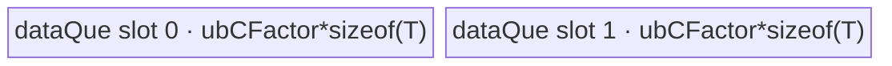
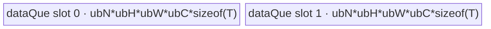

# UpsampleBicubic2d 950 ACLNN 算子知识

## 算子速览

| 项目 | 内容 |
|---|---|
| 实际入口 | `aclnnUpsampleBicubic2dGetWorkspaceSize` / `aclnnUpsampleBicubic2d`，公开 ACLNN 两段式接口；950 `IsRegBase()` 分支复用内部 `ResizeBicubicV2`。 |
| 计算语义 | 对 4D 图像做二维双三次 resize；通用路线用 `a=-0.75` 的三次核组合 H/W 两轴共 16 个采样点。 |
| 输入输出 | `self/out` 同 dtype、同 format；950 支持 FP16/FP32/BF16 与 NCHW/ND/NHWC，空间输出由 `outputSize=[outH,outW]` 指定。 |
| 执行类型 | 单 Kernel；R-001/R-002 为 `AIV_VECTOR` 数据搬运，R-003～R-006 为 `SIMT`；所有可达节点均无 Cube/AIC/MIX_CV。 |
| Kernel 路线 | R-001 全量复制；R-002 整数网格点复制；R-003 输出 1×1；R-004 输入 1×1；R-005 整数坐标；R-006 通用双三次。 |
| 核心资源 | GM、R-001/R-002 的 depth-2 `TQueBind` UB、SIMT 标量寄存器；SIMT 无 shared/dynamic UB；节点声明固定 16 MiB workspace 但 Kernel 不读取。 |
| 来源闭包 | `source_closed`：公开 ACLNN → RegBase Host 分支 → `ResizeBicubicV2` launcher → arch35 Tiling/POD/key → 全部 AIV/SIMT entry/body → ascend950 构建接线闭合。 |
| 验证状态 | 已完成源码闭包检查；本次知识提取未执行编译、真机、数值或性能测试。 |

## 接口与语义

### 计算语义

对输出元素 `(n,c,h,w)`，`alignCorners=false` 的源坐标为：

```text
srcH = (h + 0.5) * scaleH - 0.5
srcW = (w + 0.5) * scaleW - 0.5
```

`alignCorners=true` 时为 `srcH=h*scaleH`、`srcW=w*scaleW`。其中正的显式 scale 在 Tiling 中取倒数；未给正 scale 时用 `lenSrc/lenDes`；对齐角点且目标轴长大于 1 时用 `(lenSrc-1)/(lenDes-1)`。

R-006 取 `floor(src)` 周围四行四列并把越界索引 clamp 到 `[0,lenSrc-1]`。每轴系数由 `a=-0.75` 的 `CubicConvolution1/2` 产生；输入先转 FP32，先做四次 W 向 FP32 加权和，再做 H 向 FP32 加权，最后 `static_cast<T>` 写输出。其余 Route 只在三次插值严格退化为复制、广播或整数点采样时命中。

### 输入、输出与属性

| 参数 | shape/layout | dtype | 约束、默认值与语义 |
|---|---|---|---|
| `self` | 4D NCHW、ND（按 NCHW）或 NHWC | FP16/FP32/BF16 | N/C/H/W 有效域由 API/Tiling 校验；可非连续，先 `Contiguous`。 |
| `outputSize` | 长度 2，内部转为 INT32 ND Tensor | API 为 INT64 数组 | 两项均大于 0，且与 `out` H/W 一致；公开每维 `<=2^20` 保护 INT32 转换。 |
| `alignCorners` | 标量 | bool | `false` 为 half-pixel；`true` 为角点对齐。 |
| `scalesH/scalesW` | 标量 | API double，内部/Tiling float | 正值时公开约束要求 `output=floor(input*scale)`；非正值由 shape 推导。 |
| `out` | 与输入同 N/C、目标 H/W、同 format | 与 `self` 相同 | 可非连续，内部结果由 `ViewCopy` 提交。 |
| `workspaceSize/executor` | Host 输出 | `uint64_t*` / `aclOpExecutor**` | executor 持有前后处理、size Tensor、核心 Kernel 与临时 Tensor。 |

### 入口与版本

固定仓只公开 `aclnnUpsampleBicubic2d*` 这一版本族。公开 ACLNN 文档明确 950 支持；`GetWorkspaceSize` 在 `IsRegBase()` 为真时调用 `GetWorkspaceSizeRegBase`，后者只添加 950-only `ResizeBicubicV2` 核心节点。旧内部 `UpsampleBicubic2d` README 的 950 不支持不构成入口冲突，因为 950 ACLNN 不启动旧 Kernel；`ResizeBicubicV2` README、OpDef、CMake 和 binary config 均明确 ascend950 支持。

## Host/Launcher 执行流程

### 参数校验与前处理

1. 校验 `workspaceSize/executor`、`self/outputSize/out` 非空；950 dtype 为 FP16/FP32/BF16；输入输出 dtype/format 相同；format 属于 NCHW/NHWC/ND；输入输出均 4D；`outputSize` 长度为 2；C/H/W 与输出 H/W 为正且输出 shape 匹配。
2. `self->IsEmpty()` 时源码直接返回 `workspaceSize=0` 的 executor；公开文档仍声明不支持空 Tensor。
3. 分别对 `self` 与 `out` 建 `Contiguous` 节点，并将两个 double scale 窄化成 float 数组。
4. `l0op::ResizeBicubicV2` 将 `outputSize` 转为 INT32 Device Tensor，分配内部输出 `y`，通过 `ADD_TO_LAUNCHER_LIST_AICORE` 添加一个核心节点。
5. `ViewCopy(y,out)` 提交到用户输出；任一中间指针为空都中止第一段构造。

### 参数、Workspace 与生命周期

`ResizeBicubicV2Tiling::SetTilingData` 为核心节点声明固定 `16*1024*1024` 字节 workspace。entry 虽有 `workspace` 形参，但 router 和全部 body 均不读取；这一区域仍由 executor/framework 所有，不能由调用者复用。ACLNN 第一段返回整个 executor 的 `GetWorkspaceSize()`，还可能包含 `Contiguous/ViewCopy` 的框架临时区，固定仓未展开其切片总和。

size Tensor、连续输入、内部 `y`、POD 和临时节点均由 executor 持有到第二段 `CommonOpExecutorRun(...,stream)` 完成。节点按 executor 在同一 stream 上提交；通用 executor 的 event 细节属于框架边界。

### 启动图与失败传播

```text
aclnnUpsampleBicubic2dGetWorkspaceSize [IsRegBase]
  -> Contiguous(self)
  -> Contiguous(out)
  -> ConvertToTensor(outputSize, INT32)
  -> ResizeBicubicV2(x,size -> y)
       -> resize_bicubic_v2<schId,isInt32,isHalfPixel,isNchw>
          execution family = AIV_VECTOR or SIMT
          blockDim = realCoreNum
  -> ViewCopy(y -> out)
aclnnUpsampleBicubic2d(workspace,executor,stream)
  -> CommonOpExecutorRun
```

核心语义是单 Kernel，无跨 Kernel workspace 边。第一段任一校验、分配或 launcher 添加失败都会阻断后继节点；第二段由 `CommonOpExecutorRun` 返回执行状态。

## Route 与参数设计

### 分核与资源计算

公共 flat 分核以 `ySize=N*outH*outW*C` 个元素为域：

```text
realCoreNum = min(ySize, AIVCoreNum)
blkProcessNum = floor(ySize / realCoreNum)
splitBlockTailFactor = ySize - blkProcessNum * realCoreNum
```

前 `splitBlockTailFactor` 个 core 多处理一个元素；`blockDim=realCoreNum`。R-002 改用 `FindBest2DTiling(N,outH)` 先切 N/H，核数富余时再切 W/C。

Tiling 将 UB 转成 32B block 并预留 8 block：`ubBlockNum=ceil(UB_bytes/32)-8`。R-001 的单 slot 容量为 `ubCFactor=floor(ubBlockNum/2)*32/sizeof(T)` 个元素。R-002 的单 slot 目标上界为 `vol4AxisC=floor(ubBlockNum/2)*32/sizeof(T)` 个元素，并按 C→W→H→N 的顺序扩展 UB factor。两条 AIV Route 均 depth=2。

SIMT 若 `xSize,ySize<=UINT32_MAX` 且源/目标 H/W 均 `<=INT32_MAX`，取 `isInt32=1`、`uint32_t/int32_t` 与 512 threads；否则取 64 位索引与 256 threads。SIMT 无 dynamic UB、shared memory、barrier 或 atomic。

### Route 选择

| 顺序 | Route | Key/模板 | 精确选择条件与优先级 | 不适用去向 |
|---:|---|---|---|---|
| 1 | R-001 全量复制 | `(5,0,isHalfPixel,0)` | `outH==inH && outW==inW` | R-002 |
| 2 | R-002 整数网格点复制 | `(6,0,isHalfPixel,0)` | NHWC；`C*sizeof(T)>=128`；`scaleH>=1 && scaleW>=1`；align-corners 时两轴端点区间均整除，或 half-pixel 时两轴 scale 均为奇整数且与 `lenSrc/lenDes` 一致 | R-003 |
| 3 | R-003 输出 1×1 | `(3,isInt32,0,isNchw)` | `outH==1 && outW==1 && alignCorners=true` | R-004 |
| 4 | R-004 输入 1×1 | `(2,isInt32,isHalfPixel,isNchw)` | `inH==1 && inW==1`；R-003 优先 | R-005 |
| 5 | R-005 整数坐标 | `(4,isInt32,isHalfPixel,isNchw)` | align-corners 下 H/W scale 均为整数，或 half-pixel 下二者均为奇整数；排除前四条 Route | R-006 |
| 6 | R-006 通用双三次 | `(0,isInt32,isHalfPixel,isNchw)` | 其余合法输入 | 无 fallback；执行通用插值 |

```text
if H/W 完全不变: schId=5
else if NHWC 大通道且输出点严格落在整数采样网格: schId=6
else if outH=outW=1 and alignCorners: schId=3
else if inH=inW=1: schId=2
else if 坐标全部落在整数网格: schId=4
else: schId=0
then 依据元素数/维度上界选择 32/64 位索引；schId 5/6 强制 isInt32=0,isNchw=0
```

源码还有一个位于 `IsMatchAllCopy()` 之后的 `schId=1` 尺寸相等分支，因前序条件相同而 Host 不可达，不进入正式 Route。

### 模板/实现执行矩阵

| Route | key/selector | dtype/shape/platform 完整命中条件 | 执行拓扑与 Kernel 节点 | 实际模板/body | 内存与同步特征 | tail/fallback |
|---|---|---|---|---|---|---|
| R-001 | schId 5 | 950、合法 dtype/format、H/W 不变 | 单 AIV Kernel | `ResizeBicubicV2AllCopy<DTYPE_X,...>` | GM↔depth-2 `TQueBind`；queue 同步 | core 余数与最后 UB tile |
| R-002 | schId 6 | 950、NHWC、大 C、整数采样网格 | 单 AIV Kernel | `ResizeBicubicV2PointCopy<DTYPE_X,...>` | loop-mode 多维 DMA，经 depth-2 UB | N/H/W/C core/UB tail |
| R-003 | schId 3 | 输出 1×1、align-corners；NCHW/ND 或 NHWC；32/64 位 | 单 SIMT Kernel | `ResizeBicubicV2SimtNCHW/NHWC<...,mode=3,...>` | GM direct；512/256 threads | thread stride tail |
| R-004 | schId 2 | 输入 1×1；布局/half-pixel/索引子模板 | 单 SIMT Kernel | 同上，`mode=2` | GM direct | 同上 |
| R-005 | schId 4 | 整数源坐标；布局/half-pixel/索引子模板 | 单 SIMT Kernel | 同上，`mode=4` | GM direct、坐标 clamp | 同上 |
| R-006 | schId 0 | 其余；布局/half-pixel/索引子模板 | 单 SIMT Kernel | 同上，`mode=0` + `ComputeNchwMode0/ComputeNhwcMode0` | 16 GM load、FP32 标量计算、1 store | clamp 与 thread tail |

NCHW 与 NHWC 使用不同地址 body，32/64 位索引使用不同 `asc_vf_call` specialization；上表用一个 Route 行保留同一 `schId` 语义族，并逐项列出全部子模板，不把它们误当作相同 TilingKey。

### 隐藏性能 Guard

| Guard | Host/Tiling 条件 | Device/资源原因 | 影响 Route | 不满足时去向 | 源码符号 |
|---|---|---|---|---|---|
| 950 平台 | ACLNN `IsRegBase()`；构建 `SUPPORT_COMPUTE_UNIT=ascend950` | 选择 arch35 AIV-only Kernel | 全部 | 非本卡平台路线 | ACLNN `GetWorkspaceSize`; `resize_bicubic_v2/CMakeLists.txt` |
| UB 保留 | `ubBlockNum=ceil(UB/32)-8` | 给系统/流水预留 256B，再按 double buffer 二分 | R-001/R-002 | factor 变小、增加循环 | `Compute/DoTilingPointCopy` |
| point-copy 通道 | `C*sizeof(T)>=128` | 连续 C block 足够大才启用多维 DMA | R-002 | R-003～R-006 | `IsMatchPointCopy` |
| point-copy 坐标 | 完整整数网格谓词 | 只有三次核退化为单位权重时才能省略计算 | R-002 | 后续 SIMT | `IsMatchPointCopy` |
| 32 位索引 | 总元素≤`UINT32_MAX` 且四个 H/W≤`INT32_MAX` | 允许 32 位 magic division 与 512 threads | R-003～R-006 | 64 位、256 threads | `DoTilingKeyPostProcess` |
| shape/size | N/C/H/W>0、size 两个 INT32 且等于输出 H/W | 防止无效分核、除零与越界 | 全部 | Tiling `GRAPH_FAILED` | `CheckParams/GetInputSize` |

### POD/ABI

固定仓可见 `ResizeBicubicV2TilingData` 的 19 个字段声明顺序、类型与 Host/Device 同名访问；展开 `TILING_DATA_FIELD_DEF` 的 `tilingdata_base.h` 不在固定仓中，因此物理 `sizeof/alignof/offsetof` 不可见，不按普通 struct 规则推测。

| 结构 | 字段 | 类型/位宽 | ABI 布局 | 单位 | Host/launcher producer | Device consumer | 边界 |
|---|---|---|---|---|---|---|---|
| `ResizeBicubicV2TilingData` | `realCoreNum` | int64/64 | 物理布局固定仓不可见；声明序号1 | core | `min(ySize,coreNum)` 或 R-002 重算 | 全部 `Process` core guard | `1..AIVCoreNum` |
| 同上 | `blkProcessNum` | int64/64 | 同上；序号2 | element/core | `floor(ySize/realCoreNum)` | R-001/SIMT 分核 | R-002 inactive |
| 同上 | `splitBlockTailFactor` | int64/64 | 同上；序号3 | core | `ySize-blkProcessNum*realCoreNum` | R-001/SIMT former cores | R-002 inactive |
| 同上 | `lenSrcH` | int64/64 | 同上；序号4 | element | 输入 shape | R-002/SIMT stride/坐标 | >0 |
| 同上 | `lenSrcW` | int64/64 | 同上；序号5 | element | 输入 shape | 同上 | >0 |
| 同上 | `lenDesH` | int64/64 | 同上；序号6 | element | 输出 shape | R-002/SIMT 解码 | >0 |
| 同上 | `lenDesW` | int64/64 | 同上；序号7 | element | 输出 shape | 同上 | >0 |
| 同上 | `lenC` | int64/64 | 同上；序号8 | element | 输入 C | R-002/NHWC SIMT | >0 |
| 同上 | `lenN` | int64/64 | 同上；序号9 | element | 输入 N | R-002/NHWC SIMT | >0 |
| 同上 | `scaleH` | float/32 | 同上；序号10 | source/output element | `ComputeScale` 或角点公式 | SIMT `ComputeOri`；R-002 key 已消费其退化性质 | API/shape 有效域 |
| 同上 | `scaleW` | float/32 | 同上；序号11 | 同上 | 同上 | 同上 | 同上 |
| 同上 | `nFactor` | int64/64 | 同上；序号12 | element/core tile | `DoTilingPointCopy` | R-002 `CalcTile` | 其它 Route inactive |
| 同上 | `hFactor` | int64/64 | 同上；序号13 | element/core tile | 同上 | R-002 | 同上 |
| 同上 | `wFactor` | int64/64 | 同上；序号14 | element/core tile | 同上 | R-002 | 同上 |
| 同上 | `cFactor` | int64/64 | 同上；序号15 | element/core tile | 同上 | R-002 | 非零 |
| 同上 | `ubNFactor` | int64/64 | 同上；序号16 | element/UB tile | UB 容量决策 | R-002 loop | 其它 Route inactive |
| 同上 | `ubHFactor` | int64/64 | 同上；序号17 | element/UB tile | 同上 | R-002 | 同上 |
| 同上 | `ubWFactor` | int64/64 | 同上；序号18 | element/UB tile | 同上 | R-002 | 同上 |
| 同上 | `ubCFactor` | int64/64 | 同上；序号19 | element/UB tile | R-001/R-002 UB 公式 | AIV `InitBuffer`/loop | SIMT inactive |

### Route 源码闭包

| Route | Key/selector | Host/Tiling producer | POD/参数 | Kernel entry/router 节点 | Kernel body/直接依赖 | 构建接线 |
|---|---|---|---|---|---|---|
| R-001 | schId 5 | `ComputeKey` | core/flat tail/`ubCFactor` | `resize_bicubic_v2_apt.cpp::resize_bicubic_v2` | `ResizeBicubicV2AllCopy::{Init,Process,CopyIn,CopyOut}` | 950 OpDef、CMake、binary config |
| R-002 | schId 6 | `IsMatchPointCopy/DoTilingPointCopy` | N/H/W/C core 与 UB factors | 同上 | `ResizeBicubicV2PointCopy::{CalcTile,Process,CopyIn,CopyOut}` | 同上 |
| R-003 | schId 3 | `ComputeKey/DoTilingKeyPostProcess` | shape/core/scale/index width | 同上 | NCHW/NHWC `Process` + mode3 callee | 同上 |
| R-004 | schId 2 | 同上 | 同上 | 同上 | mode2 callee | 同上 |
| R-005 | schId 4 | 同上 | 同上 | 同上 | mode4 + `ComputeOri/GetSrc` | 同上 |
| R-006 | schId 0 | 同上 | 同上 | 同上 | mode0 + `Compute*Mode0/GetCubicCoeff` | 同上 |

## Kernel 实现

### 公共执行流程

entry 参数固定为 `(x,size,y,workspace,tiling)`，声明 `KERNEL_TASK_TYPE_DEFAULT(KERNEL_TYPE_AIV_ONLY)` 并解析同一 POD。`schId=5/6` 构造拥有 entry 局部 `TPipe` 的 AIV 搬运类；其它 `schId` 根据 `isNchw` 和 `isInt32` 构造 NCHW/NHWC、32/64 位 SIMT 类。`size` 和 `workspace` 在 Device body 中均不读取，shape/scale 已进入 POD。所有 Route 都是单 Kernel、每个输出唯一 writer，无跨 Kernel 边、atomic 或跨核通信。

### Route R-001：全量复制

#### 适用条件

##### 选择证据

| 层级 | 文件 | 符号 | 源码谓词/参数 | 结果/下一跳 |
|---|---|---|---|---|
| API | `image/upsample_bicubic2d/op_host/op_api/aclnn_upsample_bicubic_2d.cpp` | `GetWorkspaceSize/GetWorkspaceSizeRegBase` | `IsRegBase()` | `ResizeBicubicV2` |
| Tiling | `image/resize_bicubic_v2/op_host/arch35/resize_bicubic_v2_tiling_arch35.cpp` | `IsMatchAllCopy/ComputeKey` | H/W 完全相等 | schId5 |
| Router | `image/resize_bicubic_v2/op_kernel/resize_bicubic_v2_apt.cpp` | `resize_bicubic_v2` | `schId==5` | AllCopy |

#### Device 数据流

##### 函数级调用链

```text
ResizeBicubicV2 launcher
  -> resize_bicubic_v2<5,0,halfPixel,0>
    -> AllCopy::Init -> InitBuffer(dataQue_,2,ubCFactor*sizeof(T))
    -> AllCopy::Process -> CopyIn(DataCopyPad GM->UB)
                        -> CopyOut(DataCopyPad UB->GM)
```

##### 源码等价伪码

```text
# 伪码
core_len/base = ySize 的 quotient/remainder 切分
for loop=0; loop<core_len; loop+=ubCFactor:
  len=min(ubCFactor,core_len-loop); off=base+loop
  DataCopyPad(x[off], blockCount=1, blockLen=len*sizeof(T), stride=0) -> queue
  DeQue; DataCopyPad(queue -> y[off], same byte length); FreeTensor
```

#### 内存与数据搬运

##### 资源与搬运表

| 层级/缓冲区 | offset/地址公式 | extent/容量公式 | dtype/layout | producer | consumer | owner/lifetime | 对齐/复用 |
|---|---|---|---|---|---|---|---|
| GM x/y | `totalOffset+loop` 元素 | `length*sizeof(T)` | 原连续布局 | x/UB | UB/y | executor/user | `DataCopyPad` 处理实际 tail |
| UB `dataQue_` | 当前 queue slot | slot=`ubCFactor*sizeof(T)`；depth2 | byte view | CopyIn | CopyOut | Kernel `TPipe` | `FreeTensor` 后复用 |
| 寄存器 | core/loop/len/off 标量 | 物理字节固定仓不可见 | int64 | Process | 地址计算 | 单迭代 | 下一迭代覆盖 |

##### 分层内存布局



##### 字节账与复用顺序

```text
UB_total = 2 * ubCFactor * sizeof(T)
ubCFactor = floor((ceil(UB_bytes/32)-8)/2) * 32 / sizeof(T)
workspace_node = 16 MiB（Kernel 未读取）
dynamic_ub = N/A
```

| 复用子区 | 写入者 | 读取者/消费点 | 下一次覆盖 | 同步或释放依据 | 安全条件 |
|---|---|---|---|---|---|
| `dataQue_` slot | `CopyIn/EnQue` | `DeQue/CopyOut` | 后续 loop | `FreeTensor` | 当前 slot 已写回 GM |

#### 同步、精度与尾块

##### 同步与数值边界表

| 阶段 | primitive/机制 | producer | consumer/等待点 | 保护对象 | 精度/尾块 |
|---|---|---|---|---|---|
| GM→UB→GM | `TQueBind` EnQue/DeQue/Free | CopyIn | CopyOut | queue slot | 原 dtype 逐字节复制；core 与 UB 尾块均用实际长度 |

#### 关键实现

##### 符号证据表

| 阶段 | 文件 | 符号/模板实例 | 实现事实 |
|---|---|---|---|
| Host/Tiling producer | `.../resize_bicubic_v2_tiling_arch35.cpp` | `ComputeKey` | schId5 与 UB factor |
| Kernel entry/router | `.../resize_bicubic_v2_apt.cpp` | schId5 branch | AllCopy 实例 |
| Device body/helper | `.../resize_bicubic_v2_all_copy.h` | `Init/Process/CopyIn/CopyOut` | depth2 连续 DMA |

### Route R-002：整数网格点复制

#### 适用条件

##### 选择证据

| 层级 | 文件 | 符号 | 源码谓词/参数 | 结果/下一跳 |
|---|---|---|---|---|
| Tiling | `.../resize_bicubic_v2_tiling_arch35.cpp` | `IsMatchPointCopy` | NHWC、大 C、缩小且两轴整数网格 | schId6 |
| Tiling | 同上 | `DoTilingPointCopy` | N/H→W/C 分核和 UB 容量分支 | POD factors |
| Router | `.../resize_bicubic_v2_apt.cpp` | schId6 branch | `(6,0,halfPixel,0)` | PointCopy |

#### Device 数据流

##### 函数级调用链

```text
launcher -> resize_bicubic_v2<6,0,halfPixel,0>
  -> PointCopy::Init -> InitBuffer(dataQue_,2,N*H*W*C*sizeof(T))
  -> Process -> CalcTile -> N/H/W/C UB loops
             -> CopyIn(SetLoopModePara + DataCopyPad Compact)
             -> CopyOut(SetLoopModePara + DataCopyPad Compact)
```

##### 源码等价伪码

```text
# 伪码
decode blockIdx -> n/h/w/c core tile，并按各轴 tail 缩短
for each UB N/H/W/C tile:
  sampledH/W = align-corners 的整数 stride，或 half-pixel 奇数 stride 的中心
  用 loop2=N、loop1=H、blockCount=W、blockLen=C*sizeof(T) 抽取 GM NHWC 点列
  压紧到 UB，再按输出 N/H stride 写回连续 W*C 区
```

#### 内存与数据搬运

##### 资源与搬运表

| 层级/缓冲区 | offset/地址公式 | extent/容量公式 | dtype/layout | producer | consumer | owner/lifetime | 对齐/复用 |
|---|---|---|---|---|---|---|---|
| GM x | `n*nStrideX+c+sampleH*hStrideX+sampleW*wStrideX` | W blocks×`cLength*sizeof(T)` | NHWC strided | input | CopyIn | executor | `srcStride=(wPointStride-1)*cLength*sizeof(T)` |
| UB `dataQue_` | compact N/H/W/C tile | slot=`ubN*ubH*ubW*ubC*sizeof(T)`；depth2 | compact | CopyIn | CopyOut | Kernel | W*C row stride `wcLenAlign*sizeof(T)` |
| GM y | `n*nStrideY+h*hStrideY+w*wStrideY+c` | W*C contiguous bytes per H/N | NHWC | CopyOut | output | user | loop-mode output strides |

##### 分层内存布局



##### 字节账与复用顺序

```text
UB_total = 2 * ubNFactor * ubHFactor * ubWFactor * ubCFactor * sizeof(T)
single-slot capacity target = floor((ceil(UB_bytes/32)-8)/2) * 32 bytes
workspace_node = 16 MiB（Kernel 未读取）
dynamic_ub = N/A
```

| 复用子区 | 写入者 | 读取者/消费点 | 下一次覆盖 | 同步或释放依据 | 安全条件 |
|---|---|---|---|---|---|
| compact queue slot | `CopyIn/EnQue` | `DeQue/CopyOut` | 下一 UB tile | `FreeTensor`；两方向各 `ResetLoopModePara` | loop-mode 已复位且当前输出已提交 |

#### 同步、精度与尾块

##### 同步与数值边界表

| 阶段 | primitive/机制 | producer | consumer/等待点 | 保护对象 | 精度/尾块 |
|---|---|---|---|---|---|
| sampled DMA | Queue + loop-mode | GM→UB | UB→GM | compact tile | 无算术/cast；N/H/W/C core tail 和四层 UB `Min` tail |

#### 关键实现

##### 符号证据表

| 阶段 | 文件 | 符号/模板实例 | 实现事实 |
|---|---|---|---|
| Host/Tiling producer | `.../resize_bicubic_v2_tiling_arch35.cpp` | `IsMatchPointCopy/DoTilingPointCopy` | 退化谓词、分核、UB factors |
| Kernel entry/router | `.../resize_bicubic_v2_apt.cpp` | schId6 | PointCopy 实例 |
| Device body/helper | `.../resize_bicubic_v2_point_copy.h` | `CalcTile/Process/CopyIn/CopyOut` | 多维 DMA、地址与 tail |

### Route R-003：输出 1×1 直取

#### 适用条件

##### 选择证据

| 层级 | 文件 | 符号 | 源码谓词/参数 | 结果/下一跳 |
|---|---|---|---|---|
| Tiling | `.../resize_bicubic_v2_tiling_arch35.cpp` | `ComputeKey` | `outH==outW==1 && isHalfPixel==0`，且 R-001/R-002 未命中 | schId3 |
| Router | `.../resize_bicubic_v2_apt.cpp` | layout/index branches | `isNchw/isInt32` | mode3 NCHW/NHWC 32/64 位实例 |

#### Device 数据流

##### 函数级调用链

```text
entry -> SimtNCHW/NHWC::Init -> Process
  -> asc_vf_call<calleeInt32(512) | calleeInt64(256)>
    -> SimtCompute*[mode=3] -> one GM load -> one GM store
```

##### 源码等价伪码

```text
# 伪码
for idx=threadIdx.x; idx<blkProcessNum; idx+=threads:
  y=blkStartOffset+idx; decode N/C
  NCHW: out[y]=in[NC*inH*inW]
  NHWC: out[y]=in[N*inH*inW*C+C]
```

#### 内存与数据搬运

##### 资源与搬运表

| 层级/缓冲区 | offset/地址公式 | extent/容量公式 | dtype/layout | producer | consumer | owner/lifetime | 对齐/复用 |
|---|---|---|---|---|---|---|---|
| GM x/y | 上述每 N/C 首像素地址 / flat y | 1 element/thread iteration | T/NCHW或NHWC | x | SIMT/y | executor/user | 直接 GM |
| 寄存器 | flat index、N/C、value | 物理字节固定仓不可见 | uint/int/T | thread | address/store | 单迭代 | 下一 idx 覆盖 |
| dynamic UB/shared | N/A | 0 | N/A | N/A | N/A | N/A | GM→register→GM |

##### 分层内存布局

N/A：SIMT 不分配 AIV UB、shared 或 dynamic UB；实际路径为 `GM source → thread scalar register → GM output`。

##### 字节账与复用顺序

```text
UB_total=0; dynamic_ub=0; workspace_node=16 MiB reserved and unread
```

| 复用子区 | 写入者 | 读取者/消费点 | 下一次覆盖 | 同步或释放依据 | 安全条件 |
|---|---|---|---|---|---|
| thread value register | GM load | GM store | 下一 idx | 单线程程序序 | 每个 y 由唯一线程写 |

#### 同步、精度与尾块

##### 同步与数值边界表

| 阶段 | primitive/机制 | producer | consumer/等待点 | 保护对象 | 精度/尾块 |
|---|---|---|---|---|---|
| core/thread split | quotient/remainder + thread stride | Tiling/Process | callee | flat y slice | 原 dtype；former core 多1元素；线程循环自然保护末尾 |

#### 关键实现

##### 符号证据表

| 阶段 | 文件 | 符号/模板实例 | 实现事实 |
|---|---|---|---|
| Host/Tiling producer | `.../resize_bicubic_v2_tiling_arch35.cpp` | `ComputeKey/DoTilingKeyPostProcess` | schId3、core、索引宽度 |
| Kernel entry/router | `.../resize_bicubic_v2_apt.cpp` | SIMT branches | layout/index specialization |
| Device body/helper | SIMT NCHW/NHWC headers | `SimtCompute*<mode=3>` | 每 N/C 首像素地址 |

### Route R-004：输入 1×1 广播

#### 适用条件

##### 选择证据

| 层级 | 文件 | 符号 | 源码谓词/参数 | 结果/下一跳 |
|---|---|---|---|---|
| Tiling | `.../resize_bicubic_v2_tiling_arch35.cpp` | `ComputeKey` | `inH==inW==1`，R-003 优先 | schId2 |
| Router | `.../resize_bicubic_v2_apt.cpp` | layout/index branches | key tuple | mode2 NCHW/NHWC 32/64 位实例 |

#### Device 数据流

##### 函数级调用链

```text
entry -> SimtNCHW/NHWC::Process -> callee 512/256 -> SimtCompute*[mode=2]
```

##### 源码等价伪码

```text
# 伪码
for each uniquely owned y:
  decode NC (NCHW) or N,C (NHWC)
  out[y] = NCHW ? in[NC] : in[N*lenC+C]
```

#### 内存与数据搬运

##### 资源与搬运表

| 层级/缓冲区 | offset/地址公式 | extent/容量公式 | dtype/layout | producer | consumer | owner/lifetime | 对齐/复用 |
|---|---|---|---|---|---|---|---|
| GM x/y | `NC` 或 `N*C+C` / flat y | 1 element/iteration | T | x | thread/y | executor/user | broadcast 通过重复 GM load 实现 |
| registers | index/value | 物理字节不可见 | int/T | thread | store | iteration | 下一 idx 覆盖 |
| UB/shared | N/A | 0 | N/A | N/A | N/A | N/A | GM direct |

##### 分层内存布局

N/A：SIMT 实际替代路径为 `GM singleton → thread register → GM output`。

##### 字节账与复用顺序

```text
UB_total=0; dynamic_ub=0; workspace_node=16 MiB reserved and unread
```

| 复用子区 | 写入者 | 读取者/消费点 | 下一次覆盖 | 同步或释放依据 | 安全条件 |
|---|---|---|---|---|---|
| thread scalar | GM load | GM store | 下一 idx | program order | unique y writer |

#### 同步、精度与尾块

##### 同步与数值边界表

| 阶段 | primitive/机制 | producer | consumer/等待点 | 保护对象 | 精度/尾块 |
|---|---|---|---|---|---|
| SIMT | 无 barrier/atomic | load | store | y element | 原 dtype；core remainder 与 thread stride tail |

#### 关键实现

##### 符号证据表

| 阶段 | 文件 | 符号/模板实例 | 实现事实 |
|---|---|---|---|
| Host/Tiling producer | `.../resize_bicubic_v2_tiling_arch35.cpp` | `ComputeKey` | schId2 优先级 |
| Kernel entry/router | `.../resize_bicubic_v2_apt.cpp` | mode2 templates | layout/index width |
| Device body/helper | SIMT NCHW/NHWC headers | mode2 branch | singleton broadcast |

### Route R-005：整数坐标直取

#### 适用条件

##### 选择证据

| 层级 | 文件 | 符号 | 源码谓词/参数 | 结果/下一跳 |
|---|---|---|---|---|
| Tiling | `.../resize_bicubic_v2_tiling_arch35.cpp` | `ComputeKey` | align-corners 整数 scale 或 half-pixel 两轴奇整数 scale | schId4 |
| Router | `.../resize_bicubic_v2_apt.cpp` | SIMT branches | layout/index/halfPixel | mode4 |

#### Device 数据流

##### 函数级调用链

```text
entry -> SimtNCHW/NHWC::Process -> SimtCompute*[mode=4]
  -> ComputeOri -> floorf -> GetSrc clamp -> GM load/store
```

##### 源码等价伪码

```text
# 伪码
decode y -> N,C,H,W
srcH=clamp(floor(ComputeOri(H,scaleH))); srcW=clamp(floor(ComputeOri(W,scaleW)))
out[y]=in[address(N,C,srcH,srcW)]
```

#### 内存与数据搬运

##### 资源与搬运表

| 层级/缓冲区 | offset/地址公式 | extent/容量公式 | dtype/layout | producer | consumer | owner/lifetime | 对齐/复用 |
|---|---|---|---|---|---|---|---|
| GM x/y | NCHW `NC*inHW+srcH*inW+srcW`；NHWC `N*inHWC+C+srcH*inWC+srcW*C` | 1 element | T | x | thread/y | executor/user | source clamp |
| registers | decoded axes、orig、indices、value | 物理字节不可见 | int/float/T | thread | address/store | iteration | 下一 idx 覆盖 |
| UB/shared | N/A | 0 | N/A | N/A | N/A | N/A | GM direct |

##### 分层内存布局

N/A：SIMT 实际替代路径为 `GM integer sample → scalar registers → GM output`。

##### 字节账与复用顺序

```text
UB_total=0; dynamic_ub=0; workspace_node=16 MiB reserved and unread
```

| 复用子区 | 写入者 | 读取者/消费点 | 下一次覆盖 | 同步或释放依据 | 安全条件 |
|---|---|---|---|---|---|
| coordinate/value registers | decode/load | store | 下一 idx | program order | clamp 后地址合法且 unique y writer |

#### 同步、精度与尾块

##### 同步与数值边界表

| 阶段 | primitive/机制 | producer | consumer/等待点 | 保护对象 | 精度/尾块 |
|---|---|---|---|---|---|
| coordinate | `ComputeOri/floorf/GetSrc` | H/W/scale | GM load | source bounds | 无插值/cast；thread stride tail |

#### 关键实现

##### 符号证据表

| 阶段 | 文件 | 符号/模板实例 | 实现事实 |
|---|---|---|---|
| Host/Tiling producer | `.../resize_bicubic_v2_tiling_arch35.cpp` | `ComputeKey` | 整数网格 guard |
| Kernel entry/router | `.../resize_bicubic_v2_apt.cpp` | schId4 | mode4 specialization |
| Device body/helper | SIMT headers/base | mode4, `ComputeOri/GetSrc` | 单点坐标与 clamp |

### Route R-006：通用双三次

#### 适用条件

##### 选择证据

| 层级 | 文件 | 符号 | 源码谓词/参数 | 结果/下一跳 |
|---|---|---|---|---|
| Tiling | `.../resize_bicubic_v2_tiling_arch35.cpp` | `ComputeKey` | 前五个谓词均 false | schId0 |
| Router | `.../resize_bicubic_v2_apt.cpp` | SIMT branches | layout/halfPixel/index | mode0 |

#### Device 数据流

##### 函数级调用链

```text
entry -> SimtNCHW/NHWC::Process -> callee 512/256
  -> SimtCompute*[mode=0] -> ComputeOri
    -> ComputeNchwMode0/ComputeNhwcMode0
      -> GetCubicCoeff -> CubicConvolution1/2
      -> GetSrc -> 16 GM loads -> FP32 W sums -> FP32 H sum -> cast/store
```

##### 源码等价伪码

```text
# 伪码
for each unique y:
  decode N,C,H,W; src=coordinate_transform(H,W)
  top/left=floor(src); dx/dy=src-floor(src)
  cw[0..3]=cubic(dx,-0.75); ch[0..3]=cubic(dy,-0.75)
  for r=0..3:
    row[r]=sum(c=0..3, float(x[clamp(top+r-1),clamp(left+c-1)])*cw[c])
  out[y]=static_cast<T>(sum(r=0..3,row[r]*ch[r]))
```

#### 内存与数据搬运

##### 资源与搬运表

| 层级/缓冲区 | offset/地址公式 | extent/容量公式 | dtype/layout | producer | consumer | owner/lifetime | 对齐/复用 |
|---|---|---|---|---|---|---|---|
| GM x | NCHW/NHWC 四行四列 clamp 地址 | 16 elements/output | T/原 layout | x | thread registers | executor | 边界点可能重复读 |
| registers | 8 coeff、16 value、4 row sum、result/indices | 物理字节不可见；单输出生命周期可见 | FP32/int | GM/helper | sum/store | thread iteration | 下一 idx 覆盖 |
| GM y | flat `yGmIdx` | 1 element/output | T/原 layout | cast result | user | user | unique writer |
| UB/shared | N/A | 0 | N/A | N/A | N/A | N/A | GM→register→GM |

##### 分层内存布局

N/A：SIMT 不使用 AIV UB/shared/dynamic UB；实际路径为 `GM 4×4 samples → FP32 scalar registers → cast<T> → GM output`。

##### 字节账与复用顺序

```text
UB_total=0; dynamic_ub=0
register_bytes=固定仓不可见，仅可证明单线程单输出生命周期
workspace_node=16 MiB reserved and unread
```

| 复用子区 | 写入者 | 读取者/消费点 | 下一次覆盖 | 同步或释放依据 | 安全条件 |
|---|---|---|---|---|---|
| coeff/value/row registers | helper/GM load | FP32 sums/store | 下一 idx | thread program order | store 完成后才进入下一输出 |

#### 同步、精度与尾块

##### 同步与数值边界表

| 阶段 | primitive/机制 | producer | consumer/等待点 | 保护对象 | 精度/尾块 |
|---|---|---|---|---|---|
| core split | quotient/remainder | Tiling | Process | flat y slice | former cores 多1元素 |
| thread split | `idx+=blockDim.x` | `asc_vf_call` | callee | core slice | 512/256 threads，自然 tail guard |
| interpolation | thread program order | 16 loads/coeff | horizontal then vertical sum | one y | 输入转 FP32、FP32 两级加权、最后 cast；round mode未显式指定 |
| boundary | `GetSrc` | coordinate | load | source address | 四邻点逐一 clamp |

#### 关键实现

##### 符号证据表

| 阶段 | 文件 | 符号/模板实例 | 实现事实 |
|---|---|---|---|
| Host/Tiling producer | `.../resize_bicubic_v2_tiling_arch35.cpp` | `Compute/ComputeKey/SetTilingData` | scale、core、key、POD |
| Kernel entry/router | `.../resize_bicubic_v2_apt.cpp` | schId0 branches | layout/index specialization |
| Device body/helper | SIMT NCHW/NHWC/base headers | `SimtCompute*`, `Compute*Mode0`, `GetCubicCoeff` | 16点、FP32顺序、clamp/tail |

## 算子特定优化

### Trick T-001：按数学退化形态优先消除三次插值

#### 触发与源码依据

- 适用 Route：R-001～R-005
- 触发条件：尺寸不变、严格整数采样网格、输入/输出 1×1 或全整数源坐标，按 `ComputeKey` 短路顺序命中。
- Golden 来源：[`image/resize_bicubic_v2/op_host/arch35/resize_bicubic_v2_tiling_arch35.cpp:516-532`](../../../../../../../cann-ops-raw/ascendc/ops-cv/bb717d075d129fd1fc7b96b2886824a1d153ed2f/image/resize_bicubic_v2/op_host/arch35/resize_bicubic_v2_tiling_arch35.cpp#L516-L532)

**官方源码（固定 Commit 连续逐字摘录）**：

```cpp
if (IsMatchAllCopy()) {
    ubCFactor_ = ubBlockNum_ / DB_BUFF_NUM * ONE_BLOCK_SIZE / xDtypeSize_;
    schId_ = DIM_5;
} else if (IsMatchPointCopy(isIntScaleH, isIntScaleW, oddScales)) {
    DoTilingPointCopy();
    schId_ = DIM_6;
} else if (lenDesH_ == lenSrcH_ && lenDesW_ == lenSrcW_) {
    schId_ = DIM_1;
} else if (lenDesH_ == 1 && lenDesW_ == 1 && isHalfPiex_ == DIM_0) {
    schId_ = DIM_3;
} else if (lenSrcH_ == 1 && lenSrcW_ == 1) {
    schId_ = NUM_2;
} else if ((isHalfPiex_ == DIM_0 && isIntScaleH && isIntScaleW) || (oddScales)) {
    schId_ = DIM_4;
} else {
    schId_ = DIM_0;
}
```

#### 机制与设计原因

Host 先证明双三次核退化，再选连续 DMA、整数网格 DMA、广播或单点 load/store，避免 R-006 每输出 16 次 GM load、系数计算和 FP32 两级加权。`schId` 是编译期模板参数，Device 不再重复判断这些 shape 条件。

#### 迁移边界

- 适用：采样坐标使三次核严格退化为单位权重的 resize。
- 前提：950、相同坐标变换；R-002 还要求 NHWC、大 C 和完整整数网格谓词。
- 失效：任一输出坐标带非零小数且不属于 1×1 特例时走 R-006。
- 未验证：本次知识提取未执行编译、真机、数值或性能测试。

#### 错误做法

不能只凭 scale 近似整数做点复制；源码使用 `1e-6`，half-pixel 还要求两轴奇整数，align-corners 要求端点区间整除，否则采样点并不落在整数网格。

### Trick T-002：NHWC 整数网格用多维 DMA 合并抽样

#### 触发与源码依据

- 适用 Route：R-002
- 触发条件：`IsMatchPointCopy` 完整谓词，且 N/H/W/C core 与 UB factors 已产生。
- Golden 来源：[`image/resize_bicubic_v2/op_kernel/arch35/resize_bicubic_v2_point_copy.h:103-128`](../../../../../../../cann-ops-raw/ascendc/ops-cv/bb717d075d129fd1fc7b96b2886824a1d153ed2f/image/resize_bicubic_v2/op_kernel/arch35/resize_bicubic_v2_point_copy.h#L103-L128)

**官方源码（固定 Commit 连续逐字摘录）**：

```cpp
LoopModeParams loopParams;
loopParams.loop2Size = nLength_;
loopParams.loop2SrcStride = nStrideX_ * sizeof(T_DATA);
loopParams.loop2DstStride = hLength_ * wcLenAlign_ * sizeof(T_DATA);
loopParams.loop1Size = hLength_;
loopParams.loop1SrcStride = hStrideX_ * hPointStride_ * sizeof(T_DATA);
loopParams.loop1DstStride = wcLenAlign_ * sizeof(T_DATA);
SetLoopModePara(loopParams, DataCopyMVType::OUT_TO_UB);

DataCopyExtParams gm2ubParams;
gm2ubParams.blockCount = wLength_;
gm2ubParams.blockLen = cLength_ * sizeof(T_DATA);
gm2ubParams.srcStride = (wPointStride_ - 1) * cLength_ * sizeof(T_DATA);
gm2ubParams.dstStride = 0;
```

#### 机制与设计原因

N/H 由 loop-mode 表达，W 由 `blockCount/srcStride` 表达，C 保持连续 `blockLen`；一次 DMA 配置即可抽取四维整数网格并压紧到 UB，再按输出 stride 写回。各 stride 与 blockLen 都来自当前 tile/POD，单位均为字节。

#### 迁移边界

- 适用：NHWC、大连续 C、固定步长整数抽样。
- 前提：整数源坐标、32B 对齐的 UB tile、loop-mode 参数在每次使用后复位。
- 失效：NCHW、小 C 或非整数坐标走 SIMT。
- 未验证：本次知识提取未执行编译、真机、数值或性能测试。

#### 错误做法

不能省略 `ResetLoopModePara`；固定源码在 GM→UB 与 UB→GM 后分别复位，避免后续 DataCopy 继承多维 stride 状态。

### Trick T-003：按索引范围选择 512/256 线程 specialization

#### 触发与源码依据

- 适用 Route：R-003～R-006
- 触发条件：总元素和 H/W 维度满足 32 位 guard 时 `isInt32=1`，否则为 0。
- Golden 来源：[`image/resize_bicubic_v2/op_kernel/arch35/resize_bicubic_v2_simt_nchw.h:156-164`](../../../../../../../cann-ops-raw/ascendc/ops-cv/bb717d075d129fd1fc7b96b2886824a1d153ed2f/image/resize_bicubic_v2/op_kernel/arch35/resize_bicubic_v2_simt_nchw.h#L156-L164)

**官方源码（固定 Commit 连续逐字摘录）**：

```cpp
if constexpr (sizeof(T_IDX) == sizeof(uint64_t)) {
    asc_vf_call<calleeInt64<T1, halfPixel, mode, T_IDX, T_IDX2>>(dim3(256), blkStartOffset, blkProcessNum,
        mHw, shiftHw, mW, shiftW, mH, shiftH, lenSrcH, lenSrcW, lenDesH, lenDesW, scaleH, scaleW,
        (__gm__ T1 *)(inputGm_.GetPhyAddr()), (__gm__ T1 *)(outputGm_.GetPhyAddr()));
} else {
    asc_vf_call<calleeInt32<T1, halfPixel, mode, T_IDX, T_IDX2>>(dim3(512), blkStartOffset, blkProcessNum,
        mHw, shiftHw, mW, shiftW, mH, shiftH, lenSrcH, lenSrcW, lenDesH, lenDesW, scaleH, scaleW,
        (__gm__ T1 *)(inputGm_.GetPhyAddr()), (__gm__ T1 *)(outputGm_.GetPhyAddr()));
}
```

#### 机制与设计原因

安全范围内用 32 位 magic division、索引和 512 threads；大地址域改用 64 位并降为 256 threads。模板在编译期消除位宽分支，同时保存大张量索引正确性。

#### 迁移边界

- 适用：flat-index SIMT 图像算子。
- 前提：Host 同时检查总元素和参与乘除的轴长。
- 失效：任一上界越界时必须用 64 位 Route 变体。
- 未验证：本次知识提取未执行编译、真机、数值或性能测试。

#### 错误做法

固定源码提供真实 fallback：超出 `UINT32_MAX/INT32_MAX` 仍用 32 位会窄化，正确去向是 `isInt32=0` 的 64 位/256-thread specialization。

## 模板与实现对比

| 对比维度 | R-001 全量复制 | R-002 点复制 | R-003/R-004/R-005 特化 SIMT | R-006 通用 SIMT | 设计选择依据 |
|---|---|---|---|---|---|
| 命中条件/优先级 | H/W 不变，最高 | NHWC 大 C + 整数网格 | 输出/输入1×1或整数坐标 | 其余 | 从最强退化到通用 |
| 模板与 dtype | AllCopy，原 dtype bytes | PointCopy，原 dtype bytes | mode 3/2/4；FP16/FP32/BF16 | mode0；同 dtype模板 | dtype不改变 key谓词 |
| 循环与分核 | flat core+UB loop | N/H/W/C core+UB loops | flat core+512/256 thread loop | 同左 | 资源/索引域决定 |
| Queue/TBuf/寄存器/dynamic UB/通信 window | depth2 bound queue | depth2 bound queue | scalar registers；dynamic UB=0 | coeff/value/sum registers；dynamic UB=0 | SIMT GM direct |
| 内存总占用与复用 | `2*ubC*sizeof(T)` | `2*ubN*ubH*ubW*ubC*sizeof(T)` | 显式 UB=0 | 显式 UB=0 | AIV容量由Host UB producer限制 |
| 搬运/Vector/SIMT/NDDMA/通信 API | DataCopyPad contiguous | loop-mode DataCopyPad Compact | one load/store | 16 loads+FP32 arithmetic+store | 数学退化减少工作 |
| 同步、精度与 tail | queue；无cast；两级tail | queue/reset；四轴tail | unique writer；原dtype | unique writer；FP32后cast；clamp | 无barrier/atomic |
| fallback/失败边界 | 无 | 后续 SIMT | R-006 | Tiling/launch失败 | schId1 Host不可达 |

## 平台差异

| 项目 | A2 | A3 | 950 |
|---|---|---|---|
| 支持状态 | 本卡不覆盖 | 本卡不覆盖 | 公开 ACLNN 支持，源码闭包 |
| Host/Launcher | 本卡不处理 | 本卡不处理 | `IsRegBase` → `ResizeBicubicV2` 单 Kernel |
| Kernel/资源 | 本卡不处理 | 本卡不处理 | 两条 AIV DMA + 四类 SIMT；无 Cube；固定16MiB workspace声明 |

## 限制与失败边界

- 公开约束：每维 `<=2^20`，输出 N/C 与输入一致，文档内存公式小于 60GB，`N*C*inputH<2^31`；正 scales 与 `outputSize=floor(input*scale)` 一致。
- 950 Tiling 还要求 size Tensor 恰有两个 INT32、输入输出 4D 且同 format、N/C/H/W 均正；否则 `GRAPH_FAILED`。
- RegBase API 分支未调用非 RegBase 的 `CheckScales`；正 scale 与 outputSize 的一致性依赖公开调用约束，Tiling 只校验 size Tensor 与输出 shape。
- `schId=1` 受前序相同谓词遮蔽，不是 Host 可达 Route。
- SIMT `static_cast<T>` 未显式指定 FP16/BF16 round mode；不得推测。SIMT 无 shared/dynamic UB、cooperative group、barrier 或 atomic。
- POD 宏物理 ABI 与 executor 内部 workspace 总切片固定仓不可见；已保留为框架边界。
- 本次知识提取未执行编译、真机、数值或性能测试。

## 源码索引

### 链路索引

| 链路阶段 | 文件 | 关键符号 | 支撑内容 |
|---|---|---|---|
| 入口声明/约束 | `image/upsample_bicubic2d/docs/aclnnUpsampleBicubic2d.md` | 产品表/API原型/约束 | 950公开支持与接口语义 |
| 入口实现 | `image/upsample_bicubic2d/op_host/op_api/aclnn_upsample_bicubic_2d.cpp` | `GetWorkspaceSize/GetWorkspaceSizeRegBase` | RegBase分发、前后处理、executor |
| 入口声明/约束 | `image/resize_bicubic_v2/README.md` | 产品表/语义 | 950内部核心节点支持 |
| Host/Tiling/Launcher | `image/resize_bicubic_v2/op_api/resize_bicubic_v2.cpp` | `ResizeBicubicV2/ResizeBicubicV2AICORE` | size Tensor、y、launcher |
| Host/Tiling/Launcher | `image/resize_bicubic_v2/op_host/arch35/resize_bicubic_v2_tiling_arch35.h` | `ResizeBicubicV2TilingData` | POD/compile info |
| Host/Tiling/Launcher | `image/resize_bicubic_v2/op_host/arch35/resize_bicubic_v2_tiling_arch35.cpp` | `ComputeKey/DoTilingPointCopy/SetTilingData` | selector、core、UB、key/workspace |
| Host/Tiling/Launcher | `image/resize_bicubic_v2/op_host/resize_bicubic_v2_def.cpp` | `ResizeBicubicV2` OpDef | ascend950注册/dtype/layout |
| Kernel entry/body | `image/resize_bicubic_v2/op_kernel/resize_bicubic_v2_apt.cpp` | `resize_bicubic_v2` | key到AIV/SIMT body |
| Kernel entry/body | `image/resize_bicubic_v2/op_kernel/arch35/resize_bicubic_v2_tiling_key.h` | template声明/选择 | 可编译key组合 |
| Kernel entry/body | `image/resize_bicubic_v2/op_kernel/arch35/resize_bicubic_v2_all_copy.h` | `ResizeBicubicV2AllCopy` | R-001 |
| Kernel entry/body | `image/resize_bicubic_v2/op_kernel/arch35/resize_bicubic_v2_point_copy.h` | `ResizeBicubicV2PointCopy` | R-002 |
| Kernel entry/body | `image/resize_bicubic_v2/op_kernel/arch35/resize_bicubic_v2_simt_base.h` | coefficient/coordinate helpers | R-005/R-006 |
| Kernel entry/body | `image/resize_bicubic_v2/op_kernel/arch35/resize_bicubic_v2_simt_nchw.h` | `ResizeBicubicV2SimtNCHW` | NCHW SIMT |
| Kernel entry/body | `image/resize_bicubic_v2/op_kernel/arch35/resize_bicubic_v2_simt_nhwc.h` | `ResizeBicubicV2SimtNHWC` | NHWC SIMT |
| 构建接线 | `image/resize_bicubic_v2/CMakeLists.txt` | `SUPPORT_COMPUTE_UNIT/add_all_modules_sources` | ascend950/arch35 active build |

### 实现复用检查

| 检查项 | 可复用事实 | 不得改变的约束 | 源码符号 |
|---|---|---|---|
| ABI/POD | 19字段顺序、类型、producer/consumer | 位宽、float scale、inactive字段条件；物理offset固定仓不可见 | `ResizeBicubicV2TilingData` |
| 调用顺序 | RegBase→Contiguous→ResizeBicubicV2→ViewCopy | INT32 size转换、executor/stream与失败短路 | `GetWorkspaceSizeRegBase` |
| workspace/内存 | 节点声明16MiB；AIV depth2 UB | workspace仍归framework；32B/8-block reserve与factors | `SetTilingData`, AIV `Init` |
| 同步 | AIV queue、双向 loop-mode reset；SIMT unique writer | EnQue/DeQue/Free与Reset顺序；不增加虚构barrier | AIV `CopyIn/CopyOut` |
| 精度与尾块 | 通用路线上FP32横向/纵向加权后cast | `a=-0.75`、坐标变换、clamp、32/64位thread tail | `Compute*Mode0`, SIMT `Process` |
| 失败边界 | 参数/Tiling/launcher失败即阻断 | 不把dead schId1或固定仓外ABI细节写成实现事实 | `CheckParams/ComputeKey` |
