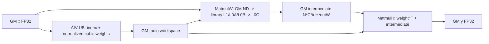
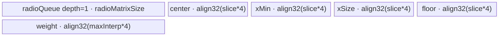

# UpsampleBicubic2dAA A2/A3 ACLNN 算子知识

## 算子速览

| 项目 | 内容 |
|---|---|
| 实际入口 | 公开两段式 `aclnnUpsampleBicubic2dAAGetWorkspaceSize` / `aclnnUpsampleBicubic2dAA` |
| 计算语义 | 对 NCHW 输入执行可分离的二维 Keys cubic 抗锯齿插值；先 W、后 H，核函数参数 `a=-0.5` |
| 输入输出 | `x:[N,C,inH,inW]`，`out:[N,C,outH,outW]`，ND/NCHW；公开 dtype 为 FP16/FP32/BF16 |
| 执行类型 | 核心单 Kernel 为 `MIX_CV`：AIV Vector 生成归一化权重矩阵，AscendC Matmul/Cube 完成 W/H 两次乘法；FP16/BF16 ACLNN 路线另含框架 Cast 节点 |
| Kernel 路线 | R-001 FP32 直达；R-002 FP16→FP32→FP16；R-003 BF16→FP32→BF16；三者核心均只命中 key 2 |
| 核心资源 | GM 输入/输出；user workspace 中的 W-pass 中间图和逐逻辑核权重矩阵；Matmul system workspace；Vector UB queue/TBuf；Matmul 库管理 L1/L0A/L0B/L0C |
| 来源闭包 | `source_closed`：公开 ACLNN、算子拥有的前处理/launcher、经典 Tiling/POD、MIX entry/body、平台 binary/config 与构建接线闭合；普通 Contiguous/Cast/ViewCopy 和 Matmul primitive 内部标为框架/库边界 |
| 验证状态 | 已完成源码闭包检查；本次知识提取未执行编译、真机、数值或性能测试。 |

## 接口与语义

### 计算语义

令输入为 `x[n,c,h,w]`，输出为 `y[n,c,oh,ow]`。对每一轴先计算

```text
scale = alignCorners ? (in-1)/(out-1)（out==1 时为 0）
                     : (用户 scales>0 ? 1/scales : in/out)
support = scale>=1 ? 2*scale : 2
invScale = scale>1 ? 1/scale : 1
center(o) = (o+0.5)*scale
```

候选输入范围为 `[max(0,floor(center+0.5-support)), min(in,floor(center+0.5+support)))`。距离乘 `invScale` 后进入 `a=-0.5` 的 cubic kernel；每轴权重除以该轴权重和。Device 将 W 权重矩阵与每个 N/C/H 行相乘，得到 `[N,C,inH,outW]`；再将 H 权重矩阵转置后与每个 N/C 平面相乘，得到 `[N,C,outH,outW]`。若某轴 `scale≈1`，对应乘法可跳过；两轴均不变时只执行选择出的一个方向完成等值拷贝。

### 输入、输出与属性

| 参数 | shape/layout | dtype | 约束、默认值与语义 |
|---|---|---|---|
| `x` | rank 4 `[N,C,H,W]`；ND 按 NCHW 解释，也接受 NCHW storage format；可非连续 | FP16、FP32、BF16 | 非空计算要求 `C,H,W>0`；空 tensor 在 ACLNN 第一段成功短路 |
| `outputSize` | Host IntArray，长度 2 | INT64 | `[outH,outW]`，两项均大于 0，且与 `out` 的 H/W 相同 |
| `alignCorners` | Host 标量 | BOOL | 为 true 时使用角点对齐 scale；否则使用 scales 或 `in/out` |
| `scalesH/scalesW` | Host 标量 | DOUBLE，传给算子 attr 时窄化为 FLOAT | 大于 0 时需满足 `output=floor(input*scales)` 的公开约束；非 RegBase ACLNN 先以 double 求倒数再转 float |
| `out` | rank 4 `[N,C,outH,outW]`；ND/NCHW；可非连续 | 与 `x` 相同 | 公开契约要求 N/C 与输入相同；最终用 ViewCopy 提交到该 view |
| `workspaceSize` | Host 输出 | UINT64 | executor 汇总 Contiguous/Cast/ViewCopy、算子 user workspace 与 Matmul system workspace；空 tensor 为 0 |
| `executor/stream` | Host 对象 | opaque | 第一段保存执行图；第二段在指定 stream 上由 `CommonOpExecutorRun` 执行 |

公开约束还要求各维 `<=2^20`、`N*C*inH<2^31`、总内存公式小于 60 GiB；A2/A3 下两个缩小倍率均 `<=50`。源码 ACLNN 实际以非 RegBase `realScale<=50`、各维 `<=INT32_MAX` 做显式检查，公开约束仍是调用者边界。

### 入口与版本

固定版本只公开无版本后缀的最新接口族。第一段创建 executor 并完成检查、连续化与节点添加；第二段不再解析属性，只运行 executor。A2/A3 对原始 FP16/BF16 输入先追加 `Cast(...,DT_FLOAT)`，核心 `l0op::UpsampleBicubic2dAA` 因而总是收到 FP32，并在核心后 Cast 回原 dtype。FP32 输入直接进入核心。普通 Contiguous、Cast 和 ViewCopy 的生成 Kernel 属框架边界；算子拥有的 dtype/架构选择与节点顺序在当前源码闭合。

## Host/Launcher 执行流程

### 参数校验与前处理

顺序为 `OP_CHECK_COMM_INPUT -> CREATE_EXECUTOR -> CheckNotNull -> CheckParams -> empty short-circuit -> Contiguous -> 非 RegBase dtype Cast -> l0op::UpsampleBicubic2dAA -> 非 RegBase output Cast -> ViewCopy -> GetWorkspaceSize`。`CheckParams` 要求指针非空、x/out dtype 匹配且在 FP16/FP32/BF16 内、x rank 4、`outputSize.size==2`、H/W 与 C 为正、out H/W 与属性一致、storage format 为 ND/NCHW；非 RegBase 还校验维度 `<=INT32_MAX` 与缩小倍率 `<=50`。

源码 `CheckShape` 的 `outputN/outputC` 误从 `inputShape` 读取，因此该函数中的 N/C 相等检查本身恒真；这是固定源码事实，不能依赖它替代公开的 N/C 契约。后续输出 tensor、ViewCopy 与公开接口仍要求调用者提供匹配 N/C。

### 参数、Workspace 与生命周期

核心 Tiling 以 FP32 `dataTypeSize=4` 计算：

```text
intermediate = align_up(N*C*inH*outW*4, 512)
singleCoreKW = ceil(sliceSize*scaleW) + ceil(2*supportW)
singleCoreKH = ceil(sliceSize*scaleH) + ceil(2*supportH)
radioW = sliceSize*singleCoreKW*4
radioH = sliceSize*singleCoreKH*4
radio = max(radioW,radioH)
workspace[0] = intermediate + radio*needCoreNum*2 + 32 MiB
```

`GetUserWorkspace(workspace)` 取得用户区；其 offset 0 是 W-pass 中间图，权重区从 `intermediateMatrixSize` 开始，Device 对每个逻辑 `blockIdx=GetBlockIdx()/2` 使用 `align_up(max(align32(radioW),align32(radioH)),512)*blockIdx`。固定 32 MiB 是 Matmul system workspace 预算；两倍 core 权重预算与 MIX 物理 block 编码配套，但 runtime 对 user/system workspace 的最终基址拆分位于框架边界。

executor 在第一段持有 launcher 图，调用方负责 workspace、x/out 的生命周期直至 stream 完成。任一前处理或 launcher 添加失败立即返回，不提交后继；空 tensor 释放 executor 给调用方但不追加核心节点。

### 启动图与失败传播

```text
R-001 FP32:
  Contiguous（需要时） -> UpsampleBicubic2dAA[key=2,MIX_CV] -> ViewCopy（需要时）

R-002 FP16:
  Contiguous -> Cast(FP16->FP32) -> UpsampleBicubic2dAA[key=2,MIX_CV]
             -> Cast(FP32->FP16) -> ViewCopy

R-003 BF16:
  Contiguous -> Cast(BF16->FP32) -> UpsampleBicubic2dAA[key=2,MIX_CV]
             -> Cast(FP32->BF16) -> ViewCopy
```

核心节点由 `ADD_TO_LAUNCHER_LIST_AICORE` 添加，Tiling 设置 `blockDim=max(needCoreNumW,needCoreNumH)` 和 schedule mode 1。entry 未知 key 或 user workspace 为空时无输出。同一 executor/stream 保证框架节点顺序；核心内部 `SyncAll()` 保证 W-pass 中间图对 H-pass 可见。binary config 与 OpDef 分别把相同实现接到 `ascend910b`（A2）和 `ascend910_93`（A3）。

## Route 与参数设计

### 分核与资源计算

`sliceSize` 随 `max(scaleH,scaleW)` 取 64（`<=5`）、48（`<=8`）、32（`<=20`）或 16（其余）；若任一输出空间轴小于所选值，则退回 16。对 W 轴，`sliceCount=ceil(outW/sliceSize)`，均匀部分按 core 切 slice；余 slice 再把扁平的 `N*C*inH` 行分组，最小每核行数为 `sliceSize*2/dataTypeSize`。H 轴同理，但余 slice 沿 `N*C` batch-channel 域分组。实际 `needCoreNum` 是两轴需求最大值。

W Matmul 的 Host 原始 shape 为 `M=N*C*inH, N=sliceSize, K=singleCoreKW`，原始矩阵宽为 `outW/inW`；H Matmul 为 `M=sliceSize, N=outW, K=singleCoreKH`，A 设 transpose。具体 `baseM/baseN/baseK`、step/depth 与 L1/L0 字节由仓外 `MatmulApiTiling::GetTiling` 写入两个 `TCubeTiling`；当前仓可证明的 specialization 是 GM/ND、FP32 A/B/C、W 不转置、H 的 A 转置、`MDL_CFG=GetMDLConfig(true,false,0,false,false,false,true)`。

### Route 选择

| 顺序 | Route | Key/模板 | 精确选择条件与优先级 | 不适用去向 |
|---:|---|---|---|---|
| 1 | R-001 FP32 直达 | 核心 key 2，`UpsampleBicubic2dAAND<float>` | A2/A3、原始 dtype FP32、非空且 ACLNN 检查通过 | 空 tensor 成功短路；检查失败返回 |
| 2 | R-002 FP16 升精度 | 框架 FP16→FP32；核心 key 2；框架 FP32→FP16 | A2/A3、原始 dtype FP16、非空且检查通过 | Cast/核心/ViewCopy 任一失败即返回 |
| 3 | R-003 BF16 升精度 | 框架 BF16→FP32；核心 key 2；框架 FP32→BF16 | A2/A3、原始 dtype BF16、非空且检查通过 | Cast/核心/ViewCopy 任一失败即返回 |

```text
empty(x) || empty(out) -> workspaceSize=0，无 Device 节点
否则 current arch 非 RegBase:
  original dtype FP32 -> R-001 -> core key 2
  original dtype FP16 -> R-002 -> Cast -> core key 2 -> Cast
  original dtype BF16 -> R-003 -> Cast -> core key 2 -> Cast
  其他 dtype -> ACLNN_ERR_PARAM_INVALID
```

Tiling/entry 中 key 1（half）和 key 3（BF16）是 OpDef/direct Host 可用实现，但被当前公开 ACLNN 的非 RegBase Cast 前处理遮蔽，不作为 ACLNN 可达 Route。

### 模板/实现执行矩阵

| Route | key/selector | dtype/shape/platform 完整命中条件 | 执行族与 kernel 节点 | 实际模板/body | 内存与同步特征 | tail/fallback |
|---|---|---|---|---|---|---|
| R-001 FP32 直达 | key 2 | A2/A3；FP32；rank 4 ND/NCHW；非空；scale/shape guard 通过 | 单核心节点 `upsample_bicubic2d_aa`，AIV 权重生成 + 两个 Cube Matmul 阶段 | `UpsampleBicubic2dAAND<float>`；W/H `MatmulType<GM,ND,float>`，H-A transpose | FP32 intermediate/radio workspace；UB float buffers；`SyncAll` 分隔 W/H | 空 tensor Host 短路；W/H slice 与分行/分 batch tail |
| R-002 FP16 升精度 | key 2（核心） | 同上但原始 FP16 | 框架 Cast→同一 MIX_CV 核心→框架 Cast | 核心仍为 `UpsampleBicubic2dAAND<float>` | 核心全 FP32；输出 Cast round 行为由框架 Cast 实现 | 任一节点失败阻断后继 |
| R-003 BF16 升精度 | key 2（核心） | 同上但原始 BF16 | 框架 Cast→同一 MIX_CV 核心→框架 Cast | 核心仍为 `UpsampleBicubic2dAAND<float>` | 核心全 FP32；输出 BF16 Cast 为框架边界 | 任一节点失败阻断后继 |

### 隐藏性能 Guard

| Guard | Host/Tiling 条件 | Device/资源原因 | 影响 Route | 不满足时去向 | 源码符号 |
|---|---|---|---|---|---|
| 平台分流 | `IsRegbaseSocVersion(context)==false` | 选择带 `TCubeTiling` 的经典 MIX_CV POD/body | R-001~R-003 | RegBase 转 950 Tiling，不是本卡路线 | `RunBigKernelTiling` |
| 缩小倍率 | `realScaleH<=50 && realScaleW<=50` | `MAX_CORE_CONT=50` 且权重 support/插值域受该公开边界约束 | 全部 | ACLNN 参数错误 | `CheckMaxScaleSupport` |
| slice specialization | `maxScale<=5/8/20/else` -> `64/48/32/16`；任一 out axis 小于 slice 时置 16 | 控制权重矩阵 N 维、UB 和 Matmul tail 规模 | 全部 | 同 Route 的更小 slice |
| core 数 | compile info `GetCoreNumAic()>0` | 两次 Matmul 按 AIC 核数分 slice | 全部 | Tiling failed，无 fallback | `TilingPrepare4Bicubic2DAA` |
| user workspace | `GetUserWorkspace(workspace)!=nullptr` | 中间图和权重矩阵都在 workspace | 全部 | entry 直接返回，无输出 | `upsample_bicubic2d_aa` |
| sub-block | `GetSubBlockIdx()!=1` 且 `blockIdx<needCoreNum{W,H}` | MIX 编码只让有效执行子块进入权重/Matmul body | 全部 | 当前子块返回 | `ProcessWidthDirection/ProcessHeightDirection` |
| Matmul tail | `tensorCIndex+sliceSize>outAxis` | 最后一 W/H slice 小于固定 N/M | 全部 | `SetTail`，不读写 padded 区 | `CalculateWidthExtension/CalculateHeightExtension` |
| fixed axis | `abs(scale-1)<1e-8` | 避免恒等轴的权重构造和乘法 | 全部 | 跳过该轴；两轴固定时选一方向做等值结果 |

### POD/ABI

`UpsampleBicubic2dAATilingData` 由 Tiling 宏生成，固定仓未包含宏展开及 `TCubeTiling` 定义，因此完整 `sizeof/alignof/offsetof` 不可见；下表保留声明顺序、源码类型和 producer/consumer。数组每项为 int32，长度固定 50。

| 结构 | 字段 | 类型/位宽 | ABI 布局 | 单位 | Host/launcher producer | Device consumer | 边界 |
|---|---|---|---|---|---|---|---|
| `UpsampleBicubic2dAATilingData` | `scaleW` | float/32 | 字段 1；精确 offsetof 固定仓不可见 | 输入像素/输出像素 | `SetScale: realScaleW` | `CalculateIndexTensor` | 正常 <=50；alignCorners out=1 可为 0 |
| 同上 | `scaleH` | float/32 | 字段 2 | 同上 | `SetScale` | `CalculateIndexTensor` | 同上 |
| 同上 | `invscaleW` | float/32 | 字段 3 | 无量纲 | `scaleW>1 ? 1/scaleW : 1` | `CalculateRadioTensor` | <=1 |
| 同上 | `invscaleH` | float/32 | 字段 4 | 无量纲 | 同上 H | 同上 | <=1 |
| 同上 | `supportH` | float/32 | 字段 5 | 输入像素 | `scaleH>=1 ? 2*scaleH : 2` | index/radio helper | 缩小越大 support 越大 |
| 同上 | `supportW` | float/32 | 字段 6 | 输入像素 | 同上 W | index/radio helper | 同上 |
| 同上 | `maxInterpSizeW` | int32/32 | 字段 7 | 元素 | `2*ceil(supportW)+1` | UB weight 容量/循环 | Host 临时 int16 后写 int32 |
| 同上 | `maxInterpSizeH` | int32/32 | 字段 8 | 元素 | 同上 H | 同上 | 同上 |
| 同上 | `radioMatrixWSize` | uint32/32 | 字段 9 | 字节 | `sliceSize*singleCoreKW*4` | `ParseTilingData` | Device 再 32/512 对齐 |
| 同上 | `radioMatrixHSize` | uint32/32 | 字段 10 | 字节 | 同上 H | 同上 | 同上 |
| 同上 | `needCoreNumW` | uint32/32 | 字段 11 | 逻辑 core | `GetNeedCoreNumWidth` | W core guard/固定轴方向 | <=平台 AIC 数 |
| 同上 | `needCoreNumH` | uint32/32 | 字段 12 | 逻辑 core | `GetNeedCoreNumHeight` | H core guard/固定轴方向 | <=平台 AIC 数 |
| 同上 | `sliceSize` | uint32/32 | 字段 13 | 输出元素 | `SetSliceSize` | 所有 slice 循环/矩阵列 | 16/32/48/64 |
| 同上 | `intermediateMatrixSize` | uint64/64 | 字段 14 | 字节 | `align512(N*C*inH*outW*4)` | workspace radio base | 防止权重区覆盖中间图 |
| 同上 | `inputShapes` | int32[4] | 字段 15 | 元素 | `GetOutputShape` 从 origin shape 窄化 | 地址、M/K、循环 | ACLNN 非 RegBase 先限 INT32_MAX |
| 同上 | `outputShapes` | int32[4] | 字段 16 | 元素 | N/C 取 input，H/W 取 outputSize | 地址、N、tail | 同上 |
| 同上 | `sliceStartListW` | int32[50] | 字段 17 | W 输出索引 | W 均匀 slice producer | W 主循环 | inactive core 为 0 |
| 同上 | `sliceEndListW` | int32[50] | 字段 18 | W 输出索引 | 同上 | 同上 | 半开区间 |
| 同上 | `tailSliceStartListW` | int32[50] | 字段 19 | W 输出索引 | W 余 slice producer | W tail | inactive 为 0 |
| 同上 | `tailSliceEndListW` | int32[50] | 字段 20 | W 输出索引 | 同上 | 同上 | 半开区间 |
| 同上 | `tailRowStartListW` | int32[50] | 字段 21 | 扁平 N*C*inH 行 | 余 slice 行分组 | `CalculateWidthExtension` | inactive 为 0 |
| 同上 | `tailRowEndListW` | int32[50] | 字段 22 | 行 | 同上 | 同上 | 半开区间 |
| 同上 | `sliceStartListH` | int32[50] | 字段 23 | H 输出索引 | H 均匀 slice producer | H 主循环 | inactive 为 0 |
| 同上 | `sliceEndListH` | int32[50] | 字段 24 | H 输出索引 | 同上 | 同上 | 半开区间 |
| 同上 | `tailSliceStartListH` | int32[50] | 字段 25 | H 输出索引 | H 余 slice producer | H tail | inactive 为 0 |
| 同上 | `tailSliceEndListH` | int32[50] | 字段 26 | H 输出索引 | 同上 | 同上 | 半开区间 |
| 同上 | `tailBatchStartListH` | int32[50] | 字段 27 | 扁平 N*C | H 余 slice batch 分组 | `CalculateHeightExtension` | inactive 为 0 |
| 同上 | `tailBatchEndListH` | int32[50] | 字段 28 | 扁平 N*C | 同上 | 同上 | 半开区间 |
| 同上 | `matmulTilingW` | `TCubeTiling`/外部定义 | 字段 29；sizeof/alignof/offsetof 固定仓不可见 | Matmul 参数 | `GetTCubeTilingW::MatmulApiTiling::GetTiling` | `REGIST_MATMUL_OBJ`、W Matmul | GM ND FP32；A/B 不转置 |
| 同上 | `matmulTilingH` | `TCubeTiling`/外部定义 | 字段 30；固定仓不可见 | Matmul 参数 | `GetTCubeTilingH::GetTiling` | H Matmul | GM ND FP32；A 转置、B 不转置 |

### Route 源码闭包

| Route | Key/selector | Host/Tiling producer | POD/参数 | Kernel entry/router | Kernel body/直接依赖 | 构建接线 |
|---|---|---|---|---|---|---|
| R-001 FP32 直达 | 非 RegBase，核心 key 2 | `aclnn...GetWorkspaceSize`；`RunBigKernelTiling/SetScale/SetSliceSize/GetNeedCoreNum*` | `UpsampleBicubic2dAATilingData` + 两个 `TCubeTiling` | `upsample_bicubic2d_aa.cpp::upsample_bicubic2d_aa` | `UpsampleBicubic2dAAND<float>::Init/Process/Calculate*`；AscendC Matmul 当前实例 | OpDef 910B/910_93；两份 binary JSON；CMake；ascendc config |
| R-002 FP16 升精度 | API dtype FP16；核心 key 2 | 同上，另由 API 添加 Cast | 核心 POD 与 R-001 相同 | 框架 Cast entry + 同一核心 entry | Cast 为框架边界；核心与 R-001 相同 | 同上 |
| R-003 BF16 升精度 | API dtype BF16；核心 key 2 | 同上，另由 API 添加 Cast | 核心 POD 与 R-001 相同 | 框架 Cast entry + 同一核心 entry | Cast 为框架边界；核心与 R-001 相同 | 同上 |

## Kernel 实现

### 公共执行流程

三条 Route 的算子核心完全相同。entry 解析 POD、取得 user/system workspace并在 key 2 下构造 `UpsampleBicubic2dAAND<float>`，把两个 `TCubeTiling` 注册给 `matmulW/matmulH`。`Init` 将物理 block 映射为逻辑 `blockIdx=GetBlockIdx()/2`，分配 UB，绑定 GM。`Process` 先 W 后 H，中间以 `SyncAll()` 分隔；每个方向都是“Vector 计算 index/归一化权重→权重 UB 到 workspace→Matmul 读权重与输入/中间图→GM 输出”。

### Route R-001：FP32 直达

#### 适用条件

##### 选择证据

| 层级 | 文件 | 符号 | 源码谓词/参数 | 结果/下一跳 |
|---|---|---|---|---|
| ACLNN | `op_host/op_api/aclnn_upsample_bicubic2d_aa.cpp` | `CheckParams` | 非空、FP32、rank/format/scale 合法 | 不 Cast，进入 L0；失败返回 |
| Host | 同上 | `aclnnUpsampleBicubic2dAAGetWorkspaceSize` | `!IsRegBase(curArch)` 且 dtype 非 FP16/BF16 | `l0op::UpsampleBicubic2dAA` |
| Tiling | `op_host/upsample_bicubic2d_aa_tiling.cpp` | `RunBigKernelTiling/GetTilingKeyVal` | 非 RegBase，core dtype FP32 | key 2，设置 blockDim/workspace |
| Router | `op_kernel/upsample_bicubic2d_aa.cpp` | `upsample_bicubic2d_aa` | `TILING_KEY_IS(2)` | `UpsampleBicubic2dAAND<float>::Process` |

#### Device 数据流

##### 函数级调用链

```text
upsample_bicubic2d_aa(x,y,workspace,tiling)
  -> REGIST_MATMUL_OBJ(matmulW,matmulH)
  -> UpsampleBicubic2dAAND<float>::Init
  -> Process
    -> ProcessWidthDirection
      -> CalculateIndexTensor -> CalculateRadioTensor
      -> CopyRadioTensorToGm -> CalculateWidthExtension -> matmulW.IterateAll/End
    -> SyncAll
    -> ProcessHeightDirection
      -> CalculateIndexTensor -> CalculateRadioTensor
      -> CopyRadioTensorToGm -> CalculateHeightExtension -> matmulH.IterateAll/End
```

##### 源码等价伪码

```text
伪码：logicalCore=GetBlockIdx()/2；subBlock 1 返回
for owSlice in core.W_main_and_tail_slices:
  center=(ow+0.5)*scaleW
  xmin=max(floor(center+0.5-supportW),0)
  xsize=clamp(floor(center+0.5+supportW)-xmin,0,maxInterpW)
  for each ow: weight[k]=cubic((xmin+k-center+0.5)*invscaleW); normalize
  store dense [singleCoreK,sliceSize] weight tile to per-core workspace
  MatmulW(A=x rows, B=weight, C=out if H fixed else intermediate)
SyncAll()
if not (both axes fixed and width chosen):
  for ohSlice in core.H_main_and_tail_slices:
    construct/normalize dense H weight tile identically
    store weight tile to same per-core radio workspace
    for nc in assigned N*C:
      MatmulH(A=weight^T, B=input if W fixed else intermediate, C=output)
```

#### 内存与数据搬运

##### 资源与搬运表

| 层级/缓冲区 | offset/地址公式 | extent/容量公式 | dtype/layout | producer | consumer | owner/lifetime | 对齐/复用 |
|---|---|---|---|---|---|---|---|
| GM x | W: `xMin+row*inW`；H-fixed: `xMin*outW+nc*inH*outW` | `[N,C,inH,inW]` | FP32 NCHW | API/Contiguous | W Matmul；H Matmul when W fixed | caller/executor lifetime | logical ND |
| GM intermediate | userWS offset 0 | `align512(N*C*inH*outW*4)` bytes | FP32 `[N,C,inH,outW]` | W Matmul when H not fixed | H Matmul | runtime workspace；W 后到 H 完成 | 512-byte extent |
| GM radio workspace | `intermediate + radioMatrixSize*logicalCore` | per core `radioMatrixSize=align512(max(align32(radioW),align32(radioH)))` | FP32 dense K×slice weight | `CopyRadioTensorToGm` | W/H Matmul B/A | runtime workspace；每 slice 覆盖 | same core sequential reuse |
| GM y | W direct or H output offset | `[N,C,outH,outW]` | FP32 NCHW | MatmulW/MatmulH | ViewCopy | executor output temp | tail via `SetTail` |
| UB `radioQueue` | queue local | `radioMatrixSize` bytes，depth 1（public key 2） | FP32 | `CalculateRadioTensor` | DataCopy to GM | `AllocTensor→EnQue→DeQue→FreeTensor` | W/H 共用 |
| UB `center/xMin/xSize/floor` | four independent TBuf | each `align32(sliceSize*4)` bytes | FP32 | Vector API | scalar reads/radio helper | kernel lifetime | W/H 共用 |
| UB `weightTensor` | TBuf | `align32(max(maxInterpW,maxInterpH)*4)` bytes | FP32 | scalar cubic weight | normalize/store | kernel lifetime | 每输出位置复用 |
| L1/L0A/L0B/L0C | Matmul library-owned | 由 `TCubeTilingW/H` 决定；精确容量固定仓不可见 | GM ND FP32 当前实例 | Matmul prologue | Mmad/epilogue | 单次 IterateAll | W: A/B non-trans；H: A trans |

##### 分层内存布局





##### 字节账、交接边与复用顺序

```text
workspace_total = align512(N*C*inH*outW*4)
                + max(radioW,radioH)*needCoreNum*2
                + 32 MiB system workspace
UB_total = radioMatrixSize
         + 4*align32(sliceSize*4)
         + align32(max(maxInterpW,maxInterpH)*4)
L1/L0 = TCubeTiling runtime specialization，固定仓未展开精确字节
```

| 边/复用子区 | producer | offset/extent | dtype/layout | consumer | ordering/sync | owner/lifetime | 安全条件 |
|---|---|---|---|---|---|---|---|
| W→H intermediate | `matmulW.IterateAll` | offset 0；`N*C*inH*outW*4` effective，extent 512 对齐 | FP32 NCHW-like | `matmulH` | `SyncAll()` | user workspace | H 不固定时才读 |
| radio per-core slice | `CopyRadioTensorToGm` | `intermediate+radioMatrixSize*core` | FP32 K×slice | current W/H Matmul | queue dequeue后 DataCopy；同调用序消费 | user workspace | 下一 slice 必须在当前 Matmul `End` 后覆盖 |
| radio UB queue | `CalculateRadioTensor` | depth 1 | FP32 | CopyRadio | EnQue/DeQue/FreeTensor | TPipe | Free 后方可重分配 |

#### 同步、精度与尾块

##### 同步与数值边界表

| 阶段 | primitive/机制 | producer | consumer/等待点 | 保护对象 | 精度/尾块 |
|---|---|---|---|---|---|
| weight UB lifecycle | TQue enqueue/dequeue | `CalculateRadioTensor` | `CopyRadioTensorToGm` | radio UB | 实际 length 以 32/512 对齐容量承载；有效权重之外先 Duplicate 0 |
| W→H | `SyncAll()` | 所有 W Matmul | 所有 H Matmul | GM intermediate | H 只读已完成 W 结果 |
| Cube | Matmul `IterateAll(...,false)` + `End()` | library mainloop | GM output/intermediate | L1/L0 与目标 tile | W/H tail 用 `SetTail`；FP32 A/B/C |
| 权重精度 | FP32 Vector/scalar | index/support/cubic | FP32 radio/Matmul | weights | 先求总和再除；无输出 cast于 R-001 |
| slice tail | `Min` + `SetTail` | Host slice lists | Matmul | 最后空间 slice | 只提交 `outAxis-index` 有效 M/N |

#### 关键实现

##### 符号证据表

| 阶段 | 文件 | 符号/模板实例 | 实现事实 |
|---|---|---|---|
| Host/Tiling producer | `op_host/upsample_bicubic2d_aa_tiling.cpp` | `RunBigKernelTiling/SetScale/GetWorkSpace/GetTCubeTilingW/H` | key 2、scale/slice/core/workspace 和两份 Matmul tiling |
| Kernel entry/router | `op_kernel/upsample_bicubic2d_aa.cpp` | `upsample_bicubic2d_aa` key 2 | 注册 `UpsampleBicubic2dAAND<float>` 的 W/H Matmul |
| Device body/helper | `op_kernel/upsample_bicubic2d_aa.h` | `Process* / Calculate*Extension / CalculateRadioTensor` | Vector 权重、workspace 地址、两次 Matmul、同步和 tail |

### Route R-002：FP16 升精度

#### 适用条件

##### 选择证据

| 层级 | 文件 | 符号 | 源码谓词/参数 | 结果/下一跳 |
|---|---|---|---|---|
| ACLNN | `op_host/op_api/aclnn_upsample_bicubic2d_aa.cpp` | `aclnn...GetWorkspaceSize` | 非 RegBase 且 `dtype==DT_FLOAT16` | 前 Cast FP32、核心、后 Cast FP16 |
| Tiling/Router | classic tiling/kernel files | 与 R-001 相同 | Cast 后核心 dtype FP32 | 核心 key 2 |

#### Device 数据流

##### 函数级调用链

```text
framework Cast(FP16 -> FP32)
  -> R-001 的完整 upsample_bicubic2d_aa<float> 调用链
  -> framework Cast(FP32 -> FP16)
```

##### 源码等价伪码

```text
伪码：x32=Cast(contiguous(x16),FP32)
y32=UpsampleBicubic2dAA<float>(x32, core key 2)
out16=Cast(y32,FP16); ViewCopy(out16,out)
```

#### 内存与数据搬运

##### 资源与搬运表

| 层级/缓冲区 | offset/地址公式 | extent/容量公式 | dtype/layout | producer | consumer | owner/lifetime | 对齐/复用 |
|---|---|---|---|---|---|---|---|
| framework cast temp | executor 分配 | 输入/输出相应 FP32/FP16 tensor extent；具体 workspace 固定仓不可见 | FP16↔FP32 | Cast | 核心/ViewCopy | executor | 框架边界 |
| 核心全部资源 | 与 R-001 相同 | 与 R-001 相同 | FP32 | 同 R-001 | 同 R-001 | 同 R-001 | 同 R-001 |

##### 分层内存布局


##### 字节账、交接边与复用顺序

```text
core workspace/L1/L0/UB = R-001
executor total = core workspace + framework Contiguous/Cast/ViewCopy needs
framework node-specific workspace/offset = 固定仓不可见
```

| 边/复用子区 | producer | offset/extent | dtype/layout | consumer | ordering/sync | owner/lifetime | 安全条件 |
|---|---|---|---|---|---|---|---|
| Cast-in→core | framework Cast | FP32 tensor | FP32 NCHW | core key 2 | executor 同 stream 顺序 | executor | Cast 成功后启动核心 |
| core→Cast-out | core | FP32 output temp | FP32 NCHW | framework Cast | executor 同 stream 顺序 | executor | core 成功后启动 Cast |

#### 同步、精度与尾块

##### 同步与数值边界表

| 阶段 | primitive/机制 | producer | consumer/等待点 | 保护对象 | 精度/尾块 |
|---|---|---|---|---|---|
| wrapper ordering | executor stream | Cast-in/core/Cast-out | next node | temp tensors | cubic 权重和两次 Matmul 均 FP32；最终降 FP16 |
| core | 与 R-001 相同 | 同上 | 同上 | 同上 | 同上 |

#### 关键实现

##### 符号证据表

| 阶段 | 文件 | 符号/模板实例 | 实现事实 |
|---|---|---|---|
| Host/Tiling producer | `op_host/op_api/aclnn_upsample_bicubic2d_aa.cpp` | `aclnn...GetWorkspaceSize` | FP16 前后 Cast，double reciprocal 后转 float |
| Kernel entry/router | `op_kernel/upsample_bicubic2d_aa.cpp` | key 2 | Cast 后进入 float 核心 |
| Device body/helper | `op_kernel/upsample_bicubic2d_aa.h` | `UpsampleBicubic2dAAND<float>` | 与 R-001 相同 |

### Route R-003：BF16 升精度

#### 适用条件

##### 选择证据

| 层级 | 文件 | 符号 | 源码谓词/参数 | 结果/下一跳 |
|---|---|---|---|---|
| ACLNN | `op_host/op_api/aclnn_upsample_bicubic2d_aa.cpp` | `aclnn...GetWorkspaceSize` | 非 RegBase 且 `dtype==DT_BF16` | 前 Cast FP32、核心、后 Cast BF16 |
| Tiling/Router | classic tiling/kernel files | 与 R-001 相同 | Cast 后核心 dtype FP32 | 核心 key 2 |

#### Device 数据流

##### 函数级调用链

```text
framework Cast(BF16 -> FP32)
  -> R-001 的完整 upsample_bicubic2d_aa<float> 调用链
  -> framework Cast(FP32 -> BF16)
```

##### 源码等价伪码

```text
伪码：x32=Cast(contiguous(xbf16),FP32)
y32=UpsampleBicubic2dAA<float>(x32, core key 2)
outbf16=Cast(y32,BF16); ViewCopy(outbf16,out)
```

#### 内存与数据搬运

##### 资源与搬运表

| 层级/缓冲区 | offset/地址公式 | extent/容量公式 | dtype/layout | producer | consumer | owner/lifetime | 对齐/复用 |
|---|---|---|---|---|---|---|---|
| framework cast temp | executor 分配 | BF16/FP32 tensor extent；具体 workspace 固定仓不可见 | BF16↔FP32 | Cast | 核心/ViewCopy | executor | 框架边界 |
| 核心全部资源 | 与 R-001 相同 | 与 R-001 相同 | FP32 | 同 R-001 | 同 R-001 | 同 R-001 | 同 R-001 |

##### 分层内存布局


##### 字节账、交接边与复用顺序

```text
core workspace/L1/L0/UB = R-001
executor total = core workspace + framework nodes；框架精确 offset 固定仓不可见
```

| 边/复用子区 | producer | offset/extent | dtype/layout | consumer | ordering/sync | owner/lifetime | 安全条件 |
|---|---|---|---|---|---|---|---|
| Cast-in→core | framework Cast | FP32 tensor | FP32 NCHW | core key 2 | executor 同 stream 顺序 | executor | Cast 成功 |
| core→Cast-out | core | FP32 output temp | FP32 NCHW | framework Cast | executor 同 stream顺序 | executor | core 成功 |

#### 同步、精度与尾块

##### 同步与数值边界表

| 阶段 | primitive/机制 | producer | consumer/等待点 | 保护对象 | 精度/尾块 |
|---|---|---|---|---|---|
| wrapper ordering | executor stream | Cast-in/core/Cast-out | next node | temp tensors | 全核心 FP32，最后降 BF16；框架 round mode 固定仓不可见 |
| core | 与 R-001 相同 | 同上 | 同上 | 同上 | 同上 |

#### 关键实现

##### 符号证据表

| 阶段 | 文件 | 符号/模板实例 | 实现事实 |
|---|---|---|---|
| Host/Tiling producer | `op_host/op_api/aclnn_upsample_bicubic2d_aa.cpp` | `aclnn...GetWorkspaceSize` | BF16 前后 Cast |
| Kernel entry/router | `op_kernel/upsample_bicubic2d_aa.cpp` | key 2 | Cast 后进入 float 核心 |
| Device body/helper | `op_kernel/upsample_bicubic2d_aa.h` | `UpsampleBicubic2dAAND<float>` | 与 R-001 相同 |

## 算子特定优化

### Trick T-001：按轴可分离并跳过恒等轴

#### 触发与源码依据

- 适用 Route：R-001、R-002、R-003
- 触发条件：任一 `abs(scale-1)<1e-8`；两轴均固定时用 `needCoreNumW>needCoreNumH` 决定只走一个方向。
- Golden 来源：[`op_kernel/upsample_bicubic2d_aa.h:197-209`](../../../../../../../cann-ops-raw/ascendc/ops-cv/bb717d075d129fd1fc7b96b2886824a1d153ed2f/image/upsample_bicubic2d_aa/op_kernel/upsample_bicubic2d_aa.h#L197-L209)

**官方源码（固定 Commit 连续逐字摘录）**：

```cpp
// 先横向扩展
ProcessWidthDirection();
SyncAll();
// 如果shape不变，直接copy输出结束
if (widthFixed && heightFixed && useWidthDirectCopy) {
    return;
}
// 再纵向扩展
ProcessHeightDirection();
```

#### 机制与设计原因

二维 cubic 权重可拆成 W/H 两个一维矩阵乘。源码在每个方向进入前检查 `widthFixed/heightFixed`；不变轴不构造权重、不物化对应中间结果。两轴都不变时仍需产生输出，因此选择资源需求更大的方向完成一次等值矩阵乘，随后直接返回。该机制减少可由源码证明的权重构造、workspace 中间写读和一次 Matmul 阶段。

#### 迁移边界

- 适用：可分离二维插值且恒等轴的权重矩阵等价单位矩阵。
- 前提：scale 的固定判断容差保持 `1e-8`，输出布局与当前 NCHW 地址公式一致。
- 失效：任一轴 scale 非 1 时必须执行该轴；两轴都变化时 W→SyncAll→H 不可省略。
- 未验证：本次知识提取未执行编译、真机、数值或性能测试。

#### 错误做法

不能在 W 写完中间图前省略 `SyncAll()` 并启动 H；这会破坏跨核 producer→consumer 可见性。

### Trick T-002：FP16/BF16 ACLNN 路线统一升至 FP32 核心

#### 触发与源码依据

- 适用 Route：R-002、R-003
- 触发条件：非 RegBase 且原始 dtype 为 FP16 或 BF16。
- Golden 来源：[`op_host/op_api/aclnn_upsample_bicubic2d_aa.cpp:190-215`](../../../../../../../cann-ops-raw/ascendc/ops-cv/bb717d075d129fd1fc7b96b2886824a1d153ed2f/image/upsample_bicubic2d_aa/op_host/op_api/aclnn_upsample_bicubic2d_aa.cpp#L190-L215)

**官方源码（固定 Commit 连续逐字摘录）**：

```cpp
if (!(IsRegBase(curArch))) {
    auto dtype = x->GetDataType();
    // 将fp16/bf16类型cast成fp32处理，保证精度
    if (dtype == op::DataType::DT_BF16 || dtype == op::DataType::DT_FLOAT16) {
        selfContiguous = l0op::Cast(selfContiguous, op::DataType::DT_FLOAT, uniqueExecutor.get());
    }
```

#### 机制与设计原因

Host 将输入、权重构造、两次 Matmul 与中间图统一为 FP32，避免把归一化 cubic 权重和两阶段乘法限制在 16 位；用户 scale 的倒数也先用 double 计算再窄化 float。代价是 executor 多两个 Cast 节点与 FP32 临时张量。核心 key 因而统一为 2，不能按原始 API dtype 误选 key 1/3。

#### 迁移边界

- 适用：A2/A3 的公开 ACLNN FP16/BF16 调用。
- 前提：框架 Cast、executor 临时 tensor 和 FP32 Matmul 均可用。
- 失效：950 RegBase 不走该 Host 分支；其 Device 直接保留原 dtype。
- 未验证：本次知识提取未执行编译、真机、数值或性能测试。

#### 错误做法

直接根据 API 输入 FP16/BF16 选择经典 entry key 1/3，会绕过公开 ACLNN 的精度路线并改变 workspace dtype/字节账。

## 模板与实现对比

| 对比维度 | R-001 FP32 直达 | R-002 FP16 / R-003 BF16 升精度 | 设计选择依据 |
|---|---|---|---|
| 命中条件/优先级 | 原始 FP32 | 原始 16 位 dtype，Host 先 Cast | 非 RegBase dtype 分支 |
| 执行族/节点图 | 核心 MIX_CV 单节点，外加必要 Contiguous/ViewCopy | Cast-in→同一 MIX_CV→Cast-out | 以节点图区分 Route |
| M/N/K、tile 与 scheduler | W/H 两套 Matmul，slice 16/32/48/64 | 核心完全相同 | Cast 后均 FP32 |
| workspace/L1/L0/UB | FP32 intermediate/radio + system WS；Matmul L1/L0；Vector UB | 核心相同，executor 另含 Cast 临时资源 | 精度优先的 Host lowering |
| AIC/AIV 或 kernel 交接 | AIV 权重→GM radio→Cube；W→GM intermediate→H | 同核心；另有框架 stream 边 | 核心 `SyncAll` + executor ordering |
| 同步、精度与 tail | 全 FP32；slice/core tail | 核心 FP32，最后降 FP16/BF16 | 16 位仅在接口边界 |
| fallback/失败边界 | 空 tensor 短路；未知 key无 body | 任一 Cast/核心/ViewCopy 失败阻断后继 | 无算法 fallback |

## 平台差异

| 项目 | A2 | A3 | 950 |
|---|---|---|---|
| 支持状态 | 公开支持 | 公开支持 | 公开支持，见 `_950` 卡 |
| Host/Launcher | `ascend910b`，经典 Tiling，FP16/BF16 Cast FP32 | `ascend910_93`，与 A2 共用经典实现 | RegBase Tiling，不做 Host FP32 Cast |
| Kernel/资源 | MIX_CV、Matmul、FP32 intermediate/radio、32 MiB system WS | 与 A2 相同 | AIV copy 或 SIMT，固定 16 MiB workspace；无 Cube 路径 |

## 限制与失败边界

- 公开 API 约束各维 `<=2^20`、内存公式 `<60 GiB`、`N*C*inH<2^31`；显式 ACLNN 源码的上限检查更宽，调用者仍须遵守公开约束。
- A2/A3 缩小倍数大于 50 由 ACLNN 拒绝；输入/输出 H/W 或 C 非正、outputSize 长度不为 2、dtype/format 不匹配均失败。
- `CheckShape` 的 output N/C 读取自 input shape，使源码内 N/C check 恒真；不得据此放宽公开的 N/C 相等要求。
- `TCubeTiling` 的 base/step/depth、Matmul L1/L0 精确容量和框架 Cast/Contiguous/ViewCopy 的 kernel/workspace 细节位于固定仓外；本卡只记录当前调用实例和可见边界，不推测其内部。
- entry 对 null user workspace 或未知 key 直接返回；Host 无备用 Kernel。经典 key 1/3 虽存在，但当前公开 ACLNN 不可达。
- 本次知识提取未执行编译、真机、数值或性能测试。

## 源码索引

### 链路索引

| 链路阶段 | 文件 | 关键符号 | 支撑内容 |
|---|---|---|---|
| 入口声明/约束 | `image/upsample_bicubic2d_aa/docs/aclnnUpsampleBicubic2dAA.md` | 产品表、函数原型、约束 | A2/A3 公开支持、接口与边界 |
| 入口声明/约束 | `image/upsample_bicubic2d_aa/op_host/op_api/aclnn_upsample_bicubic2d_aa.h` | 两段式 ACLNN 声明 | 参数 ABI |
| 入口实现 | `image/upsample_bicubic2d_aa/op_host/op_api/aclnn_upsample_bicubic2d_aa.cpp` | `Check*`、两段接口 | 校验、Cast/Contiguous/ViewCopy、executor 顺序 |
| 入口实现 | `image/upsample_bicubic2d_aa/op_host/op_api/upsample_bicubic2d_aa.cpp` | `l0op::UpsampleBicubic2dAA` | 输出 temp 与 launcher 添加 |
| Host/Tiling/Launcher | `image/upsample_bicubic2d_aa/op_host/upsample_bicubic2d_aa_tiling.h` | `UpsampleBicubic2dAATilingData` | POD 字段与 TCube 嵌入 |
| Host/Tiling/Launcher | `image/upsample_bicubic2d_aa/op_host/upsample_bicubic2d_aa_tiling.cpp` | classic Tiling 全部方法 | key/core/slice/workspace/Matmul tiling |
| Kernel entry/body | `image/upsample_bicubic2d_aa/op_kernel/upsample_bicubic2d_aa.cpp` | `upsample_bicubic2d_aa` | key router 与 Matmul 注册 |
| Kernel entry/body | `image/upsample_bicubic2d_aa/op_kernel/upsample_bicubic2d_aa.h` | `UpsampleBicubic2dAAND` | Vector 权重、Matmul、内存、同步与 tail |
| 构建接线 | `image/upsample_bicubic2d_aa/op_host/upsample_bicubic2d_aa_def.cpp` | `UpsampleBicubic2dAA` OpDef | 910B/910_93 注册与 dtype |
| 构建接线 | `image/upsample_bicubic2d_aa/op_host/config/ascend910b/upsample_bicubic2d_aa_binary.json` | FP16/FP32/BF16 op_list | A2 binary 实例 |
| 构建接线 | `image/upsample_bicubic2d_aa/op_host/config/ascend910_93/upsample_bicubic2d_aa_binary.json` | FP16/FP32/BF16 op_list | A3 binary 实例 |
| 构建接线 | `image/upsample_bicubic2d_aa/op_host/CMakeLists.txt` | `add_modules_sources` | Host 模块纳入构建 |
| 构建接线 | `scripts/kernel/binary_config/ascendc_config.json` | `UpsampleBicubic2dAA` | compute units 与 A2/A3 auto_sync |

### 实现复用检查

| 检查项 | 可复用事实 | 不得改变的约束 | 源码符号 |
|---|---|---|---|
| ABI/POD | scale/support、slice/core lists、两份 TCubeTiling 的 producer/consumer 映射 | 字段顺序、int32 shape/列表、50-core 上限与 W/H TCube transpose 语义 | `UpsampleBicubic2dAATilingData` |
| 调用顺序 | API lowering 与 W→H 可分离流水 | FP16/BF16 必须先 Cast FP32；H 前必须完成 `SyncAll` | `aclnn...GetWorkspaceSize`、`Process` |
| workspace/内存 | intermediate 与 per-core radio 的公式和复用 | 512 对齐、radio base 不得覆盖 intermediate、system WS 不得省略 | `GetWorkSpace`、`ParseTilingData` |
| 同步 | queue lifecycle、Matmul End、W/H 全核 barrier | radio 覆盖和 H 读取不能提前 | `CopyRadioTensorToGm`、`Process` |
| 精度与尾块 | FP32 cubic/Matmul；slice/row/batch tail | 权重先归一化；最后 slice 必须 `SetTail`；输出 cast 只在 wrapper | `CalculateRadioTensor`、`Calculate*Extension` |
| 失败边界 | 空 tensor Host 短路、null workspace/unknown key 无 body | 不得把 classic key 1/3误记为公开 ACLNN 可达路线 | ACLNN entry、kernel router |