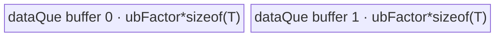

# UpsampleBicubic2dAA 950 ACLNN 算子知识

## 算子速览

| 项目 | 内容 |
|---|---|
| 实际入口 | 公开两段式 `aclnnUpsampleBicubic2dAAGetWorkspaceSize` / `aclnnUpsampleBicubic2dAA` |
| 计算语义 | 对 NCHW 输入逐输出像素执行 Keys cubic 抗锯齿插值；H/W 一维权重分别归一化后相乘，`a=-0.5` |
| 输入输出 | `x:[N,C,inH,inW]`，`out:[N,C,outH,outW]`，ND/NCHW；FP16/FP32/BF16 |
| 执行类型 | R-001 `AIV_VECTOR` 数据搬运；R-002/R-003 `SIMT`；所有 950 可达节点均无 Cube/AIC/MIX_CV |
| Kernel 路线 | R-001 恒等双缓冲 DataCopy；R-002 32 位索引 SIMT；R-003 64 位索引 SIMT |
| 核心资源 | R-001 使用 GM、双缓冲 `TQueBind`/UB；SIMT 路线使用 GM 与线程局部寄存器，无 shared/dynamic UB/atomic；三条路线均声明 16 MiB workspace 但 body 不访问 |
| 来源闭包 | `source_closed`：公开 ACLNN、RegBase Host selector/Tiling/POD、模板 key、APT entry、DataCopy/SIMT body、950 OpDef/binary/build config 闭合；普通 Contiguous/ViewCopy 为框架边界 |
| 验证状态 | 已完成源码闭包检查；本次知识提取未执行编译、真机、数值或性能测试。 |

## 接口与语义

### 计算语义

对扁平输出 `yGmIdx` 还原 `(NC,H,W)`：`W=y%outW`、`H=(y/outW)%outH`、`NC=y/(outW*outH)`。每个空间轴使用：

```text
scale = alignCorners ? (out>1 ? (in-1)/(out-1) : 0)
                     : (originalScale>0 ? 1/originalScale : in/out)
invScale = scale>=1 ? 1/scale : 1
support = scale>=1 ? 2*scale : 2
center(o) = scale*(o+0.5)
```

候选输入区间是 `[max(0,floor(center-support+0.5)), min(in,floor(center+support+0.5)))`。`CubicFilterAA` 对绝对距离执行 `|d|<1: (1.5d-2.5)d²+1`、`1<=|d|<2: ((-0.5d+2.5)d-4)d+2`、其余为 0。H/W 权重分别求和归一化；每个线程以 FP32 执行 `value += input*weightH*weightW`，再写回接口 dtype。

### 输入、输出与属性

| 参数 | shape/layout | dtype | 约束、默认值与语义 |
|---|---|---|---|
| `x` | rank 4 `[N,C,H,W]`；ND 按 NCHW 解释，也接受 NCHW；可非连续 | FP16、FP32、BF16 | ACLNN 空 tensor 成功短路；非空时 C/H/W 为正 |
| `outputSize` | Host IntArray，长度 2 | INT64 | `[outH,outW]`，两项均大于 0，且与 out H/W 相同 |
| `alignCorners` | Host 标量 | BOOL | true 使用角点对齐；false 使用 scales 或尺寸比 |
| `scalesH/scalesW` | Host DOUBLE，L0 attr 为 FLOAT | DOUBLE→FLOAT | 950 Host 将正值直接窄化 float，Tiling 再求倒数；非正时使用 `in/out` |
| `out` | rank 4 `[N,C,outH,outW]`；ND/NCHW；可非连续 | 与 x 相同 | 公开契约 N/C 与输入相同；最终 ViewCopy 到用户 view |
| `workspaceSize` | Host 输出 | UINT64 | 非空核心固定请求 16 MiB；executor 还可能汇总框架节点资源；APT body 未使用 user workspace |
| `executor/stream` | Host 对象 | opaque | 第一段生成执行图；第二段用 `CommonOpExecutorRun` 在指定 stream 执行 |

公开文档另要求各维 `<=2^20`、`N*C*inH<2^31`、总内存公式小于 60 GiB，且 `output=floor(input*scales)`。A2/A3 的缩小倍率 50 限制未列为 950 约束，950 ACLNN 也跳过该检查。

### 入口与版本

固定源码只有无版本后缀的公开接口族。第一段创建 executor、校验、处理空 tensor、连续化 x、添加核心节点并 ViewCopy；第二段仅运行 executor。950 的 `IsRegBase(curArch)` 为 true，Host 不执行 FP16/BF16→FP32 Cast，也不预先把正 scales 取倒数；APT kernel 直接以接口 dtype 读写。空 tensor 在 launcher 前返回 `workspaceSize=0`，所以 RegBase Tiling 的 empty failure 对公开空 tensor不可达。

## Host/Launcher 执行流程

### 参数校验与前处理

实际顺序是 `OP_CHECK_COMM_INPUT -> CREATE_EXECUTOR -> CheckNotNull -> CheckParams -> empty short-circuit -> Contiguous -> l0op::UpsampleBicubic2dAA -> ViewCopy -> GetWorkspaceSize`。检查要求 x/out 非空指针、dtype 相同且为 FP16/FP32/BF16、x rank 4、`outputSize.size==2`、C/H/W 和 outputSize H/W 为正、out H/W 与属性相同、storage format 为 ND/NCHW。950 不执行非 RegBase 的 INT32 维度上限和缩小倍率检查。

`CheckShape` 中 `outputN/outputC` 误从 input shape 读取，使 API 这一处 N/C check 恒真；RegBase `CheckInputShapeAndAttr` 会从真实 output shape再次检查 N/C 相等。任一校验、Contiguous、launcher 或 ViewCopy 失败立即返回并阻断后继。

### 参数、Workspace 与生命周期

RegBase `Init` 从平台取得 AIV core 数、UB 字节数和 UB block size。`DoTiling` 对三条非空路线统一设置 `workspace[0]=16 MiB`；APT entry 虽调用 `GetUserWorkspace(workspace)`，变量 `usrWorkspace` 未传给任何 body，实际核心使用 0 字节 workspace。

R-001 的资源推导为：

```text
cacheLineNum = 128/dtypeSize                         # 元素
realCoreNum = outSize<=cacheLineNum*platformCores
              ? floor(outSize/cacheLineNum) : platformCores
realCoreNum = max(realCoreNum,1)
blkProcessNum = floor(outSize/realCoreNum)           # 元素/core
tailBlockNum = outSize%realCoreNum                   # 前若干 core 各加 1 元素
oneBlockNum = UB_block_bytes/dtypeSize               # 元素
ubFactor = floor_to_multiple((UB_bytes-UB_block_bytes)/(2*dtypeSize), oneBlockNum)
```

SIMT 路线用 `realCoreNum=min(platformAivCores,N*C*outH*outW)`，再按 quotient/remainder 切连续输出区间。executor 保存 launcher graph；调用方的 x/out/workspace 生命周期须覆盖 stream 执行完成。

### 启动图与失败传播

三条 Route 的算子核心都是单 Kernel：

```text
aclnnUpsampleBicubic2dAAGetWorkspaceSize
  -> l0op::UpsampleBicubic2dAA / ADD_TO_LAUNCHER_LIST_AICORE
    -> RunBigKernelTiling detects RegBase
      -> Tiling4UpsampleBicubic2dAARegbase
        -> key(schId,isInt32), blockDim=realCoreNum, workspace=16MiB
          -> upsample_bicubic2d_aa_apt<schId,isInt32>
            -> R-001 DataCopy 或 R-002/R-003 SIMT
  -> ViewCopy
```

entry 为 `KERNEL_TYPE_AIV_ONLY`。R-001 在 AIV pipeline 执行 `DataCopyPad`；R-002/R-003 从 entry 以 `asc_vf_call(dim3(512),...)` 启动 SIMT callee。核心没有跨 Kernel workspace 边、event、atomic 或 barrier；executor 的同 stream 顺序保证 ViewCopy 在核心之后。Tiling/launcher 失败会阻断核心，核心失败会阻断 ViewCopy；模板声明只生成 `(0,0)/(1,0)/(1,1)` 三种 key。

## Route 与参数设计

### 分核与资源计算

Host 先计算 `outSize=N*C*outH*outW`。恒等路线按 128-byte cache line 限制小输出使用的 core 数，再将每核区间按 UB 容量切成 `ubFactor` 元素 tile。非恒等路线每核持有连续输出区间；每个 SIMT callee 固定 512 threads，线程 `t` 处理 `idx=t,t+512,...<blkProcessNum`。

`isInt32=(inputNumel<=INT32_MAX && outputNumel<=INT32_MAX)` 只控制 SIMT 模板整数宽度；R-001 强制 key 的 `isInt32=0`，但 DataCopy 内部 offset 始终为 int64。SIMT 预先为 outW/outH 生成 magic/shift，避免在每个像素上执行普通整数除法。

### Route 选择

| 顺序 | Route | Key/模板 | 精确选择条件与优先级 | 不适用去向 |
|---:|---|---|---|---|
| 1 | R-001 恒等 DataCopy | `(schId=0,isInt32=0)`；`Bicubic2dAADataCopy<DTYPE_X>` | `outH==inH && outW==inW && scaleH==1.0f && scaleW==1.0f` | false 进入 SIMT 整数宽度判断 |
| 2 | R-002 SIMT32 | `(1,1)`；`Bicubic2dAASimt<DTYPE_X,uint32_t,int32_t,1>` | 非恒等且 input/output 总元素都 `<=INT32_MAX` | 任一超限进入 R-003 |
| 3 | R-003 SIMT64 | `(1,0)`；`Bicubic2dAASimt<DTYPE_X,uint64_t,int64_t,1>` | 非恒等且 input/output 任一总元素 `>INT32_MAX` | 无后续 fallback |

```text
empty(x) || empty(out) -> Host 成功短路，workspaceSize=0，无 Kernel
否则 RegBase:
  shape H/W 相同 && 计算后的 scaleH/W 精确为 1 -> R-001 (0,0)
  else inputNumel<=INT32_MAX && outputNumel<=INT32_MAX -> R-002 (1,1)
  else -> R-003 (1,0)
```

### 模板/实现执行矩阵

| Route | key/selector | dtype/shape/platform 完整命中条件 | 执行拓扑与 Kernel 节点 | 实际模板/body | 内存与同步特征 | tail/fallback |
|---|---|---|---|---|---|---|
| R-001 恒等 DataCopy | `(0,0)` | 950；非空；FP16/FP32/BF16；输入输出 H/W 同且两个 scale 精确为 1 | 单 AIV kernel `upsample_bicubic2d_aa_apt` | `Bicubic2dAADataCopy<DTYPE_X>::Init/Process/CopyIn/CopyOut` | GM↔双缓冲 UB queue；EnQue/DeQue/FreeTensor | core remainder + UB tail；非恒等转 SIMT |
| R-002 SIMT32 | `(1,1)` | 950；非空非恒等；input/output numel均<=INT32_MAX | 单 AIV entry→SIMT VF callee | `Bicubic2dAASimt<T,uint32_t,int32_t,1>`→`calleeInt32`→`SimtCompute` | 512 threads；GM/寄存器；无 UB/shared/atomic/barrier | core remainder、thread stride、输入窗口 clamp |
| R-003 SIMT64 | `(1,0)` | 950；非空非恒等；任一 numel>INT32_MAX | 单 AIV entry→SIMT VF callee | `Bicubic2dAASimt<T,uint64_t,int64_t,1>`→`calleeInt64`→`SimtCompute` | 与 R-002 相同，地址/循环为64位 | 同 R-002；无后续 fallback |

### 隐藏性能 Guard

| Guard | Host/Tiling 条件 | Device/资源原因 | 影响 Route | 不满足时去向 | 源码符号 |
|---|---|---|---|---|---|
| 平台分流 | `IsRegbaseSocVersion(context)==true` | 选择 arch35 POD、template key 和 APT body | 全部 | 非 RegBase 转经典实现，不属于本卡 | `RunBigKernelTiling` |
| 恒等严格比较 | H/W shape 相同且 `scaleH==scaleW==1.0f` | DataCopy 不解释插值，只能 bitwise 复制 | R-001 | R-002/R-003 | `CalTilingData` |
| copy core 阈值 | `outSize<=cacheLineNum*coreNum` 时 `realCoreNum=floor(outSize/cacheLineNum)`，最小 1 | 小输出让每核约至少处理 128 bytes | R-001 | 同 route 的全部 core 分支 |
| UB 上界 | `2*ubFactor*dtypeSize<=UB_bytes-UB_block_bytes` 且 `ubFactor` 对 block 元素数向下对齐 | 两个 queue buffer及 DMA block 对齐 | R-001 | 平台 UB/block 异常则 Tiling 失败，无 fallback |
| 索引宽度 | input/output numel 同时 `<=INT32_MAX` | 32-bit offset、循环和 magic division 安全 | R-002 | R-003 |
| SIMT thread 数 | `THREAD_NUM_B32=THREAD_NUM_B64=512` | 每 core 固定 512 threads 分摊连续区间 | R-002/R-003 | 固定，无其它 threads 配置 |
| 权重除零 | `totalWeightsH/W!=0` 才归一化 | 防止除零 | R-002/R-003 | 保留未除权重；无算法 fallback |
| 输出 tail | core quotient/remainder + thread `idx<blkProcessNum` | 防止最后 core/thread 越界 | 全部 | 仅写有效输出 |

### POD/ABI

`UpsampleBicubic2dAARegBaseTilingData` 是手写标准布局：八个 int64 后接两个 int32 和六个 float，`sizeof=96`、`alignof=8`。Host 在 `Init` 中先 `memset_s(...,0)`，因此 inactive 字段保持 0。

| 结构 | 字段 | 类型/位宽 | ABI 布局 | 单位 | Host/launcher producer | Device consumer | 边界 |
|---|---|---|---|---|---|---|---|
| `UpsampleBicubic2dAARegBaseTilingData` | `blkProcessNum` | int64/64 | offset 0 | 元素/core | `outSize/realCoreNum` | copy/SIMT `Process` | 前 tail core 加 1 |
| 同上 | `lenN` | int64/64 | offset 8 | 元素 | input N | SIMT 参数；坐标以 NC 扁平 | 公开非空 Route 中 >0；N=0 时 ACLNN 已短路 |
| 同上 | `lenC` | int64/64 | offset 16 | 元素 | input C | SIMT 参数 | >0 |
| 同上 | `inH` | int64/64 | offset 24 | 元素 | input shape | SIMT窗口和输入地址 | >0 |
| 同上 | `inW` | int64/64 | offset 32 | 元素 | input shape | SIMT窗口和输入地址 | >0 |
| 同上 | `outH` | int64/64 | offset 40 | 元素 | output shape | magic division/坐标 | >0 |
| 同上 | `outW` | int64/64 | offset 48 | 元素 | output shape | magic division/坐标 | >0 |
| 同上 | `alignCorners` | int64/64 | offset 56 | bool枚举 | attr bool→0/1 | body不直接读，已折入scale | 0/1 |
| 同上 | `ubFactor` | int32/32 | offset 64 | 元素/tile | `ComputeDataCopy` | R-001 InitBuffer/loop | SIMT route为0且不读 |
| 同上 | `tailBlockNum` | int32/32 | offset 68 | core | `outSize%realCoreNum` | copy/SIMT core offset | `<realCoreNum` |
| 同上 | `scaleH` | float/32 | offset 72 | 输入像素/输出像素 | `ComputeScalesSupportValues` | SIMT center；copy selector后不读 | alignCorners out=1时0 |
| 同上 | `scaleW` | float/32 | offset 76 | 同上 | 同上 | 同上 | 同上 |
| 同上 | `invScaleH` | float/32 | offset 80 | 无量纲 | `scaleH>=1?1/scaleH:1` | H cubic distance | <=1 |
| 同上 | `invScaleW` | float/32 | offset 84 | 无量纲 | 同上 W | W cubic distance | <=1 |
| 同上 | `supportH` | float/32 | offset 88 | 输入像素 | `scaleH>=1?2*scaleH:2` | H候选区间 | 正常>=2 |
| 同上 | `supportW` | float/32 | offset 92 | 输入像素 | 同上 W | W候选区间 | 正常>=2 |

### Route 源码闭包

| Route | Key/selector | Host/Tiling producer | POD/参数 | Kernel entry/router 节点 | Kernel body/直接依赖 | 构建接线 |
|---|---|---|---|---|---|---|
| R-001 恒等 DataCopy | `(0,0)` | `UpsampleBicubic2dAARegbaseTiling::{Init,CalTilingData,ComputeDataCopy,DoTiling}` | `UpsampleBicubic2dAARegBaseTilingData` | `upsample_bicubic2d_aa_apt<0,0>` | `Bicubic2dAADataCopy::{Init,Process,CopyIn,CopyOut}` | OpDef ascend950→APT；950 binary JSON；CMake；ascendc config |
| R-002 SIMT32 | `(1,1)` | `CheckInputParams/CalTilingData/DoTiling` | 同一 POD | `upsample_bicubic2d_aa_apt<1,1>` | `Bicubic2dAASimt<T,uint32_t,int32_t,1>`、`calleeInt32/SimtCompute` | 同上 |
| R-003 SIMT64 | `(1,0)` | `CheckInputParams/CalTilingData/DoTiling` | 同一 POD | `upsample_bicubic2d_aa_apt<1,0>` | `Bicubic2dAASimt<T,uint64_t,int64_t,1>`、`calleeInt64/SimtCompute` | 同上 |

## Kernel 实现

### 公共执行流程

APT entry 解析同一 POD，声明 `KERNEL_TYPE_AIV_ONLY`，按编译期 `schId/isInt32` 消除运行时 route 分支。三条 Route 直接以 `DTYPE_X` 绑定 x/y；`usrWorkspace` 只被求值、不被 body 使用。copy route按 core/tile连续搬运；SIMT route按 core连续切片，再由512 threads strided覆盖。每个SIMT线程独立完成一个输出像素，无跨线程共享、归约或同步。

### Route R-001：恒等 DataCopy

#### 适用条件

##### 选择证据

| 层级 | 文件 | 符号 | 源码谓词/参数 | 结果/下一跳 |
|---|---|---|---|---|
| ACLNN | `op_host/op_api/aclnn_upsample_bicubic2d_aa.cpp` | `aclnn...GetWorkspaceSize` | RegBase、非空、dtype/shape合法 | 不 Cast，进入 L0 |
| Tiling | `op_host/upsample_bicubic2d_aa_tiling_arch35.cpp` | `CalTilingData` | H/W shape相同且两个scale精确为1 | key `(0,0)` |
| Router | `op_kernel/upsample_bicubic2d_aa_apt.cpp` | `<schId=0,isInt32=0>` | `if constexpr(schId==0)` | `Bicubic2dAADataCopy<DTYPE_X>` |

#### Device 数据流

##### 函数级调用链

```text
upsample_bicubic2d_aa_apt<0,0>(x,y,workspace,tiling)
  -> Bicubic2dAADataCopy<DTYPE_X>::Init
    -> InitBuffer(dataQue_,2,ubFactor*sizeof(T))
  -> Process
    -> CopyIn: AllocTensor -> DataCopyPad(GM->UB) -> EnQue
    -> CopyOut: DeQue -> DataCopyPad(UB->GM) -> FreeTensor
```

##### 源码等价伪码

```text
伪码：q=outSize/blockNum; r=outSize%blockNum
len=q+(blockIdx<r)
start=blockIdx*q+min(blockIdx,r)
for loop=0; loop<len; loop+=ubFactor:
  valid=min(ubFactor,len-loop)
  DataCopyPad(UB, x[(start+loop)*sizeof(T)],
              blockCount=1,blockLen=valid*sizeof(T),srcStride=0,dstStride=0)
  EnQue/DeQue
  DataCopyPad(y[(start+loop)*sizeof(T)], UB,
              blockCount=1,blockLen=valid*sizeof(T),srcStride=0,dstStride=0)
  FreeTensor
```

#### 内存与数据搬运

##### 资源与搬运表

| 层级/缓冲区 | offset/地址公式 | extent/容量公式 | dtype/layout | producer | consumer | owner/lifetime | 对齐/复用 |
|---|---|---|---|---|---|---|---|
| GM x/y | `(totalOffset+loop)*sizeof(T)` | `valid*sizeof(T)` per tile | raw T bytes，保留ND/NCHW | caller/CopyIn | CopyOut/ViewCopy | caller/executor | 最后一tile只搬valid bytes |
| UB `dataQue_` | queue local | `2*ubFactor*sizeof(T)` total | uint8 local view | `CopyIn` | `CopyOut` | TPipe；tile lifetime | depth 2；ubFactor按UB block对齐 |
| workspace | N/A：实际替代路径为直接GM↔UB↔GM | Tiling声明16MiB，body使用0 | N/A | N/A | N/A | runtime/executor | 不得误作中间buffer |
| 寄存器/dynamic UB | N/A：仅标量loop/offset | 编译器分配不可见 | scalar | Device | Device | 当前迭代 | 无SIMT dynamic UB |

##### 分层内存布局



##### 字节账与复用顺序

```text
UB_total = 2*ubFactor*dtypeSize
         <= UB_bytes-UB_block_bytes
dynamic_ub = N/A
workspace_total = 16 MiB declared；Device使用0
=> ubFactor按oneBlockNum向下对齐，末tile用实际valid长度
```

| 复用子区 | 写入者 | 读取者/消费点 | 下一次覆盖 | 同步或释放依据 | 安全条件 |
|---|---|---|---|---|---|
| `dataQue_` ping/pong slot | `CopyIn` | `CopyOut` | 后续 loop | EnQue→DeQue→FreeTensor | Free 后方可复用；valid blockLen不得扩大到ubFactor |

#### 同步、精度与尾块

##### 同步与数值边界表

| 阶段 | primitive/机制 | producer | consumer/等待点 | 保护对象 | 精度/尾块 |
|---|---|---|---|---|---|
| GM→UB→GM | TQue EnQue/DeQue/FreeTensor | CopyIn | CopyOut | queue slot | bitwise T copy，无cast/round；tail blockLen=`valid*sizeof(T)` |
| core tail | quotient/remainder | Host Tiling | `Process` | disjoint GM ranges | 前r核多1元素，无overlap |

#### 关键实现

##### 符号证据表

| 阶段 | 文件 | 符号/模板实例 | 实现事实 |
|---|---|---|---|
| Host/Tiling producer | `op_host/upsample_bicubic2d_aa_tiling_arch35.cpp` | `CalTilingData/ComputeDataCopy` | 恒等selector、core/tile/UB参数 |
| Kernel entry/router | `op_kernel/upsample_bicubic2d_aa_apt.cpp` | `<0,0>` | 编译期选择copy body |
| Device body/helper | `op_kernel/arch35/upsample_bicubic2d_aa_data_copy.h` | `Bicubic2dAADataCopy` | double buffer、DMA参数、core/tile tail |

### Route R-002：SIMT 32 位索引

#### 适用条件

##### 选择证据

| 层级 | 文件 | 符号 | 源码谓词/参数 | 结果/下一跳 |
|---|---|---|---|---|
| ACLNN | `op_host/op_api/aclnn_upsample_bicubic2d_aa.cpp` | `aclnn...GetWorkspaceSize` | RegBase非空且参数合法 | 不Cast，进入L0 |
| Tiling | `op_host/upsample_bicubic2d_aa_tiling_arch35.cpp` | `CheckInputParams/CalTilingData` | 非恒等且input/output numel<=INT32_MAX | key `(1,1)` |
| Router | `op_kernel/upsample_bicubic2d_aa_apt.cpp` | `<1,1>` | `isInt32==1` | `Bicubic2dAASimt<T,uint32_t,int32_t,1>` |

#### Device 数据流

##### 函数级调用链

```text
upsample_bicubic2d_aa_apt<1,1>
  -> Bicubic2dAASimt<T,uint32_t,int32_t,1>::Init/Process
    -> GetUintDivMagicAndShift(outW/outH)
    -> asc_vf_call<calleeInt32>(dim3(512), ...)
      -> SimtCompute
        -> CubicFilterAA -> CubicConvolution1/2
        -> outputGm[y]=FP32 accumulator cast to T
```

##### 源码等价伪码

```text
伪码：core slice [start,start+count)
parallel thread t in [0,512):
  for idx=t; idx<count; idx+=512:
    y=start+idx
    (NC,H,W)=magic_div_decode<uint32>(y,outH,outW)
    centerH/W=(coord+0.5)*scaleH/W
    min/max H/W=clamp(floor(center+0.5±support),input bounds)
    sumH=sum cubic((h-centerH+0.5)*invScaleH)
    sumW=sum cubic((w-centerW+0.5)*invScaleW)
    value=0.0f
    for h in H-window:
      for w in W-window:
        value += float(x[NC*inH*inW+h*inW+w])*(weightH/sumH)*(weightW/sumW)
    y[yIndex]=cast<T>(value)
```

#### 内存与数据搬运

##### 资源与搬运表

| 层级/缓冲区 | offset/地址公式 | extent/容量公式 | dtype/layout | producer | consumer | owner/lifetime | 对齐/复用 |
|---|---|---|---|---|---|---|---|
| GM x | `NC*inH*inW+clampedH*inW+clampedW` | scalar loads across support window | T NCHW | caller | SIMT thread | caller | H/W边界clamp |
| thread registers | center/bounds/weight sums/weights/value + int32/uint32 indices | 精确字节由编译器决定，固定仓不可见 | FP32+32-bit integer | thread | same thread | 单输出迭代 | 无共享/alias |
| GM y | `blkStartOffset+idx` | one T scalar | T NCHW | thread | ViewCopy | executor temp | core/thread域互斥 |
| UB/TQue/TBuf/shared/dynamic UB | N/A：实际为GM标量加载+线程寄存器 | 0 | N/A | N/A | N/A | N/A | 无atomic/barrier |
| workspace | N/A：body未使用 | Tiling声明16MiB，实际0 | N/A | N/A | N/A | runtime | 无节点间workspace边 |

##### 分层内存布局

N/A：SIMT 节点不分配 AIV UB、shared 或 dynamic UB；真实路径为 `GM x<T> -> thread-local FP32/32-bit registers -> GM y<T>`。

##### 字节账与复用顺序

```text
UB_total = 0
dynamic_ub = 0 / N/A（asc_vf_call未传动态UB）
workspace_total = 16 MiB declared；Device使用0
register_bytes = 编译器分配不可见；生命周期为单thread单输出迭代
```

| 复用子区 | 写入者 | 读取者/消费点 | 下一次覆盖 | 同步或释放依据 | 安全条件 |
|---|---|---|---|---|---|
| thread-local scalar set | current output iteration | same thread accumulator/store | thread的下一idx | thread program order | 每线程输出地址唯一，无跨线程读取 |

#### 同步、精度与尾块

##### 同步与数值边界表

| 阶段 | primitive/机制 | producer | consumer/等待点 | 保护对象 | 精度/尾块 |
|---|---|---|---|---|---|
| SIMT launch | `asc_vf_call(dim3(512))` | AIV entry | callee | core output slice | 每线程stride512，`idx<count`保护tail |
| coordinate division | magic/shift + `Simt::UintDiv` | outer Process | `SimtCompute` | W/H/NC | uint32 magic，int32 offset由numel guard保护 |
| accumulation | thread-local FP32 | scalar T loads | scalar T store | one output | H/W各自归一化；最终隐式cast，无显式round mode |
| synchronization | N/A | 独立threads | N/A | disjoint y | 无barrier/atomic/shared |

#### 关键实现

##### 符号证据表

| 阶段 | 文件 | 符号/模板实例 | 实现事实 |
|---|---|---|---|
| Host/Tiling producer | `op_host/upsample_bicubic2d_aa_tiling_arch35.cpp` | `CalTilingData/DoTiling` | SIMT selector、int32 key、blockDim |
| Kernel entry/router | `op_kernel/upsample_bicubic2d_aa_apt.cpp` | `<1,1>` | 32-bit SIMT实例 |
| Device body/helper | `op_kernel/arch35/upsample_bicubic2d_aa_simt.h` | `Bicubic2dAASimt<T,uint32_t,int32_t,1>` | core range、magic、512-thread call |
| Device body/helper | `op_kernel/arch35/upsample_bicubic2d_aa_simt_base.h` | `calleeInt32/SimtCompute` | 坐标、权重、FP32累加、tail |

### Route R-003：SIMT 64 位索引

#### 适用条件

##### 选择证据

| 层级 | 文件 | 符号 | 源码谓词/参数 | 结果/下一跳 |
|---|---|---|---|---|
| ACLNN | `op_host/op_api/aclnn_upsample_bicubic2d_aa.cpp` | `aclnn...GetWorkspaceSize` | RegBase非空且参数合法 | 不Cast，进入L0 |
| Tiling | `op_host/upsample_bicubic2d_aa_tiling_arch35.cpp` | `CheckInputParams/CalTilingData` | 非恒等且input/output任一numel>INT32_MAX | key `(1,0)` |
| Router | `op_kernel/upsample_bicubic2d_aa_apt.cpp` | `<1,0>` | `isInt32!=1` | `Bicubic2dAASimt<T,uint64_t,int64_t,1>` |

#### Device 数据流

##### 函数级调用链

```text
upsample_bicubic2d_aa_apt<1,0>
  -> Bicubic2dAASimt<T,uint64_t,int64_t,1>::Init/Process
    -> GetUintDivMagicAndShift<uint64_t>(outW/outH)
    -> asc_vf_call<calleeInt64>(dim3(512), ...)
      -> SimtCompute<T,uint64_t,int64_t,1>
```

##### 源码等价伪码

```text
与R-002相同的core/thread/窗口/cubic/归一化/累加流程，
但y、NC/H/W、输入地址、窗口循环和block slice均为int64，
magic divisor/shift为uint64；仍以FP32 value累加并cast<T>输出。
```

#### 内存与数据搬运

##### 资源与搬运表

| 层级/缓冲区 | offset/地址公式 | extent/容量公式 | dtype/layout | producer | consumer | owner/lifetime | 对齐/复用 |
|---|---|---|---|---|---|---|---|
| GM x/y | 与R-002相同公式，索引改int64 | scalar T | T NCHW | caller/thread | thread/ViewCopy | caller/executor | 64-bit地址算术 |
| thread registers | R-002标量集，整数为int64/uint64 | 精确字节固定仓不可见 | FP32+64-bit integer | thread | same thread | 单输出迭代 | 无共享 |
| UB/shared/dynamic UB | N/A：GM标量+寄存器路径 | 0 | N/A | N/A | N/A | N/A | 无atomic/barrier |
| workspace | N/A：body未使用 | 声明16MiB，实际0 | N/A | N/A | N/A | runtime | 无交接边 |

##### 分层内存布局

N/A：SIMT64 不分配 AIV UB、shared 或 dynamic UB；真实布局为 `GM x<T> -> thread-local FP32/64-bit registers -> GM y<T>`。

##### 字节账与复用顺序

```text
UB_total = 0
dynamic_ub = 0 / N/A
workspace_total = 16 MiB declared；Device使用0
register_bytes = 编译器分配不可见
```

| 复用子区 | 写入者 | 读取者/消费点 | 下一次覆盖 | 同步或释放依据 | 安全条件 |
|---|---|---|---|---|---|
| thread-local scalar set | current output | same thread | next idx | program order | disjoint y index |

#### 同步、精度与尾块

##### 同步与数值边界表

| 阶段 | primitive/机制 | producer | consumer/等待点 | 保护对象 | 精度/尾块 |
|---|---|---|---|---|---|
| launch/tail | `asc_vf_call` 512 + `idx<count` | entry | callee | block slice | 与R-002相同，索引64位 |
| coordinate division | uint64 magic/shift | Process | SimtCompute | W/H/NC | 支持大扁平域 |
| accumulation | FP32 scalar | T loads | T store | one output | 与R-002相同，无显式round mode |
| synchronization | N/A | independent threads | N/A | disjoint y | 无barrier/atomic |

#### 关键实现

##### 符号证据表

| 阶段 | 文件 | 符号/模板实例 | 实现事实 |
|---|---|---|---|
| Host/Tiling producer | `op_host/upsample_bicubic2d_aa_tiling_arch35.cpp` | `CheckInputParams/DoTiling` | 总元素guard与64-bit key |
| Kernel entry/router | `op_kernel/upsample_bicubic2d_aa_apt.cpp` | `<1,0>` | 64-bit实例 |
| Device body/helper | `op_kernel/arch35/upsample_bicubic2d_aa_simt.h` | `Bicubic2dAASimt<T,uint64_t,int64_t,1>` | core range与callee选择 |
| Device body/helper | `op_kernel/arch35/upsample_bicubic2d_aa_simt_base.h` | `calleeInt64/SimtCompute` | 64-bit地址/循环与FP32算法 |

## 算子特定优化

### Trick T-001：恒等场景绕过 cubic 并用 UB 双缓冲搬运

#### 触发与源码依据

- 适用 Route：R-001
- 触发条件：`outH==inH && outW==inW && scaleH==1.0f && scaleW==1.0f`。
- Golden 来源：[`op_host/upsample_bicubic2d_aa_tiling_arch35.cpp:110-136`](../../../../../../../cann-ops-raw/ascendc/ops-cv/bb717d075d129fd1fc7b96b2886824a1d153ed2f/image/upsample_bicubic2d_aa/op_host/upsample_bicubic2d_aa_tiling_arch35.cpp#L110-L136)

**官方源码（固定 Commit 连续逐字摘录）**：

```cpp
bool isDataCopy = baseTiling_.outH == baseTiling_.inH && baseTiling_.outW == baseTiling_.inW &&
    baseTiling_.scaleH == 1.0f && baseTiling_.scaleW == 1.0f;
baseTiling_.realCoreNum = baseTiling_.coreNum;
baseTiling_.cacheLineNum = CACHE_LINE / baseTiling_.dtypeSize;

if (isDataCopy) {
    OP_LOGI(context_, "enter datacopy");
    baseTiling_.schId = CONST_0; // 纯copy模板
```

#### 机制与设计原因

恒等插值无需中心、support、cubic 权重和二维窗口。Host 选择编译期 copy 模板；Device 用两个 UB buffer 按 `ubFactor` 连续搬运。小输出还按每核约 128-byte cache line 缩减 core 数。源码可证明该路线消除了全部 cubic 计算和SIMT随机标量访问。

#### 迁移边界

- 适用：输入输出 shape相同、计算scale精确为1且dtype/layout一致的bit-preserving操作。
- 前提：GM输出只需逐元素等值复制，UB可容纳两个对齐tile。
- 失效：alignCorners且out axis为1时scale为0，即使shape相同也进入SIMT；任一条件false使用R-002/3。
- 未验证：本次知识提取未执行编译、真机、数值或性能测试。

#### 错误做法

只比较输入输出H/W而忽略计算后的scale，会错误覆盖alignCorners size-1语义；固定selector同时检查shape与scale。

### Trick T-002：按总元素选择 32/64 位 SIMT 地址 specialization

#### 触发与源码依据

- 适用 Route：R-002、R-003
- 触发条件：input/output总元素是否都`<=INT32_MAX`。
- Golden 来源：[`op_host/upsample_bicubic2d_aa_tiling_arch35.cpp:200-213`](../../../../../../../cann-ops-raw/ascendc/ops-cv/bb717d075d129fd1fc7b96b2886824a1d153ed2f/image/upsample_bicubic2d_aa/op_host/upsample_bicubic2d_aa_tiling_arch35.cpp#L200-L213)

**官方源码（固定 Commit 连续逐字摘录）**：

```cpp
int64_t inputSize = inputShape.GetShapeSize();
int64_t outputSize = outShape.GetShapeSize();
baseTiling_.outSize = outputSize;
...
int64_t int32Max = static_cast<int64_t>(std::numeric_limits<int32_t>::max());
int32_t isInt32 = static_cast<int32_t>((inputSize <= int32Max) && (outputSize <= int32Max));
baseTiling_.isInt32 = isInt32;
```

#### 机制与设计原因

小/中张量使用 uint32 magic division 和 int32地址/循环；大张量切到uint64/int64保证索引安全。选择在Host完成，entry的`if constexpr`使每个binary只保留一种整数宽度，不在每输出像素内动态判断。

#### 迁移边界

- 适用：扁平索引上界能由input/output总元素保守证明的SIMT算法。
- 前提：shape乘积以int64计算，input和output都参与guard。
- 失效：任一总元素超过INT32_MAX必须用R-003，不得只按单维或只按输出判断。
- 未验证：本次知识提取未执行编译、真机、数值或性能测试。

#### 错误做法

只检查output会遗漏输入地址`NC*inH*inW+...`溢出；固定源码同时检查两侧。

### Trick T-003：线程内按轴归一化而不物化二维权重

#### 触发与源码依据

- 适用 Route：R-002、R-003
- 触发条件：非恒等SIMT路线；每线程负责一个输出元素。
- Golden 来源：[`op_kernel/arch35/upsample_bicubic2d_aa_simt_base.h:86-126`](../../../../../../../cann-ops-raw/ascendc/ops-cv/bb717d075d129fd1fc7b96b2886824a1d153ed2f/image/upsample_bicubic2d_aa/op_kernel/arch35/upsample_bicubic2d_aa_simt_base.h#L86-L126)

**官方源码（固定 Commit 连续逐字摘录）**：

```cpp
float totalWeightsH = 0.0f;
for (T3 j = 0; j < sizeH; ++j) {
    const T3 jH = minH + j;
    const float distanceH = (static_cast<float>(jH) - centerH + 0.5f) * invScaleH;
    const float w = CubicFilterAA(distanceH);
    totalWeightsH += w;
}
```

#### 机制与设计原因

H/W权重可分离，源码分别求两个一维归一化和，再在双层采样循环中相乘；无需物化二维权重矩阵或分配UB/shared buffer。每线程只写一个GM地址，所以无需atomic/barrier。减少中间物化是源码可证明机制，具体性能未测。

#### 迁移边界

- 适用：核函数可分离且单输出窗口可由单线程承载的二维采样。
- 前提：各线程输出地址互斥，FP32线程局部累加满足精度需求。
- 失效：需要跨输出共享权重或窗口过大时需另设缓存/协作路线；固定仓未提供该fallback。
- 未验证：本次知识提取未执行编译、真机、数值或性能测试。

#### 错误做法

固定仓未提供可验证反例。

## 模板与实现对比

| 对比维度 | R-001 恒等 DataCopy | R-002 SIMT32 | R-003 SIMT64 | 设计选择依据 |
|---|---|---|---|---|
| 命中条件/优先级 | shape同且scale精确1，最高优先级 | 非恒等且两侧numel<=INT32_MAX | 非恒等其余 | 先消除无需计算场景，再选安全索引宽度 |
| 模板与 dtype | `DataCopy<DTYPE_X>`，直接保留FP16/FP32/BF16 | `Simt<T,uint32,int32,1>` | `Simt<T,uint64,int64,1>` | dtype均直接读写，只有整数类型变化 |
| 循环与分核 | core连续区间→ubFactor tile | core连续区间→512 thread stride | 同R-002 | copy受UB容量，SIMT受线程映射 |
| Queue/TBuf/寄存器/dynamic UB/通信 window | depth2 `TQueBind`；无TBuf/dynamic UB | 线程局部FP32/32-bit寄存器；dynamic UB=0 | FP32/64-bit寄存器；dynamic UB=0 | route资源模型不同 |
| 内存总占用与复用 | `2*ubFactor*dtypeSize` UB，queue slot按Free复用 | UB=0；register迭代复用 | 同左 | workspace统一声明16MiB但均未使用 |
| 搬运/Vector/SIMT/NDDMA/通信 API | `DataCopyPad` blockCount1、有效byte blockLen | `asc_vf_call`+`Simt::UintDiv`+scalar GM | 同左，64-bit | 无NDDMA/通信 |
| 同步、精度与 tail | queue同步，bitwise copy，core/tile tail | 无barrier/atomic；FP32累加→T；core/thread tail | 同R-002，索引64位 | 输出域互斥 |
| fallback/失败边界 | 非恒等转SIMT | 超INT32转R-003 | 无算法fallback | Host selector覆盖所有非空合法950输入 |

## 平台差异

| 项目 | A2 | A3 | 950 |
|---|---|---|---|
| 支持状态 | 公开支持，使用无后缀 CV 卡 | 公开支持，使用无后缀 CV 卡 | 公开支持，本卡 |
| Host/Launcher | 非RegBase，FP16/BF16升FP32 | 与A2共用classic Host | RegBase selector；不做FP32 Cast；三条VV Route |
| Kernel/资源 | MIX_CV、两次Matmul、FP32中间/权重workspace | 与A2相同 | AIV DataCopy或SIMT；无Cube；16MiB workspace声明但body未用 |

## 限制与失败边界

- 公开shape、内存和scale/outputSize一致性约束适用；950没有A2/A3缩小倍率50限制。
- 空tensor只在ACLNN Host成功短路；直接进入RegBase Tiling的空input/output会失败。
- API `CheckShape` 的N/C检查存在固定源码读取错误，但RegBase Tiling用真实output shape再次检查；不得放宽公开N/C相等契约。
- SIMT对FP16/BF16输入以FP32标量累加后赋值给T；源码没有显式round mode，转换舍入由编译器/类型语义决定。
- SIMT不缓存权重，每个输出线程独立重复计算窗口权重；固定仓没有其它950 fallback。
- Tiling固定声明16MiB workspace，而APT body不使用`usrWorkspace`；复用时不得据此擅自改变公开workspace查询结果。
- 本次知识提取未执行编译、真机、数值或性能测试。

## 源码索引

### 链路索引

| 链路阶段 | 文件 | 关键符号 | 支撑内容 |
|---|---|---|---|
| 入口声明/约束 | `image/upsample_bicubic2d_aa/docs/aclnnUpsampleBicubic2dAA.md` | 产品表、接口、约束 | 950公开支持与语义 |
| 入口声明/约束 | `image/upsample_bicubic2d_aa/op_host/op_api/aclnn_upsample_bicubic2d_aa.h` | 两段式声明 | 参数ABI |
| 入口实现 | `image/upsample_bicubic2d_aa/op_host/op_api/aclnn_upsample_bicubic2d_aa.cpp` | `Check*`、两段接口 | RegBase前处理、empty、executor |
| 入口实现 | `image/upsample_bicubic2d_aa/op_host/op_api/upsample_bicubic2d_aa.cpp` | `l0op::UpsampleBicubic2dAA` | launcher添加 |
| Host/Tiling/Launcher | `image/upsample_bicubic2d_aa/op_host/upsample_bicubic2d_aa_tiling.cpp` | `RunBigKernelTiling` | RegBase外层分流 |
| Host/Tiling/Launcher | `image/upsample_bicubic2d_aa/op_host/upsample_bicubic2d_aa_tiling_arch35.cpp` | RegBase Tiling | scale、selector、core、UB、POD、workspace |
| Host/Tiling/Launcher | `image/upsample_bicubic2d_aa/op_kernel/arch35/upsample_bicubic2d_aa_tiling_data.h` | RegBase POD | 手写结构ABI |
| Host/Tiling/Launcher | `image/upsample_bicubic2d_aa/op_kernel/arch35/upsample_bicubic2d_aa_tiling_key.h` | template key macros | 三个可编译实例 |
| Kernel entry/body | `image/upsample_bicubic2d_aa/op_kernel/upsample_bicubic2d_aa_apt.cpp` | APT entry | AIV_ONLY与编译期router |
| Kernel entry/body | `image/upsample_bicubic2d_aa/op_kernel/arch35/upsample_bicubic2d_aa_data_copy.h` | `Bicubic2dAADataCopy` | UB/DMA/tail |
| Kernel entry/body | `image/upsample_bicubic2d_aa/op_kernel/arch35/upsample_bicubic2d_aa_simt.h` | `Bicubic2dAASimt` | core分域、magic、VF launch |
| Kernel entry/body | `image/upsample_bicubic2d_aa/op_kernel/arch35/upsample_bicubic2d_aa_simt_base.h` | `SimtCompute` | thread映射、cubic、FP32累加 |
| 构建接线 | `image/upsample_bicubic2d_aa/op_host/upsample_bicubic2d_aa_def.cpp` | ascend950 RegBase config | APT opFile、dtype、动态shape |
| 构建接线 | `image/upsample_bicubic2d_aa/op_host/config/ascend950/upsample_bicubic2d_aa_binary.json` | 950 op_list | FP16/FP32/BF16 binary |
| 构建接线 | `image/upsample_bicubic2d_aa/op_host/CMakeLists.txt` | `add_modules_sources` | Host纳入构建 |
| 构建接线 | `scripts/kernel/binary_config/ascendc_config.json` | `UpsampleBicubic2dAA` | ascend950 compute unit、auto_sync false、编译选项 |

### 实现复用检查

| 检查项 | 可复用事实 | 不得改变的约束 | 源码符号 |
|---|---|---|---|
| ABI/POD | 96-byte RegBase POD和精确offset | 八int64→两int32→六float顺序、位宽与scale单位 | `UpsampleBicubic2dAARegBaseTilingData` |
| 调用顺序 | RegBase不Cast，Host selector→单APT kernel→ViewCopy | empty必须在Tiling前短路；key与body对应 | ACLNN entry、APT entry |
| workspace/内存 | copy UB公式；SIMT无UB；统一16MiB声明 | copy depth2、block对齐、workspace查询值 | `ComputeDataCopy`、DataCopy `Init`、`DoTiling` |
| 同步 | copy queue生命周期；SIMT输出域互斥 | queue Free前不得覆盖；不得虚构SIMT atomic/barrier | DataCopy/Simt body |
| 精度与尾块 | FP32权重/累加→T；core/thread/tile tail | H/W分别归一化、32/64 guard、clamp不可省略 | `SimtCompute`、各`Process` |
| 失败边界 | direct empty Tiling失败、ACLNN empty成功；无未知key fallback | 不得套用A2/A3 scale<=50或误记Cube | API/Tiling/template key |