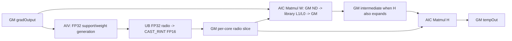
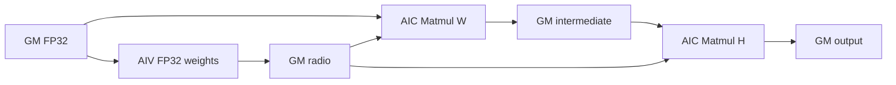
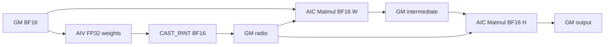

# UpsampleBicubic2dAAGrad A2/A3 ACLNN 算子知识

## 算子速览

| 项目 | 内容 |
|---|---|
| 实际入口 | 公开两段式 `aclnnUpsampleBicubic2dAAGradGetWorkspaceSize` / `aclnnUpsampleBicubic2dAAGrad`，无其它公开版本后缀。 |
| 计算语义 | 双三次抗锯齿插值的反向传播；把 `gradOutput[N,C,Hin,Win]` 按 H/W 可分离权重累加到 `gradInput[N,C,Hout,Wout]`。 |
| 输入输出 | `gradOutput`、`out` 均为四维 NCHW/ND，dtype 同为 FP16、FP32 或 BF16；`outputSize=[Hin,Win]`，`inputSize=[N,C,Hout,Wout]`。 |
| 执行类型 | 单个可达 `__aicore__` Kernel；同一 body 先由 AIV Vector 生成权重矩阵，再由 `matmul::Matmul` 执行 AIC_CUBE 宽/高方向乘法，属于单 Kernel CV 路线。 |
| Kernel 路线 | R-001 FP16（key 1）、R-002 FP32（key 2）、R-003 BF16（key 3）；各 Route 内再按 `scale_w/scale_h` 是否约等于 1 裁剪 W/H 阶段。 |
| 核心资源 | 输入/输出 GM、用户 workspace 的中间张量与逐核权重矩阵、Matmul system workspace、Vector UB `TBuf/TQue`、Matmul 库管理的 L1/L0A/L0B/L0C。 |
| 来源闭包 | `source_closed`：公开 ACLNN、L0 launcher、A2/A3 Tiling/POD、三 dtype router、Vector 权重 body、Matmul 当前 GM/ND/T specialization 和平台配置均闭合；Matmul 库内部层级分配是固定仓外部库边界。 |
| 验证状态 | 已完成源码闭包检查；本次知识提取未执行编译、真机、数值或性能测试。 |

## 接口与语义

### 计算语义

令 `gradOutput` 空间尺寸为 `(Hin, Win)`，`gradInput` 空间尺寸为 `(Hout, Wout)`。每一维先计算反向映射尺度：`alignCorners=true` 时为 `(out-1)/(in-1)`（`in<=1` 时为 0），否则优先使用 ACLNN 端由 `1/scales*` 得到的正尺度，未提供尺度时为 `out/in`。抗锯齿支撑域为 `support=max(2*scale,2)`，核函数使用 `a=-0.5` 的分段三次卷积，并对每个源点覆盖的目标点权重做归一化。

Device 将二维累加分解为两次矩阵乘：需要 W 扩展时先计算 `gradOutput × weightW`，若还需 H 扩展则中间结果写 workspace；随后计算 `weightH × (gradOutput 或 W 中间结果)`。两轴尺度均约等于 1 时，源码仍进入 H 阶段，以恒等权重矩阵完成输出。

### 输入、输出与属性

| 参数 | shape/layout | dtype | 约束、默认值与语义 |
|---|---|---|---|
| `gradOutput` | 4D NCHW；ND 按 NCHW 解释 | FP16/FP32/BF16 | 非空，格式与 `out` 相同；API 支持非连续输入并先做 `Contiguous`。 |
| `outputSize` | 长度 2 | INT64 | 必须为 `[gradOutput.H, gradOutput.W]`，元素大于 0。 |
| `inputSize` | 长度 4 | INT64 | `[N,C,gradInput.H,gradInput.W]`，元素大于 0。 |
| `alignCorners` | 标量 | bool | 是否按角点对齐。 |
| `scalesH/scalesW` | 标量 | double（进入 L0 前转 float） | 不得为负；正数在 ACLNN 端先以 double 求倒数，再窄化为 float。 |
| `out` | 4D NCHW/ND | 与输入相同 | API 支持非连续输出，内部临时输出完成后 `ViewCopy` 提交。 |

公开文档还约束：每维不超过 `2^20`，`N*C*Hin < 2^31`，A2/A3 每轴缩小倍数不超过 50，且 `(Hin*Win + Hout*Wout + Hin*Wout)*N*C*sizeof(dtype) < 60 GiB`。

### 入口与版本

仓内只公开无版本后缀的两段式 ACLNN。第一段构造 executor 和完整计算图，第二段在调用者提供的 workspace 与 stream 上执行。README/API 产品表明确支持 Atlas A2、A3；OpDef 的 `ascend910b`、`ascend910_93` 配置及两套 binary JSON 对三种 dtype 均有接线，未发现公开性冲突。

## Host/Launcher 执行流程

### 参数校验与前处理

`CheckParams` 依次检查非空指针、dtype 支持与一致性、非负 scale、输入输出均为 4D、`inputSize/outputSize` 长度、NCHW 时 N/C 一致，以及正 shape/ND 或 NCHW 格式。非 RegBase 平台额外要求实际反向尺度 `>=0.02` 且相关维度不超过 `INT32_MAX`。空 Tensor 分支在这些检查后返回 workspace 0，不添加 Kernel。

非空路径依次添加 `Contiguous(gradOutput)`、对 `out` 的 `Contiguous`（该返回值未被后续算子使用）、以 double 计算正 scale 的倒数并转 float、添加 `UpsampleBicubic2dAAGrad` AICore launcher、最后 `ViewCopy(upsampleOut,out)`。任一步返回空指针都会中止 executor 构造。

### 参数、Workspace 与生命周期

L0 `UpsampleBicubic2dAAGrad` 分配与 `out` 同 view shape/dtype/format 的临时张量，并把一个 AICore 节点加入 executor。Tiling 的用户区域由两部分组成：

```text
intermediate_elems = N*C*Hin*Wout
radio_w_elems = slide_size * singleCoreK_w
workspace[0] = intermediate_elems*sizeof(T)
             + radio_w_elems*needCoreNum*8
             + 32 MiB
```

Kernel 通过 `GetUserWorkspace` 获得用户区，Matmul 注册则通过 `GetSysWorkSpacePtr` 使用系统区。权重矩阵实际以 `intermediate_elems + max(radio_w_elems,radio_h_elems)*blockIdx` 为元素偏移；Host 公式只显式使用 `radio_w_elems` 并按每元素 8 字节保守计量，这一固定源码差异必须保留。executor 持有临时张量和 launch 描述直至第二段在指定 stream 完成；`ViewCopy` 是最终输出提交边界。

### 启动图与失败传播

```text
aclnn...GetWorkspaceSize
  -> Contiguous(gradOutput)
  -> ADD_TO_LAUNCHER_LIST_AICORE(UpsampleBicubic2dAAGrad)
       -> Tiling: key/blockDim/POD/workspace
       -> upsample_bicubic2d_aa_grad(input,tempOut,workspace,tiling)
            Vector 生成 W/H 权重 -> GM workspace
            Matmul W（条件） -> tempOut 或 GM intermediate
            SyncAll
            Matmul H（条件） -> tempOut
  -> ViewCopy(tempOut,out)
aclnn... -> CommonOpExecutorRun(..., stream)
```

这是一个核心语义 Kernel；Kernel launch 添加失败会使 L0 返回空，第一段返回内部错误，后续 `ViewCopy` 不会被加入。Kernel 内 `GetUserWorkspace()==nullptr` 直接无输出返回。W→H 的 GM 中间结果由同一 Kernel 的 `SyncAll` 保护；最终临时输出由同 stream 上的 `ViewCopy` 消费。

## Route 与参数设计

### 分核与资源计算

`slide_size=16`。Tiling 以平台 `GetCoreNumAic()` 为候选核数，将 W 的 `ceil(Wout/16)` 个滑窗、H 的 `ceil(Hout/16)` 个滑窗分到各核；不足整除的尾窗再按行分组，写入每核 `slideStart/End`、`tailSlideStart/End`、`tailRowStart/End`。`needCoreNum=max(needCoreNumW,needCoreNumH,1)`。

每方向 `singleCoreK=min(2*ceil(16/scale)+2*ceil(maxInterp), 对应输入轴长)`，`maxInterp=2*ceil(support)+1`。Matmul W 的原始形状为 `(N*C*Hin, Wout, Win)`，单块形状 `(N*C*Hin,16,singleCoreK_w)`；H 为 `(Hout,Wout,Hin)`，单块 `(16,Wout,singleCoreK_h)`。`MatmulApiTiling::GetTiling` 生成 `TCubeTiling`；base/step/L1/L0 数值未由本算子源码显式固定。

### Route 选择

| 顺序 | Route | Key/模板 | 精确选择条件与优先级 | 不适用去向 |
|---:|---|---|---|---|
| 1 | R-001 FP16 CV | key 1 / `UpSampleBicubic2dAAGradND<half>` | 输入 dtype `DT_FLOAT16` | 非 FP16 转下一 dtype 分支 |
| 2 | R-002 FP32 CV | key 2 / `UpSampleBicubic2dAAGradND<float>` | 输入 dtype `DT_FLOAT` | 非 FP32 转下一 dtype 分支 |
| 3 | R-003 BF16 CV | key 3 / `UpSampleBicubic2dAAGradND<bfloat16_t>` | 输入 dtype `DT_BF16` | 其它 dtype 在 API/Tiling 失败；未知 key 无输出 |

```text
if dtype == FP16: key=1, T=half
else if dtype == FP32: key=2, T=float
else if dtype == BF16: key=3, T=bfloat16_t
else: fail

within every route:
  needExpandW = abs(scale_w-1) >= 1e-6
  needExpandH = abs(scale_h-1) >= 1e-6
  if needExpandW: W stage
  SyncAll()
  if needExpandH || !needExpandW: H stage
```

### 模板/实现执行矩阵

| Route | key/selector | dtype/shape/platform 完整命中条件 | 执行族与 kernel 节点 | 实际模板/body | 内存与同步特征 | tail/fallback |
|---|---|---|---|---|---|---|
| R-001 FP16 CV | 1 | A2/A3，FP16，API/shape/scale 检查通过 | 单 Kernel：AIV Vector 权重 + AIC_CUBE Matmul W/H | `UpSampleBicubic2dAAGradND<half>::Process` | FP32 权重在 UB 生成，`CAST_RINT` 到 FP16 后写 GM；W/H 之间 `SyncAll` | Matmul `SetTail`；滑窗与行尾由 POD 数组限制 |
| R-002 FP32 CV | 2 | A2/A3，FP32，同上 | 同上 | `...<float>::Process` | FP32 权重直接写 GM，无 cast queue 消费 | 同上 |
| R-003 BF16 CV | 3 | A2/A3，BF16，同上 | 同上 | `...<bfloat16_t>::Process` | FP32 权重 `CAST_RINT` 到 BF16 后写 GM | 同上 |

### 隐藏性能 Guard

| Guard | Host/Tiling 条件 | Device/资源原因 | 影响 Route | 不满足时去向 | 源码符号 |
|---|---|---|---|---|---|
| 缩小倍数 | 非 RegBase `realScaleH/W >= 0.02` | 约束权重支撑域、队列长度及单核 K | 全部 | ACLNN 参数错误 | `CheckInputElement` |
| 轴恒等裁剪 | `FloatEqual(scale,1.0)`，阈值 `1e-6` | 跳过对应 W Matmul；H 在 W 未执行时仍负责输出 | 全部 | 同 Route 内另一阶段图 | `setScale`、`Process` |
| 核列表容量 | `MAX_CORE_CONT=50`，Tiling 循环以平台 AIC 核数索引数组 | POD 每方向只有 50 个核槽 | 全部 | 固定源码未给显式 fallback | `GetNeedCoreNumW/H` |
| 权重 DMA 对齐 | `ceil(radioBuf.GetSize()/(32/sizeof(T)))*(32/sizeof(T))` | UB→GM `DataCopy` 按 32 字节块提交 | 全部 | 通过 padding 覆盖尾部 |
| Matmul tail | `tensorCIndex+16 > axis` | 最后一滑窗 M/N 小于 16 | 全部 | `SetTail` | `calculateWidthExtension/HeightExtension` |
| 空用户 workspace | `GetUserWorkspace(workspace)==nullptr` | 中间/权重 GM 无有效地址 | 全部 | Kernel 直接返回，无输出 | Kernel entry |

### POD/ABI

`UpsampleBicubicAAGradTilingData` 由 `BEGIN_TILING_DATA_DEF` 生成；宏展开和嵌套 `TCubeTiling` 的 `sizeof/alignof/offsetof` 在固定仓不可见。字段顺序如下，每个数组长度均为 50。

| 结构 | 字段 | 类型/位宽 | ABI 布局 | 单位 | Host/launcher producer | Device consumer | 边界 |
|---|---|---|---|---|---|---|---|
| `UpsampleBicubicAAGradTilingData` | `slide_size` | int64/64 | 宏生成，offset 不可见 | 输出元素 | `getSlideSize=16` | W/H 滑窗循环 | 固定 16 |
| 同上 | `dataType` | int64/64 | 同上 | 枚举 1/2/3 | `GetDataTypeVal` | 是否 cast 权重 | 其它值不应可达 |
| 同上 | `scale_w` | float/32 | 同上 | 坐标比 | `setScale` | W 中心映射 | 可为 0 |
| 同上 | `scale_h` | float/32 | 同上 | 坐标比 | `setScale` | H 中心映射 | 可为 0 |
| 同上 | `invscale_w` | float/32 | 同上 | 权重尺度 | `scale>=1 ? 1/scale : 1` | W 核函数 | 正值 |
| 同上 | `invscale_h` | float/32 | 同上 | 权重尺度 | 同上 | H 核函数 | 正值 |
| 同上 | `support_w` | float/32 | 同上 | 输出坐标 | `max(2*scale_w,2)` | W 支撑域 | `>=2` |
| 同上 | `max_interp_size_w` | int16/16 | 同上 | 元素 | `2*ceil(support_w)+1` | W 队列/K 上界 | 受 API scale 限制 |
| 同上 | `support_h` | float/32 | 同上 | 输出坐标 | `max(2*scale_h,2)` | H 支撑域 | `>=2` |
| 同上 | `max_interp_size_h` | int16/16 | 同上 | 元素 | `2*ceil(support_h)+1` | H 队列/K 上界 | 同上 |
| 同上 | `intermediate_matrix_size` | uint64/64 | 同上 | T 元素 | `N*C*Hin*Wout` | workspace 权重区基址 | 乘法溢出未显式检查 |
| 同上 | `radio_matrix_size` | uint32/32 | 同上 | 元素 | `16*singleCoreK_w` | W 权重容量 | uint32 窄化 |
| 同上 | `radio_matrix_size_h` | uint32/32 | 同上 | 元素 | `16*singleCoreK_h` | H 权重容量 | uint32 窄化 |
| 同上 | `input_shapes[4]` | int64[4] | 同上 | 元素 | `gradOutput` shape | GM 地址/K | NCHW |
| 同上 | `output_shapes[4]` | int64[4] | 同上 | 元素 | `inputSize` shape | GM 地址/M/N | NCHW |
| 同上 | `need_core_num_w` | uint32/32 | 同上 | core | `GetNeedCoreNumW` | W 核 guard | `<=platform cores` |
| 同上 | `need_core_num_h` | uint32/32 | 同上 | core | `GetNeedCoreNumH` | H 核 guard | 同上 |
| 同上 | `slideStartList_w[50]` | int64[50] | 同上 | W 元素 | W 分核循环 | 每核主窗起点 | inactive 槽为 0 |
| 同上 | `slideEndList_w[50]` | int64[50] | 同上 | W 元素 | 同上 | 每核主窗终点 | 同上 |
| 同上 | `tailSlideStartList_w[50]` | int64[50] | 同上 | W 元素 | W 尾组 | 每核尾窗起点 | 同上 |
| 同上 | `tailSlideEndList_w[50]` | int64[50] | 同上 | W 元素 | 同上 | 每核尾窗终点 | 同上 |
| 同上 | `tailRowStartList_w[50]` | int64[50] | 同上 | flattened N*C*Hin 行 | W 尾组 | 尾窗行起点 | 同上 |
| 同上 | `tailRowEndList_w[50]` | int64[50] | 同上 | 行 | W 尾组 | 尾窗行终点 | 同上 |
| 同上 | `slideStartList_h[50]` | int64[50] | 同上 | H 元素 | H 分核循环 | 每核主窗起点 | inactive 槽为 0 |
| 同上 | `slideEndList_h[50]` | int64[50] | 同上 | H 元素 | 同上 | 每核主窗终点 | 同上 |
| 同上 | `tailSlideStartList_h[50]` | int64[50] | 同上 | H 元素 | H 尾组 | 每核尾窗起点 | 同上 |
| 同上 | `tailSlideEndList_h[50]` | int64[50] | 同上 | H 元素 | 同上 | 每核尾窗终点 | 同上 |
| 同上 | `tailRowStartList_h[50]` | int64[50] | 同上 | Wout 行 | H 尾组 | 尾窗列起点 | 同上 |
| 同上 | `tailRowEndList_h[50]` | int64[50] | 同上 | Wout 行 | H 尾组 | 尾窗列终点 | 同上 |
| 同上 | `matmulTiling_w` | `TCubeTiling` | 嵌套布局不可见 | Matmul 参数 | `MatmulApiTiling::GetTiling` | `matmulW` 注册与运行 | W 恒等时 inactive |
| 同上 | `matmulTiling_h` | `TCubeTiling` | 同上 | Matmul 参数 | 同上 | `matmulH` | H 不执行时 inactive |

### Route 源码闭包

| Route | Key/selector | Host/Tiling producer | POD/参数 | Kernel entry/router | Kernel body/直接依赖 | 构建接线 |
|---|---|---|---|---|---|---|
| R-001 FP16 | 1 | `upsample_bicubic2d_aa_grad_tiling.cpp::RunBigKernelTiling` | `UpsampleBicubicAAGradTilingData` | `upsample_bicubic2d_aa_grad.cpp::upsample_bicubic2d_aa_grad` | `UpSampleBicubic2dAAGradND<half>` + Matmul API | `ascend910b/ascend910_93` binary JSON |
| R-002 FP32 | 2 | 同上 | 同上 | 同上 | `...<float>` + Matmul API | 同上 |
| R-003 BF16 | 3 | 同上 | 同上 | 同上 | `...<bfloat16_t>` + Matmul API | 同上 |

## Kernel 实现

### 公共执行流程

entry 解析 POD 与两份 `TCubeTiling`，拒绝空用户 workspace，按 key 实例化 `T`，再以 `REGIST_MATMUL_OBJ(&pipe, GetSysWorkSpacePtr(), matmulW,...,matmulH,...)` 注册两个 GM/ND Matmul。`Init` 将逻辑 `blockIdx=GetBlockIdx()/2`，分配权重生成 UB，并绑定输入、输出、用户 workspace GM。`GetSubBlockIdx()==1` 的子块只执行 `SyncAll` 后退出；活动子块完成 W、全核同步、H。

### Route R-001：FP16 CV

#### 适用条件

##### 选择证据

| 层级 | 文件 | 符号 | 源码谓词/参数 | 结果/下一跳 |
|---|---|---|---|---|
| API | `op_api/aclnn_upsample_bicubic2d_aa_grad.cpp` | `CheckDtypeValid` | FP16 在支持表且 out 同 dtype | 进入 launcher |
| Tiling | `op_host/upsample_bicubic2d_aa_grad_tiling.cpp` | `GetTilingKeyVal` | `DT_FLOAT16` | key 1 |
| Router | `op_kernel/upsample_bicubic2d_aa_grad.cpp` | `TILING_KEY_IS(1)` | key 1 | `UpSampleBicubic2dAAGradND<half>` |

#### Device 数据流

##### 函数级调用链

```text
upsample_bicubic2d_aa_grad
  -> REGIST_MATMUL_OBJ<GM ND half>
  -> Init -> ParseTilingData/getQueueSize/InitBuffer
  -> Process
     -> WDirectionExpansion (if scale_w != 1)
        -> calculateIntermediateTensorX -> calculateRadioTensor
        -> Cast<half,CAST_RINT> -> copyRadioTensorToGm
        -> calculateWidthExtension -> matmulW.IterateAll/End
     -> SyncAll
     -> HDirectionExpansion (if scale_h != 1 || W skipped)
        -> calculateIntermediateTensorY -> calculateRadioTensorH
        -> Cast<half,CAST_RINT> -> copyRadioTensorToGm
        -> calculateHeightExtension -> matmulH.IterateAll/End
```

##### 源码等价伪码

```text
for each assigned 16-wide W window:
  vector-compute source centers, clipped min/max support and normalized FP32 cubic weights
  cast weights to half; DMA aligned weight tile to workspace[intermediate + radio*block]
  matmulW(input rows, weight tile) -> output if H identity else workspace intermediate
SyncAll()
for each assigned 16-high H window when required:
  vector-compute normalized FP32 weights; cast to half; DMA to same per-block radio slice
  for nc: matmulH(weight tile, input-or-intermediate) -> output
```

#### 内存与数据搬运

##### 资源与搬运表

| 层级/缓冲区 | offset/地址公式 | extent/容量公式 | dtype/layout | producer | consumer | owner/lifetime | 对齐/复用 |
|---|---|---|---|---|---|---|---|
| GM input | row offsets from `instart*`, `instartIndex`, N/C | `N*C*Hin*Win` | FP16/NCHW | caller | matmul W/H | caller | read-only |
| GM intermediate | workspace offset 0 | `N*C*Hin*Wout` elements | FP16/ND rows | matmulW | matmulH | executor workspace | only when both axes expand |
| GM radio | `intermediate_size + radioSize*blockIdx` | `max(16*K_w,16*K_h)` elements | FP16/ND | Vector DMA | Matmul B/A | executor workspace | W/H sequentially reuse |
| UB center/xMin/xSize/floor | independent aligned TBuf | each `align32(queueSize*4)` bytes | FP32 | Vector ops | scalar/Vector weight logic | `TPipe`/Kernel | W/H reuse after stage |
| UB weight | TBuf | `align32(maxInterp*4)` | FP32 | scalar `SetValue` | normalization | `TPipe` | reused per source point |
| UB radioQueue | VECOUT depth 1 | `align32(radioSize*4)` | FP32 | weight logic | Cast | `TPipe` | Free after cast |
| UB radioCastQueue | VECOUT depth 1 | `align32(radioSize*2)` | FP16 | Cast | MTE3→GM | `TPipe` | W/H reuse after Free |
| L1/L0A/L0B/L0C | Matmul library-owned | from generated `TCubeTiling` | GM ND FP16 operands/result | Matmul prologue/mainloop | Matmul epilogue | system workspace/library | exact bytes fixed仓不可见 |

##### 分层内存布局



##### 字节账、交接边与复用顺序

```text
workspace_total = intermediate_elems*2 + radio_w_elems*needCoreNum*8 + 32 MiB
UB_total = 4*align32(queueSize*4) + align32(maxInterp*4)
         + align32(radioSize*4) + align32(radioSize*2)
L1/L0 = generated TCubeTiling; exact bytes unavailable in this repository
```

| 边/复用子区 | producer | offset/extent | dtype/layout | consumer | ordering/sync | owner/lifetime | 安全条件 |
|---|---|---|---|---|---|---|---|
| radio W→matmulW | `copyRadioTensorToGm` | `intermediate+radioSize*block`, aligned tile | FP16/ND | `matmulW` | `MTE3_MTE2` flag/wait | workspace, one Kernel | no overwrite before `End` |
| W intermediate→H | `matmulW.IterateAll` | 0 / `N*C*Hin*Wout` | FP16/ND | `matmulH` | `SyncAll` | workspace | all W producers complete |
| radio W→radio H reuse | W stage | same per-block slice | FP16/ND | H stage | W `End` + global `SyncAll` | workspace | sequential phase |

#### 同步、精度与尾块

##### 同步与数值边界表

| 阶段 | primitive/机制 | producer | consumer/等待点 | 保护对象 | 精度/尾块 |
|---|---|---|---|---|---|
| Vector→scalar reads | repeated `PipeBarrier<PIPE_V>` / `V_S` flag | Vector center/min/size | `GetValue` weight loops | UB metadata | FP32 calculations |
| UB→GM radio | `MTE3_MTE2` Set/Wait | `DataCopy` | Matmul tensor bind | per-core radio | 32-byte padded DMA |
| W→H | `SyncAll` | all W Matmul tiles | H stage | GM intermediate | ensures phase visibility |
| weight cast | `Cast(...CAST_RINT)` | normalized FP32 weights | FP16 Matmul | radio tile | round-to-nearest integer mode defined by API |
| tail | `SetTail` + POD row/window bounds | full tiles | last Matmul | output extent | no logical write beyond axis |

#### 关键实现

##### 符号证据表

| 阶段 | 文件 | 符号/模板实例 | 实现事实 |
|---|---|---|---|
| Host/Tiling producer | `op_host/upsample_bicubic2d_aa_grad_tiling.cpp` | `setScale/GetNeedCoreNum/getTCubeTiling_*` | 尺度、分核、workspace 和 Matmul shape |
| Kernel entry/router | `op_kernel/upsample_bicubic2d_aa_grad.cpp` | key 1 + `REGIST_MATMUL_OBJ` | FP16 模板和两 Matmul 对象 |
| Device body/helper | `op_kernel/upsample_bicubic2d_aa_grad.h` | `UpSampleBicubic2dAAGradND<half>` | Vector 权重、GM 交接、Matmul 与 tail |

### Route R-002：FP32 CV

#### 适用条件

##### 选择证据

| 层级 | 文件 | 符号 | 源码谓词/参数 | 结果/下一跳 |
|---|---|---|---|---|
| API | `op_api/aclnn_upsample_bicubic2d_aa_grad.cpp` | `CheckDtypeValid` | FP32 且 out 同 dtype | launcher |
| Tiling | `op_host/upsample_bicubic2d_aa_grad_tiling.cpp` | `GetTilingKeyVal` | `DT_FLOAT` | key 2 |
| Router | `op_kernel/upsample_bicubic2d_aa_grad.cpp` | `TILING_KEY_IS(2)` | key 2 | `UpSampleBicubic2dAAGradND<float>` |

#### Device 数据流

##### 函数级调用链

```text
entry -> UpSampleBicubic2dAAGradND<float>::Init/Process
      -> Vector FP32 radio generation -> radioQueue -> GM
      -> Matmul<float> W -> SyncAll -> Matmul<float> H
```

##### 源码等价伪码

```text
same window/core/address flow as R-001;
keep normalized weights in FP32, enqueue radioQueue directly, DMA to GM,
then execute GM/ND float Matmul W/H with SetTail.
```

#### 内存与数据搬运

##### 资源与搬运表

| 层级/缓冲区 | offset/地址公式 | extent/容量公式 | dtype/layout | producer | consumer | owner/lifetime | 对齐/复用 |
|---|---|---|---|---|---|---|---|
| GM intermediate/radio | 同 R-001 | `intermediate` 与每核 `radioSize` | FP32/ND | W/Vector | H/Matmul | workspace | phase reuse |
| UB metadata/weight | 同 R-001 | `4*align32(queueSize*4)+align32(maxInterp*4)` | FP32 | Vector | weight logic | pipe | reused |
| UB radioQueue | VECOUT depth 1 | `align32(radioSize*4)` | FP32 | weight logic | DMA | pipe | direct path |
| UB radioCastQueue | 已分配但该 Route 不消费 | `align32(radioSize*4)` | FP32 | none | none | pipe | inactive allocation |
| L1/L0 | library-owned | `TCubeTiling` | FP32/ND | Matmul | Matmul | library | exact bytes不可见 |

##### 分层内存布局



##### 字节账、交接边与复用顺序

```text
workspace_total = intermediate_elems*4 + radio_w_elems*needCoreNum*8 + 32 MiB
UB_total = 4*align32(queueSize*4) + align32(maxInterp*4) + 2*align32(radioSize*4)
```

| 边/复用子区 | producer | offset/extent | dtype/layout | consumer | ordering/sync | owner/lifetime | 安全条件 |
|---|---|---|---|---|---|---|---|
| radio | `radioQueue` DMA | per-core slice | FP32/ND | Matmul W/H | `MTE3_MTE2` | workspace | `End` before reuse |
| intermediate | Matmul W | workspace base | FP32/ND | Matmul H | `SyncAll` | workspace | both axes expand |

#### 同步、精度与尾块

##### 同步与数值边界表

| 阶段 | primitive/机制 | producer | consumer/等待点 | 保护对象 | 精度/尾块 |
|---|---|---|---|---|---|
| weights | no cast | FP32 normalization | FP32 Matmul | radio | preserves FP32 |
| phases | `SyncAll` | W | H | intermediate | same tail guards as R-001 |

#### 关键实现

##### 符号证据表

| 阶段 | 文件 | 符号/模板实例 | 实现事实 |
|---|---|---|---|
| Host/Tiling producer | `op_host/upsample_bicubic2d_aa_grad_tiling.cpp` | `GetTilingKeyVal/getWorkSpace` | key 2 and 4-byte intermediate |
| Kernel entry/router | `op_kernel/upsample_bicubic2d_aa_grad.cpp` | key 2 | float Matmul registration |
| Device body/helper | `op_kernel/upsample_bicubic2d_aa_grad.h` | `...<float>` | direct FP32 radio path |

### Route R-003：BF16 CV

#### 适用条件

##### 选择证据

| 层级 | 文件 | 符号 | 源码谓词/参数 | 结果/下一跳 |
|---|---|---|---|---|
| API | `op_api/aclnn_upsample_bicubic2d_aa_grad.cpp` | `CheckDtypeValid` | BF16 且 out 同 dtype | launcher |
| Tiling | `op_host/upsample_bicubic2d_aa_grad_tiling.cpp` | `GetTilingKeyVal` | `DT_BF16` | key 3 |
| Router | `op_kernel/upsample_bicubic2d_aa_grad.cpp` | `TILING_KEY_IS(3)` | key 3 | `UpSampleBicubic2dAAGradND<bfloat16_t>` |

#### Device 数据流

##### 函数级调用链

```text
entry -> UpSampleBicubic2dAAGradND<bfloat16_t>::Init/Process
      -> FP32 weight generation -> CAST_RINT BF16 -> GM radio
      -> Matmul<bfloat16_t> W -> SyncAll -> Matmul<bfloat16_t> H
```

##### 源码等价伪码

```text
identical address/window graph to R-001;
only T is bfloat16_t and normalized FP32 weights are rounded to BF16 before Matmul.
```

#### 内存与数据搬运

##### 资源与搬运表

| 层级/缓冲区 | offset/地址公式 | extent/容量公式 | dtype/layout | producer | consumer | owner/lifetime | 对齐/复用 |
|---|---|---|---|---|---|---|---|
| GM intermediate/radio | 同 R-001 | 同 R-001 | BF16/ND | W/Vector | H/Matmul | workspace | phase reuse |
| UB metadata/radio | 同 R-001 | FP32 radio + BF16 cast radio | FP32/BF16 | Vector/Cast | DMA/Matmul | pipe | depth 1 |
| L1/L0 | library-owned | `TCubeTiling` | BF16/ND | Matmul | Matmul | library | exact bytes不可见 |

##### 分层内存布局



##### 字节账、交接边与复用顺序

```text
workspace_total = intermediate_elems*2 + radio_w_elems*needCoreNum*8 + 32 MiB
UB_total = 4*align32(queueSize*4) + align32(maxInterp*4)
         + align32(radioSize*4) + align32(radioSize*2)
```

| 边/复用子区 | producer | offset/extent | dtype/layout | consumer | ordering/sync | owner/lifetime | 安全条件 |
|---|---|---|---|---|---|---|---|
| radio/intermediate | 同 R-001 | 同 R-001 | BF16/ND | BF16 Matmul | flags + `SyncAll` | workspace | same phase constraints |

#### 同步、精度与尾块

##### 同步与数值边界表

| 阶段 | primitive/机制 | producer | consumer/等待点 | 保护对象 | 精度/尾块 |
|---|---|---|---|---|---|
| weight cast | `CAST_RINT` | FP32 normalized weights | BF16 Matmul | radio | one narrowing before each axis Matmul |
| phases/tail | `SyncAll` + `SetTail` | W/full tile | H/last tile | GM intermediate/output | same as R-001 |

#### 关键实现

##### 符号证据表

| 阶段 | 文件 | 符号/模板实例 | 实现事实 |
|---|---|---|---|
| Host/Tiling producer | `op_host/upsample_bicubic2d_aa_grad_tiling.cpp` | `GetTilingKeyVal` | key 3 |
| Kernel entry/router | `op_kernel/upsample_bicubic2d_aa_grad.cpp` | key 3 | BF16 Matmul registration |
| Device body/helper | `op_kernel/upsample_bicubic2d_aa_grad.h` | `...<bfloat16_t>` | FP32 weight then BF16 cast |

## 算子特定优化

### Trick T-001：两轴可分离 Matmul 与恒等轴裁剪

#### 触发与源码依据

- 适用 Route：R-001/R-002/R-003
- 触发条件：`abs(scale_w-1)>=1e-6` 才执行 W；`abs(scale_h-1)>=1e-6 || W 未执行` 才执行 H。
- Golden 来源：[`op_kernel/upsample_bicubic2d_aa_grad.h:347-366`](../../../../../../../cann-ops-raw/ascendc/ops-cv/bb717d075d129fd1fc7b96b2886824a1d153ed2f/image/upsample_bicubic2d_aa_grad/op_kernel/upsample_bicubic2d_aa_grad.h#L347-L366)

**官方源码（固定 Commit 连续逐字摘录）**：

```cpp
if (needExpendX) {
    WDirectionExpansion();
}
SyncAll();
if (needExpendY || !needExpendX) {
    HDirectionExpansion();
}
```

#### 机制与设计原因

双三次二维权重可分离为 W/H 两次矩阵乘；若某轴尺度为 1，源码省去该轴的权重构造与 Matmul。唯一必须保留的例外是 W 被省略时 H 仍执行，以保证存在输出生产者。两轴都需扩展时，W 结果只物化一次到 GM intermediate，再由 H 消费。

#### 迁移边界

- 适用：可分离二维插值反向或其它可表示为左右权重矩阵乘的算子。
- 前提：NCHW/ND、轴间权重独立、GM intermediate 容量和全核同步可用。
- 失效：非可分离核或轴间依赖必须使用联合计算路线。
- 未验证：本次知识提取未执行编译、真机、数值或性能测试。

#### 错误做法

不能在两轴恒等时同时跳过 W/H，否则临时输出从未写入；源码用 `needExpendY || !needExpendX` 避免该错误。

### Trick T-002：每核权重切片复用并以事件约束 MTE 可见性

#### 触发与源码依据

- 适用 Route：R-001/R-002/R-003
- 触发条件：每个 W/H 滑窗权重完成后、进入对应 Matmul 前。
- Golden 来源：[`op_kernel/upsample_bicubic2d_aa_grad.h:617-640`](../../../../../../../cann-ops-raw/ascendc/ops-cv/bb717d075d129fd1fc7b96b2886824a1d153ed2f/image/upsample_bicubic2d_aa_grad/op_kernel/upsample_bicubic2d_aa_grad.h#L617-L640)

**官方源码（固定 Commit 连续逐字摘录）**：

```cpp
workSpaceRadioOffset = intermediate_matrix_size + radioSize * blockIdx;
DataCopy(intermediateTensorGm[workSpaceRadioOffset], radioCastTensor,
    (radioCastTensor.GetSize() + size - 1) / size * size);
event_t eventID2 = static_cast<event_t>(pipe.FetchEventID(HardEvent::MTE3_MTE2));
SetFlag<HardEvent::MTE3_MTE2>(eventID2);
WaitFlag<HardEvent::MTE3_MTE2>(eventID2);
```

#### 机制与设计原因

每核只保留一个可覆盖的权重 GM 切片，W/H 滑窗顺序复用；32 字节上取整保证 DMA 粒度，`MTE3_MTE2` 事件使随后作为 Matmul GM 操作数读取前完成写入。该机制把权重 workspace 从“所有滑窗全量”降为“每核一个最大滑窗”。

#### 迁移边界

- 适用：权重可即时生成、每核串行消费的 tiled Matmul。
- 前提：每核切片互不重叠，Matmul `End` 和 W/H `SyncAll` 先于覆盖。
- 失效：并发消费多个权重 tile 时需多缓冲或独立切片。
- 未验证：本次知识提取未执行编译、真机、数值或性能测试。

#### 错误做法

固定源码的真实反例边界是省略 MTE3→MTE2 事件后立即将同一 GM 切片绑定给 Matmul，可能破坏写后读顺序。

## 模板与实现对比

| 对比维度 | R-001 FP16 | R-002 FP32 | R-003 BF16 | 设计选择依据 |
|---|---|---|---|---|
| 命中条件/优先级 | key 1 | key 2 | key 3 | dtype 直接映射 |
| 执行族/节点图 | Vector→Cube W/H | 同 | 同 | 单 Kernel 相同阶段图 |
| M/N/K、tile 与 scheduler | 16 轴 tile，T=half | 16 轴 tile，T=float | 16 轴 tile，T=bf16 | 业务维度相同，库内部 tiling 随 dtype 生成 |
| workspace/L1/L0/UB | 2-byte intermediate + FP32/cast UB | 4-byte intermediate + 两个 FP32 radio buffer 分配 | 同 FP16 容量 | dtype 大小与 cast path |
| AIC/AIV 或 kernel 交接 | UB FP32→FP16 GM→Cube | UB FP32 GM→Cube | UB FP32→BF16 GM→Cube | 以 GM radio 为跨族边 |
| 同步、精度与 tail | CAST_RINT；SyncAll；SetTail | 不 cast；SyncAll；SetTail | CAST_RINT；SyncAll；SetTail | 权重精度匹配 Matmul T |
| fallback/失败边界 | 未知 key 无输出 | 同 | 同 | API 先过滤其它 dtype |

## 平台差异

| 项目 | A2 | A3 | 950 |
|---|---|---|---|
| 支持状态 | 公开支持 | 公开支持 | 公开支持，另见 `_950` 卡 |
| Host/Launcher | `ascend910b`，共用非 RegBase Tiling | `ascend910_93`，共用非 RegBase Tiling | RegBase Tiling，key 由 copy/索引宽度/确定性组成 |
| Kernel/资源 | Vector+Cube 单 Kernel、GM intermediate/radio、Matmul system workspace | 同 | AIV copy 或 SIMT；无 Cube Matmul/intermediate |

## 限制与失败边界

- 非 RegBase 缩小倍数必须小于等于 50；API/Tiling 还依赖正 shape、四维 NCHW/ND、同 dtype/format 和正确属性 shape。
- `MAX_CORE_CONT=50`，固定源码未对平台 AIC 核数超过 50 给出显式保护。
- Host radio workspace 公式使用 W 容量且每元素计 8 字节，Device offset 使用 W/H 最大容量；固定源码没有显式证明所有合法 shape 下该保守量必然覆盖 H 容量。
- `TCubeTiling` 的具体 L1/L0 base/step/depth、Matmul 累加 dtype 和内部 scheduler 属于固定仓外部 Matmul 库生成边界，不推测补齐。
- 未知 TilingKey、空用户 workspace 或 `GetTiling` 失败均没有 Device fallback；其中 `GetTiling` 失败的 helper 仅 `return`，上层仍继续填充 POD，这是固定源码失败传播边界。

## 源码索引

### 链路索引

| 链路阶段 | 文件 | 关键符号 | 支撑内容 |
|---|---|---|---|
| 入口声明/约束 | `docs/aclnnUpsampleBicubic2dAAGrad.md` | 产品表、函数原型、约束 | A2/A3 公开支持与接口语义 |
| 入口声明/约束 | `op_host/op_api/aclnn_upsample_bicubic2d_aa_grad.h` | 两段式 ACLNN | ABI 原型 |
| 入口实现 | `op_host/op_api/aclnn_upsample_bicubic2d_aa_grad.cpp` | `CheckParams`、两段接口 | 校验、前处理、executor |
| 入口实现 | `op_host/op_api/upsample_bicubic2d_aa_grad.cpp` | `l0op::UpsampleBicubic2dAAGrad` | 单 AICore launch 节点 |
| Host/Tiling/Launcher | `op_host/upsample_bicubic2d_aa_grad_tiling.h` | `UpsampleBicubicAAGradTilingData` | POD 字段 |
| Host/Tiling/Launcher | `op_host/upsample_bicubic2d_aa_grad_tiling.cpp` | `RunBigKernelTiling` 等 | key、分核、workspace、TCubeTiling |
| Kernel entry/body | `op_kernel/upsample_bicubic2d_aa_grad.cpp` | `upsample_bicubic2d_aa_grad` | key router 与 Matmul 注册 |
| Kernel entry/body | `op_kernel/upsample_bicubic2d_aa_grad.h` | `UpSampleBicubic2dAAGradND<T>` | Vector/Cube body、内存、同步、tail |
| 构建接线 | `op_host/upsample_bicubic2d_aa_grad_def.cpp` | `UpsampleBicubic2dAAGrad` OpDef | A2/A3 平台与 dtype |
| 构建接线 | `op_host/config/ascend910b/upsample_bicubic2d_aa_grad_binary.json` | `op_list` | A2 三 dtype binary |
| 构建接线 | `op_host/config/ascend910_93/upsample_bicubic2d_aa_grad_binary.json` | `op_list` | A3 三 dtype binary |

### 实现复用检查

| 检查项 | 可复用事实 | 不得改变的约束 | 源码符号 |
|---|---|---|---|
| ABI/POD | dtype key、尺度、shape、逐核窗口和两份 TCubeTiling | 宏字段顺序、数组长度 50、单位 | `UpsampleBicubicAAGradTilingData` |
| 调用顺序 | 可分离 W→H | W/H 中间必须在 `SyncAll` 后消费 | `Process` |
| workspace/内存 | base 为 W/H intermediate，尾部为逐核 radio | Host 字节公式、Device 元素 offset、system/user 区边界 | `getWorkSpace/copyRadioTensorToGm` |
| 同步 | Vector/MTE/Matmul 与 W/H phase 协议 | `PipeBarrier`、`MTE3_MTE2`、`SyncAll` 不可删除 | 相关 body |
| 精度与尾块 | FP32 权重，半精度/BF16 `CAST_RINT`，Matmul `SetTail` | cast 顺序和有效 M/N/K | `calculateRadioTensor*`、`calculate*Extension` |
| 失败边界 | API 过滤非法输入，未知 key 无输出 | 不把缺失 fallback 补造成支持 | `CheckParams`、entry router |