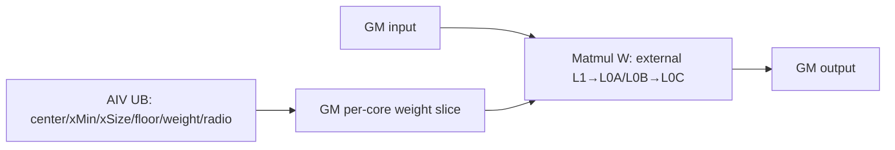
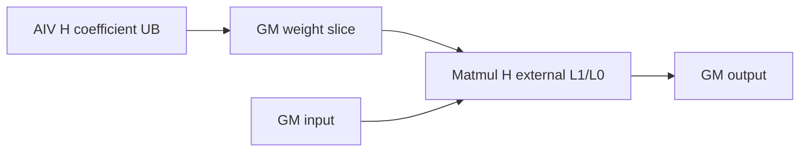
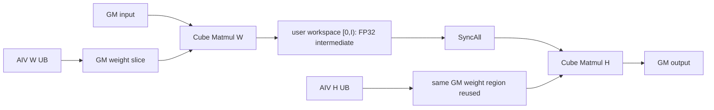

# UpsampleBilinear2dAA A2/A3 ACLNN 算子知识

## 算子速览

| 项目 | 内容 |
|---|---|
| 实际入口 | 公开两段式 `aclnnUpsampleBilinear2dAAGetWorkspaceSize` / `aclnnUpsampleBilinear2dAA`；固定仓未出现 V2 或更高版本 |
| 计算语义 | 对 NCHW/按 NCHW 解释的 ND 输入做可分离二维双线性抗锯齿重采样：先归一化每个输出坐标覆盖的线性权重，再沿 W、H 求加权和 |
| 输入输出 | 四维 `[N,C,H,W]`，FP32/FP16/BF16，NCHW 或 ND；输出 `[N,C,outH,outW]`，dtype/format 与输入一致 |
| 执行类型 | 非 identity Route 为单 Device 节点 `MIX_CV`：AIV Vector/标量段生成权重矩阵，同一 entry 内两路 `matmul::Matmul` 使用 Cube；identity Route 仅经过框架 `Contiguous/ViewCopy` |
| Kernel 路线 | R-001 identity bypass；R-002 W-only MIX_CV；R-003 H-only MIX_CV；R-004 W→H MIX_CV |
| 核心资源 | GM 输入/输出、用户 workspace 的中间矩阵与逐核权重片、AIV TBuf/TQue、Matmul 外部库管理的 L1/L0A/L0B/L0C、32 MiB system workspace |
| 来源闭包 | `source_closed`：公开 ACLNN→校验/前处理→L0 launcher→A2/A3 Tiling/POD→key 1 entry→Vector 权重生成与两路 Cube Matmul body→平台 binary/构建接线闭合；Matmul 库内部层级实现是固定仓外部边界 |
| 验证状态 | 已完成源码闭包检查；本次知识提取未执行编译、真机、数值或性能测试。 |

## 接口与语义

### 计算语义

令输入 `X[n,c,h,w]`，输出空间为 `OH=outputSize[0]`、`OW=outputSize[1]`。每个轴的反向尺度为：

```text
scaleD = 1                                      , ID == OD
       = (ID-1)/(OD-1)                         , alignCorners && OD>1
       = 0                                     , alignCorners && OD<=1
       = reciprocal(userScaleD)                , !alignCorners && userScaleD>0
       = ID/OD                                 , otherwise
supportD = max(scaleD, 1)
invScaleD = scaleD>=1 ? 1/scaleD : 1
```

对输出坐标 `o`，Kernel 取 `center=scale*(o+0.5)`，把输入候选区间裁剪为 `[floor(center-support+0.5), floor(center+support+0.5))∩[0,ID)`。候选 `i` 的未归一化权重为 `max(1-|i-center+0.5|*invScale,0)`，再除以该输出坐标全部候选权重之和。二维计算可分离为：

```text
tmp[n,c,h,ow] = Σiw X[n,c,h,iw] * normalizedWeightW[iw,ow]
Y[n,c,oh,ow]  = Σih normalizedWeightH[oh,ih] * tmp[n,c,ih,ow]
```

若 W 轴无需变化，H 段直接读 `X`；若 H 轴无需变化，W 段直接写 `Y`。公开 ACLNN 在 A2/A3 会先把 FP16/BF16 输入 Cast 为 FP32，算子 Kernel 因而以 `UpsampleBilinearAAND<float>` 计算，最后 Cast 回用户 dtype。

### 输入、输出与属性

| 参数 | shape/layout | dtype | 约束、默认值与语义 |
|---|---|---|---|
| input | 四维 `[N,C,H,W]`；NCHW 或按 NCHW 解释的 ND；允许非连续 | FP32/FP16/BF16 | `N,C,H,W>0`；先 `Contiguous`；与 `out` dtype/format 相同 |
| outputSize | 长度 2 的 `aclIntArray` | INT64 | `[OH,OW]`，两值均大于 0；应等于 `out` 的 H/W |
| alignCorners | 标量 | bool | 角点对齐开关；`true` 时尺度优先由 `(ID-1)/(OD-1)` 计算 |
| scalesH/scalesW | 标量 | double | 不得为负；正值在 ACLNN 中先取倒数并窄化为 float 传给 L0；0 表示由输入/输出尺寸推导 |
| out | 四维 `[N,C,OH,OW]`；format 与 input 相同；允许非连续 | 与 input 相同 | N/C 必须与 input 相同；最终经 `ViewCopy` 提交 |
| workspaceSize/executor/stream | 两段式 ACLNN 参数 | uint64/指针 | 第一段返回 executor 聚合 workspace；第二段在指定 stream 调用 `CommonOpExecutorRun` |

公开文档还要求 `OH=floor(H*scalesH)`、`OW=floor(W*scalesW)`。API 源码没有显式复核该等式；本卡不把文档约束改写成 Host 已验证事实。

### 入口与版本

固定 Commit 只公开这一组无版本后缀的 ACLNN。`IsRegBase()` 仅对 `DAV_3510` 返回 true，因此 A2/A3 进入非 RegBase 图：identity shape 直接复用连续输入；其它 shape 对 FP16/BF16 先升为 FP32，再加入 `UpsampleBilinear2dAA` launcher。README/ACLNN 文档明确支持 Atlas A2/A3；OpDef 注册 `ascend910b`、`ascend910_93`，两平台 binary config 均包含 FP32/FP16/BF16，公共 AscendC config 也列出两 compute units。

## Host/Launcher 执行流程

### 参数校验与前处理

1. `OP_CHECK_COMM_INPUT` 检查 `workspaceSize/executor`，`CREATE_EXECUTOR` 创建 owner。
2. `CheckParams` 依次检查业务指针、支持 dtype 与 input/out dtype 相等、两者 rank=4、format 相等且为 ND/NCHW、`outputSize.size()==2`；NCHW 时用 `CheckNCDimValid` 检查 N/C；再拒绝负 scale 和所有非正的 N/C/H/W/OH/OW。
3. 非 RegBase 额外调用 `CheckMaxScaleSupport`，拒绝推导的 H/W 缩小倍数大于 50。源码在 scale 为 0 时使用整数表达式 `inputH/outputH`、`inputW/outputW` 后转 float。
4. 代码保留 `input->IsEmpty() || out->IsEmpty()` 的 workspace 0 早退；它位于正维度校验之后，对正常四维零元素输入不可达。
5. `l0op::Contiguous` 生成连续输入。若 `H==OH && W==OW`，直接把它作为结果；否则 FP16/BF16 先 `Cast(...,DT_FLOAT)`，正 `scalesH/W` 以 double 做 `1/scale` 后窄化为 float，再调用 L0 `UpsampleBilinear2dAA`。
6. 非 FP32 原输入在算子之后 Cast 回原 dtype；最后 `ViewCopy` 到用户 `out`。任一框架节点返回空指针立即以 inner error 终止，不添加后续节点。

`Contiguous/Cast/ViewCopy` 的内部 kernel、临时 tensor 切片与同步由 ACLNN 框架拥有，固定仓未提供实现；它们是明确的框架边界，不属于算子自有 Device Route。

### 参数、Workspace 与生命周期

L0 `UpsampleBilinear2dAA` 用用户输出的 view shape、输入 dtype、输出 storage format 分配中间 `out`，并以 `OP_INPUT(input), OP_OUTPUT(out), OP_ATTR(outputSize,alignCorners,scales_h,scales_w)` 加入一个 AICore launcher。executor 持有连续输入、可选 Cast tensor、算子中间输出和 ViewCopy 节点，直到第二段 stream 执行结束。

非 identity Tiling 的算子 workspace 为：

```text
S = sizeof(kernel dtype) = 4 B（公开 A2/A3 ACLNN 非 identity 图已升到 FP32）
I = align_up(N*C*inH*outW*S, 512 B)
Kw = min(ceil(slide*scaleW)+ceil(maxInterpW), inW)    # 元素
Kh = min(ceil(slide*scaleH)+ceil(maxInterpH), inH)    # 元素
Kmax = max(Kw,Kh)
R_host = slide*Kmax*S*needCoreNum                     # 字节
workspace[0] = I + R_host + 32 MiB
```

entry 用 `GetUserWorkspace(workspace)` 得到用户区，`Init` 将其 offset 0 绑定为 `intermediateTensorGm`；`REGIST_MATMUL_OBJ` 另把 `GetSysWorkSpacePtr()` 交给两路 Matmul。用户区 `[0,I)` 在 R-004 存 W 中间矩阵；逐核权重从元素偏移 `I/S` 开始。32 MiB 与 user/system workspace 的运行时切分细节在固定仓不可见，但 Host 常量、两个 Device accessor 与使用者均可定位。

### 启动图与失败传播

```text
aclnnUpsampleBilinear2dAAGetWorkspaceSize
  -> CheckParams -> Contiguous
  -> A2/A3 identity: framework ViewCopy
  -> A2/A3 non-identity: optional Cast(FP16/BF16->FP32)
       -> l0op::UpsampleBilinear2dAA
         -> one launcher K0: upsample_bilinear2d_aa(input,tmp,user/system workspace,tiling)
            -> key 1 -> UpsampleBilinearAAND<float>::Init/Process
       -> optional Cast(FP32->FP16/BF16) -> ViewCopy(out)
aclnnUpsampleBilinear2dAA
  -> CommonOpExecutorRun(workspace,workspaceSize,executor,stream)
```

K0 是单 Kernel MIX_CV 节点，`blockDim=needCoreNum=max(needCoreNumW,needCoreNumH,1)`。Kernel 内部按 `GetBlockIdx()/2` 得到逻辑块，`GetSubBlockIdx()==1` 的伙伴只参加 `SyncAll` 后返回；另一子块执行 Vector 权重生成和 Matmul。R-004 的 W→H 交接发生在同一 K0：W Matmul 写 user workspace `[0,I)`，`SyncAll` 后 H Matmul读取。launcher/Tiling 或 framework node 失败会阻止后继加入或执行；entry 的 `GetUserWorkspace()==nullptr` 直接返回且无 Device fallback。

## Route 与参数设计

### 分核与资源计算

Tiling 先计算 `scale/support/invScale/maxInterp`，再按 `max(scaleH,scaleW)` 选 `slide`：`<=5→64`、`<=8→48`、`<=20→32`、否则 `16`；ACLNN 已限制最大缩小倍数 50。W 轴以 `slideNumW=ceil(outW/slide)` 切片，H 轴以 `slideNumH=ceil(outH/slide)` 切片。每轴先把完整 slide 均分给平台 AIC 核；余 slide 再把 `N*C*inH` 行（W）或 `N*C` batch（H）按核组切分，产生 `groupCoreNum*`、`tailAvergingRows*` 与 tail 范围。最终 blockDim 取两轴所需核数的最大值且至少 1。

W Matmul producer 设置：

```text
org(M,N,K) = (N*C*inH, outW, inW)
requested shape = (N*C*inH, slide, Kw)
A/B/C position+layout+dtype = GM/ND/T
```

H Matmul producer设置：

```text
org(M,N,K) = (outH, outW, inW)       # 保留源码第三实参，不改写为 inH
requested shape = (slide, outW, Kh)
A/B/C position+layout+dtype = GM/ND/T
```

`MatmulApiTiling::GetTiling` 生成两份 `TCubeTiling`；Device 读取其中 `singleCoreM/N/K`，按当前 slide/tail 再调用 `SetOrgShape/SetSingleShape/SetTail`。`TCubeTiling` 的 base/step/depth、Matmul 内部 L1/L0 容量和 `GetMDLConfig(true,false,0,false,false,false,true)` 七个参数的字段名在固定 ops-cv 仓不可见，不能推测。

### Route 选择

| 顺序 | Route | Key/模板 | 精确选择条件与优先级 | 不适用去向 |
|---:|---|---|---|---|
| 1 | R-001 identity bypass | 无算子 key；framework alias/copy | 非 RegBase 且 `inH==outH && inW==outW`；在 dtype Cast 与算子 launcher 之前命中 | shape 不同进入 R-002/R-003/R-004 |
| 2 | R-002 W-only MIX_CV | key 1；`UpsampleBilinearAAND<float>` | 非 identity；Tiling `scaleW!=1` 且 `scaleH==1`（`FloatEqual` 阈值 `1e-6`） | `scaleW==1` 进入 R-003；两轴均非 1 进入 R-004 |
| 3 | R-003 H-only MIX_CV | key 1；`UpsampleBilinearAAND<float>` | 非 identity；`scaleW==1`；H 段条件 `scaleH!=1 \|\| scaleW==1` 恒为真 | `scaleW!=1` 进入 R-002/R-004 |
| 4 | R-004 W→H MIX_CV | key 1；`UpsampleBilinearAAND<float>` | 非 identity；`scaleW!=1 && scaleH!=1` | 无 Device fallback；校验/Tiling/Matmul tiling 失败终止 |

```text
if !IsRegBase():
  if inH==outH && inW==outW: R-001
  else:
    optional Cast input to FP32
    Tiling key=1
    if FloatEqual(scaleW,1): R-003
    else if FloatEqual(scaleH,1): R-002
    else: R-004
```

### 模板/实现执行矩阵

| Route | key/selector | dtype/shape/platform 完整命中条件 | 执行族与 kernel 节点 | 实际模板/body | 内存与同步特征 | tail/fallback |
|---|---|---|---|---|---|---|
| R-001 identity bypass | API shape branch | A2/A3；合法四维输入；H/W 完全相同 | 无算子自有 Device 节点；framework Contiguous→ViewCopy | ACLNN framework boundary | executor-owned tensor；workspace 由框架汇总 | 无算子 tail；框架失败短路 |
| R-002 W-only MIX_CV | key 1 | A2/A3；非 identity；公开 ACLNN inner dtype FP32；`scaleW!=1,scaleH==1` | 单 K0；AIV coefficient→Cube `matmulW`→GM output | `UpsampleBilinearAAND<float>::WExpansion/calculateWidthExtension` | W UB buffers；逐核 weight workspace；MTE3_MTE2 flags；H buffers不分配 | slide W 尾块 `SetTail`；未知 key/空 workspace 无输出 |
| R-003 H-only MIX_CV | key 1 | A2/A3；非 identity；FP32；`scaleW==1` | 单 K0；AIV coefficient→Cube `matmulH`→GM output | `HExpansion/calculateHeightExtension` | H UB buffers；输入直达 H Matmul；MTE3_MTE2 flags | slide H 尾块 `SetTail` |
| R-004 W→H MIX_CV | key 1 | A2/A3；非 identity；FP32；两 scale 均非 1 | 单 K0；AIV→Cube W→workspace→`SyncAll`→AIV→Cube H→output | W/H 全部方法与两路 `matmul::Matmul` | W+H UB 同时驻留；中间矩阵+复用权重片；跨子块 `SyncAll` | W/H 分别处理 slide/core tail；无 fallback |

### 隐藏性能 Guard

| Guard | Host/Tiling 条件 | Device/资源原因 | 影响 Route | 不满足时去向 | 源码符号 |
|---|---|---|---|---|---|
| 最大缩小倍数 | 非 RegBase `realScalesH<=50 && realScalesW<=50` | 控制 `maxInterp`、K 与 UB/权重矩阵上界 | R-002~R-004 | ACLNN 参数错误；无 fallback | `CheckMaxScaleSupport`; `CheckScales` |
| slide specialization | `maxScale<=5/8/20/else` | 以 64/48/32/16 平衡输出 N tile 与 K 支持宽度 | R-002~R-004 | 总有一档；上游 >50 已失败 | `getSlideSize` |
| conditional UB | W buffer仅 `scaleW!=1`；H buffer仅 `scaleH!=1 \|\| scaleW==1` | 不为未执行轴占用 UB | R-002~R-004 | 切换对应 Route | `UpsampleBilinearAAND::Init` |
| dtype router | `dataType=2` 对应 float；1/3 分支存在但公开 A2/A3 ACLNN 非 identity 已先 Cast | 保证公开 FP16/BF16 走 FP32 权重与 Matmul计算 | R-002~R-004 | unsupported code 0 无 body；编译 guard 可删除部分类型实例 | ACLNN GetWorkspaceSize；kernel entry |
| Matmul tiling成功 | 两次 `GetTiling(...)!=-1` 才能得到有效内部 tile | 当前 Cube specialization 依赖合法 `TCubeTiling` | R-002~R-004 | Host函数只记录 error并 return void；固定源码未显式把该失败传播为 GRAPH_FAILED | `getTCubeTiling_w/h` |
| user workspace非空 | `GetUserWorkspace(workspace)!=nullptr` | 中间矩阵/权重必须有 GM backing | R-002~R-004 | entry 直接 return，无输出 | `upsample_bilinear2d_aa` entry |
| 权重片对齐契约 | Device 将 `radio_matrix_size_*` 向上对齐到 128 元素；Host 按未对齐 `slide*Kmax*S` 分配 | 每核以对齐后元素 stride 寻址并做 DMA | R-002~R-004 | 固定源码无 guard/fallback；复用时必须核对容量 | `getWorkSpace`; `ParseTilingData` |

### POD/ABI

`UpsampleBilinearAATilingData` 由仓外 `tilingdata_base.h` 宏生成；固定仓可见字段顺序和类型，但宏展开后的 `sizeof/alignof/offsetof` 不可见。下表单位与 producer/consumer 均按源码记录。

| 结构 | 字段 | 类型/位宽 | ABI 布局 | 单位 | Host/launcher producer | Device consumer | 边界 |
|---|---|---|---|---|---|---|---|
| UpsampleBilinearAATilingData | slide_size | int64/64 | 固定仓不可见 | 输出元素/slide | `getSlideSize` 取 64/48/32/16 | 循环步长、权重矩阵 N | 正值 |
| 同上 | dataType | int64/64 | 固定仓不可见 | enum 1/2/3 | `GetDataTypeVal` | entry 模板分支；权重 Cast | 公开路线为2 |
| 同上 | scale_w | float/32 | 固定仓不可见 | 输入坐标/输出坐标 | `setScale` | W center、Route guard | `FloatEqual(1)` |
| 同上 | scale_h | float/32 | 固定仓不可见 | 输入坐标/输出坐标 | `setScale` | H center、Route guard | 同上 |
| 同上 | invscale_w | float/32 | 固定仓不可见 | 权重距离系数 | `setScale` | `calculateRadioTensorW` | scale<1时1 |
| 同上 | invscale_h | float/32 | 固定仓不可见 | 权重距离系数 | `setScale` | `calculateRadioTensorH` | scale<1时1 |
| 同上 | support_w | float/32 | 固定仓不可见 | 输入元素坐标 | `max(scaleW,1)` | W候选区间 | >=1 |
| 同上 | max_interp_size_w | int16/16 | 固定仓不可见 | 元素 | `ceil(supportW)*2+1` | W weight TBuf与K | scale<=50控制窄化 |
| 同上 | support_h | float/32 | 固定仓不可见 | 输入元素坐标 | `max(scaleH,1)` | H候选区间 | >=1 |
| 同上 | max_interp_size_h | int16/16 | 固定仓不可见 | 元素 | `ceil(supportH)*2+1` | H weight TBuf与K | 同上 |
| 同上 | intermediate_matrix_size | uint64/64 | 固定仓不可见 | 字节 | `align_up(N*C*inH*outW*S,512)` | 除以 `sizeof(T)` 得 GM 元素 offset | R-004有效；其它路线仍写入 |
| 同上 | radio_matrix_size_w | uint32/32 | 固定仓不可见 | 元素 | `slide*Kw` | 向上对齐128元素；W queue/GM stride | W未执行时0 |
| 同上 | radio_matrix_size_h | uint32/32 | 固定仓不可见 | 元素 | `slide*Kh` | 向上对齐128元素；H queue/GM stride | H总执行条件见Route |
| 同上 | need_core_num_w | uint32/32 | 固定仓不可见 | logical core | `GetNeedCoreNumW` | `blockIdx<need_core_num_w` | W未执行时0 |
| 同上 | need_core_num_h | uint32/32 | 固定仓不可见 | logical core | `GetNeedCoreNumH` | `blockIdx<need_core_num_h` | H未执行时0 |
| 同上 | eachCoreSlideNumW | int64/64 | 固定仓不可见 | slide/core | `slideNumW/coreNum` | W普通范围 | 可为0 |
| 同上 | tailStartSlideNumW | int64/64 | 固定仓不可见 | slide | `eachCoreSlideNumW*coreNum` | W tail起点 | 可为0 |
| 同上 | slideNumW | int64/64 | 固定仓不可见 | slide | `ceil(outW/slide)` | W普通范围上界 | >0 |
| 同上 | groupCoreNumW | int64/64 | 固定仓不可见 | core/group | W余块分组 | `getSlideRange` 除数 | 逻辑上至少1；源码尾部分支修正 |
| 同上 | tailAvergingRowsW | int64/64 | 固定仓不可见 | N*C*H行/core | W余块分行 | W tail row范围 | >=slide初值或推导值 |
| 同上 | remainderW | int64/64 | 固定仓不可见 | slide | `slideNumW%coreNum` | W groupIndex guard | `[0,coreNum)` |
| 同上 | eachCoreSlideNumH | int64/64 | 固定仓不可见 | slide/core | `slideNumH/coreNum` | H普通范围 | 可为0 |
| 同上 | tailStartSlideNumH | int64/64 | 固定仓不可见 | slide | `eachCoreSlideNumH*coreNum` | H tail起点 | 可为0 |
| 同上 | slideNumH | int64/64 | 固定仓不可见 | slide | `ceil(outH/slide)` | H普通范围上界 | >0 |
| 同上 | groupCoreNumH | int64/64 | 固定仓不可见 | core/group | H余块分组 | `getSlideRange` 除数 | 由正core推导 |
| 同上 | tailAvergingRowsH | int64/64 | 固定仓不可见 | N*C batch/core | H余块分batch | H tail row范围 | >=1 |
| 同上 | remainderH | int64/64 | 固定仓不可见 | slide | `slideNumH%coreNum` | H groupIndex guard | `[0,coreNum)` |
| 同上 | input_shapes[4] | int64×4 | 固定仓不可见 | 元素维度 | `getShapes` | 地址、范围、Matmul shape | NCHW |
| 同上 | output_shapes[4] | int64×4 | 固定仓不可见 | 元素维度 | `getShapes` | 地址、范围、tail | NCHW |
| 同上 | matmulTiling_w | TCubeTiling/固定仓不可见 | 固定仓不可见 | Matmul tile POD | `MatmulApiTiling::GetTiling` | entry始终把地址传给`REGIST_MATMUL_OBJ`；W body读`singleCoreM/N/K` | W未执行时Host不调用GetTiling；外部注册宏是否读取inactive内容固定仓不可见 |
| 同上 | matmulTiling_h | TCubeTiling/固定仓不可见 | 固定仓不可见 | Matmul tile POD | `MatmulApiTiling::GetTiling` | entry始终把地址传给`REGIST_MATMUL_OBJ`；H body读`singleCoreM/N/K` | H未执行时Host不调用GetTiling；外部注册宏是否读取inactive内容固定仓不可见 |

### Route 源码闭包

| Route | Key/selector | Host/Tiling producer | POD/参数 | Kernel entry/router | Kernel body/直接依赖 | 构建接线 |
|---|---|---|---|---|---|---|
| R-001 identity bypass | API shape selector | ACLNN GetWorkspaceSize | framework tensors；无算子 POD | 无算子 entry | Contiguous/ViewCopy framework boundary | ACLNN op_host target |
| R-002 W-only MIX_CV | key1 + scale guard | `UpsampleBilinearAATiling::RunBigKernelTiling/GetNeedCoreNumW` | `UpsampleBilinearAATilingData` + W `TCubeTiling` | `upsample_bilinear2d_aa`→`UpsampleBilinearAAND<float>` | W coefficient helpers + `matmulW` | ascend910b/910_93 OpDef、binary、AscendC config |
| R-003 H-only MIX_CV | key1 + scale guard | 同上 + `GetNeedCoreNumH` | POD + H `TCubeTiling` | 同一 entry | H coefficient helpers + `matmulH` | 同上 |
| R-004 W→H MIX_CV | key1 + both-scale guard | W/H producers与 workspace producer | POD + 两份 `TCubeTiling` | 同一 entry | W body→`SyncAll`→H body | 同上 |

## Kernel 实现

### 公共执行流程

所有非 identity Route 共享 key 1 entry。entry 解析 POD，取得两份 `TCubeTiling`，要求 user workspace 非空；公开 ACLNN route 的 `dataType==2`，实例化 `UpsampleBilinearAAND<float>`，把 system workspace 和两份 Matmul tiling 注册到 `matmulW/matmulH`。`Init` 以 `GetBlockIdx()/2` 映射逻辑块、解析字段、计算普通/tail slide 与 row 范围，并按实际轴条件分配 UB。`Process` 让 subblock 1 在 `SyncAll` 等待后退出；subblock 0 执行 W，双方 rendezvous 后再执行 H。

Vector 段用 `ArithProgression/Adds/Muls/Floor/Maxs/Mins/Sub` 批量生成每个输出坐标的 center、最小输入坐标与覆盖长度；`V_S` event 后转为标量循环，生成并归一化稀疏权重矩阵。权重经 UB→GM 后作为 Matmul 的 B（W）或 A（H）。当前实例的 Matmul type traits 均为 `MatmulType<GM,ND,float>`，无 transpose，配置为 `MDL_CFG=GetMDLConfig(true,false,0,false,false,false,true)`；内部 L1/L0 scheduler、base/step/depth由仓外 Matmul 库解释 `TCubeTiling`。

### Route R-001：identity bypass

#### 适用条件

##### 选择证据

| 层级 | 文件 | 符号 | 源码谓词/参数 | 结果/下一跳 |
|---|---|---|---|---|
| API | `op_host/op_api/aclnn_upsample_bilinear2d_aa.cpp` | `aclnnUpsampleBilinear2dAAGetWorkspaceSize` | `!IsRegBase()` 且 `inputH==outputSize[0] && inputW==outputSize[1]` | `upsampleBilinearAAOut=selfContiguous`，不加入算子 launcher |
| API | 同上 | 同上 | 随后 `ViewCopy(upsampleBilinearAAOut,out)` | framework 提交；失败短路 |

#### Device 数据流

##### 函数级调用链

```text
aclnnUpsampleBilinear2dAAGetWorkspaceSize
  -> l0op::Contiguous(input)
  -> alias selfContiguous as result
  -> l0op::ViewCopy(result,out)
```

##### 源码等价伪码

```text
# 伪码
require(valid input/output/attrs)
x = Contiguous(input)
if inH==outH && inW==outW:
    result = x
    ViewCopy(result,out)
```

#### 内存与数据搬运

##### 资源与搬运表

| 层级/缓冲区 | offset/地址公式 | extent/容量公式 | dtype/layout | producer | consumer | owner/lifetime | 对齐/复用 |
|---|---|---|---|---|---|---|---|
| GM input | framework tensor | `N*C*H*W` 元素 | 用户 dtype/NCHW逻辑 | 用户 | Contiguous | 用户跨调用 | 非连续允许 |
| framework contiguous/result | 固定仓不可见 | 同逻辑元素数 | 用户 dtype | Contiguous | ViewCopy | executor至stream完成 | 可与原输入复用与否固定仓不可见 |
| GM out | framework view | `N*C*H*W` 元素 | 用户 dtype | ViewCopy | 用户 | 用户 | 非连续允许 |
| L1/L0/UB | N/A | 无算子自有 Device 节点 | N/A | N/A | N/A | N/A | framework内部不可见 |

##### 分层内存布局


##### 字节账、交接边与复用顺序

```text
workspace_total = executor->GetWorkspaceSize()（framework 汇总；固定仓无分项）
L1/L0/UB = N/A（无算子自有 Kernel）
```

| 边/复用子区 | producer | offset/extent | dtype/layout | consumer | ordering/sync | owner/lifetime | 安全条件 |
|---|---|---|---|---|---|---|---|
| contiguous result | framework Contiguous | 固定仓不可见/完整 tensor | 用户 dtype/NCHW逻辑 | ViewCopy | executor 同 stream 顺序 | executor | 前驱成功才加入后继 |

#### 同步、精度与尾块

##### 同步与数值边界表

| 阶段 | primitive/机制 | producer | consumer/等待点 | 保护对象 | 精度/尾块 |
|---|---|---|---|---|---|
| framework chain | executor stream ordering | Contiguous | ViewCopy | 中间 tensor | 无算子算术；原 dtype逐元素复制 |

#### 关键实现

##### 符号证据表

| 阶段 | 文件 | 符号/模板实例 | 实现事实 |
|---|---|---|---|
| Host/Tiling producer | `op_host/op_api/aclnn_upsample_bilinear2d_aa.cpp` | `aclnnUpsampleBilinear2dAAGetWorkspaceSize` | identity 条件在 Cast/launcher 之前 bypass |
| Kernel entry/router | N/A | N/A | 不启动算子自有 Kernel |
| Device body/helper | 固定仓框架边界 | `Contiguous/ViewCopy` | 内部 body不可见 |

### Route R-002：W-only MIX_CV

#### 适用条件

##### 选择证据

| 层级 | 文件 | 符号 | 源码谓词/参数 | 结果/下一跳 |
|---|---|---|---|---|
| API | `op_host/op_api/aclnn_upsample_bilinear2d_aa.cpp` | GetWorkspaceSize | 非 RegBase且非 identity | optional Cast→L0 launcher |
| Tiling | `op_host/upsample_bilinear2d_aa_tiling.cpp` | `GetNeedCoreNum` | `!FloatEqual(scaleW,1)`；H条件为false | 生产W分核与W TCubeTiling，key1 |
| Router | `op_kernel/upsample_bilinear2d_aa.cpp` | `upsample_bilinear2d_aa` | key1且dataType2 | `UpsampleBilinearAAND<float>` |

#### Device 数据流

##### 函数级调用链

```text
upsample_bilinear2d_aa
  -> UpsampleBilinearAAND<float>::Init
  -> Process
    -> WExpansion
      -> calculateIntermediateTensor(W)
      -> calculateRadioTensorW
      -> copyRadioTensorToGm(W)
      -> calculateWidthExtension -> matmulW.IterateAll(output)
    -> SyncAll
    -> HExpansion(no-op)
```

##### 源码等价伪码

```text
# 伪码
logicalBlock = GetBlockIdx()/2
if subBlock==1: SyncAll(); return
for each assigned W slide [o,o+len):
  vector_compute center[o], xmin[o], xsize[o]
  wait V->S
  weightGM[I/S + logicalBlock*align128(slide*Kw)] = normalized W weights
  wait MTE3->MTE2
  matmulW(A=input[xmin + rowStart*inW], B=weightGM,
          M=rowCount, N=len/tile, K=actualCoveredK,
          C=output[rowStart*outW+o])
  wait MTE3->MTE2
SyncAll()
```

#### 内存与数据搬运

##### 资源与搬运表

| 层级/缓冲区 | offset/地址公式 | extent/容量公式 | dtype/layout | producer | consumer | owner/lifetime | 对齐/复用 |
|---|---|---|---|---|---|---|---|
| GM input | `xmin+rowStart*inW` | `N*C*inH*inW`元素 | FP32/ND | ACLNN Cast/Contiguous | matmulW A | executor/K0 | 按行窗口读取 |
| UB center/xMin/xSize/floor W | 独立 TBuf | 各 `A=align_up(slide*4,32)` B | FP32 | Vector ops | scalar GetValue | K0；跨slide覆盖 | 四独立区 |
| UB weight W | 独立 TBuf | `B_w=align_up(maxInterpW*4,32)` B | FP32 | scalar SetValue | 权重构造 | K0 | 每输出坐标复用 |
| UB radioQueue W | TQue VECOUT depth1 | `Q_w=slide*Kw*4` B | FP32 | Duplicate/scalar weights | DataCopy GM | 单slide Alloc→EnQue→DeQue→Free | depth1 |
| GM weight slice | `I/S + logicalBlock*align_up(slide*Kw,128)`元素 | Device stride/片 `align_up(slide*Kw,128)*4` B | FP32/ND | DataCopy | matmulW B | user workspace；每slide复用 | Host容量按未对齐Kmax公式，见限制 |
| Matmul L1/L0A/L0B/L0C | Matmul库管理 | 由 `TCubeTiling_w` 决定，固定仓不可见 | GM ND FP32→FP32 | Matmul prologue/mainloop | epilogue | 单次 IterateAll | 当前type traits/shape已闭合，内部容量外部 |
| GM output | `o+rowStart*outW` | `N*C*inH*outW`元素 | FP32/ND | matmulW | 后续 Cast/ViewCopy | executor | N tail用SetTail |
| system workspace | runtime system区 | 32 MiB Host常量的一部分 | Matmul opaque | framework | Matmul object | K0 | 切分offset固定仓不可见 |

##### 分层内存布局



##### 字节账、交接边与复用顺序

```text
workspace_total = I + slide*Kmax*4*needCoreNum + 32 MiB
L1/L0 = TCubeTiling_w 决定；固定仓不可见
UB_W = 4*A + B_w + Q_w
UB_total = UB_W
```

| 边/复用子区 | producer | offset/extent | dtype/layout | consumer | ordering/sync | owner/lifetime | 安全条件 |
|---|---|---|---|---|---|---|---|
| radioQueueW→weightGM | DataCopy | 每核对齐stride；有效 `slide*actualK` | FP32/ND | matmulW B | `MTE3_MTE2` Set/Wait | user workspace/K0 | Matmul结束后下一slide可覆盖 |
| weightGM复用 | 当前slide | 同一每核片 | FP32 | `IterateAll/End` | Matmul End + MTE3_MTE2 flag | K0 | 不得在End前写下一组权重 |

#### 同步、精度与尾块

##### 同步与数值边界表

| 阶段 | primitive/机制 | producer | consumer/等待点 | 保护对象 | 精度/尾块 |
|---|---|---|---|---|---|
| Vector依赖 | `PipeBarrier<PIPE_V>` | 每个center/xmin/xsize向量步骤 | 下一Vector步骤 | TBuf | length至少扩到16；无效lane不进入标量 `i<length` |
| Vector→scalar | `V_S` flag | Duplicate/Vector结果 | GetValue/SetValue循环 | coefficient tensors | FP32归一化 |
| UB→GM→Matmul | `MTE3_MTE2` flag | DataCopy weight | Matmul读取 | per-core weight slice | FP32；DMA长度为queue容量 |
| Matmul tail | `SetTail` | Host/Device shape | Matmul epilogue | 最后W slide | `N=outW-o`；M tail按row分组 |

#### 关键实现

##### 符号证据表

| 阶段 | 文件 | 符号/模板实例 | 实现事实 |
|---|---|---|---|
| Host/Tiling producer | `op_host/upsample_bilinear2d_aa_tiling.cpp` | `setScale/getSlideSize/GetNeedCoreNumW/getTCubeTiling_w/getWorkSpace` | W shape、core、workspace、POD |
| Kernel entry/router | `op_kernel/upsample_bilinear2d_aa.cpp` | key1/dataType2→`UpsampleBilinearAAND<float>` | Matmul注册、Init/Process |
| Device body/helper | `op_kernel/upsample_bilinear2d_aa.h` | WExpansion及W helpers | 权重、搬运、Matmul、tail、event |

### Route R-003：H-only MIX_CV

#### 适用条件

##### 选择证据

| 层级 | 文件 | 符号 | 源码谓词/参数 | 结果/下一跳 |
|---|---|---|---|---|
| API | `op_host/op_api/aclnn_upsample_bilinear2d_aa.cpp` | GetWorkspaceSize | 非 RegBase且非 identity | optional Cast→L0 |
| Tiling | `op_host/upsample_bilinear2d_aa_tiling.cpp` | `GetNeedCoreNum` | `FloatEqual(scaleW,1)` | 跳过W，强制生产H分核/TCubeTiling，key1 |
| Router | `op_kernel/upsample_bilinear2d_aa.cpp` | entry | key1/dataType2 | float实例 |

#### Device 数据流

##### 函数级调用链

```text
upsample_bilinear2d_aa -> Init -> Process
  -> WExpansion(no-op)
  -> SyncAll
  -> HExpansion
    -> calculateIntermediateTensor(H)
    -> calculateRadioTensorH
    -> copyRadioTensorToGm(H)
    -> calculateHeightExtension -> matmulH(input→output)
```

##### 源码等价伪码

```text
# 伪码
if subBlock==1: SyncAll(); return
SyncAll()
for assigned H slides:
  vector/scalar build normalized H weight matrix
  copy weight UB->per-core GM; wait MTE3->MTE2
  for nc in assigned NC range:
    matmulH(A=weightGM, B=input[xmin*inW + nc*inH*inW], C=output[o*outW + nc*outH*outW])
    End(); wait MTE3->MTE2
```

#### 内存与数据搬运

##### 资源与搬运表

| 层级/缓冲区 | offset/地址公式 | extent/容量公式 | dtype/layout | producer | consumer | owner/lifetime | 对齐/复用 |
|---|---|---|---|---|---|---|---|
| GM input | `xmin*outW + nc*(inH*outW)`；此Route `outW`由非identity约束通常等于inW，但源码用middleHW | `N*C*inH*inW` | FP32/ND | ACLNN | matmulH B | executor/K0 | 每NC读取H窗口 |
| H center/xMin/xSize/floor TBuf | 独立 | 各 `A=align_up(slide*4,32)` B | FP32 | Vector | scalar | K0 | 跨slide覆盖 |
| H weight TBuf | 独立 | `B_h=align_up(maxInterpH*4,32)` B | FP32 | scalar | coefficient loop | K0 | 复用 |
| H radioQueue depth1 | TQue | `Q_h=slide*Kh*4` B | FP32 | coefficient loop | DataCopy | slide lifetime | Alloc/Free |
| GM weight slice | `I/S+logicalBlock*align_up(slide*Kh,128)` | 对齐片 | FP32/ND | DataCopy | matmulH A | user workspace | 每slide复用 |
| Matmul L1/L0 | external | `TCubeTiling_h`；固定仓不可见 | ND FP32 | Matmul | output | IterateAll | tail由SetTail |
| GM output | `o*outW+nc*outH*outW` | `N*C*outH*outW` | FP32 | matmulH | Cast/ViewCopy | executor | H tail有效 |

##### 分层内存布局



##### 字节账、交接边与复用顺序

```text
workspace_total = I + slide*Kmax*4*needCoreNum + 32 MiB
L1/L0 = TCubeTiling_h 决定；固定仓不可见
UB_total = 4*A + B_h + Q_h
```

| 边/复用子区 | producer | offset/extent | dtype/layout | consumer | ordering/sync | owner/lifetime | 安全条件 |
|---|---|---|---|---|---|---|---|
| H weight GM | DataCopy | per-core aligned H片 | FP32/ND | matmulH A | MTE3_MTE2 flag | user workspace/K0 | End后覆盖 |
| 输入→输出 | matmulH | 各NC与H slide | FP32/ND | framework Cast/ViewCopy | K0完成后executor stream | executor | 每个H tile不重叠 |

#### 同步、精度与尾块

##### 同步与数值边界表

| 阶段 | primitive/机制 | producer | consumer/等待点 | 保护对象 | 精度/尾块 |
|---|---|---|---|---|---|
| idle partner rendezvous | `SyncAll` | subblock1与工作subblock | H开始 | mixed subblocks | W为空仍必须配对 |
| coefficient | PIPE_V与标量循环 | Vector坐标 | radio matrix | UB | FP32 normalize；总权重0时保持零 |
| H tail | `SetTail(outH-o,singleCoreN,singleCoreK)` | Device | Matmul | last H slide | 只提交有效M |

#### 关键实现

##### 符号证据表

| 阶段 | 文件 | 符号/模板实例 | 实现事实 |
|---|---|---|---|
| Host/Tiling producer | `op_host/upsample_bilinear2d_aa_tiling.cpp` | `GetNeedCoreNumH/getTCubeTiling_h` | H core/tile |
| Kernel entry/router | `op_kernel/upsample_bilinear2d_aa.cpp` | key1 float实例 | MIX entry |
| Device body/helper | `op_kernel/upsample_bilinear2d_aa.h` | HExpansion及H helpers | 权重、Matmul、tail |

### Route R-004：W→H MIX_CV

#### 适用条件

##### 选择证据

| 层级 | 文件 | 符号 | 源码谓词/参数 | 结果/下一跳 |
|---|---|---|---|---|
| API | `op_host/op_api/aclnn_upsample_bilinear2d_aa.cpp` | GetWorkspaceSize | 非identity | 加入launcher |
| Tiling | `op_host/upsample_bilinear2d_aa_tiling.cpp` | `GetNeedCoreNum` | `scaleW!=1 && scaleH!=1` | 生产两轴参数，blockDim=max，key1 |
| Device | `op_kernel/upsample_bilinear2d_aa.h` | `Process` | W执行；SyncAll；H执行 | workspace交接 |

#### Device 数据流

##### 函数级调用链

```text
entry -> Init(W+H UB) -> Process
  -> WExpansion -> W coefficient -> weightGM -> matmulW(input→intermediateGM)
  -> SyncAll
  -> HExpansion -> H coefficient -> weightGM(reuse) -> matmulH(intermediateGM→output)
```

##### 源码等价伪码

```text
# 伪码
for assigned W tiles:
  build W weights; copy to own weight slice
  matmulW(input, weights, intermediate[rows,outW])
SyncAll()  # all W producers visible before any H consumer
for assigned H tiles:
  build H weights; overwrite own weight slice
  for assigned NC:
    matmulH(weights, intermediate[nc,inH,outW], output[nc,outH,outW])
```

#### 内存与数据搬运

##### 资源与搬运表

| 层级/缓冲区 | offset/地址公式 | extent/容量公式 | dtype/layout | producer | consumer | owner/lifetime | 对齐/复用 |
|---|---|---|---|---|---|---|---|
| W/H UB | 各自独立 | `UB_W+UB_H` | FP32 | coefficient helpers | GM weight copies | K0 | 两轴同时Init；按阶段使用 |
| intermediate GM | offset0 | `I=align_up(N*C*inH*outW*4,512)` B | FP32 `[N,C,inH,outW]` | matmulW | matmulH B | executor user workspace/K0 | `SyncAll`保护 |
| per-core weight GM | `I/4 + block*alignedRadio` | host `slide*Kmax*4*cores`，Device每轴128元素stride | FP32/ND | W后H覆盖 | 对应Matmul | K0 | 阶段间复用 |
| W Matmul L1/L0 | external | W TCubeTiling | FP32 ND | library | intermediate | W IterateAll | 固定仓不可见 |
| H Matmul L1/L0 | external | H TCubeTiling | FP32 ND | library | output | H IterateAll | 固定仓不可见 |
| GM output | H tile offset | `N*C*outH*outW` | FP32 | matmulH | framework | executor | H tail |

##### 分层内存布局



##### 字节账、交接边与复用顺序

```text
workspace_total = I + slide*Kmax*4*needCoreNum + 32 MiB
L1/L0 = W/H TCubeTiling决定；固定仓不可见
UB_total = (4*A+B_w+Q_w) + (4*A+B_h+Q_h)
```

| 边/复用子区 | producer | offset/extent | dtype/layout | consumer | ordering/sync | owner/lifetime | 安全条件 |
|---|---|---|---|---|---|---|---|
| W intermediate | matmulW | `[0,I)`；有效 `N*C*inH*outW*4` | FP32/NCHW逻辑 | matmulH B | `SyncAll` | user workspace/K0 | 所有W块完成才进入H |
| weight region W→H复用 | W DataCopy/Matmul | `[I, I+R)` | FP32/ND | H DataCopy/Matmul | W `End`+MTE flag；跨阶段SyncAll | user workspace/K0 | 每核独占；H覆盖不得早于W消费完 |

#### 同步、精度与尾块

##### 同步与数值边界表

| 阶段 | primitive/机制 | producer | consumer/等待点 | 保护对象 | 精度/尾块 |
|---|---|---|---|---|---|
| W→H | `SyncAll` | 全部W block/subblock | HExpansion | intermediate与weight复用 | FP32中间不降精度 |
| 每轴权重 | V barrier、V_S、MTE3_MTE2 | Vector/Scalar/DataCopy | scalar/Matmul | UB与GM片 | 每轴分别归一化 |
| Matmul | `IterateAll/End` | Cube mainloop | 后继/复用 | L0C→GM | W/H各自SetTail；累加类型由外部Matmul实例决定，固定仓不可见 |

#### 关键实现

##### 符号证据表

| 阶段 | 文件 | 符号/模板实例 | 实现事实 |
|---|---|---|---|
| Host/Tiling producer | `op_host/upsample_bilinear2d_aa_tiling.cpp` | 全部W/H producer | 两轴shape、workspace、blockDim |
| Kernel entry/router | `op_kernel/upsample_bilinear2d_aa.cpp` | key1 `UpsampleBilinearAAND<float>` | 注册两Matmul对象 |
| Device body/helper | `op_kernel/upsample_bilinear2d_aa.h` | `Process/WExpansion/HExpansion` | 单K0两阶段、交接、同步、tail |

## 算子特定优化

### Trick T-001：按缩小倍数选择 slide 宽度

#### 触发与源码依据

- 适用 Route：R-002、R-003、R-004
- 触发条件：非 RegBase、非 identity；`max(scaleH,scaleW)` 落入四个阈值区间
- Golden 来源：[`image/upsample_bilinear2d_aa/op_host/upsample_bilinear2d_aa_tiling.cpp:346-358`](../../../../../../../cann-ops-raw/ascendc/ops-cv/bb717d075d129fd1fc7b96b2886824a1d153ed2f/image/upsample_bilinear2d_aa/op_host/upsample_bilinear2d_aa_tiling.cpp#L346-L358)

**官方源码（固定 Commit 连续逐字摘录）**：

```cpp
auto max_scale = realScale_h > realScale_w ? realScale_h : realScale_w;
if (max_scale <= BEST_PERFORMANCE_SCALE_4) {
    slide_size = BEST_PERFORMANCE_SIZE_4;
} else if (max_scale <= BEST_PERFORMANCE_SCALE_3) {
    slide_size = BEST_PERFORMANCE_SIZE_3;
} else if (max_scale <= BEST_PERFORMANCE_SCALE_2) {
    slide_size = BEST_PERFORMANCE_SIZE_2;
} else {
    slide_size = BEST_PERFORMANCE_SIZE_1;
}
tilingData.set_slide_size(slide_size);
```

#### 机制与设计原因

scale越大，单个输出 tile 覆盖的输入 K 越宽；源码把 N方向 slide 从64逐级降到16，使 `slide*K` 权重矩阵与 UB/GM片不会同时按两个维度膨胀。slide直接进入权重矩阵 N、W/H循环步长、Matmul requested N与每核 workspace公式，因此这是 Host specialization，不是注释级提示。

#### 迁移边界

- 适用：可分离插值、输出 tile 与输入支持宽度乘积决定局部权重容量的场景。
- 前提：A2/A3、scale不超过50、同样的 W/H权重矩阵与Matmul数据流。
- 失效：950使用逐输出SIMT/纯copy路线；不能沿用这些阈值。
- 未验证：本次知识提取未执行编译、真机、数值或性能测试。

#### 错误做法

固定仓未提供可验证反例；但直接固定64会改变源码的 UB/workspace与Matmul N上界，不能声称与当前实现等价。

### Trick T-002：只为实际执行轴分配 UB 并省略无效 Matmul

#### 触发与源码依据

- 适用 Route：R-002、R-003
- 触发条件：`FloatEqual(scaleW,1)` 或 `FloatEqual(scaleH,1)`
- Golden 来源：[`image/upsample_bilinear2d_aa/op_kernel/upsample_bilinear2d_aa.h:217-233`](../../../../../../../cann-ops-raw/ascendc/ops-cv/bb717d075d129fd1fc7b96b2886824a1d153ed2f/image/upsample_bilinear2d_aa/op_kernel/upsample_bilinear2d_aa.h#L217-L233)

**官方源码（固定 Commit 连续逐字摘录）**：

```cpp
if (!FloatEqual(scale_w, 1.0)) {
    pipe.InitBuffer(centerQueue_w, tensorWidthSize);
    pipe.InitBuffer(xMinQueue_w, tensorWidthSize);
    pipe.InitBuffer(xSizeQueue_w, tensorWidthSize);
    pipe.InitBuffer(floorQueue_w, tensorWidthSize);
    pipe.InitBuffer(weightQueue_w, (max_interp_size_w * sizeof(float) + 31) / 32 * 32);
    pipe.InitBuffer(radioQueue_w, BUFFER_NUM, radio_matrix_size_w * sizeof(float));
}
```

#### 机制与设计原因

Host与Device用同一 `FloatEqual` 规则：不变轴不生产 `TCubeTiling`，Device也不获取对应TBuf/TQue、不生成权重、不调用对应Matmul。W不变时H直接读输入；H不变时W直接写输出，避免中间矩阵物化。

#### 迁移边界

- 适用：可分离两轴变换且单位尺度确实是恒等映射。
- 前提：单位尺度判断、输入输出shape与地址路径一致；阈值为`1e-6`。
- 失效：两轴都变化必须R-004；API identity shape会更早进入R-001。
- 未验证：本次知识提取未执行编译、真机、数值或性能测试。

#### 错误做法

固定仓未提供可验证反例；若只跳过计算而仍按未初始化轴读取 `TCubeTiling`，会破坏当前 inactive-field 契约。

### Trick T-003：W中间矩阵与逐核权重片分区并跨阶段复用

#### 触发与源码依据

- 适用 Route：R-004
- 触发条件：两轴scale均非1，必须先W后H
- Golden 来源：[`image/upsample_bilinear2d_aa/op_host/upsample_bilinear2d_aa_tiling.cpp:317-328`](../../../../../../../cann-ops-raw/ascendc/ops-cv/bb717d075d129fd1fc7b96b2886824a1d153ed2f/image/upsample_bilinear2d_aa/op_host/upsample_bilinear2d_aa_tiling.cpp#L317-L328)

**官方源码（固定 Commit 连续逐字摘录）**：

```cpp
uint64_t intermediate_matrix_size =
    output_shapes[0] * output_shapes[1] * input_shapes[2] * output_shapes[3] * dataTypeSize;
intermediate_matrix_size = (intermediate_matrix_size + ADDR_ALIGN_SIZE - 1) / ADDR_ALIGN_SIZE * ADDR_ALIGN_SIZE;
int64_t singleCoreK = singleCoreK_w > singleCoreK_h ? singleCoreK_w : singleCoreK_h;

uint32_t radioMatrixWorkspaceSize = slide_size * singleCoreK * dataTypeSize;
workspaces[0] = intermediate_matrix_size + radioMatrixWorkspaceSize * needCoreNum + WORK_SPACE_SIZE;
```

#### 机制与设计原因

一次分配容纳 W结果、按最大K估算的每核权重片和Matmul系统区。W/H顺序执行，逐核权重区可由H覆盖W内容；中间矩阵只物化一次，`SyncAll`形成producer→consumer可见性。最大K使两个轴共享统一Host容量公式。

#### 迁移边界

- 适用：两阶段可分离Matmul、阶段串行、权重片每核独占的场景。
- 前提：保持512B中间矩阵对齐、Device权重offset单位和跨阶段SyncAll。
- 失效：单轴Route不需要中间矩阵语义；950 SIMT直接按输出聚合。
- 未验证：本次知识提取未执行编译、真机、数值或性能测试。

#### 错误做法

Host按未对齐 `slide*Kmax` 分配而Device按128元素stride寻址是固定源码中需要复核的边界；迁移实现不能在未证明容量覆盖时照搬该不对称。

## 模板与实现对比

| 对比维度 | R-001 identity | R-002 W-only | R-003 H-only | R-004 W→H | 设计选择依据 |
|---|---|---|---|---|---|
| 命中条件/优先级 | H/W完全相同，API最先命中 | W非1、H为1 | W为1 | W/H均非1 | API shape优先，随后Device scale条件 |
| 执行族/节点图 | framework-only | 单K0 MIX_CV W | 单K0 MIX_CV H | 单K0 MIX_CV W→H | 是否需要轴变换 |
| M/N/K、tile 与 scheduler | N/A | M=N*C*inH,N=slide,K=Kw | M=slide,N=outW,K=Kh | 两者串联 | slide按maxScale；TCubeTiling外部生成 |
| workspace/L1/L0/UB | framework不可见 | W权重片+W UB | H权重片+H UB | intermediate+共享权重区+W/H UB | 条件分配与中间物化 |
| AIC/AIV 或 kernel 交接 | N/A | UB→GM权重→Cube | 同左 | W Cube→GM→SyncAll→H Cube | event与SyncAll |
| 同步、精度与 tail | framework | FP32，W SetTail | FP32，H SetTail | FP32中间，双轴tail | ACLNN升精度；每轴独立tail |
| fallback/失败边界 | framework失败 | 无Device fallback | 无Device fallback | 无Device fallback | key/userWS/tiling失败均终止 |

## 平台差异

| 项目 | A2 | A3 | 950 |
|---|---|---|---|
| 支持状态 | 公开支持；ascend910b接线 | 公开支持；ascend910_93接线 | 公开支持；见独立`_950`卡 |
| Host/Launcher | 非RegBase；identity bypass；FP16/BF16升FP32 | 与A2共用源码 | RegBase始终加入算子launcher，Tiling选择copy/SIMT |
| Kernel/资源 | key1 MIX_CV，Matmul+UB+大workspace | 与A2共用实现和binary结构 | AIV-only copy或512-thread SIMT；无Cube |

## 限制与失败边界

- A2/A3缩小倍数不得超过50；API只接受四维正尺寸、ND/NCHW、FP32/FP16/BF16且input/out dtype与format相同。
- 文档要求outputSize与scales满足floor关系，API源码未显式验证；不一致属性可能改变scale Route，不能视为受支持扩展。
- `getTCubeTiling_w/h` 在 `GetTiling==-1` 时仅记录日志并从void函数返回，调用者仍继续；固定源码没有闭合显式失败传播。
- Host权重workspace按未对齐`slide*Kmax*S`计数，Device却把每轴`slide*K`向上对齐到128元素后作为逐核stride；固定源码没有容量guard，迁移时必须重新证明边界。
- H Host `SetOrgShape` 的K参数源码为`inputW`，而业务H K来自`inH`且Device改用`singleCoreK`；本卡保留此事实，不推测修正。
- Matmul库内部 `TCubeTiling` ABI、L1/L0A/L0B/L0C容量、scheduler、累加dtype、Fixpipe/cast/round和system/user workspace实际切分在固定ops-cv仓不可见。
- 本次知识提取未执行编译、真机、数值或性能测试。

## 源码索引

### 链路索引

| 链路阶段 | 文件 | 关键符号 | 支撑内容 |
|---|---|---|---|
| 入口声明/约束 | `image/upsample_bilinear2d_aa/docs/aclnnUpsampleBilinear2dAA.md` | 产品表、函数原型、约束 | A2/A3公开支持与语义 |
| 入口声明/约束 | `image/upsample_bilinear2d_aa/op_host/op_api/aclnn_upsample_bilinear2d_aa.h` | 两段式ACLNN声明 | ABI入口 |
| 入口实现 | `image/upsample_bilinear2d_aa/op_host/op_api/aclnn_upsample_bilinear2d_aa.cpp` | CheckParams/GetWorkspaceSize/execute | API分支、Cast、executor |
| 入口实现 | `image/upsample_bilinear2d_aa/op_host/op_api/upsample_bilinear2d_aa.cpp` | `l0op::UpsampleBilinear2dAA` | launcher添加 |
| 入口实现 | `common/inc/op_api/aclnn_check.h` | `IsRegBase` | DAV_3510边界 |
| Host/Tiling/Launcher | `image/upsample_bilinear2d_aa/op_host/upsample_bilinear2d_aa_def.cpp` | OpDef | 910b/910_93/950注册 |
| Host/Tiling/Launcher | `image/upsample_bilinear2d_aa/op_host/upsample_bilinear2d_aa_tiling.h` | POD定义 | A2/A3 ABI字段 |
| Host/Tiling/Launcher | `image/upsample_bilinear2d_aa/op_host/upsample_bilinear2d_aa_tiling.cpp` | `UpsampleBilinearAATiling` | selector、shape/core/workspace/TCubeTiling |
| Kernel entry/body | `image/upsample_bilinear2d_aa/op_kernel/upsample_bilinear2d_aa.cpp` | entry/router | key/dtype/Matmul注册 |
| Kernel entry/body | `image/upsample_bilinear2d_aa/op_kernel/upsample_bilinear2d_aa.h` | `UpsampleBilinearAAND<T>` | UB、权重、W/H Matmul、同步/tail |
| 构建接线 | `image/upsample_bilinear2d_aa/op_host/config/ascend910b/upsample_bilinear2d_aa_binary.json` | binary entries | A2三dtype binary |
| 构建接线 | `image/upsample_bilinear2d_aa/op_host/config/ascend910_93/upsample_bilinear2d_aa_binary.json` | binary entries | A3三dtype binary |
| 构建接线 | `image/upsample_bilinear2d_aa/op_host/CMakeLists.txt` | `add_modules_sources` | Host target收集 |
| 构建接线 | `scripts/kernel/binary_config/ascendc_config.json` | UpsampleBilinear2dAA entry | compute units与auto_sync |

### 实现复用检查

| 检查项 | 可复用事实 | 不得改变的约束 | 源码符号 |
|---|---|---|---|
| ABI/POD | scale、shape、分核、workspace与两份TCubeTiling生产链 | 字段顺序/单位；两份TCubeTiling地址始终注册，inactive实例的宏读取边界不可擅自假定 | `UpsampleBilinearAATilingData`; entry；`ParseTilingData` |
| 调用顺序 | 权重生成→GM→Matmul；R-004 W→SyncAll→H | 不能让H提前读取中间矩阵 | `Process/WExpansion/HExpansion` |
| workspace/内存 | `[0,I)`中间矩阵，随后逐核权重片，system Matmul区 | 字节/元素换算、512B与128元素对齐、owner | `getWorkSpace/copyRadioTensorToGm` |
| 同步 | PIPE_V、V_S、MTE3_MTE2、SyncAll | flag方向、End与覆盖顺序 | coefficient helpers/Process |
| 精度与尾块 | ACLNN FP16/BF16→FP32→原dtype；W/H各自SetTail | 不得删除升精度或把无效lane写出 | API Cast；`SetTail` |
| 失败边界 | API/Tiling错误、null userWS、unknown key均无fallback | 不能把静默return当成功输出 | CheckParams/entry/getTCubeTiling |