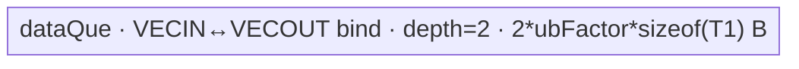

# UpsampleBilinear2dAA 950 ACLNN 算子知识

## 算子速览

| 项目 | 内容 |
|---|---|
| 实际入口 | 公开两段式 `aclnnUpsampleBilinear2dAAGetWorkspaceSize` / `aclnnUpsampleBilinear2dAA`；固定仓未出现 V2 或更高版本 |
| 计算语义 | 四维 NCHW 双线性抗锯齿重采样；恒等映射直接复制，其余情况由每个 SIMT 线程收集一个输出元素的二维支持域 |
| 输入输出 | `[N,C,H,W]→[N,C,outH,outW]`，FP32/FP16/BF16，ND/NCHW；输入输出 dtype/format 一致 |
| 执行类型 | R-001 `AIV_VECTOR` 数据搬运；R-002/R-003 `SIMT`；entry 均为 `KERNEL_TYPE_AIV_ONLY`，无 Cube/AIC/MIX_CV |
| Kernel 路线 | R-001 AIV 双缓冲 copy；R-002 32 位索引 SIMT；R-003 64 位索引 SIMT |
| 核心资源 | R-001 使用 GM 与 depth-2 绑定 TQue；SIMT 直接 GM 标量 load/store 和线程私有标量；Tiling 固定申报 16 MiB workspace，但 body 不读取 |
| 来源闭包 | `source_closed`：公开 ACLNN→RegBase Host 分支→L0→arch35 Tiling/POD/key→AIV copy/SIMT32/SIMT64 entry/body→ascend950 binary/构建接线闭合 |
| 验证状态 | 已完成源码闭包检查；本次知识提取未执行编译、真机、数值或性能测试。 |

## 接口与语义

### 计算语义

对轴 `D∈{H,W}`，950 Tiling 计算：

```text
scaleD = (inD-1)/(outD-1)       , alignCorners && outD>1
       = 0                       , alignCorners && outD<=1
       = reciprocal(scalesD)     , !alignCorners && scalesD>0
       = inD/outD                , otherwise
supportD = max(scaleD,1)
invScaleD = scaleD>=1 ? 1/scaleD : 1
```

正 `scalesD` 在 ACLNN 层先以 double 求倒数、再窄化为 float 传给 L0。SIMT 对扁平输出 `y` 解码 `W=y%outW`、`H=(y/outW)%outH`、`NC=y/(outW*outH)`，并计算：

```text
centerD = scaleD*(D+0.5)
minD = max(floor(centerD-supportD+0.5),0)
maxD = min(floor(centerD+supportD+0.5),inD)
w(d) = max(1-abs((d-centerD+0.5)*invScaleD),0)
Y[y] = ΣhΣw X[NC,h,w] * wH(h)/ΣwH * wW(w)/ΣwW
```

中心、权重、归一化和累加均为 FP32；赋给 `T1` 时转换为目标 dtype，具体 round mode 固定仓不可见。恒等 Route 不做算术，按原 dtype 字节复制。

### 输入、输出与属性

| 参数 | shape/layout | dtype | 约束、默认值与语义 |
|---|---|---|---|
| input | 四维 `[N,C,H,W]`；ND/NCHW；允许非连续 | FP32/FP16/BF16 | `N,C,H,W>0`；先 `Contiguous` |
| outputSize | 长度 2 | INT64 | `[outH,outW]`，两值正且匹配 out H/W |
| alignCorners | 标量 | bool | 角点对齐；true 且 out 轴为 1 时该轴 scale 为 0 |
| scalesH/scalesW | 标量 | double | 不得为负；正值先取倒数；0 表示由尺寸推导 |
| out | 四维 `[N,C,outH,outW]`；与 input 同 format | 与 input 相同 | N/C 与 input 相等；最终 `ViewCopy` |
| workspaceSize/executor/stream | 两段式 ACLNN 参数 | uint64/指针 | 第一段返回 executor 聚合 workspace；第二段在指定 stream 运行 |

### 入口与版本

固定 Commit 只公开无版本后缀的两段式接口。`IsRegBase()` 仅匹配 `NpuArch::DAV_3510`，因此 950 跳过非 RegBase 的缩小倍数 50 检查和 FP16/BF16→FP32 前后 Cast，始终调用 L0。README/ACLNN 文档明确支持 950PR/950DT；OpDef 的 ascend950 配置指定 `opFile.value=upsample_bilinear2d_aa_apt`，ascend950 binary 包含三种 dtype，公共 AscendC config 也列出 ascend950。

## Host/Launcher 执行流程

### 参数校验与前处理

1. `OP_CHECK_COMM_INPUT` 检查 workspaceSize/executor，创建 executor。
2. `CheckParams` 依次检查 input/outputSize/out 指针、支持 dtype、input/out dtype 与 format 相同、rank=4、format 为 ND/NCHW、outputSize 长度 2；NCHW 时检查 N/C；再拒绝负 scale 和所有非正的 N/C/H/W/outH/outW。
3. 950 的 `IsRegBase()==true`，不调用 `CheckMaxScaleSupport`；源码没有为极大 support 提供备用 Route。
4. 正维度检查之后仍保留 empty 早退代码；正常四维零元素输入会更早失败，因此该早退对公开有效域不可达。
5. input 经 `Contiguous`。950 无论 H/W 是否相同都调用 L0，且保留原 dtype；正 scale 在 Host 求倒数后传入。
6. L0 分配中间 out 并加入 launcher；结果由 `ViewCopy` 提交。任一框架节点返回空或 launcher 失败都会短路。

`Contiguous/ViewCopy` 的具体 kernel、临时切片与内部同步由 ACLNN 框架拥有，固定仓未提供实现。

### 参数、Workspace 与生命周期

L0 按用户 out view shape、input dtype 和 out storage format 分配中间 tensor，以 `OP_INPUT(input),OP_OUTPUT(out),OP_ATTR(outputSize,alignCorners,scales_h,scales_w)` 加入 launcher。executor 持有连续输入、中间输出、launcher 和 ViewCopy，直到第二段 stream 完成。

RegBase Tiling 固定设置：

```text
workspace[0] = 16 MiB
blockDim = realCoreNum
copy: realCoreNum 初始为平台AIV核数；outSize<=cacheLineNum*coreNum时改为 floor(outSize/cacheLineNum)，最后至少1
SIMT: realCoreNum=min(outSize,platformAivCoreNum)
blkProcessNum=floor(outSize/realCoreNum)
tailBlockNum=outSize%realCoreNum
```

950 entry 保留 workspace 形参，但 copy/SIMT body 均不读取；16 MiB 的运行时用途和 framework 额外 workspace 分项固定仓不可见。R-001 的 UB tile 来自平台 UB；R-002/R-003 不生产 dynamic UB 参数，也没有显式 shared/local array。

### 启动图与失败传播

```text
aclnnUpsampleBilinear2dAAGetWorkspaceSize
  -> CheckParams -> Contiguous
  -> l0op::UpsampleBilinear2dAA
    -> K0: upsample_bilinear2d_aa<schId,isInt32>(x,tmp,workspace,tiling)
       -> schId0: Bilinear2dAADataCopy<T1>
       -> schId1/isInt321: Bilinear2dAASimt<T1,uint32_t,int32_t>
       -> schId1/isInt320: Bilinear2dAASimt<T1,uint64_t,int64_t>
  -> ViewCopy(tmp,out)
aclnnUpsampleBilinear2dAA -> CommonOpExecutorRun(...,stream)
```

三个 Route 都只有单 K0，固定 `KERNEL_TASK_TYPE_DEFAULT(KERNEL_TYPE_AIV_ONLY)`，无节点间 workspace 边。Host/Tiling 失败阻止 launch；template selector 只实例化 `(0,0),(1,1),(1,0)`，没有 Device fallback。

## Route 与参数设计

### 分核与资源计算

Tiling 取 `dtypeSize∈{4,2}`、平台 UB block 字节数、UB 总字节和 AIV 核数，计算 `outSize=N*C*outH*outW`。copy Route 的 UB tile：

```text
cacheLineNum = 128/dtypeSize
oneBlockNum = ubBlockSize/dtypeSize
ubFactor0 = (ubSize-oneBlockNum*dtypeSize)/(2*dtypeSize)
ubFactor = floor(ubFactor0/oneBlockNum)*oneBlockNum
queue_bytes = 2*ubFactor*dtypeSize <= ubSize-ubBlockSize
```

SIMT 按 outSize 均分连续扁平区间；每个 AIV block 调用 512 个 VF 线程，线程以 `idx+=512` 覆盖本核区间。input/output 总元素均不超过 `INT32_MAX` 时选择 32 位 T2/T3，否则选择 64 位。

### Route 选择

| 顺序 | Route | Key/模板 | 精确选择条件与优先级 | 不适用去向 |
|---:|---|---|---|---|
| 1 | R-001 AIV 双缓冲 copy | `GET_TPL_TILING_KEY(0,0)`；`Bilinear2dAADataCopy<DTYPE_INPUT>` | `outH==inH && outW==inW && scaleH==1.0f && scaleW==1.0f` | 条件 false 进入 SIMT |
| 2 | R-002 32 位索引 SIMT | `GET_TPL_TILING_KEY(1,1)`；`Bilinear2dAASimt<T1,uint32_t,int32_t>` | 非 copy；`inputSize<=INT32_MAX && outSize<=INT32_MAX` | 任一总量超界进入 R-003 |
| 3 | R-003 64 位索引 SIMT | `GET_TPL_TILING_KEY(1,0)`；`Bilinear2dAASimt<T1,uint64_t,int64_t>` | 非 copy；上述 int32 条件 false | 参数/平台失败；无 fallback |

```text
if same H/W and scaleH==1.0f and scaleW==1.0f:
  schId=0; isInt32=0; R-001
else:
  schId=1
  if inputSize<=INT32_MAX && outSize<=INT32_MAX: R-002
  else: R-003
```

### 模板/实现执行矩阵

| Route | key/selector | dtype/shape/platform 完整命中条件 | 执行拓扑与 Kernel 节点 | 实际模板/body | 内存与同步特征 | tail/fallback |
|---|---|---|---|---|---|---|
| R-001 AIV 双缓冲 copy | `(0,0)` | 950；三 dtype；same H/W 且两 scale 精确 1 | 单 K0 AIV_VECTOR | `Bilinear2dAADataCopy<T1>::Init/Process/CopyIn/CopyOut` | GM↔depth-2 bind queue；EnQue/DeQue | 核余数前置；最后 UB tile 精确 lenCopy |
| R-002 SIMT32 | `(1,1)` | 950；非 copy；input/out 总元素<=INT32_MAX | 单 K0 SIMT；512 threads/block | `Bilinear2dAASimt<T1,uint32_t,int32_t>`→`calleeInt32`→`SimtCompute` | 直接 GM；线程私有 FP32；无 queue/atomic/barrier | `idx<blkProcessNum`；候选 clamp |
| R-003 SIMT64 | `(1,0)` | 950；非 copy；任一总元素>INT32_MAX | 单 K0 SIMT；512 threads/block | `Bilinear2dAASimt<T1,uint64_t,int64_t>`→`calleeInt64`→同一 body | 同 R-002，仅索引/magic 位宽变 64 | 同上；无 fallback |

### 隐藏性能 Guard

| Guard | Host/Tiling 条件 | Device/资源原因 | 影响 Route | 不满足时去向 | 源码符号 |
|---|---|---|---|---|---|
| copy 精确 scale | same H/W 且两 float scale 均 `==1.0f` | 只有严格单位映射可逐字节 copy | R-001 | R-002/R-003 | `CalTilingData` |
| singleton alignCorner | alignCorners 且 outD<=1 时 scaleD=0 | 同 shape singleton 也可能不命中 copy | R-001 | SIMT | `ComputeScalesSupportValues` |
| 32 位索引 | inputSize/outSize 均<=INT32_MAX | T2/T3、magic division 和 GM index 保持 32 位 | R-002 | R-003 | `CheckInputParams`; `DoTiling` |
| UB 双缓冲 | ubSize>0；ubFactor 向下对齐 oneBlockNum | 两份 queue buffer并保留一个 UB block | R-001 | ubSize 无效时 Host 失败；源码未检查 ubFactor>0 | `Init`; `DataCopyTiling` |
| 512 线程 | `THREAD_NUM_B32=B64=512` | grid-stride 覆盖每核连续区间 | R-002/R-003 | 固定配置，无备用值 | `calleeInt32/calleeInt64` |
| 无 scale 上限 | 950 跳过 `CheckMaxScaleSupport` | 支持域和标量循环可随 scale 增长 | R-002/R-003 | 无 fallback | API `CheckParams`; `SimtCompute` |

### POD/ABI

`UpsampleBilinear2dAARegBaseTilingData` 是无继承、无 pack 的普通结构。由字段声明与自然对齐可得 `alignof=8`、`sizeof=96`，末尾 4 字节 padding。

| 结构 | 字段 | 类型/位宽 | ABI 布局 | 单位 | Host/launcher producer | Device consumer | 边界 |
|---|---|---|---|---|---|---|---|
| UpsampleBilinear2dAARegBaseTilingData | blkProcessNum | int64/64 | offset 0 | 输出元素/core | `outSize/realCoreNum` | copy/SIMT 每核长度 | >0 |
| 同上 | tailBlockNum | int64/64 | offset 8 | 输出元素余数 | `outSize%realCoreNum` | 前 tail cores 加1 | `<realCoreNum`；copy窄化int32 |
| 同上 | lenN | int64/64 | offset 16 | 维度元素 | input N | SIMT launch参数 | `SimtCompute`不读取 |
| 同上 | lenC | int64/64 | offset 24 | 维度元素 | input C | SIMT launch参数 | `SimtCompute`不读取 |
| 同上 | inH | int64/64 | offset 32 | 元素 | input H | SIMT input index | 正值；按 T3 窄化 |
| 同上 | inW | int64/64 | offset 40 | 元素 | input W | SIMT input index | 正值；按 T3 窄化 |
| 同上 | outH | int64/64 | offset 48 | 元素 | output H | H magic division | 正值 |
| 同上 | outW | int64/64 | offset 56 | 元素 | output W | W magic division | 正值 |
| 同上 | ubFactor | int32/32 | offset 64 | 元素/tile | `DataCopyTiling` | copy queue/loop | SIMT为0且不读 |
| 同上 | scaleH | float/32 | offset 68 | 输入/输出坐标 | scale producer | centerH | copy body不读 |
| 同上 | scaleW | float/32 | offset 72 | 输入/输出坐标 | scale producer | centerW | copy body不读 |
| 同上 | invScaleH | float/32 | offset 76 | 权重距离系数 | `scaleH>=1?1/scaleH:1` | H weight | copy不读 |
| 同上 | invScaleW | float/32 | offset 80 | 权重距离系数 | `scaleW>=1?1/scaleW:1` | W weight | copy不读 |
| 同上 | supportH | float/32 | offset 84 | 输入坐标 | `max(scaleH,1)` | H candidate bound | copy不读 |
| 同上 | supportW | float/32 | offset 88 | 输入坐标 | `max(scaleW,1)` | W candidate bound | copy不读 |

### Route 源码闭包

| Route | Key/selector | Host/Tiling producer | POD/参数 | Kernel entry/router 节点 | Kernel body/直接依赖 | 构建接线 |
|---|---|---|---|---|---|---|
| R-001 AIV copy | key(0,0) | arch35 `CalTilingData/DataCopyTiling` | RegBase POD、blockDim、16MiB | apt entry `schId==0` | `Bilinear2dAADataCopy<T1>` | ascend950 OpDef/binary/AscendC config |
| R-002 SIMT32 | key(1,1) | `CheckInputParams/CalTilingData` | POD、blockDim | apt entry `schId!=0,isInt32==1` | `Bilinear2dAASimt<T1,uint32_t,int32_t>`/calleeInt32/SimtCompute | 同上 |
| R-003 SIMT64 | key(1,0) | 同上 | POD、blockDim | apt entry else | `Bilinear2dAASimt<T1,uint64_t,int64_t>`/calleeInt64/SimtCompute | 同上 |

## Kernel 实现

### 公共执行流程

模板 entry 解析同一 96B POD，声明 AIV-only。`schId==0` 构造 copy 类并传入 `TPipe`；否则按 `isInt32` 构造 32/64 位 SIMT 类。三种 dtype 由 binary/compiler 的 `DTYPE_INPUT` 实例化。所有 Route 用 `GetBlockIdx()` 对应 Host `blockDim`；无多 Kernel 边、无跨族同步，workspace 形参不被 body 消费。

### Route R-001：AIV 双缓冲 copy

#### 适用条件

##### 选择证据

| 层级 | 文件 | 符号 | 源码谓词/参数 | 结果/下一跳 |
|---|---|---|---|---|
| API | `op_host/op_api/aclnn_upsample_bilinear2d_aa.cpp` | GetWorkspaceSize | `IsRegBase()==true` | same shape也加入 L0 |
| Tiling | `op_host/upsample_bilinear2d_aa_tiling_arch35.cpp` | `CalTilingData` | same H/W && scaleH==1 && scaleW==1 | schId0,isInt320；DataCopyTiling |
| Router | `op_kernel/upsample_bilinear2d_aa_apt.cpp` | template entry | `if constexpr(schId==0)` | copy实例 |

#### Device 数据流

##### 函数级调用链

```text
upsample_bilinear2d_aa<0,0>
  -> Bilinear2dAADataCopy<T1>::Init
  -> Process
    -> CopyIn -> DataCopyPad(GM bytes→bind queue) -> EnQue
    -> CopyOut -> DeQue -> DataCopyPad(bind queue→GM bytes) -> FreeTensor
```

##### 源码等价伪码

```text
# 伪码
length = blkProcessNum + (blockIdx<tailBlockNum)
offset = blockIdx*blkProcessNum + min(blockIdx,tailBlockNum)
for loop=0; loop<length; loop+=ubFactor:
  len=min(ubFactor,length-loop)
  q=AllocTensor<uint8>()
  DataCopyPad(q,x[(offset+loop)*sizeof(T1)],blockCount=1,blockLen=len*sizeof(T1),strides=0)
  EnQue(q); q=DeQue()
  DataCopyPad(y[(offset+loop)*sizeof(T1)],q,same valid bytes)
  FreeTensor(q)
```

#### 内存与数据搬运

##### 资源与搬运表

| 层级/缓冲区 | offset/地址公式 | extent/容量公式 | dtype/layout | producer | consumer | owner/lifetime | 对齐/复用 |
|---|---|---|---|---|---|---|---|
| GM input bytes | `(totalOffset+loop)*sizeof(T1)` | `N*C*H*W*sizeof(T1)` | raw bytes/NCHW | Contiguous | CopyIn | executor/K0 | blockCount1、stride0 |
| dataQue | queue内部slot | depth2 × `ubFactor*sizeof(T1)` | uint8 bytes | CopyIn | CopyOut | TPipe/K0 | VECIN/VECOUT bind；Free后复用 |
| GM output bytes | 同扁平offset | 同逻辑字节数 | raw bytes/NCHW | CopyOut | ViewCopy | executor | 只写lenCopy有效字节 |
| workspace | 未寻址 | Host申报16MiB | N/A | Host | 无body consumer | executor | 未使用 |
| 寄存器 | 标量offset/length | 固定仓不可见 | int64/int32 | Process | DMA参数 | 单迭代 | 无显式RegTensor |

##### 分层内存布局



##### 字节账与复用顺序

```text
UB_total = 2*ubFactor*sizeof(T1) <= ubSize-ubBlockSize
dynamic_ub = N/A
workspace_total = 16 MiB（K0不读）
```

| 复用子区 | 写入者 | 读取者/消费点 | 下一次覆盖 | 同步或释放依据 | 安全条件 |
|---|---|---|---|---|---|
| dataQue slot | CopyIn/DataCopyPad | CopyOut/DataCopyPad | 下一 tile CopyIn | EnQue→DeQue→FreeTensor | FreeTensor 后覆盖；depth2由queue维护 |

#### 同步、精度与尾块

##### 同步与数值边界表

| 阶段 | primitive/机制 | producer | consumer/等待点 | 保护对象 | 精度/尾块 |
|---|---|---|---|---|---|
| GM→UB→GM | TQue EnQue/DeQue | CopyIn | CopyOut | queue slot | raw bytes，无cast/round |
| core tail | 前tailBlockNum cores加1 | Host POD | Process | 扁平区间 | offset公式连续且不重叠 |
| tile tail | `lenCopy=min(ubFactor,remaining)` | Process | CopyIn/Out | 最后DMA | blockLen精确字节；DataCopyPad处理非对齐 |

#### 关键实现

##### 符号证据表

| 阶段 | 文件 | 符号/模板实例 | 实现事实 |
|---|---|---|---|
| Host/Tiling producer | `op_host/upsample_bilinear2d_aa_tiling_arch35.cpp` | DataCopyTiling/CalTilingData | copy谓词、core、ubFactor |
| Kernel entry/router | `op_kernel/upsample_bilinear2d_aa_apt.cpp` | entry<0,0> | AIV-only copy |
| Device body/helper | `op_kernel/arch35/upsample_bilinear2d_aa_data_copy.h` | copy类全部方法 | queue、DMA、offset/tail |

### Route R-002：32 位索引 SIMT

#### 适用条件

##### 选择证据

| 层级 | 文件 | 符号 | 源码谓词/参数 | 结果/下一跳 |
|---|---|---|---|---|
| Tiling | arch35 Tiling | `CheckInputParams/CalTilingData` | 非copy且inputSize/outSize<=INT32_MAX | schId1,isInt321 |
| Router | apt entry | `if constexpr(isInt32==1)` | key(1,1) | `<T1,uint32_t,int32_t>` |
| SIMT | `upsample_bilinear2d_aa_simt.h` | Process | `sizeof(T2)!=sizeof(uint64_t)` | calleeInt32，512线程 |

#### Device 数据流

##### 函数级调用链

```text
entry<1,1> -> Bilinear2dAASimt<T1,uint32_t,int32_t>::Init/Process
  -> GetUintDivMagicAndShift(outW/outH)
  -> asc_vf_call<calleeInt32>(dim3(512),...)
    -> SimtCompute<T1,uint32_t,int32_t>
      -> CubilFilterAA -> GM scalar load -> FP32 accumulate -> GM store
```

##### 源码等价伪码

```text
# 伪码
coreLen=blkProcessNum+(blockIdx<tailBlockNum)
coreBase=blockIdx*blkProcessNum+min(blockIdx,tailBlockNum)
for idx=threadIdx.x; idx<coreLen; idx+=512:
  y=coreBase+idx
  W=y%outW; tmp=y/outW; H=tmp%outH; NC=tmp/outH
  derive clipped [minH,maxH),[minW,maxW)
  sumH=ΣfilterH; sumW=ΣfilterW; value(float)=0
  for h,w in support:
    value += float(input[NC*inH*inW+h*inW+w])*(filterH/sumH)*(filterW/sumW)
  output[y]=T1(value)
```

#### 内存与数据搬运

##### 资源与搬运表

| 层级/缓冲区 | offset/地址公式 | extent/容量公式 | dtype/layout | producer | consumer | owner/lifetime | 对齐/复用 |
|---|---|---|---|---|---|---|---|
| GM input | `NC*inH*inW+h*inW+w` | `N*C*inH*inW`元素 | T1/NCHW | Contiguous | SIMT scalar load | executor/K0 | 支持域散读 |
| thread scalars | compiler registers | center/min/max/sums/weights/value | uint32/int32/float | thread | same thread | thread lifetime | 无shared/alias |
| GM output | `coreBase+idx` | `N*C*outH*outW`元素 | T1/NCHW | unique thread | ViewCopy | executor | 每y唯一writer |
| dynamic/shared UB | N/A | body无声明、Host无producer | N/A | N/A | N/A | N/A | 实际路径为GM直读写 |
| workspace | 未寻址 | 16MiB | N/A | Host | 无body consumer | executor | 未使用 |

##### 分层内存布局

N/A：本 Route 不使用 AIV `TQue/TBuf/LocalTensor`，也没有 SIMT shared/dynamic UB；实际路径是 512 个 VF 线程从 GM 标量读取，以线程私有 FP32 标量累加并直接写 GM。

##### 字节账与复用顺序

```text
UB_total = 0 B（无显式UB分配）
dynamic_ub = N/A（Host无producer，body无shared/local array）
workspace_total = 16 MiB（K0不读）
register_bytes = 编译后不可见；源码只证明线程私有标量生命周期
```

| 复用子区 | 写入者 | 读取者/消费点 | 下一次覆盖 | 同步或释放依据 | 安全条件 |
|---|---|---|---|---|---|
| thread-private value | 当前线程内层循环 | 当前线程GM store | 下一idx重置为0 | 顺序程序语义 | 不跨线程共享 |

#### 同步、精度与尾块

##### 同步与数值边界表

| 阶段 | primitive/机制 | producer | consumer/等待点 | 保护对象 | 精度/尾块 |
|---|---|---|---|---|---|
| SIMT并行 | 无barrier/atomic | 每线程 | 自身store | unique y | `idx<coreLen`保护线程tail |
| division | magic producer + `Simt::UintDiv` | outer Process | callee | y→W/H/NC | uint32 magic与index |
| accumulation | FP32 scalar | T1 load | T1 output assignment | value | 两轴分别归一化；round mode不可见 |
| candidate tail | min/max clamp | thread | nested loops | input边界 | `[0,inD)`无越界 |

#### 关键实现

##### 符号证据表

| 阶段 | 文件 | 符号/模板实例 | 实现事实 |
|---|---|---|---|
| Host/Tiling producer | `op_host/upsample_bilinear2d_aa_tiling_arch35.cpp` | CheckInputParams/CalTilingData/FillTilingData | int32 key、core、scale |
| Kernel entry/router | `op_kernel/upsample_bilinear2d_aa_apt.cpp` | entry<1,1> | 32位SIMT实例 |
| Device body/helper | arch35 simt headers | Process/calleeInt32/SimtCompute | magic、thread映射、计算/tail |

### Route R-003：64 位索引 SIMT

#### 适用条件

##### 选择证据

| 层级 | 文件 | 符号 | 源码谓词/参数 | 结果/下一跳 |
|---|---|---|---|---|
| Tiling | arch35 Tiling | `CheckInputParams/DoTiling` | 非copy且isInt32=0 | key(1,0) |
| Router | apt entry | else branch | `schId!=0 && isInt32!=1` | `<T1,uint64_t,int64_t>` |
| SIMT | simt.h | Process | `sizeof(T2)==sizeof(uint64_t)` | calleeInt64，512线程 |

#### Device 数据流

##### 函数级调用链

```text
entry<1,0> -> Bilinear2dAASimt<T1,uint64_t,int64_t>::Process
  -> asc_vf_call<calleeInt64>(dim3(512),...)
    -> SimtCompute<T1,uint64_t,int64_t> -> GM output
```

##### 源码等价伪码

```text
# 与R-002同一算法；T2除法/magic参数为uint64，T3长度、offset、循环和GM index为int64。
for int64 idx=threadIdx.x; idx<coreLen; idx+=512:
  decode y with uint64 magic division
  enumerate clipped H/W support in int64
  accumulate float and store T1
```

#### 内存与数据搬运

##### 资源与搬运表

| 层级/缓冲区 | offset/地址公式 | extent/容量公式 | dtype/layout | producer | consumer | owner/lifetime | 对齐/复用 |
|---|---|---|---|---|---|---|---|
| GM input/output | 与R-002相同，index为int64 | 对应总元素 | T1/NCHW | thread | thread/framework | K0 | 64位地址算术 |
| thread scalars | compiler registers | 64位index+FP32权重/累加 | uint64/int64/float | thread | thread | thread lifetime | 字节数不可见 |
| dynamic/shared UB | N/A | 无显式分配 | N/A | N/A | N/A | N/A | GM直读写 |
| workspace | 未寻址 | 16MiB | N/A | Host | 无body consumer | executor | 未使用 |

##### 分层内存布局

N/A：本 Route 无 AIV UB queue/TBuf，也无 SIMT shared/dynamic UB；512 个 VF 线程以 64 位索引直接 GM load/store，FP32 标量在单线程内存活。

##### 字节账与复用顺序

```text
UB_total = 0 B
dynamic_ub = N/A
workspace_total = 16 MiB（unused by K0）
register_bytes = 固定仓不可见
```

| 复用子区 | 写入者 | 读取者/消费点 | 下一次覆盖 | 同步或释放依据 | 安全条件 |
|---|---|---|---|---|---|
| thread-private value | 当前线程 | GM store | 下一idx | 顺序语义 | unique y、无共享 |

#### 同步、精度与尾块

##### 同步与数值边界表

| 阶段 | primitive/机制 | producer | consumer/等待点 | 保护对象 | 精度/尾块 |
|---|---|---|---|---|---|
| SIMT | 无barrier/atomic | unique thread | GM store | y | idx guard |
| index | uint64 magic + int64 offsets | Process | SimtCompute | 大tensor地址 | 避免32位截断 |
| numeric | FP32 normalize/accumulate | scalar loops | T1 store | output | round mode不可见；candidate clamp |

#### 关键实现

##### 符号证据表

| 阶段 | 文件 | 符号/模板实例 | 实现事实 |
|---|---|---|---|
| Host/Tiling producer | arch35 Tiling | isInt32 producer | 大tensor选择64位 |
| Kernel entry/router | apt entry | entry<1,0> | uint64/int64实例 |
| Device body/helper | arch35 simt headers | calleeInt64/SimtCompute | 64位thread映射与同算法 |

## 算子特定优化

### Trick T-001：恒等条件切换为按字节双缓冲搬运

#### 触发与源码依据

- 适用 Route：R-001
- 触发条件：same H/W 且 Tiling 的两个 scale 精确等于1
- Golden 来源：[`image/upsample_bilinear2d_aa/op_host/upsample_bilinear2d_aa_tiling_arch35.cpp:107-123`](../../../../../../../cann-ops-raw/ascendc/ops-cv/bb717d075d129fd1fc7b96b2886824a1d153ed2f/image/upsample_bilinear2d_aa/op_host/upsample_bilinear2d_aa_tiling_arch35.cpp#L107-L123)

**官方源码（固定 Commit 连续逐字摘录）**：

```cpp
bool isDataCopy = baseTiling_.outH == baseTiling_.inH && baseTiling_.outW == baseTiling_.inW &&
    baseTiling_.scaleH == 1.0f && baseTiling_.scaleW == 1.0f;
if (isDataCopy) {
    OP_LOGI(context_, "enter datacopy");
    baseTiling_.schId = CONST_0; // 纯copy模板
    baseTiling_.isInt32 = 0;
    DataCopyTiling();
} else {
    OP_LOGI(context_, "enter simt nchw");
```

#### 机制与设计原因

恒等映射不进入每输出支持域枚举，直接使用 GM↔UB 扩展搬运；queue 绑定 VECIN/VECOUT 且 depth2，`ubFactor` 按 UB block 对齐并保留一个 block 余量，避免权重计算、除法和二维散读。

#### 迁移边界

- 适用：输入输出空间相同且坐标映射严格为单位尺度。
- 前提：950、原 dtype 可逐字节复制、scale 浮点值精确为1。
- 失效：任一 scale 非1或 singleton alignCorners 产生0，必须 SIMT。
- 未验证：本次知识提取未执行编译、真机、数值或性能测试。

#### 错误做法

只比较 shape 而忽略 scale 与固定源码不同；不满足精确谓词时必须进入 SIMT。

### Trick T-002：按总元素数静态选择32/64位索引

#### 触发与源码依据

- 适用 Route：R-002、R-003
- 触发条件：非 copy；inputSize/outSize 与 INT32_MAX 比较
- Golden 来源：[`image/upsample_bilinear2d_aa/op_kernel/upsample_bilinear2d_aa_apt.cpp:36-45`](../../../../../../../cann-ops-raw/ascendc/ops-cv/bb717d075d129fd1fc7b96b2886824a1d153ed2f/image/upsample_bilinear2d_aa/op_kernel/upsample_bilinear2d_aa_apt.cpp#L36-L45)

**官方源码（固定 Commit 连续逐字摘录）**：

```cpp
} else {
    if constexpr(isInt32 == 1) {
        Bilinear2dAASimt<DTYPE_INPUT, uint32_t, int32_t> op;
        op.Init(x, y, &tilingData);
        op.Process();
    } else {
        Bilinear2dAASimt<DTYPE_INPUT, uint64_t, int64_t> op;
        op.Init(x, y, &tilingData);
        op.Process();
    }
```

#### 机制与设计原因

Host 在 launch 前决定位宽，Device 内没有逐元素位宽分支。小 tensor 用32位 magic division 与 index，大 tensor 用64位保持地址范围；两实例共享数值 body，只改变 T2/T3 和 callee。

#### 迁移边界

- 适用：正维度 NCHW tensor，扁平总量覆盖全部索引乘积。
- 前提：Host 总量计算无溢出，key 与模板类型成对保持。
- 失效：超过 INT32_MAX 必须 R-003。
- 未验证：本次知识提取未执行编译、真机、数值或性能测试。

#### 错误做法

固定仓的真实 fallback 是 R-003；删除64位实例会使大 tensor 无安全 Route。

### Trick T-003：每线程独占输出以消除 atomic

#### 触发与源码依据

- 适用 Route：R-002、R-003
- 触发条件：每核连续输出片由512线程 grid-stride 覆盖
- Golden 来源：[`image/upsample_bilinear2d_aa/op_kernel/arch35/upsample_bilinear2d_aa_simt_base.h:45-52`](../../../../../../../cann-ops-raw/ascendc/ops-cv/bb717d075d129fd1fc7b96b2886824a1d153ed2f/image/upsample_bilinear2d_aa/op_kernel/arch35/upsample_bilinear2d_aa_simt_base.h#L45-L52)

**官方源码（固定 Commit 连续逐字摘录）**：

```cpp
T3 lenSrcHw = lenSrcH * lenSrcW;
for (T3 idx = static_cast<T3>(threadIdx.x); idx < blkProcessNum;
    idx += static_cast<T3>(blockDim.x)) {
    T3 yGmIdx = blkStartOffset + idx;
    T2 tmpRes = Simt::UintDiv(static_cast<T2>(yGmIdx), mW, shiftW);
    T2 W = yGmIdx - tmpRes * lenDstW;
    T2 NC = Simt::UintDiv(tmpRes, mH, shiftH);
```

#### 机制与设计原因

任务按输出而非输入贡献划分；每线程收集该输出的全部候选并只写一个 `yGmIdx`，不同 core/thread 区间互斥，无需 atomic 或 barrier。magic division 在支持域循环外完成坐标解码。

#### 迁移边界

- 适用：每个输出可独立收集、输入只读的重采样。
- 前提：core 与 thread 扁平区间保持唯一覆盖，输出不是原地别名。
- 失效：改成输入散射贡献时必须重新设计冲突同步。
- 未验证：本次知识提取未执行编译、真机、数值或性能测试。

#### 错误做法

固定仓未提供可验证的散射反例；无源码证据时不得把该 Route 改述为 atomic 累加。

## 模板与实现对比

| 对比维度 | R-001 AIV copy | R-002 SIMT32 | R-003 SIMT64 | 设计选择依据 |
|---|---|---|---|---|
| 命中条件/优先级 | same shape且scale全1，最高 | 非copy且总量<=INT32_MAX | 非copy且任一总量更大 | 数学恒等与index范围 |
| 模板与 dtype | DataCopy<T1>，三dtype | Simt<T1,uint32,int32>，三dtype | Simt<T1,uint64,int64>，三dtype | dtype行为一致，index位宽分流 |
| 循环与分核 | 连续core区间，UB tile循环 | 连续core区间，512-thread grid-stride | 同左 | copy受UB，SIMT受输出量 |
| Queue/TBuf/寄存器/dynamic UB/通信 window | bind TQue depth2；无通信 | thread-private标量；dynamic UB N/A | 64位标量更多；dynamic UB N/A | 实际执行族资源 |
| 内存总占用与复用 | `2*ubFactor*S`；slot Free后复用 | 显式UB 0；线程标量按idx复用 | 同左 | copy局部搬运 vs GM直访 |
| 搬运/Vector/SIMT/NDDMA/通信 API | DataCopyPad、TQue | asc_vf_call、UintDiv、scalar GM | 同左 | 不使用NDDMA/通信 |
| 同步、精度与 tail | queue同步、raw bytes、DMA tail | unique writer、FP32累加、idx/clamp tail | 同左，64位index | 语义与安全边界 |
| fallback/失败边界 | predicate false转SIMT | 大tensor转R-003 | 无fallback | Host selector |

## 平台差异

| 项目 | A2 | A3 | 950 |
|---|---|---|---|
| 支持状态 | 公开支持；实现见无后缀卡 | 公开支持；实现见无后缀卡 | 公开支持，当前闭包 |
| Host/Launcher | 非RegBase；identity bypass；非FP32升精度；scale<=50 | 同A2 | RegBase；始终加入launcher；无50上限/前后Cast |
| Kernel/资源 | MIX_CV Vector权重+Cube Matmul | 同A2 | AIV copy或SIMT；无Cube；16MiB workspace body不读 |

## 限制与失败边界

- 950要求四维正尺寸、ND/NCHW、三dtype且input/out dtype/format、N/C一致；无空tensor Route。
- 950跳过scale<=50限制，SIMT候选循环随support增长，固定源码无资源或耗时fallback。
- `alignCorners=true && outD<=1`令scaleD=0；即使输入输出该轴同为1，也不满足精确copy谓词。
- `ubFactor`无显式正值检查；平台UB虽要求>0，但不足以保留双buffer时copy循环步长可能失效。
- `isInt32`依赖`Shape::GetShapeSize()`；乘法溢出处理、template key数值编码和FP16/BF16输出round mode固定仓不可见。
- 16MiB workspace由Tiling固定申报而K0不读取；其框架/system用途固定仓不可见。
- 本次知识提取未执行编译、真机、数值或性能测试。

## 源码索引

### 链路索引

| 链路阶段 | 文件 | 关键符号 | 支撑内容 |
|---|---|---|---|
| 入口声明/约束 | `image/upsample_bilinear2d_aa/docs/aclnnUpsampleBilinear2dAA.md` | 产品表/原型/语义 | 950公开支持 |
| 入口声明/约束 | `image/upsample_bilinear2d_aa/op_host/op_api/aclnn_upsample_bilinear2d_aa.h` | ACLNN声明 | 两段式ABI |
| 入口实现 | `image/upsample_bilinear2d_aa/op_host/op_api/aclnn_upsample_bilinear2d_aa.cpp` | CheckParams/GetWorkspaceSize/execute | RegBase分支、前处理 |
| 入口实现 | `image/upsample_bilinear2d_aa/op_host/op_api/upsample_bilinear2d_aa.cpp` | L0函数 | launcher添加 |
| 入口实现 | `common/inc/op_api/aclnn_check.h` | IsRegBase | DAV_3510判定 |
| Host/Tiling/Launcher | `image/upsample_bilinear2d_aa/op_host/upsample_bilinear2d_aa_def.cpp` | OpDef | ascend950 apt接线 |
| Host/Tiling/Launcher | `image/upsample_bilinear2d_aa/op_host/upsample_bilinear2d_aa_tiling.cpp` | RunBigKernelTiling | 分派RegBase Tiling |
| Host/Tiling/Launcher | `image/upsample_bilinear2d_aa/op_host/upsample_bilinear2d_aa_tiling_arch35.cpp` | RegbaseTiling全部方法 | selector/core/UB/workspace/POD |
| Host/Tiling/Launcher | `image/upsample_bilinear2d_aa/op_kernel/arch35/upsample_bilinear2d_aa_tiling_data.h` | RegBase POD | ABI结构 |
| Host/Tiling/Launcher | `image/upsample_bilinear2d_aa/op_kernel/arch35/upsample_bilinear2d_aa_tiling_key.h` | template args/selector | 三个可达key |
| Kernel entry/body | `image/upsample_bilinear2d_aa/op_kernel/upsample_bilinear2d_aa_apt.cpp` | apt entry | AIV-only router |
| Kernel entry/body | `image/upsample_bilinear2d_aa/op_kernel/arch35/upsample_bilinear2d_aa_data_copy.h` | DataCopy类 | copy全部body |
| Kernel entry/body | `image/upsample_bilinear2d_aa/op_kernel/arch35/upsample_bilinear2d_aa_simt.h` | Bilinear2dAASimt | block分区/magic/SIMT launch |
| Kernel entry/body | `image/upsample_bilinear2d_aa/op_kernel/arch35/upsample_bilinear2d_aa_simt_base.h` | callee/SimtCompute | thread算法/精度/tail |
| 构建接线 | `image/upsample_bilinear2d_aa/op_host/config/ascend950/upsample_bilinear2d_aa_binary.json` | 三dtype entries | 950 binary |
| 构建接线 | `image/upsample_bilinear2d_aa/op_host/CMakeLists.txt` | add_modules_sources | Host target |
| 构建接线 | `scripts/kernel/binary_config/ascendc_config.json` | UpsampleBilinear2dAA | ascend950 compute unit/auto_sync |

### 实现复用检查

| 检查项 | 可复用事实 | 不得改变的约束 | 源码符号 |
|---|---|---|---|
| ABI/POD | 96B RegBase POD和三key active字段 | 字段offset/位宽；copy ubFactor与SIMT scale/shape不可混读 | tiling_data.h/FillTilingData |
| 调用顺序 | Contiguous→K0→ViewCopy；K0按key单分支 | 前驱失败阻断后继 | ACLNN/L0/apt entry |
| workspace/内存 | 16MiB申报；copy depth2 queue；SIMT直接GM | 不得虚构body workspace slice；copy按字节offset | DoTiling/DataCopy类 |
| 同步 | copy EnQue/DeQue；SIMT unique writer无同步 | queue生命周期不能绕过；SIMT不添加无证据atomic | DataCopy/SimtCompute |
| 精度与尾块 | copy raw bytes；SIMT FP32归一化/累加后写T1 | 32/64 key、idx guard、candidate clamp | apt entry/SimtCompute |
| 失败边界 | copy false转SIMT；int32超界转int64；其它Host失败无fallback | 不套用A2/A3 scale<=50/Cube Route | CalTilingData/CheckParams |