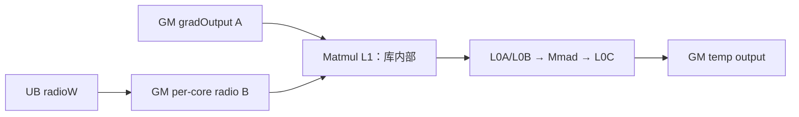
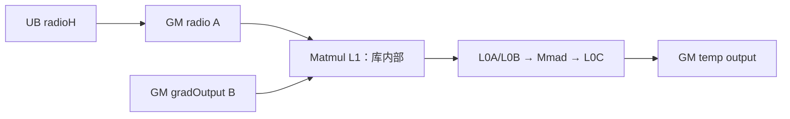
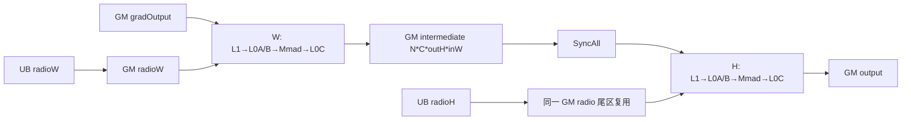

# UpsampleBilinear2dAABackward A2/A3 ACLNN 算子知识

## 算子速览

| 项目 | 内容 |
|---|---|
| 实际入口 | `aclnnUpsampleBilinear2dAABackwardGetWorkspaceSize` + `aclnnUpsampleBilinear2dAABackward`，公开 ACLNN 两段式接口，无后续版本符号。 |
| 计算语义 | 将每个 `gradOutput(n,c,h,w)` 按抗锯齿双线性归一化权重反向散布到 `gradInput`；实现把二维计算分解成 W、H 两个可独立省略的一维矩阵乘。 |
| 输入输出 | `gradOutput:[N,C,outH,outW]`，`out:[N,C,inH,inW]`；ND 按 NCHW 解释；ACLNN dtype 为 FP32/FP16/BF16，非平凡 A2/A3 FP16/BF16 路线先升为 FP32。 |
| 执行类型 | 算子 Kernel 为 `AIC_CUBE`：同一 entry 内先用 Vector/标量代码生成系数矩阵，再由 `matmul::Matmul<GM/ND,float>` 执行 W/H Cube；`Contiguous/Cast/ViewCopy` 是 executor 中的框架节点。 |
| Kernel 路线 | R-001 仅 W；R-002 仅 H；R-003 W→全核同步→H。相同 H/W 尺寸在 ACLNN 层直接走框架拷贝旁路，不启动本算子 Kernel。 |
| 核心资源 | 输入/输出 GM、用户 workspace 中间矩阵与逐核权重矩阵、Matmul system workspace、条件分配的 UB `TBuf/TQue`、Matmul 库管理的 L1/L0。 |
| 来源闭包 | `source_closed`：公开 ACLNN、L0 launcher、非 RegBase Tiling/POD、Key=1 router、权重生成与两个 Matmul body、平台二进制配置及构建接线已闭合；通用 Matmul primitive 内部为明确库边界。 |
| 验证状态 | 已完成源码闭包检查；本次知识提取未执行编译、真机、数值或性能测试。 |

## 接口与语义

### 计算语义

设正向抗锯齿双线性插值的输出像素 `(h,w)` 由输入像素 `(h_i,w_j)` 贡献，则反向为

```text
gradInput(n,c,h_i,w_j) += gradOutput(n,c,h,w) * weightH(h_i,h) * weightW(w_j,w)
```

每个轴的核函数为 `max(0, 1-|distance|)`，再除以该输出位置覆盖范围内的权重和。源码把二维可分离权重写为 W 系数矩阵与 H 系数矩阵：W Matmul 把 `[N*C*outH,outW]` 变为 `[N*C*outH,inW]`，H Matmul 再对每个 `N*C` 把 `[outH,inW]` 变为 `[inH,inW]`。若某轴无需 resize，则该轴不计算；两轴均不变时 ACLNN 在 Host 旁路。A2/A3 的 FP16/BF16 非平凡路线按 `Cast(input→FP32) → FP32 Cube 累加/输出 → Cast(原 dtype) → ViewCopy` 执行。

### 输入、输出与属性

| 参数 | shape/layout | dtype | 约束、默认值与语义 |
|---|---|---|---|
| `gradOutput` | 4D NCHW 或 ND（按 NCHW） | FP32/FP16/BF16 | 非空；与 `out` dtype、storage format 一致；N/C 与 `out` 一致。 |
| `outputSize` | 长度 2 | INT64 数组 | 等于 `gradOutput` 的 H/W，元素均大于 0。 |
| `inputSize` | 长度 4，NCHW | INT64 数组 | 等于 `out` 的 N/C/H/W，元素均大于 0。 |
| `alignCorners` | 标量 | bool | `true` 时用 `(inSize-1)/(outSize-1)`，`outSize<=1` 时 scale 为 0。 |
| `scalesH/scalesW` | 标量 | double | 不得为负；正值由 ACLNN 先取倒数并窄化为 float 传给 L0；0 表示由 shape 比例推导。 |
| `out` | `[N,C,inH,inW]`，与输入相同 storage format | 同 `gradOutput` | 非空、4D；最终由 `ViewCopy` 提交。 |
| `workspaceSize/executor` | Host 输出 | `uint64_t*` / `aclOpExecutor**` | 第一段返回 executor 图和其全部框架节点、算子节点所需 workspace。 |
| `workspace/workspaceSize/stream` | Device 地址、字节数、stream | 指针/整数 | 第二段交给 `CommonOpExecutorRun`；owner 必须保持到 stream 上 executor 工作完成。 |

### 入口与版本

公开资料只声明 `aclnnUpsampleBilinear2dAABackward` 两段式接口，没有带版本后缀的更新入口。产品表明确支持 Atlas A2、A3；`UpsampleBilinear2dAABackward` OpDef 同时注册 `ascend910b` 与 `ascend910_93`，两套 binary config 都提供 FP32/FP16/BF16 ND 实例。当前卡只描述 ACLNN 实际可达的 A2/A3 路径：FP16/BF16 在 L2 wrapper 中先转换为 FP32，因此本算子节点最终命中 `dataType==2` 和 `UpsampleBilinear2dAABackwardND<float>`；binary 中的 half/BF16 body 对图模式可见，但不是本 ACLNN 非平凡路线的实际 body。

## Host/Launcher 执行流程

### 参数校验与前处理

`CheckParams` 依次检查公共输出指针、`gradOutput/inputSize/out` 非空、dtype 支持且输入输出一致、输入输出 4D、`inputSize` 长度 4、`outputSize` 长度 2、ND/NCHW format、N/C 一致、scale 非负，以及所有 size 大于 0。非 RegBase 平台还计算 `realScale = 1/scales` 或 `inputSize/outputSize`，要求两个轴均不小于 `0.02`。

随后创建 executor；空 Tensor 分支虽存在，但前述 size 正值约束使公开有效输入不会进入。`gradOutput` 先经 `Contiguous`。若 `inputSize[H,W] == outputSize[H,W]`，直接把连续输入作为结果；否则 FP16/BF16 经框架 `Cast` 升为 FP32，FP32 直接进入 `l0op::UpsampleBilinear2dAABackward`。L0 分配临时输出并用 `ADD_TO_LAUNCHER_LIST_AICORE` 添加算子节点；FP16/BF16 再 Cast 回原 dtype，最后 `ViewCopy` 到用户 `out`。任一节点返回空指针或 launcher 添加失败都会立即返回错误，不再提交后继。

### 参数、Workspace 与生命周期

L0 属性顺序固定为 `outputSize,inputSize,alignCorners,realScalesH,realScalesW`。Tiling 把 `gradOutput` origin shape 记为 `inputShapes=[N,C,outH,outW]`，把 `inputSize` 记为 `outputShapes=[N,C,inH,inW]`。

```text
intermediate_elems = N * C * outH * inW
radioW_elems/core = slideSize * singleCoreKW
radioH_elems/core = slideSize * singleCoreKH
radio_reserved_bytes = max(radioW_elems,radioH_elems) * sizeof(T) * needCoreNum * 2
operator_workspace = intermediate_elems*sizeof(T) + radio_reserved_bytes + 16 MiB
```

16 MiB 由 Host 常量 `WORK_SPACE_SIZE` 保留，entry 将原始 workspace 分成 `GetSysWorkSpacePtr()`（注册两个 Matmul 对象）与 `GetUserWorkspace()`（中间矩阵和系数矩阵）。逐核系数实际地址为 `intermediate_elems + radio{W|H}_elems*blockIdx`；W、H 阶段复用同一用户 workspace 尾部。executor 拥有临时 Tensor 与 workspace 规划，用户拥有最终 `out`，第二段 stream 完成前不得释放 workspace/executor 关联对象。

### 启动图与失败传播

```text
aclnn GetWorkspaceSize
  -> Contiguous
  -> [同尺寸] ViewCopy(out)
  -> [非同尺寸, FP16/BF16] Cast(FP32)
  -> ADD_TO_LAUNCHER_LIST_AICORE(UpsampleBilinear2dAABackward)
       -> Tiling4UpsampleBilinear2dAABackwardTiling
       -> entry upsample_bilinear2d_aa_backward(input,temp,user/system workspace,POD)
          -> W AIC_CUBE（可选）
          -> SyncAll
          -> H AIC_CUBE（可选）
  -> [FP16/BF16] Cast(original dtype)
  -> ViewCopy(user out)
  -> CommonOpExecutorRun(same stream)
```

本算子是单 Kernel launch；W/H 是同一 Kernel 内的两个 Cube 阶段，不是两个 Host kernel 节点。Tiling 设置 `blockDim=max(needCoreNumW,needCoreNumH)` 和 Key=1。entry 的 `blockIdx=GetBlockIdx()/2`，`GetSubBlockIdx()==1` 的子块只参加 `SyncAll` 后返回；固定源码没有单独声明该编码的外部运行时解释。Host/executor 任一步失败即终止构图或执行；entry 获取不到 user workspace 时无输出返回。

## Route 与参数设计

### 分核与资源计算

每轴 `realScale` 按 `alignCorners` 和 L0 float scale/shape 计算，`support=max(realScale,1)`，`maxInterp=2*ceil(support)+1`，`invscale=(realScale>=1 ? 1/realScale : 1)`。常规 `slideSize=16`；任一轴 `0<realScale<0.04` 时改为 8。有效公共 ACLNN 非 RegBase 范围同时受 `realScale>=0.02` 约束。

W 轴先估算 `singleCoreKW=min(outW, ceil((slideSize+4)/scaleW)+ceil(maxInterpW)+4)`；H 轴同理。每轴把目标 `inW/inH` 切成 `ceil(axis/slideSize)` 个 slide：完整 slide 按 AIC 核平均，余数 slide 再把正交行域分组到多核；POD 中六个长度 50 的数组分别记录主 slide 与尾 slide/row 范围。`needCoreNum=max(W,H)` 且至少 1。Host 以 `GetCoreNumAic()` 为平台核数来源；数组容量固定 50，因此可用 AIC 核数不得超过该声明边界。

Cube tiling 的 W 原始形状为 `M=N*C*outH, N=inW, K=outW`，单次形状为 `M, slideSize, singleCoreKW`；H 原始形状为 `M=inH, N=inW, K=outH`，单次形状为 `slideSize,inW,singleCoreKH`。A/B/C 都是 GM、ND、同 dtype、非转置。当前 ACLNN body dtype 为 FP32。

### Route 选择

| 顺序 | Route | Key/模板 | 精确选择条件与优先级 | 不适用去向 |
|---:|---|---|---|---|
| 0 | Host 同尺寸旁路 | 无算子 key | `inputSize[2]==outputSize[0] && inputSize[3]==outputSize[1]` | 不成立进入下列 Key=1 路线。 |
| 1 | R-001 仅 W | `1` / `UpsampleBilinear2dAABackwardND<float>` | 非 RegBase、非 Host 旁路，`needResizeW=true && needResizeH=false` | 条件不符检查 R-002/R-003。 |
| 2 | R-002 仅 H | 同上 | 非 RegBase、非 Host 旁路，`needResizeW=false && needResizeH=true` | 条件不符检查 R-003。 |
| 3 | R-003 W→H | 同上 | 非 RegBase、非 Host 旁路，`needResizeW=true && needResizeH=true` | 无其它算子 Kernel fallback。 |

```text
IsRegBase()==false
  -> ACLNN 同 H/W ? framework copy bypass
  -> dtype FP16/BF16 ? Cast to FP32 : keep FP32
  -> Tiling CheckScales(realScaleH/W >= 0.02)
  -> SetScale derives needResizeW/H; if both false, force H=true
  -> Key=1
     -> W only / H only / W then SyncAll then H
```

### 模板/实现执行矩阵

| Route | key/selector | dtype/shape/platform 完整命中条件 | 执行族与 kernel 节点 | 实际模板/body | 内存与同步特征 | tail/fallback |
|---|---|---|---|---|---|---|
| R-001 仅 W | 1 + `needResizeW && !needResizeH` | A2/A3；非同尺寸；ACLNN 输入合法；本算子输入已为 FP32 | 单 Kernel，W `AIC_CUBE` | `ND<float>::WDirectionExpansion` → `matmulW` | W UB；radio GM；C 直接写输出；无中间矩阵消费 | slide 尾 N 用 `SetTail`；余 slide 按 row range 分核。 |
| R-002 仅 H | 1 + `!needResizeW && needResizeH` | 同上 | 单 Kernel，H `AIC_CUBE` | `ND<float>::HDirectionExpansion` → `matmulH` | H UB；radio GM；B 直接读输入；C 写输出 | slide 尾 M 用 `SetTail`；余 slide 按列范围分核。 |
| R-003 W→H | 1 + `needResizeW && needResizeH` | 同上 | 单 Kernel，W `AIC_CUBE` → H `AIC_CUBE` | 两个同 dtype GM/ND Matmul 实例 | W 写 intermediate GM；`SyncAll`；H 读 intermediate；radio 尾区跨阶段复用 | W/H 各自 slide/row tail；无 Device fallback。 |

### 隐藏性能 Guard

| Guard | Host/Tiling 条件 | Device/资源原因 | 影响 Route | 不满足时去向 | 源码符号 |
|---|---|---|---|---|---|
| 最小 scale | 非 RegBase `realScaleH>=0.02 && realScaleW>=0.02` | 控制最大影响范围和 UB/Matmul K | 全部 | Tiling/API 失败 | `CheckInputElement`, `CheckScales` |
| slide 8/16 | 任一 `0<realScale<0.04` 取 8，否则 16 | 极小 scale 增大 `singleCoreK/maxInterp`，缩小 N/M tile | 全部 | 不是失败，选 16 | `GetSlideSize` |
| 轴条件分配 | `needResizeW/H` | 未执行轴不分配其五个 TBuf 与 radio TQue | R-001/R-002 | 进入另一轴或双轴 | `SetScale`, `ND::Init` |
| AIC 核数组边界 | platform AIC core count 被用作长度 50 数组循环上界 | POD 每个分核数组仅 50 项 | 全部 | 固定源码未显式检查，超过时无安全 fallback | `MAX_CORE_CONT`, `GetNeedCoreNumW/H` |
| dtype 路由 | ACLNN 非平凡 FP16/BF16 先 Cast FP32 | A2/A3 统一使用 FP32 Cube 累加，避免低精度 body | 全部 ACLNN | Cast 节点失败则 API 失败 | `aclnn...GetWorkspaceSize` |
| workspace 非空 | `GetUserWorkspace(workspace)!=nullptr` | 系数与双轴中间矩阵均依赖 GM workspace | 全部 | entry 直接返回，无输出 | kernel entry |
| Matmul tail | `tileStart+slideSize > axisExtent` | 最后 N/M 不满 slide | 全部 | `SetTail`，无额外 Kernel | `calculateWidthExtension/HeightExtension` |

### POD/ABI

`TILING_DATA_FIELD_DEF` 生成的整体 `sizeof/alignof/offsetof` 与 `TCubeTiling` 定义不在本固定仓中；下表保留声明顺序、源码类型和 producer/consumer，精确 offset 标为固定仓不可见。

| 结构 | 字段 | 类型/位宽 | ABI 布局 | 单位 | Host/launcher producer | Device consumer | 边界 |
|---|---|---|---|---|---|---|---|
| `Upsample...TilingData` | `slideSize` | int64/64 | offset 固定仓不可见 | 元素/slide | `GetSlideSize`：8 或 16 | W/H slide loop | 正值 |
| 同上 | `dataType` | uint8/8 | 同上 | 枚举 | `GetDataTypeVal` | entry dtype router、radio Cast | ACLNN 可达值 2 |
| 同上 | `scaleW` | float/32 | 同上 | 比率 | `SetScale` | W center 映射 | 可为 0 |
| 同上 | `scaleH` | float/32 | 同上 | 比率 | `SetScale` | H center 映射 | 可为 0 |
| 同上 | `invscaleW` | float/32 | 同上 | 比率 | `SetScale` | W weight distance | scale<1 时为 1 |
| 同上 | `invscaleH` | float/32 | 同上 | 比率 | `SetScale` | H weight distance | 同上 |
| 同上 | `supportW` | float/32 | 同上 | 元素半径 | `max(scaleW,1)` | W xMin/xSize | >=1 |
| 同上 | `supportH` | float/32 | 同上 | 元素半径 | `max(scaleH,1)` | H xMin/xSize | >=1 |
| 同上 | `maxInterpSizeW` | int16/16 | 同上 | 元素 | `2*ceil(supportW)+1` | W weight TBuf/clip | 存在窄化 |
| 同上 | `maxInterpSizeH` | int16/16 | 同上 | 元素 | `2*ceil(supportH)+1` | H weight TBuf/clip | 存在窄化 |
| 同上 | `intermediateMatrixSize` | uint64/64 | 同上 | T 元素 | `N*C*outH*inW` | radio workspace base、W/H 中间矩阵 | 乘法溢出未显式检查 |
| 同上 | `radioMatrixSizeW` | uint32/32 | 同上 | T 元素/core | `slideSize*singleCoreKW` | W radio Queue/offset | 存在窄化 |
| 同上 | `radioMatrixSizeH` | uint32/32 | 同上 | T 元素/core | `slideSize*singleCoreKH` | H radio Queue/offset | 存在窄化 |
| 同上 | `needCoreNumW` | uint32/32 | 同上 | core | `GetNeedCoreNumW` | W core guard | <=平台核数 |
| 同上 | `needCoreNumH` | uint32/32 | 同上 | core | `GetNeedCoreNumH` | H core guard | <=平台核数 |
| 同上 | `needResizeW` | bool/位宽固定仓不可见 | 同上 | 布尔 | `SetScale` | W buffer/Process/C 输出选择 | inactive 时 W 字段不消费 |
| 同上 | `needResizeH` | bool/位宽固定仓不可见 | 同上 | 布尔 | `SetScale` | H buffer/Process/B 输入选择 | 两轴 false 被强制 H=true |
| 同上 | `inputShapes` | int64[4]/256 | 同上 | 元素 | `GetShapes`：gradOutput NCHW | 地址、K、NC loop | 长度固定 4 |
| 同上 | `outputShapes` | int64[4]/256 | 同上 | 元素 | `GetShapes`：inputSize NCHW | 地址、M/N、tail | 长度固定 4 |
| 同上 | `slideStartListW` | int64[50] | 同上 | W 元素 | `GetNeedCoreNumW` | W 主 slide 起点 | blockIdx 索引 |
| 同上 | `slideEndListW` | int64[50] | 同上 | W 元素 | 同上 | W 主 slide 终点 | 同上 |
| 同上 | `tailSlideStartListW` | int64[50] | 同上 | W 元素 | 同上 | W 尾 slide 起点 | 未命中为 0 |
| 同上 | `tailSlideEndListW` | int64[50] | 同上 | W 元素 | 同上 | W 尾 slide 终点 | 同上 |
| 同上 | `tailRowStartListW` | int64[50] | 同上 | row | 同上 | W 尾正交行起点 | 同上 |
| 同上 | `tailRowEndListW` | int64[50] | 同上 | row | 同上 | W 尾正交行终点 | 同上 |
| 同上 | `slideStartListH` | int64[50] | 同上 | H 元素 | `GetNeedCoreNumH` | H 主 slide 起点 | blockIdx 索引 |
| 同上 | `slideEndListH` | int64[50] | 同上 | H 元素 | 同上 | H 主 slide 终点 | 同上 |
| 同上 | `tailSlideStartListH` | int64[50] | 同上 | H 元素 | 同上 | H 尾 slide 起点 | 未命中为 0 |
| 同上 | `tailSlideEndListH` | int64[50] | 同上 | H 元素 | 同上 | H 尾 slide 终点 | 同上 |
| 同上 | `tailRowStartListH` | int64[50] | 同上 | column | 同上 | H 尾正交列起点 | 同上 |
| 同上 | `tailRowEndListH` | int64[50] | 同上 | column | 同上 | H 尾正交列终点 | 同上 |
| 同上 | `matmulTilingW` | `TCubeTiling` | 定义/offset 固定仓不可见 | Matmul 参数 | `GetTCubeTilingW` | `REGIST_MATMUL_OBJ`、W singleCore M/K/N | W inactive 时不执行 |
| 同上 | `matmulTilingH` | `TCubeTiling` | 同上 | Matmul 参数 | `GetTCubeTilingH` | `REGIST_MATMUL_OBJ`、H singleCore M/K/N | H inactive 时不执行 |

### Route 源码闭包

| Route | Key/selector | Host/Tiling producer | POD/参数 | Kernel entry/router | Kernel body/直接依赖 | 构建接线 |
|---|---|---|---|---|---|---|
| R-001 仅 W | 1 / W flag | tiling.cpp `RunBigKernelTiling/SetScale/GetNeedCoreNumW/GetTCubeTilingW` | `Upsample...TilingData`, `matmulTilingW` | kernel.cpp `upsample_bilinear2d_aa_backward` → `ND<float>` | kernel.h `WDirectionExpansion`, radio helpers, `calculateWidthExtension` | OpDef + ascend910b/910_93 binary JSON + op_host CMake |
| R-002 仅 H | 1 / H flag | tiling.cpp 对应 H producer | 同上、`matmulTilingH` | 同一 entry/router | kernel.h `HDirectionExpansion`, radio helpers, `calculateHeightExtension` | 同上 |
| R-003 W→H | 1 / 双 flag | W/H 两套 producer，workspace 取最大核数/单核 K | 两个 `TCubeTiling` 与中间矩阵字段 | 同一 entry/router | 上述两组 body + `Process::SyncAll` | 同上 |

## Kernel 实现

### 公共执行流程

entry 解析 POD 和两个 `TCubeTiling`，确认 user workspace 后仅接受 Key=1。ACLNN 实际 `dataType==2`，构造 `ND<float>`，用同一个 `TPipe` 和 system workspace 注册 `matmulW/matmulH`。`Init` 解析当前 `blockIdx` 的主/尾区间、按轴条件分配 UB，并绑定输入、输出、中间 GM。每个轴先用 Vector API 计算 center/xMin/xSize，再用标量 `GetValue/SetValue` 生成并归一化稀疏权重矩阵；权重通过 TQue 和 `DataCopy` 写入逐核 GM workspace，随后 Matmul 直接从 GM A/B 读入并写 GM C。通用 Matmul 库负责 GM→L1→L0A/L0B→Mmad→L0C→GM；固定仓给出了 GM/ND/type traits、M/N/K/tail 和 `IterateAll/End`，但没有展开其内部 base/step、L1/L0 字节数与 scheduler。

### Route R-001：仅 W 的 GM-ND Cube

#### 适用条件

##### 选择证据

| 层级 | 文件 | 符号 | 源码谓词/参数 | 结果/下一跳 |
|---|---|---|---|---|
| API | op_host/op_api/aclnn_upsample_bilinear2d_aa_backward.cpp | GetWorkspaceSize | 非 RegBase、H/W 非同时相等 | 添加 L0 算子节点 |
| Tiling | op_host/upsample_bilinear2d_aa_backward_tiling.cpp | `SetScale` | `needResizeW && !needResizeH` | Key=1，生成 W POD |
| Router | op_kernel/upsample_bilinear2d_aa_backward.cpp | entry | `TILING_KEY_IS(1) && dataType==2` | `ND<float>::Process` |

#### Device 数据流

##### 函数级调用链

```text
entry -> REGIST_MATMUL_OBJ(matmulW<float,GM,ND>) -> ND<float>::Init
  -> Process -> WDirectionExpansion
    -> calculateIntermediateTensorW
    -> calculateRadioTensorW -> copyRadioTensorToGm
    -> calculateWidthExtension -> matmulW.IterateAll -> End
  -> SyncAll -> return
```

##### 源码等价伪码

```text
for slide in this_core.main_and_tail_W:
  xMin = clamp(floor(slide/scaleW-supportW)-1, 0)
  center[i] = (xMin+i+0.5)*scaleW
  begin[i] = max(floor(center[i]+0.5-supportW),0)
  count[i] = clamp(floor(center[i]+0.5+supportW)-begin[i],0,maxInterpW)
  for source_i in singleCoreK:
    weight[j] = max(0,1-abs((j+begin[i]-center[i]+0.5)*invscaleW))
    radio[i,j] = weight[j]/sum(weight) when target lane is in current slide
  DataCopy(radio_UB -> workspace[intermediateSize + radioWSize*blockIdx])
  M = full rows or tail row range; N = slide valid length; K = source window
  C[M,N] = A[input + xMin + rowStart*outW] * B[radio workspace]
```

#### 内存与数据搬运

##### 资源与搬运表

| 层级/缓冲区 | offset/地址公式 | extent/容量公式 | dtype/layout | producer | consumer | owner/lifetime | 对齐/复用 |
|---|---|---|---|---|---|---|---|
| GM input A | `xMin + rowStart*outW` | `M*K` logical | FP32/ND | framework input | matmulW | executor/input lifetime | Matmul tail handles N |
| UB W scalars | 各独立 TBuf | `4*align32(singleCoreKW*4)+align32(maxInterpW*4)` bytes | FP32 | Vector/标量 helpers | radio generator | TPipe，整个 W 阶段 | 32B 对齐 |
| UB W radio | radioQueueW depth 1 | `align32(radioMatrixSizeW*4)` bytes | FP32/ND | radio generator | DataCopy | alloc→EnQue→DeQue→Free | depth=1 |
| GM radio | `intermediateSize + radioMatrixSizeW*blockIdx` elements | `radioMatrixSizeW*4` bytes/core | FP32/ND | DataCopy | matmulW B | user workspace，当前 slide 可覆盖 | MTE3_MTE2 同步后读 |
| L1/L0A/B/C | Matmul 库内部 | 固定仓不可见 | FP32/ND traits | Matmul prologue/Mmad | epilogue | system workspace/硬件层级 | `TCubeTiling` 控制，精确字节不可见 |
| GM output C | `slide + rowStart*inW` | `M*N` logical | FP32/ND | matmulW | 后续 Cast/ViewCopy | executor temp | 最后 slide `SetTail` |

##### 分层内存布局



##### 字节账、交接边与复用顺序

```text
workspace_total = 16 MiB + intermediate_elems*4 + 2*max(radioW_elems,radioH_elems)*needCoreNum*4
UB_W = 4*align32(singleCoreKW*4) + align32(maxInterpW*4) + align32(radioMatrixSizeW*4)
L1/L0 = 当前 TCubeTiling 所选 Matmul 库内部容量，固定仓不可见
```

| 边/复用子区 | producer | offset/extent | dtype/layout | consumer | ordering/sync | owner/lifetime | 安全条件 |
|---|---|---|---|---|---|---|---|
| radioW | `calculateRadioTensorW/DataCopy` | 上述逐核 offset / radioW bytes | FP32/ND | matmulW B | Queue + `MTE3_MTE2` | user workspace，下一 slide 覆盖 | Matmul `End` 后才覆盖 |

#### 同步、精度与尾块

##### 同步与数值边界表

| 阶段 | primitive/机制 | producer | consumer/等待点 | 保护对象 | 精度/尾块 |
|---|---|---|---|---|---|
| center vector 链 | `PipeBarrier<PIPE_V>` | 每个 Vector op | 下一 Vector op | center/xMin/xSize/floor | 全 FP32，实际有效 length 被裁到 source extent |
| radio scalar 读 | `V_S SetFlag/WaitFlag` | `Duplicate` | `GetValue/SetValue` 循环 | radio/Vector tensor | FP32 求和与除法 |
| UB→GM radio | TQue + `MTE3_MTE2` | DataCopy | Matmul B 读取 | 逐核 radio | 搬运长度按 32B block 向上取整，padding 已先清零 |
| Cube | `IterateAll/End` | Mmad | GM C | 当前 slide | FP32 累加；N tail 用 `SetTail` |

#### 关键实现

##### 符号证据表

| 阶段 | 文件 | 符号/模板实例 | 实现事实 |
|---|---|---|---|
| Host/Tiling producer | op_host/upsample_bilinear2d_aa_backward_tiling.cpp | `GetTCubeTilingW` | GM/ND FP32 M/N/K 和 TCubeTiling |
| Kernel entry/router | op_kernel/upsample_bilinear2d_aa_backward.cpp | `dataType==2` | 注册并进入 `ND<float>` |
| Device body/helper | op_kernel/upsample_bilinear2d_aa_backward.h | `calculateRadioTensorW/calculateWidthExtension` | 权重归一化、GM radio、W Matmul 和 tail |

### Route R-002：仅 H 的 GM-ND Cube

#### 适用条件

##### 选择证据

| 层级 | 文件 | 符号 | 源码谓词/参数 | 结果/下一跳 |
|---|---|---|---|---|
| API | op_host/op_api/aclnn_upsample_bilinear2d_aa_backward.cpp | GetWorkspaceSize | 非 RegBase、H/W 非同时相等 | 添加 L0 节点 |
| Tiling | op_host/upsample_bilinear2d_aa_backward_tiling.cpp | `SetScale` | `!needResizeW && needResizeH` | Key=1，生成 H POD |
| Router | op_kernel/upsample_bilinear2d_aa_backward.cpp | entry | Key=1、dtype=2 | `ND<float>::Process` |

#### Device 数据流

##### 函数级调用链

```text
entry -> REGIST_MATMUL_OBJ(matmulH<float,GM,ND>) -> ND<float>::Init
  -> Process -> SyncAll -> HDirectionExpansion
    -> calculateIntermediateTensorH
    -> calculateRadioTensorH -> copyRadioTensorToGm
    -> calculateHeightExtension -> per-(N,C) matmulH.IterateAll -> End
```

##### 源码等价伪码

```text
for slide in this_core.main_and_tail_H:
  derive center/begin/count over source H
  radio[target_h,source_h] = normalized antialias weight
  DataCopy(radio_UB -> per-core GM radio)
  for nc in N*C:
    M = valid target-H length; N = full inW or tail column range; K = source-H window
    C[M,N] = A[radio] * B[gradOutput(nc,xMin:...,columns)]
```

#### 内存与数据搬运

##### 资源与搬运表

| 层级/缓冲区 | offset/地址公式 | extent/容量公式 | dtype/layout | producer | consumer | owner/lifetime | 对齐/复用 |
|---|---|---|---|---|---|---|---|
| GM input B | `xMin*inW + rowStart + nc*outH*inW` | `K*N` logical | FP32/ND | framework input | matmulH | input lifetime | N tail by row range |
| UB H scalars | 各独立 TBuf | `4*align32(singleCoreKH*4)+align32(maxInterpH*4)` | FP32 | Vector/标量 helpers | radio generator | H 阶段 | 32B |
| UB H radio | radioQueueH depth 1 | `align32(radioMatrixSizeH*4)` | FP32/ND | helper | DataCopy | alloc/queue/free | depth 1 |
| GM radio A | `intermediateSize+radioMatrixSizeH*blockIdx` | radioH bytes | FP32/ND | DataCopy | matmulH A | user workspace | 当前 slide 复用 |
| L1/L0A/B/C | Matmul 库内部 | 固定仓不可见 | FP32/ND | Matmul | Matmul | system/硬件 | TCubeTiling |
| GM output C | `targetH*inW+rowStart+nc*inH*inW` | `M*N` | FP32/ND | matmulH | Cast/ViewCopy | temp output | M tail `SetTail` |

##### 分层内存布局



##### 字节账、交接边与复用顺序

```text
UB_H = 4*align32(singleCoreKH*4) + align32(maxInterpH*4) + align32(radioMatrixSizeH*4)
workspace_total 与公共公式相同；intermediate slice 在本 Route 不作为矩阵输入输出，但 Host 仍按统一公式保留。
```

| 边/复用子区 | producer | offset/extent | dtype/layout | consumer | ordering/sync | owner/lifetime | 安全条件 |
|---|---|---|---|---|---|---|---|
| radioH | H radio helper/DataCopy | per-core H radio offset/bytes | FP32/ND | matmulH A | Queue + MTE3_MTE2 | user workspace | 每次 `End` 后覆盖 |

#### 同步、精度与尾块

##### 同步与数值边界表

| 阶段 | primitive/机制 | producer | consumer/等待点 | 保护对象 | 精度/尾块 |
|---|---|---|---|---|---|
| 前置全核点 | `SyncAll` | 空 W 阶段 | H 阶段 | 与公共 Process 顺序一致 | 无数值变化 |
| radio | PIPE_V、V_S、TQue、MTE3_MTE2 | Vector/标量/DataCopy | Matmul | UB/GM radio | FP32 normalized weights，padding 清零 |
| Cube | `IterateAll/End` | Mmad | GM C | 每个 NC 的 H tile | FP32；M tail 与 N row tail均受界限保护 |

#### 关键实现

##### 符号证据表

| 阶段 | 文件 | 符号/模板实例 | 实现事实 |
|---|---|---|---|
| Host/Tiling producer | op_host/upsample_bilinear2d_aa_backward_tiling.cpp | `GetTCubeTilingH` | H Matmul M/N/K |
| Kernel entry/router | op_kernel/upsample_bilinear2d_aa_backward.cpp | Key=1/dtype=2 | `ND<float>` |
| Device body/helper | op_kernel/upsample_bilinear2d_aa_backward.h | `calculateRadioTensorH/calculateHeightExtension` | H 权重、NC loop、tail 与输出 |

### Route R-003：W→H 双阶段 GM-ND Cube

#### 适用条件

##### 选择证据

| 层级 | 文件 | 符号 | 源码谓词/参数 | 结果/下一跳 |
|---|---|---|---|---|
| API | op_host/op_api/aclnn_upsample_bilinear2d_aa_backward.cpp | GetWorkspaceSize | 非 RegBase、非同尺寸 | 添加算子节点 |
| Tiling | op_host/upsample_bilinear2d_aa_backward_tiling.cpp | `SetScale/GetNeedCoreNum` | `needResizeW && needResizeH` | 两个 TCubeTiling，blockDim 取两轴最大核数 |
| Router | op_kernel/upsample_bilinear2d_aa_backward.cpp | entry | Key=1、dtype=2 | 同一 `ND<float>` 顺序执行两个 Matmul |

#### Device 数据流

##### 函数级调用链

```text
entry -> ND<float>::Process
  -> WDirectionExpansion -> radioW -> matmulW -> intermediate GM
  -> SyncAll
  -> HDirectionExpansion -> radioH -> matmulH(intermediate GM) -> output GM
```

##### 源码等价伪码

```text
execute R-001 W tiles, but C = workspace[0:intermediate_elems]
SyncAll()  // all W writers complete before any H reader
execute R-002 H tiles, but B = workspace[xMin*inW + nc*outH*inW]
commit final FP32 temp output
```

#### 内存与数据搬运

##### 资源与搬运表

| 层级/缓冲区 | offset/地址公式 | extent/容量公式 | dtype/layout | producer | consumer | owner/lifetime | 对齐/复用 |
|---|---|---|---|---|---|---|---|
| GM intermediate | user workspace offset 0 | `N*C*outH*inW*4` bytes | FP32/ND | matmulW C | matmulH B | executor workspace，SyncAll 之间活跃 | W/H 不别名 radio base |
| GM radio tail | offset `intermediate_elems` + per-core | Host 为最大 W/H radio 预留 | FP32/ND | W radio，后 H radio | 对应 Matmul | 跨阶段复用 | `SyncAll` + W `End` 后改写 |
| UB W + H | 条件分配的独立对象 | `UB_W + UB_H` | FP32 | helpers | radio DataCopy | Kernel lifetime | 两组同时分配，不可把逻辑串行误算为 alias |
| L1/L0 | 两个 Matmul 对象 | 固定仓不可见 | FP32/ND | matmulW/H | GM | system workspace | TCubeTiling 分别控制 |
| GM output | 用户临时输出 | `N*C*inH*inW*4` logical | FP32/ND | matmulH | Cast/ViewCopy | executor | tail 有效区 |

##### 分层内存布局



##### 字节账、交接边与复用顺序

```text
UB_total = UB_W + UB_H
workspace_total = 16 MiB + intermediate_elems*4 + 2*max(radioW_elems,radioH_elems)*needCoreNum*4
L1/L0 = 两个当前 TCubeTiling 实例的库内部容量，固定仓不可见
```

| 边/复用子区 | producer | offset/extent | dtype/layout | consumer | ordering/sync | owner/lifetime | 安全条件 |
|---|---|---|---|---|---|---|---|
| W→H intermediate | matmulW C | 0 / intermediate bytes | FP32/ND `[N,C,outH,inW]` | matmulH B | `matmulW.End` + `SyncAll` | user workspace，H 结束后可释放 | 所有 W 核均完成 |
| radio W→H 复用 | W DataCopy/Matmul | tail base / max radio reserved | FP32/ND | H DataCopy/Matmul | W `End`、MTE3_MTE2、跨轴 SyncAll | user workspace | 对应 per-core slot，H 开始后 W 不再访问 |

#### 同步、精度与尾块

##### 同步与数值边界表

| 阶段 | primitive/机制 | producer | consumer/等待点 | 保护对象 | 精度/尾块 |
|---|---|---|---|---|---|
| W 内部 | Vector barrier、V_S、TQue、MTE3_MTE2、Matmul End | W helpers | W Matmul/阶段结束 | radio 与 intermediate | FP32、N/row tail |
| W→H | `SyncAll` | 所有 W core | 所有 H core | intermediate 与 radio 尾区 | 保持可分离乘法次序 |
| H 内部 | 同 R-002 | H helpers | H Matmul/输出 | radio/output | FP32、M/column tail |
| ACLNN 后处理 | framework Cast（FP16/BF16） | FP32 temp | ViewCopy | 用户 out | Cast round mode 在固定仓不可见 |

#### 关键实现

##### 符号证据表

| 阶段 | 文件 | 符号/模板实例 | 实现事实 |
|---|---|---|---|
| Host/Tiling producer | op_host/upsample_bilinear2d_aa_backward_tiling.cpp | `GetWorkSpace/GetTCubeTilingW/H` | 中间矩阵、radio、双 Matmul POD |
| Kernel entry/router | op_kernel/upsample_bilinear2d_aa_backward.cpp | 两个 `REGIST_MATMUL_OBJ` 参数 | system workspace 注册两个 Matmul |
| Device body/helper | op_kernel/upsample_bilinear2d_aa_backward.h | `Process/WDirectionExpansion/HDirectionExpansion` | W→SyncAll→H 与 GM 交接 |

## 算子特定优化

### Trick T-001：可分离权重的两次窄 Matmul 与按轴消除

#### 触发与源码依据

- 适用 Route：R-001、R-002、R-003。
- 触发条件：对应 `needResizeW/H` 为 true；双轴时 W 结果写中间 GM，单轴时直接连接输入或输出。
- Golden 来源：[`op_kernel/upsample_bilinear2d_aa_backward.h:536-550`](../../../../../../../cann-ops-raw/ascendc/ops-cv/bb717d075d129fd1fc7b96b2886824a1d153ed2f/image/upsample_bilinear2d_aa_backward/op_kernel/upsample_bilinear2d_aa_backward.h#L536-L550)

**官方源码（固定 Commit 连续逐字摘录）**：

```cpp
matmulW.SetOrgShape(singleCoreM, singleCoreN, inputShapes[3], singleCoreK, outputShapes[3]);
matmulW.SetSingleShape(singleCoreM, singleCoreN, singleCoreK);
if (tensorCIndex + slideSize > outputShapes[3]) {
    matmulW.SetTail(singleCoreM, outputShapes[3] - tensorCIndex, singleCoreK);
}
int64_t xIndex = xMin + rowStart * inputShapes[3];
int64_t tensorCIndexWithOffset = tensorCIndex + rowStart * outputShapes[3];

matmulW.SetTensorA(inTensorsGM[xIndex], false);
matmulW.SetTensorB(intermediateTensorGm[workSpaceRadioOffset], false);
if (!needResizeH) {
    matmulW.IterateAll(outTensorsGM[tensorCIndexWithOffset], false);
} else {
    matmulW.IterateAll(intermediateTensorGm[tensorCIndexWithOffset], false);
}
```

#### 机制与设计原因

二维权重是 H/W 可分离乘积，源码没有物化四维散布权重，而是把每轴局部影响窗口变成 `singleCoreK × slideSize` 的窄矩阵。仅 W 时直接把 Matmul C 写最终输出，消除 intermediate；需要 H 时才写 `[N,C,outH,inW]` 中间矩阵。Host 同时按轴条件消除 UB buffer 和 `TCubeTiling` 的实际执行。`SetTail` 让最后不足 slide 的 N/M 直接在当前 Matmul 完成，不增加 fallback Kernel。

#### 迁移边界

- 适用：权重可分离、每轴影响窗口有界、能够用 GM-ND Matmul 表达的一维 resize 反向。
- 前提：A2/A3 AIC Cube；FP32 ACLNN 内部 dtype；`realScale>=0.02`；workspace 足以保存必要的中间矩阵和逐核 radio。
- 失效：权重不可分离时不能复用；全同尺寸应走 Host 旁路；950 使用 AIV-only SIMT/搬运实现而不是本模板。
- 未验证：本次知识提取未执行编译、真机、数值或性能测试。

#### 错误做法

固定仓未提供可验证反例。

## 模板与实现对比

| 对比维度 | R-001 仅 W | R-002 仅 H | R-003 W→H | 设计选择依据 |
|---|---|---|---|---|
| 命中条件/优先级 | W true/H false | W false/H true | W true/H true | Host 先排除同尺寸，POD flags 决定轴执行。 |
| 执行族/节点图 | 单 W AIC_CUBE | 单 H AIC_CUBE | 同 Kernel 两个 AIC_CUBE 阶段 | 轴可分离。 |
| M/N/K、tile 与 scheduler | `N*C*outH, inW, outW`；N slide | `inH,inW,outH`；M slide | 前两者串联 | 由目标轴与 source window 决定。 |
| workspace/L1/L0/UB | radio + W UB，C 直出 | radio + H UB，B 直读 | intermediate + radio，W/H UB 同时分配 | 仅双轴物化中间矩阵。 |
| AIC/AIV 或 kernel 交接 | radio UB→GM→Cube | 同左 | W GM→SyncAll→H；radio 尾区复用 | MTE3_MTE2 与全核同步保护。 |
| 同步、精度与 tail | FP32，N tail | FP32，M/column tail | FP32 两阶段，双重 tail | ACLNN FP16/BF16 在框架外层 Cast。 |
| fallback/失败边界 | 无 Device fallback | 无 Device fallback | 无 Device fallback | scale、workspace、unknown dtype/key 失败或无输出。 |

## 平台差异

| 项目 | A2 | A3 | 950 |
|---|---|---|---|
| 支持状态 | 公开支持 | 公开支持 | 公开支持，但本卡不覆盖 |
| Host/Launcher | 非 RegBase Tiling，`GetCoreNumAic`，Key=1 | 同 A2 | RegBase selector、AIV 核、模板 key `(schId,isInt32,isDetermine)` |
| Kernel/资源 | GM-ND FP32 Cube；16 MiB system workspace + user workspace | 同 A2 | `KERNEL_TYPE_AIV_ONLY` 的 DataCopy/SIMT，无 Cube/MIX_CV，应使用 VV 知识卡 |

## 限制与失败边界

- A2/A3 公开约束要求两个轴缩小倍数不超过 50，对应非 RegBase `realScale>=0.02`；shape/scale 关系还应满足公开文档公式。
- `maxInterpSizeW/H` 窄化到 int16，`radioMatrixSizeW/H` 窄化到 uint32；shape 乘法和固定 50 核数组循环没有源码级溢出/上界防护。
- entry 的未知 Key、未知 `dataType` 不执行任何 body；user workspace 为空时直接返回，固定源码未写 Device 错误码。
- 通用 `matmul::Matmul` 的具体 L1/L0A/L0B/L0C 容量、base/step、内部 scheduler 与 Mmad 累加实现属于固定仓外的 AscendC 库边界；当前实例的 GM/ND/FP32 traits、M/N/K、tail 和调用顺序已闭合。
- FP16/BF16 后处理框架 Cast 的精确 round mode、Contiguous/ViewCopy 内部 Kernel 和 executor stream 调度实现固定仓不可见；算子拥有的添加顺序与失败传播已闭合。
- 本次知识提取未执行编译、真机、数值或性能测试。

## 源码索引

### 链路索引

| 链路阶段 | 文件 | 关键符号 | 支撑内容 |
|---|---|---|---|
| 入口声明/约束 | image/upsample_bilinear2d_aa_backward/docs/aclnnUpsampleBilinear2dAABackward.md | 产品表、函数原型、约束 | A2/A3 支持、接口语义、dtype/shape/scale |
| 入口实现 | image/upsample_bilinear2d_aa_backward/op_host/op_api/aclnn_upsample_bilinear2d_aa_backward.cpp | `CheckParams/GetWorkspaceSize/CommonOpExecutorRun` | 校验、旁路、Cast、executor 图 |
| 入口实现 | image/upsample_bilinear2d_aa_backward/op_host/op_api/upsample_bilinear2d_aa_backward.cpp | `l0op::UpsampleBilinear2dAABackward` | 输出临时 Tensor 与 AICORE launcher |
| Host/Tiling/Launcher | image/upsample_bilinear2d_aa_backward/op_host/upsample_bilinear2d_aa_backward_tiling.h | `Upsample...TilingData` | POD 声明、TCubeTiling、50 核数组 |
| Host/Tiling/Launcher | image/upsample_bilinear2d_aa_backward/op_host/upsample_bilinear2d_aa_backward_tiling.cpp | `RunBigKernelTiling` 及 helpers | scale、分核、workspace、两个 Matmul tiling |
| Kernel entry/body | image/upsample_bilinear2d_aa_backward/op_kernel/upsample_bilinear2d_aa_backward.cpp | `upsample_bilinear2d_aa_backward` | Key/dtype router、Matmul 注册 |
| Kernel entry/body | image/upsample_bilinear2d_aa_backward/op_kernel/upsample_bilinear2d_aa_backward.h | `ND<T>` 全部方法 | UB、权重、W/H Matmul、同步和 tail |
| 构建接线 | image/upsample_bilinear2d_aa_backward/op_host/upsample_bilinear2d_aa_backward_def.cpp | `UpsampleBilinear2dAABackward` OpDef | ascend910b/910_93 配置与 dtype |
| 构建接线 | image/upsample_bilinear2d_aa_backward/op_host/config/ascend910b/upsample_bilinear2d_aa_backward_binary.json | `op_list` | A2 binary dtype/ND 实例 |
| 构建接线 | image/upsample_bilinear2d_aa_backward/op_host/config/ascend910_93/upsample_bilinear2d_aa_backward_binary.json | `op_list` | A3 binary dtype/ND 实例 |
| 构建接线 | image/upsample_bilinear2d_aa_backward/op_host/CMakeLists.txt | `add_modules_sources` | Host/API/Tiling module 接线 |

### 实现复用检查

| 检查项 | 可复用事实 | 不得改变的约束 | 源码符号 |
|---|---|---|---|
| ABI/POD | scale、shape、每核 slide/row、radio 与两个 TCubeTiling 的 producer/consumer | 声明顺序、数组 50、元素/字节单位、条件字段 | TilingData + `FillTilingData/ParseTilingData` |
| 调用顺序 | ACLNN 前处理→单 Kernel；Kernel 内 W→SyncAll→H | 双轴时不得交换或去掉全核同步 | `GetWorkspaceSize`, `ND::Process` |
| workspace/内存 | intermediate 从 offset 0，radio 从 `intermediateSize` 后逐核切片 | dtype 元素单位、16 MiB system 区、W/H 尾区复用生命周期 | `GetWorkSpace`, `copyRadioTensorToGm` |
| 同步 | PIPE_V、V_S、Queue、MTE3_MTE2、Matmul End、SyncAll | radio 在 Matmul 结束前不可覆盖；H 不得早读 intermediate | radio helpers、`Process` |
| 精度与尾块 | ACLNN FP16/BF16 升 FP32，归一化和 Cube 均 FP32；slide/row tail | Cast 顺序、归一化除法、`SetTail` 有效范围 | ACLNN wrapper、radio helpers、extension helpers |
| 失败边界 | 参数/scale/Tiling/launcher 失败终止；空 workspace/未知 key 不输出 | 不得把无输出终点当作成功 fallback | `CheckParams`, Tiling guards, kernel entry |
