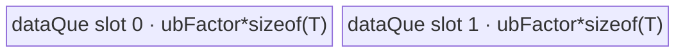

# UpsampleBilinear2dAABackward 950 ACLNN 算子知识

## 算子速览

| 项目 | 内容 |
|---|---|
| 实际入口 | `aclnnUpsampleBilinear2dAABackwardGetWorkspaceSize` + `aclnnUpsampleBilinear2dAABackward`，公开 ACLNN 两段式接口。 |
| 计算语义 | 把 `gradOutput` 按两个轴的归一化抗锯齿线性权重传播到 `gradInput`；非确定性路线 scatter+Atomic，确定性路线逐输出 gather。 |
| 输入输出 | `[N,C,H,W]`，ND/NCHW；FP32/FP16/BF16 原 dtype 直接进入 950 Kernel。 |
| 执行类型 | 单 Kernel：R-001 `AIV_VECTOR` DataCopy；R-002 `AIV_VECTOR` 清零 + `SIMT` Atomic scatter；R-003 `SIMT` deterministic gather。entry 明确 `KERNEL_TYPE_AIV_ONLY`，无 Cube/AIC/MIX_CV。 |
| Kernel 路线 | `(schId,isInt32,isDetermine)`：R-001 `(0,0,1)`；R-002 `(1,{0,1},0)`；R-003 `(1,{0,1},1)`。 |
| 核心资源 | GM input/output；DataCopy 路线使用 depth=2 的绑定 TQue；SIMT 使用 512 threads/core、线程局部标量和 GM Atomic，无 dynamic UB；统一保留 16 MiB workspace 但 body 不读取。 |
| 来源闭包 | `source_closed`：公开 ACLNN→RegBase Host/Tiling→模板 key/POD→AIV-only entry→DataCopy/SIMT/Atomic 全部可达 body 与 ascend950 构建接线闭合。 |
| 验证状态 | 已完成源码闭包检查；本次知识提取未执行编译、真机、数值或性能测试。 |

## 接口与语义

### 计算语义

若正向输出 `(h,w)` 受输入 `(h_i,w_j)` 影响，反向语义为：

```text
gradInput(n,c,h_i,w_j) += gradOutput(n,c,h,w) * weightH(h_i,h) * weightW(w_j,w)
weight(d) = max(0, 1-|d|)，每个轴分别按覆盖区间归一化。
```

`scaleX` 在 `alignCorners=true` 时为 `(inX-1)/(outX-1)`，否则取 ACLNN 已倒数后的正 scale，未指定时为 `inX/outX`；`supportX=max(scaleX,1)`，`invScaleX=(scaleX>=1 ? 1/scaleX : 1)`。950 默认非确定性实现：每个 `gradOutput` 元素向多个 `gradInput` 地址做原 dtype AtomicAdd。开启确定性后，映射反转为每个 `gradInput` 元素按固定 H/W 循环读取所有相关 `gradOutput`，FP32 局部累加后单次写出。

### 输入、输出与属性

| 参数 | shape/layout | dtype | 约束、默认值与语义 |
|---|---|---|---|
| `gradOutput` | 4D NCHW 或 ND（按 NCHW） | FP32/FP16/BF16 | 非空；与 `out` dtype、format 一致；N/C 相同。 |
| `outputSize` | 长度 2 | INT64 数组 | 必须等于 `gradOutput` H/W，元素正数。 |
| `inputSize` | 长度 4，NCHW | INT64 数组 | 必须等于 `out` N/C/H/W，元素正数。 |
| `alignCorners` | 标量 | bool | 控制角点或边对齐。 |
| `scalesH/scalesW` | 标量 | double→L0 float | 不得为负；正值由 ACLNN 先取倒数。 |
| `out` | `[N,C,inH,inW]` | 同输入 | 最终由 `ViewCopy` 提交到用户 Tensor。 |
| `workspace/executor/stream` | Device workspace 与执行对象 | 指针/整数 | 第一段返回 16 MiB 算子 workspace 及框架临时区；第二段在指定 stream 执行。 |

### 入口与版本

公开产品表明确支持 Ascend 950PR/950DT，且说明 950 默认非确定性、可通过运行时系统参数开启确定性。OpDef 为 `ascend950` 选择 `upsample_bilinear2d_aa_backward_apt`，binary config 提供 FP32/FP16/BF16 ND 实例；`ascendc_config.json` 也把该算子接到 ascend950。无更新版本符号，因此提取当前唯一公开入口。

## Host/Launcher 执行流程

### 参数校验与前处理

ACLNN 依次校验空指针、dtype 与输入输出一致性、4D、ND/NCHW、`inputSize/outputSize` 长度、N/C、正 size 和非负 scale；创建 executor 并对 `gradOutput` 做 `Contiguous`。950 的 `IsRegBase()` 分支优先于 A2/A3 的同尺寸 Host 旁路，因此 950 总是调用 L0 算子：不对 FP16/BF16 做 FP32 Cast，直接把原 dtype、属性和输出描述加入 AICORE launcher。算子临时输出最后经 `ViewCopy` 写入用户 `out`。任一框架节点或 launcher 添加失败立即返回，不继续后继。

### 参数、Workspace 与生命周期

Tiling 从输出 `grad_input` shape 得到 `inH/inW/inSize`，从输入 `grad_output` 得到 `outH/outW/outSize`，读取 deterministic context、AIV core 数、UB 字节数和 dtype size。所有 Route 都令 `workspaces[0]=16 MiB`；950 entry 接收 `workspace` 但三个 body 均不读取，固定源码没有进一步切片。

DataCopy 计算 `oneBlockNum=UB_BLOCK_BYTES/dtypeSize`，`ubFactor=floor_to_oneBlock((UBSize-oneBlockNum*dtypeSize)/(2*dtypeSize))` 个元素；SIMT 不申请 UB。executor 拥有临时输出与 workspace，用户须保持 workspace/executor 有效到 stream 工作完成。

### 启动图与失败传播

```text
ACLNN GetWorkspaceSize
  -> Contiguous
  -> l0op::UpsampleBilinear2dAABackward
     -> Tiling4...::RunBigKernelTiling -> Regbase Tiling
     -> single AIV-only entry(blockDim=max(realCoreNum,initRealCoreNum), POD, template key)
        -> R-001 DataCopy
        -> R-002 ClearOut(AIV) -> SyncAll -> SIMT scatter AtomicAdd
        -> R-003 SIMT gather -> one GM store/output element
  -> ViewCopy
  -> CommonOpExecutorRun(same stream)
```

三个 Route 都是单 Kernel。非确定性 R-002 先由最多 `initRealCoreNum` 个 AIV 核清零输出，所有 block 经 `SyncAll` 后才允许 SIMT Atomic；`blockDim` 取清零核数和计算核数较大者。确定性/Copy 无跨 Kernel 边。Host Tiling 失败会阻止 launch；entry 的 template key 由编译选择集约束，固定 body 没有运行时 unknown-key 分支。

## Route 与参数设计

### 分核与资源计算

同尺寸判定要求 `outH==inH && outW==inW && scaleH==1 && scaleW==1`，命中后强制 tuple `(0,0,1)`。否则 `schId=1`：确定性以 `inSize` 为工作域，非确定性以 `outSize` 为工作域；`realCoreNum=min(dataSize,AIVCoreNum)`，`blkProcessNum=dataSize/realCoreNum`，余数前 `tailBlockNum` 核各多处理一个元素。非确定性另以 `inSize` 同法生成输出清零分核。

若 `inSize<=INT32_MAX && outSize<=INT32_MAX`，`isInt32=1`，SIMT 用 `uint32_t` magic division 与 `int32_t` 地址/循环；否则用 `uint64_t/int64_t`。每个 AIV kernel block 通过 `asc_vf_call(dim3(512),...)` 启动 512 个 SIMT 线程，线程以 `threadIdx.x + k*blockDim.x` 遍历该核连续片段。无 dynamic UB、shared memory、warp cooperative group 或 SIMT barrier。

### Route 选择

| 顺序 | Route | Key/模板 | 精确选择条件与优先级 | 不适用去向 |
|---:|---|---|---|---|
| 1 | R-001 原样搬运 | `(0,0,1)` | `outH==inH && outW==inW && scaleH==1 && scaleW==1` | 不成立进入 SIMT。 |
| 2 | R-002 非确定性 scatter | `(1,1,0)` 或 `(1,0,0)` | 非 Copy 且 `context->GetDeterministic()==0`；索引宽度由两边元素数决定 | deterministic 时 R-003。 |
| 3 | R-003 确定性 gather | `(1,1,1)` 或 `(1,0,1)` | 非 Copy 且 `context->GetDeterministic()==1` | 无其它 fallback。 |

```text
isDataCopy ? (schId=0,isInt32=0,isDetermine=1)
           : (schId=1,
              isInt32=(inSize<=INT32_MAX && outSize<=INT32_MAX),
              isDetermine=context deterministic)
```

### 模板/实现执行矩阵

| Route | key/selector | dtype/shape/platform 完整命中条件 | 执行拓扑与 Kernel 节点 | 实际模板/body | 内存与同步特征 | tail/fallback |
|---|---|---|---|---|---|---|
| R-001 | `(0,0,1)` | 950；任一支持 dtype；同 shape、双 scale=1 | 单 AIV Kernel | `DataCopy<DTYPE_GRAD_OUTPUT>` | depth=2 TQueBind，GM↔UB | core 余数 + UB loop tail，DataCopyPad 按字节长度。 |
| R-002 | `(1,{1,0},0)` | 950；非 Copy；默认/关闭确定性 | 同 Kernel AIV ClearOut→SIMT | `Simt<T,uint{32,64},int{32,64},0>`→`SimtCompute` | 输出清零后 SyncAll；原 dtype GM AtomicAdd | 每线程 stride loop；覆盖区 clamp；无 fallback。 |
| R-003 | `(1,{1,0},1)` | 950；非 Copy；开启确定性 | 单 SIMT Kernel | `Simt<T,uint{32,64},int{32,64},1>`→`SimtComputeDetermine` | 无 Atomic、无输出预清零；线程独占输出 | source 候选区由 maxInterp 与边界截断。 |

### 隐藏性能 Guard

| Guard | Host/Tiling 条件 | Device/资源原因 | 影响 Route | 不满足时去向 | 源码符号 |
|---|---|---|---|---|---|
| Copy 严格谓词 | shape 同且两个 float scale 精确等于 1 | 才能语义等价逐元素搬运 | R-001 | SIMT | `CalTilingData` |
| 32/64 位索引 | `inSize,outSize<=INT32_MAX` | magic division、地址和循环防溢出 | R-002/R-003 | 64 位 specialization | `CheckInputParams`, entry |
| UB factor | `(UBSize-UBBlock)/(2*dtypeSize)` 再按 UB block 元素对齐 | 双缓冲总量与 DMA block 对齐 | R-001 | 固定源码无失败检查 | `ComputeDataCopy` |
| Atomic 初始化 | `isDetermine==0` | Atomic scatter 必须从 0 开始 | R-002 | 确定性不需要 | `Process::ClearOut/SyncAll` |
| 512 threads | 两种索引宽度均固定 512 | VF callee 的线程步长/launch bound | R-002/R-003 | 无替代 threads 配置 | `THREAD_NUM_B32/B64` |
| AIV core | `GetCoreNumAiv()>0` | blockDim 和片段分配 | 全部 | Tiling 失败 | Regbase `Init` |
| 非空 shape | `inSize!=0 && outSize!=0` | 除法分核、线程域有效 | 全部 | Tiling 失败 | `CheckInputParams` |

### POD/ABI

结构是普通顺序布局：14 个 int64、1 个 int32、6 个 float；按源码自然 8 字节对齐推导 `sizeof=144, alignof=8`。模板 tuple 不在 POD 中，由 TilingKey 编译期选择。

| 结构 | 字段 | 类型/位宽 | ABI 布局 | 单位 | Host/launcher producer | Device consumer | 边界 |
|---|---|---|---|---|---|---|---|
| `Upsample...RegBaseTilingData` | `blkProcessNum` | int64/64 | offset 0 | 元素/core | `CalTilingData/ComputeDataCopy` | Copy/Simt `Process` | quotient |
| 同上 | `realCoreNum` | int64/64 | offset 8 | core | 同上 | core guard | >=1 |
| 同上 | `tailBlockNum` | int64/64 | offset 16 | core/元素余数 | 同上 | 前若干核 +1 | `<realCoreNum` |
| 同上 | `initBlkProcessNum` | int64/64 | offset 24 | 输出元素/core | 非确定性分核 | `ClearOut` | 其它路线为0 |
| 同上 | `initRealCoreNum` | int64/64 | offset 32 | core | 同上 | clear guard/blockDim | 其它路线为0 |
| 同上 | `initTailBlockNum` | int64/64 | offset 40 | 余数 | 同上 | clear offset | 其它路线为0 |
| 同上 | `lenN` | int64/64 | offset 48 | 元素 | shape N | SIMT 参数 | 正值 |
| 同上 | `lenC` | int64/64 | offset 56 | 元素 | shape C | SIMT 参数；body未直接使用 | 正值 |
| 同上 | `inH` | int64/64 | offset 64 | 元素 | gradInput H | SIMT src/dst | 正值 |
| 同上 | `inW` | int64/64 | offset 72 | 元素 | gradInput W | SIMT src/dst | 正值 |
| 同上 | `outH` | int64/64 | offset 80 | 元素 | gradOutput H | SIMT src/dst | 正值 |
| 同上 | `outW` | int64/64 | offset 88 | 元素 | gradOutput W | SIMT src/dst | 正值 |
| 同上 | `maxInterpSizeH` | int64/64 | offset 96 | 候选元素 | `ceil(5/scaleH)+2ceil(supportH)+5` 或 outH | deterministic rightH | nondet inactive |
| 同上 | `maxInterpSizeW` | int64/64 | offset 104 | 候选元素 | 同上 W | deterministic rightW | nondet inactive |
| 同上 | `ubFactor` | int32/32 | offset 112 | 元素/tile | `ComputeDataCopy` | Copy loop/InitBuffer | SIMT inactive |
| 同上 | `scaleH` | float/32 | offset 116 | 比率 | `ComputeScalesSupportValues` | center/left index | 可为0 |
| 同上 | `scaleW` | float/32 | offset 120 | 比率 | 同上 | 同上 W | 可为0 |
| 同上 | `invScaleH` | float/32 | offset 124 | 比率 | `scale>=1?1/scale:1` | weight distance | >=0 |
| 同上 | `invScaleW` | float/32 | offset 128 | 比率 | 同上 | 同上 W | >=0 |
| 同上 | `supportH` | float/32 | offset 132 | 元素半径 | `max(scaleH,1)` | H window | >=1 |
| 同上 | `supportW` | float/32 | offset 136 | 元素半径 | `max(scaleW,1)` | W window | >=1 |

### Route 源码闭包

| Route | Key/selector | Host/Tiling producer | POD/参数 | Kernel entry/router 节点 | Kernel body/直接依赖 | 构建接线 |
|---|---|---|---|---|---|---|
| R-001 | `(0,0,1)` | tiling_arch35 `CalTilingData/ComputeDataCopy` | RegBase POD + dtype binary | apt entry `schId==0` | data_copy.h 全部方法 | ascend950 binary、OpDef `_apt`、ascendc_config |
| R-002 | `(1,{1,0},0)` | tiling_arch35 `CalTilingData/DoTiling` | POD + 512 threads + magic divisor | apt entry SIMT template | simt.h `ClearOut/Process`; simt_base `SimtCompute/callee*` | 同上 |
| R-003 | `(1,{1,0},1)` | 同上 | POD + candidate bounds | apt entry SIMT template | simt.h `Process`; simt_base `SimtComputeDetermine/callee*` | 同上 |

## Kernel 实现

### 公共执行流程

entry 标记 `KERNEL_TYPE_AIV_ONLY`，解析同一 RegBase POD。`schId==0` 构造 DataCopy；否则按 `isInt32` 选择 32/64 位索引模板，再按 `isDetermine` 编译期选择 scatter 或 gather callee。`T1=DTYPE_GRAD_OUTPUT` 由 ascend950 FP32/FP16/BF16 binary 决定。SIMT 的除法不直接用 `/` 解码 N/C/H/W，而由 AIV 侧 `GetUintDivMagicAndShift` 生成 magic/shift，传入 VF callee 使用 `Simt::UintDiv`。

### Route R-001：AIV depth-2 绑定 Queue 原样搬运

#### 适用条件

##### 选择证据

| 层级 | 文件 | 符号 | 源码谓词/参数 | 结果/下一跳 |
|---|---|---|---|---|
| API | op_host/op_api/aclnn_upsample_bilinear2d_aa_backward.cpp | `IsRegBase` branch | 950 | 始终添加算子节点 |
| Tiling | op_host/upsample_bilinear2d_aa_backward_tiling_arch35.cpp | `CalTilingData` | 同 shape 且 scaleH/W==1 | `(0,0,1)` |
| Router | op_kernel/upsample_bilinear2d_aa_backward_apt.cpp | `schId==0` | compile-time | `DataCopy<T>` |

#### Device 数据流

##### 函数级调用链

```text
entry -> DataCopy<T>::Init -> InitBuffer(TQueBind,depth=2,ubFactor*sizeof(T))
      -> Process -> [CopyIn(DataCopyPad GM→UB) -> CopyOut(DataCopyPad UB→GM)]*
```

##### 源码等价伪码

```text
core_len = blkProcessNum + (blockIdx < tailBlockNum)
core_off = blkProcessNum*blockIdx + min(blockIdx,tailBlockNum)
for loop in [0,core_len) step ubFactor:
  len = min(ubFactor,core_len-loop)
  DataCopyPad(input[(core_off+loop)*sizeof(T)] -> bound queue, blockCount=1, blockLen=len*sizeof(T))
  DataCopyPad(bound queue -> output[same offset], same bytes)
```

#### 内存与数据搬运

##### 资源与搬运表

| 层级/缓冲区 | offset/地址公式 | extent/容量公式 | dtype/layout | producer | consumer | owner/lifetime | 对齐/复用 |
|---|---|---|---|---|---|---|---|
| GM input/output | `(coreOffset+loop)*sizeof(T)` | `len*sizeof(T)` | uint8 view/original ND | CopyIn/CopyOut | output | external | exact byte blockLen |
| bound `dataQue_` | queue slot | `2*ubFactor*sizeof(T)` total | uint8 | DataCopyPad | DataCopyPad | TPipe, per iteration alloc/free | depth2；ubFactor按UB block对齐 |
| workspace | N/A | Host保留16 MiB | N/A | 未使用 | 未使用 | executor | 不伪造切片 |

##### 分层内存布局



##### 字节账与复用顺序

```text
UB_total = 2 * ubFactor * sizeof(T)
ubFactor = floor_to_UB_block((UBSize-UBBlockBytes)/(2*sizeof(T)))
UB_total <= UBSize-UBBlockBytes
dynamic_ub = N/A
workspace_total = 16 MiB reserved, body use = 0
```

| 复用子区 | 写入者 | 读取者/消费点 | 下一次覆盖 | 同步或释放依据 | 安全条件 |
|---|---|---|---|---|---|
| dataQue slot | CopyIn | CopyOut | 下一 loop CopyIn | EnQue→DeQue→FreeTensor | CopyOut 完成后复用 |

#### 同步、精度与尾块

##### 同步与数值边界表

| 阶段 | primitive/机制 | producer | consumer/等待点 | 保护对象 | 精度/尾块 |
|---|---|---|---|---|---|
| GM→UB→GM | bound Queue 生命周期 | CopyIn | CopyOut | 当前 tile | 纯字节搬运，无 cast；最后 tile 精确 len bytes |
| 分核 | quotient/remainder | Host | core Process | GM 不重叠区间 | 前 tailBlockNum 核多1元素 |

#### 关键实现

##### 符号证据表

| 阶段 | 文件 | 符号/模板实例 | 实现事实 |
|---|---|---|---|
| Host/Tiling producer | op_host/upsample_bilinear2d_aa_backward_tiling_arch35.cpp | `ComputeDataCopy` | core/UB/tail |
| Kernel entry/router | op_kernel/upsample_bilinear2d_aa_backward_apt.cpp | `schId==0` | `DataCopy<DTYPE>` |
| Device body/helper | op_kernel/arch35/upsample_bilinear2d_aa_backward_data_copy.h | `Init/Process/CopyIn/CopyOut` | depth2 与字节 DMA |

### Route R-002：SIMT 非确定性 Atomic scatter

#### 适用条件

##### 选择证据

| 层级 | 文件 | 符号 | 源码谓词/参数 | 结果/下一跳 |
|---|---|---|---|---|
| Doc/Runtime | docs/aclnnUpsampleBilinear2dAABackward.md | 确定性说明 | 950 默认非确定性 | context deterministic=0 |
| Tiling | tiling_arch35.cpp | `CalTilingData` | 非 Copy，isDetermine=0 | `(1,isInt32,0)`，按 outSize 分核并生成 init 分核 |
| Router | apt.cpp | SIMT branch | 32/64 位 | `Simt<T,index,address,0>` |

#### Device 数据流

##### 函数级调用链

```text
entry -> Simt<T,...,0>::Process
  -> ClearOut -> InitOutput<T>(per-core output slice,0) -> SyncAll
  -> GetUintDivMagicAndShift(H/W)
  -> asc_vf_call<calleeInt32/64<T,...,0>>(512 threads)
     -> SimtCompute -> asc_atomic_add(output + affected_index, T(input*weightH*weightW))
```

##### 源码等价伪码

```text
parallel clear every gradInput element; SyncAll
for gradOutput flat index assigned to this core and SIMT thread:
  decode (NC,H,W) using magic division over outH/outW
  compute clamped affected gradInput H/W ranges and normalized FP32 axis weights
  for h,w in affected range:
    atomic_add_T(gradInput[NC,h,w], cast<T>(float(gradOutput)*weightH*weightW))
```

#### 内存与数据搬运

##### 资源与搬运表

| 层级/缓冲区 | offset/地址公式 | extent/容量公式 | dtype/layout | producer | consumer | owner/lifetime | 对齐/复用 |
|---|---|---|---|---|---|---|---|
| GM input | `blkStart+idx` | 1 element/thread iteration | T/ND | gradOutput | SIMT | input | tail guarded by idx<blkProcess |
| GM output | `NC*inH*inW+h*inW+w` | 1 T Atomic target | T/ND | ClearOut then Atomic | final output | output | collision domain=all source pixels influencing target |
| registers | H/W/NC、range、weights、sum | thread local | int32/64 + FP32 | SIMT | same thread | callee lifetime | capacity固定仓不可见 |
| UB/dynamic UB | N/A | 0 explicit | N/A | 无 | 无 | 无 | asc_vf_call直接GM |

##### 分层内存布局

N/A：该 Route 无 AIV UB 队列；512 个 SIMT 线程直接读写 GM，线程局部状态位于寄存器。

##### 字节账与复用顺序

```text
UB_total = 0（源码无 InitBuffer）
dynamic_ub = N/A
workspace_total = 16 MiB reserved, body use = 0
```

| 复用子区 | 写入者 | 读取者/消费点 | 下一次覆盖 | 同步或释放依据 | 安全条件 |
|---|---|---|---|---|---|
| output GM | InitOutput | Atomic scatter | 多线程 Atomic 累加 | ClearOut 后 `SyncAll` | 所有核清零完成后开始 Atomic |

#### 同步、精度与尾块

##### 同步与数值边界表

| 阶段 | primitive/机制 | producer | consumer/等待点 | 保护对象 | 精度/尾块 |
|---|---|---|---|---|---|
| 初始化 | `InitOutput` + `SyncAll` | AIV clear | SIMT scatter | 全 output GM | 原 dtype 零 |
| 贡献 | `asc_atomic_add` | 多线程 | GM | 冲突地址 | weight/乘法为FP32，贡献先cast T；累加顺序非确定 |
| 线程 tail | strided loop guard | 512 threads | callee | core slice | `idx<blkProcessNum` |

#### 关键实现

##### 符号证据表

| 阶段 | 文件 | 符号/模板实例 | 实现事实 |
|---|---|---|---|
| Host/Tiling producer | op_host/upsample_bilinear2d_aa_backward_tiling_arch35.cpp | `CalTilingData/DoTiling` | outSize计算域、init域、scheduleMode=1 |
| Kernel entry/router | op_kernel/upsample_bilinear2d_aa_backward_apt.cpp | `Simt<T,...,0>` | index width specialization |
| Device body/helper | op_kernel/arch35/upsample_bilinear2d_aa_backward_simt.h / simt_base.h | `ClearOut/SimtCompute/callee*` | 512线程、Atomic scatter、tail |

### Route R-003：SIMT 确定性 gather

#### 适用条件

##### 选择证据

| 层级 | 文件 | 符号 | 源码谓词/参数 | 结果/下一跳 |
|---|---|---|---|---|
| Runtime/Tiling | tiling_arch35.cpp | `GetDeterministic/CalTilingData` | 非 Copy，isDetermine=1 | `(1,isInt32,1)`，按 inSize 分核 |
| Router | apt.cpp | SIMT branch | 32/64 位 | `Simt<T,index,address,1>` |
| Callee | simt_base.h | `calleeInt32/64` | compile-time isDetermine=1 | `SimtComputeDetermine` |

#### Device 数据流

##### 函数级调用链

```text
entry -> Simt<T,...,1>::Process -> magic/shift
  -> asc_vf_call<calleeInt32/64<T,...,1>>(512 threads)
     -> SimtComputeDetermine -> GetLeftIndex/GetWeights -> outputGm[yGmIdx]=value
```

##### 源码等价伪码

```text
for gradInput flat index assigned to this core/thread:
  decode (NC,H,W) in inH/inW domain
  derive candidate gradOutput [leftH,rightH)×[leftW,rightW), clipped by maxInterp and out shape
  value=0 FP32
  for h then w in fixed increasing order:
    if target coordinate lies in source pixel support:
      value += float(gradOutput[NC,h,w]) * normalizedWeightH * normalizedWeightW
  gradInput[index] = cast<T>(value)
```

#### 内存与数据搬运

##### 资源与搬运表

| 层级/缓冲区 | offset/地址公式 | extent/容量公式 | dtype/layout | producer | consumer | owner/lifetime | 对齐/复用 |
|---|---|---|---|---|---|---|---|
| GM input | `NC*outH*outW+h*outW+w` | candidates | T/ND | gradOutput | SIMT | input | bounds clipped |
| GM output | `blkStart+idx` | 1 element | T/ND | single thread store | final | output | no conflicts |
| registers | candidate bounds、FP32 value/weights | thread local | int32/64+FP32 | callee | same thread | iteration | 固定仓不可见字节 |
| UB/dynamic UB | N/A | 0 explicit | N/A | 无 | 无 | 无 | direct GM |

##### 分层内存布局

N/A：无 AIV UB/dynamic UB；SIMT 线程从 GM gather 到寄存器并单写 GM。

##### 字节账与复用顺序

```text
UB_total = 0
dynamic_ub = N/A
workspace_total = 16 MiB reserved, body use = 0
```

| 复用子区 | 写入者 | 读取者/消费点 | 下一次覆盖 | 同步或释放依据 | 安全条件 |
|---|---|---|---|---|---|
| output element | owning thread | final consumer | 无本Kernel覆盖 | 一线程一元素 | 按inSize分核区间不重叠 |

#### 同步、精度与尾块

##### 同步与数值边界表

| 阶段 | primitive/机制 | producer | consumer/等待点 | 保护对象 | 精度/尾块 |
|---|---|---|---|---|---|
| gather | 无Atomic/无barrier | owning thread | direct store | 单output | FP32固定H→W顺序累加，末尾cast T |
| candidate tail | clamp + continue/break | bounds logic | loops | source边缘 | right=min(left+maxInterp,outExtent) |
| thread tail | strided guard | 512 threads | callee | core slice | idx<blkProcess |

#### 关键实现

##### 符号证据表

| 阶段 | 文件 | 符号/模板实例 | 实现事实 |
|---|---|---|---|
| Host/Tiling producer | op_host/upsample_bilinear2d_aa_backward_tiling_arch35.cpp | `ComputeScalesSupportValues/CalTilingData` | candidate上界、inSize域 |
| Kernel entry/router | op_kernel/upsample_bilinear2d_aa_backward_apt.cpp | `Simt<T,...,1>` | deterministic template |
| Device body/helper | op_kernel/arch35/upsample_bilinear2d_aa_backward_simt_base.h | `SimtComputeDetermine/GetWeights` | 固定顺序gather与单写 |

## 算子特定优化

### Trick T-001：按确定性要求反转并行方向

#### 触发与源码依据

- 适用 Route：R-002、R-003。
- 触发条件：非 Copy；`context_->GetDeterministic()` 生成编译期 `isDetermine`。
- Golden 来源：[`upsample_bilinear2d_aa_backward_simt_base.h:182-189`](../../../../../../../cann-ops-raw/ascendc/ops-cv/bb717d075d129fd1fc7b96b2886824a1d153ed2f/image/upsample_bilinear2d_aa_backward/op_kernel/arch35/upsample_bilinear2d_aa_backward_simt_base.h#L182-L189)

**官方源码（固定 Commit 连续逐字摘录）**：

```cpp
if constexpr (isDetermine == 0) {
    SimtCompute<T1, T2, T3>(inputGm, outputGm, blkStartOffset, blkProcessNum, lenN, lenC, mH, shiftH, mW, shiftW,
        lenSrcH, lenSrcW, lenDstH, lenDstW, maxInterpSizeH, maxInterpSizeW, scaleH, scaleW, invScaleH, invScaleW,
        supportH, supportW);
} else {
    SimtComputeDetermine<T1, T2, T3>(inputGm, outputGm, blkStartOffset, blkProcessNum, lenN, lenC, mH, shiftH,
        mW, shiftW, lenSrcH, lenSrcW, lenDstH, lenDstW, maxInterpSizeH, maxInterpSizeW, scaleH, scaleW,
        invScaleH, invScaleW, supportH, supportW);
}
```

#### 机制与设计原因

非确定性模板让线程拥有 `gradOutput` 元素并 scatter，扩大源元素并行度，但多个线程冲突时必须 Atomic，因而先全局清零且加法顺序不固定。确定性模板让线程拥有唯一 `gradInput` 元素，按 H/W 递增顺序 gather 贡献，在寄存器 FP32 累加后单写，消除 Atomic 冲突和调度顺序对结果的影响。Host 同时把分核域从 `outSize` 切换为 `inSize`。

#### 迁移边界

- 适用：反向插值等 scatter/gather 对偶问题。
- 前提：能枚举目标元素的有限 source 候选窗口；950 SIMT；正确的 maxInterp 上界。
- 失效：候选关系不可逆枚举或窗口上界不闭合时不能使用 deterministic gather。
- 未验证：本次知识提取未执行编译、真机、数值或性能测试。

#### 错误做法

固定仓的真实反例是非确定性 scatter 若省略 `ClearOut + SyncAll`，Atomic 会在未初始化或未完全清零的输出上累加。

### Trick T-002：同尺寸专用绑定 Queue 字节搬运

#### 触发与源码依据

- 适用 Route：R-001。
- 触发条件：H/W 相同且计算后的双 scale 精确为 1。
- Golden 来源：[`upsample_bilinear2d_aa_backward_data_copy.h:109-114`](../../../../../../../cann-ops-raw/ascendc/ops-cv/bb717d075d129fd1fc7b96b2886824a1d153ed2f/image/upsample_bilinear2d_aa_backward/op_kernel/arch35/upsample_bilinear2d_aa_backward_data_copy.h#L109-L114)

**官方源码（固定 Commit 连续逐字摘录）**：

```cpp
for (int64_t loop = 0; loop < totalLength_; loop += ubFactor_) {
    int64_t len = Min(ubFactor_, totalLength_ - loop);
    int64_t offset = totalOffset_ + loop;
    CopyIn(offset, len);
    CopyOut(offset, len);
}
```

#### 机制与设计原因

语义退化为 identity 时不启动 512 线程权重循环，改用 `uint8_t` 视图和 depth=2 的绑定 Queue 原样搬运；同一 body 自然覆盖三种 dtype，尾 tile 的 `blockLen=len*sizeof(T)` 不写 padding 区。源码循环按 `CopyIn→CopyOut` 顺序执行，未证明跨迭代搬运重叠。

#### 迁移边界

- 适用：输出与输入逐 bit 相同的退化路线。
- 前提：shape 相同、scale=1、dtype/layout不变、UB factor为正。
- 失效：任一 resize 维度或 scale 不等于1即转 SIMT。
- 未验证：本次知识提取未执行编译、真机、数值或性能测试。

#### 错误做法

固定仓未提供可验证反例。

## 模板与实现对比

| 对比维度 | R-001 DataCopy | R-002 非确定性 scatter | R-003 确定性 gather | 设计选择依据 |
|---|---|---|---|---|
| 命中条件/优先级 | 同shape、scale=1，最高 | 非Copy、det=0 | 非Copy、det=1 | 先消除计算，再按确定性分流。 |
| 模板与 dtype | `DataCopy<T>` | `Simt<T,uint32/64,int32/64,0>` | 同左但 det=1 | T为FP32/FP16/BF16 binary。 |
| 循环与分核 | input元素、UB tile | gradOutput元素、512线程scatter | gradInput元素、512线程gather | 并行所有权不同。 |
| Queue/TBuf/寄存器/dynamic UB/通信 window | depth2 bound Queue | 线程寄存器；无UB | 同左 | SIMT直接GM。 |
| 内存总占用与复用 | `2*ubFactor*sizeof(T)` | explicit UB=0 | explicit UB=0 | 统一16MiB workspace未消费。 |
| 搬运/Vector/SIMT/NDDMA/通信 API | DataCopyPad | InitOutput、asc_vf_call、Atomic | asc_vf_call、单写 | 无NDDMA/通信。 |
| 同步、精度与 tail | Queue；bitwise copy | Clear+SyncAll；FP32权重→cast贡献→T Atomic | FP32固定序累加→cast T | tail均由范围guard。 |
| fallback/失败边界 | ubFactor无显式正值guard | 无Atomic dtype fallback | 无候选窗口fallback | Tiling/shape失败终止。 |

## 平台差异

| 项目 | A2 | A3 | 950 |
|---|---|---|---|
| 支持状态 | 支持，非本卡 | 支持，非本卡 | 公开支持 |
| Host/Launcher | 非RegBase Key=1 | 同A2 | RegBase tuple selector + deterministic context |
| Kernel/资源 | Cube Matmul + workspace中间矩阵 | 同A2 | AIV-only DataCopy/SIMT，无Cube；16MiB保留workspace未消费 |

## 限制与失败边界

- 输入输出必须非空、4D、N/C一致、dtype/format一致，属性 shape 必须与实际 Tensor 对应；Tiling 对不一致直接失败。
- 非确定性 FP16/BF16 在贡献乘法后先 cast 到 T 再做 T Atomic；确定性在 FP32 固定序累加后一次 cast，二者舍入路径不同。
- `inSize/outSize` 的 shape 乘法由框架 shape API产生；固定源码只据其选择 int32/64，没有展示更早的乘法溢出处理。
- DataCopy 的 `ubFactor` 没有显式 `>0` guard；安全性依赖 950 UB 大于预留 UB block。
- `maxInterpSize=ceil(5/scale)+2*ceil(support)+5` 是确定性候选上界；scale=0 时退化为完整对应 out 轴。非确定性 body 不消费该字段。
- 16 MiB workspace 的 950 body 实际用途固定仓不可见；entry 参数存在但未读取。SIMT magic-division helper、Atomic 和 `InitOutput` primitive 内部属于 AscendC 库边界。
- 本次知识提取未执行编译、真机、数值或性能测试。

## 源码索引

### 链路索引

| 链路阶段 | 文件 | 关键符号 | 支撑内容 |
|---|---|---|---|
| 入口声明/约束 | image/upsample_bilinear2d_aa_backward/docs/aclnnUpsampleBilinear2dAABackward.md | 产品/确定性说明 | 950公开性、接口约束 |
| 入口实现 | image/upsample_bilinear2d_aa_backward/op_host/op_api/aclnn_upsample_bilinear2d_aa_backward.cpp | GetWorkspaceSize | 950不Cast、executor顺序 |
| 入口实现 | image/upsample_bilinear2d_aa_backward/op_host/op_api/upsample_bilinear2d_aa_backward.cpp | L0 launcher | 单算子节点 |
| Host/Tiling/Launcher | image/upsample_bilinear2d_aa_backward/op_host/upsample_bilinear2d_aa_backward_tiling.cpp | `RunBigKernelTiling` | RegBase外层分派 |
| Host/Tiling/Launcher | image/upsample_bilinear2d_aa_backward/op_host/upsample_bilinear2d_aa_backward_tiling_arch35.cpp | Regbase Tiling全部方法 | scale、route、core、workspace、key |
| Kernel entry/body | image/upsample_bilinear2d_aa_backward/op_kernel/upsample_bilinear2d_aa_backward_apt.cpp | entry | AIV-only模板router |
| Kernel entry/body | image/upsample_bilinear2d_aa_backward/op_kernel/arch35/upsample_bilinear2d_aa_backward_tiling_key.h | TPL declaration/selection | 可编译tuple闭包 |
| Kernel entry/body | image/upsample_bilinear2d_aa_backward/op_kernel/arch35/upsample_bilinear2d_aa_backward_tiling_data.h | RegBase POD | ABI字段 |
| Kernel entry/body | image/upsample_bilinear2d_aa_backward/op_kernel/arch35/upsample_bilinear2d_aa_backward_data_copy.h | DataCopy class | UB/DMA/tail |
| Kernel entry/body | image/upsample_bilinear2d_aa_backward/op_kernel/arch35/upsample_bilinear2d_aa_backward_simt.h | Simt class | Clear、分核、VF launch |
| Kernel entry/body | image/upsample_bilinear2d_aa_backward/op_kernel/arch35/upsample_bilinear2d_aa_backward_simt_base.h | callees/helpers | 512线程、scatter/gather、Atomic/精度 |
| 构建接线 | image/upsample_bilinear2d_aa_backward/op_host/upsample_bilinear2d_aa_backward_def.cpp | ascend950 `_apt` config | 平台body选择 |
| 构建接线 | image/upsample_bilinear2d_aa_backward/op_host/config/ascend950/upsample_bilinear2d_aa_backward_binary.json | 三dtype op_list | binary实例 |
| 构建接线 | scripts/kernel/binary_config/ascendc_config.json | `UpsampleBilinear2dAABackward` | ascend950 compute unit |

### 实现复用检查

| 检查项 | 可复用事实 | 不得改变的约束 | 源码符号 |
|---|---|---|---|
| ABI/POD | 144B普通结构、字段producer/consumer | offset、int64/float位宽、inactive字段 | RegBase POD/FillTilingData |
| 调用顺序 | Copy或Clear→SyncAll→scatter，或gather | 非确定性不得在清零同步前Atomic | Simt::Process |
| workspace/内存 | Copy depth2 UB；SIMT direct GM | ubFactor字节公式、输出区间不重叠/Atomic冲突域 | ComputeDataCopy/DataCopy/SimtCompute |
| 同步 | Queue生命周期；非确定性全核SyncAll；GM Atomic | 不得用普通store代替冲突Atomic | DataCopy Process/Simt Process |
| 精度与尾块 | FP32权重；scatter贡献cast后Atomic；gather FP32累加后cast | 两路线舍入顺序、candidate clamp、512-thread guard | SimtCompute/Determine |
| 失败边界 | shape/dtype/core/UB检查失败不launch | Copy谓词、index宽度、deterministic key不可混淆 | Regbase Init/Check/DoTiling |
