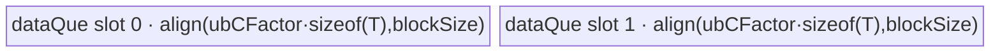

# UpsampleNearest2dBackward 950 ACLNN 算子知识

## 算子速览

| 项目 | 内容 |
|---|---|
| 实际入口 | `aclnnUpsampleNearest2dBackwardGetWorkspaceSize` / `aclnnUpsampleNearest2dBackward`，公开 ACLNN、两段式、无版本后缀 |
| 计算语义 | 对每个 `gradInput[n,c,H,W]`，累加所有最近邻前向映射到该点的 `gradOut[n,c,h,w]` |
| 输入输出 | 950：4D NCHW/NHWC；FP16/FP32/BF16；输入输出 dtype/format/N/C 一致，H/W 非空 |
| 执行类型 | 非空路径为单 Kernel；R-001 为 AIV_VECTOR，R-002～R-004 为 SIMT；entry 的 `KERNEL_TYPE_MIX_AIV_1_0` 表示 AIV:AIC=1:0，不含 Cube |
| Kernel 路线 | R-001 同尺寸 AllCopy；R-002 单空间轴 1D；R-003 NCHW 大 HW；R-004 通用确定性 SIMT |
| 核心资源 | GM；R-001 使用 depth=2 的绑定 TQue；SIMT 直接 GM、无 Atomic/显式 shared buffer；核心节点固定申请 16 MiB workspace，并设置 `UB-40 KiB` local memory |
| 来源闭包 | source_closed：公开 ACLNN、950 `IsRegBase` Host 分支、L0 launcher、950 Tiling/POD、全部四条可达 entry/body、workspace 与构建接线均闭合 |
| 验证状态 | 已完成源码闭包检查；本次知识提取未执行编译、真机、数值或性能测试。 |

## 接口与语义

### 计算语义

令 `gradOut` 的空间维为 `(h,w)=(lenDstH,lenDstW)`，`gradInput` 的空间维为 `(H,W)=(lenSrcH,lenSrcW)`。950 Host 固定 `alignCorners=false`、`halfPixelCenters=false`。Tiling 先取

```text
scaleH = scalesH > 0 ? 1 / scalesH : H / h
scaleW = scalesW > 0 ? 1 / scalesW : W / w
inverseScaleH = 1 / scaleH
inverseScaleW = 1 / scaleW
```

Device 对输出位置 `(H,W)` 计算 `h0=min(ceil(H*inverseScaleH),h)`、`h1=min(ceil((H+1)*inverseScaleH),h)`，W 轴同理，然后以 FP32 标量顺序累加 `[h0,h1)×[w0,w1)` 内的 `gradOut`，最后转换回输出 dtype。其语义与公开文档中的二维区间求和一致；同尺寸特例直接逐元素拷贝。

### 输入、输出与属性

| 参数 | shape/layout | dtype | 约束、默认值与语义 |
|---|---|---|---|
| `gradOut` | 4D NCHW 或 NHWC | FP16/FP32/BF16 | 支持非连续；H/W 大于 0；shape 必须等于由 `inputSize` 的 N/C 与 `outputSize` 的 H/W 组成的完整 shape |
| `outputSize` | 长度 2 | INT64 | `gradOut` 的 H/W，两个元素均大于 0 |
| `inputSize` | 长度 4 | INT64 | `gradInput` shape；NCHW 为 `[N,C,H,W]`，NHWC 为 `[N,H,W,C]`；H/W 大于 0 |
| `scalesH` | 标量 | double，进入内核前窄化为 float | 公共约束要求 `outputSize_H=floor(inputSize_H*scalesH)`；950 将值放入 `scales[0]` |
| `scalesW` | 标量 | double，进入内核前窄化为 float | 公共约束要求 `outputSize_W=floor(inputSize_W*scalesW)`；950 将值放入 `scales[1]` |
| `gradInput` | 4D，format 与 gradOut 相同 | dtype 与 gradOut 相同 | 支持非连续；N/C 与 gradOut 相同；是区间归约后的输出 |
| `workspaceSize` | 标量 | uint64 | executor 汇总值；核心 `ResizeNearestNeighborV2Grad` 节点请求 16 MiB |
| `executor` | opaque | `aclOpExecutor**` | 第一段创建并移交，第二段在指定 stream 上执行 |

### 入口与版本

固定仓公开无版本后缀的两段式 `aclnnUpsampleNearest2dBackward`，没有更高版本 950 入口。公开产品表明确支持 Ascend 950PR/950DT；950 由 `IsRegBase()` 选择专用路径。该路径只调用 `ResizeNearestNeighborV2Grad`，其 OpDef、binary config 和 CMake 均显式接到 `ascend950`/`arch35`，支持 FP16/FP32/BF16 与 NCHW/NHWC。固定仓同时保留的 A2/A3 `UpsampleNearest2dGrad` Cube body 不在 950 Host 可达图中。

## Host/Launcher 执行流程

### 参数校验与前处理

第一段依次检查四个必需指针、950 dtype 集、输入输出 dtype 一致、gradOut 为 4D、两个 IntArray 长度分别为 2/4、输入输出 N/C 一致，以及完整 gradOut shape 与 `inputSize/outputSize` 一致。H/W 非法直接报错；N/C 为 0 时 `IsEmpty()` 快速返回 `workspaceSize=0`，不添加核心 Kernel。

非空输入先过框架 `Contiguous`。950 构造 `scales=[float(scalesH),float(scalesW)]`，固定 `alignCorners=false, halfPixelCenters=false`，再调用 L0 `ResizeNearestNeighborV2Grad`。L0 按 original format 从 `inputSize` 取 H/W，转成 executor 持有的 INT32 `[H,W]` tensor，按相同 dtype/format 分配中间输出并添加核心 launcher；随后框架 `ViewCopy` 把中间结果提交到可能非连续的 `gradInput`。任一分配、转换或 launcher 返回空均阻断后继。

### 参数、Workspace 与生命周期

核心 Tiling 固定 `workspaces[0]=16*1024*1024` 字节。Kernel entry 要求 `workspace` 和 `GetUserWorkspace(workspace)` 均非空，但四条可达 body 都不读写 user workspace；该空间仍是 ABI/launch 前置条件。`TilingPrepare4ResizeNearestNeighborV2Grad` 从平台产生 AIV core 数和 UB 字节，Tiling 将 local memory 设为 `ubSize-32 KiB-8 KiB`。executor 持有连续输入、INT32 size tensor、核心中间输出和最终 ViewCopy，第一段用 `GetWorkspaceSize()` 汇总框架与核心需求并 `ReleaseTo`，第二段由 `CommonOpExecutorRun` 在调用者 stream 上消费；框架 system-workspace 前缀的具体 offset 固定仓不可见。

### 启动图与失败传播

```text
aclnnUpsampleNearest2dBackwardGetWorkspaceSize
  -> [empty] workspaceSize=0, no Device node
  -> [non-empty] Contiguous(gradOut)                         # 框架边界
       -> ResizeNearestNeighborV2Grad(grads,size,scales)     # 单核心 Device 节点
            -> A5 Tiling tuple -> resize_nearest_neighbor_v2_grad<...>
       -> ViewCopy(intermediate, gradInput)                  # 框架边界
aclnnUpsampleNearest2dBackward(workspace,executor,stream)
  -> CommonOpExecutorRun
```

核心节点输入为连续 gradOut GM 与 executor 所有的 INT32 size tensor，输出为 executor 所有的连续中间 GM；POD 为 `ResizeNearestNeighborV2GradTilingData`，blockDim 为 `realCoreNum`。四条 Route 都是单 Kernel，没有核心间 workspace 交接边。添加顺序由同一 executor 保留，运行顺序由同一 stream 的 `CommonOpExecutorRun` 保证；Host 任一步失败均不添加后继。

## Route 与参数设计

### 分核与资源计算

设 `C=|gradInput|` 表示输出元素总数、`G=|gradOut|`、平台 AIV 核数为 `P`：

```text
blockSize = GetUbBlockSize()
ubBlockNum = ceil(UB / blockSize) - 8
idxType = uint32  iff C,G < UINT32_MAX 且四个空间维 <= INT32_MAX；否则 uint64

R-001/R-002/R-004:
  realCoreNum = min(C,P)
  splitBlockFactor = floor(C/realCoreNum)
  splitBlockTailFactor = C - splitBlockFactor*realCoreNum

R-003:
  spatial = lenSrcH*lenSrcW
  realCoreNum = P
  splitBlockFactor = floor(spatial/P)
  splitBlockTailFactor = spatial - splitBlockFactor*P

R-001 only:
  ubCFactor = floor(ubBlockNum/2)*blockSize/sizeof(dtype)  # 元素
  queue buffer = align(ubCFactor*sizeof(dtype),blockSize) # 字节，depth=2
```

每核尾块使用前 `splitBlockTailFactor` 个核多处理 1 个元素；R-003 只按输出 HW 分核，线程得到空间坐标后在核内遍历全部 N/C。

### Route 选择

| 顺序 | Route | Key/模板 | 精确选择条件与优先级 | 不适用去向 |
|---:|---|---|---|---|
| 1 | R-001 同尺寸 AllCopy | `schId=0, format∈{NCHW,NHWC}, align=0, half=0, idx∈{32,64}` | 非空 950 路径且 `lenSrcH==lenDstH && lenSrcW==lenDstW`；最先判断 | R-002 |
| 2 | R-002 单空间轴 1D | `schId=4, format∈{NCHW,NHWC}, align=0, half=0, idx∈{32,64}` | 非同尺寸，且 `((lenSrcH==lenDstH && lenSrcH==1) \|\| (lenSrcW==lenDstW && lenSrcW==1))`；950 固定 `!alignCorners` | R-003 |
| 3 | R-003 NCHW 大 HW | `schId=3, format=NCHW, align=0, half=0, idx∈{32,64}` | 前两条失败，NCHW，`lenDstW>=2048`，`1/scaleW>=12`，`lenSrcH*lenSrcW>=4096` | R-004 |
| 4 | R-004 通用确定性 SIMT | `schId=2, format∈{NCHW,NHWC}, align=0, half=0, idx∈{32,64}` | 前三条均失败；950 固定 `IsMatchSimtDetermine()==true` | Tiling 失败 |

```text
empty -> Host success, no kernel
non-empty + IsRegBase
  -> same H/W ? R-001
  -> one unchanged spatial axis has length 1 ? R-002
  -> NCHW && gradOutW>=2048 && gradOutW/gradInputW>=12 && gradInputH*gradInputW>=4096 ? R-003
  -> R-004
```

`schId=1/5` 的非确定性/初始化-Atomic body 只在 `alignCorners=true` 可选，而当前 ACLNN 固定传 false，因此不是 Host 可达 Route。

### 模板/实现执行矩阵

| Route | key/selector | dtype/shape/platform 完整命中条件 | 执行拓扑与 Kernel 节点 | 实际模板/body | 内存与同步特征 | tail/fallback |
|---|---|---|---|---|---|---|
| R-001 同尺寸 AllCopy | `schId=0` tuple | 950，三种浮点 dtype、NCHW/NHWC，同 H/W | 单 AIV_VECTOR 节点 | `ResizeNearestNeighborV2GradAllCopy<DTYPE_Y,DTYPE_Y>::Process` | GM→绑定 TQue(depth2)→GM；queue 同一 tensor DeQue 后输出 | 前 tail 核多 1 元素，tile 尾由 `min(ubCFactor,remain)` |
| R-002 单空间轴 1D | `schId=4` tuple | 950，三种 dtype、NCHW/NHWC；一个不变轴长度为 1 | 单 SIMT 节点 | `ResizeNearestNeighborV2GradSimtDetermine1D<T,uint32/64,FORMAT,false>` | 直接 GM；每输出唯一线程归约，无 Atomic/Barrier | W=1 不变时 Host 交换 H/W POD；线程循环处理 core tail |
| R-003 NCHW 大 HW | `schId=3` tuple | 950，三种 dtype，仅 NCHW；三项大 HW guard | 单 SIMT 节点 | `ResizeNearestNeighborV2GradSimtDetermineHW<T,uint32/64,false>` | 直接 GM；每线程一个输出 HW，再串行遍历 N/C | HW 前 tail 核多 1；每线程步长为 2048/512 |
| R-004 通用确定性 SIMT | `schId=2` tuple | 950，三种 dtype、NCHW/NHWC；前三条失败 | 单 SIMT 节点 | `ResizeNearestNeighborV2GradSimtDetermine<T,uint32/64,FORMAT,false>` | 直接 GM；magic division 解线性坐标；无 Atomic/Barrier | 输出元素按核与线程双层尾保护；无后续 fallback |

### 隐藏性能 Guard

| Guard | Host/Tiling 条件 | Device/资源原因 | 影响 Route | 不满足时去向 | 源码符号 |
|---|---|---|---|---|---|
| 950 专用 Host gate | `IsRegBase()` | 只在 RegBase 使用 arch35 SIMT/AIV 实现 | 全部 | 非 950 平台分支 | ACLNN cpp + `aclnnUpsampleNearest2dBackwardGetWorkspaceSize` |
| 空域 | `gradOut->IsEmpty() \|\| gradInput->IsEmpty()` | 避免 `realCoreNum=0` 后除法和无效 launch | 全部 | Host 零 workspace 成功 | ACLNN cpp + 同名第一段接口 |
| UB 预留 | `ubBlockNum=ceil(UB/blockSize)-8` | AllCopy 在可用 UB 中保留 8 个 block；depth=2 后再求单 buffer 容量 | R-001 | Tiling 平台资源失败 | tiling_base.cpp + `GetPlatformInfo/DoTilingAllCopy` |
| 32/64 位索引 | `C,G<UINT32_MAX && H/W<=INT32_MAX` | 32 位路径使用更多 SIMT threads；超界必须防地址窄化 | R-002～R-004 | uint64 模板、512 threads | tiling_base.cpp + `SetIndexType` |
| HW specialization | NCHW 且 `lenDstW>=2048 && 1/scaleW>=12 && lenSrcH*lenSrcW>=4096` | 只切 HW 后在每点循环 N/C，适合足够大的空间域与宽向归约 | R-003 | R-004 | tiling_base.cpp + `IsSimtDetermineHW` |
| 1D POD 交换 | `lenSrcW==lenDstW==1` | 1D body固定沿 W 归约，Host 把 H 轴映射到 W 字段 | R-002 | 不交换或其它 Route | tiling_base.cpp + `FillTilingData` |
| local memory | `SetLocalMemorySize(UB-32KiB-8KiB)` | 为 SIMT dcache 和 AscendC 分别保留资源 | 全部 | UB/platform 非法导致 Tiling 失败 | tiling_base.cpp + `RunResizeNearestNeighborV2GradTiling` |
| workspace 非空 | entry 中 `workspace!=nullptr && GetUserWorkspace(workspace)!=nullptr` | 保持系统/用户 workspace ABI，即使当前 body 不消费 user slice | 全部 | Device 直接 return | entry + `resize_nearest_neighbor_v2_grad` |

### POD/ABI

`ResizeNearestNeighborV2GradCompileInfo` 为 8 B、align 4：`core_num` offset 0，`ubSize` offset 4。Device POD 按固定宽度字段自然布局为 128 B、align 8；下表 offset 来自声明顺序与类型对齐。

| 结构 | 字段 | 类型/位宽 | ABI 布局 | 单位 | Host/launcher producer | Device consumer | 边界 |
|---|---|---|---|---|---|---|---|
| CompileInfo | `core_num` | int32/32 | sizeof=8, align=4, offset=0 | AIV 核 | TilingPrepare：`GetCoreNumAiv()` | Tiling `GetPlatformInfo` | `<=0` 失败 |
| CompileInfo | `ubSize` | int32/32 | offset=4 | 字节 | TilingPrepare：`GetCoreMemSize(UB)` 后窄化 | Tiling `GetPlatformInfo` | `<=0` 失败；大于 INT32_MAX 的窄化未额外保护 |
| TilingData | `ubSize` | int64/64 | sizeof=128, align=8, offset=0 | 字节 | `FillTilingData: ubSize_` | 当前四条 body 不直接读取 | 保留 ABI 字段 |
| TilingData | `lenN` | int64/64 | offset=8 | 元素维 | `SetDims` | R-003 的 N 循环 | 其它 Route inactive |
| TilingData | `lenC` | int64/64 | offset=16 | 元素维 | `SetDims` | R-002/R-003/R-004 坐标与地址 | 正数或 N/C 空域已由 Host 截断 |
| TilingData | `lenSrcH` | int64/64 | offset=24 | gradInput H | `FillTilingData`，W=1 特例取原 `lenSrcW` | R-003/R-004 输出坐标 | R-002 轴交换后可为 1 |
| TilingData | `lenSrcW` | int64/64 | offset=32 | gradInput W/1D 长度 | `FillTilingData`，W=1 特例取原 `lenSrcH` | R-002/R-003/R-004 | 必须非零 |
| TilingData | `lenDstH` | int64/64 | offset=40 | gradOut H | `FillTilingData`，W=1 特例取原 `lenDstW` | R-003/R-004 归约上界 | 必须非零 |
| TilingData | `lenDstW` | int64/64 | offset=48 | gradOut W/1D 长度 | `FillTilingData`，W=1 特例取原 `lenDstH` | R-002/R-003/R-004 地址 | 必须非零 |
| TilingData | `ubCFactor` | int64/64 | offset=56 | 元素/单 buffer | R-001 `floor(ubBlockNum/2)*blockSize/dtypeSize` | AllCopy tile loop、InitBuffer | 仅 R-001 active |
| TilingData | `scaleH` | float/32 | offset=64 | 比率 | `SetScales`/轴交换 | SIMT 参数中传递，确定性 body 不使用 | 保留当前 tuple ABI |
| TilingData | `scaleW` | float/32 | offset=68 | 比率 | `SetScales`/轴交换 | R-002/R-003/R-004 Process 读取但只传递 | Device 实际索引用 inverse |
| TilingData | `inverseScaleH` | float/32 | offset=72 | gradOut/gradInput | `1/scaleH`/轴交换 | R-003/R-004 `CalGradsIdx` | 非零 scale 前提 |
| TilingData | `inverseScaleW` | float/32 | offset=76 | gradOut/gradInput | `1/scaleW`/轴交换 | R-002/R-003/R-004 `CalGradsIdx` | 非零 scale 前提 |
| TilingData | `initYRealCoreNum` | int64/64 | offset=80 | 核 | 950 可达 Route 保持 0 | 当前四条 body 不读 | 仅 schId 1/5 active |
| TilingData | `initYSplitBlockFactor` | int64/64 | offset=88 | 元素/核 | 950 可达 Route 保持 0 | 当前四条 body 不读 | 仅 schId 1/5 active |
| TilingData | `initYSplitBlockTailFactor` | int64/64 | offset=96 | 核数 | 950 可达 Route 保持 0 | 当前四条 body 不读 | 仅 schId 1/5 active |
| TilingData | `realCoreNum` | int64/64 | offset=104 | 核 | Route 对应 DoTiling 函数 | entry body 的 block guard | `blockDim` 同步使用 |
| TilingData | `splitBlockFactor` | int64/64 | offset=112 | 输出元素或 HW/核 | Route 对应 DoTiling 函数 | 所有 Process 的 `blkProcessNum` | R-003 单位为 HW，其它为输出元素 |
| TilingData | `splitBlockTailFactor` | int64/64 | offset=120 | 前 tail 核数 | `domain-factor*realCoreNum` | 所有 Process 的 offset 修正 | `<realCoreNum` |

### Route 源码闭包

| Route | Key/selector | Host/Tiling producer | POD/参数 | Kernel entry/router 节点 | Kernel body/直接依赖 | 构建接线 |
|---|---|---|---|---|---|---|
| R-001 | schId 0 | tiling_base.cpp `SetTilingKey/DoTilingAllCopy` | `TilingData` + `ubCFactor` | apt.cpp `resize_nearest_neighbor_v2_grad` | all_copy.h `Init/CopyIn/CopyOut/Process` | CMake `ascend950,arch35` + binary JSON |
| R-002 | schId 4 | tiling_base.cpp `SetTilingKey/DoTilingSimtDetermine/FillTilingData` | `TilingData` + exchanged axis fields | apt.cpp schId 4, idx32/64 | simt_base.h + simt_determine_1d.h | 同上 |
| R-003 | schId 3 | tiling_base.cpp `IsSimtDetermineHW/DoTilingSimtDetermineHW` | `TilingData` + N/C/H/W/inverse scales | apt.cpp schId 3, idx32/64 | simt_base.h + simt_determine_hw.h | 同上 |
| R-004 | schId 2 | tiling_base.cpp `SetTilingKey/DoTilingSimtDetermine` | `TilingData` + layout/shape/inverse scales | apt.cpp schId 2, format/idx32/64 | simt_base.h + simt_determine.h | 同上 |

## Kernel 实现

### 公共执行流程

四条 Route 共用模板 entry `(grads,size,y,workspace,tiling)`。entry 校验 workspace，设置 system workspace，解析同一 POD，声明 `KERNEL_TYPE_MIX_AIV_1_0`，再按编译期 `schId` 实例化 body。R-002～R-004 继承 `ResizeNearestNeighborV2GradBase::Init`，把 `GetBlockIdx()` 与两端 GM 地址绑定；R-001 自持 `TPipe/TQue`。Tiling tuple 同时固化 format、`alignCorners=0`、`halfPixelCenters=0` 和 idxType；未知 schId 穿过全部分支后无输出。

### Route R-001：同尺寸 AllCopy

#### 适用条件

##### 选择证据

| 层级 | 文件 | 符号 | 源码谓词/参数 | 结果/下一跳 |
|---|---|---|---|---|
| API | upsample_nearest2d_grad/op_host/op_api/aclnn_upsample_nearest_2d_backward.cpp | 第一段接口 | `IsRegBase()`；`alignCorners=false,halfPixelCenters=false` | 添加 Resize 节点 |
| Tiling | resize_nearest_neighbor_v2_grad_tiling_base.cpp | `SetTilingKey` | `lenSrcH==lenDstH && lenSrcW==lenDstW` | `schId=ALL_COPY` |
| Router | resize_nearest_neighbor_v2_grad_apt.cpp | entry schId 0 | `ResizeNearestNeighborV2GradAllCopy<DTYPE_Y,DTYPE_Y>` | Init→Process |

#### Device 数据流

##### 函数级调用链

```text
resize_nearest_neighbor_v2_grad<0,format,0,0,idxType>
  -> ResizeNearestNeighborV2GradAllCopy<T,T>::Init
  -> Process
     -> CopyIn: GM grads -> dataQue(VECIN)
     -> CopyOut: same bound queue tensor -> GM y
```

##### 源码等价伪码

```text
# 伪码
coreLen = factor + (blockIdx < tail ? 1 : 0)
coreOff = blockIdx*factor + min(blockIdx,tail)
for loop in range(0,coreLen,ubCFactor):
    valid = min(ubCFactor,coreLen-loop)
    q = AllocTensor<uint8>()
    DataCopyPad(q, grads[(coreOff+loop)*sizeof(T)], blockCount=1,
                blockLen=valid*sizeof(T), strides=0, noPad)
    EnQue(q); q = DeQue()
    DataCopyPad(y[(coreOff+loop)*sizeof(T)], q, blockCount=1,
                blockLen=valid*sizeof(T), strides=0)
    FreeTensor(q)
```

#### 内存与数据搬运

##### 资源与搬运表

| 层级/缓冲区 | offset/地址公式 | extent/容量公式 | dtype/layout | producer | consumer | owner/lifetime | 对齐/复用 |
|---|---|---|---|---|---|---|---|
| GM gradOut | `(coreOff+loop)*sizeof(T)` | `valid*sizeof(T)` | uint8 view of T, original NCHW/NHWC linear order | ACLNN input | CopyIn | caller，stream 完成前有效 | 精确有效字节 |
| `dataQue_` | queue slot | `bufferSize=align(ubCFactor*sizeof(T),blockSize)` × depth2 | uint8 | CopyIn | CopyOut | kernel TPipe；FreeTensor 后复用 | TQueBind VECIN→VECOUT，block 对齐 |
| GM intermediate y | 与输入相同 offset | `valid*sizeof(T)` | T，同 layout | CopyOut | 框架 ViewCopy | executor | 只写有效 tail |
| workspace | user slice，无访问 offset | 16 MiB | opaque | Host | entry null check | executor/user | 当前 body 不消费 |

##### 分层内存布局



##### 字节账与复用顺序

```text
bufferSize = align(floor((ceil(UB/blockSize)-8)/2)*blockSize, blockSize)
UB_total = 2*bufferSize
workspace_total(core node) = 16 MiB
dynamic/local memory = UB - 40 KiB（launch 属性；AllCopy 不显式使用 SIMT local）
```

| 复用子区 | 写入者 | 读取者/消费点 | 下一次覆盖 | 同步或释放依据 | 安全条件 |
|---|---|---|---|---|---|
| `dataQue_` slot | CopyIn | CopyOut DeQue | 后续 tile AllocTensor | EnQue→DeQue→FreeTensor | valid 不超过 ubCFactor；depth=2 已计入 UB |

#### 同步、精度与尾块

##### 同步与数值边界表

| 阶段 | primitive/机制 | producer | consumer/等待点 | 保护对象 | 精度/尾块 |
|---|---|---|---|---|---|
| GM→UB→GM | TQue EnQue/DeQue | CopyIn | CopyOut | 当前 queue tensor | 位级拷贝，不 cast；最后 tile 只传 valid 字节 |
| 分核 | blockDim/POD | Host | Process | 输出不重叠区间 | 前 tail 核多 1；blockDim 恰为 realCoreNum |

#### 关键实现

##### 符号证据表

| 阶段 | 文件 | 符号/模板实例 | 实现事实 |
|---|---|---|---|
| Host/Tiling producer | resize_nearest_neighbor_v2_grad_tiling_base.cpp | `DoTilingAllCopy` | 计算 core factor/tail 与 UB tile |
| Kernel entry/router | resize_nearest_neighbor_v2_grad_apt.cpp | schId 0 | 路由 AllCopy<T,T> |
| Device body/helper | arch35/resize_nearest_neighbor_v2_grad_all_copy.h | `Init/Process/CopyIn/CopyOut` | depth2 绑定队列与字节级 DMA tail |

### Route R-002：单空间轴 1D SIMT

#### 适用条件

##### 选择证据

| 层级 | 文件 | 符号 | 源码谓词/参数 | 结果/下一跳 |
|---|---|---|---|---|
| API | ACLNN cpp | 950 branch | fixed align=false, half=false | determine family |
| Tiling | tiling_base.cpp | `SetTilingKey` | 一个不变空间轴长度为 1，且非同尺寸 | schId 4 |
| Tiling | tiling_base.cpp | `FillTilingData` | 若 W 不变且为 1，则 H/W 与 scale 字段互换 | 统一为 W 轴归约 |
| Router | apt.cpp | schId 4 | idxType 选择 uint32/uint64；format 编译期选择 NCHW/NHWC | 1D body |

#### Device 数据流

##### 函数级调用链

```text
entry<4,FORMAT,0,0,idxType>
  -> Base<T>::Init
  -> SimtDetermine1D<T,uint32/64,FORMAT,false>::Process
     -> asc_vf_call<callee...>(threads=2048/512)
        -> NCHWCompute 或 NHWCCompute
           -> CalGradsIdx -> FP32 sum -> GM y
```

##### 源码等价伪码

```text
# 伪码；W=1 原始情况已在 Host POD 中交换为沿 W 的问题
for local = threadIdx.x; local < coreFactor; local += threadsPerBlock:
    yIdx = coreOffset + local
    decode yIdx -> (NC,w) for NCHW, or (N,w,C) for NHWC using magic division
    w0 = min(ceil(w*inverseScaleW), lenDstW)
    w1 = min(ceil((w+1)*inverseScaleW), lenDstW)
    acc_fp32 = sum(float(grads[address(...,wi,...)]), wi in [w0,w1))
    y[yIdx] = T(acc_fp32)
```

#### 内存与数据搬运

##### 资源与搬运表

| 层级/缓冲区 | offset/地址公式 | extent/容量公式 | dtype/layout | producer | consumer | owner/lifetime | 对齐/复用 |
|---|---|---|---|---|---|---|---|
| GM gradOut | NCHW `idxNC*lenDstW+w`；NHWC `(N*lenDstW+w)*C+c` | `[w0,w1)` 标量读 | T/original format | caller | SIMT thread | caller | 无 UB staging |
| SIMT registers | thread local | idx/magic division + FP32 accumulator | uint32/64 + float | thread | same thread | callee lifetime | 固定仓不公开字节数 |
| GM y | `coreOffset+local` | 1 element/thread iteration | T/original format | thread | ViewCopy | executor | 每元素唯一 writer |
| workspace/local | user 16 MiB；local=`UB-40KiB` | 无显式数组 | opaque | Host | entry/SIMT runtime | launch | 无 body 复用 |

##### 分层内存布局

N/A：该 SIMT body 直接从 GM 标量读取并写回 GM，不声明 AIV `TQue/TBuf` 或 dynamic shared 数组；Host 仅设置 `UB-40 KiB` local memory 上限。

##### 字节账与复用顺序

```text
UB_total(explicit) = 0
dynamic_ub/shared(explicit) = 0；local memory launch limit = UB - 40 KiB
workspace_total(core node) = 16 MiB（body 不消费 user slice）
```

| 复用子区 | 写入者 | 读取者/消费点 | 下一次覆盖 | 同步或释放依据 | 安全条件 |
|---|---|---|---|---|---|
| thread-local accumulator | 当前线程 | cast/store | 下一 yIdx 循环 | 单线程程序顺序 | 输出索引不重叠 |

#### 同步、精度与尾块

##### 同步与数值边界表

| 阶段 | primitive/机制 | producer | consumer/等待点 | 保护对象 | 精度/尾块 |
|---|---|---|---|---|---|
| SIMT launch | `asc_vf_call` | AIV Process | callee | 当前 block 的输出段 | idx32=2048 threads；idx64=512 threads；线程 stride 防 tail 越界 |
| 归约 | thread-local loop | GM scalar loads | FP32 accumulator | 单输出 | FP16/BF16/FP32 均转 float 累加，再 `static_cast<T>`；无 Atomic |

#### 关键实现

##### 符号证据表

| 阶段 | 文件 | 符号/模板实例 | 实现事实 |
|---|---|---|---|
| Host/Tiling producer | tiling_base.cpp | `SetTilingKey/FillTilingData/DoTilingSimtDetermine` | 1D 选择、轴交换、按总输出分核 |
| Kernel entry/router | apt.cpp | schId 4 idx32/64 | 选择完整 1D 模板 |
| Device body/helper | simt_determine_1d.h | `Process/NCHWCompute/NHWCCompute` | layout 地址、线程循环、FP32 归约与 cast |

### Route R-003：NCHW 大 HW SIMT

#### 适用条件

##### 选择证据

| 层级 | 文件 | 符号 | 源码谓词/参数 | 结果/下一跳 |
|---|---|---|---|---|
| Tiling | tiling_base.cpp | `IsSimtDetermineHW` | NCHW、dstW≥2048、`1/scaleW≥12`、srcHW≥4096 | true |
| Tiling | tiling_base.cpp | `DoTilingSimtDetermineHW` | `realCoreNum=P`，只切 `lenSrcH*lenSrcW` | HW factor/tail |
| Router | apt.cpp | schId 3 | idxType→uint32/uint64，HALF_PIXEL=false | HW body |

#### Device 数据流

##### 函数级调用链

```text
entry<3,NCHW,0,0,idxType>
  -> Base<T>::Init
  -> SimtDetermineHW<T,uint32/64,false>::Process
     -> asc_vf_call<calleeHW>(2048/512 threads)
        -> SimtDetermineHWCompute
           -> each HW -> for N -> for C -> 2D FP32 sum -> GM y
```

##### 源码等价伪码

```text
# 伪码
for local = threadIdx.x; local < coreHW; local += threadsPerBlock:
    hw = coreOffset + local; decode (H,W) by magic division
    [h0,h1),[w0,w1) = ceil-boundaries(inverse scales)
    for n in [0,N):
      for c in [0,C):
        acc_fp32 = 0
        for h in [h0,h1): for w in [w0,w1):
          acc_fp32 += float(grads[((n*C+c)*lenDstH+h)*lenDstW+w])
        y[((n*C+c)*lenSrcH+H)*lenSrcW+W] = T(acc_fp32)
```

#### 内存与数据搬运

##### 资源与搬运表

| 层级/缓冲区 | offset/地址公式 | extent/容量公式 | dtype/layout | producer | consumer | owner/lifetime | 对齐/复用 |
|---|---|---|---|---|---|---|---|
| GM gradOut | `n*C*dstHW+c*dstHW+h*dstW+w` | 每输出归约窗口 | T/NCHW | caller | SIMT thread | caller | 标量访问 |
| registers | per thread | H/W decode、边界、FP32 acc | idx32/64,float | thread | same thread | callee | N/C 循环复用 accumulator |
| GM y | `n*C*srcHW+c*srcHW+hw` | N*C elements per assigned HW | T/NCHW | thread | ViewCopy | executor | 不同 thread 的 HW 不重叠 |
| workspace/local | 16 MiB + local limit | 无显式 body buffer | opaque | Host | runtime | launch | N/A |

##### 分层内存布局

N/A：SIMT 直接 GM；无显式 AIV UB、shared/dynamic UB 或 workspace 中间张量。

##### 字节账与复用顺序

```text
UB_total(explicit)=0
local memory limit=UB-40KiB
workspace_total(core node)=16MiB
```

| 复用子区 | 写入者 | 读取者/消费点 | 下一次覆盖 | 同步或释放依据 | 安全条件 |
|---|---|---|---|---|---|
| thread FP32 accumulator | 当前 `(n,c,hw)` | cast/store | 下一 `(n,c)` | 程序顺序 | 写回后再清零 |

#### 同步、精度与尾块

##### 同步与数值边界表

| 阶段 | primitive/机制 | producer | consumer/等待点 | 保护对象 | 精度/尾块 |
|---|---|---|---|---|---|
| HW 分核 | factor/tail + thread stride | Host/POD | SIMT | HW 域 | 前 tail 核多一 HW；callee 条件 `idx<coreFactor` |
| 归约 | 无 Atomic/Barrier | scalar reads | thread accumulator | 单 `(n,c,H,W)` | FP32 累加后 cast；pragma unroll 只用于 W 内循环 |

#### 关键实现

##### 符号证据表

| 阶段 | 文件 | 符号/模板实例 | 实现事实 |
|---|---|---|---|
| Host/Tiling producer | tiling_base.cpp | `IsSimtDetermineHW/DoTilingSimtDetermineHW` | HW guard 与空间分核 |
| Kernel entry/router | apt.cpp | schId 3 idx32/64 | NCHW HW 模板 |
| Device body/helper | simt_determine_hw.h | `Process/SimtDetermineHWCompute` | HW→N/C 任务图、地址和归约 |

### Route R-004：通用确定性 SIMT

#### 适用条件

##### 选择证据

| 层级 | 文件 | 符号 | 源码谓词/参数 | 结果/下一跳 |
|---|---|---|---|---|
| Tiling | tiling_base.cpp | `SetTilingKey` | same/1D/HW 均不命中；`IsMatchSimtDetermine()==!alignCorners==true` | schId 2 |
| Tiling | tiling_base.cpp | `SetIndexType/DoTilingSimtDetermine` | 总元素与维度决定 idx；按 y 总元素分核 | tuple/POD |
| Router | apt.cpp | schId 2 | format 与 idxType 编译期实例 | Determine body |

#### Device 数据流

##### 函数级调用链

```text
entry<2,FORMAT,0,0,idxType>
  -> Base<T>::Init
  -> SimtDetermine<T,uint32/64,FORMAT,false>::Process
     -> GetUintDivMagicAndShift(C,H,W)
     -> asc_vf_call<calleeDetermine>(2048/512 threads)
        -> CalcOutputDimIdx -> CalGradsIdx -> GetInputValue -> GM y
```

##### 源码等价伪码

```text
# 伪码
for local=threadIdx.x; local<coreFactor; local+=threadsPerBlock:
  yIdx=coreOffset+local
  decode yIdx by FORMAT:
    NCHW -> (((N,C),H),W); NHWC -> (((N,H),W),C)
  h0=min(ceil(H*inverseScaleH),lenDstH)
  h1=min(ceil((H+1)*inverseScaleH),lenDstH)
  w0=min(ceil(W*inverseScaleW),lenDstW)
  w1=min(ceil((W+1)*inverseScaleW),lenDstW)
  acc_fp32=0
  for h in [h0,h1): for w in [w0,w1):
    acc_fp32 += float(grads[FORMAT_address(N,C,h,w)])
  y[yIdx]=T(acc_fp32)
```

#### 内存与数据搬运

##### 资源与搬运表

| 层级/缓冲区 | offset/地址公式 | extent/容量公式 | dtype/layout | producer | consumer | owner/lifetime | 对齐/复用 |
|---|---|---|---|---|---|---|---|
| GM gradOut | NCHW `((n*C+c)*dstH+h)*dstW+w`；NHWC `((n*dstH+h)*dstW+w)*C+c` | 2D 归约窗口 | T/layout preserved | caller | SIMT thread | caller | scalar direct |
| registers | per thread | magic quotient state、indices、FP32 acc | idx32/64,float | thread | thread | callee | 每 yIdx 重置 |
| GM y | `coreOffset+local` | 1 element/iteration | T/layout preserved | thread | ViewCopy | executor | 唯一 writer |
| workspace/local | 16 MiB + local limit | no explicit body buffer | opaque | Host | entry/runtime | launch | N/A |

##### 分层内存布局

N/A：SIMT 直接 GM 标量读写，不声明 UB queue、shared array 或 workspace slice。

##### 字节账与复用顺序

```text
UB_total(explicit)=0
local memory launch limit=UB-40KiB
workspace_total(core node)=16MiB（仅 ABI 检查）
```

| 复用子区 | 写入者 | 读取者/消费点 | 下一次覆盖 | 同步或释放依据 | 安全条件 |
|---|---|---|---|---|---|
| thread-local indices/acc | current yIdx | address/cast/store | next thread-stride yIdx | program order | `local<coreFactor` |

#### 同步、精度与尾块

##### 同步与数值边界表

| 阶段 | primitive/机制 | producer | consumer/等待点 | 保护对象 | 精度/尾块 |
|---|---|---|---|---|---|
| 坐标解码 | `UintDiv` magic/shift | Process | callee | linear index | magic 参数由实际 lenC/H/W 生成；idx width 匹配 Guard |
| 归约 | thread-local + no Atomic | GM reads | FP32 acc | one output | 区间 end 由 `min(ceil(...),lenDst)` 截断；FP32 accumulate→T cast |
| 线程尾 | loop condition | threadIdx/blockDim | callee | core output slice | 2048/512 stride；前 tail 核 offset 由 Host 修正 |

#### 关键实现

##### 符号证据表

| 阶段 | 文件 | 符号/模板实例 | 实现事实 |
|---|---|---|---|
| Host/Tiling producer | tiling_base.cpp | `SetTilingKey/SetIndexType/DoTilingSimtDetermine` | fallback 与分核 |
| Kernel entry/router | apt.cpp | schId 2 + format/idx | 完整模板映射 |
| Device body/helper | simt_determine.h | `Process/CalcOutputDimIdx/CalGradsIdx/SimtDetermineCompute` | layout、边界、线程映射、精度和 tail |

## 算子特定优化

### Trick T-001：同尺寸绕过索引与归约

#### 触发与源码依据

- 适用 Route：R-001
- 触发条件：`lenSrcH==lenDstH && lenSrcW==lenDstW`
- Golden 来源：[`resize_nearest_neighbor_v2_grad_tiling_base.cpp:441-470`](../../../../../../../cann-ops-raw/ascendc/ops-cv/bb717d075d129fd1fc7b96b2886824a1d153ed2f/image/resize_nearest_neighbor_v2_grad/op_host/arch35/resize_nearest_neighbor_v2_grad_tiling_base.cpp#L441-L470)

**官方源码（固定 Commit 连续逐字摘录）**：

```cpp
if ((lenSrcH_ == lenDstH_ && lenSrcW_ == lenDstW_)) {
    schId_ = static_cast<uint64_t>(TPL_SCH_ID_ALL_COPY);
    return;
}
```

#### 机制与设计原因

同尺寸时每个输出只对应一个输入，Host 在所有 SIMT 判断之前选择 AllCopy。Device 用双缓冲绑定队列和两次 `DataCopyPad` 搬运连续字节，消除坐标解码、ceil 边界与 FP32 标量归约；`ubCFactor` 将一次搬运限制在扣除 8 个 UB block 后的一半容量，depth=2 与容量公式一致。

#### 迁移边界

- 适用：输入输出线性布局相同且逐元素恒等的反向映射。
- 前提：H/W 完全相同，dtype/format 不变，UB 足以分配两个对齐 slot。
- 失效：任一空间维改变即进入 R-002/R-003/R-004。
- 未验证：本次知识提取未执行编译、真机、数值或性能测试。

#### 错误做法

固定仓提供真实 fallback：尺寸不同时继续字节拷贝会遗漏多对一梯度求和，必须改用 SIMT Route。

### Trick T-002：大 NCHW 空间只切 HW 并复用坐标窗口

#### 触发与源码依据

- 适用 Route：R-003
- 触发条件：NCHW、`lenDstW>=2048`、`1/scaleW>=12`、`lenSrcH*lenSrcW>=4096`
- Golden 来源：[`resize_nearest_neighbor_v2_grad_tiling_base.cpp:389-409`](../../../../../../../cann-ops-raw/ascendc/ops-cv/bb717d075d129fd1fc7b96b2886824a1d153ed2f/image/resize_nearest_neighbor_v2_grad/op_host/arch35/resize_nearest_neighbor_v2_grad_tiling_base.cpp#L389-L409)

**官方源码（固定 Commit 连续逐字摘录）**：

```cpp
if (format_ != FORMAT_NCHW) {
    return false;
}
if (lenDstW_ < SIMT_DETERMINE_DST_W_THRESHOLD) {
    return false;
}
if (1.0f / scaleW_ < SIMT_DETERMINE_DST_Y_W_RATIO) {
    return false;
}
```

#### 机制与设计原因

通用 Route 为每个 N/C/H/W 输出重复解码 H/W 区间。HW specialization 只把 `H*W` 分给各核/线程；每个线程计算一次空间坐标和归约窗口，再在内部遍历全部 N/C。这样从源码结构上减少相同 HW 边界的重复计算，并保持每个 `(n,c,H,W)` 仍由唯一线程写回，无需 Atomic。

#### 迁移边界

- 适用：NCHW、多 N/C 共享相同空间映射且空间域足够大。
- 前提：满足三个 Host 阈值，format 必须 NCHW。
- 失效：NHWC 或阈值不足进入 R-004；单轴 1D 先进入 R-002。
- 未验证：本次知识提取未执行编译、真机、数值或性能测试。

#### 错误做法

固定仓以 Guard 给出反例：NHWC 不允许使用该地址公式；小空间或低 W 比率也不进入 HW 路线。

### Trick T-003：1D 统一为 W 轴 body

#### 触发与源码依据

- 适用 Route：R-002
- 触发条件：非同尺寸，且一个不变空间轴长度为 1；W 不变且为 1 时交换 H/W POD
- Golden 来源：[`resize_nearest_neighbor_v2_grad_tiling_base.cpp:546-571`](../../../../../../../cann-ops-raw/ascendc/ops-cv/bb717d075d129fd1fc7b96b2886824a1d153ed2f/image/resize_nearest_neighbor_v2_grad/op_host/arch35/resize_nearest_neighbor_v2_grad_tiling_base.cpp#L546-L571)

**官方源码（固定 Commit 连续逐字摘录）**：

```cpp
if(lenSrcW_ == lenDstW_ && lenSrcW_== 1 && IsMatchSimtDetermine()){
    tilingData_.set_lenSrcH(lenSrcW_);
    tilingData_.set_lenSrcW(lenSrcH_);
    tilingData_.set_lenDstH(lenDstW_);
    tilingData_.set_lenDstW(lenDstH_);
```

#### 机制与设计原因

Device 只维护沿 W 的一维 NCHW/NHWC 归约 body。原问题若是 H 轴变化而 W 恒为 1，Host 交换两轴长度和 scale/inverseScale 字段，把它规范成 W 问题；因此不需要第二套 H 专用 Kernel，同时仍保留 layout 专用地址公式。

#### 迁移边界

- 适用：二维问题退化为单空间轴，且另一轴输入输出都为 1。
- 前提：950 固定 determine 语义；POD 的长度和 scale 必须成组交换。
- 失效：两个轴都变化进入 R-003/R-004；两个轴都不变化进入 R-001。
- 未验证：本次知识提取未执行编译、真机、数值或性能测试。

#### 错误做法

只交换 shape 而不交换 `scale/inverseScale` 会让边界计算对应错误轴；固定源码明确同步交换全部六个相关字段。

## 模板与实现对比

| 对比维度 | R-001 同尺寸 | R-002 1D | R-003 HW | R-004 通用 | 设计选择依据 |
|---|---|---|---|---|---|
| 命中条件/优先级 | 最先，同 H/W | 次优先，退化轴 | NCHW 三阈值 | 最终 fallback | 先特例再通用 |
| 模板与 dtype | AllCopy<T,T> | 1D<T,idx,format,false> | HW<T,idx,false> | Determine<T,idx,format,false> | dtype 三种，idx 宽度单独 specialization |
| 循环与分核 | 输出元素→UB tile | 输出元素→thread stride | HW→thread，再 N/C | 输出元素→thread | HW 路线复用空间边界 |
| Queue/TBuf/寄存器/dynamic UB/通信 window | depth2 bind queue | thread registers | thread registers | thread registers | SIMT 无显式 shared/UB |
| 内存总占用与复用 | `2*align(ubCFactor*sizeof(T))` | explicit UB=0 | explicit UB=0 | explicit UB=0 | 所有 route workspace 16MiB |
| 搬运/Vector/SIMT/NDDMA/通信 API | DataCopyPad | asc_vf_call 2048/512 | asc_vf_call 2048/512 | asc_vf_call 2048/512 | idx32 提高线程数 |
| 同步、精度与 tail | queue；位级 copy | no atomic；FP32 sum→T | no atomic；FP32 sum→T | no atomic；FP32 sum→T | 唯一输出 writer 保证确定性 |
| fallback/失败边界 | 尺寸变更去后续 | 非 1D 去后续 | Guard 失败去 R-004 | unknown tuple/资源失败 | 无 Device 内 fallback |

## 平台差异

| 项目 | A2 | A3 | 950 |
|---|---|---|---|
| 支持状态 | 公开支持，但不由本卡覆盖 | 公开支持，但不由本卡覆盖 | 公开支持 |
| Host/Launcher | 非 RegBase，存在其它公开 route | 非 RegBase，存在其它公开 route | `IsRegBase` 固定单 `ResizeNearestNeighborV2Grad` 核心节点 |
| Kernel/资源 | 本卡不描述 | 本卡不描述 | arch35 AIV AllCopy + SIMT Determine，16 MiB workspace |

## 限制与失败边界

- 必需指针为空、dtype/shape/format/N/C 不匹配、IntArray 长度错误或 H/W 非正会在 ACLNN/Host Tiling 返回错误；空 N/C 则 Host 快速成功且不启动 Kernel。
- 核心 Tiling 额外要求输入输出为非空 4D、size tensor 为两个 INT32、三种浮点 dtype、NCHW/NHWC，并校验 size 与输出 H/W 一致。
- double `scalesH/scalesW` 在 ACLNN 950 分支先窄化为 float；公开约束要求 outputSize 与 `floor(inputSize*scale)` 一致，固定仓没有额外浮点容差校验。
- `CompileInfo::ubSize` 为 int32，但平台接口先返回 uint64；固定仓只检查窄化后的值大于 0，没有显式大值溢出保护。
- entry 对 workspace/user workspace 为空只直接返回，没有向 GM 写错误码；unknown 编译期 schId 也无输出。正常 Host 只生成四类已闭合 tuple。
- SIMT body 的硬件 dcache/shared 实际物理布局及 `asc_vf_call` 内部调度属于 AscendC runtime 边界；固定仓能确认 threads、GM 地址、线程循环与 local-memory launch 上限，不能给出其内部寄存器字节数。
- 框架 `Contiguous/ViewCopy/CommonOpExecutorRun` 的生成 Kernel、system-workspace 前缀 offset 和 cleanup 细节固定仓不可见；它们是 Skill 允许的框架边界，不承载当前算子的核心归约算法。
- 本次知识提取未执行编译、单元测试、真机、数值或性能测试。

## 源码索引

### 链路索引

| 链路阶段 | 文件 | 关键符号 | 支撑内容 |
|---|---|---|---|
| 入口声明/约束 | image/upsample_nearest2d_grad/docs/aclnnUpsampleNearest2dBackward.md | 产品表、函数原型、公式 | 950 公开支持与接口语义 |
| 入口声明/约束 | image/upsample_nearest2d_grad/op_host/op_api/aclnn_upsample_nearest_2d_backward.h | 两段式声明 | 参数 ABI |
| 入口实现 | image/upsample_nearest2d_grad/op_host/op_api/aclnn_upsample_nearest_2d_backward.cpp | `CheckParams`、第一/二段接口 | 950 gate、前后处理、executor |
| 入口实现 | image/resize_nearest_neighbor_v2_grad/op_api/resize_nearest_neighbor_v2_grad.cpp | `ResizeNearestNeighborV2Grad/AICORE` | size tensor、输出分配、launcher |
| Host/Tiling/Launcher | image/resize_nearest_neighbor_v2_grad/op_host/arch35/resize_nearest_neighbor_v2_grad_tiling.cpp | Tiling 注册/Prepare | core/UB producer 与数据依赖 |
| Host/Tiling/Launcher | image/resize_nearest_neighbor_v2_grad/op_host/arch35/resize_nearest_neighbor_v2_grad_tiling_base.h | CompileInfo/TilingData | POD 定义 |
| Host/Tiling/Launcher | image/resize_nearest_neighbor_v2_grad/op_host/arch35/resize_nearest_neighbor_v2_grad_tiling_base.cpp | `Init/SetTilingKey/DoTiling*/Fill` | Route、公式、workspace/local memory |
| Host/Tiling/Launcher | image/resize_nearest_neighbor_v2_grad/op_kernel/arch35/resize_nearest_neighbor_v2_grad_tiling_key.h | template tuple | schId/format/attr/idx 实例集合 |
| Kernel entry/body | image/resize_nearest_neighbor_v2_grad/op_kernel/resize_nearest_neighbor_v2_grad_apt.cpp | entry/router | tuple 到 body |
| Kernel entry/body | image/resize_nearest_neighbor_v2_grad/op_kernel/arch35/resize_nearest_neighbor_v2_grad_simt_base.h | `Base::Init` | SIMT GM 与 block 绑定 |
| Kernel entry/body | image/resize_nearest_neighbor_v2_grad/op_kernel/arch35/resize_nearest_neighbor_v2_grad_all_copy.h | AllCopy methods | R-001 UB/DMA/tail |
| Kernel entry/body | image/resize_nearest_neighbor_v2_grad/op_kernel/arch35/resize_nearest_neighbor_v2_grad_simt_determine.h | Determine methods | R-004 layout/线程/归约 |
| Kernel entry/body | image/resize_nearest_neighbor_v2_grad/op_kernel/arch35/resize_nearest_neighbor_v2_grad_simt_determine_1d.h | 1D methods | R-002 地址/线程/归约 |
| Kernel entry/body | image/resize_nearest_neighbor_v2_grad/op_kernel/arch35/resize_nearest_neighbor_v2_grad_simt_determine_hw.h | HW methods | R-003 HW/N/C 拓扑 |
| 构建接线 | image/resize_nearest_neighbor_v2_grad/op_host/resize_nearest_neighbor_v2_grad_def.cpp | OpDef | 950 dtype/format/apt target |
| 构建接线 | image/resize_nearest_neighbor_v2_grad/op_host/config/ascend950/resize_nearest_neighbor_v2_grad_binary.json | op_list | 950 binary dtype/format 覆盖 |
| 构建接线 | image/resize_nearest_neighbor_v2_grad/CMakeLists.txt | `SUPPORT_COMPUTE_UNIT/TILING_DIR` | ascend950/arch35 接线 |

每行只写一个文件，并确保该文件存在于 Frontmatter `sources`。

### 实现复用检查

| 检查项 | 可复用事实 | 不得改变的约束 | 源码符号 |
|---|---|---|---|
| ABI/POD | 128 B TilingData 与五元编译期 tuple | 字段顺序/位宽/offset、W=1 轴交换、idxType 必须一致 | TilingData + `GET_TPL_TILING_KEY` |
| 调用顺序 | Contiguous→Resize→ViewCopy，核心单 Kernel | 空返回阻断后继；同 executor/stream | ACLNN 第一段 + L0 launcher |
| workspace/内存 | 核心 16 MiB；AllCopy depth2 queue；SIMT 直接 GM | workspace/userWS 非空、UB reserve 与 queue depth | `RunTiling` + entry + AllCopy::Init |
| 同步 | AllCopy queue；SIMT 唯一 writer，无 Atomic | 不把 schId 1/5 的 Atomic 初始化协议并入当前 Route | AllCopy/Determine bodies |
| 精度与尾块 | FP32 标量累加→T，factor/tail + thread stride | ceil/min 边界、format 地址、idx width | `CalGradsIdx/Simt*Compute` |
| 失败边界 | Host/Tiling 失败即停止；entry null/unknown 无输出 | 不绕过 platform、dtype/shape/UB/workspace guard | `CheckParams/Init/entry` |
