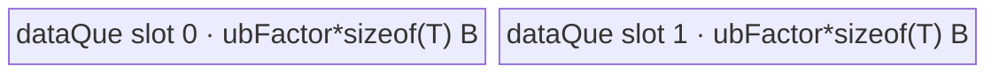

# UpsampleNearest3d 950 ACLNN 算子知识

## 算子速览

| 项目 | 内容 |
|---|---|
| 实际入口 | `aclnnUpsampleNearest3dGetWorkspaceSize` / `aclnnUpsampleNearest3d`，公开 ACLNN 两段式接口；固定仓未出现该语义的更新版本号入口。 |
| 计算语义 | 对 NCDHW/NDHWC 五维张量做最近邻上采样：`src_q=min(floor(dst_q*scale_q), in_q-1)`，950 Tiling 中 `scale_q` 为正属性的倒数，否则为 `in_q/out_q`。 |
| 输入输出 | `self/out` 均为 5D，dtype 相同；950 支持 FLOAT32/FLOAT16/BFLOAT16/DOUBLE/UINT8，公开格式 NCDHW、NDHWC、ND。内部核心节点统一按连续 NCDHW 处理。 |
| 执行类型 | 单个 operator-owned Device 节点：R-001 为 `AIV_VECTOR` 数据搬运；R-002～R-004 为 `SIMT` on AIV。入口显式 `KERNEL_TYPE_AIV_ONLY`，无 Cube/AIC/MIX_CV。ACLNN 的 Contiguous、可选 Transpose 和 ViewCopy 是框架边界。 |
| Kernel 路线 | R-001 恒等 DataCopy；R-002 SIMT-DHW；R-003 SIMT-CDHW；R-004 SIMT-NCDHW。 |
| 核心资源 | R-001 使用 GM、一个双缓冲 `TQueBind<VECIN,VECOUT>` 和 UB；SIMT 路线直接逐元素 GM 读写，无显式 dynamic UB/shared buffer；Tiling 为核心节点统一预留 16 MiB workspace，但 Kernel body 不消费它。 |
| 来源闭包 | `source_closed`：公开 ACLNN→L0 950 AICore selector→RegBase Tiling/POD/key→APT entry→DataCopy/SIMT body→950 binary/CMake 均已闭合；框架 Contiguous/Transpose/ViewCopy 明确停在框架边界。 |
| 验证状态 | 已完成源码闭包检查；本次知识提取未执行编译、真机、数值或性能测试。 |

## 接口与语义

### 计算语义

令内部连续输入为 `x[n,c,d,h,w]`，输出空间为 `(OD,OH,OW)`。对每个输出坐标：

```text
sd = scalesD > 0 ? 1 / scalesD : ID / OD
sh = scalesH > 0 ? 1 / scalesH : IH / OH
sw = scalesW > 0 ? 1 / scalesW : IW / OW
id = min(floor(d * sd), ID - 1)
ih = min(floor(h * sh), IH - 1)
iw = min(floor(w * sw), IW - 1)
y[n,c,d,h,w] = x[n,c,id,ih,iw]
```

ACLNN 先把正的 `scalesD/H/W` 转成倒数 `castScales`；950 L0 因 `IsRegBase(curArch)` 改传原始正 scale，950 Tiling 的 `ComputeScales` 再取倒数。因此 Device 最终使用上式的目标坐标到源坐标比例。`Nearest3dSimt::ComputeOri<isExtra=false>` 固定采用 `floor(idx*scale)`，不会使用 Exact 变体的半像素偏移。

### 输入、输出与属性

| 参数 | shape/layout | dtype | 约束、默认值与语义 |
|---|---|---|---|
| `self` | 5D；NCDHW、NDHWC 或 ND（ND 按 NCDHW） | FLOAT32、FLOAT16、BFLOAT16、DOUBLE、UINT8 | `C,D,H,W>0`，各维不大于 `INT32_MAX`；允许非连续，由 `Contiguous` 物化。实现允许仅 N 为 0 时提前成功，公开文档则写“不支持空 Tensor”，调用方应遵循公开约束。 |
| `outputSize` | 长度 3，依次 OD/OH/OW | INT64 数组 | 三项都大于 0，且 `out` 的空间维必须完全相等。 |
| `scalesD/H/W` | 标量 | double，进入 L0/Tiling 前窄化为 float | 正值决定 Device 的倒数比例；非正值使 Tiling 使用 `input/output`。公开约束要求 `output=floor(input*scales)`。 |
| `out` | 与 `self` 相同格式的 5D；N/C 不变，空间维为 `outputSize` | 与 `self` 相同 | 允许非连续，最终通过 `ViewCopy` 提交。 |
| `workspaceSize/executor` | ACLNN 第一段输出 | `uint64_t*` / `aclOpExecutor**` | executor 持有 Contiguous、可选 Transpose、UpsampleNearest3d 和 ViewCopy 的任务图及临时对象。 |
| `workspace/workspaceSize/stream` | ACLNN 第二段输入 | 指针、字节数、stream | 交给 `CommonOpExecutorRun`；核心节点 Tiling 固定请求 16 MiB。 |

### 入口与版本

公开声明是 `aclnnUpsampleNearest3dGetWorkspaceSize` 与 `aclnnUpsampleNearest3d`，固定仓中没有 `V2` 或其它更新版本的 3D 同语义入口；1D/2D V2 与 Exact/Grad 都是不同逻辑语义，不并入本卡。公开文档产品表明确支持 Ascend 950PR/950DT。950 selector 的 `IsRegBase` 分支接受五种公开 dtype，`upsample_nearest3d_def.cpp` 的 ascend950 config 和 binary JSON 同时接线 ND/NCDHW 五种 dtype。

## Host/Launcher 执行流程

### 参数校验与前处理

1. `OP_CHECK_COMM_INPUT` 检查 `workspaceSize/executor`，`CREATE_EXECUTOR` 创建任务 owner。
2. `CheckNotNull` 检查 `self/outputSize/out`；`CheckDtypeValid` 在 950 使用 `DTYPE_SUPPORT_LIST_REGBASE` 并要求输入输出 dtype 相同。
3. `CheckInputElement` 按 storage format 解释 NCDHW 或 NDHWC，要求 C/D/H/W 与 OD/OH/OW 为正；`CheckShape` 要求输入输出均 5D、`outputSize.Size()==3`，并构造期望输出 shape。
4. 若 `self->IsEmpty()`，写 `workspaceSize=0` 并直接返回；否则用 `l0op::Contiguous` 得到连续输入。
5. 把三项 double scale 窄化为 float；三项都为正时另建倒数数组。NDHWC 先 `Transpose` 为 NCDHW，核心计算后再转回 NDHWC；NCDHW/ND 直接进入核心 L0。
6. `l0op::UpsampleNearest3dNcdhw` 在 950 选择 `ADD_TO_LAUNCHER_LIST_AICORE(UpsampleNearest3d, ...)`；结果经 `ViewCopy` 写入用户 `out`。任一分配/节点创建失败立即返回，不继续后续节点。

### 参数、Workspace 与生命周期

`outputSize` 和三个 float scale 由 executor 管理，L0 分配与输入 dtype/format 相同、空间维替换为 OD/OH/OW 的中间输出。950 Tiling 的 `Init` 读取 AIV core 数和 UB 字节数；`DoTiling` 最终设置 `blockDim=realCoreNum`、`tilingKey=GET_TPL_TILING_KEY(schId,isUint32)`，并把核心节点 workspace slice 设为 `16*1024*1024` 字节。APT entry 调用 `GetUserWorkspace(workspace)`，但所有可达 body 均未读取 `usrWorkspace`；该 slice 的 owner/lifetime 仍属于 executor，从第二段调用开始有效，到 stream 中任务完成后才可释放。ACLNN 总 workspace 还可能包含 Contiguous/Transpose/ViewCopy 的框架临时区，其合并公式在固定仓不可见，只能通过 `executor->GetWorkspaceSize()` 获得。

### 启动图与失败传播

```text
aclnnUpsampleNearest3dGetWorkspaceSize
  -> Contiguous(self)                                  # 框架边界
  -> [NDHWC only] Transpose(NDHWC -> NCDHW)           # 框架边界
  -> UpsampleNearest3d A5 node
       Host: Tiling4UpsampleNearest3dTiling
             -> RunBigKernelTiling
             -> Tiling4UpsampleNearest3dRegbase
       entry: upsample_nearest3d<schId,isUint32>
       blockDim: realCoreNum
       POD: UpsampleNearest3dRegBaseTilingData
       input/output: contiguous NCDHW GM
       workspace slice: 16 MiB, body 未消费
  -> [NDHWC only] Transpose(NCDHW -> NDHWC)           # 框架边界
  -> ViewCopy(result, out)                             # 框架边界
aclnnUpsampleNearest3d
  -> CommonOpExecutorRun(workspace, workspaceSize, executor, stream)
```

operator-owned 启动图只有一个 Device 节点，没有跨 Kernel workspace 边。所有节点由同一 executor 按任务图提交到给定 stream；任一前处理节点返回空指针、Tiling 返回 `GRAPH_FAILED` 或 launcher 添加失败都会阻断后继节点。框架内部具体 event 与辅助 Kernel POD 在固定仓不可见。

## Route 与参数设计

### 分核与资源计算

设 `P=coreNumAiv`、`T=2048`、`DHW=OD*OH*OW`、`CDHW=C*DHW`、`NCDHW=N*C*DHW`。

- R-001：初始 `realCoreNum=P`；若 `NCDHW <= (128/dtypeBytes)*P`，先取 `floor(NCDHW/(128/dtypeBytes))`，若为 0 再钳为 1。随后 `blkProcessNum=floor(NCDHW/realCoreNum)`，`tailBlockNum=NCDHW%realCoreNum`。UB tile 为 `ubFactor=floor((UB-oneBlockNum*dtypeBytes)/(2*dtypeBytes)/oneBlockNum)*oneBlockNum`，`oneBlockNum=ubBlockSize/dtypeBytes`。
- R-002：`allNum=DHW`，Host 把 POD 的 `lenN` 改为 `N*C`；R-003：`allNum=C*DHW`；R-004：`allNum=N*C*DHW`，且 `realCoreNum=min(P,allNum)`。SIMT 三路线都令 `blkProcessNum=floor(allNum/realCoreNum)`、`tailBlockNum=allNum%realCoreNum`。
- 每个 block 的有效域是：前 `tailBlockNum` 个 block 处理 `blkProcessNum+1` 项，起点 `blockIdx*(blkProcessNum+1)`；其余处理 `blkProcessNum` 项，起点 `blockIdx*blkProcessNum+tailBlockNum`。
- `isUint32=1` 当输入/输出总元素数均不超过 `UINT32_MAX` 且六个空间维均不超过 `INT32_MAX`；否则使用 uint64 索引。恒等路线强制 `isUint32=0`，其 body 使用 int64 分块变量。

### Route 选择

| 顺序 | Route | Key/模板 | 精确选择条件与优先级 | 不适用去向 |
|---:|---|---|---|---|
| 1 | R-001 恒等 DataCopy | `(schId=0,isUint32=0)` | `OD==ID && OH==IH && OW==IW && abs(sd-1)<=1e-8 && abs(sh-1)<=1e-8 && abs(sw-1)<=1e-8` | R-002 判断 |
| 2 | R-002 SIMT-DHW | `(schId=1,isUint32=0/1)` | 非恒等且 `DHW >= P*2048` | R-003 判断 |
| 3 | R-003 SIMT-CDHW | `(schId=2,isUint32=0/1)` | 非恒等且 `DHW < P*2048 && CDHW >= P*2048` | R-004 |
| 4 | R-004 SIMT-NCDHW | `(schId=3,isUint32=0/1)` | 非恒等且 `CDHW < P*2048` | 无；校验/Tiling 失败 |

```text
if nodeType is UpsampleNearest3d: isExact = false
if identity_shape_and_scale:
    key = (0, 0)
else if OD*OH*OW >= coreNumAiv*2048:
    key = (1, size_fits_uint32 ? 1 : 0)
else if C*OD*OH*OW >= coreNumAiv*2048:
    key = (2, size_fits_uint32 ? 1 : 0)
else:
    key = (3, size_fits_uint32 ? 1 : 0)
```

`schId=4` 只可能由 `UpsampleNearestExact1d/2d/3d` 的 `isExact=true` 路径选择，对本逻辑算子不可达，不进入正文路线。

### 模板/实现执行矩阵

| Route | key/selector | dtype/shape/platform 完整命中条件 | 执行拓扑与 Kernel 节点 | 实际模板/body | 内存与同步特征 | tail/fallback |
|---|---|---|---|---|---|---|
| R-001 恒等 DataCopy | `(0,0)` | 950 五种 dtype；shape 与三项 scale 均恒等 | 单 AIV node | `Nearest3dDataCopy<DTYPE_X>::Process` | 双缓冲绑定队列，GM→UB→GM，无计算 | 前 `tailBlockNum` 核多 1 元素；tile 尾取 `min` |
| R-002 SIMT-DHW | `(1,0/1)` | 非恒等，`DHW>=P*2048`；索引宽度由 size guard 决定 | 单 AIV/SIMT node | `Nearest3dSimt<DTYPE_X,uint64_t/uint32_t,false,1>` → `SimtCompute<...,1>` | 无显式 UB；每线程算 DHW 坐标并循环所有 NC | block tail 分配；线程以 `blockDim.x` 步进 |
| R-003 SIMT-CDHW | `(2,0/1)` | 非恒等，`DHW<P*2048<=CDHW` | 单 AIV/SIMT node | `Nearest3dSimt<DTYPE_X,uint64_t/uint32_t,false,2>` → `SimtCompute<...,2>` | 无显式 UB；每线程算 CDHW 坐标并循环 N | 同上 |
| R-004 SIMT-NCDHW | `(3,0/1)` | 非恒等，`CDHW<P*2048` | 单 AIV/SIMT node | `Nearest3dSimt<DTYPE_X,uint64_t/uint32_t,false,3>` → `SimtCompute<...,3>` | 无显式 UB；每线程直接处理完整展平输出 | `realCoreNum=min(P,NCDHW)`；同上 |

### 隐藏性能 Guard

| Guard | Host/Tiling 条件 | Device/资源原因 | 影响 Route | 不满足时去向 | 源码符号 |
|---|---|---|---|---|---|
| 950 RegBase | `IsRegBase(curArch)` | 选择五 dtype AICore launcher 和 arch35 Tiling/APT entry | 全部 | 非 950 走 DAV_2201/2002 或 AICPU | `UpsampleNearest3dNcdhw` |
| 恒等容差 | 三空间 shape 相同且三项 `abs(scale-1)<=1e-8` | 可完全消除坐标计算 | R-001 | R-002～R-004 | `CalTilingData` |
| 调度域阈值 | `DHW`、`CDHW` 与 `P*2048` 顺序比较 | 决定线程并行域与外层串行循环 | R-002～R-004 | 下一较细展平 Route | `CalTilingData` |
| 索引位宽 | 两总元素数 `<=UINT32_MAX` 且六空间维 `<=INT32_MAX` | 选择 2048-thread uint32 VF 或 1024-thread uint64 VF，避免索引溢出 | R-002～R-004 | `isUint32=0`，不是失败 | `GetAndCheckShapes`、`Nearest3dSimt::Process` |
| DataCopy UB tile | `ubSize>0`，`ubFactor` 按 UB/对齐公式向下取整 | 双缓冲总量不能超过 UB，并保持 UB block 对齐 | R-001 | 平台信息无效则 Tiling 失败 | `Init`、`ComputeDataCopy` |
| 非空核心域 | Tiling 要求 input/output shape size 非 0 | 避免 `realCoreNum=0` 和无效索引；ACLNN N=0 已在上层提前返回 | 全部 | `GRAPH_FAILED` | `GetAndCheckShapes` |
| Exact/SIMD 隔离 | `GetIsSimd` 首先检查 `isExact`；本节点为 false | 防止本语义误入 `schId=4` Exact SIMD body | 全部 | 继续 R-001～R-004 | `Init`、`GetIsSimd` |

### POD/ABI

`UpsampleNearest3dRegBaseTilingData` 为标准顺序结构，固定源码字段可推出 `sizeof=96`、`alignof=8`；最后字段结束于 92，尾部补齐到 96。每个 Route 使用同一 POD，inactive 字段仍由 `FillTilingData` 写入。

| 结构 | 字段 | 类型/位宽 | ABI 布局 | 单位 | Host/launcher producer | Device consumer | 边界 |
|---|---|---|---|---|---|---|---|
| `UpsampleNearest3dRegBaseTilingData` | `blkProcessNum` | int64/64 | offset 0 | 输出元素/块 | `CalTilingData: allNum/realCoreNum` 或 `ComputeDataCopy` | `Nearest3dDataCopy::Init`、`Nearest3dSimt::Process` | 每核基础份额 |
| 同上 | `lenN` | int64/64 | offset 8 | N 或 NC | `FillTilingData: dimN`；R-002 前已令 `dimN=N*C` | `SimtCompute` 的 R-002 NC 循环、R-003 N 循环 | R-001/R-004 不读 |
| 同上 | `lenC` | int64/64 | offset 16 | C | `FillTilingData: dimC` | R-003 地址计算 | 其它 Route 不读 |
| 同上 | `inD` | int64/64 | offset 24 | 元素 | 输入 shape D | `SimtCompute` 源坐标/stride | 必须正 |
| 同上 | `inH` | int64/64 | offset 32 | 元素 | 输入 shape H | `SimtCompute` 源坐标/stride | 必须正 |
| 同上 | `inW` | int64/64 | offset 40 | 元素 | 输入 shape W | `SimtCompute` 源坐标/stride | 必须正 |
| 同上 | `outD` | int64/64 | offset 48 | 元素 | 输出 shape D | `Nearest3dSimt::Process` 与 `SimtCompute` 解码 | 必须正 |
| 同上 | `outH` | int64/64 | offset 56 | 元素 | 输出 shape H | 同上 | 必须正 |
| 同上 | `outW` | int64/64 | offset 64 | 元素 | 输出 shape W | 同上 | 必须正 |
| 同上 | `ubFactor` | int32/32 | offset 72 | 元素/tile | `ComputeDataCopy` UB 公式 | `Nearest3dDataCopy::Init/Process` | 仅 R-001 读取 |
| 同上 | `tailBlockNum` | int32/32 | offset 76 | core 数 | `allNum%realCoreNum` | DataCopy/SIMT 前若干核加 1 | `[0,realCoreNum)` |
| 同上 | `scaleD` | float/32 | offset 80 | 源 D / 目标 D | `ComputeScales` | `ComputeOri(D,...)` | 坐标为 float 精度 |
| 同上 | `scaleH` | float/32 | offset 84 | 源 H / 目标 H | `ComputeScales` | `ComputeOri(H,...)` | 同上 |
| 同上 | `scaleW` | float/32 | offset 88 | 源 W / 目标 W | `ComputeScales` | `ComputeOri(W,...)` | 同上 |

### Route 源码闭包

| Route | Key/selector | Host/Tiling producer | POD/参数 | Kernel entry/router 节点 | Kernel body/直接依赖 | 构建接线 |
|---|---|---|---|---|---|---|
| R-001 恒等 DataCopy | `(0,0)` | `upsample_nearest3d_tiling_arch35.cpp` `CalTilingData/ComputeDataCopy` | `UpsampleNearest3dRegBaseTilingData` | `upsample_nearest3d_apt.cpp` `upsample_nearest3d<0,0>` | `upsample_nearest3d_data_copy.h` `Nearest3dDataCopy` | `upsample_nearest3d_def.cpp` ascend950 `opFile=upsample_nearest3d_apt`；ascend950 binary JSON；`op_host/CMakeLists.txt` |
| R-002 SIMT-DHW | `(1,0/1)` | 同上 `CalTilingData/GetAndCheckShapes` | 同上 | `upsample_nearest3d<1,0/1>` | `upsample_nearest3d_simt.h` + `upsample_nearest3d_simt_base.h`，`SimtCompute<...,1>` | 同上 |
| R-003 SIMT-CDHW | `(2,0/1)` | 同上 | 同上 | `upsample_nearest3d<2,0/1>` | 同上，`SimtCompute<...,2>` | 同上 |
| R-004 SIMT-NCDHW | `(3,0/1)` | 同上 | 同上 | `upsample_nearest3d<3,0/1>` | 同上，`SimtCompute<...,3>` | 同上 |

## Kernel 实现

### 公共执行流程

APT entry 解析 `UpsampleNearest3dRegBaseTilingData`，声明 `KERNEL_TYPE_AIV_ONLY`。`schId=0` 构造 DataCopy 类；`schId=1/2/3` 再按 `isUint32` 构造 uint32 或 uint64 索引的 `Nearest3dSimt`。SIMT 类为当前 block 计算连续输出域，预计算对 OD/OH/OW 的 unsigned division magic/shift，通过 `asc_vf_call` 启动 2048 或 1024 个 VF 线程；线程以 `threadIdx.x + k*blockDim.x` 遍历本 block 的输出项。所有路线是单 Kernel，无跨节点数据或同步边。

### Route R-001：恒等 DataCopy

#### 适用条件

##### 选择证据

| 层级 | 文件 | 符号 | 源码谓词/参数 | 结果/下一跳 |
|---|---|---|---|---|
| API | `op_host/op_api/upsample_nearest_3d.cpp` | `UpsampleNearest3dNcdhw` | `IsRegBase(curArch)` 且 dtype 属于五种 950 白名单 | 添加 AICore `UpsampleNearest3d` 节点 |
| Tiling | `op_host/upsample_nearest3d_tiling_arch35.cpp` | `CalTilingData` | 三空间 shape 相同且三个 scale 与 1 的差不超过 `1e-8` | `schId=0,isUint32=0` |
| Router | `op_kernel/upsample_nearest3d_apt.cpp` | `upsample_nearest3d<schId,isUint32>` | `if constexpr(schId==SCH_MODE_0)` | `Nearest3dDataCopy<DTYPE_X>` |

#### Device 数据流

##### 函数级调用链

```text
Tiling4UpsampleNearest3dRegbase
  -> CalTilingData -> ComputeDataCopy -> FillTilingData
  -> SetTilingKey(0,0), SetBlockDim(realCoreNum)
upsample_nearest3d<0,0>(x,y,workspace,tiling)
  -> Nearest3dDataCopy<DTYPE_X>::Init
  -> Nearest3dDataCopy<DTYPE_X>::Process
       -> CopyIn -> CopyOut
```

##### 源码等价伪码

```text
base = blkProcessNum
if blockIdx < tailBlockNum:
    count = base + 1
    coreOffset = blockIdx * count
else:
    count = base
    coreOffset = base * blockIdx + tailBlockNum
for tileOffset in range(0, count, ubFactor):
    valid = min(ubFactor, count - tileOffset)
    q = AllocTensor<uint8>()
    DataCopyPad(q, x[(coreOffset+tileOffset)*sizeof(T)], blockCount=1,
                blockLen=valid*sizeof(T), srcStride=0, dstStride=0)
    EnQue(q); q = DeQue<uint8>()
    DataCopyPad(y[(coreOffset+tileOffset)*sizeof(T)], q, same byte count)
    FreeTensor(q)
```

#### 内存与数据搬运

##### 资源与搬运表

| 层级/缓冲区 | offset/地址公式 | extent/容量公式 | dtype/layout | producer | consumer | owner/lifetime | 对齐/复用 |
|---|---|---|---|---|---|---|---|
| GM `x` | `(coreOffset+tileOffset)*sizeof(T)` 字节 | `valid*sizeof(T)` | 原 dtype，连续 NCDHW 线性 | ACLNN 前处理 | `CopyIn` | 用户/executor，Kernel 全程只读 | 可为非整 UB block，`DataCopyPad` 处理 |
| `dataQue_` | 队列内部 | `2*ubFactor*sizeof(T)` | 以 uint8 视图搬字节 | `CopyIn` | `CopyOut` | `TPipe`，每 tile Alloc→EnQue→DeQue→Free | `TQueBind<VECIN,VECOUT>` 同一物理队列，depth=2 |
| GM `y` | 与输入相同线性 offset | `valid*sizeof(T)` | 原 dtype，连续 NCDHW 线性 | `CopyOut` | ACLNN 后处理 | executor 中间输出 | 只写有效字节 |
| workspace | user workspace base | 16 MiB | 未定义/未使用 | executor | 无 body consumer | stream 任务期间 | `GetUserWorkspace` 结果未读 |

##### 分层内存布局



##### 字节账与复用顺序

```text
oneBlockNum = ubBlockSize / sizeof(T)
ubFactor = floor((UB - oneBlockNum*sizeof(T)) / (2*sizeof(T)) / oneBlockNum) * oneBlockNum
UB_total = 2 * ubFactor * sizeof(T)
UB_total <= UB - ubBlockSize < UB
dynamic_ub = N/A；本 Route 使用静态 TPipe queue
workspace_total = 16 * 1024 * 1024 B（body 未消费）
```

| 复用子区 | 写入者 | 读取者/消费点 | 下一次覆盖 | 同步或释放依据 | 安全条件 |
|---|---|---|---|---|---|
| `dataQue_` 当前 slot | `CopyIn/DataCopyPad` | `CopyOut/DataCopyPad` | 后续 tile 的 `AllocTensor` | EnQue→DeQue→FreeTensor 队列生命周期 | 必须先完成 GM 写出并 Free，双 slot 才可循环复用 |

#### 同步、精度与尾块

##### 同步与数值边界表

| 阶段 | primitive/机制 | producer | consumer/等待点 | 保护对象 | 精度/尾块 |
|---|---|---|---|---|---|
| GM→UB→GM | `TQueBind` 的 EnQue/DeQue/Free | `CopyIn` | `CopyOut` | 当前 queue slot | 逐字节复制，无数值转换；最后 tile 用 `min` 限定有效元素 |
| 分核 | `tailBlockNum` | Host | `Process` | 每核 GM 区间 | 前若干核多 1 元素，区间连续且无重叠 |

#### 关键实现

##### 符号证据表

| 阶段 | 文件 | 符号/模板实例 | 实现事实 |
|---|---|---|---|
| Host/Tiling producer | `op_host/upsample_nearest3d_tiling_arch35.cpp` | `CalTilingData`、`ComputeDataCopy` | 恒等谓词、核分配、UB tile 公式 |
| Kernel entry/router | `op_kernel/upsample_nearest3d_apt.cpp` | `upsample_nearest3d<0,0>` | 选择 `Nearest3dDataCopy<DTYPE_X>` |
| Device body/helper | `op_kernel/arch35/upsample_nearest3d_data_copy.h` | `Init/Process/CopyIn/CopyOut` | 双缓冲字节搬运、tail core/tile |

### Route R-002：SIMT-DHW

#### 适用条件

##### 选择证据

| 层级 | 文件 | 符号 | 源码谓词/参数 | 结果/下一跳 |
|---|---|---|---|---|
| API | `op_host/op_api/upsample_nearest_3d.cpp` | `UpsampleNearest3dNcdhw` | 950 RegBase 五 dtype | AICore node |
| Tiling | `op_host/upsample_nearest3d_tiling_arch35.cpp` | `CalTilingData` | 非恒等且 `outDHW>=coreNum*2048` | `schId=1`，`dimN=N*C`，`allNum=outDHW` |
| Tiling | 同上 | `GetAndCheckShapes` | size/dim guard | `isUint32=1` 或 0 |
| Router | `op_kernel/upsample_nearest3d_apt.cpp` | `upsample_nearest3d<1,isUint32>` | `schId!=0 && schId!=4` | `Nearest3dSimt<DTYPE_X,uint32_t/uint64_t,false,1>` |

#### Device 数据流

##### 函数级调用链

```text
Tiling4UpsampleNearest3dRegbase -> CalTilingData(schId=1) -> FillTilingData
upsample_nearest3d<1,isUint32>
  -> Nearest3dSimt::Init
  -> Nearest3dSimt::Process
       -> GetUintDivMagicAndShift(H/W)
       -> asc_vf_call<calleeInt32/64>(2048/1024 threads)
            -> SimtCompute<...,1> -> ComputeOri(D/H/W) -> GM copy
```

##### 源码等价伪码

```text
partition allNum=DHW across realCoreNum blocks
for idx = threadIdx.x; idx < blkProcessNum; idx += blockDim.x:
    yLocal = blkStartOffset + idx
    W = yLocal % OW
    tmp = yLocal / OW
    H = tmp % OH
    D = tmp / OH
    srcD/H/W = min(floor(D/H/W * scaleD/H/W), inD/H/W - 1)
    for nc in [0, N*C):
        out = nc*outDHW + yLocal
        src = nc*inDHW + srcD*inHW + srcH*inW + srcW
        y[out] = x[src]
```

#### 内存与数据搬运

##### 资源与搬运表

| 层级/缓冲区 | offset/地址公式 | extent/容量公式 | dtype/layout | producer | consumer | owner/lifetime | 对齐/复用 |
|---|---|---|---|---|---|---|---|
| GM `x` | `nc*inDHW+srcD*inHW+srcH*inW+srcW` | 1 element/写出 | 原 dtype/NCDHW | ACLNN 前处理 | SIMT thread | 用户/executor | 标量加载，无显式对齐 guard |
| GM `y` | `nc*outDHW+yLocal` | 1 element | 原 dtype/NCDHW | SIMT thread | ACLNN 后处理 | executor | 每个 `(nc,yLocal)` 唯一 writer |
| VF 寄存器 | 坐标、magic/shift、offset | 每线程标量，固定仓未给字节数 | uint32/uint64 + float | `Process/SimtCompute` | 当前线程 | VF 调用期间 | 无跨线程 alias |
| workspace | user workspace base | 16 MiB | 未使用 | executor | 无 | stream 任务期间 | 无复用语义 |

##### 分层内存布局

N/A：该 SIMT Route 未分配 AIV `TQue/TBuf`、shared 或 dynamic UB；数据从 GM 标量读取后直接写 GM，只有线程私有寄存器，其物理字节数固定仓不可见。

##### 字节账与复用顺序

```text
UB_total = 0 B（算子源码无 InitBuffer/动态 UB 分配）
dynamic_ub = N/A
workspace_total = 16 * 1024 * 1024 B（entry 取地址但 body 不读取）
```

| 复用子区 | 写入者 | 读取者/消费点 | 下一次覆盖 | 同步或释放依据 | 安全条件 |
|---|---|---|---|---|---|
| N/A | N/A | N/A | N/A | 每个线程直接 GM→寄存器→GM | 分核区间及 NC 循环保证输出地址唯一 |

#### 同步、精度与尾块

##### 同步与数值边界表

| 阶段 | primitive/机制 | producer | consumer/等待点 | 保护对象 | 精度/尾块 |
|---|---|---|---|---|---|
| VF 启动 | `asc_vf_call` | AIV entry | VF 完成后 Kernel 返回 | SIMT 工作项 | uint32 用 2048 threads，uint64 用 1024 threads |
| 坐标计算 | `floorf` + `min` | 当前线程 | 当前线程 GM 读取 | 源坐标 | 坐标比例为 float；输入值原 dtype 原样复制 |
| tail | block tail + thread stride | Host/`Process` | `SimtCompute` 循环条件 | 有效输出域 | `idx<blkProcessNum`，无越界 lane；不需 barrier/atomic |

#### 关键实现

##### 符号证据表

| 阶段 | 文件 | 符号/模板实例 | 实现事实 |
|---|---|---|---|
| Host/Tiling producer | `op_host/upsample_nearest3d_tiling_arch35.cpp` | `CalTilingData` | DHW 阈值、NC 合并、block 份额 |
| Kernel entry/router | `op_kernel/upsample_nearest3d_apt.cpp` | `upsample_nearest3d<1,0/1>` | 索引类型模板选择 |
| Device body/helper | `op_kernel/arch35/upsample_nearest3d_simt.h`；`upsample_nearest3d_simt_base.h` | `Nearest3dSimt::Process`；`SimtCompute<...,1>` | 线程数、DHW 解码、NC 循环、源坐标与 GM 地址 |

### Route R-003：SIMT-CDHW

#### 适用条件

##### 选择证据

| 层级 | 文件 | 符号 | 源码谓词/参数 | 结果/下一跳 |
|---|---|---|---|---|
| API | `op_host/op_api/upsample_nearest_3d.cpp` | `UpsampleNearest3dNcdhw` | 950 RegBase 五 dtype | AICore node |
| Tiling | `op_host/upsample_nearest3d_tiling_arch35.cpp` | `CalTilingData` | 非恒等、`DHW<P*2048` 且 `CDHW>=P*2048` | `schId=2,allNum=CDHW` |
| Router | `op_kernel/upsample_nearest3d_apt.cpp` | `upsample_nearest3d<2,isUint32>` | size guard 的索引位宽 | `Nearest3dSimt<DTYPE_X,uint32_t/uint64_t,false,2>` |

#### Device 数据流

##### 函数级调用链

```text
Tiling4UpsampleNearest3dRegbase -> CalTilingData(schId=2)
upsample_nearest3d<2,isUint32>
  -> Nearest3dSimt::Process -> asc_vf_call<calleeInt32/64>
       -> SimtCompute<...,2> -> ComputeOri -> GM copy
```

##### 源码等价伪码

```text
partition allNum=C*DHW across blocks
for yLocal in this block/thread stride:
    W = yLocal % OW
    q = yLocal / OW
    H = q % OH
    q = q / OH
    D = q % OD
    Cidx = q / OD
    srcD/H/W = min(floor(dst*scale), in-1)
    for n in [0,N):
        out = (n*C+Cidx)*outDHW + (D*OH+H)*OW+W
        src = (n*C+Cidx)*inDHW + (srcD*IH+srcH)*IW+srcW
        y[out] = x[src]
```

#### 内存与数据搬运

##### 资源与搬运表

| 层级/缓冲区 | offset/地址公式 | extent/容量公式 | dtype/layout | producer | consumer | owner/lifetime | 对齐/复用 |
|---|---|---|---|---|---|---|---|
| GM `x` | `(n*C+Cidx)*inDHW+srcSpatial` | 1 element | 原 dtype/NCDHW | ACLNN 前处理 | SIMT thread | 用户/executor | 标量访问 |
| GM `y` | `(n*C+Cidx)*outDHW+dstSpatial` | 1 element | 原 dtype/NCDHW | SIMT thread | ACLNN 后处理 | executor | 唯一 writer |
| VF 寄存器 | N/C/D/H/W、magic/shift、offset | 固定仓不可见 | uint32/uint64 + float | 当前线程 | 当前线程 | VF 调用期间 | 无共享 |
| workspace | user workspace | 16 MiB | 未使用 | executor | 无 | stream 任务期间 | N/A |

##### 分层内存布局

N/A：无显式 AIV UB、dynamic UB 或 shared buffer；线程私有寄存器承担坐标和地址计算。

##### 字节账与复用顺序

```text
UB_total = 0 B
dynamic_ub = N/A
workspace_total = 16 * 1024 * 1024 B（未消费）
```

| 复用子区 | 写入者 | 读取者/消费点 | 下一次覆盖 | 同步或释放依据 | 安全条件 |
|---|---|---|---|---|---|
| N/A | N/A | N/A | N/A | 直接 GM 标量路径 | `Cidx` 与 n 循环组合唯一覆盖 NCDHW |

#### 同步、精度与尾块

##### 同步与数值边界表

| 阶段 | primitive/机制 | producer | consumer/等待点 | 保护对象 | 精度/尾块 |
|---|---|---|---|---|---|
| 索引解码 | `Simt::UintDiv` magic/shift | `Process` 预计算 | `SimtCompute` | CDHW 索引 | uint32/uint64 specialization |
| 坐标/复制 | `floorf/min` + 标量 GM | 当前线程 | 当前线程 | 单输出元素 | float 坐标；数据无 cast |
| 并发 | 无 barrier/atomic | 独立线程 | N/A | 输出 GM | block tail 与线程循环条件截断 |

#### 关键实现

##### 符号证据表

| 阶段 | 文件 | 符号/模板实例 | 实现事实 |
|---|---|---|---|
| Host/Tiling producer | `op_host/upsample_nearest3d_tiling_arch35.cpp` | `CalTilingData` | CDHW 路线优先级与份额 |
| Kernel entry/router | `op_kernel/upsample_nearest3d_apt.cpp` | `upsample_nearest3d<2,0/1>` | uint32/uint64 body |
| Device body/helper | `op_kernel/arch35/upsample_nearest3d_simt_base.h` | `SimtCompute<...,2>` | C/D/H/W 解码、N 循环、地址公式 |

### Route R-004：SIMT-NCDHW

#### 适用条件

##### 选择证据

| 层级 | 文件 | 符号 | 源码谓词/参数 | 结果/下一跳 |
|---|---|---|---|---|
| API | `op_host/op_api/upsample_nearest_3d.cpp` | `UpsampleNearest3dNcdhw` | 950 RegBase 五 dtype | AICore node |
| Tiling | `op_host/upsample_nearest3d_tiling_arch35.cpp` | `CalTilingData` | 非恒等且 `CDHW<P*2048` | `schId=3,allNum=NCDHW`；`realCoreNum=min(P,NCDHW)` |
| Router | `op_kernel/upsample_nearest3d_apt.cpp` | `upsample_nearest3d<3,isUint32>` | size guard | `Nearest3dSimt<DTYPE_X,uint32_t/uint64_t,false,3>` |

#### Device 数据流

##### 函数级调用链

```text
Tiling4UpsampleNearest3dRegbase -> CalTilingData(schId=3)
upsample_nearest3d<3,isUint32>
  -> Nearest3dSimt::Process -> asc_vf_call<calleeInt32/64>
       -> SimtCompute<...,3> -> ComputeOri -> GM copy
```

##### 源码等价伪码

```text
partition allNum=N*C*DHW across min(P,allNum) blocks
for yFlat in this block/thread stride:
    W = yFlat % OW
    q = yFlat / OW
    H = q % OH
    q = q / OH
    D = q % OD
    NCflat = q / OD
    srcD/H/W = min(floor(dst*scale), in-1)
    src = NCflat*inDHW + (srcD*IH+srcH)*IW+srcW
    y[yFlat] = x[src]
```

#### 内存与数据搬运

##### 资源与搬运表

| 层级/缓冲区 | offset/地址公式 | extent/容量公式 | dtype/layout | producer | consumer | owner/lifetime | 对齐/复用 |
|---|---|---|---|---|---|---|---|
| GM `x` | `NCflat*inDHW+srcSpatial` | 1 element | 原 dtype/NCDHW | ACLNN 前处理 | SIMT thread | 用户/executor | 标量访问 |
| GM `y` | `yFlat` | 1 element | 原 dtype/NCDHW | SIMT thread | ACLNN 后处理 | executor | 完整展平域唯一 writer |
| VF 寄存器 | NCflat/D/H/W、magic/shift | 固定仓不可见 | uint32/uint64 + float | 当前线程 | 当前线程 | VF 调用期间 | 无共享 |
| workspace | user workspace | 16 MiB | 未使用 | executor | 无 | stream 任务期间 | N/A |

##### 分层内存布局

N/A：无显式 AIV UB、dynamic UB 或 shared buffer，使用寄存器和直接 GM 标量路径。

##### 字节账与复用顺序

```text
UB_total = 0 B
dynamic_ub = N/A
workspace_total = 16 * 1024 * 1024 B（未消费）
```

| 复用子区 | 写入者 | 读取者/消费点 | 下一次覆盖 | 同步或释放依据 | 安全条件 |
|---|---|---|---|---|---|
| N/A | N/A | N/A | N/A | 独立线程直接读写 GM | `yFlat` 分块和线程 stride 不重叠 |

#### 同步、精度与尾块

##### 同步与数值边界表

| 阶段 | primitive/机制 | producer | consumer/等待点 | 保护对象 | 精度/尾块 |
|---|---|---|---|---|---|
| 分核 | `realCoreNum=min(P,NCDHW)` | Host | entry launch | 输出域 | 不启动空核；首批核多 1 元素 |
| 坐标/复制 | `floorf/min` + GM 标量 | 当前线程 | 当前线程 | 单元素 | float 坐标、原 dtype 值复制 |
| 并发 | 无 barrier/atomic | 独立线程 | N/A | 输出 GM | `idx<blkProcessNum` 保护尾部 |

#### 关键实现

##### 符号证据表

| 阶段 | 文件 | 符号/模板实例 | 实现事实 |
|---|---|---|---|
| Host/Tiling producer | `op_host/upsample_nearest3d_tiling_arch35.cpp` | `CalTilingData` | NCDHW fallback、核数收缩、tail |
| Kernel entry/router | `op_kernel/upsample_nearest3d_apt.cpp` | `upsample_nearest3d<3,0/1>` | 索引模板映射 |
| Device body/helper | `op_kernel/arch35/upsample_nearest3d_simt_base.h` | `SimtCompute<...,3>` | 完整展平索引、直接 GM copy |

## 算子特定优化

### Trick T-001：恒等参数退化为纯双缓冲搬运

#### 触发与源码依据

- 适用 Route：R-001
- 触发条件：输入输出 D/H/W 相同，且三个 Device scale 与 1 的绝对差都不超过 `1e-8`。
- Golden 来源：[`image/upsample_nearest3d/op_host/upsample_nearest3d_tiling_arch35.cpp:231-241`](../../../../../../../cann-ops-raw/ascendc/ops-cv/bb717d075d129fd1fc7b96b2886824a1d153ed2f/image/upsample_nearest3d/op_host/upsample_nearest3d_tiling_arch35.cpp#L231-L241)

**官方源码（固定 Commit 连续逐字摘录）**：

```cpp
bool isDataCopy = baseTiling_.outD == baseTiling_.inD && baseTiling_.outH == baseTiling_.inH &&
    baseTiling_.outW == baseTiling_.inW && std::abs(baseTiling_.scaleD - 1.0f) <= EPSILON && std::abs(baseTiling_.scaleH - 1.0f) <= EPSILON &&
    std::abs(baseTiling_.scaleW - 1.0f) <= EPSILON;
baseTiling_.realCoreNum = baseTiling_.coreNum;
baseTiling_.cacheLineNum = CACHE_LINE / baseTiling_.dtypeSize;

if (isDataCopy) {
    OP_LOGI(context_, "enter datacopy");
    baseTiling_.schId = 0; // 纯copy模板
    baseTiling_.isUint32 = 0;
    ComputeDataCopy();
```

#### 机制与设计原因

Host 在插值比例和空间 shape 都恒等时完全绕过 `floorf`、除法 magic 和逐坐标 GM gather，改用连续 GM→UB→GM。`ComputeDataCopy` 以可用 UB 反推 `ubFactor`，预留一个 UB block 后把其余空间均分给两个 queue slot；Device 用 `DataCopyPad` 搬最后非整 tile。这改变了计算和搬运形态：从随机标量采样退化为大块顺序 DMA，同时保持所有 dtype 位级不变。

#### 迁移边界

- 适用：输出与输入空间完全相同且 scale 语义等价于 1 的最近邻算子。
- 前提：950、公开 `UpsampleNearest3d`、连续内部 NCDHW、dtype 相同、三项误差在源码容差内。
- 失效：任一空间维或 scale 不满足即进入 R-002～R-004 SIMT。
- 未验证：本次知识提取未执行编译、真机、数值或性能测试。

#### 错误做法

不能只比较 shape 而忽略显式 scale；源码同时检查三项 scale。固定仓未提供其它可验证反例。

### Trick T-002：按最小足量展平域选择 SIMT 并窄化索引

#### 触发与源码依据

- 适用 Route：R-002～R-004
- 触发条件：非恒等；依次比较 `DHW`、`CDHW` 与 `coreNum*2048`，并由 shape/元素总数决定 uint32 或 uint64 索引。
- Golden 来源：[`image/upsample_nearest3d/op_host/upsample_nearest3d_tiling_arch35.cpp:243-263`](../../../../../../../cann-ops-raw/ascendc/ops-cv/bb717d075d129fd1fc7b96b2886824a1d153ed2f/image/upsample_nearest3d/op_host/upsample_nearest3d_tiling_arch35.cpp#L243-L263)

**官方源码（固定 Commit 连续逐字摘录）**：

```cpp
int64_t allNum = 0;
if (outDHW >= maxNum) {
    OP_LOGI(context_, "enter simt dhw");
    baseTiling_.schId = 1; // dhw 分线程， nc拉成一维
    baseTiling_.dimN = baseTiling_.dimN * baseTiling_.dimC;
    allNum = outDHW;
} else if (outCDHW >= maxNum) {
    OP_LOGI(context_, "enter simt cdhw");
    baseTiling_.schId = CONST_2; // cdhw 分线程, 和竞品一致
    allNum = outCDHW;
} else {
    OP_LOGI(context_, "enter simt ncdhw");
    int64_t coreNum = static_cast<int64_t>(baseTiling_.coreNum);
    if (outNCDHW < coreNum) {
        baseTiling_.realCoreNum = static_cast<int32_t>(outNCDHW);
    }
    allNum = outNCDHW;
    baseTiling_.schId = CONST_3; // ncdhw 分线程
}
baseTiling_.blkProcessNum = allNum / static_cast<int64_t>(baseTiling_.realCoreNum);
baseTiling_.tailBlockNum = static_cast<int32_t>(allNum % static_cast<int64_t>(baseTiling_.realCoreNum));
```

#### 机制与设计原因

选择器先尝试只并行空间 DHW；空间工作量足够时，每个线程复用一次坐标结果去循环 NC。空间不足时把 C、再把 N*C 纳入并行域，逐步减少串行外循环并保证足够工作项。另一个正交 specialization 在尺寸安全时用 uint32 magic division 和 2048 VF threads，否则用 uint64 和 1024 threads；位宽条件来自 Host 的总元素/单维上界，不能仅由某一个输出维推断。

#### 迁移边界

- 适用：按输出坐标独立映射、没有跨元素归约或写冲突的采样类算子。
- 前提：950 AIV SIMT、输出地址一一对应、源坐标可由 float scale 和 floor 独立求得。
- 失效：恒等条件改走 R-001；尺寸越过 uint32 guard 时必须使用 uint64 specialization。
- 未验证：本次知识提取未执行编译、真机、数值或性能测试。

#### 错误做法

不能无条件把 N/C 留作线程内循环：当 DHW 较小时会减少并行工作项；也不能在总元素超过 uint32 时保留 uint32 地址。固定仓未提供量化性能反例。

## 模板与实现对比

| 对比维度 | R-001 恒等 DataCopy | R-002 SIMT-DHW | R-003 SIMT-CDHW | R-004 SIMT-NCDHW | 设计选择依据 |
|---|---|---|---|---|---|
| 命中条件/优先级 | 最高；shape/scale 恒等 | 非恒等且 DHW 足量 | DHW 不足、CDHW 足量 | CDHW 仍不足 | 从消除计算到逐级扩大并行域 |
| 模板与 dtype | `Nearest3dDataCopy<DTYPE_X>`；五 dtype | `Nearest3dSimt<DTYPE_X,U32/U64,false,1>` | 同，`schId=2` | 同，`schId=3` | dtype 由 binary specialization；索引位宽由 Host guard |
| 循环与分核 | 连续元素按 core/tile | 线程并行 DHW，串行 NC | 线程并行 CDHW，串行 N | 线程并行完整 NCDHW | `P*2048` 阈值 |
| Queue/TBuf/寄存器/dynamic UB/通信 window | 双缓冲绑定 queue | 线程寄存器；无 dynamic UB | 同 | 同 | Copy 适合 DMA；采样适合标量 SIMT |
| 内存总占用与复用 | `2*ubFactor*sizeof(T)<UB` | 显式 UB 0 | 显式 UB 0 | 显式 UB 0 | 全部统一预留未消费的 16 MiB workspace |
| 搬运/Vector/SIMT/NDDMA/通信 API | `DataCopyPad` | `asc_vf_call`、标量 GM | 同 | 同 | 无 NDDMA/通信 |
| 同步、精度与 tail | queue 生命周期；位级复制 | 无 barrier；float 坐标；block/thread tail | 同 | 同，且收缩空核 | 输出唯一 writer，无 atomic |
| fallback/失败边界 | 非恒等转 SIMT | DHW 不足转 R-003 | CDHW 不足转 R-004 | 校验/Tiling 失败 | `schId=4` 对本算子不可达 |

## 平台差异

| 项目 | A2 | A3 | 950 |
|---|---|---|---|
| 支持状态 | 公开支持，但本卡不覆盖；公开 DOUBLE 会落入固定仓不可见的 AICPU 核心实现，不能形成 `source_closed` | 同 A2 | 支持；本卡闭合五种 dtype |
| Host/Launcher | DAV_2201 对 FLOAT/FLOAT16/BFLOAT16 走旧 AIV，对 DOUBLE 走 AICPU | 同 A2 | RegBase 五 dtype 全部走 AICore；arch35 selector 四 Route |
| Kernel/资源 | 旧 Vector Gather body；DOUBLE AICPU body 缺失 | 同 A2 | AIV DataCopy 或 SIMT；16 MiB workspace；无 Cube/AIC/MIX_CV |

## 限制与失败边界

- 仅覆盖 `UpsampleNearest3d`，不覆盖 1D/2D、Exact、Grad、原地或量化语义；`schId=4` 属于 Exact 家族，对本入口不可达。
- ACLNN 要求输入输出 dtype 相同、5D、outputSize 长度为 3、C/D/H/W 与输出空间为正；Tiling 再校验 N/C 一致、输入输出非空、dtype/shape/attribute 一致。N=0 的 ACLNN 实现会在 launcher 前提前成功，这与公开文档“不支持空 Tensor”文字存在约束差异。
- double scale 在 ACLNN 中先窄化为 float；SIMT 坐标计算始终使用 float 与 `floorf`，但采样值不做 cast。所有大尺寸地址由 `isUint32` guard 切换到 uint64。
- 950 核心 Tiling 无条件请求 16 MiB workspace，APT entry 取得 user workspace 地址但可达 body 不读取；不得据此删除外部 workspace，因为 launcher ABI 与 executor 仍按该大小构图。
- Contiguous、Transpose、ViewCopy 的内部 Kernel、workspace 切片合并和 event 细节固定仓不可见；它们是 ACLNN 框架边界。operator-owned 核心节点的 selector、POD、entry、body 和构建接线已闭合。
- 本次知识提取未执行编译、真机、数值或性能测试。

## 源码索引

### 链路索引

| 链路阶段 | 文件 | 关键符号 | 支撑内容 |
|---|---|---|---|
| 入口声明/约束 | `image/upsample_nearest3d/docs/aclnnUpsampleNearest3d.md` | 产品表、公式、参数表 | 950 公开支持、接口约束与语义 |
| 入口声明/约束 | `image/upsample_nearest3d/op_host/op_api/aclnn_upsample_nearest_3d.h` | 两段式 ACLNN 声明 | 精确入口 ABI |
| 入口实现 | `image/upsample_nearest3d/op_host/op_api/aclnn_upsample_nearest_3d.cpp` | `CheckParams`、`upsampleNearest3dCompute`、两段接口 | 校验、Contiguous/Transpose/ViewCopy、executor |
| 入口实现 | `image/upsample_nearest3d/op_host/op_api/upsample_nearest_3d.cpp` | `UpsampleNearest3dNcdhw` | 950 dtype/arch selector、AICore launcher、scale 传递 |
| Host/Tiling/Launcher | `image/upsample_nearest3d/op_host/upsample_nearest3d_def.cpp` | `class UpsampleNearest3d` | ascend950 五 dtype 与 APT opFile 注册 |
| Host/Tiling/Launcher | `image/upsample_nearest3d/op_host/upsample_nearest3d_tiling.cpp` | `RunBigKernelTiling` | RegBase 分派到 arch35 Tiling |
| Host/Tiling/Launcher | `image/upsample_nearest3d/op_host/upsample_nearest3d_tiling_arch35.cpp` | `UpsampleNearest3dRegbaseTiling` | 校验、Route、分核、workspace、POD producer |
| Host/Tiling/Launcher | `image/upsample_nearest3d/op_kernel/arch35/upsample_nearest3d_tiling_data.h` | `UpsampleNearest3dRegBaseTilingData` | Host/Device ABI |
| Host/Tiling/Launcher | `image/upsample_nearest3d/op_kernel/arch35/upsample_nearest3d_tiling_key.h` | `SCH_MODE_0..4`、模板声明 | key 枚举与实例范围 |
| Kernel entry/body | `image/upsample_nearest3d/op_kernel/upsample_nearest3d_apt.cpp` | `upsample_nearest3d<schId,isUint32>` | AIV-only entry 与 route router |
| Kernel entry/body | `image/upsample_nearest3d/op_kernel/arch35/upsample_nearest3d_data_copy.h` | `Nearest3dDataCopy` | R-001 UB/DMA/循环/tail |
| Kernel entry/body | `image/upsample_nearest3d/op_kernel/arch35/upsample_nearest3d_simt.h` | `Nearest3dSimt` | SIMT launch、block 分配、位宽实例 |
| Kernel entry/body | `image/upsample_nearest3d/op_kernel/arch35/upsample_nearest3d_simt_base.h` | `ComputeOri`、`SimtCompute`、callee | 线程循环、三种解码、地址和精度 |
| 构建接线 | `image/upsample_nearest3d/op_host/config/ascend950/upsample_nearest3d_binary.json` | `UpsampleNearest3d` 五 dtype ND/NCDHW entries | 950 binary 发布接线 |
| 构建接线 | `image/upsample_nearest3d/op_host/CMakeLists.txt` | `add_modules_sources` | Host 模块纳入构建 |

每行只写一个文件，并确保该文件存在于 Frontmatter `sources`。

### 实现复用检查

| 检查项 | 可复用事实 | 不得改变的约束 | 源码符号 |
|---|---|---|---|
| ABI/POD | 96-byte `UpsampleNearest3dRegBaseTilingData` 可直接复用 | 字段顺序、64/32 位宽、offset、scale 单位；SIMT 不得误读 SIMD POD | `upsample_nearest3d_tiling_data.h` |
| 调用顺序 | ACLNN 前处理→单核心 node→后处理 | NDHWC 的两次 Transpose、所有节点同 executor/stream、失败阻断 | `upsampleNearest3dCompute` |
| workspace/内存 | 核心固定 16 MiB；DataCopy UB 由公式界定 | workspace 虽未消费仍属于 ABI；queue depth=2 与 UB block 对齐不能省略 | `DoTiling`、`ComputeDataCopy`、`Nearest3dDataCopy::Init` |
| 同步 | DataCopy 依赖 queue 生命周期；SIMT 输出无冲突 | 不得在 slot Free 前覆盖；SIMT 域分解必须保持唯一 writer | `CopyIn/CopyOut`、`SimtCompute` |
| 精度与尾块 | float 比例、`floorf/min`，值原 dtype 复制；前若干核多 1 项 | 不得改成 half 坐标或 Exact 半像素公式；必须保留 uint64 fallback 和 thread tail guard | `ComputeScales`、`ComputeOri`、`Nearest3dSimt::Process` |
| 失败边界 | 参数/shape/dtype/platform/UB 检查可直接复用 | N=0 上层提前返回；A2/A3 DOUBLE AICPU 缺失不能由 950 body代替 | `CheckParams`、`GetAndCheckShapes`、`Init` |
