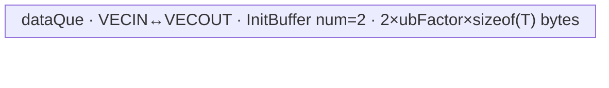

# UpsampleNearestExact2dBackward 950 ACLNN 算子知识

## 算子速览

| 项目 | 内容 |
|---|---|
| 实际入口 | 公开两段式 `aclnnUpsampleNearestExact2dBackwardGetWorkspaceSize` / `aclnnUpsampleNearestExact2dBackward`；固定仓未出现 V2 或更高公开版本 |
| 计算语义 | 对每个 `gradInput[n,c,H,W]`，累加 exact-nearest 前向映射到该点的 `gradOutput[n,c,h,w]`；边界为 `ceil(index*scale-0.5)` |
| 输入输出 | `gradOutput:[N,C,inH,inW]`，`out:[N,C,outH,outW]`，ACLNN 接受 NCHW/ND、FP32/FP16/BF16；950 内部 OpDef 为 ND |
| 执行类型 | 算子自有单 Device 节点；R-001 为 `AIV_VECTOR` 数据搬运，R-002～R-007 为 AIV-only entry 内的 `SIMT` VF；无 Cube/AIC/MIX_CV |
| Kernel 路线 | R-001 等尺寸 DataCopy；R-002/R-003 按 HW 切分的 uint32/uint64 SIMT；R-004/R-005 按 CHW 切分；R-006/R-007 按 NCHW 切分 |
| 核心资源 | DataCopy 路线使用 GM 与一只绑定 VECIN/VECOUT 的双缓冲队列；SIMT 路线仅用 GM、线程标量/寄存器；主算子固定申请 16 MiB workspace 但 body 不读写该区 |
| 来源闭包 | `source_closed`：公开 ACLNN→L0 launcher→950 selector/Tiling/POD/key→AIV-only entry→DataCopy/SIMT body→ascend950 OpDef/config/CMake 均闭合；Contiguous、ViewCopy 与 executor 聚合属于允许的框架边界 |
| 验证状态 | 已完成源码闭包检查；本次知识提取未执行编译、真机、数值或性能测试。 |

## 接口与语义

### 计算语义

令输入梯度为 `x=gradOutput[N,C,inH,inW]`，输出梯度为 `y=gradInput[N,C,outH,outW]`。950 Kernel 中 `scaleH/scaleW` 为正属性时直接取属性，否则分别取 `inH/outH`、`inW/outW`。对输出空间点 `(H,W)`：

```text
origH   = min(ceil(H       * scaleH - 0.5), inH)
origHUp = min(ceil((H + 1) * scaleH - 0.5), inH)
origW   = min(ceil(W       * scaleW - 0.5), inW)
origWUp = min(ceil((W + 1) * scaleW - 0.5), inW)

y[n,c,H,W] = Σ(h=origH..origHUp-1) Σ(w=origW..origWUp-1) x[n,c,h,w]
```

若某一区间为空，线程的 `float grad=0` 直接写零。所有 dtype 都以 FP32 标量累加；最终 `static_cast<T1>` 写回 FP32、FP16 或 BF16。每个输出元素只有一个线程写，不需要 atomic，结果默认确定性。

### 输入、输出与属性

| 参数 | shape/layout | dtype | 约束、默认值与语义 |
|---|---|---|---|
| gradOutput | 4D `[N,C,inH,inW]`；NCHW/ND；允许非连续 | FP32/FP16/BF16 | 与 `out` storage format、dtype、N/C 必须一致；ACLNN 空 Tensor 走零 workspace 空执行器 |
| outputSize | `aclIntArray`，长度 2 | INT64 | 表示 `gradOutput` 的 H/W；API 检查长度，但固定 API 代码未显式检查指针非空或逐值匹配输入 shape |
| inputSize | `aclIntArray`，长度 4 | INT64 | 表示 `out` 的 N/C/H/W；非空路径要求 H/W>0，950 L0 用其中 H/W 分配内部输出 |
| scalesH | Host 标量 | double→float | 不得为负；正值传成 float 并作为 Kernel `scaleH`，0 表示由 shape 比值计算；API 以 `1/scalesH>=0.02` 检查最大缩小倍数 |
| scalesW | Host 标量 | double→float | 与 `scalesH` 对称 |
| out | 4D `[N,C,outH,outW]`；NCHW/ND；允许非连续 | 与 gradOutput 相同 | ACLNN 只显式比较 rank、format、dtype、N/C；内部 L0 输出 H/W 取 `inputSize[2:4]`，最后 ViewCopy 到用户 out |
| workspaceSize/executor/stream | ACLNN 两段式句柄 | uint64/指针 | 第一段返回整个 executor 的聚合 workspace，第二段在指定 stream 执行 |

公开文档还约束 `inH/outH<=50`、`inW/outW<=50`，并要求 forward 尺寸与 scale 满足 floor 关系。固定 API 的 `CheckInputElement` 通过 `realScale>=0.02` 实现 50 倍边界，但未显式复算文档中的两个 floor 等式。

### 入口与版本

固定 Commit 仅公开无版本后缀的两段式 ACLNN。`aclnnUpsampleNearestExact2dBackwardGetWorkspaceSize` 校验并构造 executor，`aclnnUpsampleNearestExact2dBackward` 调用 `CommonOpExecutorRun`。L0 的 `isExact=true` 固定选择 `UpsampleNearestExact2dGrad`，不与 `UpsampleNearest2dGrad` 合并。

公开 README/API 文档同时支持 A2、A3、Ascend 950。950 的独立证据是 `OpAICoreConfig("ascend950")` 将 `opFile.value` 指向 `upsample_nearest_exact2d_grad_apt`，ascend950 binary config 覆盖三种 dtype，Host 的 `IsRegbaseSocVersion && exact-op` 优先进入 `Tiling4UpsampleNearestExact2dGradRegbase`。A2/A3 则从同一 selector 落到旧 `TCubeTiling + matmul::Matmul` body，属于 CV，故不在本 VV 卡中外推。

## Host/Launcher 执行流程

### 参数校验与前处理

第一段接口按源码顺序执行：

1. `OP_CHECK_COMM_INPUT` 检查 `workspaceSize/executor`，创建 `OpExecutor`；随后 `CheckNotNull` 检查 `gradOutput/inputSize/out`。
2. `gradOutput->IsEmpty() || out->IsEmpty()` 时立即返回 `workspaceSize=0` 的空 executor；该路径先于 dtype、shape、scale 校验。
3. 非空路径依次检查支持 dtype 且输入输出同 dtype、输入输出均为 4D、`inputSize.size=4`、`outputSize.size=2`、storage format 相同、N/C 相同且非 NHWC、scale 非负、N/C/H/W 为正以及实际缩小比不小于 0.02。
4. `l0op::Contiguous` 分别为输入和用户 out 建立连续 tensor；固定代码后续主算子使用连续输入，内部重新分配输出，最终用 `ViewCopy` 写用户 out。Contiguous/ViewCopy 的 Kernel 与临时区是固定仓外框架边界。
5. 950 上 `IsRegBase()` 为 true，FP16/BF16 不执行非 RegBase 专用的前后 Cast。正 scale 转为 float；L0 按输入 storage/original shape 把 H/W 改成 `inputSize[2/3]`，分配内部输出并加入一个 `UpsampleNearestExact2dGrad` AICore launcher。
6. `ViewCopy(upsampleOut,out)` 加入 executor。任一步空指针均短路；成功后 `GetWorkspaceSize` 汇总 executor workspace，第二段在调用者 stream 执行。

### 参数、Workspace 与生命周期

主算子 Tiling 从 950 平台读取 `GetCoreNumAiv()` 和 UB 大小，要求二者大于零；POD 先整体清零，再由 Route producer 填字段。每个非空 Route 都设置：

```text
main_workspace[0] = 16 * 1024 * 1024 bytes
blockDim = realCoreNum
tilingKey = GET_TPL_TILING_KEY(schId, isUint32)
```

entry 调用 `GetUserWorkspace(workspace)` 并在 null 时返回，但 DataCopy 与 SIMT body 都不消费 `usrWorkspace`。这 16 MiB 因而是框架/入口协议保留区，不是节点间数据边。executor 还可能为 Contiguous/ViewCopy 申请临时区；其聚合 offset、总量与释放细节固定仓不可见。executor 持有内部连续输入、内部输出、launcher 与临时 tensor，生命周期持续到第二段 stream 执行完成。

### 启动图与失败传播

```text
ACLNN executor on caller stream
  -> [framework boundary] Contiguous(gradOutput)
  -> node K1: UpsampleNearestExact2dGrad
       Host: tiling4UpsampleNearestExact2dGradTiling
         -> exact + RegBase: Tiling4UpsampleNearestExact2dGradRegbase
       entry: upsample_nearest_exact2d_grad<schId,isUint32>
       blockDim: realCoreNum; single AIV-only Device node
       workspace slice: 16 MiB reserved, no body read/write
  -> [framework boundary] ViewCopy(internal output, user out)
```

K1 内无跨 Kernel 边。executor 的同 stream launcher 顺序保证主输出先于 ViewCopy 消费；具体 event/临时区 offset 固定仓不可见。API 校验、executor 分配或 Tiling 失败会阻断 K1；entry 的 user workspace 指针为 null 时直接返回且无显式错误上报；K1 正常返回后 ViewCopy 才可消费内部输出。

## Route 与参数设计

### 分核与资源计算

共同量：

```text
outHW   = outH * outW                    # 输出元素/NC
outCHW  = C * outHW                      # 输出元素/N
outNCHW = N * outCHW                     # 输出总元素
maxNum  = aivCoreNum * 2048              # Host 的调度阈值
isUint32 = (inputShapeSize <= UINT32_MAX && outputShapeSize <= UINT32_MAX)
```

DataCopy Route 初始 `realCoreNum=aivCoreNum`。若 `outNCHW <= cacheLineElements*aivCoreNum`，则取 `floor(outNCHW/cacheLineElements)`，结果为 0 时钳到 1。之后 `blkProcessNum=floor(outNCHW/realCoreNum)`、`tailBlockNum=outNCHW%realCoreNum`。`cacheLineElements=128/dtypeSize`，`oneBlockNum=GetUbBlockSize()/dtypeSize`，并有：

```text
ubFactor0 = floor((ubSize - oneBlockNum*dtypeSize) / (2*dtypeSize))
ubFactor  = floor(ubFactor0 / oneBlockNum) * oneBlockNum
```

SIMT Route 默认 `realCoreNum=aivCoreNum`；只有 NCHW 路线在 `outNCHW<aivCoreNum` 时缩为 `outNCHW`。各路线把其一维工作域均分为 `blkProcessNum`，余数前 `tailBlockNum` 个 block 各多处理一个元素。uint32 VF 每块 2048 线程，uint64 VF 每块 1024 线程；每线程以相应 `blockDim.x` 为步长遍历本 block 的工作域。

### Route 选择

| 顺序 | Route | Key/模板 | 精确选择条件与优先级 | 不适用去向 |
|---:|---|---|---|---|
| 1 | R-001 等尺寸 DataCopy | `(schId=0,isUint32=0)` | `outH==inH && outW==inW && abs(scaleH-1)<=1e-8 && abs(scaleW-1)<=1e-8` | R-002～R-007 |
| 2 | R-002 HW-SIMT-u32 | `(1,1)` | 非 R-001，`outHW>=aivCoreNum*2048`，且输入/输出总元素均 `<=UINT32_MAX` | R-003 或下一粒度 |
| 3 | R-003 HW-SIMT-u64 | `(1,0)` | 非 R-001，`outHW>=aivCoreNum*2048`，且任一总元素 `>UINT32_MAX` | 下一粒度 |
| 4 | R-004 CHW-SIMT-u32 | `(2,1)` | 非 R-001，`outHW<maxNum && outCHW>=maxNum`，32 位索引安全 | R-005 或 NCHW |
| 5 | R-005 CHW-SIMT-u64 | `(2,0)` | 非 R-001，`outHW<maxNum && outCHW>=maxNum`，需 64 位索引 | NCHW |
| 6 | R-006 NCHW-SIMT-u32 | `(3,1)` | 非 R-001，`outHW<maxNum && outCHW<maxNum`，32 位索引安全 | R-007 |
| 7 | R-007 NCHW-SIMT-u64 | `(3,0)` | 非 R-001，`outHW<maxNum && outCHW<maxNum`，需 64 位索引 | 无；Tiling 前置校验失败 |

```text
if exact-op && RegBase:
  if same H/W and both scales approximately 1: R-001
  else if outH*outW >= aivCoreNum*2048: R-002 if isUint32 else R-003
  else if C*outH*outW >= aivCoreNum*2048: R-004 if isUint32 else R-005
  else: R-006 if isUint32 else R-007
else:
  leave A5 RegBase implementation family
```

### 模板/实现执行矩阵

| Route | key/selector | dtype/shape/platform 完整命中条件 | 执行拓扑与 Kernel 节点 | 实际模板/body | 内存与同步特征 | tail/fallback |
|---|---|---|---|---|---|---|
| R-001 DataCopy | `(0,0)` | 950、三种 dtype、等 H/W 且两 scale≈1 | 单 AIV node | `NearestExact2dGradDataCopy<DTYPE_GRAD_OUTPUT>` | GM↔绑定队列，双缓冲容量；队列同步 | 前余数 block 多 1 元素；tile 尾长 `min` |
| R-002 HW-u32 | `(1,1)` | 950、非 copy、`outHW>=maxNum`、32 位安全 | 单 AIV-only/SIMT node | `NearestExact2dGradSimt<T,uint32_t,true,1>` | GM+线程寄存器，2048 threads，无 atomic | block 余数均分；线程步进 |
| R-003 HW-u64 | `(1,0)` | 同 R-002 但需 64 位 | 同上 | `NearestExact2dGradSimt<T,uint64_t,true,1>` | GM+线程寄存器，1024 threads | 同上 |
| R-004 CHW-u32 | `(2,1)` | `outHW<maxNum<=outCHW`、32 位安全 | 单 AIV-only/SIMT node | `NearestExact2dGradSimt<T,uint32_t,true,2>` | 2048 threads；每点循环 N | 同上 |
| R-005 CHW-u64 | `(2,0)` | 同 R-004 但需 64 位 | 同上 | `NearestExact2dGradSimt<T,uint64_t,true,2>` | 1024 threads；每点循环 N | 同上 |
| R-006 NCHW-u32 | `(3,1)` | `outCHW<maxNum`、32 位安全 | 单 AIV-only/SIMT node | `NearestExact2dGradSimt<T,uint32_t,true,3>` | 2048 threads；每点独立 | `realCoreNum=min(coreNum,outNCHW)` |
| R-007 NCHW-u64 | `(3,0)` | 同 R-006 但需 64 位 | 同上 | `NearestExact2dGradSimt<T,uint64_t,true,3>` | 1024 threads；每点独立 | 同上 |

### 隐藏性能 Guard

| Guard | Host/Tiling 条件 | Device/资源原因 | 影响 Route | 不满足时去向 | 源码符号 |
|---|---|---|---|---|---|
| identity fast path | 四个等式/epsilon 谓词全部成立 | 避免任何坐标计算与求和，仅搬运 | R-001 | SIMT 粒度树 | `CalTilingData` |
| 128 B 小任务分核 | `outSize<=cacheLineNum*coreNum` | 以 cache-line 元素数约束过细分核 | R-001 | 保持全部 AIV 核 | `ComputeDataCopy` |
| UB 对齐 | `ubFactor` 向下对齐 `oneBlockNum` | 双缓冲队列容量必须容纳整 UB block 粒度 | R-001 | 固定仓无备用 copy Route；Init/资源异常由运行时处理 | `ComputeDataCopy` |
| schedule threshold | 依次比较 `outHW`、`outCHW` 与 `coreNum*2048` | 选择让线程并行覆盖空间、C 或 NC 的最外粒度 | R-002～R-007 | 更细粒度 Route | `CalTilingData` |
| index width | 输入和输出总元素都 `<=UINT32_MAX` | 地址、magic division 和循环变量可用 32 位；否则避免溢出 | R-002/R-004/R-006 | 对应 64 位 Route | `CheckInputParams`、entry `isUint32` |
| thread count | `sizeof(T2)==8` | 64 位实例使用 1024，32 位实例使用 2048 个 VF thread | R-002～R-007 | 编译期对应实例 | `NearestExact2dGradSimt::Process` |
| 非空与资源 | shape size非 0、AIV 核数>0、UB>0 | 防止除零、0 block 与无 UB | 全 Route | `GRAPH_FAILED` | `CheckInputParams`、`Init` |
| workspace pointer | `GetUserWorkspace(workspace)!=nullptr` | entry 的统一协议 guard，尽管 body 不消费该区 | 全 Route | Device entry 直接 return | `upsample_nearest_exact2d_grad` |

### POD/ABI

`UpsampleNearestExact2dGradRegBaseTilingData` 在 Host 与 Device 都直接包含同一声明。按字段自然对齐，`sizeof=72`、`alignof=8`；以下 offset 可由声明中的标准标量布局确定。

| 结构 | 字段 | 类型/位宽 | ABI 布局 | 单位 | Host/launcher producer | Device consumer | 边界 |
|---|---|---|---|---|---|---|---|
| RegBaseTilingData | blkProcessNum | int64/64 | offset 0 | 元素/当前 block | `CalTilingData: allNum/realCoreNum` | DataCopy/Simt `Process` | 所有 Route；前余数核再 +1 |
| RegBaseTilingData | lenN | int64/64 | offset 8 | N 或 NC | 输入 N；schId1 改写为 `N*C` | HW Route 外层 NC 循环；其余传入 helper | R-001 不读 |
| RegBaseTilingData | lenC | int64/64 | offset 16 | C | 输入 C | CHW 地址分解与 N-stride | R-001/HW 不依赖 |
| RegBaseTilingData | inH | int64/64 | offset 24 | 元素 | 输入 shape[2] | `lenSrcH`、输入 stride | R-001 不读 |
| RegBaseTilingData | inW | int64/64 | offset 32 | 元素 | 输入 shape[3] | `lenSrcW`、输入 stride | R-001 不读 |
| RegBaseTilingData | outH | int64/64 | offset 40 | 元素 | 输出 shape[2] | magic division、输出 stride | R-001 不读 |
| RegBaseTilingData | outW | int64/64 | offset 48 | 元素 | 输出 shape[3] | magic division、输出 stride | R-001 不读 |
| RegBaseTilingData | ubFactor | int32/32 | offset 56 | 元素/tile | 仅 `ComputeDataCopy` 公式 | DataCopy tile step/queue capacity | SIMT 保持 memset 后 0 且不读 |
| RegBaseTilingData | tailBlockNum | int32/32 | offset 60 | block 数 | `allNum%realCoreNum` | 两类 `Process` 的前缀余数分配 | 所有 Route |
| RegBaseTilingData | scaleH | float/32 | offset 64 | 输入坐标/输出坐标 | 正 attr 或 `inH/outH` | `ComputeOrig` | R-001 不读 |
| RegBaseTilingData | scaleW | float/32 | offset 68 | 输入坐标/输出坐标 | 正 attr 或 `inW/outW` | `ComputeOrig` | R-001 不读 |

### Route 源码闭包

| Route | Key/selector | Host/Tiling producer | POD/参数 | Kernel entry/router 节点 | Kernel body/直接依赖 | 构建接线 |
|---|---|---|---|---|---|---|
| R-001 | `(0,0)` | `tiling_arch35.cpp::CalTilingData/ComputeDataCopy` | `RegBaseTilingData` | `apt.cpp::upsample_nearest_exact2d_grad<0,0>` | `data_copy.h::Init/Process/CopyIn/CopyOut` | `def.cpp` ascend950 `opFile.value` + ascend950 binary + CMake |
| R-002 | `(1,1)` | `CalTilingData` HW branch | 同上 | entry `<1,1>` | `simt.h::Process`→`calleeInt32`→`SimtCompute<...,1>`→`ComputeForSplitHw` | 同上 |
| R-003 | `(1,0)` | 同 R-002 + 64 位 guard | 同上 | entry `<1,0>` | `calleeInt64`→`SimtCompute<...,1>` | 同上 |
| R-004 | `(2,1)` | `CalTilingData` CHW branch | 同上 | entry `<2,1>` | `calleeInt32`→`ComputeForSplitChw` | 同上 |
| R-005 | `(2,0)` | 同 R-004 + 64 位 guard | 同上 | entry `<2,0>` | `calleeInt64`→`ComputeForSplitChw` | 同上 |
| R-006 | `(3,1)` | `CalTilingData` NCHW branch | 同上 | entry `<3,1>` | `calleeInt32`→`ComputeForSplitNchw` | 同上 |
| R-007 | `(3,0)` | 同 R-006 + 64 位 guard | 同上 | entry `<3,0>` | `calleeInt64`→`ComputeForSplitNchw` | 同上 |

## Kernel 实现

### 公共执行流程

所有 Route 共用单节点 entry：注册 `KERNEL_TYPE_AIV_ONLY` 与默认 POD，解析 `UpsampleNearestExact2dGradRegBaseTilingData`，检查 user workspace 指针。`schId=0` 构造 DataCopy 类；其余 `schId` 按 `isUint32` 构造 uint32 或 uint64 SIMT 类。三种数据 dtype 由构建生成的 `DTYPE_GRAD_OUTPUT` 实例化，不改变 Route 树。

SIMT 公共流程先按 block 余数规则求 `blkStartOffset/blkProcessNum`，为 `outW`（以及 schId 2/3 的 `outH`）计算整数除法 magic/shift，再启动 2048-thread `calleeInt32` 或 1024-thread `calleeInt64`。线程从 `threadIdx.x` 开始、按 `blockDim.x` 步进；每个输出位置调用四次 `ComputeOrig`，在 FP32 标量中累加输入矩形并一次写回。无跨 block 通信、barrier、atomic 或动态 UB。

### Route R-001：等尺寸 DataCopy

#### 适用条件

##### 选择证据

| 层级 | 文件 | 符号 | 源码谓词/参数 | 结果/下一跳 |
|---|---|---|---|---|
| API | `op_api/aclnn_upsample_nearest_exact2d_backward.cpp` | GetWorkspaceSize | 非空、合法后 `isExact=true` | L0 exact op |
| Tiling | `op_host/upsample_nearest_exact2d_grad_tiling.cpp` | `RunBigKernelTiling` | `regBase && opType==EXACT_2D_GRAD_TYPE` | arch35 Tiling |
| Tiling | `op_host/upsample_nearest_exact2d_grad_tiling_arch35.cpp` | `CalTilingData` | H/W 同尺寸且两 scale 与 1 差≤1e-8 | `schId=0,isUint32=0` |
| Router | `op_kernel/upsample_nearest_exact2d_grad_apt.cpp` | entry | `if constexpr(schId==0)` | DataCopy body |

#### Device 数据流

##### 函数级调用链

```text
upsample_nearest_exact2d_grad<0,0>(x,y,workspace,tiling)
  -> NearestExact2dGradDataCopy<T>::Init
  -> Process
     -> CopyIn(offset,length)
     -> CopyOut(offset,length)
```

##### 源码等价伪码

```text
base = blockIdx < tailBlockNum
       ? blockIdx * (blkProcessNum + 1)
       : blockIdx * blkProcessNum + tailBlockNum
count = blkProcessNum + (blockIdx < tailBlockNum)
for loop in [0,count) step ubFactor:
  valid = min(ubFactor,count-loop)
  q = AllocTensor<uint8_t>()
  DataCopyPad(q, x[(base+loop)*sizeof(T)], blockLen=valid*sizeof(T))
  EnQue(q); q = DeQue<uint8_t>()
  DataCopyPad(y[(base+loop)*sizeof(T)], q, blockLen=valid*sizeof(T))
  FreeTensor(q)
```

#### 内存与数据搬运

##### 资源与搬运表

| 层级/缓冲区 | offset/地址公式 | extent/容量公式 | dtype/layout | producer | consumer | owner/lifetime | 对齐/复用 |
|---|---|---|---|---|---|---|---|
| input GM | `(totalOffset+loop)*sizeof(T)` | `length*sizeof(T)` | 原 dtype/连续 ND | ACLNN contiguous | CopyIn | executor 至 K1 完成 | byte-addressed，DataCopyPad tail |
| dataQue | 0 | `2*ubFactor*sizeof(T)` provision | uint8 view | CopyIn | CopyOut | pipe，单 tile Alloc→Free | `TQueBind<VECIN,VECOUT,1>`，InitBuffer num=2 |
| output GM | 同 input 元素 offset | `length*sizeof(T)` | 原 dtype/连续 ND | CopyOut | ViewCopy | executor | 仅有效字节写回 |
| workspace | framework user offset | 16 MiB | opaque | Host Tiling | entry guard only | executor | 不被 body 复用 |

##### 分层内存布局



##### 字节账与复用顺序

```text
UB_total = 2 * ubFactor * sizeof(T)
ubFactor <= floor((ubSize - oneBlockNum*sizeof(T)) / (2*sizeof(T))) aligned down to oneBlockNum
=> UB_total <= ubSize - oneBlockNum*sizeof(T)
dynamic_ub = N/A
workspace_total(main op) = 16 MiB reserved; body-consumed bytes = 0
```

| 复用子区 | 写入者 | 读取者/消费点 | 下一次覆盖 | 同步或释放依据 | 安全条件 |
|---|---|---|---|---|---|
| dataQue 当前 slot | `CopyIn` | `CopyOut` | 下一 tile `AllocTensor` | `EnQue→DeQue→FreeTensor` | CopyOut 完成后才 Free |

#### 同步、精度与尾块

##### 同步与数值边界表

| 阶段 | primitive/机制 | producer | consumer/等待点 | 保护对象 | 精度/尾块 |
|---|---|---|---|---|---|
| GM→UB→GM | bound Queue | MTE2 CopyIn | DeQue 后 MTE3 CopyOut | 当前 queue slot | 逐字节保持 dtype bit pattern；最后 tile 用 `min` 有效长度 |
| 分核 | prefix remainder | Host/POD | block `Process` | GM 不重叠区间 | 前 `tailBlockNum` 核多 1 元素 |

#### 关键实现

##### 符号证据表

| 阶段 | 文件 | 符号/模板实例 | 实现事实 |
|---|---|---|---|
| Host/Tiling producer | `op_host/upsample_nearest_exact2d_grad_tiling_arch35.cpp` | `CalTilingData/ComputeDataCopy` | identity 谓词、core/tile/UB 公式 |
| Kernel entry/router | `op_kernel/upsample_nearest_exact2d_grad_apt.cpp` | `<schId=0,isUint32=0>` | 路由到 DataCopy，AIV-only |
| Device body/helper | `op_kernel/arch35/upsample_nearest_exact2d_grad_data_copy.h` | `Init/Process/CopyIn/CopyOut` | byte offset、双缓冲、tail copy |

### Route R-002：HW-SIMT-u32

#### 适用条件

##### 选择证据

| 层级 | 文件 | 符号 | 源码谓词/参数 | 结果/下一跳 |
|---|---|---|---|---|
| Tiling | `tiling_arch35.cpp` | `CalTilingData` | 非 copy 且 `outHW>=coreNum*2048` | `schId=1,allNum=outHW,lenN=N*C` |
| Tiling | 同上 | `CheckInputParams` | input/output size≤UINT32_MAX | `isUint32=1` |
| Router | `apt.cpp` | entry `<1,1>` | `schId!=0 && isUint32==1` | SIMT uint32 |

#### Device 数据流

##### 函数级调用链

```text
entry<1,1> -> NearestExact2dGradSimt<T,uint32_t,true,1>::Process
  -> asc_vf_call<calleeInt32>(2048 threads)
    -> SimtCompute<...,1> -> ComputeOrig ×4 -> ComputeForSplitHw
```

##### 源码等价伪码

```text
for local = threadIdx.x; local < blockCount; local += 2048:
  p = blockStart + local; H=floor(p/outW); W=p-H*outW
  bounds = exact_ceil_minus_half(H,W)
  for nc in [0,N*C):
    grad=float(0); for h,w in bounds: grad += float(x[nc,h,w])
    y[nc,H,W]=T(grad)
```

#### 内存与数据搬运

##### 资源与搬运表

| 层级/缓冲区 | offset/地址公式 | extent/容量公式 | dtype/layout | producer | consumer | owner/lifetime | 对齐/复用 |
|---|---|---|---|---|---|---|---|
| input GM | `nc*inH*inW+h*inW+w` | 映射矩形 | T/ND | caller | VF thread | input lifetime | 标量 load |
| thread state | H/W/bounds/grad | compiler-managed，字节数固定仓不可见 | uint32+float | thread | same thread | 单输出迭代 | 无 shared/dynamic UB |
| output GM | `nc*outHW+p` | 1 element/NC | T/ND | thread | ViewCopy | output lifetime | 唯一 writer |
| workspace | user offset | 16 MiB reserved | opaque | Host | entry guard | executor | body 不访问 |

##### 分层内存布局

N/A：该 Route 不分配 AIV `TQue/TBuf` 或 SIMT shared/dynamic UB，实际替代路径是 GM 标量访问与线程私有标量/寄存器。

##### 字节账与复用顺序

```text
UB_total = 0 bytes explicit
dynamic_ub = 0 bytes explicit
workspace_total(main op) = 16 MiB reserved; consumed = 0
register/private bytes = fixed source does not expose compiler allocation
```

| 复用子区 | 写入者 | 读取者/消费点 | 下一次覆盖 | 同步或释放依据 | 安全条件 |
|---|---|---|---|---|---|
| thread-private `grad` | 当前 `(nc,H,W)` | final store | 下一 nc/线程循环 | 单线程程序顺序 | 每次声明初始化为 0 |

#### 同步、精度与尾块

##### 同步与数值边界表

| 阶段 | primitive/机制 | producer | consumer/等待点 | 保护对象 | 精度/尾块 |
|---|---|---|---|---|---|
| VF launch | `asc_vf_call` | AIV entry | VF completion | K1 output | 2048 threads；线程循环保护 `idx<blkProcessNum` |
| reduction | thread-local loop | GM loads | one GM store | one output element | FP32 sequential accumulation→T cast；空矩形写 0 |
| block tail | prefix remainder | POD | `Process` | output p interval | 前余数 block 多 1 p |

#### 关键实现

##### 符号证据表

| 阶段 | 文件 | 符号/模板实例 | 实现事实 |
|---|---|---|---|
| Host/Tiling producer | `op_host/upsample_nearest_exact2d_grad_tiling_arch35.cpp` | `CalTilingData` | HW 阈值、N*C 折叠、均分 |
| Kernel entry/router | `op_kernel/upsample_nearest_exact2d_grad_apt.cpp` | `<1,1>` | uint32 SIMT 实例 |
| Device body/helper | `op_kernel/arch35/upsample_nearest_exact2d_grad_simt*.h` | `Process/calleeInt32/SimtCompute/ComputeForSplitHw` | 2048 threads、地址、求和与 cast |

### Route R-003：HW-SIMT-u64

#### 适用条件

##### 选择证据

| 层级 | 文件 | 符号 | 源码谓词/参数 | 结果/下一跳 |
|---|---|---|---|---|
| Tiling | `tiling_arch35.cpp` | `CalTilingData` | 同 HW 粒度，任一总元素>UINT32_MAX | `schId=1,isUint32=0` |
| Router | `apt.cpp` | entry `<1,0>` | `isUint32!=1` | `T2=uint64_t` |

#### Device 数据流

##### 函数级调用链

```text
entry<1,0> -> Simt<T,uint64_t,true,1>::Process
  -> asc_vf_call<calleeInt64>(1024 threads) -> SimtCompute -> ComputeForSplitHw
```

##### 源码等价伪码

```text
与 R-002 相同，但所有索引、magic/shift、offset 和循环变量为 uint64；线程步长为 1024。
```

#### 内存与数据搬运

##### 资源与搬运表

| 层级/缓冲区 | offset/地址公式 | extent/容量公式 | dtype/layout | producer | consumer | owner/lifetime | 对齐/复用 |
|---|---|---|---|---|---|---|---|
| input/output GM | 同 R-002，uint64 地址计算 | 映射矩形/单输出 | T/ND | caller/thread | thread/ViewCopy | K1 | 唯一 writer |
| thread state | 同 R-002 | compiler-managed | uint64+float | thread | thread | 单迭代 | 无 shared UB |
| workspace | user offset | 16 MiB | opaque | Host | entry guard | executor | body 不访问 |

##### 分层内存布局

N/A：无显式 AIV UB 或 SIMT shared/dynamic UB；使用 GM 与线程私有状态。

##### 字节账与复用顺序

```text
UB_total=0 explicit; dynamic_ub=0; workspace=16 MiB reserved; compiler private bytes不可见
```

| 复用子区 | 写入者 | 读取者/消费点 | 下一次覆盖 | 同步或释放依据 | 安全条件 |
|---|---|---|---|---|---|
| thread `grad` | 当前 NC 点 | GM store | 下一 NC | 程序顺序 | 每次清零 |

#### 同步、精度与尾块

##### 同步与数值边界表

| 阶段 | primitive/机制 | producer | consumer/等待点 | 保护对象 | 精度/尾块 |
|---|---|---|---|---|---|
| VF/reduction | 1024-thread VF + private loop | GM | GM store | 单输出 | FP32 accumulate→T；uint64 防大地址溢出 |

#### 关键实现

##### 符号证据表

| 阶段 | 文件 | 符号/模板实例 | 实现事实 |
|---|---|---|---|
| Host/Tiling producer | `tiling_arch35.cpp` | `CheckInputParams/CalTilingData` | 64 位 guard 与 HW 选择 |
| Kernel entry/router | `apt.cpp` | `<1,0>` | uint64 实例 |
| Device body/helper | `simt.h`、`simt_base.h` | `calleeInt64/ComputeForSplitHw` | 1024 threads，64 位地址 |

### Route R-004：CHW-SIMT-u32

#### 适用条件

##### 选择证据

| 层级 | 文件 | 符号 | 源码谓词/参数 | 结果/下一跳 |
|---|---|---|---|---|
| Tiling | `tiling_arch35.cpp` | `CalTilingData` | `outHW<maxNum && C*outHW>=maxNum`，32 位安全 | `schId=2,isUint32=1,allNum=outCHW` |
| Router | `apt.cpp` | entry `<2,1>` | 模板 key | CHW uint32 |

#### Device 数据流

##### 函数级调用链

```text
entry<2,1> -> Simt<T,uint32_t,true,2>::Process
  -> calleeInt32 -> SimtCompute<...,2> -> ComputeForSplitChw
```

##### 源码等价伪码

```text
p flatten C,H,W; W=p%outW; temp=p/outW; C=temp/outH; H=temp-C*outH
for n in [0,N):
  grad=Σ float(x[n,C,h,w]) over exact bounds
  y[n,C,H,W]=T(grad)
```

#### 内存与数据搬运

##### 资源与搬运表

| 层级/缓冲区 | offset/地址公式 | extent/容量公式 | dtype/layout | producer | consumer | owner/lifetime | 对齐/复用 |
|---|---|---|---|---|---|---|---|
| input GM | `(n*C+Cidx)*inHW+h*inW+w` | bounds rectangle/N | T/ND | caller | thread | K1 | scalar loads |
| output GM | `n*C*outHW+p` | 1 element/N | T/ND | thread | ViewCopy | K1 | unique writer |
| private/workspace | private compiler state；16 MiB reserved | explicit UB 0 | uint32/float | thread/Host | thread/guard | iteration/executor | no alias |

##### 分层内存布局

N/A：无显式 AIV UB 或 SIMT shared/dynamic UB。

##### 字节账与复用顺序

```text
UB_total=0 explicit; dynamic_ub=0; workspace=16 MiB reserved and unconsumed
```

| 复用子区 | 写入者 | 读取者/消费点 | 下一次覆盖 | 同步或释放依据 | 安全条件 |
|---|---|---|---|---|---|
| `grad` | 当前 N | output store | 下一 N | thread order | initialized 0 |

#### 同步、精度与尾块

##### 同步与数值边界表

| 阶段 | primitive/机制 | producer | consumer/等待点 | 保护对象 | 精度/尾块 |
|---|---|---|---|---|---|
| VF | 2048 threads | block launcher | VF completion | CHW interval | each p loops N; FP32 accumulate→T; prefix block tail |

#### 关键实现

##### 符号证据表

| 阶段 | 文件 | 符号/模板实例 | 实现事实 |
|---|---|---|---|
| Host/Tiling producer | `tiling_arch35.cpp` | `CalTilingData` | CHW threshold |
| Kernel entry/router | `apt.cpp` | `<2,1>` | uint32 CHW |
| Device body/helper | `simt_base.h` | `SimtCompute/ComputeForSplitChw` | C/H/W 解码、N loop、地址 |

### Route R-005：CHW-SIMT-u64

#### 适用条件

##### 选择证据

| 层级 | 文件 | 符号 | 源码谓词/参数 | 结果/下一跳 |
|---|---|---|---|---|
| Tiling | `tiling_arch35.cpp` | `CalTilingData` | 同 CHW，需 64 位索引 | `(2,0)` |
| Router | `apt.cpp` | entry `<2,0>` | `isUint32=0` | CHW uint64 |

#### Device 数据流

##### 函数级调用链

```text
entry<2,0> -> Simt<T,uint64_t,true,2>::Process -> calleeInt64 -> ComputeForSplitChw
```

##### 源码等价伪码

```text
与 R-004 相同；地址与循环变量为 uint64，VF thread 数/步长为 1024。
```

#### 内存与数据搬运

##### 资源与搬运表

| 层级/缓冲区 | offset/地址公式 | extent/容量公式 | dtype/layout | producer | consumer | owner/lifetime | 对齐/复用 |
|---|---|---|---|---|---|---|---|
| GM/private/workspace | 同 R-004，uint64 address | bounds/N；explicit UB 0；workspace 16 MiB | T/ND | caller/thread/Host | thread/ViewCopy/guard | K1 | unique output writer |

##### 分层内存布局

N/A：无显式 AIV UB 或 SIMT shared/dynamic UB。

##### 字节账与复用顺序

```text
UB_total=0 explicit; dynamic_ub=0; workspace=16 MiB reserved; private allocation fixed source不可见
```

| 复用子区 | 写入者 | 读取者/消费点 | 下一次覆盖 | 同步或释放依据 | 安全条件 |
|---|---|---|---|---|---|
| `grad` | 当前 N | GM store | 下一 N | thread order | clear-before-use |

#### 同步、精度与尾块

##### 同步与数值边界表

| 阶段 | primitive/机制 | producer | consumer/等待点 | 保护对象 | 精度/尾块 |
|---|---|---|---|---|---|
| VF | 1024 threads | AIV entry | completion | CHW interval | FP32 accumulate→T；64 位地址；prefix tail |

#### 关键实现

##### 符号证据表

| 阶段 | 文件 | 符号/模板实例 | 实现事实 |
|---|---|---|---|
| Host/Tiling producer | `tiling_arch35.cpp` | `CheckInputParams/CalTilingData` | CHW + 64 位 guard |
| Kernel entry/router | `apt.cpp` | `<2,0>` | uint64 CHW |
| Device body/helper | `simt.h`、`simt_base.h` | `calleeInt64/ComputeForSplitChw` | 1024 threads、N loop |

### Route R-006：NCHW-SIMT-u32

#### 适用条件

##### 选择证据

| 层级 | 文件 | 符号 | 源码谓词/参数 | 结果/下一跳 |
|---|---|---|---|---|
| Tiling | `tiling_arch35.cpp` | `CalTilingData` | 非 copy，`outHW<maxNum && outCHW<maxNum`，32 位安全 | `(3,1)`, `allNum=outNCHW` |
| Router | `apt.cpp` | entry `<3,1>` | 模板 key | NCHW uint32 |

#### Device 数据流

##### 函数级调用链

```text
entry<3,1> -> Simt<T,uint32_t,true,3>::Process
  -> calleeInt32 -> SimtCompute<...,3> -> ComputeForSplitNchw
```

##### 源码等价伪码

```text
p flatten NC,H,W; W=p%outW; NC=(p/outW)/outH; H=(p/outW)-NC*outH
grad=Σ float(x[NC,h,w]) over exact bounds
y[p]=T(grad)
```

#### 内存与数据搬运

##### 资源与搬运表

| 层级/缓冲区 | offset/地址公式 | extent/容量公式 | dtype/layout | producer | consumer | owner/lifetime | 对齐/复用 |
|---|---|---|---|---|---|---|---|
| input GM | `NC*inHW+h*inW+w` | bounds rectangle | T/ND | caller | thread | K1 | scalar load |
| output GM | p | one element | T/ND | thread | ViewCopy | K1 | unique writer |
| private/workspace | compiler private；workspace 16 MiB | explicit UB 0 | uint32/float | thread/Host | thread/guard | iteration/executor | no alias |

##### 分层内存布局

N/A：无显式 AIV UB 或 SIMT shared/dynamic UB。

##### 字节账与复用顺序

```text
UB_total=0 explicit; dynamic_ub=0; workspace=16 MiB reserved and unconsumed
```

| 复用子区 | 写入者 | 读取者/消费点 | 下一次覆盖 | 同步或释放依据 | 安全条件 |
|---|---|---|---|---|---|
| `grad` | 当前 p | y[p] store | 下一 p | thread order | clear each p |

#### 同步、精度与尾块

##### 同步与数值边界表

| 阶段 | primitive/机制 | producer | consumer/等待点 | 保护对象 | 精度/尾块 |
|---|---|---|---|---|---|
| VF | 2048 threads | entry | completion | unique p | FP32 accumulate→T；`realCoreNum=min(coreNum,outNCHW)`；prefix tail |

#### 关键实现

##### 符号证据表

| 阶段 | 文件 | 符号/模板实例 | 实现事实 |
|---|---|---|---|
| Host/Tiling producer | `tiling_arch35.cpp` | `CalTilingData` | NCHW fallback 和缩核 |
| Kernel entry/router | `apt.cpp` | `<3,1>` | uint32 NCHW |
| Device body/helper | `simt_base.h` | `SimtCompute/ComputeForSplitNchw` | NC/H/W decode、单输出 reduction |

### Route R-007：NCHW-SIMT-u64

#### 适用条件

##### 选择证据

| 层级 | 文件 | 符号 | 源码谓词/参数 | 结果/下一跳 |
|---|---|---|---|---|
| Tiling | `tiling_arch35.cpp` | `CalTilingData` | NCHW fallback 且需 64 位 | `(3,0)` |
| Router | `apt.cpp` | entry `<3,0>` | `isUint32=0` | NCHW uint64 |

#### Device 数据流

##### 函数级调用链

```text
entry<3,0> -> Simt<T,uint64_t,true,3>::Process -> calleeInt64 -> ComputeForSplitNchw
```

##### 源码等价伪码

```text
与 R-006 相同；地址与循环变量为 uint64，VF thread 数/步长为 1024。
```

#### 内存与数据搬运

##### 资源与搬运表

| 层级/缓冲区 | offset/地址公式 | extent/容量公式 | dtype/layout | producer | consumer | owner/lifetime | 对齐/复用 |
|---|---|---|---|---|---|---|---|
| GM/private/workspace | 同 R-006，uint64 address | rectangle/one output；explicit UB 0；workspace 16 MiB | T/ND | caller/thread/Host | thread/ViewCopy/guard | K1 | unique writer |

##### 分层内存布局

N/A：无显式 AIV UB 或 SIMT shared/dynamic UB。

##### 字节账与复用顺序

```text
UB_total=0 explicit; dynamic_ub=0; workspace=16 MiB reserved; private bytes固定仓不可见
```

| 复用子区 | 写入者 | 读取者/消费点 | 下一次覆盖 | 同步或释放依据 | 安全条件 |
|---|---|---|---|---|---|
| `grad` | current p | output store | next p | program order | initialized 0 |

#### 同步、精度与尾块

##### 同步与数值边界表

| 阶段 | primitive/机制 | producer | consumer/等待点 | 保护对象 | 精度/尾块 |
|---|---|---|---|---|---|
| VF | 1024 threads | entry | completion | unique p | FP32 accumulate→T；uint64；缩核与 prefix tail |

#### 关键实现

##### 符号证据表

| 阶段 | 文件 | 符号/模板实例 | 实现事实 |
|---|---|---|---|
| Host/Tiling producer | `tiling_arch35.cpp` | `CheckInputParams/CalTilingData` | 64 位 NCHW fallback |
| Kernel entry/router | `apt.cpp` | `<3,0>` | uint64 NCHW |
| Device body/helper | `simt.h`、`simt_base.h` | `calleeInt64/ComputeForSplitNchw` | 1024 threads、64 位地址 |

## 算子特定优化

### Trick T-001：按 HW→CHW→NCHW 逐级扩大并行域

#### 触发与源码依据

- 适用 Route：R-002～R-007
- 触发条件：非 identity Route；按 `outHW`、`outCHW` 是否达到 `aivCoreNum*2048` 依次选择粒度。
- Golden 来源：[`image/upsample_nearest_exact2d_grad/op_host/upsample_nearest_exact2d_grad_tiling_arch35.cpp:118-145`](../../../../../../../cann-ops-raw/ascendc/ops-cv/bb717d075d129fd1fc7b96b2886824a1d153ed2f/image/upsample_nearest_exact2d_grad/op_host/upsample_nearest_exact2d_grad_tiling_arch35.cpp#L118-L145)

**官方源码（固定 Commit 连续逐字摘录）**：

```cpp
if (isDataCopy) {
    OP_LOGI(tilingContext, "Enter datacopy");
    baseTiling.schId = 0;
    baseTiling.isUint32 = 0;
    ComputeDataCopy();
} else {
    int64_t allNum = 0;
    if (outHW >= maxNum) {
        OP_LOGI(tilingContext, "Enter simt hw");
        baseTiling.schId = 1;
        baseTiling.dimN = baseTiling.dimN * baseTiling.dimC;
        allNum = outHW;
    } else if (outCHW >= maxNum) {
        OP_LOGI(tilingContext, "Enter simt chw");
        baseTiling.schId = CONST_2;
        allNum = outCHW;
    } else {
        OP_LOGI(tilingContext, "Enter simt nchw");
```

#### 机制与设计原因

HW 足够大时每线程负责一个空间位置并在内部遍历 NC，减少重复的 H/W 边界解码；空间不足时把 C，再把 N*C 纳入线程工作域，以增大可分配输出点数。三个 body 维持相同 exact 边界与 FP32 累加语义，只改变线程独占的外层坐标和内层串行维度。源码证明这是调度粒度特化；本次未测量性能收益。

#### 迁移边界

- 适用：每个输出元素可独立归约，且额外 batch/channel 维可在并行与线程内循环间互换的反向采样。
- 前提：950 AIV-only SIMT、连续 NCHW/ND、单输出唯一 writer、无跨元素归约。
- 失效：identity 进入 R-001；若改变写冲突关系或 layout，必须重新设计地址与同步。
- 未验证：本次知识提取未执行编译、真机、数值或性能测试。

#### 错误做法

固定仓未提供可验证反例；不可在保留 `ComputeForSplitHw/Chw/Nchw` 地址公式不变时随意改变 `schId`，否则 POD 中 `allNum/lenN` 的含义与 Device 解码不一致。

### Trick T-002：地址范围驱动 uint32/uint64 特化并联动线程数

#### 触发与源码依据

- 适用 Route：R-002～R-007
- 触发条件：输入、输出总元素同时不超过 `UINT32_MAX` 使用 uint32，否则使用 uint64。
- Golden 来源：[`image/upsample_nearest_exact2d_grad/op_kernel/arch35/upsample_nearest_exact2d_grad_simt.h:78-87`](../../../../../../../cann-ops-raw/ascendc/ops-cv/bb717d075d129fd1fc7b96b2886824a1d153ed2f/image/upsample_nearest_exact2d_grad/op_kernel/arch35/upsample_nearest_exact2d_grad_simt.h#L78-L87)

**官方源码（固定 Commit 连续逐字摘录）**：

```cpp
if constexpr (sizeof(T2) == sizeof(uint64_t)) {
    asc_vf_call<calleeInt64<T1, T2, isExact, schId>>(
        dim3(THREAD_NUM_B64), (__gm__ T1*)(inputGm.GetPhyAddr()), (__gm__ T1*)(outputGm.GetPhyAddr()),
        blkStartOffset, blkProcessNum, lenN, lenC, mH, shiftH, mW, shiftW, lenSrcH, lenSrcW, lenDstH, lenDstW,
        tilingData->scaleH, tilingData->scaleW);
} else {
    asc_vf_call<calleeInt32<T1, T2, isExact, schId>>(
        dim3(THREAD_NUM_B32), (__gm__ T1*)(inputGm.GetPhyAddr()), (__gm__ T1*)(outputGm.GetPhyAddr()),
```

#### 机制与设计原因

Host 先证明 32 位地址范围，模板再让坐标、offset、magic division 全部采用对应位宽。uint32 实例启动 2048 threads，uint64 实例启动 1024 threads，避免无条件承担宽整数地址计算，同时为大张量保留正确寻址范围。线程数与 `calleeInt32/calleeInt64` 的 `LAUNCH_BOUND` 一一对应，不能只改 Host key。

#### 迁移边界

- 适用：线性地址上界可由总元素数可靠约束的 SIMT elementwise/reduction Kernel。
- 前提：所有中间乘积也落在选定位宽；本算子以输入/输出 shape size 为 guard。
- 失效：任一总元素超过 uint32 时必须走对应 uint64 Route；更改 flatten 公式后需重新证明中间乘积范围。
- 未验证：本次知识提取未执行编译、真机、数值或性能测试。

#### 错误做法

固定仓未提供可验证反例；不能在 Host 选择 uint64 时仍调用 `calleeInt32`，也不能保留 2048 thread launch 却使用声明为 1024 的 `calleeInt64`。

### Trick T-003：identity 条件下绕过坐标计算与归约

#### 触发与源码依据

- 适用 Route：R-001
- 触发条件：输入输出 H/W 完全相同且两个 scale 在 `1e-8` 内等于 1。
- Golden 来源：[`image/upsample_nearest_exact2d_grad/op_host/upsample_nearest_exact2d_grad_tiling_arch35.cpp:108-123`](../../../../../../../cann-ops-raw/ascendc/ops-cv/bb717d075d129fd1fc7b96b2886824a1d153ed2f/image/upsample_nearest_exact2d_grad/op_host/upsample_nearest_exact2d_grad_tiling_arch35.cpp#L108-L123)

**官方源码（固定 Commit 连续逐字摘录）**：

```cpp
int64_t outHW = baseTiling.outH * baseTiling.outW;
int64_t outCHW = baseTiling.dimC * outHW;
int64_t outNCHW = baseTiling.dimN * outCHW;
int64_t maxNum = static_cast<int64_t>(baseTiling.coreNum) * THREAD_NUM;
bool isDataCopy = baseTiling.outH == baseTiling.inH && baseTiling.outW == baseTiling.inW &&
                  std::abs(baseTiling.scaleH - 1.0f) <= EPSILON &&
                  std::abs(baseTiling.scaleW - 1.0f) <= EPSILON;
baseTiling.realCoreNum = baseTiling.coreNum;
baseTiling.cacheLineNum = CACHE_LINE / baseTiling.dtypeSize;

if (isDataCopy) {
```

#### 机制与设计原因

exact-nearest 在这四个条件下是一一映射，输出梯度等于输入梯度。Host 因而选择 byte-preserving DataCopy body，省掉每元素四次边界计算和矩形求和；双缓冲队列按 UB 与 block 粒度确定 tile。源码只证明算法与搬运路径变化，不提供实测收益。

#### 迁移边界

- 适用：输入输出 shape 相同且 scale 的实际语义确为 1 的 exact-nearest backward。
- 前提：连续内部输入输出、相同 dtype、无额外转换语义。
- 失效：任一 H/W 或 scale 条件不成立即进入 R-002～R-007。
- 未验证：本次知识提取未执行编译、真机、数值或性能测试。

#### 错误做法

固定仓未提供可验证反例；仅比较 shape 而忽略显式 scale 会错误地把非 identity 映射当作拷贝。

## 模板与实现对比

| 对比维度 | R-001 DataCopy | R-002/R-003 HW | R-004/R-005 CHW | R-006/R-007 NCHW | 设计选择依据 |
|---|---|---|---|---|---|
| 命中条件/优先级 | identity 最高优先级 | `outHW>=core*2048` | HW 不足、CHW 足够 | CHW 仍不足 | 逐级扩大线程工作域 |
| 模板与 dtype | `DataCopy<T>`，位宽 key固定0 | `Simt<T,u32/u64,true,1>` | `...,2` | `...,3` | dtype不改变控制流；地址范围改变 T2 |
| 循环与分核 | block元素段→UB tile | 线程 p→内循环 NC | 线程 CHW→内循环 N | 线程 NCHW→单点归约 | 空间并行与内循环量折中 |
| Queue/TBuf/寄存器/dynamic UB/通信 window | 双缓冲 bound queue | thread-private；无 dynamic UB | 同左 | 同左 | copy 需要 DMA staging，SIMT 标量直访 GM |
| 内存总占用与复用 | `2*ubFactor*sizeof(T)` | explicit UB 0 | explicit UB 0 | explicit UB 0 | 所有 Route workspace 均保留16 MiB且不消费 |
| 搬运/Vector/SIMT/NDDMA/通信 API | `DataCopyPad` | `asc_vf_call` + scalar GM | 同左 | 同左 | 无 NDDMA/通信/Cube |
| 同步、精度与 tail | Queue；bit-preserving；tile min | 无 atomic；FP32累加；2048/1024线程 | 同左 | 同左且可缩 blockDim | 每输出唯一 writer |
| fallback/失败边界 | 非 identity 转 SIMT | HW不足转 CHW | CHW不足转 NCHW | 最终实现；前置失败终止 | 无 unknown key Host 路线 |

## 平台差异

| 项目 | A2 | A3 | 950 |
|---|---|---|---|
| 支持状态 | 公开支持，但固定可达旧 body 含 Cube；本 VV 卡不发布 | 同 A2 | 公开支持且 VV `source_closed` |
| Host/Launcher | 非 RegBase exact 进入 legacy Tiling | 同 A2 | RegBase selector 优先进入 arch35 Tiling，单 AIV-only node |
| Kernel/资源 | `TCubeTiling`、`REGIST_MATMUL_OBJ`、两套 `matmul::Matmul`，需 CV Skill | 同 A2 | DataCopy 或 SIMT；无 Cube/AIC/MIX_CV |

## 限制与失败边界

- API 空 Tensor 在完整参数校验之前返回成功与 workspace 0；内部 950 Tiling 本身明确拒绝空 input/output。
- `outputSize` 在 `CheckNotNull` 中未被显式判空，却在 `CheckShape` 解引用；其安全失败语义固定仓不可见，不能推测为标准空指针错误。
- API 未显式比较 `outputSize` 两个元素与 `gradOutput` H/W，也未复算公开文档中的 floor 等式；只能依赖后续框架/Host 行为，不能声称这些约束已由固定 API 完整验证。
- `outH*outW`、`C*outHW`、`N*outCHW` 使用 int64 乘法且固定 Tiling 未见显式溢出检查；超 int64 shape 的行为不可外推。
- 32/64 位选择由输入、输出 shape size 决定；若迁移后新增更大的中间地址，必须重新证明位宽。
- 16 MiB 主 workspace 的具体框架基址偏移、executor 聚合总量、Contiguous/ViewCopy 临时区与事件实现固定仓不可见；body 只证明不访问 user slice。
- SIMT thread-private 寄存器/栈字节由编译器决定，固定仓不可见；源码仅能证明无显式 shared/dynamic UB。
- entry 遇到 null user workspace 直接 return，无 Device 侧错误码；调用者必须使用第一段返回的 executor/workspace 协议。
- 本次知识提取未执行编译、单元测试、真机、数值或性能测试。

## 源码索引

### 链路索引

| 链路阶段 | 文件 | 关键符号 | 支撑内容 |
|---|---|---|---|
| 入口声明/约束 | `image/upsample_nearest_exact2d_grad/docs/aclnnUpsampleNearestExact2dBackward.md` | API 文档 | 950/A2/A3 公共支持、语义、约束 |
| 入口声明/约束 | `image/upsample_nearest_exact2d_grad/op_host/op_api/aclnn_upsample_nearest_exact2d_backward.h` | 两段式声明 | 参数 ABI |
| 入口实现 | `image/upsample_nearest_exact2d_grad/op_host/op_api/aclnn_upsample_nearest_exact2d_backward.cpp` | `CheckParams/GetWorkspaceSize/aclnn...` | 校验、空域、Contiguous/Cast/ViewCopy、executor |
| 入口实现 | `image/upsample_nearest_exact2d_grad/op_host/op_api/upsample_nearest_exact2d_grad.cpp` | `l0op::UpsampleNearestExact2dGrad` | 内部输出 shape 与 exact launcher |
| 平台注册 | `image/upsample_nearest_exact2d_grad/op_host/upsample_nearest_exact2d_grad_def.cpp` | `UpsampleNearestExact2dGrad::OpDef` | dtype/format、ascend950 apt 接线 |
| Host selector | `image/upsample_nearest_exact2d_grad/op_host/upsample_nearest_exact2d_grad_tiling.cpp` | `RunBigKernelTiling/IMPL_OP_OPTILING` | RegBase 优先级、Tiling 注册、A2/A3 legacy 边界 |
| Host/Tiling | `image/upsample_nearest_exact2d_grad/op_host/upsample_nearest_exact2d_grad_tiling_arch35.cpp` | `UpsampleNearestExact2dGradRegbaseTiling` | 全 Route、POD producer、block/workspace |
| POD | `image/upsample_nearest_exact2d_grad/op_kernel/arch35/upsample_nearest_exact2d_grad_tiling_data.h` | `UpsampleNearestExact2dGradRegBaseTilingData` | Device ABI |
| key | `image/upsample_nearest_exact2d_grad/op_kernel/arch35/upsample_nearest_exact2d_grad_tiling_key.h` | TPL key/selection macros | schId/isUint32 合法实例 |
| Kernel entry | `image/upsample_nearest_exact2d_grad/op_kernel/upsample_nearest_exact2d_grad_apt.cpp` | `upsample_nearest_exact2d_grad` | AIV-only router、workspace guard |
| Kernel body | `image/upsample_nearest_exact2d_grad/op_kernel/arch35/upsample_nearest_exact2d_grad_data_copy.h` | `NearestExact2dGradDataCopy` | identity GM/UB 搬运与字节账 |
| Kernel body | `image/upsample_nearest_exact2d_grad/op_kernel/arch35/upsample_nearest_exact2d_grad_simt.h` | `NearestExact2dGradSimt` | block 分配、magic division、VF launch |
| Kernel body | `image/upsample_nearest_exact2d_grad/op_kernel/arch35/upsample_nearest_exact2d_grad_simt_base.h` | `SimtCompute/ComputeForSplit*` | 线程映射、exact bounds、FP32 累加 |
| 构建接线 | `image/upsample_nearest_exact2d_grad/op_host/config/ascend950/upsample_nearest_exact2d_grad_binary.json` | `op_list` | 950 三 dtype 二进制实例 |
| 构建接线 | `image/upsample_nearest_exact2d_grad/op_host/CMakeLists.txt` | `add_modules_sources` | 模块纳入构建 |

每行只写一个文件，并确保该文件存在于 Frontmatter `sources`。

### 实现复用检查

| 检查项 | 可复用事实 | 不得改变的约束 | 源码符号 |
|---|---|---|---|
| ABI/POD | 72 B POD 与 11 个标量字段 | 字段顺序、offset、lenN 在 HW Route 的 NC 语义、SIMT inactive `ubFactor=0` | `RegBaseTilingData`、`FillTilingData` |
| 调用顺序 | ACLNN Contiguous→单 K1→ViewCopy | 950 不执行非 RegBase Cast；executor/stream 生命周期必须保留 | `GetWorkspaceSize`、L0 launcher |
| workspace/内存 | K1 固定 16 MiB；DataCopy UB 双缓冲 | entry 要求非 null user workspace；queue provision 与 ubFactor 对齐不可拆 | `DoTiling`、entry、`DataCopy::Init` |
| 同步 | DataCopy EnQue/DeQue/Free；SIMT 唯一 writer | 不得让多个线程写同一输出；ViewCopy 必须等待 K1 | `CopyIn/CopyOut`、`ComputeForSplit*` |
| 精度与尾块 | exact ceil-minus-half；FP32 累加→T；前缀余数分块 | `-0.5f`、ceil/min 顺序、地址位宽、2048/1024 launch bound | `ComputeOrig`、`Process` |
| 失败边界 | Host 校验/Tiling 失败阻断；entry workspace null 返回 | 空 Tensor 早退顺序、scale>=0.02、950 RegBase selector | `CheckParams`、`Init/DoTiling`、entry |
