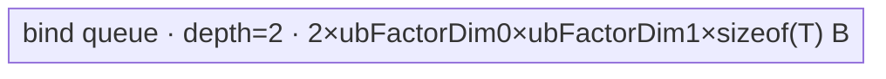
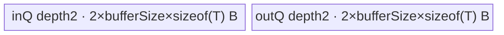

# Cat 950 ACLNN 算子知识

## 算子速览

| 项目 | 内容 |
|---|---|
| 实际入口 | `aclnnCatGetWorkspaceSize` + `aclnnCat`，公开 ACLNN 两段式接口，无编号后继版本。 |
| 计算语义 | 对输入列表按归一化后的 `dim` 拼接；输出在非拼接轴保持尺寸，在拼接轴满足 `out[dim]=Σ_i tensors[i][dim]`；混合 dtype 先提升到 `promoteType`，最后转换到 `out.dtype`。 |
| 输入输出 | 输入、输出为 1–8 维 ND 语义；950 接口支持文档列出的整数、浮点、复数、BF16、FP8/HIF8/E8M0 与 FP4 类型；非拼接轴 shape 必须一致。 |
| 执行类型 | ACLNN 组合图含可选 AIV_VECTOR/AICPU `Cast`、一个或多轮 AIV_VECTOR/SIMT `ConcatD`；`Contiguous/ViewCopy` 是框架边界。`ConcatD` entry 固定 `KERNEL_TYPE_AIV_ONLY`，SIMT 是 AIV 内 `asc_vf_call`。 |
| Kernel 路线 | R-001/R-002 纯搬运，R-003 SIMT，R-004～R-007 全对齐，R-008～R-011 同 shape 非对齐 copy/gather，R-012/R-013 异 shape 非对齐 scatter；可选 Cast 节点按 `castMap` 选择 AIV 或 AICPU。 |
| 核心资源 | `ConcatD` 使用 GM list descriptor、AIV UB、双缓冲 Queue、可选 512 B index TBuf、VReg/SIMT 线程；每个节点声明 16 MiB system workspace。ACLNN executor 还持有中间 tensor。 |
| 来源闭包 | `source_closed`：公开入口、组合 Host、950 `ConcatD` selector/POD/router/body、可选 `Cast` AIV/AICPU body和 950 构建接线均在固定仓闭合；框架 `Contiguous/ViewCopy` 明确停在 Skill 允许的框架边界。 |
| 验证状态 | 已完成源码闭包检查；本次知识提取未执行编译、真机、数值或性能测试。 |

## 接口与语义

### 计算语义

令有效输入（剔除 shape 为 `[0]` 的一维空 tensor 后）为 `X_0...X_{N-1}`，秩为 `r`，`d = dim < 0 ? dim + r : dim`。对任意输出坐标，非 `d` 轴坐标不变，`d` 轴落在前缀区间 `[Σ_{j<i} X_j[d], Σ_{j<=i} X_j[d])` 时从 `X_i` 读取。输入 dtype 先按 `PromoteType` 归并；首轮各输入经 `Contiguous` 后转换到提升类型，分组 `ConcatD` 产生中间 tensor，最后 Cast 到 `out.dtype` 并 `ViewCopy`/地址重绑定到用户输出。所有有效输入为空时执行器为空并成功返回。

FP4 以两个 4 bit 元素打包为一个 byte；Host 要求每个输入从 concat 轴到末轴的元素乘积为偶数，Tiling 再把该维除 2 并以 B8 body 搬运。

### 输入、输出与属性

| 参数 | shape/layout | dtype | 约束、默认值与语义 |
|---|---|---|---|
| `tensors` | 相同 rank，1–8 维；公开语义为 ND，输入可非连续 | 950 `REGBASE_DTYPE_SUPPORT_LIST` 的 20 类 | 非空指针；列表元素非空；可提升；除 `dim` 外 shape 相同；`[0]` 一维空项在校验前剔除。 |
| `dim` | 标量属性 | `int64_t` | `[-r,r-1]`，负值加 `r`；非连续直达 ConcatD 仅允许 `dim!=0` 且只有 `dim-1` 轴可有非连续 stride。 |
| `out` | 与推导 shape 相同，storage format 与输入一致 | 必须可从提升 dtype 转换 | 用户持有；若中间 workspace 可直接重绑定则不发生尾部 copy。 |
| `workspaceSize` | byte | `uint64_t*` | executor 中所有节点 workspace 的框架聚合结果；每个 950 ConcatD/Cast Tiling 节点各声明 16 MiB system workspace。聚合/复用公式属于 executor 框架边界。 |
| `executor` | Host 对象 | `aclOpExecutor**` | 第一段构造多节点有序图，第二段交给 `CommonOpExecutorRun` 在传入 stream 执行。 |

### 入口与版本

固定仓只公开 `aclnnCatGetWorkspaceSize/aclnnCat`，没有 `V2` ACLNN 入口；`ConcatDV2` 是 A2/A3 特定内部节点，不是新版本 Cat。文档产品表明确 950（Ascend 950PR/950DT）支持；`ConcatD` OpDef 以 `AICore().AddConfig("ascend950")` 和 `aclnnSupport.value=support_aclnn` 接线，CMake 仅为 `ascend950/mc62` 构建 arch35 body，因此本卡是 950 最新公开实现。

## Host/Launcher 执行流程

### 参数校验与前处理

`aclnnCatGetWorkspaceSize` 先创建 executor，`EraseDim1EmptyTensor` 去掉 shape `[0]` 项；全被去掉则直接释放 executor 并成功。其余依次执行：空指针检查；按当前 `NpuArch` 选择 950 dtype 白名单；逐项 `PromoteType` 且拒绝 `UNDEFINED/COMPLEX128`；拒绝 private format、要求输入和输出 storage format 一致；规范化 `dim` 并校验 rank/非 concat 轴尺寸。

`SplitToConcat` 的顺序不可交换：

1. 删除所有一般 empty tensor，计算 `promoteType`。
2. 950、`dim!=0`、2–32 输入且只在 `dim-1` 轴有合法非连续 stride，并满足“大尾轴/大 stride/小总量”任一谓词时，保留 view/stride 直接发射 `ConcatD`。
3. 只剩一个输入时：FP4 仍走 `Contiguous -> ConcatD -> Cast -> ViewCopy`；其它 dtype 走 `Contiguous -> Cast -> ViewCopy`。
4. 多输入时，950 每组最多 2048 个；首轮对每个输入 `Contiguous` 并 Cast 到提升类型，然后分组发射 `ConcatD`。若一轮结果仍多于一个，继续分组归并，直到一个 tensor。
5. 校验最终 shape，Cast 到 `out.dtype`，再 `ViewCopy`。`aclnnCat` 第二段只调用 `CommonOpExecutorRun`。

### 参数、Workspace 与生命周期

`ConcatDInferShape` 复制首输入 view shape，只把 concat 轴设为各输入该轴之和；`executor->AllocTensor` 持有每轮中间结果。所有节点进入同一 launcher list，后轮输入直接引用前轮 workspace tensor；`CommonOpExecutorRun` 在同一 stream 按 executor 图依赖执行，前节点失败阻断后节点。框架生成的具体 workspace slice offset、executor 内复用算法和 `Contiguous/ViewCopy` 内部 POD 固定仓不在算子拥有代码中展开，作为明确框架边界。

每个 `ConcatD` Tiling 都把 `workspace[0]` 设为 `16777216` byte，但 Kernel body 的 `workspace` 参数未读取；这是系统 workspace 保留。每个 AIV Cast 也声明 16 MiB；AICPU Cast 的并行任务由 AICPU runtime 管理。

### 启动图与失败传播

```text
aclnnCatGetWorkspaceSize
  -> [每个有效输入] Contiguous（框架边界）
  -> [dtype 变化时] Cast node (AIV Cast 或 AICPU Cast)
  -> ConcatD round-0/group-0 ... group-k
  -> [中间数 > 1] ConcatD round-1 ... 直到单 tensor
  -> [dtype 变化时] Cast node
  -> ViewCopy/输出地址重绑定（框架边界）
aclnnCat(workspace, workspaceSize, executor, stream)
  -> CommonOpExecutorRun：按同一 executor 的依赖顺序提交
```

每个 ConcatD 节点的 Host 添加点是 `l0op::ConcatD -> ADD_TO_LAUNCHER_LIST_AICORE(ConcatD)`，entry 为 `concat_d(x-list,y,workspace,tiling)`，blockDim 是 Tiling 的 `usedCoreNum`，POD 按 Route 为 `ConcatTilingDataNoArray`、`ConcatTilingData` 或 `ConcatTilingDataForSimt`。节点边是前一轮 GM/workspace tensor 到后一轮动态输入 list，dtype/layout 保持提升 dtype/ND；owner 是 executor，从分配到最后消费者完成。添加节点或任一中间指针为空立即返回错误，不再创建后续节点。

## Route 与参数设计

### 分核与资源计算

Tiling 把 shape 折叠为 `catDim0=Π shape[0:d]` 与每输入 `dim1_i=Π shape[d:r]`，输出 `catDim1=Σ dim1_i`。AIV 核数上限为 `min(platformAivCoreNum,72)`。DB 先把可用 UB 二分；一般非对齐再为 input/output 两份缓冲二分并限制到 `uint16_t::max` 元素，保留 `INDEX_USE_UB=1024` byte。`everyBlockNumber=32/dtypeSize`。

一般路径先求 UB tile：不切列时 `ubFactorDim0=min(maxAvailableUb/catDim1,catDim0)`；切列时 `ubFactorDim1` 对齐到 `everyBlockNumber`（gather 小列可对齐到 `sameShapeTensorDim1`），再求 `ubFactorDim0`。行 tile 多于半数核时只沿行分核；否则借列轴开核，得到 `blockFactor/tailBlockFactor` 与 `ConcatTilingData` 的每核 tensor 起止数组。

纯搬运优先用 `AutoBlockTiling(rows,ceil(catDim1/512),usedCoreNum)`，只有所有输入列宽超过按 alignment/shape 分类的 256/1024/2048 byte 阈值，且至少 90% “核×输入片”达到 48 KiB 才命中。SIMT 优先级在纯搬运之前：TilingCommon 在 `IsEnableUsedSimt` 为真时直接返回；因此实际顺序为 empty -> SIMT -> pure copy -> generic。

### Route 选择

| 顺序 | Route | Key/模板 | 精确选择条件与优先级 | 不适用去向 |
|---:|---|---|---|---|
| 1 | R-003 SIMT | `30001/2/4/8` | 连续；总 bytes `< min(tensorNum,cores)*65536`；非全 32B 对齐；shape 不同；`tensorNum%(cores+1)>cores/2`；`tensorNum<=128`；且任意运行前缀的 `maxDim1/minDim1>=2 && maxDim1*catDim0*dtypeSize>1024` 均为假 | R-001/R-002 |
| 2 | R-001 纯搬运行分核 | `20001` | `TilingForPureCopy` 成功且 `colsCutPart==1` | generic |
| 3 | R-002 纯搬运行列分核 | `20002` | `TilingForPureCopy` 成功且 `colsCutPart>1` | generic |
| 4 | R-004/R-005 全对齐同 shape | `211b/1211b` | 所有 `dim1_i*dtypeSize%32==0` 且折叠 shape 相同；`b∈{1,2,4,8}` | 对齐异 shape |
| 5 | R-006/R-007 全对齐异 shape | `212b/1212b` | 所有输入 32B 对齐但折叠 shape 不同 | 非对齐 |
| 6 | R-010/R-011 非对齐同 shape gather | `231b/1231b` | 非全对齐、同 shape，且 `sameShapeDim1*dtypeSize < vectorLen/2` | copy |
| 7 | R-008/R-009 非对齐同 shape copy | `221b/1221b` | 非全对齐、同 shape且不满足 gather | 失败 |
| 8 | R-012/R-013 非对齐异 shape scatter | `222b/1222b` | 非全对齐、shape 不同 | 失败 |

```text
empty -> blockDim=0
else if IsEnableUsedSimt -> R-003
else if TilingForPureCopy -> colsCutPart==1 ? R-001 : R-002
else preprocess(B64->B32 或合规 B8->B16) -> UB tiling -> block tiling
  -> blockSplitAxis==1 选择无 1 前缀 key / ConcatTilingData
  -> blockSplitAxis==0 选择 1 前缀 key / ConcatTilingDataNoArray
  -> alignment + shapeSame + gather + effective byte width 决定 body
```

### 模板/实现执行矩阵

| Route | key/selector | dtype/shape/platform 完整命中条件 | 执行拓扑与 Kernel 节点 | 实际模板/body | 内存与同步特征 | tail/fallback |
|---|---|---|---|---|---|---|
| R-001 | 20001 | pure-copy guard，行分核 | 单 AIV | `OneAxisConcatPureCopy<NoArray>` | bind queue depth2，直接 byte copy | 最后一行核用 `tailUbFactorDim0` |
| R-002 | 20002 | pure-copy guard，行列分核 | 单 AIV | `OneAxisConcatPureCopy<ConcatTilingData>` | 同上，加 per-core 起止数组 | 行/列尾片均显式裁剪 |
| R-003 | 30001/2/4/8 | SIMT guard；有效 byte width 1/2/4/8 | 单 AIV 内 SIMT | `OneAxisConcatSimt<uint8/16/32/64_t>` | 无 AIV Queue；1024 threads，GM->GM | `tensorIdx>=tensorNum`、线程步长保护 |
| R-004 | 2111/2/4/8 | aligned+same，列借核 | 单 AIV | `AllAlign<T,true,ConcatTilingData>` | bind queue depth2 | 起止 tensor/offset 限界 |
| R-005 | 12111/2/4/8 | aligned+same，行分核 | 单 AIV | `AllAlign<T,true,NoArray>` | bind queue depth2 | former/tail block/tile |
| R-006 | 2121/2/4/8 | aligned+diff，列借核 | 单 AIV | `AllAlign<T,false,ConcatTilingData>` | 动态读取 dim1，queue depth2 | 起止数组与尾列 |
| R-007 | 12121/2/4/8 | aligned+diff，行分核 | 单 AIV | `AllAlign<T,false,NoArray>` | queue depth2 | former/tail |
| R-008 | 2211/2/4 | nonalign+same copy，列借核 | 单 AIV | `NoAlignCopy<T,ConcatTilingData>` | in/out queue 各 depth2 | UnalignReg tail |
| R-009 | 12211/2/4 | nonalign+same copy，行分核 | 单 AIV | `NoAlignCopy<T,NoArray>` | 同上 | former/tail |
| R-010 | 2311/2/4 | nonalign+same gather，列借核 | 单 AIV | `NoAlignGather<T,U,ConcatTilingData>` | 两 queue + 512B index TBuf | mask tail |
| R-011 | 12311/2/4 | nonalign+same gather，行分核 | 单 AIV | `NoAlignGather<T,U,NoArray>` | 同上 | former/tail |
| R-012 | 2221/2/4/8 | nonalign+diff，列借核 | 单 AIV | `NoAlignDiffShape<T,U,ConcatTilingData>` | 两 queue+两个512B TBuf+events | scatter/copy tail |
| R-013 | 12221/2/4/8 | nonalign+diff，行分核 | 单 AIV | `NoAlignDiffShape<T,U,NoArray>` | 同上 | former/tail |

### 隐藏性能 Guard

| Guard | Host/Tiling 条件 | Device/资源原因 | 影响 Route | 不满足时去向 | 源码符号 |
|---|---|---|---|---|---|
| FP4 偶数 | 每个 `tensorListDim1%2==0` | 两个 FP4 共一 byte，避免半 byte 地址 | 全 Route | Tiling 失败 | `CheckFP4Dim1Even` |
| 72 核上限 | `totalCoreNum=min(AIV,72)` | POD 起止数组长 72 | 非 SIMT generic | 只用前72核 | `CalcBaseTilingParam` |
| 非连续直达 | 2–32 输入、`dim>0`、只有 `dim-1` stride 可不连续，stride `<UINT32_MAX`，并满足三种 bag 谓词之一 | POD stride/concatDim 数组仅32项，body仅替换行 stride | 全 generic；SIMT 禁止 | ACLNN 先 Contiguous | `IsNonContiguousSupport`/`CheckNonContiguous` |
| gather index | `sameShapeDim1*dtypeSize<vectorLen/2` | U16/U32 VCI index与单 VReg gather | R-010/011 | copy R-008/009 | `IsEnableGather` |
| 非对齐 UB | `(ubSize/2-1024)/dtypeSize/2 <=65535` 元素并扣 storage-align | 双缓冲、in/out 两物理区与 U16 index上界 | R-008～013 | Tiling 失败 | `TilingUb` |
| B64 降宽 | 非对齐且 dtypeSize=8 时把列数、stride×2，按4-byte模板 | 复用 B32 scatter/copy | R-008～013 | N/A | `PreProcessForNoAlign` |
| B8 升宽 | 同 shape、所有列和非连续 stride均偶数 | 两个 byte 合成 B16，减少非对齐处理粒度 | R-008～011 | 保持B8 | `IsEnableb8ToB16` |
| SIMT 波动 | 大小比达到2且大 tensor bytes>1024则拒绝 | tensor-per-core 模式负载不均 | R-003 | pure/generic | `IsEnableUsedSimt` |

### POD/ABI

下表每行一个字段。`BEGIN_TILING_DATA_DEF` 的 serializer 宏实现位于外部框架，固定仓能证明声明顺序、字段类型和数组长度，但不能从本仓展开 `sizeof/alignof/offsetof`，故 ABI 布局栏明确标记不可见。

| 结构 | 字段 | 类型/位宽 | ABI 布局 | 单位 | Host/launcher producer | Device consumer | 边界 |
|---|---|---|---|---|---|---|---|
| `ConcatTilingData/NoArray` | `ubSplitDim1` | int16/16 | 固定仓不可见 | bool | `TilingUb` | generic `Process` | 0/1 |
| 同上 | `dim` | int16/16 | 固定仓不可见 | axis | `GetConcatDim` | `GetNonConDimSize` descriptor | 0–7 |
| 同上 | `tensorNum` | int16/16 | 固定仓不可见 | tensor | input instance count | 所有 body input loop | 950 ACLNN每节点1–2048；部分 POD数组仅前缀化 |
| 同上 | `dtypeSize` | int16/16 | 固定仓不可见 | byte/effective element | `GetDtypeSize/PreProcess` | byte offsets | 1/2/4/8，FP4有效1 |
| 同上 | `isNonContiguous` | int16/16 | 固定仓不可见 | bool | `CheckNonContiguous` | stride helper | 0/1 |
| 同上 | `ubFactorDim0` | int32/32 | 固定仓不可见 | row | UB/pure tiling | tile row | >0 nonempty |
| 同上 | `ubFactorDim1` | int32/32 | 固定仓不可见 | element | UB/pure tiling | tile col | >0 |
| 同上 | `tailUbFactorDim0` | int32/32 | 固定仓不可见 | row | Tiling | last row tile | 1..former |
| 同上 | `tailUbFactorDim1` | int32/32 | 固定仓不可见 | element | Tiling | last col tile | 1..former |
| 同上 | `bufferSize` | int32/32 | 固定仓不可见 | element | max available UB | `InitBuffer` | 已含 DB/非对齐扣减 |
| 同上 | `dataPtrOffset` | int32/32 | 固定仓不可见 | 未使用 | 固定仓 producer 未赋值 | 当前 body 未读取 | inactive |
| 同上 | `blockFactor` | int64/64 | 固定仓不可见 | UB tile/core | `TilingBlock` | core inner loop | >=1 |
| 同上 | `tailBlockFactor` | int64/64 | 固定仓不可见 | UB tile | `TilingBlock` | last core | >=1 |
| 同上 | `uoDim0` | int64/64 | 固定仓不可见 | row tile/core | Tiling | row core mapping | >=1 |
| 同上 | `uoDim1` | int64/64 | 固定仓不可见 | col tile/core | Tiling | col core mapping | >=1 |
| 同上 | `catDim1` | int64/64 | 固定仓不可见 | effective element/row | `Σdim1` | output stride | FP4÷2，B64 noalign×2 |
| 同上 | `sameShapeTensorDim1` | int64/64 | 固定仓不可见 | element | `GetTensorSameDim1` | dim1 fast path | shape-dependent |
| 同上 | `isFP4Type` | int16/16 | 固定仓不可见 | bool | original size=1004 | dim1÷2 guard | 0/1 |
| `ConcatTilingData.arrays` | `endTensorIdx[72]` | int16×72 | 固定仓不可见 | tensor index | `CalcTensorList` | split-col core | only split-axis1 |
| 同上 | `endTensorOffset[72]` | int64×72 | 固定仓不可见 | element | `CalcTensorList` | split-col core | only split-axis1 |
| 两 generic POD arrays | `preLoadDim1[2]` | int64×2 | 固定仓不可见 | element | 首两个 dim1 | fast descriptor avoidance | always initialized |
| 两 generic POD arrays | `strideList[32]` | uint64×32 | 固定仓不可见 | element/row | noncon validation | `GetTensorDim0Stride` | noncon only |
| 两 generic POD arrays | `concatDimList[32]` | uint64×32 | 固定仓不可见 | element | input shape concat axis | `GetNonConDimSize` | noncon only |
| `ConcatTilingDataForSimt` | `tensorNumPerCore` | int32/32 | 固定仓不可见 | tensor/core | ceil(N/usedCore) | outer tensor loop | >=1 |
| 同上 | `tensorNum` | int32/32 | 固定仓不可见 | tensor | input count | tail guard | <=128 |
| 同上 | `catDim0` | int32/32 | 固定仓不可见 | row | folded shape | SIMT address | int32窄化未显式检查 |
| 同上 | `catDim1` | int32/32 | 固定仓不可见 | element/row | folded output | SIMT address | int32窄化未显式检查 |
| `ConcatTilingDataForSimt.arrays` | `tensorColsOffset[128]` | int32×128 | 固定仓不可见 | element | prefix sum | SIMT cols range | <=128 entries |
| `CastTilingData` | `blockNum` | int64/64 | 固定仓不可见 | core | `DoOpTiling` | Cast block domain | 1..AIV cores |
| 同上 | `ubFormer` | int64/64 | 固定仓不可见 | element | UB byte equation | Cast tile | policy-dependent |
| 同上 | `blockFormer` | int64/64 | 固定仓不可见 | element/core | ceil shape/core aligned8 | GM offset | >0 |
| 同上 | `ubLoopOfFormerBlock` | int64/64 | 固定仓不可见 | tile | ceil block/ub | `Process` | >=1 |
| 同上 | `ubLoopOfTailBlock` | int64/64 | 固定仓不可见 | tile | ceil tail/ub | tail core | >=1 |
| 同上 | `ubTailOfFormerBlock` | int64/64 | 固定仓不可见 | element | remainder | former tail | >0 |
| 同上 | `ubTailOfTailBlock` | int64/64 | 固定仓不可见 | element | remainder | last core tail | >0 |
| 同上 | `regCopyInStep` | int64/64 | 固定仓不可见 | element/VReg op | policy load dist | CastMicro | mode-dependent |
| 同上 | `regCopyOutStep` | int64/64 | 固定仓不可见 | element/VReg op | policy store dist | CastMicro | mode-dependent |
| 同上 | `ubFormerRegLoop` | int64/64 | 固定仓不可见 | reg loop | UB bits/copy bits | CastMicro | >=0 |
| 同上 | `ubTailOfFormerRegLoop` | int64/64 | 固定仓不可见 | reg loop | former tail | CastMicro | >=0 |
| 同上 | `ubTailOfTailRegLoop` | int64/64 | 固定仓不可见 | reg loop | block tail | CastMicro | >=0 |

### Route 源码闭包

| Route | Key/selector | Host/Tiling producer | POD/参数 | Kernel entry/router 节点 | Kernel body/直接依赖 | 构建接线 |
|---|---|---|---|---|---|---|
| R-001/002 | 20001/20002 | `TilingForPureCopy` | generic POD | `concat_d` | `OneAxisConcatPureCopy` | `concat_d/CMakeLists.txt`, 950 binary config |
| R-003 | 30001/2/4/8 | `IsEnableUsedSimt/TilingForConcatDSimt` | Simt POD | `concat_d` | `OneAxisConcatSimt/ConcatSimt` | 同上 |
| R-004～007 | 211b/1211b/212b/1212b | `GenTilingKey` | array/no-array POD | `concat_d` | `OneAxisConcatAllAlign` | 同上 |
| R-008/009 | 221b/1221b | `GenTilingKey` | array/no-array POD | `concat_d` | `OneAxisConcatNoAlignCopy` + `concat_base::Copy` | 同上 |
| R-010/011 | 231b/1231b | `IsEnableGather/GenTilingKey` | array/no-array POD | `concat_d` | `OneAxisConcatNoAlignGather` | 同上 |
| R-012/013 | 222b/1222b | `IsEnableScatter/GenTilingKey` | array/no-array POD | `concat_d` | `OneAxisConcatNoAlignDiffShape` + `ScatterConcat` | 同上 |
| 可选 Cast | `castMap` policy/templateId | `CastTiling` | `CastTilingData` | `cast<id>` 或 `CastCpuKernel` | `CastDirect/DstBool/Through/Two/Micro` 或 `ExecuteCast` | `math/cast/CMakeLists.txt` |

## Kernel 实现

### 公共执行流程

每个 `ConcatD` 是单 Kernel 节点，但 ACLNN 对大量输入可形成多个单 Kernel 节点的归并图。entry 从 tiling key 选择 POD 和模板；所有分支只搬运/重排 bit pattern，不做算术。动态输入 `x` 是 GM list descriptor，body 通过 `ListTensorDesc::GetDataPtr` 获取每个输入地址，输出 `y` 是连续 row-major 折叠布局。

generic AIV 路径均遵循 `GetBlockIdx -> 计算行/列片 -> GM DataCopyPad 到 UB -> 可选 MicroAPI copy/gather/scatter -> UB DataCopyPad 到 GM`。Queue 的 `EnQue/DeQue/FreeTensor` 提供 MTE2/V/MTE3 生命周期；scatter 路径额外显式 `MTE2_V` 与 `V_MTE3` event。SIMT 不分配 AIV UB，线程直接 GM->GM。可选 Cast 先由 `castMap` 固化 load/store distribution、map dtype、中间 dtype 与 round mode，再由 AIV template 或 AICPU `ParallelFor` 执行。

### Route R-001：纯搬运行分核

#### 适用条件

##### 选择证据

| 层级 | 文件 | 符号 | 源码谓词/参数 | 结果/下一跳 |
|---|---|---|---|---|
| Tiling | `concat_tiling_arch35.cpp` | `TilingForPureCopy` | pure-copy 大列/大块比例 guard 且 `colsCutPart==1` | key 20001, NoArray |
| Router | `concat_d_apt.cpp` | `concat_d` | `TILING_KEY_VAR==20001` | `PureCopy<NoArray>` |

#### Device 数据流

##### 函数级调用链

```text
l0op::ConcatD -> concat_d -> PureCopy<NoArray>::Init -> ProcessNoSplitDim1
  -> ProcessSingleTensor -> CopyInSingleTensor -> CopyOutSingleTensor
```

##### 源码等价伪码

```text
rowBase=blockIdx*ubFactorDim0; rows=last?tail:former
for each tensor: for rowTile and colTile:
  DataCopyPad(src[rowBase*srcStride + tile], UB, rows×cols)
  DataCopyPad(UB, dst[rowBase*catDim1 + concatPrefix + tile], valid rows×cols)
```

#### 内存与数据搬运

##### 资源与搬运表

| 层级/缓冲区 | offset/地址公式 | extent/容量公式 | dtype/layout | producer | consumer | owner/lifetime | 对齐/复用 |
|---|---|---|---|---|---|---|---|
| GM input | `rowBase*dim0stride+col` | valid rows×cols | byte view | prior node/user | CopyIn | executor | stride in POD/descriptor |
| bind queue | 0 | `2*bufferSize*dtypeSize` B | byte | CopyIn | CopyOut | TPipe | depth2, same physical queue bind |
| GM output | `rowBase*catDim1+prefix+col` | valid rows×cols | ND | CopyOut | next node | executor | no invalid GM write |

##### 分层内存布局


##### 字节账与复用顺序

```text
UB_total = 2 * bufferSize * dtypeSize
bufferSize = (platformUB/2) / dtypeSize
workspace_total = 16 MiB system workspace（Kernel不读）
```

| 复用子区 | 写入者 | 读取者/消费点 | 下一次覆盖 | 同步或释放依据 | 安全条件 |
|---|---|---|---|---|---|
| bind queue slot | `CopyInSingleTensor` | `CopyOutSingleTensor` | next tile | EnQue/DeQue/FreeTensor | depth2且释放后覆盖 |

#### 同步、精度与尾块

##### 同步与数值边界表

| 阶段 | primitive/机制 | producer | consumer/等待点 | 保护对象 | 精度/尾块 |
|---|---|---|---|---|---|
| copy | Queue | MTE2 | MTE3 DeQue | UB slot | bitwise；last row/col valid extent |

#### 关键实现

##### 符号证据表

| 阶段 | 文件 | 符号/模板实例 | 实现事实 |
|---|---|---|---|
| Host/Tiling producer | `concat_tiling_arch35.cpp` | `TilingForPureCopy` | key、row/col cut、bufferSize |
| Kernel entry/router | `concat_d_apt.cpp` | `concat_d/20001` | NoArray实例 |
| Device body/helper | `one_axis_concat_pure_copy.h` | `ProcessSingleTensor` | 双层 row/col tile 纯搬运 |

### Route R-002：纯搬运行列分核

#### 适用条件

##### 选择证据

同 R-001 的 pure-copy guard，但 `colsCutPart>1`，key 20002；`CalcTensorList` 生成每核列片跨 tensor 的 end index/offset。

#### Device 数据流

##### 函数级调用链

```text
concat_d -> PureCopy<ConcatTilingData>::Init -> UpdateSplitInfo -> ProcessSplitDim1 -> ProcessSingleTensor
```

##### 源码等价伪码

```text
rowCore=block/colsCores; colCore=block%colsCores
[startTensor,startOff,endTensor,endOff]=POD arrays
for tensors intersecting this col slice: copy its intersected byte rectangle to local output prefix
```

#### 内存与数据搬运

##### 资源与搬运表

与 R-001 相同，GM output base 增加 `colCore*ubFactorDim1*dtypeSize`；POD arrays 限定每核只写自己的列片。

##### 分层内存布局


##### 字节账与复用顺序

`UB_total=2*bufferSize*dtypeSize`；复用遵循 EnQue→DeQue→FreeTensor，workspace 16 MiB 未读。

#### 同步、精度与尾块

##### 同步与数值边界表

Queue 保证 tile 顺序；最后 row core 使用 `tailUbFactorDim0`，最后 col core 使用 POD `endTensorOffset`，只提交有效 byte。

#### 关键实现

##### 符号证据表

`CalcTensorList` 生产数组，`concat_d/20002` 路由，`PureCopy::ProcessSplitDim1` 消费。

### Route R-003：小规模异 shape SIMT

#### 适用条件

##### 选择证据

`IsEnableUsedSimt` 的完整谓词见 Route 表；dtype key 按有效 byte width 为 30001/30002/30004/30008。

#### Device 数据流

##### 函数级调用链

```text
concat_d -> OneAxisConcatSimt<T>::ProcessForSimt -> asc_vf_call<ConcatSimt<T>>(1024 threads)
```

##### 源码等价伪码

```text
for localTensorSlot: tensorIdx=slot*blockNum+blockIdx; guard tensorIdx<N
cols=[prefix[t-1],prefix[t]); magic division by colsSize
for i=threadIdx; i<catDim0*colsSize; i+=1024:
  row=i/colsSize; col=i-row*colsSize+prefix; y[row*catDim1+col]=x[t][i]
```

#### 内存与数据搬运

##### 资源与搬运表

| 层级/缓冲区 | offset/地址公式 | extent/容量公式 | dtype/layout | producer | consumer | owner/lifetime | 对齐/复用 |
|---|---|---|---|---|---|---|---|
| GM input | `src[i]` | `catDim0*colsSize` | T | user/prior | SIMT thread | executor | direct |
| GM output | `row*catDim1+col` | same | T | SIMT | next node | executor | disjoint tensor columns |

##### 分层内存布局

N/A：该 Route 不分配 AIV UB；实际替代路径是每 AIV block 调起 1024-thread SIMT，直接 GM→GM。

##### 字节账与复用顺序

`UB_total=N/A; dynamic_ub=N/A; workspace_total=16 MiB system workspace（未读）`。不同 tensor 的输出列区间不重叠，无复用子区。

#### 同步、精度与尾块

##### 同步与数值边界表

线程以 `i+=blockDim.x` 分割元素，无 barrier/atomic；`tensorIdx` 和 `i<...` 是尾保护。纯 bitwise store。

#### 关键实现

##### 符号证据表

`TilingForConcatDSimt` 生产 POD；`concat_d` 实例化 T；`ConcatSimt` 完成 magic division 地址映射。

### Route R-004：全对齐同 shape，列借核

#### 适用条件

##### 选择证据

全输入 32B 对齐、折叠 shape 相同、generic `blockSplitAxis==1`，keys 2111/2112/2114/2118。

#### Device 数据流

##### 函数级调用链

```text
concat_d -> AllAlign<T,true,ConcatTilingData>::Init -> ProcessBlockSplitDim1
  -> CalcSplitInfo -> CopyInSplitDim1 -> CopyOut
```

##### 源码等价伪码

按 per-core 起止 tensor/offset 迭代列 tile；每输入用二维 `DataCopyPad(blockCount=rows,blockLen=cols*sizeof(T),srcStride=(dim0stride-cols)*sizeof(T))` 紧密拼入同一 UB tile，再二维写出。

#### 内存与数据搬运

##### 资源与搬运表

GM list片→`TQueBind`→GM输出片；UB=`2*ubFactorDim0*ubFactorDim1*sizeof(T)`。

##### 分层内存布局



##### 字节账与复用顺序

Queue slot 在 CopyOut 后 Free；workspace 16 MiB 未读。

#### 同步、精度与尾块

##### 同步与数值边界表

Queue 同步；行尾 `tailUbFactorDim0`、列尾 `tailBlockFactor/tailUbFactorDim1`；无数值转换。

#### 关键实现

##### 符号证据表

`GenTilingKey`→`concat_d` 211x→`AllAlign::ProcessBlockSplitDim1`。

### Route R-005：全对齐同 shape，行分核

#### 适用条件

##### 选择证据

R-004 条件但 `blockSplitAxis==0`，keys 12111/12112/12114/12118，NoArray POD。

#### Device 数据流

##### 函数级调用链

`AllAlign<T,true,NoArray>::Process -> ProcessBlockSplitDim0NoSplitDim1/ProcessBlockSplitDim0SplitDim1`。

##### 源码等价伪码

每核处理 `blockFactor` 个 row tile；若 UB 仍切列，在核内遍历 `uoDim1`，最后 core/tile 使用 tail 字段。

#### 内存与数据搬运

##### 资源与搬运表

同 R-004，但不读取 end arrays。

##### 分层内存布局

同 R-004 的 bind queue。

##### 字节账与复用顺序

`UB_total=2*ubFactorDim0*ubFactorDim1*sizeof(T)`，Queue 释放后复用。

#### 同步、精度与尾块

##### 同步与数值边界表

Queue；最后核的 `tailBlockFactor` 与最后 UB row/col tail 防止越界。

#### 关键实现

##### 符号证据表

`TilingBlock`→1211x→`AllAlign<T,true,NoArray>`。

### Route R-006：全对齐异 shape，列借核

#### 适用条件

##### 选择证据

全32B对齐、shape不同、`blockSplitAxis==1`，2121/2122/2124/2128。

#### Device 数据流

##### 函数级调用链

同 R-004，但模板 `SAMESHAPE=false`；`GetTensorDim1` 对前两个输入读 POD，之后读 list descriptor shape。

##### 源码等价伪码

与 R-004 相同，区别是每个输入独立 `dim1_i` 和 src stride。

#### 内存与数据搬运

##### 资源与搬运表

同 R-004。

##### 分层内存布局

同 R-004。

##### 字节账与复用顺序

同 R-004。

#### 同步、精度与尾块

##### 同步与数值边界表

Queue；per-input dim1 和 per-core end offset共同保护尾列。

#### 关键实现

##### 符号证据表

212x router→`AllAlign<T,false,ConcatTilingData>`。

### Route R-007：全对齐异 shape，行分核

#### 适用条件

##### 选择证据

R-006 但 `blockSplitAxis==0`，12121/12122/12124/12128。

#### Device 数据流

##### 函数级调用链

`AllAlign<T,false,NoArray>`，核内行/可选列循环。

##### 源码等价伪码

同 R-005，输入列宽逐 descriptor 读取。

#### 内存与数据搬运

##### 资源与搬运表

同 R-005。

##### 分层内存布局

同 R-004。

##### 字节账与复用顺序

同 R-005。

#### 同步、精度与尾块

##### 同步与数值边界表

Queue + former/tail。

#### 关键实现

##### 符号证据表

1212x→`AllAlign<T,false,NoArray>`。

### Route R-008：非对齐同 shape copy，列借核

#### 适用条件

##### 选择证据

非全对齐、同shape、未命中 gather、`blockSplitAxis==1`，2211/2212/2214。

#### Device 数据流

##### 函数级调用链

```text
NoAlignCopy::CopyIn* -> inQ.DeQue -> outQ.Alloc -> MicroAPI DataCopyUnAlign/Copy -> outQ.EnQue -> CopyOut
```

##### 源码等价伪码

输入矩形 compact 到 inQ；逐行使用 UnalignReg 把各 tensor 段无缝写到 outQ，mask/tail 只覆盖有效列；再写 GM。

#### 内存与数据搬运

##### 资源与搬运表

inQ 与 outQ 各 `depth2*bufferSize*sizeof(T)`，GM offset同列分核公式。

##### 分层内存布局



##### 字节账与复用顺序

`UB_total=4*bufferSize*sizeof(T)`；inQ消费后释放，outQ写 GM 后释放。

#### 同步、精度与尾块

##### 同步与数值边界表

Queue 同步；UnalignReg `main/tail` 精确有效 lane；bitwise。

#### 关键实现

##### 符号证据表

221x→`OneAxisConcatNoAlignCopy<ConcatTilingData>`→`ComputeSplitDim1Copy`。

### Route R-009：非对齐同 shape copy，行分核

#### 适用条件

##### 选择证据

R-008 且 `blockSplitAxis==0`，12211/12212/12214。

#### Device 数据流

##### 函数级调用链

`NoAlignCopy<T,NoArray>::ProcessBlockSplitDim0*`。

##### 源码等价伪码

同 R-008，核内处理 former/tail row/col tile。

#### 内存与数据搬运

##### 资源与搬运表

同 R-008。

##### 分层内存布局

同 R-008。

##### 字节账与复用顺序

同 R-008。

#### 同步、精度与尾块

##### 同步与数值边界表

Queue + last core/tile guards。

#### 关键实现

##### 符号证据表

1221x→`NoAlignCopy<T,NoArray>`。

### Route R-010：非对齐同 shape gather，列借核

#### 适用条件

##### 选择证据

非全对齐、同 shape且 `sameShapeDim1*dtypeSize<vectorLen/2`，列借核，2311/2312/2314。

#### Device 数据流

##### 函数级调用链

`GenGatherIndex -> CopyIn -> DataCopyGather -> DataCopyUnAlign -> CopyOut`。

##### 源码等价伪码

预生成周期性 source index；对每行/列片按 mask gather 相邻小 tensor 段，B8 使用 UnPack/Interleave 适配寄存器 lane，尾部 UpdateMask。

#### 内存与数据搬运

##### 资源与搬运表

两 Queue各 depth2×buffer，另 `indexBuf=512B`。

##### 分层内存布局


##### 字节账与复用顺序

`UB_total=4*bufferSize*sizeof(T)+512` B；index 在整个 Process 只读复用。

#### 同步、精度与尾块

##### 同步与数值边界表

Queue；mask区分 main/tail；无算术精度变化。

#### 关键实现

##### 符号证据表

231x→`NoAlignGather<T,U,ConcatTilingData>`。

### Route R-011：非对齐同 shape gather，行分核

#### 适用条件

##### 选择证据

R-010 但行分核，12311/12312/12314。

#### Device 数据流

##### 函数级调用链

`NoAlignGather<T,U,NoArray>::ProcessBlockSplitDim0*`。

##### 源码等价伪码

同 R-010，核内遍历 row/col tile。

#### 内存与数据搬运

##### 资源与搬运表

同 R-010。

##### 分层内存布局

同 R-010。

##### 字节账与复用顺序

同 R-010。

#### 同步、精度与尾块

##### 同步与数值边界表

Queue/mask/former-tail。

#### 关键实现

##### 符号证据表

1231x→`NoAlignGather<T,U,NoArray>`。

### Route R-012：非对齐异 shape scatter，列借核

#### 适用条件

##### 选择证据

非全对齐、shape不同、列借核，2221/2222/2224/2228。

#### Device 数据流

##### 函数级调用链

```text
NoAlignDiffShape::ProcessBlockSplitDim1
  -> DataCopyPad compact input
  -> ComputeSplitDim1 -> Copy/ScatterConcat/GenScatterIndex+ScatterSplitDim1
  -> CopyOut
```

##### 源码等价伪码

对每个与本核列片相交的 tensor，把 row rectangle compact 到 inQ；按列宽选择4/3/2/1次展开 scatter，极小列动态生成 `row*outputCols+col` index，极大列用 Unalign Copy；输出满一 tile即写 GM并复用。

#### 内存与数据搬运

##### 资源与搬运表

inQ/outQ各 depth2×buffer，`indexBuf=512B`，`vciSequenceBuf=512B`。

##### 分层内存布局


##### 字节账与复用顺序

`UB_total=4*bufferSize*sizeof(T)+1024` B；MTE2→V event 后 inQ 可读，V→MTE3 event 后 outQ 可写出，Free 后覆盖。

#### 同步、精度与尾块

##### 同步与数值边界表

`SetFlag/WaitFlag<MTE2_V>` 保护 vector 读，`V_MTE3` 保护 GM 写；mask覆盖 scatter tail；纯 bitwise。

#### 关键实现

##### 符号证据表

222x→`NoAlignDiffShape<T,U,ConcatTilingData>`→`ComputeSplitDim1/CopyOut`。

### Route R-013：非对齐异 shape scatter，行分核

#### 适用条件

##### 选择证据

R-012 但行分核，12221/12222/12224/12228。

#### Device 数据流

##### 函数级调用链

`NoAlignDiffShape<T,U,NoArray>::ProcessBlockSplitDim0SplitDim1/NoSplitDim1`。

##### 源码等价伪码

同 R-012，核内 `blockFactor` 行 tile；最后核/最后 tile替换 tail rows，列切分由 `ubSplitDim1` 决定。

#### 内存与数据搬运

##### 资源与搬运表

同 R-012。

##### 分层内存布局

同 R-012。

##### 字节账与复用顺序

同 R-012。

#### 同步、精度与尾块

##### 同步与数值边界表

MTE2_V/V_MTE3 event + former/tail guards。

#### 关键实现

##### 符号证据表

1222x→`NoAlignDiffShape<T,U,NoArray>`。

## 算子特定优化

### Trick T-001：小异 shape 用 tensor-per-core SIMT 直接 GM 写出

#### 触发与源码依据

- 适用 Route：R-003
- 触发条件：完整条件见 Route 表，以连续、小总量、非对齐、异 shape、tensor 数分核余数和波动 guard共同限制。
- Golden 来源：[`conversion/concat/op_kernel/arch35/one_axis_concat_simt.h:69-84`](../../../../../../../cann-ops-raw/ascendc/ops-math/165d41f02a43a62324b434cb6bda7c533b14da3e/conversion/concat/op_kernel/arch35/one_axis_concat_simt.h#L69-L84)

**官方源码（固定 Commit 连续逐字摘录）**：

```cpp
uint32_t tensorIdx = i * GetBlockNum() + GetBlockIdx();
if (tensorIdx >= tilingData_.tensorNum) {
    return;
}
uint32_t colsOffset = tensorIdx == 0 ? 0 : tilingData_.arrays.tensorColsOffset[tensorIdx - 1];
uint32_t colsSize = tilingData_.arrays.tensorColsOffset[tensorIdx] - colsOffset;
```

#### 机制与设计原因

每核按跨步 tensor index 取任务，核内1024线程直接把某输入的连续元素映射到输出列区间，省去 UB 拼接和 Queue 生命周期；magic/shift代替逐元素一般除法。Host 只在小数据、异 shape 且预估负载不失衡时启用，避免直接 GM 路线放大不均衡。

#### 迁移边界

- 适用：多个小而不等宽的连续输入按中间轴拼接。
- 前提：950 SIMT、输入数≤128、int32 POD/前缀和不溢出且完整 guard 成立。
- 失效：转入 pure-copy 或 generic AIV Route。
- 未验证：本次知识提取未执行编译、真机、数值或性能测试。

#### 错误做法

固定仓提供的真实反例是非连续、全对齐/同 shape、大数据或明显宽度波动；这些条件下强行 SIMT 会绕过 selector 的负载/搬运约束。

### Trick T-002：B64 降 B32、合规 B8 升 B16复用非对齐模板

#### 触发与源码依据

- 适用 Route：R-008～R-013
- 触发条件：非对齐；B64总是把列与stride乘2按B32处理，B8仅在同 shape且所有列/stride偶数时除2按B16处理。
- Golden 来源：[`conversion/concat/op_host/arch35/concat_tiling_arch35.cpp:839-869`](../../../../../../../cann-ops-raw/ascendc/ops-math/165d41f02a43a62324b434cb6bda7c533b14da3e/conversion/concat/op_host/arch35/concat_tiling_arch35.cpp#L839-L869)

**官方源码（固定 Commit 连续逐字摘录）**：

```cpp
if (param.dtypeSize == B64_BYTES) {
    param.sameShapeTensorDim1 *= DIGIT_TWO;
    param.dtypeSize = B32_BYTES;
    param.catDim1 *= DIGIT_TWO;
```

#### 机制与设计原因

Concat 只搬运 bit pattern，不解释数值；因此可改变逻辑元素宽度并等比例改变列坐标，以复用 B32 scatter body处理 B64。B8→B16必须证明每个边界为偶数，否则会把两个输入边界跨字节合并。该优化减少 template 数，同时让 gather/scatter 使用硬件支持的 lane宽度。

#### 迁移边界

- 适用：纯数据搬运/重排，不做数值计算的非对齐 Kernel。
- 前提：地址、列数、stride均按宽度比同步缩放；B8升宽须所有边界偶数。
- 失效：B8任一列或stride奇数时保留B8；不可迁移到有数值语义的算子。
- 未验证：本次知识提取未执行编译、真机、数值或性能测试。

#### 错误做法

固定仓真实 guard 表明只检查首输入偶数是不够的；非连续路径还逐输入检查 `tensorListDim1` 与 `strideList`。

## 模板与实现对比

| 对比维度 | R-001/002 PureCopy | R-003 SIMT | R-004～013 generic | 设计选择依据 |
|---|---|---|---|---|
| 命中条件/优先级 | 大列且≥90%大块 | 小异 shape且负载均衡 | fallback全覆盖 | 降低拼接计算与小任务开销 |
| 模板与 dtype | byte搬运，dtypeSize参数化 | uint8/16/32/64 | aligned/copy/gather/scatter | alignment+shape+宽度 |
| 循环与分核 | 2D自动切核 | tensor/core + thread stride | row/col tile/core | 工作域形态 |
| Queue/TBuf/寄存器/dynamic UB/通信 window | bind queue depth2 | 无UB，SIMT寄存器 | 1或2 Queue，gather/scatter TBuf/VReg | 只分配所需资源 |
| 内存总占用与复用 | `2*buffer*dtype` | N/A | aligned `2*tile`；copy `4*buffer`；gather +512；scatter +1024 | 非对齐需输入/输出分离 |
| 搬运/Vector/SIMT/NDDMA/通信 API | DataCopyPad | direct GM load/store | DataCopyPad + Unalign/Gather/Scatter | 输入边界 |
| 同步、精度与 tail | Queue，bitwise | 无barrier，bitwise | Queue/event/mask，bitwise | producer-consumer图 |
| fallback/失败边界 | guard失败generic | guard失败pure/generic | UB/POD/shape失败终止 | 无隐藏通用fallback |

## 平台差异

| 项目 | A2 | A3 | 950 |
|---|---|---|---|
| 支持状态 | 公开文档支持，但固定仓常规 ConcatD Host/Tiling/Kernel缺失，不在本卡发布 | 同 A2 | 支持且闭合 |
| Host/Launcher | 特定 >32 输入、dim0、尾轴32B对齐可走仓内 ConcatDV2，其余实现固定仓不可见 | 同 A2 | 每组最多2048，arch35 ConcatD |
| Kernel/资源 | 正式卡未建，不能由 ConcatDV2特例外推 | 同 A2 | 本卡13 Route，AIV/SIMT，950 UB/VReg运行时取值 |

## 限制与失败边界

- 950 SIMT POD把折叠维与前缀和窄化到 int32，源码未见显式溢出检查；超界行为不能从固定仓补齐。
- generic POD的 serializer 宏展开、精确 `sizeof/alignof/offsetof` 固定仓不可见；只能锁定字段声明顺序、类型与数组长度。
- executor 聚合多个节点的实际 workspace slice offset/复用公式、`CommonOpExecutorRun` 的内部 event实现、`Contiguous/ViewCopy` 内部细节属于明确框架边界。
- `dataPtrOffset` 在 POD 中声明但 Host未赋值、当前 body未读取；不得用于派生实现。
- FP4 单输入被强制 ConcatD，因为 TensorMove AICore/AICPU均不支持；每个 concat轴及后续维乘积必须偶数。
- 空域 `blockDim=0` 不启动 Device；全 `[0]` 一维列表在 ACLNN层直接成功。其它空 shape的精确 executor输出写入语义固定仓未额外说明。
- A2/A3虽被公开文档声明支持，但固定仓只有 ConcatDV2特例实现，无法形成常规 ACLNN全链闭包，因此未生成 `cat.md`。

## 源码索引

### 链路索引

| 链路阶段 | 文件 | 关键符号 | 支撑内容 |
|---|---|---|---|
| 入口声明/约束 | `conversion/concat_d/docs/aclnnCat.md` | 产品表/函数原型 | 950公开性、dtype/shape/FP4约束 |
| 入口实现 | `conversion/concat_d/op_api/aclnn_cat.cpp` | `aclnnCatGetWorkspaceSize/SplitToConcat` | 校验、分组、多节点图 |
| 入口实现 | `conversion/concat_d/op_api/concat_d.cpp` | `ConcatD` | shape、launcher、950每组上限 |
| Host/Tiling/Launcher | `conversion/concat_d/op_host/arch35/concat_d_tiling_arch35.cpp` | `Tiling4ConcatD` | 进入公共 Tiling |
| Host/Tiling/Launcher | `conversion/concat/op_host/arch35/concat_tiling_arch35.h` | POD structs | ABI字段 |
| Host/Tiling/Launcher | `conversion/concat/op_host/arch35/concat_tiling_arch35.cpp` | `TilingCommon/DoTiling` | Route、资源、workspace |
| Kernel entry/body | `conversion/concat_d/op_kernel/concat_d_apt.cpp` | `concat_d` | key→模板router |
| Kernel entry/body | `conversion/concat/op_kernel/arch35/concat_base.h` | `Copy/ScatterConcat` | MicroAPI公共helper |
| Kernel entry/body | `conversion/concat/op_kernel/arch35/one_axis_concat_all_align.h` | `OneAxisConcatAllAlign` | 对齐body |
| Kernel entry/body | `conversion/concat/op_kernel/arch35/one_axis_concat_no_align_same_shape_copy.h` | `OneAxisConcatNoAlignCopy` | 非对齐copy |
| Kernel entry/body | `conversion/concat/op_kernel/arch35/one_axis_concat_no_align_same_shape_gather.h` | `OneAxisConcatNoAlignGather` | gather |
| Kernel entry/body | `conversion/concat/op_kernel/arch35/one_axis_concat_no_align_diff_shape.h` | `OneAxisConcatNoAlignDiffShape` | scatter/events |
| Kernel entry/body | `conversion/concat/op_kernel/arch35/one_axis_concat_pure_copy.h` | `OneAxisConcatPureCopy` | pure copy |
| Kernel entry/body | `conversion/concat/op_kernel/arch35/one_axis_concat_simt.h` | `ConcatSimt` | SIMT映射 |
| Host/Tiling/Launcher | `math/cast/op_api/cast.cpp` | `Cast` | AIV/AICPU选择与同dtype无操作 |
| Host/Tiling/Launcher | `math/cast/op_host/arch35/cast_tiling.cpp` | `CastTiling` | Cast POD/切核/UB |
| Kernel entry/body | `math/cast/op_kernel/cast_apt.cpp` | `cast<id>` | policy→AIV body |
| Kernel entry/body | `math/cast/op_kernel/arch35/cast_impl.h` | `CastDirect/.../CastMicro` | AIV循环、round/tail |
| Kernel entry/body | `math/cast/op_kernel_aicpu/cast_aicpu.cpp` | `CastCpuKernel` | AICPU conversion map/ParallelFor |
| 构建接线 | `conversion/concat_d/op_host/concat_d_def.cpp` | `ConcatD::ConcatD` | ascend950 ACLNN OpDef |
| 构建接线 | `conversion/concat_d/CMakeLists.txt` | `add_all_modules_sources` | ascend950/mc62 arch35 target |

### 实现复用检查

| 检查项 | 可复用事实 | 不得改变的约束 | 源码符号 |
|---|---|---|---|
| ABI/POD | 三类 Concat POD和 Cast POD字段 producer/consumer | 字段顺序、位宽、数组72/32/128、inactive字段 | `concat_tiling_arch35.h`, `cast_tiling.h` |
| 调用顺序 | 首轮 Contiguous/Cast→多轮ConcatD→尾Cast/ViewCopy | 第一轮才做输入提升；前轮失败阻断后轮 | `SplitToConcat` |
| workspace/内存 | 每节点系统workspace 16MiB；UB按Route公式 | executor slice/owner不得臆造，DB必须乘2 | `TilingCommon`, `CastTiling::GetWorkspaceSize` |
| 同步 | Queue生命周期；scatter显式MTE2_V/V_MTE3；SIMT无atomic | Free前不得覆盖；不同core输出必须不重叠 | 各body `Process/CopyOut` |
| 精度与尾块 | Concat bitwise；Cast policy固化round；former/tail/mask | FP4偶数、B8升宽偶数、Cast round不可替换 | `ConvertFP4DimsToB8`, `castMap` |
| 失败边界 | shape/dtype/UB/POD容量/launcher失败终止 | 不把 A2/A3特例外推，不把 unknown key当fallback | `CheckParams`, `ConcatSetTilingData`, router |
