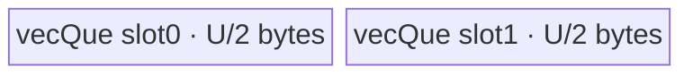
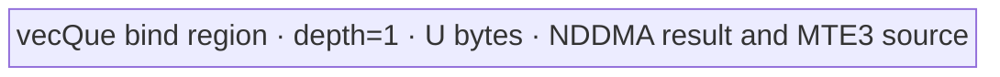
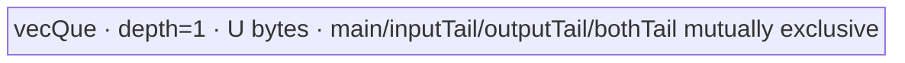
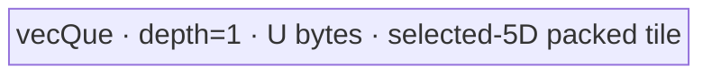

# ConfusionTranspose 950 ACLNN 算子知识

## 算子速览

| 项目 | 内容 |
|---|---|
| 实际入口 | `aclnnConfusionTransposeGetWorkspaceSize` / `aclnnConfusionTranspose`，公开 ACLNN 两段式接口，无版本后缀 |
| 计算语义 | `transpose_first=false`：`y=transpose(reshape(x, shape), perm)`；`true`：`y=reshape(transpose(x, perm), shape)` |
| 输入输出 | `x/out`：ND，rank 1–8，dtype 为有/无符号 8/16/32/64 位整数、FP16、FP32、BF16；`perm/shape` 为 Host `aclIntArray` |
| 执行类型 | 单 Device Kernel；R-001/R-006 为 AIV 数据搬运，R-002 为 SIMT，R-003/R-004/R-005 为 NDDMA；所有可达节点均使用 AIV 核数，不含 Cube/AIC 或 MIX_CV |
| Kernel 路线 | R-001 `TENSOR_MOVE`；R-002 `SMALL_SHAPE`；R-003 `CUT_ONCE`；R-004 `CUT_TWICE`；R-005 `BIG_DIM`；R-006 `N_LAST_TRANSPOSE` |
| 核心资源 | GM 输入/输出；R-001/R-003–R-006 使用一块绑定 VECIN/VECOUT 的 UB Queue；R-002 直接 SIMT GM→GM；算子 raw tiling 固定声明 16 MiB workspace，但 Device entry 不读取 `workspace` |
| 来源闭包 | `source_closed`：公开 ACLNN→L0 launcher→ConfusionTranspose Host/Tiling→复用 Transpose selector/POD→六分支 Kernel router/body→950 binary/config 已闭合 |
| 验证状态 | 已完成源码闭包检查；本次知识提取未执行编译、真机、数值或性能测试。 |

## 接口与语义

### 计算语义

`transpose_first=false` 时先把 `x` 的线性元素按 `shape` 重解释，再按 `perm` 转置；`true` 时先按 `perm` 转置 `x`，再把转置结果重解释成 `shape`。reshape 不改元素值，Device 最终只执行一次等价 transpose。Host 的 `ProcessShapeInfoForNd` 分别以 `shape` 或 `xShape` 构造等价 Transpose 输入形状与输出形状，因此没有独立 reshape Kernel。

### 输入、输出与属性

| 参数 | shape/layout | dtype | 约束、默认值与语义 |
|---|---|---|---|
| `x` | ND，rank 1–8；公开文档称支持空 Tensor | INT8/16/32/64、UINT8/16/32/64、FLOAT16/FLOAT/BFLOAT16 | API 非空校验；非空时非 NZ storage 会先 `Contiguous`；空 Tensor 在第一段直接返回 0 workspace |
| `perm` | 长度等于被转置 shape 的 rank | Host `aclIntArray` / Tiling `int64_t` | 必须恰为 `[0, rank)` 的排列；负数不被 ConfusionTranspose Host 接受 |
| `shape` | rank 1–8 | Host `aclIntArray` / Tiling `int64_t` | 每维必须正；各维乘积等于 `x` 元素数；固定源码以 `int64_t` 连乘，未见溢出检查 |
| `transpose_first` | 标量 | bool | 无默认值；决定 Host 如何生成等价 transpose shape/perm |
| `out` | ND；dtype 与 `x` 相同 | 同 `x` | Host 检查 `prod(x) <= prod(out)`，但公开计算语义要求最终 shape 匹配；L2 末尾通过 `ViewCopy` 提交到调用者 `out` |

### 入口与版本

固定仓只公开无版本后缀的 `aclnnConfusionTranspose`。公开产品表仅标记 Ascend 950PR/950DT 支持，并明确 A2、A3 不支持；OpDef 的 `AddConfig("ascend950")`、binary JSON 的 11 个 ND dtype 实例及全局 `ascendc_config.json` 的 `compute_units:["ascend950"]` 与文档一致。CMake 还列出 `mc62`，但公开 ACLNN 文档未声明该产品，本卡只发布 950。

## Host/Launcher 执行流程

### 参数校验与前处理

第一段依次创建 executor，检查 `x/perm/shape/out` 非空，检查 `x` dtype 在 11 类集合且 `out` dtype 相同。若 `x->IsEmpty()`，直接返回 `workspaceSize=0` 和 executor，不添加算子。非空且 storage format 不是 `FRACTAL_NZ` 时调用框架 `Contiguous`；随后 `l0op::ConfusionTransposeD` 通过 `ADD_TO_LAUNCHER_LIST_AICORE` 添加算子节点，最后用框架 `ViewCopy(result,out)`。更深的 Contiguous/ViewCopy Kernel 属于框架边界。

Tiling 再读取 storage shape/desc 与三个属性，归一化非 NZ format 为 ND；当前 `ParametersVerifyingFormatAndDatatype` 的控制流随后只接受 ND。它校验 x/y dtype 相同、rank 1–8、perm 长度、perm 唯一且在界、三组 shape 正数，以及 `prod(x)==prod(shape)` 且 `prod(x)<=prod(y)`。

### 参数、Workspace 与生命周期

`TilingForConfusionTransposeD` 从平台取得 AIV core 数和 UB 字节数，构造 `ShapeInfo`，调用 `TransposeNddmaTiling::TilingForReleatedTranspose`。selector 写 `blockDim=realCoreNum`、TilingKey 和 raw operator workspace `16*1024*1024` 字节。`ConfusionTransposeDTilingData` 只嵌套一个 `TransposeOpTilingData`，由第一段 executor 持有到第二段 `CommonOpExecutorRun` 提交到指定 stream。Device entry 的 `workspace` 参数未被任何 Route 读取；ACLNN 返回的总 workspace 还可能包含框架 Contiguous/ViewCopy 所需空间，其逐片 offset 在固定算子源码不可见。

### 启动图与失败传播

```text
空 x -> workspace=0，executor 无 ConfusionTransposeD 节点 -> 第二段直接完成
非空且非连续 x -> [框架 Contiguous，可选]
                   -> ConfusionTransposeD launcher
                      -> 单节点 confusion_transpose_d(x, y, workspace, tiling)
                   -> [框架 ViewCopy(result, out)]
```

主节点由 `ADD_TO_LAUNCHER_LIST_AICORE` 加入同一 executor/stream，entry 根据唯一 TilingKey 进入一个 body。Host/Tiling 返回失败时节点不加入；launcher 失败返回 `nullptr`，第一段映射为 `ACLNN_ERR_INNER_NULLPTR`；第二段由 `CommonOpExecutorRun` 传播执行错误。框架节点之间的 buffer offset 和内部 event 固定仓不可见；同一 executor/stream 提供顺序边。主节点读 `x`、写 launcher 的 `y/result`，后续 ViewCopy 消费该结果；owner 为 executor，生命周期到第二段执行结束。

## Route 与参数设计

### 分核与资源计算

等价 Transpose shape 先经 `RemoveAxisV2` 去 1 轴、`MergeAxisV2` 合并可连续轴。令 `N=prod(reducedInShape)`、`E=sizeof(T)`、`U=平台 UB 字节`、`C=AIV coreNum`。入口先取 `ubElement=U/E`；TensorMove/NLast 改为 `U/(2E)`，NDDMA 初始输入 tile 取 `floor(sqrt(U/E))`。block 分配统一以 `realCoreNum=min(C,逻辑块数)` 为上限，并用 `blkFactor=floor(blocks/realCoreNum)`、`blkTailFactor=blocks%realCoreNum` 将前若干核多分一个块。SMALL_SHAPE 的每核连续区间按 128 B 对齐选择 floor/ceil factor。CUT 路线同时约束 32 B UB 行对齐和约 90% AIV 使用率；BIG_DIM/N_LAST 也搜索 factor 以提高核利用率，但不改变结果语义。

### Route 选择

| 顺序 | Route | Key/模板 | 精确选择条件与优先级 | 不适用去向 |
|---:|---|---|---|---|
| 1 | R-001 TensorMove | 10000 / `TransposeTensorMove<DTYPE_X>` | 轴删除/合并后 `dim==1` | 继续 2 |
| 2 | R-006 NLast | 10004 / `TransposeNLast<DTYPE_X>` | `N*E>=4,000,000`，尾轴不转置，且 reduced input 尾轴 `>=32` 元素 | 继续 3 |
| 3 | R-003/R-004 NDDMA cut | 初始 90000，最终 10002/10003 | `N*E>=4,000,000`、未命中 R-006、`dim<=5`；`DoSplitUB` 后若 `outCutIndex>FindOutIndex(inCutIndex)` 取 CUT_TWICE，否则 CUT_ONCE | 继续 4 |
| 4 | R-005 BigDim | 10005 / `TransposeBigDim<DTYPE_X>` | `N*E>=4,000,000`、未命中 R-006、`dim>5` | 继续 5 |
| 5 | R-002 SmallShape | 10001 / `TransposeSmallShape<DTYPE_X>` | `N*E<4,000,000` 的兜底；相关算子模式不会进入 DAV_5102 VCONV/Gather 路线 | 无；rank 需为 2–8 |

```text
if reduced_dim == 1: TENSOR_MOVE
else if N * E >= 4_000_000:
  if last_axis_not_transposed && reduced_input[-1] >= 32: N_LAST_TRANSPOSE
  else if reduced_dim <= 5:
    NDDMA_BASE -> DoSplitUB -> (outCutIndex > inversePerm(inCutIndex) ? CUT_TWICE : CUT_ONCE)
  else: BIG_DIM
else: SMALL_SHAPE
```

### 模板/实现执行矩阵

| Route | key/selector | dtype/shape/platform 完整命中条件 | 执行拓扑与 Kernel 节点 | 实际模板/body | 内存与同步特征 | tail/fallback |
|---|---|---|---|---|---|---|
| R-001 | 10000 | 950、11 dtype、reduced dim=1 | 单 AIV 节点 | `TransposeTensorMove<DTYPE_X>::ProcessPerCore` | depth=2 bind queue，GM→UB→GM | 最后 tile 用 `inputTailFactor` |
| R-002 | 10001 | 950、N*E<4 MB、reduced dim 2–8 | 单 SIMT 节点 | `SimtComputeDimTwo..Eight<T>` | 无显式 UB；2048 threads/core，GM→GM | 每线程 `idx<coreFactor`；末核用 `blkTailFactor` |
| R-003 | 10002 | 950、N*E>=4 MB、dim<=5、单切判断 | 单 NDDMA 节点 | `TransposeCutOneAxis<T>` | 一块 U 字节 bind queue；5D MultiCopy + UB_TO_OUT loop mode | `outTailFactor` 选择 tail POD shape |
| R-004 | 10003 | 同上且双切判断 | 单 NDDMA 节点 | `TransposeCutTwoAxis<T>` | 一块 U 字节 bind queue；main/input-tail/output-tail/both-tail 四区间 | 按 Tiling interval 精确分四类 |
| R-005 | 10005 | 950、N*E>=4 MB、dim>5、未命中 NLast | 单 NDDMA 节点 | `TransposeBigDim<T>` | 一块 U 字节 bind queue；把至多 5 个活跃轴下沉 NDDMA | out tail 改 cut 轴 loopSize/blockLen |
| R-006 | 10004 | 950、N*E>=4 MB、尾轴不转且尾轴>=32 | 单 AIV 搬运节点 | `TransposeNLast<T>` | depth=2 bind queue；GM连续块→UB，UB loop-mode scatter→GM | in cut tail 使用独立 shape/stride |

### 隐藏性能 Guard

| Guard | Host/Tiling 条件 | Device/资源原因 | 影响 Route | 不满足时去向 | 源码符号 |
|---|---|---|---|---|---|
| 大小阈值 | `N*E >= 4,000,000` | 大数据才承担 NDDMA/loop-mode 分块；小数据直接 SIMT | R-002 vs R-003–006 | SMALL_SHAPE | `TransposeNddmaTiling::EntryTilingTemplate` |
| NLast 连续尾轴 | `!isLastAxisTranspose && in[-1]>=32` | 允许至少 32 元素连续搬入后用 UB_TO_OUT loop mode重排 | R-006 | NDDMA/BigDim | 同上 |
| NDDMA 最大维 | reduced `dim<=5` | `MultiCopyLoopInfo<5>` 固定五维 | R-003/R-004 | R-005 | `NDDMA_MAX_DIM_NUM` |
| UB 分割 | `inUbElement=floor(sqrt(U/E))`，两侧 tile 经 `UbOutOfBoundCheck` | 输入和输出维共同决定单块 footprint，并按 32 B 对齐 | R-003/R-004 | 调小 factor；无另一个算法 fallback | `DoSplitUB` |
| SIMT 地址位宽 | shape/stride/offset 窄化为 `uint32_t` | SIMT body 用 32 位索引与 magic division | R-002 | 固定源码未给出超 32 位 fallback | `TransposeSmallShape::Process` |
| Unknown key | key 不在 10000–10005 | router 无最终 else | 全部 | Kernel 不写输出；Host 应保证不可达 | `confusion_transpose_d` |

### POD/ABI

所有字段源码类型均为 `int64_t`，数组元素也是 64 位。宏生成结构的 `sizeof/alignof/offsetof` 定义不在固定仓可见范围；下表按声明顺序逐字段记录，禁止据此假设额外 padding。

| 结构 | 字段 | 类型/位宽 | ABI 布局 | 单位 | Host/launcher producer | Device consumer | 边界 |
|---|---|---|---|---|---|---|---|
| `ConfusionTransposeDTilingData` | `transposeOpTiling` | 嵌套结构 | 宏布局固定仓不可见 | N/A | `ConfusionTransposeDTilingForAscendC` | entry 取其地址 | 唯一成员 |
| `TransposeOpTilingData` | `permSize` | int64/64 | 第1字段，offset不可见 | 轴 | `FillTilingData: dim` | 全 body 循环界 | 1–8 |
| 同上 | `inCutIndex` | int64/64 | 第2字段 | 轴索引 | `DoSplitUB/NLast` | CUT/NLast | 非相关 Route inactive |
| 同上 | `outCutIndex` | int64/64 | 第3字段 | 轴索引 | `DoSplitUB/BigDim` | CUT/BigDim | 非相关 Route inactive |
| 同上 | `inUbFactor` | int64/64 | 第4字段 | 元素 | UB split | TensorMove/CUT/NLast | >0 |
| 同上 | `outUbFactor` | int64/64 | 第5字段 | 元素 | UB split | CUT/BigDim | >0 |
| 同上 | `inTailFactor` | int64/64 | 第6字段 | 元素 | `% inUbFactor` | CUT_TWICE/NLast | 0 表示无 tail |
| 同上 | `outTailFactor` | int64/64 | 第7字段 | 元素 | `% outUbFactor` | CUT/BigDim | 0 表示无 tail |
| 同上 | `realCoreNum` | int64/64 | 第8字段 | AIV 核 | block split | 所有 body guard | 同时写 blockDim |
| 同上 | `blkFactor` | int64/64 | 第9字段 | 逻辑块/元素 | block split | 所有 body | 每核基础份额 |
| 同上 | `blkTailFactor` | int64/64 | 第10字段 | 核/余块 | block split | 所有 body | 前若干核或 SIMT 末核处理余量 |
| 同上 | `ubSize` | int64/64 | 第11字段 | 字节 | 平台 `GetCoreMemSize(UB)` | queue `InitBuffer` | R-002 不读 |
| 同上 | `totalNddmaNum` | int64/64 | 第12字段 | 元素 | `FlushBaseNumForBigDim` | R-005 blockLen | 仅 BigDim |
| 同上 | `rangeMainEnd` | int64/64 | 第13字段 | 逻辑块索引 | `GetIntervalInfoForCutTwice` | R-004 | 闭区间 |
| 同上 | `rangeInputTailStart` | int64/64 | 第14字段 | 逻辑块索引 | 同上 | R-004 | inactive 默认0 |
| 同上 | `rangeInputTailEnd` | int64/64 | 第15字段 | 逻辑块索引 | 同上 | R-004 | 闭区间 |
| 同上 | `rangeOutputTailStart` | int64/64 | 第16字段 | 逻辑块索引 | 同上 | R-004 | inactive 默认0 |
| 同上 | `rangeOutputTailEnd` | int64/64 | 第17字段 | 逻辑块索引 | 同上 | R-004 | 闭区间 |
| 同上 | `rangeTailStart` | int64/64 | 第18字段 | 逻辑块索引 | 同上 | R-004 | inactive 默认0 |
| 同上 | `rangeTailEnd` | int64/64 | 第19字段 | 逻辑块索引 | 同上 | R-004 | 闭区间 |
| 同上 | `inputShape[8]` | int64[8] | 第20字段 | 元素/轴 | reduced input | R-002/R-005/R-006 | 前 `permSize` 有效 |
| 同上 | `outputShape[8]` | int64[8] | 第21字段 | 元素/轴 | reduced output | R-002/R-005/R-006 | 前 `permSize` 有效 |
| 同上 | `perm[8]` | int64[8] | 第22字段 | 轴索引 | reduced perm | R-002/R-005/R-006 | 前 `permSize` 有效 |
| 同上 | `baseInShape[8]` | int64[8] | 第23字段 | 元素 stride | BigDim base producer | R-005 NDDMA | 仅 BigDim |
| 同上 | `baseNddmaShape[5]` | int64[5] | 第24字段 | 元素 stride | BigDim producer | R-005 | 仅 BigDim |
| 同上 | `nddmaIdx[5]` | int64[5] | 第25字段 | 轴索引 | BigDim producer | R-005 | `-1` 表示占位 |
| 同上 | `expandedPerm[5]` | int64[5] | 第26字段 | 轴索引 | `NDDMADimExpand` | R-003/R-004 | 前补单位轴 |
| 同上 | `expandedInputShape[5]` | int64[5] | 第27字段 | 元素/轴 | 同上 | R-003/R-004 | 固定5维 |
| 同上 | `expandedOutputShape[5]` | int64[5] | 第28字段 | 元素/轴 | 同上 | R-003/R-004 | 固定5维 |
| 同上 | `inUbMainSrcShape[5]` | int64[5] | 第29字段 | 元素/轴 | shape builder | R-003/R-004 MultiCopy | main |
| 同上 | `inUbMainDstShape[5]` | int64[5] | 第30字段 | 元素/轴 | shape builder | R-003/R-004 copyout | main |
| 同上 | `inUbInputTailSrcShape[5]` | int64[5] | 第31字段 | 元素/轴 | CUT_TWICE builder | R-004 | input tail |
| 同上 | `inUbInputTailDstShape[5]` | int64[5] | 第32字段 | 元素/轴 | CUT_TWICE builder | R-004 | input tail |
| 同上 | `inUbOutputTailSrcShape[5]` | int64[5] | 第33字段 | 元素/轴 | CUT_TWICE builder | R-004 | output tail |
| 同上 | `inUbOutputTailDstShape[5]` | int64[5] | 第34字段 | 元素/轴 | CUT_TWICE builder | R-004 | output tail |
| 同上 | `inUbTailSrcShape[5]` | int64[5] | 第35字段 | 元素/轴 | shape builder | R-003/R-004 | output-only or both tail |
| 同上 | `inUbTailDstShape[5]` | int64[5] | 第36字段 | 元素/轴 | shape builder | R-003/R-004 | output-only or both tail |

### Route 源码闭包

| Route | Key/selector | Host/Tiling producer | POD/参数 | Kernel entry/router 节点 | Kernel body/直接依赖 | 构建接线 |
|---|---|---|---|---|---|---|
| R-001 | 10000 | `transpose_tiling_arch35.cpp::EntryTilingTemplate` | `TransposeOpTilingData` | `confusion_transpose_d` | `transpose_tensor_move.h::TransposeTensorMove` | 950 binary JSON + CMake dependency `transpose` |
| R-002 | 10001 | 同上 + SmallShape block split | 同上 | 同上 | `transpose_small_shape.h::TransposeSmallShape/SimtComputeDim*` | 同上 |
| R-003 | 10002 | `DoSplitUB` 单切 | 同上 | 同上 | `transpose_cut_one_axis.h::TransposeCutOneAxis` | 同上 |
| R-004 | 10003 | `DoSplitUB` 双切 + interval | 同上 | 同上 | `transpose_cut_two_axis.h::TransposeCutTwoAxis` | 同上 |
| R-005 | 10005 | `DoSplitUBBigDim/FlushBaseNumForBigDim` | 同上 | 同上 | `transpose_big_dim.h::TransposeBigDim` | 同上 |
| R-006 | 10004 | `EntryTilingTemplate/CalcBlockSplitInfoForNLastTranspose` | 同上 | 同上 | `transpose_n_last.h::TransposeNLast` | 同上 |

## Kernel 实现

### 公共执行流程

所有非空 Route 只有一个 Device 节点：`confusion_transpose_d(x,y,workspace,tiling)` 解析嵌套 POD，构造 `TPipe`，按 key 实例化对应 `DTYPE_X` 模板并执行 `Init→Process`。所有 body 先以 `GetBlockIdx()` 对 `realCoreNum` 做保护。R-001/R-003–R-006 的 `TQueBind<VECIN,VECOUT,1>` 是同一物理 UB 区，`Alloc→DataCopy→EnQue→DeQue→DataCopy→Free` 建立 MTE2→MTE3 顺序；R-002 用 `asc_vf_call` 直接启动 SIMT VF。没有跨 Kernel workspace 边。

### Route R-001：TensorMove

#### 适用条件

##### 选择证据

| 层级 | 文件 | 符号 | 源码谓词/参数 | 结果/下一跳 |
|---|---|---|---|---|
| Tiling | `transpose_tiling_arch35.cpp` | `EntryTilingTemplate` | `shapeInfo_.dim == 1` | key 10000 |
| Router | `confusion_transpose_d_apt.cpp` | `confusion_transpose_d` | `TILING_KEY_IS(TENSOR_MOVE)` | `TransposeTensorMove<DTYPE_X>` |

#### Device 数据流

##### 函数级调用链

```text
confusion_transpose_d -> TransposeTensorMove::Init -> Process -> ProcessPerCore
  -> DataCopyPad(GM x -> bind queue) -> EnQue/DeQue -> DataCopyPad(bind queue -> GM y)
```

##### 源码等价伪码

```text
core_len/start = quotient/remainder partition of N
for tile in ceil(core_len/inUbFactor):
  valid = last && remainder ? remainder : inUbFactor
  q.alloc; copy valid*sizeof(T) bytes x[start+tile*factor] -> UB
  q.enqueue/dequeue; copy same bytes UB -> y[same offset]; q.free
```

#### 内存与数据搬运

##### 资源与搬运表

| 层级/缓冲区 | offset/地址公式 | extent/容量公式 | dtype/layout | producer | consumer | owner/lifetime | 对齐/复用 |
|---|---|---|---|---|---|---|---|
| GM x/y | `srcOffset+loop*inUbFactor` | `copyNum` 元素 | T/线性 | Host/CopyIn | CopyOut/调用者 | 调用者 | tail byte copy |
| `vecQue_` | queue slot | depth2 × U/2 = U bytes | T | DataCopyPad | DataCopyPad | TPipe/Kernel | 两槽流水，单 tile Free 后复用 |

##### 分层内存布局



##### 字节账与复用顺序

```text
UB_total = 2 * (U/2) = U
dynamic_ub = N/A
workspace_total = 16 MiB raw operator reservation；Device 未读
```

| 复用子区 | 写入者 | 读取者/消费点 | 下一次覆盖 | 同步或释放依据 | 安全条件 |
|---|---|---|---|---|---|
| queue slot | CopyIn | CopyOut | 后续 tile | EnQue→DeQue→FreeTensor | Free 后才复用 |

#### 同步、精度与尾块

##### 同步与数值边界表

| 阶段 | primitive/机制 | producer | consumer/等待点 | 保护对象 | 精度/尾块 |
|---|---|---|---|---|---|
| GM→UB→GM | bind queue | MTE2 | MTE3 DeQue | tile | 逐字节搬运，不 cast；最后 tile 用 remainder |

#### 关键实现

##### 符号证据表

| 阶段 | 文件 | 符号/模板实例 | 实现事实 |
|---|---|---|---|
| Host/Tiling producer | `conversion/transpose/op_host/arch35/transpose_tiling_arch35.cpp` | `CalcBlockSplitInfoForTensorMove` | core与tile参数 |
| Kernel entry/router | `conversion/confusion_transpose_d/op_kernel/confusion_transpose_d_apt.cpp` | `confusion_transpose_d` | key 10000映射 |
| Device body/helper | `conversion/transpose/op_kernel/arch35/transpose_tensor_move.h` | `TransposeTensorMove<T>::ProcessPerCore` | 双槽连续搬运与tail |

### Route R-002：SmallShape SIMT

#### 适用条件

##### 选择证据

| 层级 | 文件 | 符号 | 源码谓词/参数 | 结果/下一跳 |
|---|---|---|---|---|
| Tiling | `transpose_tiling_arch35.cpp` | `EntryTilingTemplate` | 前述大数据条件不成立 | key 10001 |
| Router | `confusion_transpose_d_apt.cpp` | `confusion_transpose_d` | key 10001 | `TransposeSmallShape<T>` |

#### Device 数据流

##### 函数级调用链

```text
TransposeSmallShape::Process -> asc_vf_call<SimtComputeDim{2..8}<T>>(dim3(2048), ...)
  -> each thread: output linear index -> mixed-radix output coordinates -> input linear index -> GM load/store
```

##### 源码等价伪码

```text
core range = [blockIdx*blkFactor, +blkProcessNum)
prepare reversed outputShape, input strides mapped by perm, magic-div m/shift
parallel 2048 threads:
  for idx=threadIdx.x; idx<blkProcessNum; idx+=blockDim.x:
    yidx=coreOffset+idx; decode coordinates by UintDiv
    xidx=sum(coord[k]*mappedInputStride[k]); y[coreOffset+idx]=x[xidx]
```

#### 内存与数据搬运

##### 资源与搬运表

| 层级/缓冲区 | offset/地址公式 | extent/容量公式 | dtype/layout | producer | consumer | owner/lifetime | 对齐/复用 |
|---|---|---|---|---|---|---|---|
| GM x | `xIdx` | 单元素/线程迭代 | T/ND | 调用者 | SIMT thread | 调用者 | 非连续 gather |
| GM y | `coreOffset+idx` | 单元素/线程迭代 | T/ND | SIMT thread | 调用者 | 调用者 | 连续线程输出；core区间按128B切分 |

##### 分层内存布局

N/A：该 Route 不调用 `InitBuffer`，不使用 AIV UB Queue；替代路径是 SIMT 寄存器中的坐标、stride、magic-div 参数以及 GM 直接访存。

##### 字节账与复用顺序

```text
UB_total = 0（源码无显式 UB 分配）
dynamic_ub = 0/未设置
workspace_total = 16 MiB raw operator reservation；Device 未读
```

| 复用子区 | 写入者 | 读取者/消费点 | 下一次覆盖 | 同步或释放依据 | 安全条件 |
|---|---|---|---|---|---|
| SIMT registers | 当前线程 | 当前线程地址计算 | 下一循环 | 线程内顺序 | 无跨线程共享 |

#### 同步、精度与尾块

##### 同步与数值边界表

| 阶段 | primitive/机制 | producer | consumer/等待点 | 保护对象 | 精度/尾块 |
|---|---|---|---|---|---|
| SIMT | 无 barrier/atomic | 每线程 | 独立 GM store | 唯一输出元素 | T 原样复制；`idx<coreFactor` 防尾越界；地址为 uint32 |

#### 关键实现

##### 符号证据表

| 阶段 | 文件 | 符号/模板实例 | 实现事实 |
|---|---|---|---|
| Host/Tiling producer | `transpose_tiling_arch35.cpp` | `CalcBlockSplitInfoForSmallShape` | 128B core factor |
| Kernel entry/router | `confusion_transpose_d_apt.cpp` | key 10001 | SIMT body映射 |
| Device body/helper | `transpose_small_shape.h` | `TransposeSmallShape::Process`, `SimtComputeDimTwo..Eight` | 2048线程、magic division、GM→GM |

### Route R-003：CutOnce NDDMA

#### 适用条件

##### 选择证据

| 层级 | 文件 | 符号 | 源码谓词/参数 | 结果/下一跳 |
|---|---|---|---|---|
| Tiling | `transpose_tiling_arch35.cpp` | `DoSplitUB` | `outCutIndex <= FindOutIndex(inCutIndex)` | key 10002 |
| Router | `confusion_transpose_d_apt.cpp` | router | key 10002 | `TransposeCutOneAxis<T>` |

#### Device 数据流

##### 函数级调用链

```text
TransposeCutOneAxis::ProcessPerCore -> SetupLoopInfo(main/tail)
  -> CopyIn: 5D DataCopy GM->UB (transposed UB layout)
  -> CopyOut: SetLoopModePara + DataCopyPad UB->GM
```

##### 源码等价伪码

```text
expand reduced rank to 5D with leading unit axes
for assigned output tiles:
  decode tile index; map output coordinates through expandedPerm to input offset
  choose main or out-tail 5D shape
  NDDMA MultiCopy x[src] -> bound UB in destination-oriented layout
  derive blockLen/blockCount and up to 2 hardware loop levels
  loop outer residual axis if needed; DataCopyPad UB -> y[dst]; free
```

#### 内存与数据搬运

##### 资源与搬运表

| 层级/缓冲区 | offset/地址公式 | extent/容量公式 | dtype/layout | producer | consumer | owner/lifetime | 对齐/复用 |
|---|---|---|---|---|---|---|---|
| GM x | mixed-radix tile mapped by `expandedPerm*srcLoopStride` | main/tail 5D product | T/ND | caller | NDDMA | caller | source strides from full input |
| bind UB | 0 | U bytes, depth1 | T/aligned destination tile | 5D DataCopy | MTE3 | TPipe/tile | cut边前一维 stride 向上32B对齐 |
| GM y | output tile mixed-radix offset | valid main/tail product | T/ND | MTE3 | caller | caller | loop-mode stride均为字节 |

##### 分层内存布局



##### 字节账与复用顺序

```text
UB_total = 1 * U = U
workspace_total = 16 MiB reservation, unused by entry
```

| 复用子区 | 写入者 | 读取者/消费点 | 下一次覆盖 | 同步或释放依据 | 安全条件 |
|---|---|---|---|---|---|
| whole queue | NDDMA CopyIn | loop-mode CopyOut | next tile | EnQue/DeQue/Free | main/tail both fit Host U bound |

#### 同步、精度与尾块

##### 同步与数值边界表

| 阶段 | primitive/机制 | producer | consumer/等待点 | 保护对象 | 精度/尾块 |
|---|---|---|---|---|---|
| NDDMA→MTE3 | Queue + loop-mode set/reset | 5D Copy | DataCopyPad | tile | bitwise move；tail shape由 `outTailFactor` 重建 |

#### 关键实现

##### 符号证据表

| 阶段 | 文件 | 符号/模板实例 | 实现事实 |
|---|---|---|---|
| Host/Tiling producer | `transpose_tiling_arch35.cpp` | `DoSplitUB/CalcInUbShapeInfoForCutOnce` | 单切与5D shape |
| Kernel entry/router | `confusion_transpose_d_apt.cpp` | key10002 | CutOnce |
| Device body/helper | `transpose_cut_one_axis.h` | `SetupLoopInfo/CopyIn/CopyOut` | 5D NDDMA和32B行对齐 |

### Route R-004：CutTwice NDDMA

#### 适用条件

##### 选择证据

| 层级 | 文件 | 符号 | 源码谓词/参数 | 结果/下一跳 |
|---|---|---|---|---|
| Tiling | `transpose_tiling_arch35.cpp` | `DoSplitUB` | `outCutIndex > FindOutIndex(inCutIndex)` | key10003 |
| Router | `confusion_transpose_d_apt.cpp` | router | key10003 | `TransposeCutTwoAxis<T>` |

#### Device 数据流

##### 函数级调用链

```text
ProcessPerCore -> GetCopyOutParams/GetTailAddressOffsetBase -> ProcessBlock
  -> ProcessMain / ProcessInputTail / ProcessOutputTail / ProcessTail
     -> SetupLoopInfo -> 5D DataCopy GM->UB -> queue -> loop-mode DataCopyPad UB->GM
```

##### 源码等价伪码

```text
Host partitions global logical-tile index space into four closed intervals:
 main, input-cut tail, output-cut tail, both tails
each core intersects its [srcOffset, srcOffset+blkProcessNum-1] with each interval
for each nonempty intersection:
  select corresponding src/dst 5D UB shapes and base offsets
  decode loop index excluding the relevant cut axis/axes
  NDDMA x[src] -> UB; loop-mode scatter UB -> y[dst]; free
```

#### 内存与数据搬运

##### 资源与搬运表

| 层级/缓冲区 | offset/地址公式 | extent/容量公式 | dtype/layout | producer | consumer | owner/lifetime | 对齐/复用 |
|---|---|---|---|---|---|---|---|
| GM x/y | mixed-radix + tail base | interval-specific 5D product | T/ND | caller/NDDMA | MTE3/caller | caller | cut cross-product split four ways |
| bind UB | 0 | U bytes depth1 | T/5D aligned tile | selected 5D Copy | selected CopyOut | TPipe/iteration | max-cut前stride按32B对齐；四类别名复用同区 |

##### 分层内存布局



##### 字节账与复用顺序

```text
UB_total = U
workspace_total = 16 MiB reservation, unused by entry
```

| 复用子区 | 写入者 | 读取者/消费点 | 下一次覆盖 | 同步或释放依据 | 安全条件 |
|---|---|---|---|---|---|
| whole queue | 当前 interval NDDMA | 当前 interval MTE3 | 下一逻辑块/interval | EnQue/DeQue/Free | interval不重叠，且tail shape来自对应POD数组 |

#### 同步、精度与尾块

##### 同步与数值边界表

| 阶段 | primitive/机制 | producer | consumer/等待点 | 保护对象 | 精度/尾块 |
|---|---|---|---|---|---|
| 四区间 | Host interval + queue | Host POD/NDDMA | `ProcessBlock`/MTE3 | 两切轴笛卡尔边界 | main、单tail、双tail均原dtype移动；无atomic |

#### 关键实现

##### 符号证据表

| 阶段 | 文件 | 符号/模板实例 | 实现事实 |
|---|---|---|---|
| Host/Tiling producer | `transpose_tiling_arch35.cpp` | `CalcInUbShapeInfoForCutTwice/GetIntervalInfoForCutTwice` | 四套shape和区间 |
| Kernel entry/router | `confusion_transpose_d_apt.cpp` | key10003 | CutTwice |
| Device body/helper | `transpose_cut_two_axis.h` | `ProcessBlock/Process*Tail` | 每核区间交集和同UB复用 |

### Route R-005：BigDim NDDMA

#### 适用条件

##### 选择证据

| 层级 | 文件 | 符号 | 源码谓词/参数 | 结果/下一跳 |
|---|---|---|---|---|
| Tiling | `transpose_tiling_arch35.cpp` | `EntryTilingTemplate` | 大数据、非NLast、dim>5 | key10005 |
| Router | `confusion_transpose_d_apt.cpp` | router | key10005 | `TransposeBigDim<T>` |

#### Device 数据流

##### 函数级调用链

```text
TransposeBigDim::Process -> SetLoopInfo -> ProcessPerCore
  -> CopyIn(5D MultiCopy selected axes) -> CopyOut(contiguous blockLen)
```

##### 源码等价伪码

```text
Host picks output cut axis and records at most five NDDMA axes/base strides
for each assigned output tile:
  decode >5D outer coordinates in registers
  form 5D loopInfo for active axes, using outUbFactor or outTailFactor on cut axis
  NDDMA x[src] -> UB; contiguous DataCopyPad totalNddmaNum elements -> y[dst]
```

#### 内存与数据搬运

##### 资源与搬运表

| 层级/缓冲区 | offset/地址公式 | extent/容量公式 | dtype/layout | producer | consumer | owner/lifetime | 对齐/复用 |
|---|---|---|---|---|---|---|---|
| GM x | decoded outer coordinate × input strides | `totalNddmaNum` or tail-scaled | T/>5D | caller | 5D NDDMA | caller | NDDMA只承载选出的5维 |
| bind UB | 0 | U depth1 | T/packed tile | NDDMA | contiguous MTE3 | TPipe | one tile |
| GM y | decoded output coordinate × strides | main `totalNddmaNum*E`; tail按factor缩放 | T/ND | MTE3 | caller | caller | blockCount=1 |

##### 分层内存布局



##### 字节账与复用顺序

```text
UB_total = U
main_bytes = totalNddmaNum * E
tail_bytes = totalNddmaNum/outUbFactor*outTailFactor*E
```

| 复用子区 | 写入者 | 读取者/消费点 | 下一次覆盖 | 同步或释放依据 | 安全条件 |
|---|---|---|---|---|---|
| whole queue | CopyIn | CopyOut | next outer tile | queue Free | main/tail blockLen不超过Host tile |

#### 同步、精度与尾块

##### 同步与数值边界表

| 阶段 | primitive/机制 | producer | consumer/等待点 | 保护对象 | 精度/尾块 |
|---|---|---|---|---|---|
| NDDMA→MTE3 | Queue | MultiCopy | contiguous CopyOut | selected axes | dtype不变；tail替换cut loopSize和blockLen |

#### 关键实现

##### 符号证据表

| 阶段 | 文件 | 符号/模板实例 | 实现事实 |
|---|---|---|---|
| Host/Tiling producer | `transpose_tiling_arch35.cpp` | `DoSplitUBBigDim/FlushBaseNumForBigDim` | 5D选择与base stride |
| Kernel entry/router | `confusion_transpose_d_apt.cpp` | key10005 | BigDim |
| Device body/helper | `transpose_big_dim.h` | `SetLoopInfo/ProcessPerCore` | 外层解码+内层5D NDDMA |

### Route R-006：NLast MoveAlign

#### 适用条件

##### 选择证据

| 层级 | 文件 | 符号 | 源码谓词/参数 | 结果/下一跳 |
|---|---|---|---|---|
| Tiling | `transpose_tiling_arch35.cpp` | `EntryTilingTemplate` | 大数据、尾轴不转、输入尾轴>=32 | key10004 |
| Router | `confusion_transpose_d_apt.cpp` | router | key10004 | `TransposeNLast<T>` |

#### Device 数据流

##### 函数级调用链

```text
TransposeNLast::Init(ParseTilingData) -> Process -> ProcessPerCore
  -> CopyIn(contiguous GM block with optional row-wise unaligned handling)
  -> CopyOut(SetLoopModePara + up to four software outer loops + DataCopyPad)
```

##### 源码等价伪码

```text
derive main/tail UB input shape at inCutIndex and permuted output shape
for assigned input tiles:
  compute contiguous input block and tail-aware source offset
  if last row bytes unaligned: blockCount=blockLen/lastAxisLen, each blockLen=lastAxisLen*E
  copy x -> UB
  decode destination base; configure blockCount plus 2 hardware loops
  run remaining outer loops 4..7 in software and scatter UB -> y; free
```

#### 内存与数据搬运

##### 资源与搬运表

| 层级/缓冲区 | offset/地址公式 | extent/容量公式 | dtype/layout | producer | consumer | owner/lifetime | 对齐/复用 |
|---|---|---|---|---|---|---|---|
| GM x | tile index×main block，tail修正前序长度 | main/tail input block | T/contiguous rows | caller | CopyIn | caller | 非32B行拆成blockCount行 |
| bind queue | 0 | depth2×U/2=U | T/padded row layout | CopyIn | CopyOut | TPipe | last-axis stride向上32B |
| GM y | mixed radix×`dstLoopNumArray` | output main/tail | T/ND | loop-mode MTE3 | caller | caller | 最多2硬件loop+4软件loop |

##### 分层内存布局


##### 字节账与复用顺序

```text
UB_total = 2*(U/2)=U
tile elements <= U/(2E)
workspace_total = 16 MiB reservation, unused by entry
```

| 复用子区 | 写入者 | 读取者/消费点 | 下一次覆盖 | 同步或释放依据 | 安全条件 |
|---|---|---|---|---|---|
| queue slot | CopyIn | scattered CopyOut | next tile | EnQue/DeQue/Free | full scatter完成后Free |

#### 同步、精度与尾块

##### 同步与数值边界表

| 阶段 | primitive/机制 | producer | consumer/等待点 | 保护对象 | 精度/尾块 |
|---|---|---|---|---|---|
| MoveAlign | bind queue + loop mode | contiguous CopyIn | scatter CopyOut | padded UB rows | 无cast；inTailFactor切换独立loopSize/stride |

#### 关键实现

##### 符号证据表

| 阶段 | 文件 | 符号/模板实例 | 实现事实 |
|---|---|---|---|
| Host/Tiling producer | `transpose_tiling_arch35.cpp` | `CalcBlockSplitInfoForNLastTranspose` | UB factor与core利用率 |
| Kernel entry/router | `confusion_transpose_d_apt.cpp` | key10004 | NLast |
| Device body/helper | `transpose_n_last.h` | `CopyIn/CopyOut/ProcessPerCore` | row padding、loop-mode scatter、tail |

## 算子特定优化

### Trick T-001：把 reshape+transpose 折叠成一次等价 Transpose 并按形状分流

#### 触发与源码依据

- 适用 Route：R-001–R-006
- 触发条件：非空输入通过 ConfusionTranspose 校验后，Host 先按 `transpose_first` 生成等价 `ShapeInfo`，再由 Transpose selector 按 reduced shape 选择实现。
- Golden 来源：[`conversion/confusion_transpose_d/op_host/arch35/confusion_transpose_d_tiling_arch35.cpp:763-801`](../../../../../../../cann-ops-raw/ascendc/ops-math/165d41f02a43a62324b434cb6bda7c533b14da3e/conversion/confusion_transpose_d/op_host/arch35/confusion_transpose_d_tiling_arch35.cpp#L763-L801)

**官方源码（固定 Commit 连续逐字摘录）**：

```cpp
if (paramInfo_.transpose_first) {
    shapeInfo.inShapeSize = paramInfo_.xShape.GetDimNum();
    shapeInfo.outShapeSize = paramInfo_.xShape.GetDimNum();
    for (int64_t i = 0; i < shapeInfo.inShapeSize; i++) {
        shapeInfo.inShape[i] = paramInfo_.xShape[i];
        shapeInfo.outShape[i] = paramInfo_.xShape[paramInfo_.perm[i]];
    }
} else {
    shapeInfo.inShapeSize = paramInfo_.shape.GetDimNum();
    shapeInfo.outShapeSize = paramInfo_.shape.GetDimNum();
    for (int64_t i = 0; i < shapeInfo.inShapeSize; i++) {
        shapeInfo.inShape[i] = paramInfo_.shape[i];
        shapeInfo.outShape[i] = paramInfo_.shape[paramInfo_.perm[i]];
    }
}
```

#### 机制与设计原因

reshape 只改变逻辑 shape，不需要物化数据。Host 把两种运算顺序都转换为一次 transpose 的输入/输出 shape 与 perm，Device 因而只读一次 x、写一次 y；随后对 reduced dim、数据字节数、尾轴连续性和 UB 资源分流，使纯拷贝、SIMT、单/双切 NDDMA、大维 NDDMA、MoveAlign 各自避免无关分支。

#### 迁移边界

- 适用：reshape 不改变线性元素顺序、且后续 transpose 可由一组合法 permutation 表达的融合。
- 前提：shape 元素乘积相等；perm 合法；最终 output shape 与等价 transpose 一致；950 ND 与支持 dtype。
- 失效：reshape 因子不能由源码的 `ReshapeFrac/MergeFrac` 重组、rank/perm/正维校验失败时 Host 返回失败，不得强行调用 Device。
- 未验证：本次知识提取未执行编译、真机、数值或性能测试。

#### 错误做法

不能把 reshape 先物化到临时 GM 再启动第二个 transpose Kernel；固定实现明确只构造等价 `ShapeInfo` 并启动一个 Device 节点。固定仓未提供该错误实现的性能反例。

## 模板与实现对比

| 对比维度 | R-001 TensorMove | R-002 SmallShape | R-003/004/005/006 | 设计选择依据 |
|---|---|---|---|---|
| 命中条件/优先级 | reduced dim=1 | <4MB兜底 | 大数据按尾轴、dim与cut关系细分 | 决策顺序不可交换 |
| 模板与 dtype | `TransposeTensorMove<T>` | `TransposeSmallShape<T>` | CutOnce/CutTwice/BigDim/NLast `<T>` | 11个binary dtype均映射 `DTYPE_X` |
| 循环与分核 | 连续元素tile | 2048 SIMT线程/core | 逻辑tile quotient/remainder | 128B SIMT core boundary；NDDMA考虑UB |
| Queue/TBuf/寄存器/dynamic UB/通信 window | depth2 queue | 线程寄存器，无UB | Cut/Big depth1；NLast depth2 | 总UB均不超过U |
| 内存总占用与复用 | U | 显式0 | U | queue Free 后覆盖 |
| 搬运/Vector/SIMT/NDDMA/通信 API | 双向DataCopyPad | asc_vf_call + GM scalar | 5D MultiCopy或MoveAlign loop mode | shape大小与维数决定 |
| 同步、精度与 tail | queue，bitwise | 独立线程，bitwise | queue/loop mode，bitwise | 无算术精度变化 |
| fallback/失败边界 | 无 | uint32地址无fallback | factor搜索后固定Route | unknown key无输出 |

## 平台差异

| 项目 | A2 | A3 | 950 |
|---|---|---|---|
| 支持状态 | 公开 ACLNN 文档明确不支持 | 公开 ACLNN 文档明确不支持 | Ascend 950PR/950DT 支持 |
| Host/Launcher | 不发布 | 不发布 | arch35 Tiling，AIV coreNum/UB producer |
| Kernel/资源 | 不发布 | 不发布 | APT router；SIMT、NDDMA、AIV搬运六 Route |

## 限制与失败边界

- 当前 Host 的 format 校验最终只接受 ND；文档与 binary JSON 也只发布 ND。API 中对 `FRACTAL_NZ` 跳过 Contiguous 不构成公开 NZ 支持。
- 空 Tensor 在 L2 提前返回，而 Tiling 要求所有轴为正；两条路径不可混用。
- `Prod`/shape 校验与多处 stride、SIMT 地址存在 `int64_t→uint32_t` 或乘法，固定仓未见显式溢出 guard；超范围输入不得按本卡推断安全。
- raw operator workspace 固定为 16 MiB，但 entry 不读取；ACLNN executor 对 Contiguous/ViewCopy 的额外 workspace 切片、内部 event 与精确 owner offset 固定仓不可见。
- POD 宏的 `sizeof/alignof/offsetof` 与序列化实现固定仓不可见；只能确认字段声明顺序、类型和 producer/consumer。
- unknown TilingKey 没有错误分支且不写输出；合法 Host selector 必须保证 key 为 10000–10005。
- 本次知识提取未执行编译、单元测试、真机、数值或性能测试。

## 源码索引

### 链路索引

| 链路阶段 | 文件 | 关键符号 | 支撑内容 |
|---|---|---|---|
| 入口声明/约束 | `conversion/confusion_transpose_d/docs/aclnnConfusionTranspose.md` | `aclnnConfusionTranspose*` | 950产品表、公式、dtype/rank/错误 |
| 入口实现 | `conversion/confusion_transpose_d/op_api/aclnn_confusion_transpose.cpp` | 两段式入口 | 参数校验、空Tensor、Contiguous/ViewCopy、workspace |
| 入口实现 | `conversion/confusion_transpose_d/op_api/confusion_transpose.cpp` | `l0op::ConfusionTransposeD` | AICORE launcher节点 |
| Host/Tiling/Launcher | `conversion/confusion_transpose_d/op_host/arch35/confusion_transpose_d_tiling_arch35.cpp` | `ConfusionTransposeDTiling*` | 融合语义转等价Transpose、校验、AIV/UB |
| Host/Tiling/Launcher | `conversion/transpose/op_host/arch35/transpose_tiling_arch35.h` | `TransposeOpTilingData` | POD字段和Route key |
| Host/Tiling/Launcher | `conversion/transpose/op_host/arch35/transpose_tiling_arch35.cpp` | `TransposeNddmaTiling` | selector、分核、UB、tail、POD producer |
| Kernel entry/body | `conversion/confusion_transpose_d/op_kernel/confusion_transpose_d_apt.cpp` | `confusion_transpose_d` | 六key router |
| Kernel entry/body | `conversion/transpose/op_kernel/arch35/transpose_tensor_move.h` | `TransposeTensorMove` | R-001 双槽连续搬运 |
| Kernel entry/body | `conversion/transpose/op_kernel/arch35/transpose_small_shape.h` | `TransposeSmallShape/SimtComputeDim*` | R-002 SIMT GM→GM |
| Kernel entry/body | `conversion/transpose/op_kernel/arch35/transpose_cut_one_axis.h` | `TransposeCutOneAxis` | R-003 单切 NDDMA |
| Kernel entry/body | `conversion/transpose/op_kernel/arch35/transpose_cut_two_axis.h` | `TransposeCutTwoAxis` | R-004 双切四区间 NDDMA |
| Kernel entry/body | `conversion/transpose/op_kernel/arch35/transpose_big_dim.h` | `TransposeBigDim` | R-005 大维外层解码与5D NDDMA |
| Kernel entry/body | `conversion/transpose/op_kernel/arch35/transpose_n_last.h` | `TransposeNLast` | R-006 MoveAlign/loop-mode scatter |
| 构建接线 | `conversion/confusion_transpose_d/op_host/confusion_transpose_d_def.cpp` | `ConfusionTransposeD::AICore` | ascend950 OpDef注册 |
| 构建接线 | `conversion/confusion_transpose_d/CMakeLists.txt` | `add_all_modules_sources` | arch35与transpose依赖 |
| 构建接线 | `conversion/confusion_transpose_d/op_host/config/ascend950/confusion_transpose_d_binary.json` | `ConfusionTransposeD_*_ND` | 950 11 dtype binary实例 |

### 实现复用检查

| 检查项 | 可复用事实 | 不得改变的约束 | 源码符号 |
|---|---|---|---|
| ABI/POD | 可复用嵌套 `TransposeOpTilingData` | 36字段顺序、int64位宽、数组长度和inactive语义 | `TransposeOpTilingData` |
| 调用顺序 | reshape仅Host折叠，单Device节点 | `transpose_first` 两种shape构造与router key顺序 | `ProcessShapeInfoForNd/confusion_transpose_d` |
| workspace/内存 | Queue绑定输入输出可原区复用 | TensorMove/NLast depth2；CUT/Big depth1；U字节上界 | 各Route `Init` |
| 同步 | queue或SIMT独立线程 | EnQue→DeQue→Free、loop mode必须Set/Reset | 各Route CopyIn/CopyOut |
| 精度与尾块 | 所有dtype按位搬运 | 不得引入cast；main/tail shape和32B stride保持一致 | 各Route tail分支 |
| 失败边界 | Host失败阻止launch | 不得把A2/A3、NZ、unknown key或超32位SIMT地址推断为支持 | 文档产品表、Host校验、router |
