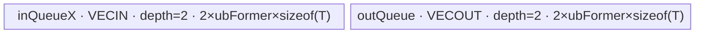

# InplaceHardtanh 950 ACLNN 算子知识

## 算子速览

| 项目 | 内容 |
|---|---|
| 实际入口 | `aclnnInplaceHardtanhGetWorkspaceSize` + `aclnnInplaceHardtanh`，公开两段式 ACLNN，无独立版本后缀。 |
| 计算语义 | 对 `selfRef` 的每个逻辑元素执行 `min(max(x, clipValueMin), clipValueMax)`，最后把结果写回 `selfRef` 的原 view。 |
| 输入输出 | `selfRef` 为 1～8 维 ND、允许非连续；950 API dtype 为 FLOAT16/FLOAT/DOUBLE/INT8/UINT8/INT16/INT32/INT64/BFLOAT16；两个边界是 Host `aclScalar`，先转换成 `selfRef` dtype 的单元素 tensor。 |
| 执行类型 | R-001：单个算子自有 `AIV_VECTOR` 节点（entry 明确 `AIV_ONLY`，AIC 直接返回）；R-002：单个算子自有 `AICPU` 节点。两条路线前后都可能有框架 `Contiguous`/`ViewCopy` 节点。 |
| Kernel 路线 | R-001 `ASS AIV`：FLOAT16/FLOAT/BFLOAT16/INT32/INT64，key `2001100`；R-002 `AICPU scalar`：DOUBLE/INT8/UINT8/INT16。空 tensor 在 API Host 直接成功返回，不启动 Device。 |
| 核心资源 | R-001 使用 GM、两个 depth=2 的 `TQue`、标量寄存器和 AIV UB，算子 tiling workspace 固定 16 MiB 但 body 不读取；R-002 直接访问 AICPU tensor buffer，使用标量局部值和 `ParallelFor`，无 AIV UB。executor 还拥有中间输出与框架复制所需 workspace。 |
| 来源闭包 | `source_closed`：公开 ACLNN、参数检查、executor 图、AIV/AICPU selector、950 Host/Tiling/POD、AIV router/body、AICPU body/注册和构建接线均已闭合；`Contiguous`、`ViewCopy`、executor workspace 切片和 launcher bridge 是明确框架边界。 |
| 验证状态 | 已完成源码闭包检查；本次知识提取未执行编译、真机、数值或性能测试。 |

## 接口与语义

### 计算语义

令 `lo = clipValueMin`、`hi = clipValueMax`。第一段接口先要求 `lo <= hi`，然后为每个 `selfRef` 逻辑元素计算：

```text
z = max(x, lo)
y = min(z, hi)
selfRef[...] = y
```

原地语义不是让 `ClipByValueV2` 的 `x`/`y` GM 指针互为别名：`GetWorkspaceSizeCommon(selfRef, ..., selfRef, ...)` 先创建连续输入与独立的 `hardtanhResult`，再用框架 `ViewCopy(hardtanhResult, selfRef)` 写回原 view。这样非连续 `selfRef` 的存储映射由框架复制节点处理，算子自有 clamp kernel 始终面对连续中间 tensor。

浮点 AICPU `ClampScalar` 显式让 `x/lo/hi` 任一 NaN 时返回 quiet NaN；AIV `Maxs`/`Mins` 的 NaN lane 规则由 AscendC primitive 定义，固定仓未给出 primitive 内部实现，不能从本仓补写其逐 lane NaN 选择顺序。

### 输入、输出与属性

| 参数 | shape/layout | dtype | 约束、默认值与语义 |
|---|---|---|---|
| `selfRef` | 文档为 ND、rank 1～8；允许非连续 | FLOAT16、FLOAT、DOUBLE、INT8、UINT8、INT16、INT32、INT64、BFLOAT16 | 输入/输出同一 ACL tensor；实现执行 `OP_CHECK_MAX_DIM(..., 8)`，但未另写 rank 下限判断。空 tensor 直接返回。 |
| `clipValueMin` | Host `aclScalar`；Device 前转换为单元素 tensor | API 实现实际接受与 950 support list 相交的上述 9 种 dtype | 必须非空；其值不大于 `clipValueMax`。注释所称默认 `-1.0` 没有对应缺省参数，调用者仍必须传指针。 |
| `clipValueMax` | Host `aclScalar`；Device 前转换为单元素 tensor | 同上 | 必须非空。注释所称默认 `1.0` 没有对应缺省参数。 |
| `workspaceSize` | 标量输出 | `uint64_t*` | 返回整个 executor 图所需 Device workspace；空 tensor 为 0。 |
| `executor` | Host 对象 | `aclOpExecutor**` | 持有 `Contiguous → ClipByValueV2 → ViewCopy` 计算流程及临时 tensor 生命周期。 |
| 第二段 `workspace` | Device 地址 | `void*` | 用户按第一段返回值分配并保持到第二段完成。 |
| 第二段 `stream` | ACL runtime stream | `aclrtStream` | `CommonOpExecutorRun` 在该 stream 上执行 executor 图。 |

公开文档把 scalar dtype 还列出 BOOL，但固定实现 `CheckDtypeValid` 对 `min/max` 也应用不含 BOOL 的 `GetDtypeSupportList`，所以本卡按实现将 BOOL 标为不可达，而不推测隐式转换。

### 入口与版本

公开头文件只声明无版本后缀的 `aclnnInplaceHardtanhGetWorkspaceSize` 与 `aclnnInplaceHardtanh`；固定 commit 内没有 `V2/V3` 等更新入口，因此这是 950 实际可见的最新公开版本。原地入口复用 `GetWorkspaceSizeCommon`，但把 `selfRef` 同时作为逻辑输入与最终 `out`；这只复用实现，不把非原地 `aclnnHardtanh` 合并进本逻辑算子。

公开产品表同时列 A2、A3、Ascend 950 支持；本 commit 的 `ClipByValueV2` OpDef 只 `.AddConfig("ascend950", ...)`，模块只设置 `SUPPORT_COMPUTE_UNIT "ascend950"`/`SUPPORT_TILING_DIR "arch35"`，binary config 也只有 `ascend950`。因此本卡只覆盖 950；A2/A3 的公开支持事实存在，但其 Host/Tiling/Kernel 核心链在固定仓固定 commit 不可见，不能据文档单独发布无后缀实现卡。

## Host/Launcher 执行流程

### 参数校验与前处理

`aclnnInplaceHardtanhGetWorkspaceSize` 的顺序如下：

1. `L2_DFX_PHASE_1` 记录 `selfRef/min/max` 及原地输出。
2. `GetWorkspaceSizeCommon` 用 `CHECK_NOT_NULL` 检查 `selfRef`、两个 scalar 和逻辑输出 `selfRef`，随后 `CREATE_EXECUTOR()`。
3. `CheckParams` 选择 950/RegBase dtype 表，检查 `selfRef/min/max` dtype 是否支持、`selfRef` 与输出 dtype/shape 是否一致、rank 不超过 8、`min <= max`；FRACTAL_NZ 只告警，不在此处拒绝。
4. 空 tensor：写 `workspaceSize=0`、释放 executor 给调用者并成功返回，后续节点均不创建。
5. 非空：`l0op::Contiguous(selfRef)` 产生连续逻辑输入；两个 `ConvertToTensor(scalar, selfRef dtype)` 产生单元素、同 dtype 边界 tensor。
6. `l0op::ClipByValueV2` 按 `selfRef` dtype 选择 R-001 AICore 或 R-002 AICPU，分配独立 `hardtanhResult`。
7. `l0op::ViewCopy(hardtanhResult, selfRef)` 把连续结果按原 view 写回；任一 l0 返回空指针都以 `ACLNN_ERR_INNER_NULLPTR` 阻断。
8. `uniqueExecutor->GetWorkspaceSize()` 生成总大小并将 executor 交给调用者；第二段只调用 `CommonOpExecutorRun`。

### 参数、Workspace 与生命周期

`selfContiguous`、两个 scalar tensor、`hardtanhResult` 与 `viewCopyResult` 均由 `uniqueExecutor` 管理。R-001 的 `ClipByValueTilingSingleDim::GetWorkspaceSize` 固定请求 `16 * 1024 * 1024` 字节，但 `ClipByValueV2Ass::Init` 虽接收 `workspace` 参数，body 从不绑定或读写它；这 16 MiB 仍是 launcher ABI 的有效 workspace slice，不能擅自删掉。R-002 的 AICPU OpDef 通过 `ApplyMathAicpuDefaultCfg` 写入框架 metadata `opInfo.workspaceSize="100"`，其单位解释和实际 executor slice 布局在固定仓框架实现中不可见。

API 返回的是整个 executor 图的 `GetWorkspaceSize()`，不等同于单个 clamp 节点的上述数值；`Contiguous`、临时输出、`ViewCopy` 的 offset/extent/alignment 由外部 executor 框架规划，固定仓不可见。调用者拥有第二段传入 workspace，executor 拥有图与临时 tensor 描述；它们至少保持到 `CommonOpExecutorRun` 在给定 stream 完成。

### 启动图与失败传播

```text
aclnnInplaceHardtanhGetWorkspaceSize
  ├─ selfRef empty → workspaceSize=0 → success（无 Device 节点）
  └─ non-empty
      → [F-0] l0op::Contiguous(selfRef)              # 框架边界，可为无实际搬运快路
      → [K-1A] ClipByValueV2 AICore/AIV, R-001       # 或 [K-1B] AICPU, R-002
      → [F-2] l0op::ViewCopy(hardtanhResult,selfRef) # 框架边界，提交原地结果
      → executor.GetWorkspaceSize

aclnnInplaceHardtanh(workspace,size,executor,stream)
  → CommonOpExecutorRun(..., stream)
```

| 节点/边 | producer → consumer | 交接介质与范围 | ordering | owner/lifetime | 失败传播 |
|---|---|---|---|---|---|
| F-0 | `selfRef` → K-1 | `selfContiguous`，shape/dtype 与 `selfRef` 一致；精确 workspace slice 固定仓不可见 | 同一 executor、同一第二段 stream 的图顺序；内部 event 固定仓不可见 | executor 临时对象，至少活到 K-1 消费完成 | `Contiguous==nullptr` 阻断 K-1/F-2 |
| K-1A | AIV clamp → F-2 | 独立 `hardtanhResult` GM tensor，完整逻辑元素域；kernel tiling workspace 为 16 MiB、body 未使用 | launcher list 和 executor stream 顺序；AIV 节点内部 TPipe queue | executor 分配中间输出，活到 F-2 消费完成 | infer shape/launcher add 失败返回 nullptr，阻断 F-2 |
| K-1B | AICPU clamp → F-2 | 独立 `hardtanhResult` GM tensor，完整逻辑元素域；AICPU context/workspace slice 固定仓不可见 | launcher list 和 executor stream 顺序；AICPU 任务完成后 F-2 才可见 | executor 分配中间输出，活到 F-2 消费完成 | launcher add 或 CPU kernel 非 OK 阻断后续，框架错误映射不可见 |
| F-2 | `hardtanhResult` → `selfRef` | ViewCopy 按 `selfRef` 原 view/storage 写回；offset/stride 细节属于框架 | 同一 executor stream，位于 K-1 之后 | `selfRef` 由调用者拥有；写回完成后临时结果才可回收 | `ViewCopy==nullptr` 使第一段返回内部空指针错误 |

## Route 与参数设计

### 分核与资源计算

R-001 先由 `DimensionCollapse([x,min,max], y)` 合轴。公开 Hardtanh 的 `min/max` 均由 scalar 转成单元素 tensor，因此结果为一维 `x=[yDim]`、`min=[1]`、`max=[1]`、`y=[yDim]`，`isSigDim=true` 且 `isAss=true`。

设平台 AIV 核数为 `C`、UB 字节为 `U`、dtype 字节为 `S`。ASS 活跃数据节点数 `aliveNum=2`，double buffer 因子为 2：

```text
dbUbSize = U / 2
ubFormerBytes0 = floor((dbUbSize / aliveNum) / 128) * 128
ubFormer0 = ubFormerBytes0 / S
ubOuter = ceil(yDim / ubFormer)
ubTail = (yDim % ubFormer == 0 ? ubFormer : yDim % ubFormer)
blockFormer = ceil(ubOuter / C)
blockTail = (ubOuter % blockFormer == 0 ? blockFormer : ubOuter % blockFormer)
blockNum = ceil(ubOuter / blockFormer)
```

若 `blockNum < C/2` 且 `ubFormer*S*aliveNum > 8 KiB`，Host 把每 tile 缩向 `ceil((2*yDim/C)*S, 128)/S`，但不低于 `floor((8 KiB/aliveNum)/128)*128/S`，再重算核分配。`ubFormer==0`、`C==0` 或 `yDim==0` 使 tiling 失败；空 tensor 已在 ACLNN 层提前截断。

每核 GM 起点为 `blockIdx * blockFormer * ubFormer` 元素；普通核执行 `blockFormer` 个 tile，最后一个实际核执行 `blockTail` 个 tile，且只有其最后一个 tile 使用 `ubTail`。

### Route 选择

| 顺序 | Route | Key/模板 | 精确选择条件与优先级 | 不适用去向 |
|---:|---|---|---|---|
| 1 | R-001 ASS AIV | l0 `ClipByValueV2AiCore`；tiling priority 1；key `2001100`；`ClipByValueV2Ass<DTYPE_X>` | 非空且 `selfRef.dtype ∈ {FLOAT16,FLOAT,BFLOAT16,INT32,INT64}`；scalar 转 tensor 后四个合轴结果 rank 都为 1，且 `minDim==maxDim==1`，故 priority 1 `IsCapable()` 成功并选择 ASS | dtype 不在 AICore 表转 R-002；priority 1 的 shape/dtype/tiling 错误不是 tensor-broadcast fallback，按 registry 返回非 `GRAPH_PARAM_INVALID` 失败 |
| 2 | R-002 AICPU scalar | l0 `ClipByValueV2AiCpu`；`ClipByValueV2CpuKernel::Compute` → `DoCompute<T>` | 非空且 950 API dtype 属于 `{DOUBLE,INT8,UINT8,INT16}`；边界 tensor 均为单元素，因此 `is_scalar=true` | 不支持 dtype 在 API 参数检查阶段失败；AICPU context 检查失败返回 `KERNEL_STATUS_PARAM_INVALID` |

```text
if selfRef.IsEmpty():
    return success(workspaceSize=0)
if selfRef.dtype in {fp16, fp32, bf16, int32, int64}:
    # priority 数值越小越先尝试
    try ClipByValueTilingSingleDim(priority=1)
      collapsed ranks all 1 && minDim==1 && maxDim==1
      → key 2001100 → ClipByValueV2Ass<DTYPE_X> → R-001
else if selfRef.dtype in {double, int8, uint8, int16}:
    ADD_TO_LAUNCHER_LIST_AICPU → ClipByValueV2CpuKernel → R-002
else:
    ACLNN_ERR_PARAM_INVALID
```

### 模板/实现执行矩阵

| Route | key/selector | dtype/shape/platform 完整命中条件 | 执行拓扑与 Kernel 节点 | 实际模板/body | 内存与同步特征 | tail/fallback |
|---|---|---|---|---|---|---|
| R-001 ASS AIV | `IsAiCoreSupport` + priority 1 + `2001100` | 950；五种 AICore dtype；non-empty；scalar bounds；四个 collapse dims 都是一维 | 单个算子自有 AIV kernel；框架可能在前后运行 Contiguous/ViewCopy | `clip_by_value_v2` → `ClipByValueV2Ass<DTYPE_X>::Init/Process` | input/output Queue 各 depth=2；`minValue/maxValue` 标量；无显式 event；kernel workspace 参数未使用 | 最后实际核用 `blockTail`，其最后 tile 用 `ubTail`；unknown key entry 静默 return，但 Host 不生成 unknown key |
| R-002 AICPU scalar | `!IsAiCoreSupport` | 950；dtype 为 DOUBLE/INT8/UINT8/INT16；non-empty；min/max tensor 均单元素 | 单个算子自有 AICPU task；框架可能在前后运行 Contiguous/ViewCopy | `ClipByValueV2CpuKernel::Compute` → `DispatchByDtype` → `DoCompute<T>` → `KernelScalarBound<T>` | 直接读写 AICPU tensor buffers；每个 shard 预装两个 scalar；小数据串行，大数据 `ParallelFor` | `data_num==1` 单元素快路；否则区间 `[beg,end)` 天然保护尾部；CPU kernel 错误返回框架 |

### 隐藏性能 Guard

| Guard | Host/Tiling 条件 | Device/资源原因 | 影响 Route | 不满足时去向 | 源码符号 |
|---|---|---|---|---|---|
| AICore dtype | `CheckType(dtype,{fp16,fp32,int32,int64,bf16})` | 950 binary config 只为这五种 dtype 提供 AscendC binary | R-001 | R-002 AICPU | `op_api/clip_by_value.cpp::IsAiCoreSupport` |
| scalar ASS | collapse 后四个 dims 的 `.size()==1` 且 `minDim==maxDim==1` | ASS body 只从 `minGm[0]/maxGm[0]` 读标量，不实现 tensor broadcast | R-001 | 本 ACLNN 总满足；若复用 l0 输入改变则 priority 1 可能不 capable | `ClipByValueTilingSingleDim::DetermineSigDimMode` |
| UB 128B floor | `floor((U/2/aliveNum)/128)*128/S > 0` | depth=2 的输入/输出 Queue 都按 `ubFormer*S` 分配，完整 tile 用对齐 blockLen | R-001 | tiling `GRAPH_FAILED` | `CalcInitialUbParams` |
| 低利用率再切 tile | `blockNum<C/2 && ubFormer*S*aliveNum>8KiB` | 缩小 tile 以增加 `ubOuter/blockNum`，同时给每核至少 8 KiB 活跃数据预算 | R-001 | 条件不满足则保留初始 tile | `AdjustForLowUtilization` |
| 空域 | API `self->IsEmpty()` | Device `Process` 总会执行至少一次最后 tile，不能接收 `yDim==0` | 两条 Route | Host workspace=0 并成功返回，无 kernel | `GetWorkspaceSizeCommon`; `CalcInitialUbParams` |
| AICPU 并行阈值 | `data_num*sizeof(T) < 200KiB` | 阈值以下直接调用 body；否则用 CPU 核数减保留 2 核后计算 shard | R-002 | 串行或 `ParallelFor` 二选一；并行失败返回 rc | `DispatchParallel` |

### POD/ABI

`ClipByValueSigDimTilingData` 的字段均以 `int64_t`、以下声明顺序通过 `TILING_DATA_FIELD_DEF` 生成。固定仓不含 `register/tilingdata_base.h` 的宏展开，因此精确 `sizeof/alignof/offsetof` 不可见；Host `SaveToBuffer` 与 Device `GET_TILING_DATA_WITH_STRUCT` 使用同一结构名和注册 key `ClipByValueV2_2001100`。

| 结构 | 字段 | 类型/位宽 | ABI 布局 | 单位 | Host/launcher producer | Device consumer | 边界 |
|---|---|---|---|---|---|---|---|
| `ClipByValueSigDimTilingData` | `blockNum` | `int64_t`/64 | 声明序 0；精确 offset/总大小固定仓不可见 | AIV core 数 | `DoOpTiling: set_blockNum(ceil(ubOuter/blockFormer))` | `Init` 的越界 guard、末核判断 | `1..C`；空域不进入 tiling |
| 同上 | `ubFormer` | `int64_t`/64 | 声明序 1；精确 offset 不可见 | 元素/tile | `CalcInitialUbParams`，可被 `AdjustForLowUtilization` 缩小 | Queue 容量、完整 tile len、GM tile 步长 | `ubFormer*S` 为 128B 倍数；必须非 0 |
| 同上 | `ubTail` | `int64_t`/64 | 声明序 2；精确 offset 不可见 | 元素 | `yDim % ubFormer`，整除时取 `ubFormer` | 最后实际核最后 tile 的 copy/compute len | `1..ubFormer` |
| 同上 | `blockFormer` | `int64_t`/64 | 声明序 3；精确 offset 不可见 | tile/core | `ceil(ubOuter/C)` | 普通核循环数；所有核 GM base 公式 | 必须非 0 |
| 同上 | `blockTail` | `int64_t`/64 | 声明序 4；精确 offset 不可见 | tile | `ubOuter % blockFormer`，整除时取 `blockFormer` | 最后实际核循环数 | `1..blockFormer` |
| 同上 | `xDim` | `int64_t`/64 | 声明序 5；精确 offset 不可见 | 元素 | collapse 后 `dims[X][0]` | `Init` 读入成员 `xDim`，后续未消费 | 对 Hardtanh 等于 `yDim` |
| 同上 | `minDim` | `int64_t`/64 | 声明序 6；精确 offset 不可见 | 元素 | collapse 后 `dims[MIN][0]` | Device ASS body 不读取；Host 用其决定 `isAss` | 本 ACLNN 恒为 1 |
| 同上 | `maxDim` | `int64_t`/64 | 声明序 7；精确 offset 不可见 | 元素 | collapse 后 `dims[MAX][0]` | Device ASS body 不读取；Host 用其决定 `isAss` | 本 ACLNN 恒为 1 |
| 同上 | `yDim` | `int64_t`/64 | 声明序 8；精确 offset 不可见 | 元素 | collapse 后 `dims[Y][0]` | Device ASS body 不读取；Host 用于全部 tile/core 公式 | 非空 Route 必须大于 0 |
| AICPU framework context | N/A | N/A | 固定仓未公开 launcher 序列化 ABI | N/A | `ADD_TO_LAUNCHER_LIST_AICPU(OP_INPUT/OP_OUTPUT)` | `CpuKernelContext::Input/Output` | R-002 无算子自定义 tiling POD |

### Route 源码闭包

| Route | Key/selector | Host/Tiling producer | POD/参数 | Kernel entry/router 节点 | Kernel body/直接依赖 | 构建接线 |
|---|---|---|---|---|---|---|
| R-001 ASS AIV | `IsAiCoreSupport`; priority 1; `2001100` | `clip_by_value_v2_single_dim_tiling.cpp` 注册；共享 `ClipByValueTilingSingleDim::{GetShapeAttrsInfo,DoOpTiling,PostTiling}` | `ClipByValueSigDimTilingData` 九字段 | `op_kernel/clip_by_value_v2_apt.cpp::clip_by_value_v2` → `ClipByValueV2Ass<DTYPE_X>` | `op_kernel/arch35/clip_by_value_v2_ass.h` 全部方法；AscendC primitive 为框架边界 | `CMakeLists.txt` ascend950/arch35；`clip_by_value_v2_def.cpp`; ascend950 binary JSON 五种 dtype |
| R-002 AICPU scalar | `!IsAiCoreSupport`; AICPU launcher | `ClipByValueV2AiCpu` 产生 3 input/1 output context；无 Host tiling | 框架 `CpuKernelContext`，无自定义 POD | `REGISTER_CPU_KERNEL("ClipByValueV2", ClipByValueV2CpuKernel)` | `Compute → GetInputAndCheck → DispatchByDtype → DoCompute<T> → DispatchParallel/KernelScalarBound` | `clip_by_value_v2_aicpu_def.cpp`; `cmake/func.cmake` 扫描/编入 `*_aicpu.cpp` |

## Kernel 实现

### 公共执行流程

两条非空 Route 共用 API 图：连续化输入和 scalar→tensor 后，只启动一个算子自有 clamp 节点，产出独立连续 `hardtanhResult`，最后由框架 ViewCopy 写回 `selfRef`。R-001 与 R-002 互斥，不构成两个 clamp kernel 的串联；两者都没有跨 clamp kernel 的 workspace edge。R-001 由 AIV Queue 管线搬入/计算/搬出，R-002 在 AICPU 地址空间直接按区间读写。

### Route R-001：ASS AIV

#### 适用条件

##### 选择证据

| 层级 | 文件 | 符号 | 源码谓词/参数 | 结果/下一跳 |
|---|---|---|---|---|
| API | `op_api/aclnn_hardtanh.cpp` | `GetDtypeSupportList`, `GetWorkspaceSizeCommon` | 950 `IsRegBase` 使用含 BF16 的 9 dtype 表；非空后 scalar 转 `self` dtype | 进入 `l0op::ClipByValueV2` |
| l0 selector | `op_api/clip_by_value.cpp` | `IsAiCoreSupport` | dtype ∈ `{FLOAT16,FLOAT,INT32,INT64,BFLOAT16}` | `ClipByValueV2AiCore`；否则 R-002 |
| Tiling registry | `common/inc/op_host/math_tiling_templates_registry.h` | `TilingRegistry::DoTilingImpl` | `std::map` 从小 priority 遍历，非 `GRAPH_PARAM_INVALID` 即终止 | priority 1 先于 2、3 |
| Tiling | `conversion/clip_by_value/op_host/arch35/clip_by_value_single_dim_tiling.cpp` | `DetermineSigDimMode`, `GetTilingKey` | 四个 collapse dims rank 均 1，`minDim==maxDim==1` | `isSigDim/isAss=true`，key `2001100` |
| Router | `op_kernel/clip_by_value_v2_apt.cpp` | `clip_by_value_v2` | AIC core 直接 return；`TILING_KEY_IS(2001100)` | `ClipByValueV2Ass<DTYPE_X>::Init/Process` |

#### Device 数据流

##### 函数级调用链

```text
ClipByValueV2AiCore
  -> ADD_TO_LAUNCHER_LIST_AICORE(ClipByValueV2, x, minTensor, maxTensor, hardtanhResult)
    -> TilingForClipByValueV2
      -> TilingRegistry::DoTilingImpl
        -> ClipByValueTilingSingleDim::DoTiling(priority=1)
          -> DetermineSigDimMode → CalcInitialUbParams → CalcBlockParams
          -> [optional] AdjustForLowUtilization → PostTiling(key=2001100, blockDim=blockNum)
    -> clip_by_value_v2(x,min,max,y,workspace,tiling)
      -> ClipByValueV2Ass<DTYPE_X>::Init
      -> ClipByValueV2Ass<DTYPE_X>::Process
        -> CopyIn → Compute(Maxs, Mins) → CopyOut   # 每 tile
  -> framework ViewCopy(hardtanhResult,selfRef)
```

##### 源码等价伪码

```text
# 伪码；len/offset 单位为元素，DataCopy blockLen 单位为字节
if core_type == AIC: return
assert tiling_key == 2001100
b = GetBlockIdx()
if b >= blockNum: return

loops = (b == blockNum-1 ? blockTail : blockFormer)
lastLen = (b == blockNum-1 ? ubTail : ubFormer)
base = b * blockFormer * ubFormer
minValue = minGM[0]
maxValue = maxGM[0]
init inQueueX(depth=2, each=ubFormer*sizeof(T))
init outQueue(depth=2, each=ubFormer*sizeof(T))

for i in [0, loops):
    len = (i == loops-1 ? lastLen : ubFormer)
    gmOffset = i * ubFormer
    xLocal = inQueueX.alloc()
    DataCopyPad(xLocal, xGM[base+gmOffset], blockCount=1,
                blockLen=len*sizeof(T), srcStride=0,dstStride=0,noPad)
    inQueueX.enqueue(xLocal)

    xLocal = inQueueX.dequeue()
    yLocal = outQueue.alloc()
    Maxs(yLocal, xLocal, minValue, len)
    inQueueX.free(xLocal)
    Mins(yLocal, yLocal, maxValue, len)
    outQueue.enqueue(yLocal)

    yLocal = outQueue.dequeue()
    DataCopyPad(yGM[base+gmOffset], yLocal, blockCount=1,
                blockLen=len*sizeof(T), srcStride=0,dstStride=0)
    outQueue.free(yLocal)
```

#### 内存与数据搬运

##### 资源与搬运表

| 层级/缓冲区 | offset/地址公式 | extent/容量公式 | dtype/layout | producer | consumer | owner/lifetime | 对齐/复用 |
|---|---|---|---|---|---|---|---|
| GM `x` | `base + i*ubFormer` | 当前 `len` 元素；完整逻辑总量 `yDim` | `T`/连续 ND | framework Contiguous | `CopyIn` | executor 临时输入；到 kernel 完成 | full tile 为 128B 对齐长度；tail 用 `DataCopyPad` |
| GM `min/max` | 0 | 各 1 元素 | `T`/scalar tensor | `ConvertToTensor` | `Init::GetValue(0)` | executor；仅初始化读取 | 不搬入 Queue，值保存在成员标量 |
| `inQueueX` VECIN | Queue 管理 | `2 * ubFormer * sizeof(T)` | `T` | `CopyIn` | `Compute` | `TPipe`/当前 kernel；每 tile alloc→enqueue→dequeue→free | depth=2；释放后 slot 可覆盖 |
| `outQueue` VECOUT | Queue 管理 | `2 * ubFormer * sizeof(T)` | `T` | `Compute` | `CopyOut` | `TPipe`/当前 kernel；每 tile alloc→enqueue→dequeue→free | depth=2；`Mins` 原地覆盖 `Maxs` 结果 |
| GM `y` | `base + i*ubFormer` | 当前 `len` 元素；总量 `yDim` | `T`/连续 ND | `CopyOut` | framework ViewCopy | executor 中间结果；到 ViewCopy 完成 | tail 只提交 `len` 元素 |
| tiling workspace | launcher slice offset 固定仓不可见 | 16 MiB | opaque | Host tiling | body 无 consumer | executor/user workspace；节点结束后可复用 | ABI 保留，不能因未读而删参数 |
| 标量成员 | N/A | `2*sizeof(T)` 的逻辑值；寄存器物理分配固定仓不可见 | `T` | `minGm/maxGm.GetValue(0)` | 每 tile `Maxs/Mins` | kernel instance | 跨所有 tile 复用，不再读 GM scalar |

##### 分层内存布局



##### 字节账与复用顺序

```text
inQueueX = 2 * ubFormer * sizeof(T)
outQueue = 2 * ubFormer * sizeof(T)
UB_total = 4 * ubFormer * sizeof(T)

ubFormer = floor(((UB_size / 2) / aliveNum=2) / 128) * 128 / sizeof(T)
=> UB_total <= UB_size（128B floor 只会留下余量；低利用率调整只会缩小 ubFormer）

dynamic_ub = N/A（AIV TPipe 静态 Queue 分配）
workspace_total(node) = 16 * 1024 * 1024 bytes（body 不读）
workspace_total(executor) = 固定仓框架规划，不可由节点值替代
```

| 复用子区 | 写入者 | 读取者/消费点 | 下一次覆盖 | 同步或释放依据 | 安全条件 |
|---|---|---|---|---|---|
| `inQueueX` slot | `CopyIn/DataCopyPad` | `Compute/Maxs` | `FreeTensor` 后后续 tile `AllocTensor` | `EnQue→DeQue→FreeTensor` | `Maxs` 已消费 `xLocal` 后才 free |
| `outQueue` slot | `Compute/Maxs` | 同一 `Compute/Mins`，随后 `CopyOut` | `CopyOut::FreeTensor` 后后续 tile | 同一 LocalTensor 先 `Maxs` 后 `Mins`，再 `EnQue→DeQue→FreeTensor` | 第二条指令以 `yLocal` 同时为 dst/src，不能在 `Mins` 前 enqueue/free |
| `minValue/maxValue` | `Init::GetValue(0)` | 所有 tile 的 `Maxs/Mins` | kernel 生命周期结束 | 单核成员值，不需要 Queue 复用 | scalar tensor 在 Init 读取时有效 |

#### 同步、精度与尾块

##### 同步与数值边界表

| 阶段 | primitive/机制 | producer | consumer/等待点 | 保护对象 | 精度/尾块 |
|---|---|---|---|---|---|
| GM→VECIN | `DataCopyPad` + `EnQue/DeQue` | MTE copy | Vector `Maxs` | 当前 `inQueueX` slot | `blockLen=len*S` 字节；full tile 对齐，tail 可非对齐且 `isPad=false` |
| clamp 下界 | `Maxs(yLocal,xLocal,minValue,len)` | VECIN tensor + scalar | 后续 `Mins` | 前 `len` 个 lane | 全程 dtype `T`，无显式升/降精度或 round |
| clamp 上界 | `Mins(yLocal,yLocal,maxValue,len)` | `Maxs` 结果 | `EnQue`/CopyOut | 同一 `yLocal` | 原地覆盖中间；无效 lane 不在 `len` 范围 |
| VECOUT→GM | `EnQue/DeQue` + `DataCopyPad` | Vector result | GM `y` | 当前 `outQueue` slot | 只写 `len` 元素；最后实际核最后 tile 使用 `ubTail` |
| 核间 | 无 atomic/barrier | 各 block 独立 GM 分片 | framework kernel completion | 不重叠 GM 区间 | `base=b*blockFormer*ubFormer`，末核/末 tile 封闭总域 |

#### 关键实现

##### 符号证据表

| 阶段 | 文件 | 符号/模板实例 | 实现事实 |
|---|---|---|---|
| Host/Tiling producer | `conversion/clip_by_value/op_host/arch35/clip_by_value_single_dim_tiling.cpp` | `DetermineSigDimMode`, `CalcInitialUbParams`, `CalcBlockParams`, `PostTiling` | scalar ASS 判定、UB/core/tail 公式、key/blockDim/workspace 写入 |
| Kernel entry/router | `conversion/clip_by_value_v2/op_kernel/clip_by_value_v2_apt.cpp` | `clip_by_value_v2`, `ClipByValueV2Ass<DTYPE_X>` | AIC return、AIV_ONLY、key 2001100 到 body 映射 |
| Device body/helper | `conversion/clip_by_value_v2/op_kernel/arch35/clip_by_value_v2_ass.h` | `Init`, `Process`, `CopyIn`, `Compute`, `CopyOut` | 核/tile 地址、depth=2 Queue、scalar preload、Maxs→Mins、DataCopyPad tail |

### Route R-002：AICPU scalar

#### 适用条件

##### 选择证据

| 层级 | 文件 | 符号 | 源码谓词/参数 | 结果/下一跳 |
|---|---|---|---|---|
| API | `op_api/aclnn_hardtanh.cpp` | `GetDtypeSupportList`, `ConvertToTensor` | 950 API 允许 DOUBLE/INT8/UINT8/INT16，两个 scalar 转成 self dtype 单元素 tensor | 进入 l0 selector |
| l0 selector | `op_api/clip_by_value.cpp` | `ClipByValueV2` | `IsAiCoreSupport(self)==false` | `ClipByValueV2AiCpu` + AICPU launcher |
| AICPU entry | `op_kernel_aicpu/clip_by_value_v2_aicpu.cpp` | `ClipByValueV2CpuKernel::Compute` | 3 input/1 output 正常、x/y 元素数相同、min/max 都是 scalar | `DispatchByDtype` |
| dtype router | 同上 | `DispatchByDtype` | DOUBLE→`double`，INT8→`int8_t`，INT16→`int16_t`，UINT8→`uint8_t` | `DoCompute<T>`；其它本 ACLNN 不可达 |
| scalar selector | 同上 | `DoCompute<T>` | `Input(1)->NumElements()==1`；Hardtanh 的 max 也为 scalar且前置检查成对确认 | 单元素快路或 `KernelScalarBound` |

#### Device 数据流

##### 函数级调用链

```text
ClipByValueV2AiCpu
  -> ADD_TO_LAUNCHER_LIST_AICPU(ClipByValueV2, x, minTensor, maxTensor, hardtanhResult)
    -> REGISTER_CPU_KERNEL("ClipByValueV2", ClipByValueV2CpuKernel)
      -> ClipByValueV2CpuKernel::Compute(ctx)
        -> NormalCheck → GetInputAndCheck
        -> DispatchByDtype(ctx, dtype)
          -> DoCompute<T>
            ├─ data_num==1 → ClampScalar<T>(x[0],min[0],max[0])
            └─ scalar bounds
               → preload mn_v/mx_v
               → DispatchParallel(total, sizeof(T), 200KiB)
                 ├─ serial body(0,total)
                 └─ CpuKernelUtils::ParallelFor → KernelScalarBound<T>(beg,end)
  -> framework ViewCopy(hardtanhResult,selfRef)
```

##### 源码等价伪码

```text
# 伪码；AICPU 直接访问 tensor data，无 AIV UB/tiling POD
check input_count=3, output_count=1
if x.numel == 0: return OK       # ACLNN 已更早截断，防御分支仍存在
check all internal dtypes equal
check y.numel == x.numel
check min.numel==1 && max.numel==1
T = route(dtype)                 # double/int8_t/int16_t/uint8_t

if x.numel == 1:
    y[0] = ClampScalar(x[0], min[0], max[0])
    return OK

mn_v = min[0]; mx_v = max[0]
body(b,e):
    for i in [b,e):
        y[i] = ClampScalar(x[i], mn_v, mx_v)

totalBytes = x.numel * sizeof(T)
if totalBytes < 200*1024:
    body(0,x.numel)
else:
    cpu_num = GetCPUNum(ctx)
    cores = max(1, max(cpu_num,2)-2)
    per_unit = ceil(x.numel / cores)
    ParallelFor(ctx, x.numel, per_unit*sizeof(T), body)
```

#### 内存与数据搬运

##### 资源与搬运表

| 层级/缓冲区 | offset/地址公式 | extent/容量公式 | dtype/layout | producer | consumer | owner/lifetime | 对齐/复用 |
|---|---|---|---|---|---|---|---|
| AICPU `x_ptr` | `i*sizeof(T)` | `data_num*sizeof(T)` | `T`/连续逻辑数组 | framework context | `KernelScalarBound` | executor 输入，任务期间有效 | 每 shard 访问不重叠 `[beg,end)` |
| AICPU `mn_ptr/mx_ptr` | 0 | 各 `sizeof(T)` | `T`/scalar | `ConvertToTensor`/context | `DoCompute` 预装 | executor，任务期间有效 | 每个 task/shard 复用局部值 |
| AICPU `y_ptr` | `i*sizeof(T)` | `data_num*sizeof(T)` | `T`/连续逻辑数组 | `KernelScalarBound` | framework ViewCopy | executor 中间输出，到 ViewCopy 完成 | shard 写区间互不重叠 |
| AICPU 局部 | N/A | `mn_v`, `mx_v` 和循环标量；物理栈/寄存器字节固定仓不可见 | `T` | `DoCompute` | lambda/body | task/shard 生命周期 | 避免逐元素重读 bounds |
| AICPU framework workspace | offset 固定仓不可见 | OpDef metadata `workspaceSize="100"`；实际 executor slice 固定仓不可见 | opaque | AICPU framework | framework | executor/user workspace | body 不直接解析 workspace |

##### 分层内存布局

N/A：R-002 不使用 AIV UB、`TQue` 或 `TBuf`。实际路径是 AICPU context tensor buffer 加每个串行/并行 shard 的局部 scalar；其物理栈和寄存器布局固定仓不可见。

##### 字节账与复用顺序

```text
UB_total = N/A（AICPU）
dynamic_ub = N/A（AICPU）
AICPU logical tensor bytes = (x + y) * data_num * sizeof(T) + 2 * sizeof(T)
workspace metadata = "100"（框架定义的单位/切片解释固定仓不可见）
executor workspace_total = GetWorkspaceSize() 统一规划，固定仓不可见
```

| 复用子区 | 写入者 | 读取者/消费点 | 下一次覆盖 | 同步或释放依据 | 安全条件 |
|---|---|---|---|---|---|
| `mn_v/mx_v` 局部值 | `DoCompute` 从 scalar tensor 读取 | shard 的全部 `ClampScalar` | task/shard 结束 | C++ 值捕获 | min/max tensor 在预装时有效；值按 T 固化 |
| `y_ptr[beg:end)` | 当前 serial body 或 ParallelFor shard | 后续 framework ViewCopy | ViewCopy 完成后中间 tensor可回收 | `ParallelFor` 返回和 AICPU task completion | shard 区间不重叠，ViewCopy 不得早于 task 完成 |

#### 同步、精度与尾块

##### 同步与数值边界表

| 阶段 | primitive/机制 | producer | consumer/等待点 | 保护对象 | 精度/尾块 |
|---|---|---|---|---|---|
| scalar preload | C++ local/capture | `mn_ptr[0]/mx_ptr[0]` | 每个 body invocation | 两个 bounds | DOUBLE 保持 double；整数保持本 dtype，无 cast |
| clamp | `ClampScalar<T>` | x 与两个 local bounds | y store | 单元素 | double 的任一 NaN 返回 quiet NaN；整数为 `min(max())` |
| shard 并行 | `CpuKernelUtils::ParallelFor` | 多个 `[beg,end)` body | `ParallelFor` 返回/任务完成 | y 的不重叠区间 | `end` 为排他上界，任意余数由最后 shard 范围覆盖，无 padding |
| 图间可见性 | AICPU task completion + executor stream | K-1B | framework ViewCopy | 完整 `hardtanhResult` | 具体 event/stream bridge 固定仓不可见，不可只凭 Host 书写顺序自行重排 |

#### 关键实现

##### 符号证据表

| 阶段 | 文件 | 符号/模板实例 | 实现事实 |
|---|---|---|---|
| Host/launcher producer | `conversion/clip_by_value_v2/op_api/clip_by_value.cpp` | `ClipByValueV2AiCpu`, `ClipByValueV2` | 非 AICore dtype 的 AICPU task 创建与输入/输出参数顺序 |
| Kernel entry/router | `conversion/clip_by_value_v2/op_kernel_aicpu/clip_by_value_v2_aicpu.cpp` | `REGISTER_CPU_KERNEL`, `Compute`, `DispatchByDtype` | entry 注册、context 检查和 dtype 到 C++ 模板映射 |
| Device body/helper | 同上 | `DoCompute<T>`, `DispatchParallel`, `KernelScalarBound<T>`, `ClampScalar<T>` | scalar 快路、串并行阈值、区间循环和 NaN/整数 clamp 语义 |

## 算子特定优化

### Trick T-001：ASS 标量只从 GM 读取一次并与双缓冲 tile 共存

#### 触发与源码依据

- 适用 Route：R-001。
- 触发条件：collapse 后 `minDim==1 && maxDim==1`，key `2001100`。
- Golden 来源：[`conversion/clip_by_value_v2/op_kernel/arch35/clip_by_value_v2_ass.h:90-94`](../../../../../../../cann-ops-raw/ascendc/ops-math/165d41f02a43a62324b434cb6bda7c533b14da3e/conversion/clip_by_value_v2/op_kernel/arch35/clip_by_value_v2_ass.h#L90-L94)

**官方源码（固定 Commit 连续逐字摘录）**：

```cpp
    minValue = minGm.GetValue(0);
    maxValue = maxGm.GetValue(0);

    pipe->InitBuffer(inQueueX, bufferNum, tilingData->ubFormer * sizeof(T));
    pipe->InitBuffer(outQueue, bufferNum, tilingData->ubFormer * sizeof(T));
```

#### 机制与设计原因

两个边界在每核 `Init` 时各从 GM 取一次，所有 tile 的 `Maxs/Mins` 都复用成员标量，而不是为每个 tile 建边界 Queue 或重复 DMA；输入和输出各用 `bufferNum=2` 的 Queue。Host 的 ASS `aliveNum=2` 与 Device 的两种 Queue 对应，结合 double buffer 后形成 `4*ubFormer*sizeof(T)` 的完整 UB 账。

#### 迁移边界

- 适用：两个边界对全 tensor 都是 scalar 的逐元素 clamp。
- 前提：950 AIV；key `2001100`；边界已转换成与 x 相同的 `T`；每核初始化时 scalar GM 有效。
- 失效：边界为逐元素/广播 tensor 时不能只读 `[0]`，必须切到共享 ClipByValueV2 的其它实现；这些 tensor 语义不是本 ACLNN Route。
- 未验证：本次知识提取未执行编译、真机、数值或性能测试。

#### 错误做法

把 tensor 边界误送入 ASS 会让所有元素错误复用 `min[0]/max[0]`；Host 用 `minDim==maxDim==1` 这一真实 guard 防止该错误。

### Trick T-002：同一输出 LocalTensor 原地完成 Maxs→Mins

#### 触发与源码依据

- 适用 Route：R-001。
- 触发条件：每个 ASS tile 的有效 `len`。
- Golden 来源：[`conversion/clip_by_value_v2/op_kernel/arch35/clip_by_value_v2_ass.h:117-122`](../../../../../../../cann-ops-raw/ascendc/ops-math/165d41f02a43a62324b434cb6bda7c533b14da3e/conversion/clip_by_value_v2/op_kernel/arch35/clip_by_value_v2_ass.h#L117-L122)

**官方源码（固定 Commit 连续逐字摘录）**：

```cpp
    auto xLocal = inQueueX.template DeQue<T>();
    auto yLocal = outQueue.template AllocTensor<T>();
    Maxs(yLocal, xLocal, minValue, len);
    inQueueX.FreeTensor(xLocal);
    Mins(yLocal, yLocal, maxValue, len);
    outQueue.EnQue(yLocal);
```

#### 机制与设计原因

下界截断直接写最终输出 Queue 的 LocalTensor，上界截断再以同一 `yLocal` 为 dst/src 原地覆盖，因而没有第三个中间 `TBuf/Queue`。`len` 同时传给两条 Vector primitive，tail 无效 lane 不进入数学结果；输入在 `Maxs` 消费后即可释放。

#### 迁移边界

- 适用：可按 `min(max(x,lo),hi)` 顺序原地覆盖中间结果的逐元素算子。
- 前提：`Mins` 支持 dst/src alias；两步使用相同 dtype 与有效长度；第二步完成前不能 enqueue/free `yLocal`。
- 失效：若后续仍需原始 `Maxs` 结果、两步 dtype 不同或 primitive 不允许 alias，就必须独立中间 buffer。
- 未验证：本次知识提取未执行编译、真机、数值或性能测试。

#### 错误做法

在 `Mins` 前释放或入队 `yLocal` 会破坏同一物理子区的读写生命周期；源码把 `EnQue` 放在两条 Vector 指令之后。

### Trick T-003：AICPU scalar shard 预装边界并按字节阈值避开小任务并行

#### 触发与源码依据

- 适用 Route：R-002。
- 触发条件：`is_scalar=true` 且 `data_num>1`。
- Golden 来源：[`conversion/clip_by_value_v2/op_kernel_aicpu/clip_by_value_v2_aicpu.cpp:163-172`](../../../../../../../cann-ops-raw/ascendc/ops-math/165d41f02a43a62324b434cb6bda7c533b14da3e/conversion/clip_by_value_v2/op_kernel_aicpu/clip_by_value_v2_aicpu.cpp#L163-L172)

**官方源码（固定 Commit 连续逐字摘录）**：

```cpp
    constexpr int64_t elem_bytes = static_cast<int64_t>(sizeof(T));

    if (is_scalar) {
        // Specialized branch: min/max broadcast; preload the scalars into local registers.
        const T mn_v = mn_ptr[0];
        const T mx_v = mx_ptr[0];
        auto body = [x_ptr, y_ptr, mn_v, mx_v](int64_t b, int64_t e) {
            KernelScalarBound<T>(x_ptr, y_ptr, b, e, mn_v, mx_v);
        };
        return DispatchParallel(ctx, "real-scalar", data_num, elem_bytes, kParallelBytesThresh, body);
```

#### 机制与设计原因

lambda 以值捕获两个 scalar，使每个 shard 的元素循环只访问 x/y；`DispatchParallel` 用 `data_num*sizeof(T)` 与 200 KiB 比较，小任务直接串行，大任务才计算 CPU shard。这个选择改变了边界搬运次数和调度路径，但固定仓没有真机收益数值。

#### 迁移边界

- 适用：AICPU 上两个只读 scalar 控制大量独立元素的逐元素运算。
- 前提：bounds 在整个任务中不变；输出元素互不依赖；`ParallelFor` 区间不重叠。
- 失效：逐元素 bounds 必须使用 `KernelElemBound`；跨元素依赖需要额外同步或不能分 shard。
- 未验证：本次知识提取未执行编译、真机、数值或性能测试。

#### 错误做法

固定仓提供的反例边界是非 scalar bounds：这时源码不做预装，而改用 `KernelElemBound` 按 `mn[i]/mx[i]` 读取；本 ACLNN 因 scalar API 不会到达该分支。

## 模板与实现对比

| 对比维度 | R-001 ASS AIV | R-002 AICPU scalar | 设计选择依据 |
|---|---|---|---|
| 命中条件/优先级 | 五种 AICore dtype；tiling priority 1；scalar ASS | 四种 API dtype 不在 AICore 表 | l0 先按 dtype 决定执行后端；只有 AIV 进入 tiling registry |
| 模板与 dtype | `ClipByValueV2Ass<DTYPE_X>`；fp16/fp32/bf16/i32/i64 | `DoCompute<double/int8_t/int16_t/uint8_t>` | 950 binary config 与 l0 selector共同限制 AIV dtype |
| 循环与分核 | AIV block→tile；Host former/tail core | AICPU `[beg,end)`；200KiB 下串行、否则 `ParallelFor` | 分别使用 AIV 核与 AICPU CPU 核调度模型 |
| Queue/TBuf/寄存器/dynamic UB/通信 window | input/output Queue 各 depth=2；两个 scalar 成员；无 dynamic UB | 无 AIV Queue/UB；两个 local scalar | 两个执行族的本地存储体系不同 |
| 内存总占用与复用 | `4*ubFormer*sizeof(T)` UB；`yLocal` 原地 Maxs→Mins | tensor buffer 直接访问；scalar 捕获复用 | AIV 以 tile 搬运，AICPU 以指针区间访问 |
| 搬运/Vector/SIMT/NDDMA/通信 API | `DataCopyPad`, `Maxs`, `Mins`；无 SIMT/NDDMA/通信 | C++ load/store, `std::min/max`, `ParallelFor` | 均无 Cube/AIC/MIX_CV 节点 |
| 同步、精度与 tail | TPipe Queue；同 dtype 两步；`ubTail` | shard completion；double NaN 显式；区间 end 保护尾部 | 各 Route 保留自身数值与尾部语义 |
| fallback/失败边界 | UB/core/yDim 失败即 tiling 失败；unknown key entry return | context/dtype/ParallelFor 错误返回 rc | l0 dtype selector是唯一后端 fallback，tiling 内不跨到 AICPU |

## 平台差异

| 项目 | A2 | A3 | 950 |
|---|---|---|---|
| 支持状态 | 公开 ACLNN 文档标支持；固定 commit 无 A2 OpDef/config/Host/Kernel 核心链，未建卡 | 公开 ACLNN 文档标支持；固定 commit 无 A3 OpDef/config/Host/Kernel 核心链，未建卡 | 文档支持，且 ascend950 OpDef、CMake、binary、arch35 Host/Kernel 全链闭合 |
| Host/Launcher | 固定仓不可见 | 固定仓不可见 | AIV ASS + AICPU scalar 两条 Route，共用 executor/Contiguous/ViewCopy |
| Kernel/资源 | 固定仓不可见 | 固定仓不可见 | AIV_ONLY 双 Queue/Maxs→Mins；AICPU serial/ParallelFor；无 Cube/MIX_CV |

## 限制与失败边界

- `selfRef/min/max` 任一空指针、dtype 不在 950 实现表、rank 超过 8 或 `min>max` 都在第一段失败；empty tensor 是 workspace=0 的成功快路。
- 文档列 scalar BOOL，但实现 support list 不含 BOOL；本卡不把 BOOL 推测为可转换成功。
- FLOAT16/BFLOAT16/FLOAT/INT32/INT64 走 R-001；DOUBLE/INT8/UINT8/INT16 走 R-002。不得把 AICPU route 的 body、NaN 规则或 workspace metadata套到 AIV route。
- 原地结果必须经过 executor 的 `ViewCopy` 回写；直接让 clamp kernel 的 `x` 和 `y` 指向同一 storage 会改变源码拥有的中间 tensor/非连续 view 生命周期，固定实现没有授权这种替换。
- AIV POD 宏展开的精确 `sizeof/alignof/offsetof`、executor 总 workspace 的 slice offset/alignment、`Contiguous/ViewCopy` 的内部 Kernel、AICPU launcher context ABI 和跨 AICPU/AIV 到 ViewCopy 的具体 event 实现在固定仓不可见。
- A2/A3 虽有公开支持表，但本 commit 未提供其核心实现接线，故未生成 `inplace_hardtanh.md`；不能用 950 `arch35/ascend950` 路径外推。
- 本次知识提取未执行编译、真机、数值或性能测试。

## 源码索引

### 链路索引

| 链路阶段 | 文件 | 关键符号 | 支撑内容 |
|---|---|---|---|
| 入口声明/约束 | `conversion/clip_by_value_v2/docs/aclnnHardtanh&aclnnInplaceHardtanh.md` | 产品支持表、`aclnnInplaceHardtanh*` | A2/A3/950 公开性、接口语义、参数与错误 |
| 入口声明/约束 | `conversion/clip_by_value_v2/op_api/aclnn_hardtanh.h` | `aclnnInplaceHardtanhGetWorkspaceSize`, `aclnnInplaceHardtanh` | 两段式 ABI |
| 入口实现 | `conversion/clip_by_value_v2/op_api/aclnn_hardtanh.cpp` | `CheckParams`, `GetWorkspaceSizeCommon`, 两段式入口 | 参数检查、empty、Contiguous/scalar conversion/ClipByValueV2/ViewCopy、executor |
| 入口实现 | `conversion/clip_by_value_v2/op_api/clip_by_value.cpp` | `IsAiCoreSupport`, `ClipByValueV2AiCore`, `ClipByValueV2AiCpu`, `ClipByValueV2` | AIV/AICPU dtype selector和 launcher |
| Host/Tiling/Launcher | `conversion/clip_by_value_v2/op_host/clip_by_value_v2_def.cpp` | `ops::ClipByValueV2` | 五种 AICore dtype 和 ascend950 config |
| Host/Tiling/Launcher | `conversion/clip_by_value_v2/op_host/arch35/clip_by_value_v2_tiling.cpp` | `TilingForClipByValueV2`, `TilingPrepareForClipByValueV2` | AIV core/UB producer和 registry入口 |
| Host/Tiling/Launcher | `conversion/clip_by_value_v2/op_host/arch35/clip_by_value_v2_single_dim_tiling.cpp` | priority 1 registration | V2 到共享 single-dim tiling 类接线 |
| Host/Tiling/Launcher | `conversion/clip_by_value/op_host/arch35/clip_by_value_single_dim_tiling.h` | `ClipByValueSigDimTilingData`, `ClipByValueTilingSingleDim` | POD 字段与类接口 |
| Host/Tiling/Launcher | `conversion/clip_by_value/op_host/arch35/clip_by_value_single_dim_tiling.cpp` | `DetermineSigDimMode`, `DoOpTiling`, `PostTiling` | ASS 条件、tile/core/workspace/key公式 |
| Host/Tiling/Launcher | `common/inc/op_host/math_tiling_templates_registry.h` | `TilingRegistry::DoTilingImpl` | priority 从小到大与失败/fallthrough语义 |
| Kernel entry/body | `conversion/clip_by_value_v2/op_kernel/clip_by_value_v2_apt.cpp` | `clip_by_value_v2` | AIV_ONLY、AIC return、key router |
| Kernel entry/body | `conversion/clip_by_value_v2/op_kernel/arch35/clip_by_value_v2_ass.h` | `ClipByValueV2Ass` | AIV ASS 完整 body |
| Kernel entry/body | `conversion/clip_by_value_v2/op_kernel_aicpu/clip_by_value_v2_aicpu.cpp` | `ClipByValueV2CpuKernel`, helpers | AICPU scalar body、并行、dtype和注册 |
| 构建接线 | `conversion/clip_by_value_v2/op_kernel_aicpu/clip_by_value_v2_aicpu_def.cpp` | `ApplyMathAicpuDefaultCfg`, AICPU config | AICPU dtype/so/workspace metadata |
| 构建接线 | `conversion/clip_by_value_v2/op_host/config/ascend950/clip_by_value_v2_binary.json` | 五个 `bin_filename` 条目 | 950 AICore binary dtype实例 |
| 构建接线 | `conversion/clip_by_value_v2/CMakeLists.txt` | `SUPPORT_COMPUTE_UNIT`, `SUPPORT_TILING_DIR` | 仅 ascend950/arch35 模块接线 |
| 构建接线 | `cmake/func.cmake` | `add_all_modules_sources` 内的 op_api/tiling/AICPU glob | ACLNN、Host/Tiling 与 AICPU source的实际收集 |

每行只写一个文件，并确保该文件存在于 Frontmatter `sources`。

### 实现复用检查

| 检查项 | 可复用事实 | 不得改变的约束 | 源码符号 |
|---|---|---|---|
| ABI/POD | ASS 可复用九个 `int64_t` 字段及 key `2001100` | 字段声明顺序、元素单位、Host/Device 同一生成结构；精确宏布局不可擅自猜测 | `ClipByValueSigDimTilingData`; `ClipByValueV2_2001100` |
| 调用顺序 | `Contiguous → scalar conversion → ClipByValueV2 → ViewCopy` | 原地输出必须在 clamp 中间结果完成后回写；empty 不创建节点 | `GetWorkspaceSizeCommon` |
| workspace/内存 | AIV UB 账与 16 MiB节点 workspace；AICPU context直接 buffer | executor 总 workspace 不得等同节点值；kernel 未读参数也不能删 ABI | `CalcInitialUbParams`; `GetWorkspaceSize`; `ApplyMathAicpuDefaultCfg` |
| 同步 | AIV `EnQue/DeQue/FreeTensor` 和 AICPU task completion模型 | `yLocal` 两步原地计算前不得释放；ViewCopy 不得越过 clamp完成点 | `ClipByValueV2Ass::Compute`; `DispatchParallel` |
| 精度与尾块 | AIV 同 dtype `Maxs→Mins` 与 `ubTail`；AICPU `ClampScalar` 与 `[beg,end)` | 不能混用两个执行族的 NaN规则；tail 只写有效长度 | `Process`; `ClampScalar`; `KernelScalarBound` |
| 失败边界 | API null/dtype/shape/minmax、tiling UB/core/yDim、AICPU context/ParallelFor错误 | priority 1 非 `GRAPH_PARAM_INVALID` 失败不会自动转 common tiling；A2/A3 不可由 950外推 | `CheckParams`; `DoTilingImpl`; `GetInputAndCheck` |

- [Maxs](../../../../apis/simd_api/basic_api/memory_vector_compute/basic_arithmetic/maxs.md)
- [Mins](../../../../apis/simd_api/basic_api/memory_vector_compute/basic_arithmetic/mins.md)
