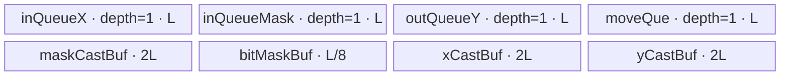

# MaskedSelect A2/A3 ACLNN 算子知识

## 算子速览

| 项目 | 内容 |
|---|---|
| 实际入口 | `aclnnMaskedSelectGetWorkspaceSize` + `aclnnMaskedSelect`，公开 ACLNN 两段式接口；内部主算子为 `MaskedSelectV3`。 |
| 计算语义 | 对广播后的 `self` 与布尔 `mask` 按展平顺序稳定筛选：`out = [self[i] \| mask[i] == true]`。 |
| 输入输出 | `self`/`mask` 为 ND、0～8 维且可广播；`mask` 接受 BOOL/UINT8，先转 BOOL；`out` 是容量等于广播后元素数的一维连续 Tensor，运行期有效长度等于 true 数。 |
| 执行类型 | 主节点 `masked_select_v3` 为 `AIV_VECTOR` 单 Kernel；不等 shape 时有外部 `BroadcastTo` 预处理节点，按 dtype 可为 AICORE 或 AICPU，`Contiguous/Cast` 属框架节点。主节点无 Cube/AIC/MIX_CV。 |
| Kernel 路线 | R-001 1-byte、R-002 2-byte、R-003 4-byte、R-004 8-byte；key 等于主计算 dtype 字节数。 |
| 核心资源 | 主节点使用 GM、单深度 `TQue/TQueBind`、`TBuf`、每核 64 B count header、按输入容量分片的压缩 workspace、`SyncAll`。 |
| 来源闭包 | `source_closed`：公开 ACLNN、前处理分发、AiCore launcher、Tiling/POD、四个宽度 router/body、workspace 交接及 A2/A3 构建接线闭合；框架 `Contiguous/Cast` 内部为允许的框架边界。 |
| 验证状态 | 已完成源码闭包检查；本次知识提取未执行编译、真机、数值或性能测试。 |

## 接口与语义

### 计算语义

令 `B = broadcast(self, mask)` 的展平元素数，API 先将 `self`、`mask` 物化为连续张量，将 `mask` 转为 BOOL，并将 `self` 转为 `out` dtype。主 Kernel 保持展平顺序，输出 `y[k] = cast(self[i_k], out.dtype)`，其中 `i_0 < i_1 < ...` 且 `mask[i_k] == 1`。`out` 的入参 shape 是 `[B]` 容量；`OP_OUTSHAPE` 关联的 shape tensor 在运行期刷新为 `[K]`，`K` 为被选元素数。

### 输入、输出与属性

| 参数 | shape/layout | dtype | 约束、默认值与语义 |
|---|---|---|---|
| `self` | ND，0～8 维；可非连续 | FLOAT32/FLOAT16/BFLOAT16/DOUBLE/INT8/INT16/INT32/INT64/UINT8/BOOL | 与 `mask` 可广播；A2/A3 的 `IsAiCoreSupport` 对上述公开 dtype 成立。源码未要求与 `out` dtype 相同，而是显式 Cast 到 `out` dtype。 |
| `mask` | ND，0～8 维；可非连续 | BOOL/UINT8 | UINT8 文档要求值只能为 0/1；进入主节点前 Cast 为 BOOL。 |
| `out` | ND，一维、连续；入参容量 `[B]` | 与 `self` 相同公开集合 | 元素数必须等于广播 shape size；运行期有效 shape 由 Kernel 的 `shapeout` 更新为 `[K]`。 |
| `workspaceSize` | 标量输出 | uint64 | executor 所有前处理节点与主节点 workspace 的框架汇总值。 |
| `executor` | Host 对象 | `aclOpExecutor**` | 第一段创建并移交，第二段在给定 stream 上执行。 |

### 入口与版本

公开文档只给出 `aclnnMaskedSelect` 版本族。A2/A3 产品表均为支持；API 在 `ASCEND910B..ASCEND910E` 上选择 `l0op::MaskedSelectV3`，而不是旧 `MaskedSelect` AICPU body。`MaskedSelectV3` OpDef、ascend910b/ascend910_93 binary config 与顶层 `SUPPORT_COMPUTE_UNIT` 同时接线，故本卡覆盖 A2/A3 的最新公开实现。旧 `MaskedSelect` 仅是非 AiCore 平台 fallback，不属于本卡 Route。

## Host/Launcher 执行流程

### 参数校验与前处理

`CheckParams` 顺序固定为：非空检查；按 SoC 选择 dtype 白名单并分别检查 `self/mask/out`；限制 `self/mask` 最大 8 维、验证广播、要求 `out` rank 为 1 且元素数等于广播容量。任一失败返回对应 ACLNN 错误。随后仅对非 ND storage format 打 warning。

若任一 `self/mask/out` 为空，第一段直接返回 workspace 0 和空任务 executor。非空路径按源码顺序加入：`Contiguous(self)`、`Contiguous(mask)`、`Cast(mask, BOOL)`、`Cast(self, out.dtype)`；当原始 shapes 不等时，再分别 `BroadcastTo(selfCasted, Bshape)` 与 `BroadcastTo(maskCasted, Bshape)`；最后加入 `MaskedSelectV3`。

`BroadcastTo` 直接依赖的 selector 已闭合：DAV_2201 上，BOOL/FLOAT/FLOAT16/INT32/INT64/UINT32/BFLOAT16/UINT8/INT8 走其 AICORE launcher，其他 dtype 走其 AICPU launcher。该节点只负责预广播，不参与稳定筛选和主 Kernel 的 Route/key。

### 参数、Workspace 与生命周期

第一段的 executor 持有连续化、Cast、可选 BroadcastTo 临时张量、主节点 out-shape tensor 和任务列表；`GetWorkspaceSize()` 返回聚合 workspace，第二段用户提供的内存在 `CommonOpExecutorRun` 生命周期内有效。各外部框架节点的 workspace slice offset/extent 由 executor 实现管理，固定仓未公开该分配器布局。

主节点 Tiling 的 user workspace 为 `align256(B*s) + N*64` 字节，其中 `s=sizeof(out.dtype)`、`N=blockDim`；其后再加 `GetLibApiWorkSpaceSize()` 得到该节点总 workspace。`GetUserWorkspace` 越过系统区后，前 `N*64` 字节是每核 count header，第二区是 `align256(B*s)` 的每核临时压缩区。workspace 由框架分配，Kernel 全程不释放。

### 启动图与失败传播

executor task graph 为同一 stream 上的有序序列：

```text
Contiguous(self) -> Contiguous(mask) -> Cast(mask->bool) -> Cast(self->out.dtype)
  -> [shape 不同: BroadcastTo(self), BroadcastTo(mask)]
  -> MaskedSelectV3(x, mask, y, shapeout, workspace, tiling)
```

`MaskedSelectV3` 是一个 Device 节点，Host 由 `MaskedSelectAiCore` 通过 `ADD_TO_LAUNCHER_LIST_AICORE` 添加，entry 为 `masked_select_v3`，blockDim 为 `N`，POD 为 `MaskedSelectV3TilingData`，输出除 `y` 外还通过 `OP_OUTSHAPE({outShapeTensor,0})` 交付运行期 shape。主节点内部先各核写 workspace，再 `SyncAll`，最后各核写最终 `y`；这是单 Kernel 内的两阶段 GM 交接，不是第二个 Kernel。launcher 添加失败会使 `MaskedSelectAiCore` 返回空，但 `aclnnMaskedSelectGetWorkspaceSize` 调用点未检查该返回值，这是固定源码中的失败传播缺口。

## Route 与参数设计

### 分核与资源计算

记 `s` 为工作 dtype 字节数，`A=256/s` 元素，`B_aligned=ceil(B/A)*A`。Tiling 从平台取 AIV 核数 `C`、UB 字节 `U` 和系统 workspace。按实际 UB 分配反推每元素因子：8-byte 为 `29.25` B/元素；4-byte 为 `15.125`；2-byte 为 `9.125`；1-byte 为 `10.125`。统一源码公式为：

```text
factor = 1 + 3*s + (s==8 ? 4 + 2/8 : 2 + 1/8) + (s==1 ? 4 : 0)
ubBlockNum = floor((U * 0.65 * s / factor) / 256)，若为奇数则减 1
L = ubBlockNum * (256/s)
ubNum = ceil(B_aligned / L)
N = min(ubNum, C)
```

前 `formerNum = B % N` 核处理 `ceil(B/N)` 元素；余核处理整除后的较短块。若余数为 0，`formerNum=N`。每组的 `tileNum=ceil(coreLength/L)`、正常 tile 长 `L`、末 tile 为余数（余数 0 时仍取 `L`）。Host 使用 uint64 计算，但 Kernel `Init` 参数为 uint32，存在显式实参窄化边界。

### Route 选择

| 顺序 | Route | Key/模板 | 精确选择条件与优先级 | 不适用去向 |
|---:|---|---|---|---|
| 1 | R-001 1-byte | key 1 / `KernelMaskedSelectV3<uint8_t>` | `sizeof(out.dtype)==1`；BOOL/INT8/UINT8 | 继续匹配 key 2 |
| 2 | R-002 2-byte | key 2 / `KernelMaskedSelectV3<uint16_t>` | `sizeof(out.dtype)==2`；FLOAT16/BFLOAT16/INT16 | 继续匹配 key 4 |
| 3 | R-003 4-byte | key 4 / `KernelMaskedSelectV3<uint32_t>` | `sizeof(out.dtype)==4`；FLOAT32/INT32 | 继续匹配 key 8 |
| 4 | R-004 8-byte | key 8 / `KernelMaskedSelectV3<uint64_t>` | `sizeof(out.dtype)==8`；DOUBLE/INT64 | 未知 key 时 entry 无 body、无显式错误 |

```text
s = dtype_size(MaskedSelectV3 输入 x)  # API 已把 self Cast 为 out.dtype
SetTilingKey(s)
entry: key==8 -> uint64; else key==4 -> uint32; else key==2 -> uint16; else key==1 -> uint8; else -> no-op
```

### 模板/实现执行矩阵

| Route | key/selector | dtype/shape/platform 完整命中条件 | 执行拓扑与 Kernel 节点 | 实际模板/body | 内存与同步特征 | tail/fallback |
|---|---|---|---|---|---|---|
| R-001 1-byte | 1 | 非空、A2/A3、out dtype 1 B、广播已物化 | 单 `masked_select_v3` | `KernelMaskedSelectV3<uint8_t>`；half Cast 后 GatherMask | 额外 x/y half TBuf；per-core workspace + `SyncAll` | tile tail 用有效 `length`; unknown key 无 fallback |
| R-002 2-byte | 2 | 同上，out dtype 2 B | 单 Kernel | `KernelMaskedSelectV3<uint16_t>` | half mask TBuf，uint16 bitmask view | 同上 |
| R-003 4-byte | 4 | 同上，out dtype 4 B | 单 Kernel | `KernelMaskedSelectV3<uint32_t>` | half mask TBuf，uint32 bitmask view | 同上 |
| R-004 8-byte | 8 | 同上，out dtype 8 B | 单 Kernel | `KernelMaskedSelectV3<uint64_t>`；以两个 int32 lane 搬运/收集 | 4L mask work TBuf，扩展双 lane bitmask | `rsvdCnt/2` 还原 64-bit 元素数 |

### 隐藏性能 Guard

| Guard | Host/Tiling 条件 | Device/资源原因 | 影响 Route | 不满足时去向 | 源码符号 |
|---|---|---|---|---|---|
| UB 65% 预算 | `ubBlockNum=floor(U*0.65*s/factor/256)` | 逐 Route Queue/TBuf 总量按 `factor*L` 分配 | 全部 | Tiling 未提供更小 fallback；若算得 0，后续除零风险 | `MaskedSelectV3Tiling::Init` |
| 偶数 block | `ubBlockNum` 为奇数时减 1 | Host 保守切分常量 `DOUBLE_BUFFER=2`，虽 Device `BUFFER_NUM=1` | 全部 | 使用减 1 后 L | `MaskedSelectV3Tiling::Init` |
| 256 B 对齐 | `A=256/s`, `B_aligned=ceil(B/A)*A` | workspace 容量与 tile 以 256 B block 计 | 全部 | 末 tile 用有效长度搬运 | `MaskedSelectV3Tiling::Init` |
| uint32 consumer | 10 个 uint64 POD 字段传入 `Init(uint32_t...)` | Device 地址/循环成员为 uint32 | 全部 | 无显式拒绝；超过 UINT32_MAX 会窄化 | `masked_select_v3` / `KernelMaskedSelectV3::Init` |
| 8-byte 双 lane | key 8 | GatherMask 以 int32 lane 工作，一个逻辑值占 2 lane | R-004 | 其他宽度走各自模板 | `GenerateMask`, `GatherResult`, `DataCopyPadDoubleWord` |
| 空输入 | 任一 tensor `IsEmpty()` | 不启动任何前处理或主 Kernel | 全部 | 成功返回 workspace 0 | `aclnnMaskedSelectGetWorkspaceSize` |

### POD/ABI

`MaskedSelectV3TilingData` 由仓外 `tilingdata_base.h` 宏生成序列化布局；固定仓可见每字段均为 uint64 且声明顺序如下，但宏展开后的 `sizeof/alignof/offsetof` 不可见。Device 读取 uint64 后传给 uint32 `Init`。

| 结构 | 字段 | 类型/位宽 | ABI 布局 | 单位 | Host/launcher producer | Device consumer | 边界 |
|---|---|---|---|---|---|---|---|
| `MaskedSelectV3TilingData` | `formerNum` | uint64/64 | 宏布局精确 offset 固定仓不可见 | core | `set_formerNum(B%N ? B%N : N)` | `Init` 大核数量 | 传入 uint32 |
| 同上 | `formerLength` | uint64/64 | 同上 | element/core | `ceil(B/N)` | 大核 GM base/extent | 传入 uint32 |
| 同上 | `formertileNum` | uint64/64 | 同上 | tile/core | `ceil(formerLength/L)` | 大核循环数 | 传入 uint32 |
| 同上 | `formertileLength` | uint64/64 | 同上 | element/tile | `L` | 大核 `tileLength` | 传入 uint32 |
| 同上 | `formerlasttileLength` | uint64/64 | 同上 | element | `formerLength%L`，0 改 L | 大核末 tile | 传入 uint32 |
| 同上 | `tailNum` | uint64/64 | 同上 | core | `N-formerNum` | 小核存在性 | 传入 uint32 |
| 同上 | `tailLength` | uint64/64 | 同上 | element/core | `(B-formerLength*formerNum)/tailNum`，仅 tail 存在 | 小核 GM base/extent | inactive 时 0；传入 uint32 |
| 同上 | `tailtileNum` | uint64/64 | 同上 | tile/core | `ceil(tailLength/L)` | 小核循环数 | inactive 时 0；传入 uint32 |
| 同上 | `tailtileLength` | uint64/64 | 同上 | element/tile | `L` | 小核 `tileLength` | inactive 时 0；传入 uint32 |
| 同上 | `taillasttileLength` | uint64/64 | 同上 | element | `tailLength%L`，0 改 L | 小核末 tile | inactive 时 0；传入 uint32 |

### Route 源码闭包

| Route | Key/selector | Host/Tiling producer | POD/参数 | Kernel entry/router 节点 | Kernel body/直接依赖 | 构建接线 |
|---|---|---|---|---|---|---|
| R-001 | 1 | `masked_select_v3_tiling.cpp::Init/RunKernelTiling` | `MaskedSelectV3TilingData` | `masked_select_v3.cpp::masked_select_v3` | `masked_select_v3.h::KernelMaskedSelectV3<uint8_t>` | CMake + ascend910b/ascend910_93 binary JSON |
| R-002 | 2 | 同上 | 同上 | 同上 | `KernelMaskedSelectV3<uint16_t>` | 同上 |
| R-003 | 4 | 同上 | 同上 | 同上 | `KernelMaskedSelectV3<uint32_t>` | 同上 |
| R-004 | 8 | 同上 | 同上 | 同上 | `KernelMaskedSelectV3<uint64_t>` + `DataCopyPadDoubleWord` | 同上 |

## Kernel 实现

### 公共执行流程

entry 解析同一 POD 和 user workspace，按 key 构造宽度模板。每核绑定原输入连续区及与其同 offset 的临时 workspace 区；tile 内 `CopyIn` 同时搬 x/mask，`GenerateMask` 产生 GatherMask 位掩码，`GatherResult` 稳定压缩，`CopyOut2WorkSpace` 把本核结果连续累积。各核把 count 写到相隔 64 B 的 header，清理 cache 后 `SyncAll`；核 `b` 累加所有前序核 count 得到最终输出前缀，分 tile 把临时结果搬到 `y[prefix]`。最后一核写 shapeout `{1,totalCount}`。

### Route R-001：1-byte half 中转筛选

#### 适用条件

##### 选择证据

| 层级 | 文件 | 符号 | 源码谓词/参数 | 结果/下一跳 |
|---|---|---|---|---|
| API | `op_api/aclnn_masked_select.cpp` | `CheckDtypeValid` / self Cast | out dtype 属 1 B 白名单 | 主节点 x dtype 为 out dtype |
| Tiling | `op_host/masked_select_v3_tiling.cpp` | `Init` | `sizeOfDataType=1`; key=1 | R-001 |
| Router | `op_kernel/masked_select_v3.cpp` | `masked_select_v3` | `TILING_KEY_IS(1)` | `KernelMaskedSelectV3<uint8_t>` |

#### Device 数据流

##### 函数级调用链

```text
MaskedSelectAiCore -> masked_select_v3<uint8_t>::Init
  -> Process -> [CopyIn -> Compute(GenerateMask -> GatherResult) -> CopyOut2WorkSpace]*tile
  -> count header -> SyncAll -> [CopyInMove -> CopyOutMove]*compact tile -> shapeout
```

##### 源码等价伪码

```text
coreRange = former/tail partition; work = workspaceData[coreRange.begin]
for tile: copy x bytes and mask bytes; cast mask uint8->half; compare ==1
          cast x uint8->half; GatherMask stable-pack; cast packed half->uint8
          append selected bytes to work; outOffset += selectedCount
header[core*64B] = outOffset; cache-clean; SyncAll
prefix = sum(header[0..core-1]); copy work[0..outOffset) -> y[prefix..)
last core writes shapeout={1,prefix+outOffset}
```

#### 内存与数据搬运

##### 资源与搬运表

| 层级/缓冲区 | offset/地址公式 | extent/容量公式 | dtype/layout | producer | consumer | owner/lifetime | 对齐/复用 |
|---|---|---|---|---|---|---|---|
| x GM | core input base + tile*L | coreLength | uint8 logical payload | API/Cast/Broadcast | `CopyIn` | caller/executor | tail uses length |
| mask GM | same logical base | coreLength | uint8 BOOL | Cast/Broadcast | `CopyIn` | executor | 1 byte/element |
| x/mask/out/move Queue | UB | L + L + L + L bytes | uint8 | `InitBuffer` | tile stages | pipe | depth 1 |
| mask/x/y TBuf | UB | 2L + 2L + 2L bytes | half views | `GenerateMask/GatherResult` | same tile | pipe | scratch |
| bitMask TBuf | UB | L/8 bytes | packed mask | CompareScalar | GatherMask | pipe | 256 B-derived L |
| count header | `workspace + core*64` | N*64 bytes total | uint64 at first 8 B/line | each core | prefix sum | framework workspace | cache-line separation |
| compact workspace | `workspace+N*64+coreInputOffset` | `align256(B)*1` total | uint8 | `CopyOut2WorkSpace` | move phase | framework workspace | no overlap across input slices |

##### 分层内存布局



##### 字节账与复用顺序

```text
UB_total = 10.125L bytes <= 0.65U
dynamic_ub = N/A（AIV TPipe 静态 UB）
workspace_total = N*64 + align256(B) bytes（另加系统 workspace）
```

| 复用子区 | 写入者 | 读取者/消费点 | 下一次覆盖 | 同步或释放依据 | 安全条件 |
|---|---|---|---|---|---|
| Queue slot | CopyIn/Compute | Compute/CopyOut | 下一 tile | EnQue/DeQue/FreeTensor | depth 1 严格串行 |
| per-core compact slice | CopyOut2WorkSpace | move phase | Kernel 结束后 | `SyncAll` | 各核 slice 按原输入分区不重叠 |

#### 同步、精度与尾块

##### 同步与数值边界表

| 阶段 | primitive/机制 | producer | consumer/等待点 | 保护对象 | 精度/尾块 |
|---|---|---|---|---|---|
| mask/x Cast | `PipeBarrier<PIPE_V>` | Duplicate/Cast | Compare/Gather | TBuf | 1-byte 值经 half 中转；仅有效 `length` 参与 |
| Queue | EnQue/DeQue | CopyIn/Compute | Compute/CopyOut | UB slot | last tile length 来自 POD |
| 跨核 | cache clean + `SyncAll` | 每核 header/workspace | prefix/move | GM workspace | 保持核序即原展平序 |

#### 关键实现

##### 符号证据表

| 阶段 | 文件 | 符号/模板实例 | 实现事实 |
|---|---|---|---|
| Host/Tiling producer | `op_host/masked_select_v3_tiling.cpp` | `MaskedSelectV3Tiling::Init` | key、L、N、former/tail |
| Kernel entry/router | `op_kernel/masked_select_v3.cpp` | `masked_select_v3`, key 1 | 映射 uint8 模板 |
| Device body/helper | `op_kernel/masked_select_v3.h` | `GenerateMask/GatherResult<uint8_t>/Process` | half 中转、稳定压缩、跨核 prefix |

### Route R-002：2-byte 原位宽筛选

#### 适用条件

##### 选择证据

| 层级 | 文件 | 符号 | 源码谓词/参数 | 结果/下一跳 |
|---|---|---|---|---|
| Tiling | `op_host/masked_select_v3_tiling.cpp` | `Init` | `sizeOfDataType=2` | key 2 |
| Router | `op_kernel/masked_select_v3.cpp` | `masked_select_v3` | `TILING_KEY_IS(2)` | `KernelMaskedSelectV3<uint16_t>` |

#### Device 数据流

##### 函数级调用链

```text
masked_select_v3<uint16_t> -> Init -> Process
  -> CopyIn -> GenerateMask(half compare) -> GatherResult<uint16_t> -> workspace
  -> SyncAll -> prefix move -> shapeout
```

##### 源码等价伪码

```text
for each valid tile: DMA x as uint16 and mask as bytes
mask half compare -> packed uint16 bitmask; GatherMask(dst uint16, src uint16, count)
append rsvdCnt values; synchronize counts; move stable compact result to final y
```

#### 内存与数据搬运

##### 资源与搬运表

| 层级/缓冲区 | offset/地址公式 | extent/容量公式 | dtype/layout | producer | consumer | owner/lifetime | 对齐/复用 |
|---|---|---|---|---|---|---|---|
| Queues | UB | x/out/move 各 2L，mask L | uint16/uint8 | CopyIn/Compute | Compute/move | pipe | depth 1 |
| mask/bit TBuf | UB | 2L + L/8 | half/packed | GenerateMask | GatherMask | pipe | scratch |
| workspace | header N*64 后按原 core offset | `align256(B*2)` | uint16 | core gather | final move | framework | per-core non-overlap |

##### 分层内存布局


##### 字节账与复用顺序

```text
UB_total = 9.125L <= 0.65U
dynamic_ub = N/A
workspace_total = N*64 + align256(B*2)
```

| 复用子区 | 写入者 | 读取者/消费点 | 下一次覆盖 | 同步或释放依据 | 安全条件 |
|---|---|---|---|---|---|
| Queue slot | stage producer | next stage | next tile | queue protocol | single-depth order |
| workspace slice | gather | move | end | SyncAll | core disjoint slices |

#### 同步、精度与尾块

##### 同步与数值边界表

| 阶段 | primitive/机制 | producer | consumer/等待点 | 保护对象 | 精度/尾块 |
|---|---|---|---|---|---|
| mask compare | PIPE_V barriers | Cast | CompareScalar | mask TBuf | BF16/F16 payload不做算术或转换，只按 uint16 位搬运 |
| gather | GatherMask | input/mask | workspace copy | output Queue | count=末 tile 有效长度 |
| global | SyncAll | all core writes | prefix move | headers/data | stable order |

#### 关键实现

##### 符号证据表

| 阶段 | 文件 | 符号/模板实例 | 实现事实 |
|---|---|---|---|
| Host/Tiling producer | `op_host/masked_select_v3_tiling.cpp` | `Init` | 2-byte factor/tiling |
| Kernel entry/router | `op_kernel/masked_select_v3.cpp` | key 2 branch | uint16 body |
| Device body/helper | `op_kernel/masked_select_v3.h` | `GatherResult` 2-byte branch | uint16 bitmask GatherMask |

### Route R-003：4-byte 原位宽筛选

#### 适用条件

##### 选择证据

| 层级 | 文件 | 符号 | 源码谓词/参数 | 结果/下一跳 |
|---|---|---|---|---|
| Tiling | `op_host/masked_select_v3_tiling.cpp` | `Init` | `sizeOfDataType=4` | key 4 |
| Router | `op_kernel/masked_select_v3.cpp` | `masked_select_v3` | `TILING_KEY_IS(4)` | `KernelMaskedSelectV3<uint32_t>` |

#### Device 数据流

##### 函数级调用链

```text
masked_select_v3<uint32_t> -> Init -> Process -> CopyIn -> GenerateMask
  -> GatherResult<uint32_t> -> compact workspace -> SyncAll -> final move -> shapeout
```

##### 源码等价伪码

```text
same stable two-phase compaction; GatherMask consumes uint32 bitmask view and 4-byte payload
DMA byte length is validLength*4; final tail copies tailLoopLength*4 bytes
```

#### 内存与数据搬运

##### 资源与搬运表

| 层级/缓冲区 | offset/地址公式 | extent/容量公式 | dtype/layout | producer | consumer | owner/lifetime | 对齐/复用 |
|---|---|---|---|---|---|---|---|
| Queues | UB | x/out/move 各 4L，mask L | uint32/uint8 | tile stages | tile stages | pipe | depth 1 |
| mask/bit TBuf | UB | 2L + L/8 | half/packed | GenerateMask | GatherMask | pipe | scratch |
| workspace | N*64 + core input byte offset | `align256(B*4)` | uint32 | gather | final move | framework | core partition |

##### 分层内存布局


##### 字节账与复用顺序

```text
UB_total = 15.125L <= 0.65U
dynamic_ub = N/A
workspace_total = N*64 + align256(B*4)
```

| 复用子区 | 写入者 | 读取者/消费点 | 下一次覆盖 | 同步或释放依据 | 安全条件 |
|---|---|---|---|---|---|
| Queue slot | current stage | next stage | next tile | FreeTensor | stage completed |
| compact slice | gather | move | end | SyncAll | no cross-core overlap |

#### 同步、精度与尾块

##### 同步与数值边界表

| 阶段 | primitive/机制 | producer | consumer/等待点 | 保护对象 | 精度/尾块 |
|---|---|---|---|---|---|
| Gather | GatherMask | x+bitmask | output Queue | packed payload | FLOAT32/INT32 按 uint32 位搬运，无算术精度变化 |
| Tail | DataCopyPad | GM/UB | next stage | last tile | byte length=`valid*4` |
| Global | cache clean + SyncAll | cores | prefix sum | workspace | output order deterministic |

#### 关键实现

##### 符号证据表

| 阶段 | 文件 | 符号/模板实例 | 实现事实 |
|---|---|---|---|
| Host/Tiling producer | `op_host/masked_select_v3_tiling.cpp` | `Init` | 4-byte key and resource factor |
| Kernel entry/router | `op_kernel/masked_select_v3.cpp` | key 4 branch | uint32 template |
| Device body/helper | `op_kernel/masked_select_v3.h` | `GatherResult` 4-byte branch | direct 4-byte GatherMask |

### Route R-004：8-byte 双 int32 lane 筛选

#### 适用条件

##### 选择证据

| 层级 | 文件 | 符号 | 源码谓词/参数 | 结果/下一跳 |
|---|---|---|---|---|
| Tiling | `op_host/masked_select_v3_tiling.cpp` | `Init` | `sizeOfDataType=8` | key 8 |
| Router | `op_kernel/masked_select_v3.cpp` | `masked_select_v3` | `TILING_KEY_IS(8)` | `KernelMaskedSelectV3<uint64_t>` |

#### Device 数据流

##### 函数级调用链

```text
masked_select_v3<uint64_t> -> DataCopyPadDoubleWord -> GenerateMask(expand each mask to 2 lanes)
  -> GatherResult<int32 lanes> -> CopyOut2WorkSpace(rsvdCnt/2)
  -> SyncAll -> DataCopyPadDoubleWord -> shapeout
```

##### 源码等价伪码

```text
reinterpret each 64-bit payload as two int32 lanes for DMA/GatherMask
expand mask bit m to [m,m], gather 2*validLength lanes
selectedElementCount = gatheredLaneCount/2
write/move full 64-bit bit patterns; preserve stable element order
```

#### 内存与数据搬运

##### 资源与搬运表

| 层级/缓冲区 | offset/地址公式 | extent/容量公式 | dtype/layout | producer | consumer | owner/lifetime | 对齐/复用 |
|---|---|---|---|---|---|---|---|
| Queues | UB | x/out/move 各 8L，mask L | uint64 + uint8 | CopyIn | Gather/move | pipe | depth 1 |
| maskCast TBuf | UB | 4L | half/int16/u8 views | GenerateMask | CompareScalar | pipe | contains 2-lane expansion |
| bitMask TBuf | UB | L/4 | packed two-lane mask | CompareScalar | GatherMask | pipe | uint32 view |
| workspace | header + core offset*8 | `align256(B*8)` | 64-bit payload | gather | final move | framework | count uses elements, not lanes |

##### 分层内存布局


##### 字节账与复用顺序

```text
UB_total = 29.25L <= 0.65U
dynamic_ub = N/A
workspace_total = N*64 + align256(B*8)
```

| 复用子区 | 写入者 | 读取者/消费点 | 下一次覆盖 | 同步或释放依据 | 安全条件 |
|---|---|---|---|---|---|
| maskCast views | Duplicate/Cast/Shift/Add | CompareScalar | next tile | PIPE_V barriers | view offsets remain within 4L allocation |
| workspace slice | Gather copy | double-word final move | end | SyncAll | `rsvdCnt` even; divide by 2 |

#### 同步、精度与尾块

##### 同步与数值边界表

| 阶段 | primitive/机制 | producer | consumer/等待点 | 保护对象 | 精度/尾块 |
|---|---|---|---|---|---|
| mask expansion | PIPE_V barriers | Cast/ShiftLeft/Add | CompareScalar | two-lane mask | duplicates one bool to both 32-bit halves |
| payload | reinterpret only | GM/UB | Gather/copy | 64-bit bits | DOUBLE/INT64 不做数值 Cast |
| tail | double-word DataCopyPad | tile | gather/move | valid lanes | count*2 int32 lanes; selected count `/2` |

#### 关键实现

##### 符号证据表

| 阶段 | 文件 | 符号/模板实例 | 实现事实 |
|---|---|---|---|
| Host/Tiling producer | `op_host/masked_select_v3_tiling.cpp` | 8-byte branch | 29.25 B/element factor |
| Kernel entry/router | `op_kernel/masked_select_v3.cpp` | key 8 branch | uint64 template |
| Device body/helper | `op_kernel/masked_select_v3.h` | `GenerateMask`, `GatherResult`, `DataCopyPadDoubleWord` | 双 int32 lane 实现 |

## 算子特定优化

### Trick T-001：每核先局部压缩、单 Kernel barrier 后稳定拼接

#### 触发与源码依据

- 适用 Route：R-001～R-004
- 触发条件：任一非空 A2/A3 `MaskedSelectV3` Route。
- Golden 来源：[`conversion/masked_select_v3/op_kernel/masked_select_v3.h:134-146`](../../../../../../../cann-ops-raw/ascendc/ops-math/165d41f02a43a62324b434cb6bda7c533b14da3e/conversion/masked_select_v3/op_kernel/masked_select_v3.h#L134-L146)

**官方源码（固定 Commit 连续逐字摘录）**：

```cpp
offsetGlobal.SetValue(blockIdx << OFFSET_SHIFT_BITS, this->outOffset);
DataCacheCleanAndInvalid<uint64_t, CacheLine::SINGLE_CACHE_LINE, DcciDst::CACHELINE_OUT>(
    offsetGlobal[blockIdx << OFFSET_SHIFT_BITS]);
SyncAll();
uint64_t ind = 0;
for (int32_t i = 0; i < blockIdx; i++) {
    DataCacheCleanAndInvalid<uint64_t, CacheLine::SINGLE_CACHE_LINE, DcciDst::CACHELINE_OUT>(
        offsetGlobal[i << OFFSET_SHIFT_BITS]);
    ind += offsetGlobal.GetValue(i << OFFSET_SHIFT_BITS);
}
yGlobal.SetGlobalBuffer((__gm__ T*)y + ind, this->outOffset);
```

#### 机制与设计原因

各核先在按原输入分区预留的 workspace 中独立稳定 Gather，无需对最终输出做原子追加；64 B 间隔的 count 避免多个核共享同一 cache line。`SyncAll` 后用前序 count 和得到唯一最终区间，再顺序搬出。该机制把跨核冲突变成一次全核 barrier 和 prefix 读取，同时维持原展平顺序。

#### 迁移边界

- 适用：输出长度依赖谓词、需要稳定顺序、可预留输入容量 workspace 的筛选/压缩。
- 前提：分区顺序与逻辑输入顺序一致；workspace 至少含 `N*64 + aligned(B*s)`；平台支持全核 `SyncAll` 与 cache 可见性操作。
- 失效：没有全核同步、无法预留容量或需要跨设备 compaction 时必须换用多阶段 prefix-sum/scan 实现。
- 未验证：本次知识提取未执行编译、真机、数值或性能测试。

#### 错误做法

若省略 `SyncAll` 就读取其他核 count，prefix 与 workspace 数据尚不可见，最终区间会重叠或错位；这是源码中同步顺序直接证明的反例。

## 模板与实现对比

| 对比维度 | R-001 1-byte | R-002 2-byte | R-003 4-byte | R-004 8-byte | 设计选择依据 |
|---|---|---|---|---|---|
| 命中条件/优先级 | key 1 | key 2 | key 4 | key 8 | 工作 dtype 字节数 |
| 模板与 dtype | uint8；half 中转 | uint16 | uint32 | uint64/int32 双 lane | GatherMask 支持粒度不同 |
| 循环与分核 | 相同 former/tail | 相同 | 相同 | 相同 | Host 统一公式，L 随 s/factor 变化 |
| Queue/TBuf/寄存器/dynamic UB/通信 window | 额外 x/y Cast TBuf | mask+bit | mask+bit | 4L mask+双 lane bit | 宽度分支 |
| 内存总占用与复用 | 10.125L | 9.125L | 15.125L | 29.25L | 对应 Host factor |
| 搬运/Vector/SIMT/NDDMA/通信 API | DataCopyPad+Cast+GatherMask | DataCopyPad+GatherMask | 同左 | double-word helper+GatherMask | 全为 AIV Vector |
| 同步、精度与 tail | half 中转 1-byte | 位模式保持 | 位模式保持 | 64-bit 位模式保持 | 均以有效 length 保护 tail |
| fallback/失败边界 | unknown key no-op | 同左 | 同左 | 同左 | 无 Device fallback |

## 平台差异

| 项目 | A2 | A3 | 950 |
|---|---|---|---|
| 支持状态 | 支持；ascend910b config | 支持；ascend910_93 config | 支持，见独立 `_950` 卡 |
| Host/Launcher | 共用非 RegBase Tiling 与 API AiCore 分支 | 共用 | RegBase Tiling、schedule mode 1 |
| Kernel/资源 | 共用 Vector GatherMask body、BUFFER_NUM=1、UB 65% | 共用 | MicroAPI ping-pong body、BUFFER_NUM=2 |

## 限制与失败边界

- API 只检查 `self` 与 `out` 各自在白名单，不要求 dtype 相等；复用实现时必须保留 `Cast(self, out.dtype)`，否则 Route key、POD 的 `s` 与输出 ABI 会不一致。
- Host 使用 uint64 POD，而 Device `Init` 及成员使用 uint32；固定源码没有对超过 UINT32_MAX 的 core/tile/length 显式拒绝。
- `ubBlockNum==0`、`numBlocks==0` 的 Tiling 除零/无效启动没有显式 guard；平台正常 UB 与公开非空输入通常使其可用，但固定源码未给出形式化下界。
- 未知 TilingKey 的 entry 没有错误返回；直接无操作。launcher 返回空在 API 调用点也未检查。
- `Contiguous/Cast` 的内部任务、workspace 分片与 stream 可见性协议位于固定仓外框架；本卡只闭合其参数和 executor 顺序。BroadcastTo 的 l0op AICORE/AICPU selector可见，但其 Kernel/Tiling 不属于 MaskedSelect 核心卡。
- 本次知识提取未执行编译、真机、数值或性能测试。

## 源码索引

### 链路索引

| 链路阶段 | 文件 | 关键符号 | 支撑内容 |
|---|---|---|---|
| 入口声明/约束 | `docs/aclnnMaskedSelect.md` | `aclnnMaskedSelect*` | 产品、dtype、shape、确定性、广播说明 |
| 入口声明/约束 | `op_api/aclnn_masked_select.h` | 两段式原型 | C ABI |
| 入口实现 | `op_api/aclnn_masked_select.cpp` | `CheckParams`, `aclnnMaskedSelectGetWorkspaceSize` | 校验、前处理、平台分支、executor |
| 入口实现 | `op_api/masked_select.cpp` | `MaskedSelectAiCore`, `MaskedSelectV3` | launcher、outShape |
| 直接依赖 | `conversion/broadcast_to/op_api/broadcast_to.cpp` | `IsAiCoreSupport`, `BroadcastTo` | 广播预处理 AICORE/AICPU 分流 |
| Host/Tiling/Launcher | `op_host/masked_select_v3_def.cpp` | `MaskedSelectV3` OpDef | dtype、A2/A3/950 注册 |
| Host/Tiling/Launcher | `op_host/masked_select_v3_tiling.h` | `MaskedSelectV3TilingData` | POD 字段与 compile info |
| Host/Tiling/Launcher | `op_host/masked_select_v3_tiling.cpp` | `Init`, `RunKernelTiling` | key、tile/core、workspace |
| Kernel entry/body | `op_kernel/masked_select_v3.cpp` | `masked_select_v3` | key router |
| Kernel entry/body | `op_kernel/masked_select_v3.h` | `KernelMaskedSelectV3` | AIV Vector 完整 body |
| 构建接线 | `op_host/config/ascend910b/masked_select_v3_binary.json` | `MaskedSelectV3` | A2 13 dtype binaries |
| 构建接线 | `op_host/config/ascend910_93/masked_select_v3_binary.json` | `MaskedSelectV3` | A3 13 dtype binaries |
| 构建接线 | `CMakeLists.txt` | `SUPPORT_COMPUTE_UNIT` | 平台与 arch32/arch35 tiling 选择 |

### 实现复用检查

| 检查项 | 可复用事实 | 不得改变的约束 | 源码符号 |
|---|---|---|---|
| ABI/POD | 十个 former/tail uint64 字段 | 声明顺序、单位及 Device uint32 窄化 | `MaskedSelectV3TilingData`, `Init` |
| 调用顺序 | local gather→count→SyncAll→prefix move→shapeout | 不得提前读 header 或覆盖 workspace | `Process` |
| workspace/内存 | `N*64 + align256(B*s)` user 区 | 64 B header stride、data base offset | `RunKernelTiling`, `Init` |
| 同步 | Queue protocol、PIPE_V、cache clean、SyncAll | header/data 对所有核可见后再搬出 | `GenerateMask`, `Process` |
| 精度与尾块 | payload 主要按位搬运；1 B half 中转；8 B 双 lane | lasttileLength、rsvdCnt/2、有效 DMA 字节 | `GatherResult`, `CopyOut2WorkSpace` |
| 失败边界 | 空输入成功短路；unknown key no-op | 保留 API 校验与 workspace/kernel 返回处理差异 | `aclnnMaskedSelectGetWorkspaceSize`, entry |
