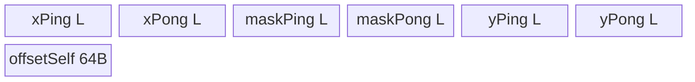

# MaskedSelect 950 ACLNN 算子知识

## 算子速览

| 项目 | 内容 |
|---|---|
| 实际入口 | 公开两段式 `aclnnMaskedSelectGetWorkspaceSize` + `aclnnMaskedSelect`；950 内部入口 `MaskedSelectV3`。 |
| 计算语义 | 对广播、连续化及 dtype 归一后的输入按展平顺序稳定筛选 `mask==1` 的 `self` 元素。 |
| 输入输出 | `self/mask` ND、0～8 维且可广播；950 self/out 支持 13 dtype，mask BOOL/UINT8；out 入参是一维最大容量，运行期 shape 为 true 数。 |
| 执行类型 | 主节点为 `AIV_VECTOR`（950 Vector MicroAPI）单 Kernel；可选外部 BroadcastTo 与框架 Contiguous/Cast 是前处理。无 Cube/AIC/MIX_CV。 |
| Kernel 路线 | R-001～R-004，分别对应 1/2/4/8-byte key 和模板。 |
| 核心资源 | ping/pong 输入、mask、输出 Queues；第二阶段 `moveQue`；Vector registers；每核 64 B header；容量级 GM workspace；`SyncAll`。 |
| 来源闭包 | `source_closed`：ACLNN→RegBase selector→arch35 Tiling/POD→APT entry/MicroAPI body→ascend950 config/CMake 闭合；框架节点内部按允许边界处理。 |
| 验证状态 | 已完成源码闭包检查；本次知识提取未执行编译、真机、数值或性能测试。 |

## 接口与语义

### 计算语义

令广播后的逻辑输入为 `x[0..B)` 与 `m[0..B)`，输出有效序列为 `y=[cast(x[i], out.dtype) | m[i]==1]`，索引递增，故筛选稳定且确定。API 要求调用者提供 `[B]` 的 out 容量；Kernel 最后一核写 `shapeout={0x80000001,K}`，其中低 32 位的 1 表示一维，第 32 位置 1 标识 uint64 shapeout，`K` 是实际输出长度。

### 输入、输出与属性

| 参数 | shape/layout | dtype | 约束、默认值与语义 |
|---|---|---|---|
| `self` | ND，0～8 维，可非连续 | BOOL/INT8/UINT8/INT16/UINT16/FP16/BF16/INT32/UINT32/FP32/INT64/UINT64/DOUBLE | 与 mask 可广播；进入主节点前 Cast 到 out dtype。 |
| `mask` | ND，0～8 维，可非连续 | BOOL/UINT8 | UINT8 值必须为 0/1；主节点只接 BOOL。 |
| `out` | ND，一维、连续，容量 B | 与 950 self 相同 13 dtype | API 未检查与 self dtype 相同；实际值按 out dtype 产生。 |
| `workspaceSize` | 标量输出 | uint64 | executor 聚合所需字节数。 |
| `executor` | Host 对象 | `aclOpExecutor**` | 第一段创建，第二段在 stream 上消费。 |

### 入口与版本

公开文档明确支持 Ascend 950PR/950DT。`IsRegBase()` 使 API 使用 13-dtype 白名单并必选 `MaskedSelectV3`；OpDef 为 ascend950 指定 `opFile.value=masked_select_v3_apt`，顶层 CMake 为 ascend950 选择 arch35 Tiling，binary JSON 有 13 个 dtype 条目。因此这是 950 实际支持的最新公开版本，不与旧 AICPU `MaskedSelect` 合并。

## Host/Launcher 执行流程

### 参数校验与前处理

依次执行 null、dtype、最大 8 维、broadcast、out rank=1、out size=B 校验。空 tensor 路径返回 workspace 0。非空时加入 `Contiguous(self/mask)`、`Cast(mask,BOOL)`、`Cast(self,out.dtype)`；若原始 shapes 不同，`ResetFormatForRegBase` 在 rank 与目标 rank 不同的情况下把 cast tensor 的 view/storage/original format 设为 ND，再各自 `BroadcastTo`；最后加入 `MaskedSelectV3`。

950 `BroadcastTo` 对 INT8/INT32/INT64/UINT8/FP16/FP32/BF16/UINT32/BOOL 走其 RegBase AICORE launcher，其他工作 dtype 走 AICPU launcher。该分流是预广播的直接依赖，不改变主筛选 Kernel 的 AIV Route。

### 参数、Workspace 与生命周期

executor 管理前处理临时 Tensor、shape tensor、节点 workspace 和同 stream 执行顺序；其内部聚合 slice offset 固定仓不可见。主节点 user workspace 精确为 `B_aligned*s + N*64`，再加系统 API workspace。user 区前 `N*64` 是 count headers，后部按原输入 core partition 放临时压缩结果。`SetSysWorkspace(workspace)` 和 `GetUserWorkspace(workspace)` 明确区分系统区与 user 区。

### 启动图与失败传播

```text
Contiguous(self/mask) -> Cast(mask->bool) -> Cast(self->out.dtype)
  -> [shape 不同: BroadcastTo(self), BroadcastTo(mask)]
  -> one MaskedSelectV3 AIV kernel
       phase 1: per-core ping/pong gather -> GM workspace -> count header
       SyncAll
       phase 2: prefix count -> workspace-to-y -> shapeout
```

`MaskedSelectAiCore` 添加单个 entry `masked_select_v3(x,mask,y,shapeout,workspace,tiling)`，`OP_OUTSHAPE` 将 shape tensor 0 号条目关联 out。添加失败返回 null，但 API 调用处未检查。Kernel 内部两阶段共享 GM workspace，仍是单 Kernel topology。

## Route 与参数设计

### 分核与资源计算

记平台 UB 为 `U`，有效 dtype 字节为 `s`，`A=256/s`，`B_aligned=ceil(B/A)*A`。RegBase Tiling 先取 `Ue=U/2-64`，再计算：

```text
factor = 1 + 2*s
ubBlockNum = floor((Ue * s / factor) / 256)
L = ubBlockNum * (256/s)
ubNum = ceil(B_aligned/L)
N = min(ubNum, aivNum)
scheduleMode = 1
```

former/tail core、tile 和末 tile 公式与 A2/A3 相同。`RunKernelTiling` 额外要求两个 storage shapes 相等；API 在 shape 不同时已先 BroadcastTo。workspace 为 `B_aligned*s+N*64+sysWorkspace`。Host POD 为 uint64，APT `Init` 仍以 uint32 接收。

### Route 选择

| 顺序 | Route | Key/模板 | 精确选择条件与优先级 | 不适用去向 |
|---:|---|---|---|---|
| 1 | R-001 1-byte | key 1 / `KernelMaskedSelectV3<uint8_t>` | out dtype BOOL/INT8/UINT8 | key 2 |
| 2 | R-002 2-byte | key 2 / `KernelMaskedSelectV3<uint16_t>` | FP16/BF16/INT16/UINT16 | key 4 |
| 3 | R-003 4-byte | key 4 / `KernelMaskedSelectV3<uint32_t>` | FP32/INT32/UINT32 | key 8 |
| 4 | R-004 8-byte | key 8 / `KernelMaskedSelectV3<uint64_t>` | DOUBLE/INT64/UINT64 | unknown key no-op |

```text
if isRegbase: arch35 Tiling -> key=GetSizeByDataType(x.dtype)
entry: 8 -> uint64; 4 -> uint32; 2 -> uint16; 1 -> uint8; otherwise return without body
```

### 模板/实现执行矩阵

| Route | key/selector | dtype/shape/platform 完整命中条件 | 执行拓扑与 Kernel 节点 | 实际模板/body | 内存与同步特征 | tail/fallback |
|---|---|---|---|---|---|---|
| R-001 | 1 | 950、非空、equal storage shape、1 B | 单 AIV Kernel | MicroAPI GatherMask<uint8> | ping/pong 4Ls+2L+64 初始 UB | mask tail 预清零；unknown no-op |
| R-002 | 2 | 同上、2 B | 单 AIV Kernel | mask unpack once，GatherMask<uint16> | 同公式 | 有效 length 控制 loops |
| R-003 | 4 | 同上、4 B | 单 AIV Kernel | mask unpack/move/unpack，GatherMask<uint32> | 同公式 | 同上 |
| R-004 | 8 | 同上、8 B | 单 AIV Kernel | payload reinterpret uint32；mask 多次 unpack/interleave | 同公式 | AR count 除以 sizeof(T) |

### 隐藏性能 Guard

| Guard | Host/Tiling 条件 | Device/资源原因 | 影响 Route | 不满足时去向 | 源码符号 |
|---|---|---|---|---|---|
| RegBase 分流 | `compileInfo->isRegbase` | 选择 arch35 MicroAPI body | 全部 | 非 RegBase 走旧 Tiling/body | `TilingForMaskedSelectV3` |
| shape equal | `storageShape0==storageShape1` | Kernel 使用同一线性 offset | 全部 | Tiling GRAPH_FAILED | `RunKernelTiling` |
| 非空 | `totalLength>0` | 防止 N/L 除零 | 全部 | Tiling GRAPH_FAILED；API 更早空短路 | arch35 `Init` |
| ping/pong 预算 | `Ue=U/2-64`, `factor=1+2s` | 双 x、双 mask、双 y queue | 全部 | 无小 tile fallback | arch35 `Init`, APT `Init` |
| schedule mode | `SetScheduleMode(1)` 成功 | 跨核 `SyncAll` 所需调度语义 | 全部 | GRAPH_FAILED | arch35 `Init` |
| uint32 窄化 | uint64 POD -> uint32 `Init` | Device 地址/循环成员为 uint32 | 全部 | 无显式拒绝 | APT entry/body |
| tail mask zero | 最后一 tile | MicroAPI 会按 vreg 长度读 mask | 全部 | 先 Duplicate 256 bytes，再 padded DMA | `CopyIn` |

### POD/ABI

结构与 A2/A3 共用：固定仓只可见十个 uint64 按声明顺序，宏展开后的 `sizeof/alignof/offsetof` 不可见；所有字段在 entry 调用 APT `Init(uint32_t...)` 时窄化。

| 结构 | 字段 | 类型/位宽 | ABI 布局 | 单位 | Host/launcher producer | Device consumer | 边界 |
|---|---|---|---|---|---|---|---|
| `MaskedSelectV3TilingData` | `formerNum` | uint64/64 | 精确宏 offset 固定仓不可见 | core | `B%N ? B%N : N` | 大核判断 | uint32 |
| 同上 | `formerLength` | uint64/64 | 同上 | element/core | `ceil(B/N)` | 大核 base/extent | uint32 |
| 同上 | `formertileNum` | uint64/64 | 同上 | tile/core | `ceil(formerLength/L)` | 大核 loops | uint32 |
| 同上 | `formertileLength` | uint64/64 | 同上 | element | `L` | 大核 tile | uint32 |
| 同上 | `formerlasttileLength` | uint64/64 | 同上 | element | remainder 或 L | 大核 tail | uint32 |
| 同上 | `tailNum` | uint64/64 | 同上 | core | `N-formerNum` | tail 核数 | uint32 |
| 同上 | `tailLength` | uint64/64 | 同上 | element/core | tail 存在时整除余量 | 小核 base/extent | inactive=0；uint32 |
| 同上 | `tailtileNum` | uint64/64 | 同上 | tile/core | `ceil(tailLength/L)` | 小核 loops | inactive=0；uint32 |
| 同上 | `tailtileLength` | uint64/64 | 同上 | element | `L` | 小核 tile | inactive=0；uint32 |
| 同上 | `taillasttileLength` | uint64/64 | 同上 | element | remainder 或 L | 小核 tail | inactive=0；uint32 |

### Route 源码闭包

| Route | Key/selector | Host/Tiling producer | POD/参数 | Kernel entry/router 节点 | Kernel body/直接依赖 | 构建接线 |
|---|---|---|---|---|---|---|
| R-001 | 1 | `masked_select_v3_tiling_arch35.cpp` | common POD | `masked_select_v3_apt.cpp` | `arch35/...apt.h<uint8_t>` | ascend950 JSON + CMake arch35 |
| R-002 | 2 | 同上 | 同上 | 同上 | APT<uint16_t> | 同上 |
| R-003 | 4 | 同上 | 同上 | 同上 | APT<uint32_t> | 同上 |
| R-004 | 8 | 同上 | 同上 | 同上 | APT<uint64_t>/VF<uint32_t> | 同上 |

## Kernel 实现

### 公共执行流程

`Init` 为每个 core 绑定线性输入与同 offset workspace slice，并初始化 x/mask/y 的 ping/pong Queue 和 64 B 本核 header buffer。`Process` 两 tile 一组：先连续 CopyIn ping、pong，再 Compute ping、pong，再顺序写 compact workspace；奇数末 tile 单独走 ping。MicroAPI 在 vector scope 清 AR，按 `VL=GetVRegSize()/sizeof(T)` 遍历，比较 mask==1，`GatherMask<STORE_REG>` 后用不对齐连续 store，最后从 AR 字节计数换算选中元素数。写 header 后 `SyncAll`，`pipe.Reset` 重建第二阶段 buffers，把全部 headers 搬入 UB、求前序和、搬 workspace 到 y，并由最后核写 shapeout。

### Route R-001：1-byte MicroAPI 筛选

#### 适用条件

##### 选择证据

| 层级 | 文件 | 符号 | 源码谓词/参数 | 结果/下一跳 |
|---|---|---|---|---|
| API | `op_api/aclnn_masked_select.cpp` | RegBase dtype list/Cast | out dtype 1 B | 主节点 1 B x |
| Tiling | `op_host/masked_select_v3_tiling_arch35.cpp` | `Init` | `sizeOfDataType=1` | key 1 |
| Router | `op_kernel/masked_select_v3_apt.cpp` | entry key 1 | key match | APT<uint8_t> |

#### Device 数据流

##### 函数级调用链

```text
masked_select_v3 -> APT<uint8_t>::Init -> Process
  -> CopyIn(ping/pong) -> Compute -> DoMaskedSelectV3VF<uint8_t> -> CopyOut2Workspace
  -> header -> SyncAll -> MoveOutputDataFromWorkspaceToGM -> shapeout
```

##### 源码等价伪码

```text
for two tiles: padded DMA x/mask; compare mask bytes to 1; GatherMask uint8
unaligned-stream packed registers into yLocal; count=AR/1; append ping then pong
write 64B header; barrier; prefix counts; copy compact bytes to final y
```

#### 内存与数据搬运

##### 资源与搬运表

| 层级/缓冲区 | offset/地址公式 | extent/容量公式 | dtype/layout | producer | consumer | owner/lifetime | 对齐/复用 |
|---|---|---|---|---|---|---|---|
| ping/pong x | UB | 2*L | uint8 | CopyIn | VF | pipe phase 1 | two slots |
| ping/pong mask | UB | 2*L | uint8 | CopyIn | CompareScalar | phase 1 | tail zero padded |
| ping/pong y | UB | 2*L | uint8 | VF | workspace DMA | phase 1 | packed |
| header/work GM | core*64 / N*64+coreOffset | 64 / B_aligned | uint64/uint8 | phase 1 | phase 2 | framework | disjoint slices |
| phase-2 UB | shape B0 + headers N*64 + move 2L | `B0+N*64+2L` | mixed | reset/reinit | prefix/move | phase 2 | B0=`GetUbBlockSize()` |

##### 分层内存布局



##### 字节账与复用顺序

```text
phase1_UB = 4Ls + 2L + 64 = 6L+64
phase2_UB = GetUbBlockSize() + N*64 + 2Ls
workspace_total = N*64 + B_aligned*s
dynamic_ub = N/A
```

| 复用子区 | 写入者 | 读取者/消费点 | 下一次覆盖 | 同步或释放依据 | 安全条件 |
|---|---|---|---|---|---|
| ping/pong queues | CopyIn/VF | VF/workspace copy | next pair | EnQue/DeQue/Free | pair order |
| entire UB pipe | phase 1 | none after header | `pipe.Reset` | SyncAll 前先完成 header | phase1 local data no longer needed |

#### 同步、精度与尾块

##### 同步与数值边界表

| 阶段 | primitive/机制 | producer | consumer/等待点 | 保护对象 | 精度/尾块 |
|---|---|---|---|---|---|
| tail | Duplicate+PIPE_ALL+DataCopyPad | zero fill + GM | VF | mask lanes | invalid mask lane forced 0 |
| VF | mask register + AR | Compare/Gather/store | count read | registers/UB | payload bitwise，no cast |
| global | 64B DMA + SyncAll | all cores | prefix phase | header/work GM | stable order |

#### 关键实现

##### 符号证据表

| 阶段 | 文件 | 符号/模板实例 | 实现事实 |
|---|---|---|---|
| Host/Tiling producer | `op_host/masked_select_v3_tiling_arch35.cpp` | `Init/RunKernelTiling` | key/resources/workspace |
| Kernel entry/router | `op_kernel/masked_select_v3_apt.cpp` | key 1 | uint8 template |
| Device body/helper | `op_kernel/arch35/masked_select_v3_apt.h` | `Process`, `DoMaskedSelectV3VF<uint8_t>` | ping/pong MicroAPI compaction |

### Route R-002：2-byte MicroAPI 筛选

#### 适用条件

##### 选择证据

| 层级 | 文件 | 符号 | 源码谓词/参数 | 结果/下一跳 |
|---|---|---|---|---|
| Tiling | `op_host/masked_select_v3_tiling_arch35.cpp` | `Init` | `s=2` | key 2 |
| Router | `op_kernel/masked_select_v3_apt.cpp` | key 2 | `TILING_KEY_IS(2)` | APT<uint16_t> |

#### Device 数据流

##### 函数级调用链

```text
APT<uint16_t>::Process -> CopyIn ping/pong -> Compute
  -> DoMaskedSelectV3VF<uint16_t>(MaskUnPack once) -> workspace -> SyncAll -> move
```

##### 源码等价伪码

```text
VL=VRegBytes/2; compare VL mask bytes; unpack predicate to 16-bit element lanes
load uint16 payload register; stable GatherMask; unaligned packed store; count=AR/2
```

#### 内存与数据搬运

##### 资源与搬运表

| 层级/缓冲区 | offset/地址公式 | extent/容量公式 | dtype/layout | producer | consumer | owner/lifetime | 对齐/复用 |
|---|---|---|---|---|---|---|---|
| phase1 queues | UB | x 4L + mask 2L + y 4L | uint16/uint8 | CopyIn/VF | VF/workspace | pipe | ping/pong |
| workspace | header + core offset*2 | N*64+B_aligned*2 | uint16 | VF output | final move | framework | stable slices |
| phase2 | UB reset | B0+N*64+4L | mixed | reinit | prefix/move | pipe | move depth 2 |

##### 分层内存布局


##### 字节账与复用顺序

```text
phase1_UB=10L+64; phase2_UB=B0+N*64+4L
workspace_total=N*64+B_aligned*2; dynamic_ub=N/A
```

| 复用子区 | 写入者 | 读取者/消费点 | 下一次覆盖 | 同步或释放依据 | 安全条件 |
|---|---|---|---|---|---|
| queue slots | copy/compute | compute/copyout | next pair | queue lifecycle | ping then pong output order |
| UB all | phase1 | reset | phase2 | `pipe.Reset` after header | no live local tensor |

#### 同步、精度与尾块

##### 同步与数值边界表

| 阶段 | primitive/机制 | producer | consumer/等待点 | 保护对象 | 精度/尾块 |
|---|---|---|---|---|---|
| predicate | MaskUnPack | byte mask | GatherMask<uint16> | lane mask | one bit per 2-byte element |
| payload | bitwise load/store | x | y/workspace | FP16/BF16/int16 bits | no numeric rounding |
| tail/global | pad zero + SyncAll | copy/core | VF/prefix | invalid lanes/GM | count from AR |

#### 关键实现

##### 符号证据表

| 阶段 | 文件 | 符号/模板实例 | 实现事实 |
|---|---|---|---|
| Host/Tiling producer | `op_host/masked_select_v3_tiling_arch35.cpp` | `s=2` formulas | L/N/workspace |
| Kernel entry/router | `op_kernel/masked_select_v3_apt.cpp` | key 2 | uint16 |
| Device body/helper | `op_kernel/arch35/masked_select_v3_apt.h` | VF 2-byte branch | predicate unpack/gather |

### Route R-003：4-byte MicroAPI 筛选

#### 适用条件

##### 选择证据

| 层级 | 文件 | 符号 | 源码谓词/参数 | 结果/下一跳 |
|---|---|---|---|---|
| Tiling | `op_host/masked_select_v3_tiling_arch35.cpp` | `s=4` | key 4 | R-003 |
| Router | `op_kernel/masked_select_v3_apt.cpp` | key 4 | match | APT<uint32_t> |

#### Device 数据流

##### 函数级调用链

```text
APT<uint32_t> -> ping/pong CopyIn -> VF(mask unpack/move/unpack)
  -> GatherMask<uint32_t> -> workspace -> SyncAll -> prefix move -> shapeout
```

##### 源码等价伪码

```text
VL=VRegBytes/4; expand byte comparison mask to 32-bit lanes
gather uint32 bit patterns, unaligned append, count=AR/4; preserve source order
```

#### 内存与数据搬运

##### 资源与搬运表

| 层级/缓冲区 | offset/地址公式 | extent/容量公式 | dtype/layout | producer | consumer | owner/lifetime | 对齐/复用 |
|---|---|---|---|---|---|---|---|
| phase1 queues | UB | x 8L + mask 2L + y 8L | uint32/u8 | stages | stages | pipe | ping/pong |
| workspace | header+coreOffset*4 | N*64+B_aligned*4 | uint32 | gather | move | framework | core slices |
| phase2 | reset UB | B0+N*64+8L | mixed | reinit | prefix/move | pipe | depth2 move |

##### 分层内存布局


##### 字节账与复用顺序

```text
phase1_UB=18L+64; phase2_UB=B0+N*64+8L
workspace_total=N*64+B_aligned*4; dynamic_ub=N/A
```

| 复用子区 | 写入者 | 读取者/消费点 | 下一次覆盖 | 同步或释放依据 | 安全条件 |
|---|---|---|---|---|---|
| ping/pong | CopyIn/VF | VF/workspace | next pair | queue free | ordered pair |
| workspace | core VF | final move | end | SyncAll | disjoint producer slices |

#### 同步、精度与尾块

##### 同步与数值边界表

| 阶段 | primitive/机制 | producer | consumer/等待点 | 保护对象 | 精度/尾块 |
|---|---|---|---|---|---|
| mask | MaskUnPack/MaskMov | compare | Gather | 32-bit lanes | invalid mask padded zero |
| value | uint32 VF | x | compact y | float/int bits | no arithmetic |
| cross-core | SyncAll | header/data | prefix | workspace | stable result |

#### 关键实现

##### 符号证据表

| 阶段 | 文件 | 符号/模板实例 | 实现事实 |
|---|---|---|---|
| Host/Tiling producer | `op_host/masked_select_v3_tiling_arch35.cpp` | `s=4` | resource key |
| Kernel entry/router | `op_kernel/masked_select_v3_apt.cpp` | key 4 | uint32 body |
| Device body/helper | `op_kernel/arch35/masked_select_v3_apt.h` | VF 4-byte branch | mask expansion and gather |

### Route R-004：8-byte 双 uint32 lane MicroAPI 筛选

#### 适用条件

##### 选择证据

| 层级 | 文件 | 符号 | 源码谓词/参数 | 结果/下一跳 |
|---|---|---|---|---|
| Tiling | `op_host/masked_select_v3_tiling_arch35.cpp` | `s=8` | key 8 | R-004 |
| Router | `op_kernel/masked_select_v3_apt.cpp` | key 8 | first branch | APT<uint64_t> |

#### Device 数据流

##### 函数级调用链

```text
APT<uint64_t>::Compute -> DoMaskedSelectV3VF<uint32_t>
  -> repeated MaskUnPack/MaskInterleave -> GatherMask<uint32_t lanes>
  -> AR/sizeof(uint64_t) -> workspace -> SyncAll -> 8-byte move
```

##### 源码等价伪码

```text
logical VL=VRegBytes/8; load 2*VL uint32 lanes for payload
expand each mask predicate to both halves of its uint64 element
gather/store lane pairs; AR byte count /8 gives selected element count
```

#### 内存与数据搬运

##### 资源与搬运表

| 层级/缓冲区 | offset/地址公式 | extent/容量公式 | dtype/layout | producer | consumer | owner/lifetime | 对齐/复用 |
|---|---|---|---|---|---|---|---|
| phase1 queues | UB | x 16L + mask 2L + y 16L | uint64/u8 | copy/VF | VF/copy | pipe | ping/pong |
| VF registers | vector scope | input/result uint32 + mask regs | uint32 lane pairs | DataCopy | Gather/store | vector scope | no GM lifetime |
| workspace | header + coreOffset*8 | N*64+B_aligned*8 | uint64 payload | VF | final move | framework | stable slices |
| phase2 | reset UB | B0+N*64+16L | mixed | reinit | prefix/move | pipe | move depth2 |

##### 分层内存布局


##### 字节账与复用顺序

```text
phase1_UB=34L+64; phase2_UB=B0+N*64+16L
workspace_total=N*64+B_aligned*8; dynamic_ub=N/A
```

| 复用子区 | 写入者 | 读取者/消费点 | 下一次覆盖 | 同步或释放依据 | 安全条件 |
|---|---|---|---|---|---|
| VF registers | each loop | gather/store | next VF loop | vector loop scope | AR cleared once per tile call |
| GM compact slice | phase1 | phase2 move | end | SyncAll | count is elements, addresses scaled by T |

#### 同步、精度与尾块

##### 同步与数值边界表

| 阶段 | primitive/机制 | producer | consumer/等待点 | 保护对象 | 精度/尾块 |
|---|---|---|---|---|---|
| mask expansion | MaskUnPack/MaskMov/MaskInterleave | byte compare | uint32 gather | two lanes/element | prevents half-element selection |
| count | AR byte counter | unaligned stores | Compute | selected length | divide by 8 |
| payload/global | reinterpret + SyncAll | x/core | y/prefix | 64-bit bits/workspace | no DOUBLE rounding |

#### 关键实现

##### 符号证据表

| 阶段 | 文件 | 符号/模板实例 | 实现事实 |
|---|---|---|---|
| Host/Tiling producer | `op_host/masked_select_v3_tiling_arch35.cpp` | `s=8` | key/tile/workspace |
| Kernel entry/router | `op_kernel/masked_select_v3_apt.cpp` | key 8 | uint64 template |
| Device body/helper | `op_kernel/arch35/masked_select_v3_apt.h` | `DoMaskedSelectV3VF<uint32_t>` | two-lane mask and count |

## 算子特定优化

### Trick T-001：显式 ping/pong 两 tile 编组与 phase reset

#### 触发与源码依据

- 适用 Route：R-001～R-004
- 触发条件：950 非空主 Kernel，`loopCount/2` 对每对 tile 执行；奇数尾 tile 单走 ping。
- Golden 来源：[`conversion/masked_select_v3/op_kernel/arch35/masked_select_v3_apt.h:169-181`](../../../../../../../cann-ops-raw/ascendc/ops-math/165d41f02a43a62324b434cb6bda7c533b14da3e/conversion/masked_select_v3/op_kernel/arch35/masked_select_v3_apt.h#L169-L181)

**官方源码（固定 Commit 连续逐字摘录）**：

```cpp
for (int32_t i = 0; i < loopCount / BUFFER_NUM; i++) {
    CopyIn(BUFFER_NUM * i, inQueueXPing, inQueueMaskPing);
    CopyIn(BUFFER_NUM * i + 1, inQueueXPong, inQueueMaskPong);
    Compute(BUFFER_NUM * i, inQueueXPing, inQueueMaskPing, outQueueYPing, rsvdCntPing);
    Compute(BUFFER_NUM * i + 1, inQueueXPong, inQueueMaskPong, outQueueYPong, rsvdCntPong);
    CopyOut2WorkSpacePingPong();
}
if (loopCount % BUFFER_NUM == 1) {
    CopyIn(loopCount - 1, inQueueXPing, inQueueMaskPing);
    Compute(loopCount - 1, inQueueXPing, inQueueMaskPing, outQueueYPing, rsvdCntPing);
    CopyOut2WorkSpace();
}
```

#### 机制与设计原因

独立 ping/pong Queue 让两次输入搬运在两次 VF 计算前完成，并保持结果以 ping 后 pong 的稳定顺序提交。Tiling 用 `U/2-64` 和 `factor=1+2s` 反推 L，恰好把两组 x/mask/y 纳入预算。phase 1 完成并写 header 后 `pipe.Reset()`，原 UB 全部复用为 header 聚合、shapeout 与 depth-2 move queue，避免同时常驻两阶段 buffer。

#### 迁移边界

- 适用：每 tile 独立、需稳定顺序、第一阶段 UB 在全局 barrier 前可全部释放的筛选。
- 前提：L 按双组 buffer 预算；奇数 tile 有独立尾路径；reset 前没有活跃 LocalTensor。
- 失效：tile 间存在依赖、第二阶段需引用第一阶段 UB、或平台无相同 MicroAPI/pipe reset 语义时不能直接迁移。
- 未验证：本次知识提取未执行编译、真机、数值或性能测试。

#### 错误做法

把奇数末 tile 强行作为 pong 读取会越过 `tileNum`；源码用 `loopCount%2==1` 的独立 ping 分支规避该错误。

## 模板与实现对比

| 对比维度 | R-001 1-byte | R-002 2-byte | R-003 4-byte | R-004 8-byte | 设计选择依据 |
|---|---|---|---|---|---|
| 命中条件/优先级 | key1 | key2 | key4 | key8 | out dtype size |
| 模板与 dtype | VF<uint8> | VF<uint16> | VF<uint32> | outer uint64/VF<uint32> | lane width |
| 循环与分核 | ping/pong + odd tail | 同 | 同 | 同 | common Process |
| Queue/TBuf/寄存器/dynamic UB/通信 window | 6L+64 phase1 | 10L+64 | 18L+64 | 34L+64 | `4Ls+2L+64` |
| 内存总占用与复用 | phase reset | 同 | 同 | 同 | two-phase local lifetime |
| 搬运/Vector/SIMT/NDDMA/通信 API | MicroAPI GatherMask | +1 unpack | multi unpack | interleave two lanes | element width |
| 同步、精度与 tail | bitwise, padded mask | bitwise | bitwise | bitwise pair | AR/sizeof(T) |
| fallback/失败边界 | unknown no-op | 同 | 同 | 同 | no Device fallback |

## 平台差异

| 项目 | A2 | A3 | 950 |
|---|---|---|---|
| 支持状态 | 支持，见无后缀卡 | 支持，见无后缀卡 | 支持；950PR/950DT |
| Host/Launcher | 非 RegBase Tiling | 非 RegBase Tiling | RegBase arch35 Tiling、schedule mode 1、shape equality gate |
| Kernel/资源 | Vector API、single queues | 同 | Vector MicroAPI、ping/pong、pipe reset、uint64 shape flag |

## 限制与失败边界

- API 允许 `self` 与 `out` 为不同合法 dtype，必须保留 self→out Cast；Route key 是 Cast 后 dtype 宽度。
- POD uint64 到 Device uint32 的窄化未做上界校验；`B/coreLength/tileLength` 超出 uint32 的行为不可安全复用。
- phase-2 UB `GetUbBlockSize()+N*64+2Ls` 没有独立 Host inequality gate；固定源码只通过 phase-1 `U/2-64` 公式间接控制 L。
- `CopyOut2WorkSpace()` 在单 ping tile 的 `rsvdCntPing==0` 时直接返回，未 DeQue/Free `outQueueYPing`；该调用之后立即进入 header/pipe reset，固定源码未说明 queue 状态检查语义。
- unknown key 无错误；launcher null 返回未被 ACLNN 第一段检查。外部 framework workspace/synchronization 实现固定仓不可见。
- 本次知识提取未执行编译、真机、数值或性能测试。

## 源码索引

### 链路索引

| 链路阶段 | 文件 | 关键符号 | 支撑内容 |
|---|---|---|---|
| 入口声明/约束 | `docs/aclnnMaskedSelect.md` | ACLNN prototypes | 950 product/dtype/shape |
| 入口声明/约束 | `op_api/aclnn_masked_select.h` | two-stage ABI | public declaration |
| 入口实现 | `op_api/aclnn_masked_select.cpp` | RegBase lists/reset/workspace | checks and graph |
| 入口实现 | `op_api/masked_select.cpp` | `MaskedSelectAiCore` | launcher/outshape |
| 直接依赖 | `conversion/broadcast_to/op_api/broadcast_to.cpp` | RegBase selector | broadcast pre-node |
| Host/Tiling/Launcher | `op_host/masked_select_v3_def.cpp` | ascend950 config | APT file selection |
| Host/Tiling/Launcher | `op_host/masked_select_v3_tiling.h` | POD/compile info | common ABI |
| Host/Tiling/Launcher | `op_host/masked_select_v3_tiling.cpp` | RegBase outer selector | route to arch35 |
| Host/Tiling/Launcher | `op_host/masked_select_v3_tiling_arch35.cpp` | arch35 Tiling | formulas/gates/workspace |
| Kernel entry/body | `op_kernel/masked_select_v3_apt.cpp` | APT entry | key router/system workspace |
| Kernel entry/body | `op_kernel/arch35/masked_select_v3_apt.h` | APT body | MicroAPI/UB/sync/tail |
| 构建接线 | `op_host/config/ascend950/masked_select_v3_binary.json` | 13 entries | dtype binaries |
| 构建接线 | `CMakeLists.txt` | ascend950/arch35 | active build routing |

### 实现复用检查

| 检查项 | 可复用事实 | 不得改变的约束 | 源码符号 |
|---|---|---|---|
| ABI/POD | common ten uint64 fields | order/unit and uint32 consumers | TilingData/APT Init |
| 调用顺序 | pair CopyIn→pair VF→pair copy; header→SyncAll→reset/move | stable ping-before-pong and barrier | `Process` |
| workspace/内存 | N*64+B_aligned*s | 64 B header stride, data after headers | Tiling `RunKernelTiling`, `Init` |
| 同步 | Queue + PIPE_ALL + SyncAll | reset only after phase1 completion | `CopyIn`, `Process` |
| 精度与尾块 | bitwise payload, mask padding, AR count | 8-byte two-lane mask; `/sizeof(T)` | `DoMaskedSelectV3VF`, `Compute` |
| 失败边界 | empty success; shape mismatch Tiling failure; unknown no-op | preserve API broadcast and checks | API/Tiling/entry |
