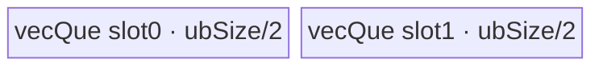
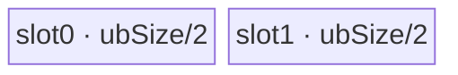
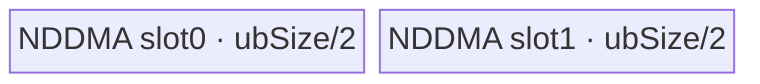
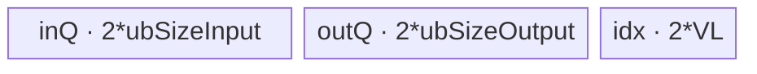
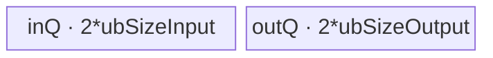

# ReplicationPad2d 950 ACLNN 算子知识

## 算子速览

| 项目 | 内容 |
|---|---|
| 实际入口 | `aclnnReplicationPad2dGetWorkspaceSize` + `aclnnReplicationPad2d`，公开两段式 ACLNN，无 V2/V3 版本族。 |
| 计算语义 | 对最后两轴做 edge/replication padding；输出坐标先减左/上 padding，再分别 clamp 到输入宽、高合法区间。负 padding 表示裁剪。 |
| 输入输出 | `self`/`out` 为 ND、rank 3 或 4、dtype 相同；`padding=[left,right,top,bottom]`，长度 4。950 API 支持 BOOL、8/16/32/64 位有符号/无符号整数、FP16/BF16/FP32/FP64、COMPLEX64/128、HIFLOAT8 与三种 FP8。 |
| 执行类型 | 单个 `PadV3` Device 节点；R-001/R-002 为 SIMT，R-003～R-005 为 `AIV_VECTOR`，R-006～R-013 为 Slice 的 `AIV_VECTOR` 或 NDDMA。入口统一声明 `KERNEL_TYPE_AIV_ONLY`，无 Cube/AIC/MIX_CV。 |
| Kernel 路线 | R-001 SIMT32；R-002 SIMT64；R-003 切尾轴；R-004 normal-width；R-005 edge-gather；R-006～R-013 全负 padding 的八种 Slice 子路线。 |
| 核心资源 | SIMT 直接 GM→GM；切尾轴使用 depth=2 绑定 Queue；normal-width 使用单 TBuf 手工 ping-pong；edge-gather 使用双缓冲 in/out Queue + 2VL 索引；Slice 使用双缓冲 Queue，部分路线另用索引 TBuf 或 NDDMA。 |
| 来源闭包 | `source_closed`：公开 ACLNN→参数检查/前后处理→`PadV3` launcher→arch35 Tiling/POD→AIV-only router→全部 edge 与直接 Slice body→ascend950 构建接线闭合。 |
| 验证状态 | 已完成源码闭包检查；本次知识提取未执行编译、真机、数值或性能测试。 |

## 接口与语义

### 计算语义

设输入最后两维为 `H×W`，`padding=[pL,pR,pT,pB]`，则输出为 `Hout=H+pT+pB`、`Wout=W+pL+pR`。对输出索引 `(hOut,wOut)`：

```text
hIn = clamp(hOut - pT, 0, H - 1)
wIn = clamp(wOut - pL, 0, W - 1)
y[..., hOut, wOut] = x[..., hIn, wIn]
```

所有 dtype 都只搬运原始 bit pattern，不做算术转换。负 padding 通过相同坐标式形成裁剪；Host 在全负场景直接改用 Slice 实现。

### 输入、输出与属性

| 参数 | shape/layout | dtype | 约束、默认值与语义 |
|---|---|---|---|
| `self` | ND，rank 3 或 4；允许非连续 | 950 支持列表内任一类型 | 非连续输入先 `Contiguous`；rank 3 在 axis 0 `UnsqueezeNd` 成 rank 4。 |
| `padding` | 长度固定为 4 | Host `aclIntArray` 的 INT64 值 | 顺序为 `[left,right,top,bottom]`；经 `GetPaddingTensor` 变为 rank 4 的 `[0,0,0,0,top,bottom,left,right]`。 |
| `out` | ND，rank 与原始 `self` 相同 | 必须与 `self` 相同 | shape 必须逐轴等于输入加对应 padding；非连续输出由 `ViewCopy` 提交。 |
| `workspaceSize` | 标量输出 | `uint64_t` | executor 全图 workspace 总量；`PadV3` Tiling 自身固定请求 16 MiB system workspace，Kernel edge body不读 `workspace`。 |
| `executor`/`stream` | 执行器与 ACL stream | N/A | 第一段构图并转移 executor 所有权；第二段在给定 stream 上 `CommonOpExecutorRun`。 |

### 入口与版本

固定仓只公开无后缀 `aclnnReplicationPad2d`。文档明确支持 Ascend 950PR/950DT；API 在 950 `IsRegBase()==true` 时使用 RegBase dtype 表，rank 经过预处理不超过 4，故 `IsAiCoreSupport(self,"edge")` 对 API 已接收 dtype 均命中 `PadV3AiCore`。`PadV3AiCpu` 不是 950 本卡路线。

## Host/Launcher 执行流程

### 参数校验与前处理

1. `OP_CHECK_COMM_INPUT` 检查 `workspaceSize/executor`，`CheckParams` 依次检查 `self/padding/out` 非空、输入输出 format 相同、950 dtype 支持且一致、rank 3～4、padding 长度 4、输出 rank/shape。
2. 若 `self` 或 `out` 为空，rank 3 直接报参数错误；rank 4 仅允许 batch 轴为 0 且 C/H/W 非 0，此时 workspace 为 0、无 `PadV3` 节点。
3. 非空时 `Contiguous(self)`；rank 3 时在 axis 0 `UnsqueezeNd`。
4. `GetPaddingTensor` 从后向前补零，生成 PadV3 所需 rank×2 行主序 padding；950 不创建 `constant_values`。
5. `l0op::PadV3(...,"edge",true)` 先推导输出 shape，再由 RegBase 分支添加一个 `PadV3` AICore launcher；原始 rank 3 的结果 `SqueezeNd(axis=0)`，最后 `ViewCopy` 到用户 `out`。

### 参数、Workspace 与生命周期

`self` 连续副本、padding tensor、可选 unsqueeze/squeeze view、PadV3 临时输出以及 ViewCopy 节点均归 `aclOpExecutor`。第一段 `GetWorkspaceSize()` 汇总这些框架节点与 PadV3 的需求；固定源码只明确 PadV3/Slice Tiling 将 `workspaces[0]` 设为 `16*1024*1024`，Contiguous/ViewCopy 的附加字节公式属于框架边界。用户在两段调用之间持有 executor 并申请 workspace，第二段运行后方可释放。

### 启动图与失败传播

```text
aclnnReplicationPad2dGetWorkspaceSize
  -> [必要时] Contiguous(self)                       # 框架边界
  -> [rank=3] UnsqueezeNd(axis=0)                   # view/shape 边界
  -> PadV3AiCore -> PadV3/pad_v3(blockDim, POD)      # 唯一核心 Device 节点
  -> [原 rank=3] SqueezeNd(axis=0)                  # view/shape 边界
  -> ViewCopy(PadV3 result, out)                    # 框架边界
aclnnReplicationPad2d(workspace, executor, stream)
  -> CommonOpExecutorRun，按同一 executor/stream 顺序执行
```

PadV3 节点输入为连续 `self`、常量 padding tensor、空 `constant_values`，输出为 executor 临时连续 tensor；没有 Kernel 间私有 workspace edge。任一检查、shape infer、launcher 添加、Squeeze 或 ViewCopy 返回空/失败都会立即终止构图，后继节点不会执行。PadV3 router 未命中 key 时没有 fallback body，属于无输出失败边界。

## Route 与参数设计

### 分核与资源计算

Tiling 读取 AIV core 数、UB 字节、UB block 字节 `B`、vector register 字节 `VL`。`DimensionCollapseMode` 消除“输入轴=1且输出轴仍=1”的轴，并把连续零 padding 轴合并；ReplicationPad2d 的前两轴 padding 固定为零，所以公开 rank 3/4 最终 `dimNum<=3`。随后从尾到头计算：

```text
outShape[i] = inShape[i] + leftPad[i] + rightPad[i]
inStride[i] = product(inShape[i+1:])
outStride[i] = product(outShape[i+1:])
inShapeSize = product(inShape); outShapeSize = product(outShape)
```

Vector 路线以 `ubAxis/ubFactor` 切输出域，`ubTotalCount=ceil(outShape[ubAxis]/ubFactor)*product(outShape[:ubAxis])`，`ubPerCount=ceil(ubTotalCount/coreNum)`，实际核数再取 `ceil(ubTotalCount/ubPerCount)`。`TilingInfoTune` 在当前核利用率低于 80% 且单 tile 输入字节大于 4096 时向后移动切分轴/均匀 factor。

### Route 选择

| 顺序 | Route | Key/模板 | 精确选择条件与优先级 | 不适用去向 |
|---:|---|---|---|---|
| 1 | R-006～R-013 Slice | `10000 + Slice key` | 非空，所有 collapse 后 padding `<=0`，且至少一个 `<0` | 否则检查 mixed/positive |
| 2 | R-001/R-002 SIMT | `23000/23001` | padding 正负混合；或全非负且 `outShapeSize<=4096` | 按总元素数选 32/64 位索引 |
| 3 | R-003 cut-last | `33010` | 全非负，且 `align(outLast*dtypeBytes,VL)>buffer`；或其 2 倍超过 buffer；或 normal/gather tune 后 `ubAxis` 落到尾轴 | 无 |
| 4 | R-004 normal-width | `33021/33031` | 全非负，未命中前项，`outLast*dtypeBytes>VL/2`，最终 UB 内轴数为 2/3 | tune 可能退 R-003 |
| 5 | R-005 edge-gather | `33022/33032` | 全非负，未命中前项，`outLast*dtypeBytes<=VL/2`，最终 UB 内轴数为 2/3 | tune 可能退 R-003 |

```text
if public API empty handling: no PadV3 launch
else collapse axes; compute shapes/strides
if all pad <= 0 and any pad < 0: SliceTilingForAscendC -> R-006..R-013
else if mixed sign: R-001 or R-002
else if outElements <= 4096: R-001
else compute alignedLast, buffer
     if cut-last guard: R-003
     else if outLastBytes > VL/2: R-004, tune may become R-003
     else: R-005, tune may become R-003
```

### 模板/实现执行矩阵

| Route | key/selector | dtype/shape/platform 完整命中条件 | 执行拓扑与 Kernel 节点 | 实际模板/body | 内存与同步特征 | tail/fallback |
|---|---|---|---|---|---|---|
| R-001 SIMT32 | 23000 | SIMT 条件且 input/output 元素数均 `<=INT32_MAX` | 单 PadV3 | `PadEdgeSimt<int8/32/64>`；实际按元素字节宽重解释 | 直接 GM→GM，2048 threads/block | `idx<outputSize`；无 fallback |
| R-002 SIMT64 | 23001 | SIMT 条件且任一元素数 `>INT32_MAX` | 单 PadV3 | `PadEdgeSimtHuge<int8/32/64>` | 直接 GM→GM；公开入口 collapse 后 dim<=3，1024 threads/block | uint64 网格步进 |
| R-003 cut-last | 33010 | 全非负且尾轴/UB guard | 单 PadV3 | `KernelPadEdgeWithHugeWidth<uint8/16/32/64>` | depth=2 绑定 Queue；event 串联 MTE2/V/MTE3 | 最后 tile 只写 `min(ubFactor,outLast-start)` |
| R-004 normal-width | 33021/33031 | 尾轴>VL/2，UB 内 2/3 轴 | 单 PadV3 | `KernelPadReplWithNormalWidth<T,KEY>` | 单 TBuf 分成两个 ping-pong 半区；MoveAlignV2+MicroAPI | 行尾非 block 对齐单独搬最后行 |
| R-005 edge-gather | 33022/33032 | 尾轴<=VL/2，UB 内 2/3 轴 | 单 PadV3 | `PadEdgeGather<T,KEY>` | in/out Queue 各 depth2，另 2VL idx TBuf | mask+unalign post 提交 tail |
| R-006 | 10100 | Slice 选择 MoveAlignV2，UB 不切尾轴/特殊2D | 单 PadV3 | `SliceMoveAlign<T,int32_t>` | depth2 bind Queue，Compact MoveAlign | `ubTailFactor` 单独处理 |
| R-007 | 10101 | Slice MoveAlignV2 且 UB 切尾轴 | 单 PadV3 | `SliceMoveAlignLastDim<T,int32_t>` | depth2 bind Queue | 主/tail `blockLen` |
| R-008 | 10102 | Slice NDDMA 且 UB 不切尾轴 | 单 PadV3 | `SliceNDDMA<T,int32_t>` | 5D NDDMA→UB，UB→GM | tail loopInfo 单独缩短 |
| R-009 | 10103 | Slice NDDMA 且 UB 切尾轴 | 单 PadV3 | `SliceNDDMALastDim<T,int32_t>` | 1D NDDMA→UB，UB→GM | tail factor |
| R-010 | 10150 | Slice 2D small-shape specialization | 单 PadV3 | `SliceMoveAlignTwoDim<T,int32_t>` | depth2 bind Queue | 主核/尾核行数 |
| R-011 | 10300 | Slice gather 准入且输入尾轴无需 unalign 特化 | 单 PadV3 | `SliceMoveAlignGather<T,int32_t>` | 双 in/out Queue + 2VL 索引 | gather mask tail |
| R-012 | 10301 | Slice `isUnalignCopy_` 条件 | 单 PadV3 | `SliceMoveAlignDataCopyUnalign<T,int32_t>` | 双 in/out Queue；UnAlign pre/post | repeat + 尾段 |
| R-013 | 10400 | 2D、尾输出<VL、倒数第二轴不裁、总 UB/core guard | 单 PadV3 | `SliceTwoDimSmallShape<T,int32_t>` | depth1 bind Queue | `mainCoreNum` 分行 |

### 隐藏性能 Guard

| Guard | Host/Tiling 条件 | Device/资源原因 | 影响 Route | 不满足时去向 | 源码符号 |
|---|---|---|---|---|---|
| 小输出 | `outShapeSize<=4096` | 避免小域的 UB tiling/搬运开销 | R-001 | Vector selector | `CalculateTilingKeyEdge` |
| SIMT 位宽 | `inShapeSize>INT32_MAX \|\| outShapeSize>INT32_MAX` | 32 位扁平索引会溢出 | R-001/R-002 | 23001 | `DoTilingWithSIMTEdge` |
| cut buffer | `buffer=align((UB/2)-VL,VL)`，上限 64 KiB | depth2 Queue 每半区还含 VL 辅助区 | R-003 | R-004/R-005 | `CalculateTilingKeyEdge` |
| normal/gather 分界 | `outLast*dtypeBytes > VL/2` | 大尾轴适合 MoveAlignV2 行搬运，小尾轴用 gather 构造多行 | R-004/R-005 | 另一 Route | `CalculateTilingKeyEdge` |
| core tune | 使用率 `<0.8` 且 tile 输入字节 `>4096` | 避免过少核且单 tile 过大 | R-003～R-005 | 移轴或 cut-last | `CheckTilingInfoSatisfied/GetOptimizeTiling` |
| Gather 索引位宽 | `RangeType=int16` for 1/2-byte T，否则 int32 | `DataCopyGather` 索引宽度与输入字节宽绑定 | R-005 | Host 通过 tile/VL 限制 | `PadEdgeGather` 类型别名 |
| Slice UB | `(UB-8192)/dtypeBytes/2`，gather 再扣 512B index 与 cache line | 双缓冲和索引保留区 | R-006～R-013 | 改切分轴/子模板 | `StrideSliceTiling::Init/CalcUbSplitInfo` |

### POD/ABI

所有数组 inactive 尾项都不由 Device 读取。固定仓给出 native struct 字段顺序与类型，但没有目标编译器生成的 `sizeof/alignof/offsetof` 常量，因此精确 ABI offset 标为固定仓不可见。

| 结构 | 字段 | 类型/位宽 | ABI 布局 | 单位 | Host/launcher producer | Device consumer | 边界 |
|---|---|---|---|---|---|---|---|
| `PadACTilingData` | `dimNum` | uint8/8 | offset 固定仓不可见 | 轴 | collapse 后写入 | 所有 body 循环上界 | 1～3（公开入口非空） |
| `PadACTilingData` | `ubAxis` | uint8/8 | 同上 | 轴号 | selector/tune | 分核与模板地址 | SIMT 不使用 |
| `PadACTilingData` | `ubFactor` | uint32/32 | 同上 | 元素/轴坐标数 | `DoFindSplitAxis*` | 每 tile 覆盖量 | SIMT 不使用 |
| `PadACTilingData` | `ubPerCount` | uint32/32 | 同上 | tile/core | `TilingInfoTune` | core 起止 tile | SIMT 路线保持 0、body 不读 |
| `PadACTilingData` | `ubTotalCount` | uint32/32 | 同上 | tile | `CheckTilingInfoSatisfied` | core 越界保护 | 同上 |
| `PadACTilingData` | `outTileSize` | uint32/32 | 同上 | 字节 | selector | `InitBuffer` | SIMT 不读 |
| `PadACTilingData` | `additionTileSize` | uint32/32 | 同上 | 字节 | selector | UB 辅助区 offset | SIMT 不读 |
| `PadACTilingData` | `inShape[8]` | uint64×8 | 同上 | 元素 | collapse/shape读取 | clamp、GM stride | 仅 `[0,dimNum)` active |
| `PadACTilingData` | `outShape[8]` | uint64×8 | 同上 | 元素 | `ComputeAfterPaddingsAndStrides` | 输出域/tail | 同上 |
| `PadACTilingData` | `inStride[8]` | uint64×8 | 同上 | 元素 | 尾积 | GM 输入 offset | 同上 |
| `PadACTilingData` | `outStride[8]` | uint64×8 | 同上 | 元素 | 尾积 | GM 输出 offset | 同上 |
| `PadACTilingData` | `leftPad[8]` | int64×8 | 同上 | 元素 | padding tensor/collapse | 坐标平移 | right pad 由 out-in-left 反推 |
| `SliceBaseTilingData` | `isBeginConst` | int8/8 | offset 固定仓不可见 | bool | 本调用恒 true | 是否读 begin GM | Pad router 给 begin 指针为 null，必须为 true |
| `SliceBaseTilingData` | `blkFactor/blkTailFactor` | 各 int64/64 | 每个字段 offset 固定仓不可见 | 输出轴元素 | block split | 每核主/尾域 | 逐字段均由 `CalcBlockSplitInfo` 产生 |
| `SliceBaseTilingData` | `ubInLoopSteps` | int64/64 | 同上 | 输入元素 | Slice 行步长计算 | tile 输入地址 | 正 stride=1 |
| `SliceBaseTilingData` | `ubSize` | int32/32 | 同上 | 字节 | UB split | Queue 分配 | 已扣保留区 |
| `SliceBaseTilingData` | `ubFactor/ubTailFactor/ubTailTailFactor` | 各 int32/32 | 同上 | 元素 | `CalcUbSplitInfo` | main/tail loop | tail 可为0 |
| `SliceBaseTilingData` | `realCoreNum/inputDims/blkIndex/ubIndex` | 各 int16/16 | 同上 | core/轴 | split | block guard/地址解码 | rank<=3 |
| `SliceBaseTilingData` | `outputShape/begin/inputSteps/rowsOffsetSteps[8]` | 各 int64×8 | 同上 | 元素/步长 | Slice 参数与积 | `SliceBase` 地址函数 | begin=`-leftPad` |
| `StridedSliceMoveAlignParams2` | `blockCount` | uint16/16 | 同上 | block | MoveAlign tiling | DataCopy `blockCount` | uint16 上限参与选路 |
| `StridedSliceMoveAlignParams2` | `blockLen/srcStride/dstStride` | 各 uint32/32 | 同上 | 字节 | MoveAlign tiling | DataCopy 参数 | stride 是 burst 尾到下一头间隔 |
| `StridedSliceMoveAlignParams2` | `loop1Size/loop2Size` | 各 uint16/16 | 同上 | loop | MoveAlign tiling | LoopMode | 默认1 |
| `StridedSliceMoveAlignParams2` | `loop1/2 Src/DstStride` | src uint32、dst uint16 | 同上 | 字节 | MoveAlign tiling | LoopMode | 位宽上限参与选路 |
| `SliceNDDMATilingData` | `nddmaTotalNum` | int64/64 | 同上 | 元素 | `SetNddmaTilingMode` | NDDMA参数 | 1～5D loop乘积 |
| `SliceNDDMATilingData` | `nddmaLoopSize/SrcStride/DstStride[5]` | 各 int64×5 | 同上 | loop/元素 | 同上 | `MultiCopyLoopInfo` | inactive 高维填安全值 |

### Route 源码闭包

| Route | Key/selector | Host/Tiling producer | POD/参数 | Kernel entry/router 节点 | Kernel body/直接依赖 | 构建接线 |
|---|---|---|---|---|---|---|
| R-001/R-002 | 23000/23001 | `PadACTiling::DoTilingModeEdge/DoTilingWithSIMTEdge` | `PadACTilingData` shape/stride/pad | `pad_v3`→`LaunchKernelPadEdgeSimt*` | `pad_edge_simt*.h` | `pad_v3_binary.json` + CMake ascend950 |
| R-003 | 33010 | `CalculateTilingKeyEdge` | `PadACTilingData` UB fields | `pad_v3`→`LaunchKernelPadEdgeWithHugeWidth` | `pad_edge_huge_width.h` | 同上 |
| R-004 | 33021/33031 | `CalculateTilingKeyEdge/TilingInfoTune` | 同上 | `LaunchKernelPadEdgeWithNormalWidth<T,KEY>` | `pad_edge_normal_w.h` | 同上 |
| R-005 | 33022/33032 | 同上 | 同上 | `LaunchKernelPadEdgeGather<T,KEY>` | `pad_edge_gather.h` | 同上 |
| R-006～R-013 | 10100..10400 | `DoTilingWithSliceOp`→`SliceTilingForAscendC` | 各 `Slice*TilData` | `pad_v3` else router→`PadSlice*Process` | `conversion/slice/op_kernel/arch35/slice_*.h` | pad_v3 CMake `DEPENDENCIES slice` |

## Kernel 实现

### 公共执行流程

`pad_v3(x,paddings,constValues,y,workspace,tiling)` 首先声明 `KERNEL_TYPE_AIV_ONLY`，按 key 选择一个 body。所有公开 ReplicationPad2d 路线都忽略 `constValues`；Vector 路线按 dtype 字节宽重解释为 `uint8/16/32/64`，保持 bit pattern。单次 ACLNN 调用只有一个 PadV3 Kernel 节点，不存在 kernel 间 workspace 边；Slice 是该同一 entry 内的替代 body，不是第二次 launch。

### Route R-001：SIMT 32 位索引

#### 适用条件

##### 选择证据

| 层级 | 文件 | 符号 | 源码谓词/参数 | 结果/下一跳 |
|---|---|---|---|---|
| Host | `pad_v3_tiling_arch35.cpp` | `DoTilingModeEdge` | mixed signs，或全非负后 `outShapeSize<=4096` | `DoTilingWithSIMTEdge` |
| Tiling | 同上 | `DoTilingWithSIMTEdge` | input/output size 均不大于 INT32_MAX | key 23000 |
| Router | `pad_v3_apt.cpp` | `pad_v3` | `TILING_KEY_IS(23000)` | `LaunchKernelPadEdgeSimt` |

#### Device 数据流

##### 函数级调用链

```text
pad_v3 -> LaunchKernelPadEdgeSimt<T> -> PadEdgeSimt<raw-width>::Init -> Process
       -> asc_vf_call<SimtComputeEdgeDim{1,2,3}>(threads=2048)
```

##### 源码等价伪码

```text
for idx = blockIdx*2048 + threadIdx; idx < outputElements; idx += blockNum*2048:
  outCoord = decode(idx, outStride, uint32 magic division)
  inCoord[d] = clamp(outCoord[d] - leftPad[d], 0, inShape[d]-1)
  y[idx] = x[sum(inCoord[d]*inStride[d])]
```

#### 内存与数据搬运

##### 资源与搬运表

| 层级/缓冲区 | offset/地址公式 | extent/容量公式 | dtype/layout | producer | consumer | owner/lifetime | 对齐/复用 |
|---|---|---|---|---|---|---|---|
| GM input | `Σ inCoord*inStride` | 1 element/thread/iteration | raw-width ND | caller | SIMT thread | caller，全调用有效 | 无合并假设 |
| GM output | flat `idx` | 1 element | 同 input | SIMT | caller | caller | `idx<outputSize` |
| AIV UB/dynamic UB | N/A | 0 显式分配 | 寄存器标量 | thread | thread | 单迭代 | 无 barrier/atomic |

##### 分层内存布局

N/A：该路线未调用 `InitBuffer`，SIMT thread 直接 GM 读写。

##### 字节账与复用顺序

```text
UB_total = 0（固定源码无显式 Queue/TBuf）
dynamic_ub = N/A
workspace_total = 16 MiB system workspace request；body 不读取 workspace
```

| 复用子区 | 写入者 | 读取者/消费点 | 下一次覆盖 | 同步或释放依据 | 安全条件 |
|---|---|---|---|---|---|
| thread 局部坐标寄存器 | 当前 thread | 当前地址计算 | 下一 loop iteration | thread 顺序 | 无跨线程共享 |

#### 同步、精度与尾块

##### 同步与数值边界表

| 阶段 | primitive/机制 | producer | consumer/等待点 | 保护对象 | 精度/尾块 |
|---|---|---|---|---|---|
| GM copy | 普通 load/store | 每 thread | 无等待 | 唯一 `y[idx]` | 不做 cast；`idx<outputSize` |

#### 关键实现

##### 符号证据表

| 阶段 | 文件 | 符号/模板实例 | 实现事实 |
|---|---|---|---|
| Host/Tiling producer | `conversion/pad_v3/op_host/arch35/pad_v3_tiling_arch35.cpp` | `CalculateTilingKeyEdge/DoTilingWithSIMTEdge` | key 与32位边界 |
| Kernel entry/router | `conversion/pad_v3/op_kernel/pad_v3_apt.cpp` | `pad_v3` key 23000 | 映射 SIMT body |
| Device body/helper | `conversion/pad_v3/op_kernel/arch35/pad_edge_simt.h` | `PadEdgeSimt::Process/SimtComputeEdgeDim*` | 2048 threads、clamp地址式 |

### Route R-002：SIMT 64 位大域

#### 适用条件

##### 选择证据

| 层级 | 文件 | 符号 | 源码谓词/参数 | 结果/下一跳 |
|---|---|---|---|---|
| Tiling | `pad_v3_tiling_arch35.cpp` | `DoTilingWithSIMTEdge` | `inShapeSize>INT32_MAX \|\| outShapeSize>INT32_MAX` | key 23001 |
| Router | `pad_v3_apt.cpp` | `pad_v3` | key 23001 | huge SIMT |

#### Device 数据流

##### 函数级调用链

```text
pad_v3 -> LaunchKernelPadEdgeSimtHuge -> PadEdgeSimtHuge::Process
       -> asc_vf_call<SimtComputeEdgeHugeDim{1,2,3}>(threads=1024)
```

##### 源码等价伪码

```text
与 R-001 相同，但 idx/outputSize/stride/magic 均为 uint64_t；公开入口 collapse 后 dim<=3。
```

#### 内存与数据搬运

##### 资源与搬运表

| 层级/缓冲区 | offset/地址公式 | extent/容量公式 | dtype/layout | producer | consumer | owner/lifetime | 对齐/复用 |
|---|---|---|---|---|---|---|---|
| GM input/output | 64 位解码后的 flat offset | 1 element/thread | raw-width ND | thread | GM | caller | uint64 tail guard |

##### 分层内存布局

N/A：无显式 AIV UB。

##### 字节账与复用顺序

```text
UB_total=0; dynamic_ub=N/A; workspace_total=16 MiB system request
```

| 复用子区 | 写入者 | 读取者/消费点 | 下一次覆盖 | 同步或释放依据 | 安全条件 |
|---|---|---|---|---|---|
| uint64 坐标寄存器 | thread | 地址计算 | 下一迭代 | thread 顺序 | `idx<outputSize` |

#### 同步、精度与尾块

##### 同步与数值边界表

| 阶段 | primitive/机制 | producer | consumer/等待点 | 保护对象 | 精度/尾块 |
|---|---|---|---|---|---|
| GM copy | load/store | thread | N/A | 单输出元素 | raw copy，64位边界 |

#### 关键实现

##### 符号证据表

| 阶段 | 文件 | 符号/模板实例 | 实现事实 |
|---|---|---|---|
| Host/Tiling producer | `pad_v3_tiling_arch35.cpp` | `DoTilingWithSIMTEdge` | INT32_MAX guard |
| Kernel entry/router | `pad_v3_apt.cpp` | key 23001 | huge router |
| Device body/helper | `pad_edge_simt_huge.h` | `PadEdgeSimtHuge::Process` | uint64 索引、1024 threads for dim<=3 |

### Route R-003：切尾轴 Vector

#### 适用条件

##### 选择证据

| 层级 | 文件 | 符号 | 源码谓词/参数 | 结果/下一跳 |
|---|---|---|---|---|
| Tiling | `pad_v3_tiling_arch35.cpp` | `CalculateTilingKeyEdge` | aligned last 超 buffer、2×last 超 buffer、dim1大行，或 tune 到尾轴 | 33010 |
| Router | `pad_v3_apt.cpp` | key 33010 | `LaunchKernelPadEdgeWithHugeWidth` | body |

#### Device 数据流

##### 函数级调用链

```text
pad_v3 -> KernelPadEdgeWithHugeWidth::Init -> Process
  -> ProcessOneStep -> CopyIn -> PadOneLine/PadBothSide -> CopyOut
```

##### 源码等价伪码

```text
for tile assigned to core:
  decode output start; clamp non-split axes; find input overlap on split axis
  DMA valid overlap into UB[additionOffset + alignedLeft]
  Duplicate edge value for pure pad or left/right segments
  MicroAPI UnAlign patches misaligned left boundary and long right runs
  DMA only min(ubFactor, remainingOutput) to y
```

#### 内存与数据搬运

##### 资源与搬运表

| 层级/缓冲区 | offset/地址公式 | extent/容量公式 | dtype/layout | producer | consumer | owner/lifetime | 对齐/复用 |
|---|---|---|---|---|---|---|---|
| `inQueue_` half | 0/1由 Queue 管理 | 每半区 `outTileSize+additionTileSize` 字节，depth2 | raw T | MTE2/Vector | Vector/MTE3 | TPipe；每 tile FreeTensor | `additionOffset=additionTileSize/sizeof(T)` |
| GM input | `ΣinIndex*inStride + remainder` | overlap元素 | ND | caller | DataCopyPad/GetValue | call | blockLen字节 |
| GM output | `ΣoutIndex*outStride` | `min(ubFactor,remain)` | ND | UB | DataCopyPad | caller | tail精确长度 |

##### 分层内存布局


##### 字节账与复用顺序

```text
UB_total = 2 * (outTileSize + additionTileSize)
additionTileSize = VL; outTileSize <= 65536
UB_total <= Host selector 使用的 UB 条件
dynamic_ub=N/A; workspace_total=16 MiB system request
```

| 复用子区 | 写入者 | 读取者/消费点 | 下一次覆盖 | 同步或释放依据 | 安全条件 |
|---|---|---|---|---|---|
| Queue half | CopyIn/Vector | CopyOut | 下个 tile AllocTensor | `FreeTensor` + MTE2/V/MTE3 event | 不在 MTE3 前释放 |

#### 同步、精度与尾块

##### 同步与数值边界表

| 阶段 | primitive/机制 | producer | consumer/等待点 | 保护对象 | 精度/尾块 |
|---|---|---|---|---|---|
| MTE2→V | `MTE2_V` event | DataCopyPad | Duplicate/MicroAPI | 输入片 | raw bits |
| V→MTE3 | `V_MTE3` | pad compute | CopyOut | 完成片 | mask/UnAlign tail |
| MTE2→MTE3 | `MTE2_MTE3` | 搬入 | 搬出 | 无需Vector改写的对齐区 | 最后 tile 精确 blockLen |

#### 关键实现

##### 符号证据表

| 阶段 | 文件 | 符号/模板实例 | 实现事实 |
|---|---|---|---|
| Host/Tiling producer | `pad_v3_tiling_arch35.cpp` | `CalculateTilingKeyEdge` | buffer/cut/tune |
| Kernel entry/router | `pad_v3_apt.cpp` | 33010 | huge-width body |
| Device body/helper | `pad_edge_huge_width.h` | `KernelPadEdgeWithHugeWidth` | overlap DMA、Duplicate、UnAlign、events |

### Route R-004：normal-width 多轴 Vector

#### 适用条件

##### 选择证据

| 层级 | 文件 | 符号 | 源码谓词/参数 | 结果/下一跳 |
|---|---|---|---|---|
| Tiling | `pad_v3_tiling_arch35.cpp` | `CalculateTilingKeyEdge` | `outLast*dtypeBytes>VL/2`，未 cut，tune 后 UB axes 2/3 | 33021/33031 |
| Router | `pad_v3_apt.cpp` | keys | `KernelPadReplWithNormalWidth<T,KEY>` | body |

#### Device 数据流

##### 函数级调用链

```text
Process -> ProcessOneStep -> CopyIn
  -> CopyandProcess2D/3D -> PadLeftSideFirst/PadRightSide/PadCopySame|Diff/PadLeftSide
  -> CopyOut
```

##### 源码等价伪码

```text
for tile assigned to core, alternate half = localIdx & 1:
  MoveAlignV2 copies valid W rows into padded UB layout
  broadcast first/last W values with MicroAPI; duplicate top/bottom rows or planes in place
  wait until prior MTE3 released this half
  copy left fragment then aligned bulk rows; handle final unaligned row separately
```

#### 内存与数据搬运

##### 资源与搬运表

| 层级/缓冲区 | offset/地址公式 | extent/容量公式 | dtype/layout | producer | consumer | owner/lifetime | 对齐/复用 |
|---|---|---|---|---|---|---|---|
| `inQueue_` TBuf half | `(idx&1)*(outTile+addition)` | 每半区 `outTile+addition` 字节 | padded ND tile | MTE2/Vector | MTE3 | TPipe，全 Process | 手工双缓冲 |
| auxiliary prefix | half base | `additionTileSize` | broadcast scratch | first-row load | left padding | 当前 tile | 与 payload 同 half |
| payload | `additionOffset` | `outTileSize` | padded rows | MoveAlign/Vector | CopyOut | 当前 tile | W ceil block |

##### 分层内存布局


##### 字节账与复用顺序

```text
UB_total = 2 * (outTileSize + additionTileSize)
Host guard = 2*(outTile+addition) <= UB，且单 buffer上限由64KiB/tune约束
dynamic_ub=N/A; workspace_total=16 MiB
```

| 复用子区 | 写入者 | 读取者/消费点 | 下一次覆盖 | 同步或释放依据 | 安全条件 |
|---|---|---|---|---|---|
| even/odd half | CopyIn+MicroAPI | CopyOut | idx+2 | EVENT_ID0/1 的 `MTE2_V`,`V_MTE3`,`MTE3_MTE2` | 同半区 MTE3 完成后再 MTE2 |

#### 同步、精度与尾块

##### 同步与数值边界表

| 阶段 | primitive/机制 | producer | consumer/等待点 | 保护对象 | 精度/尾块 |
|---|---|---|---|---|---|
| ping-pong | EVENT_ID0/1 | MTE2/V/MTE3 | 下一同 parity tile | 半区 | raw copy |
| 行尾 | 单独 DataCopyPad | Vector tile | GM | 未对齐最后行 | 精确剩余字节 |

#### 关键实现

##### 符号证据表

| 阶段 | 文件 | 符号/模板实例 | 实现事实 |
|---|---|---|---|
| Host/Tiling producer | `pad_v3_tiling_arch35.cpp` | `DoFindSplitAxis/TilingInfoTuneForNormal` | 33021/33031 |
| Kernel entry/router | `pad_edge.h` | `LaunchKernelPadEdgeWithNormalWidth` | 按字节宽实例化 |
| Device body/helper | `pad_edge_normal_w.h` | `KernelPadReplWithNormalWidth` | MoveAlign、in-place broadcast、手工DB |

### Route R-005：小尾轴 edge-gather

#### 适用条件

##### 选择证据

| 层级 | 文件 | 符号 | 源码谓词/参数 | 结果/下一跳 |
|---|---|---|---|---|
| Tiling | `pad_v3_tiling_arch35.cpp` | `CalculateTilingKeyEdge` | `outLast*dtypeBytes<=VL/2`、未 cut | 33022/33032 |
| Router | `pad_v3_apt.cpp` | keys | `PadEdgeGather<T,KEY>` | body |

#### Device 数据流

##### 函数级调用链

```text
Init -> GenGatherIndex[ThreeDim] -> for tile:
  CalcDimIdx/CalcUbSplitInAndOut -> CopyIn -> GatherCompute(2D/3D) -> CopyOut
```

##### 源码等价伪码

```text
precompute 2*VL indices: pad-clamped row and valid-row variants
for tile:
  DMA only valid input span (or one edge row for pure pad)
  gather left pad, valid region, right pad into output Queue
  for byte dtype, gather widened 16-bit then Pack
  unaligned stores use DataCopyUnAlign + Post; DMA exact output tile to GM
```

#### 内存与数据搬运

##### 资源与搬运表

| 层级/缓冲区 | offset/地址公式 | extent/容量公式 | dtype/layout | producer | consumer | owner/lifetime | 对齐/复用 |
|---|---|---|---|---|---|---|---|
| `inQue_` | Queue slot | depth2×`outTileSize` | compact input | MTE2 | gather | TPipe | FreeTensor after compute |
| `outQue_` | Queue slot | depth2×`outTileSize` | padded output | gather | MTE3 | TPipe | FreeTensor after copy |
| `idxBuf_` | 0 and VL | `2*VL` bytes | int16/int32 index | GenGatherIndex | gather | whole Process | pad/valid halves |

##### 分层内存布局


##### 字节账与复用顺序

```text
UB_total = 2*outTileSize + 2*outTileSize + 2*VL
         = 4*outTileSize + 512（VL=256时）
Host buffer uses align((UB-2*VL)/4,VL)
dynamic_ub=N/A; workspace_total=16 MiB
```

| 复用子区 | 写入者 | 读取者/消费点 | 下一次覆盖 | 同步或释放依据 | 安全条件 |
|---|---|---|---|---|---|
| in/out Queue slot | DMA/gather | gather/DMA | Queue next allocation | EnQue/DeQue/FreeTensor | depth2 backpressure |
| idxBuf | GenGatherIndex | every tile | 不覆盖 | 同一 Kernel 顺序 | 只读于 tile loop |

#### 同步、精度与尾块

##### 同步与数值边界表

| 阶段 | primitive/机制 | producer | consumer/等待点 | 保护对象 | 精度/尾块 |
|---|---|---|---|---|---|
| Queue | EnQue/DeQue | MTE2/gather | gather/MTE3 | input/output slot | 不变 dtype；B8 widen+Pack 保持字节 |
| tail | mask+UnAlignPost | gather | MTE3 | 最后一 VL | maskValue 来自实际轴剩余 |

#### 关键实现

##### 符号证据表

| 阶段 | 文件 | 符号/模板实例 | 实现事实 |
|---|---|---|---|
| Host/Tiling producer | `pad_v3_tiling_arch35.cpp` | `CalculateTilingKeyEdge` | small-last selector/UB公式 |
| Kernel entry/router | `pad_edge.h` | `LaunchKernelPadEdgeGather` | keys到模板 |
| Device body/helper | `pad_edge_gather.h` | `PadEdgeGather` | 索引生成、gather一次复制多次、Pack、Queue |

### Route R-006：Slice MoveAlign 多轴

#### 适用条件

##### 选择证据

| 层级 | 文件 | 符号 | 源码谓词/参数 | 结果/下一跳 |
|---|---|---|---|---|
| Pad Host | `pad_v3_tiling_arch35.cpp` | `DoTilingModeEdge` | all pad<=0且有负值 | base 10000 + Slice key |
| Slice | `slice_tiling_arch35.cpp` | `CalMaxSplitDim/SetTilingMode` | MoveAlignV2 family，`ubIndex` 非尾轴、非2D special | 10100 |

#### Device 数据流

##### 函数级调用链

```text
pad_v3 -> PadSliceMoveAlignProcess -> SliceMoveAlign::Init/Process -> ProcessPerBlock
```

##### 源码等价伪码

```text
begin=-leftPad; for core rows and UB tiles: Compact MoveAlign GM crop -> Queue -> exact contiguous GM output; handle ubTailFactor separately.
```

#### 内存与数据搬运

##### 资源与搬运表

| 层级/缓冲区 | offset/地址公式 | extent/容量公式 | dtype/layout | producer | consumer | owner/lifetime | 对齐/复用 |
|---|---|---|---|---|---|---|---|
| `vecQue_` | Queue slot | depth2×`ubSize/2` | cropped tile | Compact DataCopy | DataCopyOut | TPipe | bind Queue |

##### 分层内存布局



##### 字节账与复用顺序

```text
UB_total=ubSize <= platformUB-8192; workspace_total=16 MiB; dynamic_ub=N/A
```

| 复用子区 | 写入者 | 读取者/消费点 | 下一次覆盖 | 同步或释放依据 | 安全条件 |
|---|---|---|---|---|---|
| Queue slot | MTE2 | MTE3 | next slot reuse | Alloc/EnQue/DeQue/Free | depth2 |

#### 同步、精度与尾块

##### 同步与数值边界表

| 阶段 | primitive/机制 | producer | consumer/等待点 | 保护对象 | 精度/尾块 |
|---|---|---|---|---|---|
| crop copy | Queue + Compact MoveAlign | GM input | GM output | tile | raw bits；tail独立参数 |

#### 关键实现

##### 符号证据表

| 阶段 | 文件 | 符号/模板实例 | 实现事实 |
|---|---|---|---|
| Host/Tiling producer | `conversion/slice/op_host/arch35/slice_tiling_arch35.cpp` | `SliceTiling` | key100 |
| Kernel entry/router | `pad_slice.h` | `PadSliceMoveAlignProcess` | raw-width映射 |
| Device body/helper | `slice_move_align.h` | `SliceMoveAlign` | Compact MoveAlign + DB |

### Route R-007：Slice MoveAlign 尾轴

#### 适用条件

##### 选择证据

| 层级 | 文件 | 符号 | 源码谓词/参数 | 结果/下一跳 |
|---|---|---|---|---|
| Slice | `strided_slice_tiling_arch35.cpp` | `SetMovAlignV2TilingMode` | `ubIndex==dimNum-1` | key101→10101 |

#### Device 数据流

##### 函数级调用链

```text
PadSliceMoveAlignLastDimProcess -> SliceMoveAlignLastDim::Process -> ProcessPerBlockInLastDim|NLastDim
```

##### 源码等价伪码

```text
逐行/逐尾轴tile搬入裁剪区；主factor与tail factor分别设置blockLen，再原样搬出。
```

#### 内存与数据搬运

##### 资源与搬运表

| 层级/缓冲区 | offset/地址公式 | extent/容量公式 | dtype/layout | producer | consumer | owner/lifetime | 对齐/复用 |
|---|---|---|---|---|---|---|---|
| `vecQue_` | Queue slot | depth2×`ubSize/2` | 1D crop tile | MTE2 | MTE3 | TPipe | blockLen tail |

##### 分层内存布局



##### 字节账与复用顺序

```text
UB_total=ubSize; dynamic_ub=N/A; workspace_total=16 MiB
```

| 复用子区 | 写入者 | 读取者/消费点 | 下一次覆盖 | 同步或释放依据 | 安全条件 |
|---|---|---|---|---|---|
| Queue slot | MTE2 | MTE3 | next tile | Queue protocol | exact tail length |

#### 同步、精度与尾块

##### 同步与数值边界表

| 阶段 | primitive/机制 | producer | consumer/等待点 | 保护对象 | 精度/尾块 |
|---|---|---|---|---|---|
| main/tail | Queue | input GM | output GM | slot | raw bit copy |

#### 关键实现

##### 符号证据表

| 阶段 | 文件 | 符号/模板实例 | 实现事实 |
|---|---|---|---|
| Host/Tiling producer | `strided_slice_tiling_arch35.cpp` | `SetMovAlignV2TilingMode` | key101 |
| Kernel entry/router | `pad_slice.h` | `PadSliceMoveAlignLastDimProcess` | wrapper |
| Device body/helper | `slice_move_align_last_dim.h` | `SliceMoveAlignLastDim` | 主/tail搬运 |

### Route R-008：Slice NDDMA 多轴

#### 适用条件

##### 选择证据

| 层级 | 文件 | 符号 | 源码谓词/参数 | 结果/下一跳 |
|---|---|---|---|---|
| Slice | `slice_tiling_arch35.cpp` | `CalMaxSplitDim` | 未命中2D/MoveAlign/gather，选 NDDMA；`ubIndex`非尾轴 | key102→10102 |

#### Device 数据流

##### 函数级调用链

```text
PadSliceNDDMAProcess -> SliceNDDMA::Process -> SetLoopInfo -> ProcessPerBlock -> DataCopy<T,5,NDDMA>
```

##### 源码等价伪码

```text
将最多5维 loopSize/srcStride/dstStride 装入 MultiCopyParams；NDDMA从裁剪输入搬到UB紧凑布局，再DataCopyPad到连续输出；tail缩短切分轴loopSize。
```

#### 内存与数据搬运

##### 资源与搬运表

| 层级/缓冲区 | offset/地址公式 | extent/容量公式 | dtype/layout | producer | consumer | owner/lifetime | 对齐/复用 |
|---|---|---|---|---|---|---|---|
| NDDMA input | begin+core/tile offset | `nddmaTotalNum`/tail | strided ND | GM | UB | caller | loop strides 元素单位 |
| `vecQue_` | Queue slot | depth2×`ubSize/2` | compact | NDDMA | MTE3 | TPipe | DB |

##### 分层内存布局



##### 字节账与复用顺序

```text
UB_total=ubSize; workspace_total=16 MiB; dynamic_ub=N/A
```

| 复用子区 | 写入者 | 读取者/消费点 | 下一次覆盖 | 同步或释放依据 | 安全条件 |
|---|---|---|---|---|---|
| Queue slot | NDDMA | DataCopyPad out | next tile | Queue protocol | loopInfo tail匹配容量 |

#### 同步、精度与尾块

##### 同步与数值边界表

| 阶段 | primitive/机制 | producer | consumer/等待点 | 保护对象 | 精度/尾块 |
|---|---|---|---|---|---|
| NDDMA→MTE3 | bind Queue | NDDMA | output DMA | UB slot | 不变 dtype，tail loopInfo |

#### 关键实现

##### 符号证据表

| 阶段 | 文件 | 符号/模板实例 | 实现事实 |
|---|---|---|---|
| Host/Tiling producer | `strided_slice_tiling_arch35.cpp` | `SetNddmaTilingMode` | key102及5D stride |
| Kernel entry/router | `pad_slice.h` | `PadSliceNDDMAProcess` | wrapper |
| Device body/helper | `slice_nddma.h` | `SliceNDDMA` | MultiCopy 5D与tail |

### Route R-009：Slice NDDMA 尾轴

#### 适用条件

##### 选择证据

| 层级 | 文件 | 符号 | 源码谓词/参数 | 结果/下一跳 |
|---|---|---|---|---|
| Slice | `SetNddmaTilingMode` | `ubSplitDimNumber==1` | NDDMA且切尾轴 | 103→10103 |

#### Device 数据流

##### 函数级调用链

```text
PadSliceNDDMALastDimProcess -> SliceNDDMALastDim::Process -> DataCopy<T,1,NDDMA> -> DataCopyPad
```

##### 源码等价伪码

```text
按core行和尾轴tile执行1D NDDMA；主tile用ubFactor，末tile用ubTailFactor。
```

#### 内存与数据搬运

##### 资源与搬运表

| 层级/缓冲区 | offset/地址公式 | extent/容量公式 | dtype/layout | producer | consumer | owner/lifetime | 对齐/复用 |
|---|---|---|---|---|---|---|---|
| `vecQue_` | slot | depth2×`ubSize/2` | 1D | NDDMA | MTE3 | TPipe | main/tail |

##### 分层内存布局


##### 字节账与复用顺序

```text
UB_total=ubSize; workspace_total=16 MiB
```

| 复用子区 | 写入者 | 读取者/消费点 | 下一次覆盖 | 同步或释放依据 | 安全条件 |
|---|---|---|---|---|---|
| slot | NDDMA | MTE3 | next tile | Queue | tail factor非0才执行 |

#### 同步、精度与尾块

##### 同步与数值边界表

| 阶段 | primitive/机制 | producer | consumer/等待点 | 保护对象 | 精度/尾块 |
|---|---|---|---|---|---|
| 1D crop | Queue | NDDMA | MTE3 | tile | raw bits |

#### 关键实现

##### 符号证据表

| 阶段 | 文件 | 符号/模板实例 | 实现事实 |
|---|---|---|---|
| Host/Tiling producer | `strided_slice_tiling_arch35.cpp` | `SetNddmaTilingMode` | key103 |
| Kernel entry/router | `pad_slice.h` | `PadSliceNDDMALastDimProcess` | wrapper |
| Device body/helper | `slice_nddma_last_dim.h` | `SliceNDDMALastDim` | 1D主/tail |

### Route R-010：Slice 2D MoveAlign

#### 适用条件

##### 选择证据

| 层级 | 文件 | 符号 | 源码谓词/参数 | 结果/下一跳 |
|---|---|---|---|---|
| Slice | `strided_slice_tiling_arch35.cpp` | `MovAlignV2UbSplitLastTwoDim` | MoveAlignV2 family、dim=2、`ubIndex==dimNum-2` 且不是 gather | 150→10150 |

#### Device 数据流

##### 函数级调用链

```text
PadSliceMoveAlignTwoDimProcess -> SliceMoveAlignTwoDim::Process -> Compact DataCopy -> DataCopyOut
```

##### 源码等价伪码

```text
每核处理若干2D行；按ubFactor循环，Compact搬入选定尾轴区间，连续搬出；tail单独blockLen。
```

#### 内存与数据搬运

##### 资源与搬运表

| 层级/缓冲区 | offset/地址公式 | extent/容量公式 | dtype/layout | producer | consumer | owner/lifetime | 对齐/复用 |
|---|---|---|---|---|---|---|---|
| `vecQue_` | slot | depth2×`ubSize/2` | 2D rows | MTE2 | MTE3 | TPipe | DB |

##### 分层内存布局


##### 字节账与复用顺序

```text
UB_total=ubSize; workspace_total=16 MiB
```

| 复用子区 | 写入者 | 读取者/消费点 | 下一次覆盖 | 同步或释放依据 | 安全条件 |
|---|---|---|---|---|---|
| slot | Compact MTE2 | MTE3 | next tile | Queue | main/tail params |

#### 同步、精度与尾块

##### 同步与数值边界表

| 阶段 | primitive/机制 | producer | consumer/等待点 | 保护对象 | 精度/尾块 |
|---|---|---|---|---|---|
| 2D crop | Queue | MTE2 | MTE3 | row tile | raw bits |

#### 关键实现

##### 符号证据表

| 阶段 | 文件 | 符号/模板实例 | 实现事实 |
|---|---|---|---|
| Host/Tiling producer | `slice_tiling_arch35.cpp` | `SetMovAlignV2TilingMode` | key150 |
| Kernel entry/router | `pad_slice.h` | `PadSliceMoveAlignTwoDimProcess` | wrapper |
| Device body/helper | `slice_move_align_two_dim.h` | `SliceMoveAlignTwoDim` | 2D Compact copy |

### Route R-011：Slice MoveAlign Gather

#### 适用条件

##### 选择证据

| 层级 | 文件 | 符号 | 源码谓词/参数 | 结果/下一跳 |
|---|---|---|---|---|
| Slice | `slice_tiling_arch35.cpp` | `CalMaxSplitDim/SetSliceGatherTilingMode` | `isSliceGather_` 且非 `isUnalignCopy_` | 300→10300 |

#### Device 数据流

##### 函数级调用链

```text
PadSliceMoveAlignGatherProcess -> SliceMoveAlignGather::InitLoopIndex/ProcessPerBlock
  -> MoveAlign GM->UB -> GatherWithIndex -> UB->GM
```

##### 源码等价伪码

```text
预生成尾两轴索引；每tile连续搬入包含裁剪跨度的输入，按索引gather稀疏有效元素到outQueue，B8使用Pack，再搬出。
```

#### 内存与数据搬运

##### 资源与搬运表

| 层级/缓冲区 | offset/地址公式 | extent/容量公式 | dtype/layout | producer | consumer | owner/lifetime | 对齐/复用 |
|---|---|---|---|---|---|---|---|
| in/out Queue | slots | `2*ubSizeInput + 2*ubSizeOutput` | span/compact | MTE2/gather | gather/MTE3 | TPipe | DB |
| idxInitBuf | two VL | `2*VL` | RangeType | InitLoopIndex | gather | Kernel | read-only |

##### 分层内存布局



##### 字节账与复用顺序

```text
UB_total=2*ubSizeInput+2*ubSizeOutput+2*VL <= platformUB
workspace_total=16 MiB
```

| 复用子区 | 写入者 | 读取者/消费点 | 下一次覆盖 | 同步或释放依据 | 安全条件 |
|---|---|---|---|---|---|
| Queue slots | MTE2/gather | gather/MTE3 | next tile | Queue | selector分配比例 |

#### 同步、精度与尾块

##### 同步与数值边界表

| 阶段 | primitive/机制 | producer | consumer/等待点 | 保护对象 | 精度/尾块 |
|---|---|---|---|---|---|
| gather | Queue+mask | input span | compact output | slots | B8 Pack，tail mask |

#### 关键实现

##### 符号证据表

| 阶段 | 文件 | 符号/模板实例 | 实现事实 |
|---|---|---|---|
| Host/Tiling producer | `slice_tiling_arch35.cpp` | `SetSliceGatherTilingMode` | key300 |
| Kernel entry/router | `pad_slice.h` | `PadSliceMoveAlignGatherProcess` | wrapper |
| Device body/helper | `slice_move_align_gather.h` | `SliceMoveAlignGather` | 索引、gather、Pack |

### Route R-012：Slice UnAlign Copy

#### 适用条件

##### 选择证据

| 层级 | 文件 | 符号 | 源码谓词/参数 | 结果/下一跳 |
|---|---|---|---|---|
| Slice | `slice_tiling_arch35.cpp` | `CalMaxSplitDim` | 尾输入非block对齐且<=VL、有效搬入/输出范围及稀疏度/总输出 guard，`isUnalignCopy_=true` | 301→10301 |

#### Device 数据流

##### 函数级调用链

```text
PadSliceMoveAlignDataCopyUnalignProcess -> SliceMoveAlignDataCopyUnalign::ProcessPerBlock
  -> MoveAlign GM->UB -> DataCopyUnalignGather -> UB->GM
```

##### 源码等价伪码

```text
连续搬入输入跨度；逐block以UnAlignPre/UnAlign(update pointer)/UnAlignPost抽取有效尾轴区间，写compact outQueue，再搬出。
```

#### 内存与数据搬运

##### 资源与搬运表

| 层级/缓冲区 | offset/地址公式 | extent/容量公式 | dtype/layout | producer | consumer | owner/lifetime | 对齐/复用 |
|---|---|---|---|---|---|---|---|
| in/out Queue | slot | `2*ubSizeInput+2*ubSizeOutput` | input span/output compact | MTE2/UnAlign | UnAlign/MTE3 | TPipe | DB |

##### 分层内存布局



##### 字节账与复用顺序

```text
UB_total=2*ubSizeInput+2*ubSizeOutput; workspace_total=16 MiB
```

| 复用子区 | 写入者 | 读取者/消费点 | 下一次覆盖 | 同步或释放依据 | 安全条件 |
|---|---|---|---|---|---|
| Queue slot | MTE2/UnAlign | UnAlign/MTE3 | next tile | Queue | Post提交尾数据 |

#### 同步、精度与尾块

##### 同步与数值边界表

| 阶段 | primitive/机制 | producer | consumer/等待点 | 保护对象 | 精度/尾块 |
|---|---|---|---|---|---|
| unaligned | Pre/Update/Post | input UB | output UB | unaligned stream | exact repeat/tail |

#### 关键实现

##### 符号证据表

| 阶段 | 文件 | 符号/模板实例 | 实现事实 |
|---|---|---|---|
| Host/Tiling producer | `slice_tiling_arch35.cpp` | `CalMaxSplitDim` | isUnalignCopy guard |
| Kernel entry/router | `pad_slice.h` | `PadSliceMoveAlignDataCopyUnalignProcess` | wrapper |
| Device body/helper | `slice_move_align_unalign_datcopy.h` | `DataCopyUnalignGather` | Pre/Update/Post |

### Route R-013：Slice 2D 小 shape

#### 适用条件

##### 选择证据

| 层级 | 文件 | 符号 | 源码谓词/参数 | 结果/下一跳 |
|---|---|---|---|---|
| Slice | `slice_tiling_arch35.cpp` | `CalMaxSplitDim` | dim=2，尾输出字节<VL，倒数第二输出等于输入，`VL*rows < coreNum*UB/4`，且尾输出≠1或rows<=1024 | key400→10400 |

#### Device 数据流

##### 函数级调用链

```text
PadSliceTwoDimSmallShapeProcess -> SliceTwoDimSmallShape::Init/Process
```

##### 源码等价伪码

```text
按mainCoreNum分配每核输入行；一次DataCopyPad搬每行输入跨度到UB，随后按输出blockLen连续搬出裁剪尾轴。
```

#### 内存与数据搬运

##### 资源与搬运表

| 层级/缓冲区 | offset/地址公式 | extent/容量公式 | dtype/layout | producer | consumer | owner/lifetime | 对齐/复用 |
|---|---|---|---|---|---|---|---|
| `vecQue_` | slot | depth1×`ubSize` | multi-row | MTE2 | MTE3 | TPipe | `bufferCnt_=1` |

##### 分层内存布局


##### 字节账与复用顺序

```text
UB_total=ubSize（InitBuffer depth1, per-slot ubSize）
workspace_total=16 MiB
```

| 复用子区 | 写入者 | 读取者/消费点 | 下一次覆盖 | 同步或释放依据 | 安全条件 |
|---|---|---|---|---|---|
| slot | row MTE2 | row MTE3 | next batch | Queue | main/tail core行数 |

#### 同步、精度与尾块

##### 同步与数值边界表

| 阶段 | primitive/机制 | producer | consumer/等待点 | 保护对象 | 精度/尾块 |
|---|---|---|---|---|---|
| multi-row copy | bind Queue | MTE2 | MTE3 | slot | raw bits；main/tail核分行 |

#### 关键实现

##### 符号证据表

| 阶段 | 文件 | 符号/模板实例 | 实现事实 |
|---|---|---|---|
| Host/Tiling producer | `slice_tiling_arch35.cpp` | `SetTwoDimSmallShapeTilingMode` | key400/core分配 |
| Kernel entry/router | `pad_slice.h` | `PadSliceTwoDimSmallShapeProcess` | wrapper |
| Device body/helper | `slice_two_dim_small_shape.h` | `SliceTwoDimSmallShape` | 多行搬运 |

## 算子特定优化

### Trick T-001：小尾轴预生成 clamp 索引并 gather 一次复用多次

#### 触发与源码依据

- 适用 Route：R-005。
- 触发条件：全非负 padding、未 cut、`outLast*dtypeBytes<=VL/2`，tune 后 UB 内保留 2 或 3 轴。
- Golden 来源：[`conversion/pad_v3/op_kernel/arch35/pad_edge_gather.h:330-383`](../../../../../../../cann-ops-raw/ascendc/ops-math/165d41f02a43a62324b434cb6bda7c533b14da3e/conversion/pad_v3/op_kernel/arch35/pad_edge_gather.h#L330-L383)

**官方源码（固定 Commit 连续逐字摘录）**：

```cpp
MicroAPI::Arange(lineRange, 0);
MicroAPI::DataCopy(idxAddr, lineRange, maskIdx);
MicroAPI::DataCopy(idxAddr2, lineRange, maskIdx);
MicroAPI::LocalMemBar<MicroAPI::MemType::VEC_STORE, MicroAPI::MemType::VEC_STORE>();
MicroAPI::Adds(lineRange, lineRange, ((RangeType)-1)*lastLeftPadNum, maskIdx);
MicroAPI::CompareScalar<RangeType, CMPMODE::LT>(leftMask, lineRange, 0, maskIdx);
MicroAPI::Duplicate(leftPadIdxReg, (RangeType)0);
MicroAPI::Copy<RangeType, MicroAPI::MaskMergeMode::MERGING>(lineRange, leftPadIdxReg, leftMask);
```

#### 机制与设计原因

2VL 的索引区在 tile 循环前生成：前 VL 表示纯 padding clamp 索引，后 VL 表示有效行递增索引。`VlPaddingCopyProc` 对一个边缘行只做一次 `DataCopyGather`，再把同一寄存器复制到多行 padding；这同时减少重复 GM 输入加载和重复索引计算。1-byte dtype 使用 16-bit gather lane 后 `Pack`，避免索引 lane 数不足导致的错误布局。

#### 迁移边界

- 适用：尾轴小、多个相邻输出行共享同一 clamp 边界值的纯搬运算子。
- 前提：索引乘以输入步长落在 RangeType 可表达范围，2VL idx TBuf 与双输入/输出 Queue 总量不超过 UB。
- 失效：尾轴字节超过 `VL/2` 改用 R-004；tile 落尾轴改 R-003；正负 padding 混合改 SIMT。
- 未验证：本次知识提取未执行编译、真机、数值或性能测试。

#### 错误做法

固定仓未提供可验证反例；可证的边界是不能删除 B8 的 widen+Pack，也不能在索引 TBuf 写完前移除 `LocalMemBar`。

### Trick T-002：normal-width 单 TBuf 手工 parity 双缓冲

#### 触发与源码依据

- 适用 Route：R-004。
- 触发条件：key 33021/33031。
- Golden 来源：[`conversion/pad_v3/op_kernel/arch35/pad_edge_normal_w.h:156-183`](../../../../../../../cann-ops-raw/ascendc/ops-math/165d41f02a43a62324b434cb6bda7c533b14da3e/conversion/pad_v3/op_kernel/arch35/pad_edge_normal_w.h#L156-L183)

**官方源码（固定 Commit 连续逐字摘录）**：

```cpp
LocalTensor<T> input = inQueue_.Get<T>();
LocalTensor<T> srcLocal =
    input[(idx & 1) * (tilingData_->outTileSize + tilingData_->additionTileSize) / sizeof(T)];
...
if (idx >= 1) {
    int32_t nextIdx = idx + 1;
    if ((nextIdx & 1) == 0) {
        WaitFlag<HardEvent::MTE2_V>(EVENT_ID0);
    } else {
        WaitFlag<HardEvent::MTE2_V>(EVENT_ID1);
    }
}
```

#### 机制与设计原因

Host 按 `2*(outTile+addition)` 计算容量，Device 用 `idx&1` 把一个 TBuf 显式切成偶/奇半区，并用 EVENT_ID0/1 串起 MTE2→Vector→MTE3→下一次 MTE2。它允许搬入下一 tile 与前一 tile 搬出重叠，同时保留 Vector 原地生成 padding 的完整生命周期。

#### 迁移边界

- 适用：单 tile 可在 UB 内完整物化、MTE2/Vector/MTE3 三阶段可流水的搬运算子。
- 前提：每半区容量必须包含 payload 与辅助前缀，event parity 与地址 parity 完全一致。
- 失效：尾轴必须切分时改 R-003；小尾轴使用 R-005。
- 未验证：本次知识提取未执行编译、真机、数值或性能测试。

#### 错误做法

固定仓未提供可验证反例；源码协议表明若复用同一 EVENT_ID 或漏掉 `MTE3_MTE2`，下一次 MTE2 可能提前覆盖仍在搬出的半区。

## 模板与实现对比

| 对比维度 | R-001/002 SIMT | R-003 cut | R-004 normal | R-005 gather | R-006～013 Slice | 设计选择依据 |
|---|---|---|---|---|---|---|
| 命中条件/优先级 | mixed、小输出、大索引 | 尾轴/UB不足 | 大尾轴、多轴tile | 小尾轴 | 全负裁剪 | 先语义符号，再资源/行宽 |
| 模板与 dtype | raw-width SIMT | uint宽度 | uint宽度+KEY | Range/Idx/CastType | raw-width+int32 begin type | edge只需复制bit |
| 循环与分核 | thread网格步进 | core→tile | core→tile parity | core→tile+VL | Slice block/UB split | 输出域形态 |
| Queue/TBuf/寄存器/dynamic UB/通信 window | 无显式UB | depth2 Queue | 单TBuf双半区 | 双Queue+idx TBuf | 双Queue，部分idx/NDDMA | 无通信 |
| 内存总占用与复用 | 0显式 | `2*(outTile+addition)` | 同左 | `4*outTile+2VL` | 按子模板公式 | Host保证上界 |
| 搬运/Vector/SIMT/NDDMA/通信 API | GM load/store | DataCopyPad+Duplicate+UnAlign | MoveAlign+MicroAPI | Gather+Pack | Compact/UnAlign/NDDMA | 行宽与稀疏度 |
| 同步、精度与 tail | thread独立 | HardEvent | parity events | Queue/mask | Queue/NDDMA | 全部raw-copy，无cast |
| fallback/失败边界 | 32→64 | 无 | tune→cut | tune→cut | selector完备；unknown key无body | router必须命中 |

## 平台差异

| 项目 | A2 | A3 | 950 |
|---|---|---|---|
| 支持状态 | 公开文档支持，但固定仓缺少本平台 PadV3 Host/Tiling/Kernel 闭包 | 公开文档支持，但固定仓缺少本平台 PadV3 Host/Tiling/Kernel 闭包 | 支持且 source_closed |
| Host/Launcher | 非 RegBase dtype 可能命中 `PadV3AiCpu`；AICPU body固定仓不可见 | FP16/FP32/BF16可被入口判为 AICore，但固定仓仅 arch35/ascend950 构建；其他 dtype可落AICPU | RegBase dtype表全部命中 `PadV3AiCore` |
| Kernel/资源 | 固定仓不可见 | 固定仓不可见 | arch35 AIV-only，本文全部路线 |

## 限制与失败边界

- 文档列出的 padding 小于对应输入维约束没有在 `CheckShape` 中逐值实现；固定源码只校验 padding 长度与输出 shape，最终合法性还受 Tiling 的非负输出维/空输入检查约束。工程复用必须遵守公开文档，不能把缺少显式 L2 检查解释为放宽接口。
- API 空 tensor 分支不启动 PadV3：rank 3 空输入总是失败；rank 4 只允许 batch=0 且 C/H/W 非0并返回成功空图。
- `PadACTilingData` 的 native ABI 精确 offset/sizeof/alignof、executor 汇总的 Contiguous/ViewCopy workspace 字节、框架生成 launch 序列内部实现固定仓不可见。
- Router 对未知 key 无显式错误写回；Host/Device key 枚举必须原样保持。公开 ReplicationPad2d collapse 后 normal/gather 仅可达 2/3 轴 key，dim4 key 为同一 PadV3 的 dormant 路线，未纳入本文 Route。
- 本次知识提取未执行编译、单元测试、真机、数值或性能测试。

## 源码索引

### 链路索引

| 链路阶段 | 文件 | 关键符号 | 支撑内容 |
|---|---|---|---|
| 入口声明/约束 | `conversion/pad_v3/docs/aclnnReplicationPad2d.md` | 产品表/原型/参数表 | 950公开支持、dtype、rank、padding语义 |
| 入口声明/约束 | `conversion/pad_v3/op_api/aclnn_replication_pad2d.h` | 两段式原型 | C ABI |
| 入口实现 | `conversion/pad_v3/op_api/aclnn_replication_pad2d.cpp` | `CheckParams/InputPreprocess/aclnnReplicationPad2d*` | 前后处理/执行器 |
| 入口实现 | `conversion/pad_v3/op_api/op_replication_pad.h` | `CheckDtypeValid/GetPaddingTensor` | 950 dtype与padding转换 |
| Launcher | `conversion/pad_v3/op_api/padv3.cpp` | `IsAiCoreSupport/PadV3` | 950命中AiCore、A2/A3缺口 |
| Host/Tiling | `conversion/pad_v3/op_host/arch35/pad_v3_tiling_arch35.cpp` | `PadACTiling` | collapse、Route、POD、workspace |
| POD | `conversion/pad_v3/op_kernel/arch35/pad_v3_struct.h` | `PadACTilingData` | Device ABI字段 |
| Kernel entry/body | `conversion/pad_v3/op_kernel/pad_v3_apt.cpp` | `pad_v3` | AIV-only router |
| Kernel entry/body | `conversion/pad_v3/op_kernel/arch35/pad_edge.h` | `LaunchKernelPadEdge*` | dtype字节宽映射 |
| Kernel entry/body | `conversion/pad_v3/op_kernel/arch35/pad_edge_simt.h` | `PadEdgeSimt` | 32位SIMT |
| Kernel entry/body | `conversion/pad_v3/op_kernel/arch35/pad_edge_simt_huge.h` | `PadEdgeSimtHuge` | 64位SIMT |
| Kernel entry/body | `conversion/pad_v3/op_kernel/arch35/pad_edge_huge_width.h` | `KernelPadEdgeWithHugeWidth` | cut-last |
| Kernel entry/body | `conversion/pad_v3/op_kernel/arch35/pad_edge_normal_w.h` | `KernelPadReplWithNormalWidth` | normal-width |
| Kernel entry/body | `conversion/pad_v3/op_kernel/arch35/pad_edge_gather.h` | `PadEdgeGather` | small-last gather |
| Kernel entry/body | `conversion/pad_v3/op_kernel/arch35/pad_slice.h` | `PadSlice*Process` | Slice wrappers |
| Host/Tiling | `conversion/slice/op_host/arch35/slice_tiling_arch35.cpp` | `SliceTilingForAscendC` | Slice子路由 |
| Host/Tiling | `conversion/strided_slice/op_host/arch35/strided_slice_tiling_arch35.cpp` | `StrideSliceTiling` | block/UB/NDDMA参数 |
| POD | `conversion/slice/op_kernel/arch35/slice_struct.h` | `Slice*TilData` | Slice ABI |
| Kernel body | `conversion/slice/op_kernel/arch35/slice_move_align.h` | `SliceMoveAlign` | Slice MoveAlign |
| Kernel body | `conversion/slice/op_kernel/arch35/slice_move_align_last_dim.h` | `SliceMoveAlignLastDim` | 尾轴 MoveAlign |
| Kernel body | `conversion/slice/op_kernel/arch35/slice_move_align_two_dim.h` | `SliceMoveAlignTwoDim` | 2D MoveAlign |
| Kernel body | `conversion/slice/op_kernel/arch35/slice_nddma.h` | `SliceNDDMA` | Slice NDDMA |
| Kernel body | `conversion/slice/op_kernel/arch35/slice_nddma_last_dim.h` | `SliceNDDMALastDim` | 尾轴 NDDMA |
| Kernel body | `conversion/slice/op_kernel/arch35/slice_move_align_gather.h` | `SliceMoveAlignGather` | Slice gather |
| Kernel body | `conversion/slice/op_kernel/arch35/slice_move_align_unalign_datcopy.h` | `SliceMoveAlignDataCopyUnalign` | 非对齐抽取 |
| Kernel body | `conversion/slice/op_kernel/arch35/slice_two_dim_small_shape.h` | `SliceTwoDimSmallShape` | 2D small-shape |
| 构建接线 | `conversion/pad_v3/op_host/config/ascend950/pad_v3_binary.json` | `PadV3` op_list | 950二进制dtype-byte实例 |
| 构建接线 | `conversion/pad_v3/CMakeLists.txt` | `SUPPORT_COMPUTE_UNIT` | ascend950/mc62、arch35、slice依赖 |

### 实现复用检查

| 检查项 | 可复用事实 | 不得改变的约束 | 源码符号 |
|---|---|---|---|
| ABI/POD | shape/stride/leftPad和UB split可复用 | 字段顺序、宽度、rightPad不在POD | `PadACTilingData` |
| 调用顺序 | Contiguous→可选Unsqueeze→PadV3→可选Squeeze→ViewCopy | executor同一stream顺序与失败短路 | `aclnnReplicationPad2dGetWorkspaceSize` |
| workspace/内存 | PadV3固定16MiB system request；body各UB公式 | executor汇总 workspace 不能硬编码成仅16MiB | `DoTiling` |
| 同步 | Queue或HardEvent parity图可复用 | normal-width三段event与half parity不可拆 | `KernelPadReplWithNormalWidth` |
| 精度与尾块 | 所有dtype按字节宽raw-copy | B8 gather必须Pack；tail长度/UnAlignPost必须保留 | `PadEdgeGather/PadEdgeHuge` |
| 失败边界 | 950只接 source_closed AiCore路线 | A2/A3缺少Host/Kernel或AICPU body时不得沿用950卡 | `IsAiCoreSupport` + CMake |
