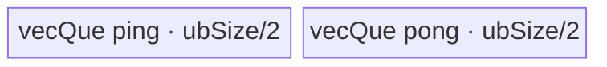
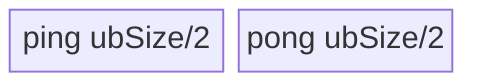
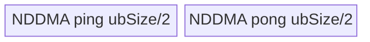
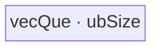

# ReplicationPad3d 950 ACLNN 算子知识

## 算子速览

| 项目 | 内容 |
|---|---|
| 实际入口 | `aclnnReplicationPad3dGetWorkspaceSize` + `aclnnReplicationPad3d`，公开 ACLNN 两段式接口，无更高版本符号。 |
| 计算语义 | 对最后三轴 D/H/W 做 edge padding；输出坐标 `o_k` 映射到输入 `i_k=clamp(o_k-p^-_k,0,I_k-1)`，前导轴恒等。负 padding 表示裁剪。 |
| 输入输出 | `self/out` 为 4D 或 5D ND、同 dtype/同 view format；950 支持 BOOL、整数、FP16/BF16/FP32/FP64、复数及 HIFLOAT8/FP8；`padding` 为 6 个 INT64，顺序 W左/右、H上/下、D前/后。 |
| 执行类型 | 非空：单 Kernel；R-001/R-002 为 SIMT，R-003～R-005 为 AIV_VECTOR/MicroAPI，R-006～R-013 为 AIV 搬运或 NDDMA。空输入由 ACLNN Host 提前返回。入口 `pad_v3` 明确 `KERNEL_TYPE_AIV_ONLY`，无 Cube/AIC/MIX_CV 节点。 |
| Kernel 路线 | R-001 32 位索引 SIMT；R-002 64 位索引 SIMT；R-003 切尾轴；R-004 正常宽度 2/3/4 轴；R-005 小尾轴 Gather 2/3/4 轴；R-006～R-013 为纯负 padding 的 Slice MoveAlign/NDDMA/Gather 特化。 |
| 核心资源 | GM 输入/输出；SIMT 无显式 AIV UB；Vector 路线使用双缓冲 TQue/TBuf、RegTensor；Slice 路线使用双缓冲 UB 或 NDDMA；所有非空路线申报 16 MiB system workspace，但 kernel body 不读 `workspace`。 |
| 来源闭包 | `source_closed`：公开 ACLNN、950 Host 选择、Tiling/POD、全部可达 router/body、Slice 直接依赖和构建接线闭合。 |
| 验证状态 | 已完成源码闭包检查；本次知识提取未执行编译、真机、数值或性能测试。 |

## 接口与语义

### 计算语义

设输入最后三轴为 `(D,H,W)`，padding 为 `(pWl,pWr,pHt,pHb,pDf,pDb)`，输出轴长分别为 `D'=D+pDf+pDb`、`H'=H+pHt+pHb`、`W'=W+pWl+pWr`。对每个输出位置：

```text
y[..., od, oh, ow] = x[..., clamp(od-pDf, 0, D-1),
                           clamp(oh-pHt, 0, H-1),
                           clamp(ow-pWl, 0, W-1)]
```

全非正 padding 且至少一个为负时，Host 将其化成 stride=1 的 Slice，语义退化为裁剪；正负混合时由 SIMT 的同一 `clamp` 映射同时完成裁剪和边界复制。4D 非 FP16/BF16/FP32 输入在 ACLNN 层先在轴 0 创建 size=1 的 view，再在计算后 squeeze 该 view；不搬运数据。

### 输入、输出与属性

| 参数 | shape/layout | dtype | 约束、默认值与语义 |
|---|---|---|---|
| `self` | ND，rank 4 或 5，可非连续 | 950：BOOL、INT8/16/32/64、UINT8/16/32/64、FP16/BF16/FP32/FP64、COMPLEX64/128、HIFLOAT8、FLOAT8_E5M2/E4M3FN/E8M0 | 非空时后三轴必须非零；Host 先 `Contiguous`。 |
| `padding` | 长度 6 | INT64 | 依次 W左/右、H上/下、D前/后；转换为 PadV3 rank×2 常量 tensor，前导轴补 0。 |
| `out` | 与 self rank、ND format 相同，可非连续 | 与 self 相同 | 前导轴等于 self，后三轴严格等于 self 加对应两侧 padding。 |
| `workspaceSize` | 标量输出 | UINT64 | executor 所有节点 workspace 之和；PadV3 Tiling 对非空节点申报 16 MiB。 |
| `executor` | Host 对象 | `aclOpExecutor**` | 第一段创建、第二段消费。 |
| `workspace/stream` | Device 指针/stream | N/A | 交给 `CommonOpExecutorRun`；PadV3 body 不使用 workspace 参数。 |

公开文档把“padding 大于等于对应输入轴”列为参数错误，但 `CheckShape` 只校验输出 shape，950 Tiling 的 edge 路线也没有该上界；固定源码因此不能证明该文档错误条件被执行。工程复用应以调用方显式保证的 shape 契约为准，不把未实现的文档检查当成 Host guard。

### 入口与版本

固定 Commit 只有 `aclnnReplicationPad3d` 这一公开版本族。950 由 `IsRegBase()` 分支选择：ACLNN 的 4D 非 FP16/BF16/FP32 情况因外层 `IsAiCoreSupport` 为 false 而增加 Unsqueeze/Squeeze view，但 `l0op::PadV3::IsAiCoreSupport` 在 RegBase 使用完整 `REPLICATION_PAD_REGBASE_AICORE_DTYPE_SUPPORT_LIST`，实际 PadV3 节点仍走 AICore/AIV。`PadV3` OpDef、ascend950 binary config、全局 binary config 与 CMake 均接到 `pad_v3_apt`/`arch35`。

## Host/Launcher 执行流程

### 参数校验与前处理

1. `OP_CHECK_COMM_INPUT` 检查 `workspaceSize/executor`，`CheckParams` 检查 self/padding/out 非空、950 dtype 集、view format 相同、rank 4/5、padding 长度 6、输出 shape。
2. 空 tensor：4D 一律报错；5D 仅允许 batch 轴为 0 且其余四轴非零，此时 workspace=0、释放 executor，不加入 PadV3 节点。
3. 非空 self 先 `l0op::Contiguous`。4D 且外层 `IsAiCoreSupport` 为 false 时，`UnsqueezeNd(axis=0)` 仅 `CreateView` 为 5D。
4. `GetPaddingTensor` 逆序构造 rank×2：4D 得 `[(0,0),(pDf,pDb),(pHt,pHb),(pWl,pWr)]`；5D 再多一个前导 `(0,0)`。
5. 950 调 `l0op::PadV3(self,paddings,nullptr,"edge",true)`；其 RegBase dtype selector 加入一个 AICore launcher。
6. 第 3 步产生 view 时对结果 `SqueezeNd(axis=0)`；最后 `ViewCopy` 写入调用者 out。

### 参数、Workspace 与生命周期

`PadV3Infershape` 从常量 paddings 生成节点输出 shape；`PadV3Tiling` 从平台读取 AIV core 数、UB、UB block、VReg 与 cache line，写 POD、`blockDim=coreNum_` 和 key。普通 edge/裁剪路线都申报 `16777216` 字节 system workspace；`pad_v3(x,paddings,constValues,y,workspace,tiling)` 的所有本算子 body 均未解引用 workspace。workspace、executor 和 stream 由 ACLNN 框架拥有；Contiguous/ViewCopy 的临时 tensor 生命期属于 executor。Unsqueeze/Squeeze 共享原 storage，只改变 view shape/offset。

### 启动图与失败传播

```text
aclnnReplicationPad3dGetWorkspaceSize
  -> Contiguous(self)
  -> [4D 且外层非 fp/bf16] UnsqueezeNd view(axis=0)
  -> GetPaddingTensor -> PadV3 infer/selector/tiling
  -> node K0: pad_v3(x, paddings, nullptr, y, workspace, PadACTilingData)
  -> [对应 4D view] SqueezeNd view(axis=0)
  -> ViewCopy(result, out)
aclnnReplicationPad3d -> CommonOpExecutorRun(..., stream)
```

K0 是唯一 Device 节点；输入、输出均为 ND GM tensor，POD 由运行时传入。无节点间 workspace edge。任一步返回 null/失败即第一段返回错误，不创建可运行 executor；第二段把统一 stream 交给框架，K0 launch 失败由 `CommonOpExecutorRun` 返回。

## Route 与参数设计

### 分核与资源计算

`DimensionCollapseMode` 删除“输入=1 且输出=1”的轴，并只合并连续的零 padding 轴；随后从尾到头计算 `inStride/outStride` 和元素总数。全非负路线以输出域切 UB；`ubTotalCount` 是 UB tile 总数，`ubPerCount=ceil(ubTotalCount/usedCoreNum)`，每核处理 `[blockIdx*ubPerCount,min(...)]`。Tiling 初始 AIV 核数来自平台，`TilingInfoTune` 要求每 tile 输入字节至少 4096，并尝试达到 80% 核利用率。

edge 的关键容量：`vectorSize=V`、`ubSize=U`、单 buffer 最大 64 KiB。切 W 候选 `buffer=min(alignV(U/2-V),64KiB)`；normal-W 的 `outTileSize` 与 `additionTileSize` 必须满足双份 UB；小 W 路线用 `alignV((U-2V)/4)` 选 tile。所有字节/元素换算用 `dtypeBytes`，最终 key 加 `(dimNum-ubAxis)*10`。

纯非正裁剪先构造 `begin=-leftPad`、`end=output+begin`、stride=1，再调用 Slice tiling；Slice 依据尾轴字节数、对齐、维数、输出总字节和 MoveAlign 参数位宽选择 100/101/102/103/150/300/301/400，外层 Pad key 为 `10000+sliceKey`。

### Route 选择

| 顺序 | Route | Key/模板 | 精确选择条件与优先级 | 不适用去向 |
|---:|---|---|---|---|
| 1 | R-006～R-013 纯裁剪 | 10100/10101/10102/10103/10150/10300/10301/10400 | 所有 padding `<=0` 且至少一个 `<0`；Slice 子 selector 再按尾轴/对齐/shape 选 key。 | 有正 padding → 2 |
| 2 | R-001/R-002 SIMT | 23000/23001 | padding 正负混合；或全非负且 `outElems<=4096`；或 collapse 后 `dimNum>4`；或 dimNum=4 且轴0有 pad。元素总数任一超过 INT32_MAX 时 23001，否则 23000。 | 全非负大 shape → 3 |
| 3 | R-003 切 W | 33010 | `alignV(outW*B)>buffer`，或 `2*alignV(outW*B)>buffer`，或调优后 ubAxis 落在尾轴，或 normal 路线 UB 预算失败。 | 4 |
| 4 | R-004 normal-W | 33021/33031/33041 | `outW*B>V/2`，且 UB 内覆盖轴数分别 2/3/4。 | 小 W → 5 |
| 5 | R-005 Gather | 33022/33032/33042 | `outW*B<=V/2`，UB 内覆盖轴数分别 2/3/4。 | 无其它 fallback；Tiling 失败即图失败。 |

```text
if all(p<=0) && any(p<0): SliceTiling -> 10000 + sliceKey
else if mixed_sign: key = (inElems>INT32_MAX || outElems>INT32_MAX) ? 23001 : 23000
else if outElems<=4096 || dimNum>4 || (dimNum==4 && pad(axis0)!=0): same SIMT choice
else if W/UB guards require cut-W: 33010
else if outW*B > V/2: 33020 + (dimNum-ubAxis)*10 + 1
else: 33020 + (dimNum-ubAxis)*10 + 2
```

### 模板/实现执行矩阵

| Route | key/selector | dtype/shape/platform 完整命中条件 | 执行拓扑与 Kernel 节点 | 实际模板/body | 内存与同步特征 | tail/fallback |
|---|---|---|---|---|---|---|
| R-001 | 23000 | 950，SIMT guard，元素总数均 `<=INT32_MAX` | 单 K0 | `PadEdgeSimt<same-size signed T>` | GM 直读写，2048 threads/core | grid-stride + `idx<outputSize` |
| R-002 | 23001 | 950，SIMT guard，任一总数 `>INT32_MAX` | 单 K0 | `PadEdgeSimtHuge<same-size signed T>` | GM 直读写，1/2D 1024 threads，3～8D 512 | uint64 索引 |
| R-003 | 33010 | 950，全非负，切尾轴 guard | 单 K0 | `KernelPadEdgeWithHugeWidth<uint{8,16,32,64}_t>` | depth2 bind queue；MTE2/V/MTE3 events | `copyLen=min(ubFactor,outW-start)` |
| R-004 | 33021/33031/33041 | 950，全非负，大 W，UB 内 2/3/4 轴 | 单 K0 | `KernelPadReplWithNormalWidth<T,KEY>` | 一个 TBuf 划成两个 ping-pong 子区；LoopMode + MicroAPI | 最后 tile/行单独搬出 |
| R-005 | 33022/33032/33042 | 950，全非负，小 W，UB 内 2/3/4 轴 | 单 K0 | `PadEdgeGather<T,KEY>` | in/out depth2 + `2*V` idx TBuf | mask/gather 只提交有效 tile |
| R-006 | 10100 | Slice MoveAlign，UB 非尾轴 | 单 K0 | `SliceMoveAlign<T,int32_t>` | UB depth2，compact MoveAlignV2 | main/tail tile |
| R-007 | 10101 | Slice MoveAlign，UB 尾轴/纯搬运 | 单 K0 | `SliceMoveAlignLastDim<T,int32_t>` | UB depth2 | main/tail |
| R-008 | 10150 | Slice 二维、blk/ub 均切轴0 | 单 K0 | `SliceMoveAlignTwoDim<T,int32_t>` | UB depth2 | main/tail |
| R-009 | 10102 | Slice NDDMA，UB 非尾轴 | 单 K0 | `SliceNDDMA<T,int32_t>` | 5D MultiCopy + UB depth2 | main/tail loop graph |
| R-010 | 10103 | Slice NDDMA，UB 尾轴 | 单 K0 | `SliceNDDMALastDim<T,int32_t>` | 1D MultiCopy + UB depth2 | main/tail |
| R-011 | 10300 | Slice 小尾轴 Gather | 单 K0 | `SliceMoveAlignGather<T,int32_t>` | in/out queue + 2V index | Gather mask tail |
| R-012 | 10301 | Slice 非对齐输入 Gather | 单 K0 | `SliceMoveAlignDataCopyUnalign<T,int32_t>` | in/out queue，UnalignReg | post-update tail |
| R-013 | 10400 | Slice 二维小 shape 特化 | 单 K0 | `SliceTwoDimSmallShape<T,int32_t>` | 单 UB buffer | 每核行尾保护 |

### 隐藏性能 Guard

| Guard | Host/Tiling 条件 | Device/资源原因 | 影响 Route | 不满足时去向 | 源码符号 |
|---|---|---|---|---|---|
| 索引位宽 | `inElems>INT32_MAX \|\| outElems>INT32_MAX` | 23000 的 shape/stride/index 为 uint32 | R-001 | R-002 | `DoTilingWithSIMTEdge` |
| SIMT 小域 | `outElems<=4096` | 避免小域建立 UB/Vector tile | R-001/2 | Vector selector | `CalculateTilingKeyEdge` |
| MoveAlignV2 轴数 | `dimNum>4` 或 4 轴且轴0 pad | normal body最多在 UB 内展开4轴且不处理 N 轴 padding | R-001/2 | R-003～5 | `CalculateTilingKeyEdge` |
| 单 buffer 上限 | `bufferSize<=64KiB` | AscendC buffer 分配上限 | R-003～5 | 切 W | `UB_MAX_DATA_SIZE_PER_BUFFER` |
| 大/小 W | `outW*B > V/2` | normal-W 与 Gather 的寄存器索引策略分界 | R-004/R-005 | 对方路线 | `CalculateTilingKeyEdge` |
| tile 下限 | `factor*inStride*B >=4096` | 调优拒绝过小每核 tile | R-003～5 | 保留旧 tile | `GetOptimizeTiling` |
| Slice MoveAlign 位宽 | blockCount/loop size `<=UINT16_MAX`，src stride `<=UINT32_MAX` | primitive 参数位宽 | R-006～8 | 降维或 NDDMA/Gather | `MovAlignV2UbSplitLast*Dim` |
| Slice Gather | 尾轴输出 `<64B` 且输入/输出稀疏、维数 `<=4` 等完整谓词 | 少搬无效尾轴字节 | R-011/12 | MoveAlign/NDDMA | `SliceTiling::CalMaxSplitDim` |

### POD/ABI

固定仓未提供 `static_assert(sizeof/offsetof)`；下表 ABI 布局列只给字段顺序和数组长度，不臆造编译器 padding。所有 Pad 主路线字段由 `FillsAndPrintTilingData` 写入、对应 body 读取；Slice 字段由各 `FillSliceTilingData*` 写入、`SliceBase`/子类读取。

| 结构 | 字段 | 类型/位宽 | ABI 布局 | 单位 | Host/launcher producer | Device consumer | 边界 |
|---|---|---|---|---|---|---|---|
| `PadACTilingData` | `dimNum` | uint8/8 | 第1字段 | 轴 | collapse 后 `dimNum_` | router/body 维度分支 | 1～8 |
| 同上 | `ubAxis` | uint8/8 | 第2字段 | 轴索引 | `ubAxis_` | tile 解码 | `<dimNum` |
| 同上 | `ubFactor` | uint32/32 | 第3字段 | 元素 | `ubFactor_` | 每 tile 轴长 | 窄化自 uint64 |
| 同上 | `ubPerCount` | uint32/32 | 第4字段 | tile/core | `ubPerCount_` | 核循环终点 | 0 保护由 start/end |
| 同上 | `ubTotalCount` | uint32/32 | 第5字段 | tile | `ubTotalCount_` | 核分工 | 窄化自 int64 |
| 同上 | `outTileSize` | uint32/32 | 第6字段 | 字节 | `outTileSize_` | InitBuffer | `<=64KiB` 或路线公式 |
| 同上 | `additionTileSize` | uint32/32 | 第7字段 | 字节 | `additionTileSize_` | UB 子区 offset | V/对齐行/额外索引区 |
| 同上 | `inShape[8]` | uint64×8 | 第8字段 | 元素 | input shape/collapse | 地址、clamp | inactive 尾项不读 |
| 同上 | `outShape[8]` | uint64×8 | 第9字段 | 元素 | `in+left+right` | output 地址/tail | 不得为负 |
| 同上 | `inStride[8]` | uint64×8 | 第10字段 | 元素 | 后缀乘积 | GM input offset | 可能超 uint32，SIMT64 处理 |
| 同上 | `outStride[8]` | uint64×8 | 第11字段 | 元素 | 后缀乘积 | GM output offset | 同上 |
| 同上 | `leftPad[8]` | int64×8 | 第12字段 | 元素 | padding front | clamp/UB padding | 可负；Slice 路线换 POD |
| `SliceBaseTilingData` | `isBeginConst` | int8/8 | 第1字段 | bool | true（Pad 内联 begin） | `ParseBaseTilingData` | false 分支本入口不活跃 |
| 同上 | `blkFactor` | int64/64 | 第2字段 | 输出轴元素 | Slice block split | 核行数 | >0 |
| 同上 | `blkTailFactor` | int64/64 | 第3字段 | 元素 | 同上 | 尾核 | 0 表整除 |
| 同上 | `ubInLoopSteps` | int64/64 | 第4字段 | 输入元素 | Slice rows steps | GM input 步长 | stride=1 |
| 同上 | `ubSize` | int32/32 | 第5字段 | 字节 | UB split | InitBuffer | 分 route |
| 同上 | `ubFactor` | int32/32 | 第6字段 | 元素 | UB split | main tile | >0 |
| 同上 | `ubTailFactor` | int32/32 | 第7字段 | 元素 | UB split | tail | 0 表整除 |
| 同上 | `ubTailTailFactor` | int32/32 | 第8字段 | 元素 | blk/ub 同轴尾部 | 尾核尾 tile | inactive 为0 |
| 同上 | `realCoreNum` | int16/16 | 第9字段 | core | block split | block guard | 窄化 |
| 同上 | `inputDims` | int16/16 | 第10字段 | 轴 | rank | 解析循环 | 2～5（collapse 后） |
| 同上 | `blkIndex` | int16/16 | 第11字段 | 轴 | block split | 核地址 | 有效轴 |
| 同上 | `ubIndex` | int16/16 | 第12字段 | 轴 | UB split | tile 地址 | 有效轴 |
| 同上 | `outputShape[8]` | int64×8 | 第13字段 | 元素 | crop 输出 | 行映射 | inactive 不读 |
| 同上 | `begin[8]` | int64×8 | 第14字段 | 元素 | `-leftPad` | input base | 非负裁剪起点 |
| 同上 | `inputSteps[8]` | int64×8 | 第15字段 | 元素 | 输入后缀积 | GM input 地址 | stride=1 |
| 同上 | `rowsOffsetSteps[8]` | int64×8 | 第16字段 | 行 | 输出后缀积 | core 行 offset | 尾轴不含在行数 |
| `StridedSliceMoveAlignParams2` | `blockCount` | uint16/16 | 第1字段 | block | MoveAlign selector | DataCopy | 位宽 guard |
| 同上 | `blockLen` | uint32/32 | 第2字段 | 字节 | selector | DataCopy | 位宽 guard |
| 同上 | `srcStride` | uint32/32 | 第3字段 | 字节 | selector | DataCopy（转为尾头间隔） | 位宽 guard |
| 同上 | `dstStride` | uint32/32 | 第4字段 | 字节 | selector | DataCopy | 位宽 guard |
| 同上 | `loop1Size` | uint16/16 | 第5字段 | 次 | selector | LoopMode | 0/1 表 inactive |
| 同上 | `loop2Size` | uint16/16 | 第6字段 | 次 | selector | LoopMode | 0/1 表 inactive |
| 同上 | `loop1SrcStride` | uint32/32 | 第7字段 | 字节 | selector | LoopMode | 位宽 guard |
| 同上 | `loop2SrcStride` | uint32/32 | 第8字段 | 字节 | selector | LoopMode | 位宽 guard |
| 同上 | `loop1DstStride` | uint16/16 | 第9字段 | 字节 | selector | LoopMode | 位宽 guard |
| 同上 | `loop2DstStride` | uint16/16 | 第10字段 | 字节 | selector | LoopMode | 位宽 guard |
| `SliceNDDMATilingData` | `ubOutLoopSteps` | int64/64 | base 后第1字段 | 输出元素 | Slice rows | CopyOut offset | main/tail |
| 同上 | `nddmaTotalNum` | int64/64 | base 后第2字段 | 元素 | NDDMA loop 乘积 | copyOut blockLen | 正数 |
| 同上 | `nddmaLoopSize[5]` | int64×5 | base 后第3字段 | 次 | `SetNddmaTilingMode` | MultiCopy loopSize | inactive 为0 |
| 同上 | `nddmaLoopSrcStride[5]` | int64×5 | base 后第4字段 | 元素 | 同上 | MultiCopy src stride | stride=1 的折叠乘积 |
| 同上 | `nddmaLoopDstStride[5]` | int64×5 | base 后第5字段 | 元素 | 同上 | MultiCopy dst stride | 连续输出 |
| `SliceMoveAlignGatherTilingData` | `ubOutLoopSteps` | int64/64 | base 后第1字段 | 输出元素 | Slice rows | GM output offset | main/tail |
| 同上 | `ubSizeInput` | int32/32 | base 后第2字段 | 字节 | Gather UB split | inQue | 与 out UB 分开 |
| 同上 | `lastOneInputDim` | uint32/32 | base 后第3字段 | 元素 | input tail dim | index/gather | 位宽已 guard |
| 同上 | `outBlockLen` | uint32/32 | base 后第4字段 | 字节 | Gather selector | CopyOut | main/tail重算 |
| 同上 | `moveAlignParams` | 嵌套结构 | base 后第5字段 | 混合 | selector | CopyIn/LoopMode | 逐字段如上 |
| `SliceTwoDimSmallSapeTilingData` | `isBeginConst` | int8/8 | 第1字段 | bool | true | Init | 本入口恒 true |
| 同上 | `realCoreNum` | int16/16 | 第2字段 | core | block split | core guard | 窄化 |
| 同上 | `mainCoreNum` | int16/16 | 第3字段 | core | block split | 主/尾核分支 | 窄化 |
| 同上 | `ubSize` | uint32/32 | 第4字段 | 字节 | small-shape selector | buffer | 位宽 guard |
| 同上 | `blockLen` | uint32/32 | 第5字段 | 字节 | small-shape selector | copy | 位宽 guard |
| 同上 | `blkFactor` | uint32/32 | 第6字段 | 行 | small-shape selector | core 行数 | 位宽 guard |
| 同上 | `lastOneInputDim` | uint64/64 | 第7字段 | 元素 | 2D input shape | GM 输入 stride | 正数 |
| 同上 | `lastOneOutputDim` | uint64/64 | 第8字段 | 元素 | 2D output shape | GM 输出 stride | 正数 |
| 同上 | `lastOneDimOffset` | uint64/64 | 第9字段 | 元素 | begin | GM 输入偏移 | 非负 |

### Route 源码闭包

| Route | Key/selector | Host/Tiling producer | POD/参数 | Kernel entry/router 节点 | Kernel body/直接依赖 | 构建接线 |
|---|---|---|---|---|---|---|
| R-001/2 | 23000/23001 | `PadACTiling::DoTilingWithSIMTEdge` | `PadACTilingData` | `pad_v3` → `LaunchKernelPadEdgeSimt*` | `PadEdgeSimt::Process` / `PadEdgeSimtHuge::Process` | PadV3 ascend950 arch35 |
| R-003 | 33010 | `CalculateTilingKeyEdge` | 同上 | `pad_v3` → HugeWidth launcher | `KernelPadEdgeWithHugeWidth` | 同上 |
| R-004 | 33021/31/41 | 同上 | 同上 | normal-W launcher | `KernelPadReplWithNormalWidth<T,KEY>` | 同上 |
| R-005 | 33022/32/42 | 同上 | 同上 | gather launcher | `PadEdgeGather<T,KEY>` | 同上 |
| R-006～13 | 10000+Slice key | `DoTilingWithSliceOp` → `SliceTilingForAscendC` | 各 Slice POD | `pad_v3` else router → `PadSlice*Process` | Slice MoveAlign/NDDMA/Gather/SmallShape 类 | PadV3 `DEPENDENCIES slice` |

## Kernel 实现

### 公共执行流程

所有非空 route 都从 `pad_v3(x,paddings,constValues,y,workspace,tiling)` 进入；entry 先声明 AIV-only，再按 key 精确分发。edge body 按 `sizeof(DTYPE_X)` 映射到同位宽无符号/有符号载体，仅复制比特，不进行数值 cast。每核只写互斥输出 tile，故无跨核 atomic/barrier。普通 route 申报 workspace 但 body 不读；同步仅发生在单核 UB 的 MTE2→Vector→MTE3 或 TQue 生命周期中。

### Route R-001：32 位索引 SIMT

#### 适用条件

##### 选择证据

| 层级 | 文件 | 符号 | 源码谓词/参数 | 结果/下一跳 |
|---|---|---|---|---|
| Tiling | `pad_v3_tiling_arch35.cpp` | `CalculateTilingKeyEdge/DoTilingWithSIMTEdge` | SIMT guard 且两总元素数不超 INT32_MAX | 23000 |
| Router | `pad_v3_apt.cpp` | `pad_v3` | `TILING_KEY_IS(EDGE_SIMT_BRANCH)` | `LaunchKernelPadEdgeSimt` |

#### Device 数据流

##### 函数级调用链

```text
pad_v3 -> LaunchKernelPadEdgeSimt<T> -> PadEdgeSimt<same-size T>::Init -> Process
  -> asc_vf_call<SimtComputeEdgeDim{1..8}>
```

##### 源码等价伪码

```text
for idx = blockIdx*2048 + threadIdx; idx < outElems; idx += blockNum*2048:
  outCoord = divmod_magic(idx, outStride[])
  inCoord[d] = clamp(int32(outCoord[d]) - int32(leftPad[d]), 0, inShape[d]-1)
  y[idx] = x[sum(inCoord[d]*inStride[d])]
```

#### 内存与数据搬运

##### 资源与搬运表

| 层级/缓冲区 | offset/地址公式 | extent/容量公式 | dtype/layout | producer | consumer | owner/lifetime | 对齐/复用 |
|---|---|---|---|---|---|---|---|
| GM x/y | 输入为 `Σi*inStride`；输出 `idx` | 全 tensor | 同位宽 T/ND | Host | SIMT thread | executor/K0 | 每线程1元素 |

##### 分层内存布局

N/A：该 SIMT route 不调用 `InitBuffer`，寄存器保存坐标、magic/shift 和一个元素。

##### 字节账与复用顺序

```text
UB_total = 0（无显式 AIV UB）
dynamic_ub = 0（固定 asc_vf_call thread dim）
workspace_total = 16 MiB system workspace；body 不访问
```

| 复用子区 | 写入者 | 读取者/消费点 | 下一次覆盖 | 同步或释放依据 | 安全条件 |
|---|---|---|---|---|---|
| 寄存器坐标 | 当前 thread | 当前 thread GM load/store | 下一 loop idx | thread 私有 | `idx<outElems` |

#### 同步、精度与尾块

##### 同步与数值边界表

| 阶段 | primitive/机制 | producer | consumer/等待点 | 保护对象 | 精度/尾块 |
|---|---|---|---|---|---|
| GM 映射 | SIMT grid-stride | 每线程 | 本线程 | 单输出元素 | bitwise copy；尾由 `idx<outputSize` |

#### 关键实现

##### 符号证据表

| 阶段 | 文件 | 符号/模板实例 | 实现事实 |
|---|---|---|---|
| Host/Tiling producer | `pad_v3_tiling_arch35.cpp` | `DoTilingWithSIMTEdge` | 32/64 位 key 分界 |
| Kernel entry/router | `pad_v3_apt.cpp` | `EDGE_SIMT_BRANCH` | key→launcher |
| Device body/helper | `pad_edge_simt.h` | `SimtComputeEdgeDimOne..Eight` | divmod、clamp、grid-stride |

### Route R-002：64 位索引 SIMT

#### 适用条件

##### 选择证据

| 层级 | 文件 | 符号 | 源码谓词/参数 | 结果/下一跳 |
|---|---|---|---|---|
| Tiling | `pad_v3_tiling_arch35.cpp` | `DoTilingWithSIMTEdge` | `inShapeSize_>INT32_MAX \|\| outShapeSize_>INT32_MAX` | 23001 |

#### Device 数据流

##### 函数级调用链

```text
pad_v3 -> LaunchKernelPadEdgeSimtHuge -> PadEdgeSimtHuge::Process
  -> SimtComputeEdgeHugeDim{1..8}
```

##### 源码等价伪码

```text
同 R-001，但 idx/shape/stride/coordinate 全为 uint64/int64；1/2D 用1024线程，3..8D用512线程。
```

#### 内存与数据搬运

##### 资源与搬运表

| 层级/缓冲区 | offset/地址公式 | extent/容量公式 | dtype/layout | producer | consumer | owner/lifetime | 对齐/复用 |
|---|---|---|---|---|---|---|---|
| GM x/y | 64位 `Σi*stride` / `idx` | 全 tensor | 同位宽 T/ND | Host | SIMT | K0 | 1元素/线程 |

##### 分层内存布局

N/A：无显式 UB。

##### 字节账与复用顺序

```text
UB_total=0; dynamic_ub=0; workspace_total=16 MiB（未读）
```

| 复用子区 | 写入者 | 读取者/消费点 | 下一次覆盖 | 同步或释放依据 | 安全条件 |
|---|---|---|---|---|---|
| thread 寄存器 | 当前迭代 | 当前 GM store | 下一迭代 | thread 私有 | uint64 边界判断 |

#### 同步、精度与尾块

##### 同步与数值边界表

| 阶段 | primitive/机制 | producer | consumer/等待点 | 保护对象 | 精度/尾块 |
|---|---|---|---|---|---|
| GM 映射 | grid-stride | thread | thread | y[idx] | bitwise；`idx<outputSize` |

#### 关键实现

##### 符号证据表

| 阶段 | 文件 | 符号/模板实例 | 实现事实 |
|---|---|---|---|
| Host/Tiling producer | `pad_v3_tiling_arch35.cpp` | `DoTilingWithSIMTEdge` | INT32_MAX guard |
| Kernel entry/router | `pad_v3_apt.cpp` | `EDGE_SIMT_BIG_SIZE_BRANCH` | key→huge launcher |
| Device body/helper | `pad_edge_simt_huge.h` | `SimtComputeEdgeHugeDim*` | 64位地址与分层 thread dim |

### Route R-003：切尾轴 Vector

#### 适用条件

##### 选择证据

| 层级 | 文件 | 符号 | 源码谓词/参数 | 结果/下一跳 |
|---|---|---|---|---|
| Tiling | `pad_v3_tiling_arch35.cpp` | `CalculateTilingKeyEdge` | W 行或 normal UB guard 不能容纳 | 33010 |

#### Device 数据流

##### 函数级调用链

```text
pad_v3 -> LaunchKernelPadEdgeWithHugeWidth -> KernelPadEdgeWithHugeWidth::Init/Process
  -> CopyIn -> PadOneLine/PadBothSide -> CopyOut
```

##### 源码等价伪码

```text
for tile assigned to core:
  decode outIndex; clamp outer axes; find intersection [padWLeft,padWLeft+inW)
  DMA valid segment into UB at additionOffset+alignedLeft
  duplicate left/right edge values; MicroAPI patches unaligned left and repeats right
  DMA min(ubFactor,outW-startW) valid elements to y
```

#### 内存与数据搬运

##### 资源与搬运表

| 层级/缓冲区 | offset/地址公式 | extent/容量公式 | dtype/layout | producer | consumer | owner/lifetime | 对齐/复用 |
|---|---|---|---|---|---|---|---|
| bind queue | logical output starts `additionTileSize/B` | depth2 × `(outTileSize+additionTileSize)` bytes | T | MTE2/Vector | MTE3 | TPipe/K0 | allocation already含 depth |
| addition region | buffer base | `additionTileSize=V` | T | remainder DMA/edge scalar | MicroAPI | tile | reused next tile after events |
| output region | base+addition | `outTileSize` | T | DMA+Duplicate | CopyOut | tile | tail blockLen exact |

##### 分层内存布局


##### 字节账与复用顺序

```text
UB_total = 2 * (outTileSize + additionTileSize)
UB_total <= ubSize（Host buffer 公式）
dynamic_ub=N/A
workspace_total=16 MiB（未读）
```

| 复用子区 | 写入者 | 读取者/消费点 | 下一次覆盖 | 同步或释放依据 | 安全条件 |
|---|---|---|---|---|---|
| queue tensor | CopyIn/PadBothSide | CopyOut | `FreeTensor` 后下一 tile | MTE2_V、V_MTE3、MTE2_MTE3 events | CopyOut 完成前不覆盖 |

#### 同步、精度与尾块

##### 同步与数值边界表

| 阶段 | primitive/机制 | producer | consumer/等待点 | 保护对象 | 精度/尾块 |
|---|---|---|---|---|---|
| DMA→scalar/vector | SetFlag/WaitFlag MTE2_V/MTE2_S | CopyIn | Duplicate/MicroAPI | UB input | 无 cast |
| Vector→DMA | V_MTE3/MTE2_MTE3 | PadBothSide | CopyOut | UB output | exact blockLen tail |

#### 关键实现

##### 符号证据表

| 阶段 | 文件 | 符号/模板实例 | 实现事实 |
|---|---|---|---|
| Host/Tiling producer | `pad_v3_tiling_arch35.cpp` | `CalculateTilingKeyEdge` | 33010 与 UB 公式 |
| Kernel entry/router | `pad_v3_apt.cpp` | `EDGE_CUT_LAST_DIM_BRANCH` | HugeWidth launcher |
| Device body/helper | `pad_edge_huge_width.h` | `CopyIn/PadBothSide/CopyOut` | 对齐修补、边值复制、tail |

### Route R-004：正常宽度多轴 Vector

#### 适用条件

##### 选择证据

| 层级 | 文件 | 符号 | 源码谓词/参数 | 结果/下一跳 |
|---|---|---|---|---|
| Tiling | `pad_v3_tiling_arch35.cpp` | `CalculateTilingKeyEdge` | `outW*B>V/2` 且 UB 内轴数2/3/4 | 33021/33031/33041 |

#### Device 数据流

##### 函数级调用链

```text
pad_v3 -> LaunchKernelPadEdgeWithNormalWidth<T,KEY>
 -> KernelPadReplWithNormalWidth::Process
 -> CopyandProcess{2D,3D,4D} -> PadLeft/Right/CopySame/CopyDiff -> CopyOut
```

##### 源码等价伪码

```text
for tile:
  DMA rectangular valid interior with DataCopyPad + LoopMode(最多2层)
  broadcast each row's first/last scalar across W padding
  copy first/last valid H/C/D plane into padded planes using RegTensor
  DMA contiguous rows; if W unaligned, write all but last row then exact last row
```

#### 内存与数据搬运

##### 资源与搬运表

| 层级/缓冲区 | offset/地址公式 | extent/容量公式 | dtype/layout | producer | consumer | owner/lifetime | 对齐/复用 |
|---|---|---|---|---|---|---|---|
| TBuf ping/pong | parity×tileBytes | `2*(outTileSize+additionTileSize)` | T/UB padded tile | MTE2 | MicroAPI/MTE3 | K0 | parity events |
| addition | tile base | aligned W/aux | T | DMA interior | padding helpers | tile | same physical TBuf |
| output area | +additionOffset | out tile | T | helpers | MTE3 | tile | masked block tails |

##### 分层内存布局


##### 字节账与复用顺序

```text
UB_total=2*(outTileSize+additionTileSize) <= ubSize
workspace_total=16 MiB（未读）
```

| 复用子区 | 写入者 | 读取者/消费点 | 下一次覆盖 | 同步或释放依据 | 安全条件 |
|---|---|---|---|---|---|
| parity tile | MTE2+Vector | MTE3 | 同 parity 下一 tile | EVENT_ID0/1 的 MTE2_V、V_MTE3、MTE3_MTE2 | `lastOut_` 收口 |

#### 同步、精度与尾块

##### 同步与数值边界表

| 阶段 | primitive/机制 | producer | consumer/等待点 | 保护对象 | 精度/尾块 |
|---|---|---|---|---|---|
| interior | LoopMode DataCopyPad | GM | padding helper | UB rectangle | byte-exact dtype |
| pad planes | broadcast load + masked RegTensor store | valid edge | output UB | left/right/up/down/front/back | B64 拆成 B32 后 Interleave |
| CopyOut | parity events | Vector | MTE3 | y rows | unaligned W 最后一行 exact blockLen |

#### 关键实现

##### 符号证据表

| 阶段 | 文件 | 符号/模板实例 | 实现事实 |
|---|---|---|---|
| Host/Tiling producer | `pad_v3_tiling_arch35.cpp` | `DoFindSplitAxis/TilingInfoTuneForNormal` | key 尾两位与轴数 |
| Kernel entry/router | `pad_v3_apt.cpp` | 33021/31/41 | specialization |
| Device body/helper | `pad_edge_normal_w.h` | `CopyandProcess2D/3D/4D` | LoopMode、平面复制、ping-pong |

### Route R-005：小尾轴 Gather Vector

#### 适用条件

##### 选择证据

| 层级 | 文件 | 符号 | 源码谓词/参数 | 结果/下一跳 |
|---|---|---|---|---|
| Tiling | `pad_v3_tiling_arch35.cpp` | `CalculateTilingKeyEdge` | `outW*B<=V/2`，UB内2/3/4轴 | 33022/32/42 |

#### Device 数据流

##### 函数级调用链

```text
pad_v3 -> LaunchKernelPadEdgeGather<T,KEY> -> Init/Process
 -> GenGatherIndex{ThreeDim} -> CopyIn -> GatherProcessUb{2D,3D,4D} -> CopyOut
```

##### 源码等价伪码

```text
build two V-length index tables: pure-padding edge index and valid-axis index
for tile: DMA minimal valid input; choose per-axis left/input/right loop counts;
MicroAPI DataCopyGather into output queue with masks; DMA exact valid output extent
```

#### 内存与数据搬运

##### 资源与搬运表

| 层级/缓冲区 | offset/地址公式 | extent/容量公式 | dtype/layout | producer | consumer | owner/lifetime | 对齐/复用 |
|---|---|---|---|---|---|---|---|
| inQue | queue slot | depth2×outTileSize | T | GM DMA | Gather | K0 | queue protocol |
| outQue | queue slot | depth2×outTileSize | T | Gather | GM DMA | K0 | queue protocol |
| idxBuf | [0,V) pad; [V,2V) valid | `2*V` bytes | int16/int32 index | GenGatherIndex | Gather helpers | K0 persistent | reused all tiles |

##### 分层内存布局


##### 字节账与复用顺序

```text
UB_total=2*outTileSize + 2*outTileSize + 2*V
Host bufferSize=alignV((U-2V)/4)，故 UB_total<=U
workspace_total=16 MiB（未读）
```

| 复用子区 | 写入者 | 读取者/消费点 | 下一次覆盖 | 同步或释放依据 | 安全条件 |
|---|---|---|---|---|---|
| in/out queue slots | DMA/Gather | Gather/DMA | FreeTensor 后 | EnQue/DeQue/FreeTensor | depth2 |
| idxBuf | Init index generator | 全 tile | kernel结束 | TBuf 独占 | shape不变 |

#### 同步、精度与尾块

##### 同步与数值边界表

| 阶段 | primitive/机制 | producer | consumer/等待点 | 保护对象 | 精度/尾块 |
|---|---|---|---|---|---|
| queue | TQue protocol | CopyIn/Gather | DeQue | UB tensors | 无 cast；B8 用更宽 index/CastType 后 pack |
| mask | `UpdateMask`/left-right counts | Host POD | Gather stores | 最后一 VL | 仅有效 `copyOutNum` 写 GM |

#### 关键实现

##### 符号证据表

| 阶段 | 文件 | 符号/模板实例 | 实现事实 |
|---|---|---|---|
| Host/Tiling producer | `pad_v3_tiling_arch35.cpp` | `CalculateTilingKeyEdge` | small-W key |
| Kernel entry/router | `pad_v3_apt.cpp` | 33022/32/42 | Gather specialization |
| Device body/helper | `pad_edge_gather.h` | `GenGatherIndex/GatherProcessUb*` | 两套索引与3种轴展开 |

### Route R-006：裁剪 MoveAlign 非尾轴

#### 适用条件

##### 选择证据

| 层级 | 文件 | 符号 | 源码谓词/参数 | 结果/下一跳 |
|---|---|---|---|---|
| Slice Tiling | `slice_tiling_arch35.cpp` | `CalMaxSplitDim/SetMovAlignV2TilingMode` | crop stride=1，尾轴输出字节≥保留阈值，UB非尾轴 | slice 100→Pad 10100 |

#### Device 数据流

##### 函数级调用链

```text
pad_v3 -> PadSliceMoveAlignProcess -> SliceMoveAlign::Init/Process -> ProcessPerBlock
```

##### 源码等价伪码

```text
decode core row range; for each UB loop: SetLoopMode; compact DataCopyPad GM->UB rectangle;
ResetLoopMode; DataCopyPad UB->contiguous GM; repeat tail with tail params
```

#### 内存与数据搬运

##### 资源与搬运表

| 层级/缓冲区 | offset/地址公式 | extent/容量公式 | dtype/layout | producer | consumer | owner/lifetime | 对齐/复用 |
|---|---|---|---|---|---|---|---|
| vecQue | core/tile GM offsets from SliceBase | `2*(ubSize/2)=ubSize` | T | compact DMA | CopyOut | K0 | depth2 |

##### 分层内存布局



##### 字节账与复用顺序

```text
UB_total=ubSize; workspace_total=16 MiB（未读）
```

| 复用子区 | 写入者 | 读取者/消费点 | 下一次覆盖 | 同步或释放依据 | 安全条件 |
|---|---|---|---|---|---|
| queue slot | DataCopyPad | DataCopyPad out | FreeTensor | TQue | tail params match slot extent |

#### 同步、精度与尾块

##### 同步与数值边界表

| 阶段 | primitive/机制 | producer | consumer/等待点 | 保护对象 | 精度/尾块 |
|---|---|---|---|---|---|
| DMA | TQue + LoopMode | GM | GM output | crop tile | bitwise；main/tail separate |

#### 关键实现

##### 符号证据表

| 阶段 | 文件 | 符号/模板实例 | 实现事实 |
|---|---|---|---|
| Host/Tiling producer | `slice_tiling_arch35.cpp` | `SetTilingMode` | MoveAlign route |
| Kernel entry/router | `pad_slice.h` | `PadSliceMoveAlignProcess` | key→class |
| Device body/helper | `slice_move_align.h` | `ProcessPerBlock` | compact DMA + tail |

### Route R-007：裁剪 MoveAlign 尾轴

#### 适用条件

##### 选择证据

| 层级 | 文件 | 符号 | 源码谓词/参数 | 结果/下一跳 |
|---|---|---|---|---|
| Slice Tiling | `strided_slice_tiling_arch35.cpp` | `MovAlignV2UbSplitLastOneDim` | MoveAlign 且 ubIndex=last | 10101 |

#### Device 数据流

##### 函数级调用链

```text
pad_v3 -> PadSliceMoveAlignLastDimProcess -> SliceMoveAlignLastDim::Process
 -> ProcessPerBlockInLastDim / ProcessPerBlockNLastDim
```

##### 源码等价伪码

```text
for core rows and last-axis tiles: DMA contiguous main factor; DMA exact tail; write same extent to contiguous y
```

#### 内存与数据搬运

##### 资源与搬运表

| 层级/缓冲区 | offset/地址公式 | extent/容量公式 | dtype/layout | producer | consumer | owner/lifetime | 对齐/复用 |
|---|---|---|---|---|---|---|---|
| vecQue | begin + row/tile offset | ubSize depth2 total | T | GM | GM | K0 | main/tail |

##### 分层内存布局



##### 字节账与复用顺序

```text
UB_total=ubSize; workspace_total=16 MiB（未读）
```

| 复用子区 | 写入者 | 读取者/消费点 | 下一次覆盖 | 同步或释放依据 | 安全条件 |
|---|---|---|---|---|---|
| queue slot | CopyIn | CopyOut | FreeTensor | TQue | tail factor exact |

#### 同步、精度与尾块

##### 同步与数值边界表

| 阶段 | primitive/机制 | producer | consumer/等待点 | 保护对象 | 精度/尾块 |
|---|---|---|---|---|---|
| main/tail DMA | DataCopyPad | GM | GM | cropped W | no cast |

#### 关键实现

##### 符号证据表

| 阶段 | 文件 | 符号/模板实例 | 实现事实 |
|---|---|---|---|
| Host/Tiling producer | `strided_slice_tiling_arch35.cpp` | `MovAlignV2UbSplitLastOneDim` | 101 |
| Kernel entry/router | `pad_slice.h` | `PadSliceMoveAlignLastDimProcess` | class mapping |
| Device body/helper | `slice_move_align_last_dim.h` | `ProcessPerBlock*` | row/last-axis tail |

### Route R-008：裁剪二维 MoveAlign 特化

#### 适用条件

##### 选择证据

| 层级 | 文件 | 符号 | 源码谓词/参数 | 结果/下一跳 |
|---|---|---|---|---|
| Slice Tiling | base/slice tiling | `MovAlignV2UbSplitLastTwoDim` | collapse 后2D且 blk/ub 均切轴0 | 10150 |

#### Device 数据流

##### 函数级调用链

```text
pad_v3 -> PadSliceMoveAlignTwoDimProcess -> SliceMoveAlignTwoDim::Process
```

##### 源码等价伪码

```text
for axis0 tile: compact nburst rows GM->UB; one contiguous UB->GM output; repeat tail factor
```

#### 内存与数据搬运

##### 资源与搬运表

| 层级/缓冲区 | offset/地址公式 | extent/容量公式 | dtype/layout | producer | consumer | owner/lifetime | 对齐/复用 |
|---|---|---|---|---|---|---|---|
| vecQue | 2D row begin | ubSize total, depth2 | T | compact DMA | output DMA | K0 | ping-pong |

##### 分层内存布局


##### 字节账与复用顺序

```text
UB_total=ubSize; workspace_total=16 MiB（未读）
```

| 复用子区 | 写入者 | 读取者/消费点 | 下一次覆盖 | 同步或释放依据 | 安全条件 |
|---|---|---|---|---|---|
| queue slot | MTE2 | MTE3 | FreeTensor | TQue | blockCount uint16 guard |

#### 同步、精度与尾块

##### 同步与数值边界表

| 阶段 | primitive/机制 | producer | consumer/等待点 | 保护对象 | 精度/尾块 |
|---|---|---|---|---|---|
| 2D compact | DataCopyPad compact | x | y | rows | main/tail factor |

#### 关键实现

##### 符号证据表

| 阶段 | 文件 | 符号/模板实例 | 实现事实 |
|---|---|---|---|
| Host/Tiling producer | `strided_slice_tiling_arch35.cpp` | `MovAlignV2UbSplitLastTwoDim` | key150 |
| Kernel entry/router | `pad_slice.h` | `PadSliceMoveAlignTwoDimProcess` | mapping |
| Device body/helper | `slice_move_align_two_dim.h` | `Process` | 2D compact main/tail |

### Route R-009：裁剪 NDDMA 非尾轴

#### 适用条件

##### 选择证据

| 层级 | 文件 | 符号 | 源码谓词/参数 | 结果/下一跳 |
|---|---|---|---|---|
| Slice Tiling | `slice_tiling_arch35.cpp` | `CalMaxSplitDim/SetNddmaTilingMode` | MoveAlign/Gather 特化不命中，UB非尾轴 | 10102 |

#### Device 数据流

##### 函数级调用链

```text
pad_v3 -> PadSliceNDDMAProcess -> SliceNDDMA::Init/Process
 -> SetLoopInfo -> DataCopy<T,5,nddmaConfig> -> DataCopyPad out
```

##### 源码等价伪码

```text
build up to five nested loopSize/srcStride/dstStride in element units;
for core/tile: NDDMA MultiCopy cropped hyper-rectangle GM->UB; contiguous DMA UB->y; repeat tail loop graph
```

#### 内存与数据搬运

##### 资源与搬运表

| 层级/缓冲区 | offset/地址公式 | extent/容量公式 | dtype/layout | producer | consumer | owner/lifetime | 对齐/复用 |
|---|---|---|---|---|---|---|---|
| vecQue | SliceBase core/tile offset | ubSize total depth2 | T | NDDMA MultiCopy | MTE3 | K0 | ping-pong |

##### 分层内存布局



##### 字节账与复用顺序

```text
UB_total=ubSize; NDDMA intermediate=queue slots only; workspace_total=16 MiB（未读）
```

| 复用子区 | 写入者 | 读取者/消费点 | 下一次覆盖 | 同步或释放依据 | 安全条件 |
|---|---|---|---|---|---|
| queue slot | MultiCopy | CopyOut | FreeTensor | TQue | loop product <= tile extent |

#### 同步、精度与尾块

##### 同步与数值边界表

| 阶段 | primitive/机制 | producer | consumer/等待点 | 保护对象 | 精度/尾块 |
|---|---|---|---|---|---|
| 5D NDDMA | MultiCopyConfig `{false,0,0,false}` | GM | UB | crop rectangle | element strides；tail loopInfo |
| output | DataCopyPad | UB | GM | contiguous y | exact main/tail bytes |

#### 关键实现

##### 符号证据表

| 阶段 | 文件 | 符号/模板实例 | 实现事实 |
|---|---|---|---|
| Host/Tiling producer | base tiling | `SetNddmaTilingMode` | loop arrays/key102 |
| Kernel entry/router | `pad_slice.h` | `PadSliceNDDMAProcess` | mapping |
| Device body/helper | `slice_nddma.h` | `SetLoopInfo/ProcessPerBlock` | 5D MultiCopy graph |

### Route R-010：裁剪 NDDMA 尾轴

#### 适用条件

##### 选择证据

| 层级 | 文件 | 符号 | 源码谓词/参数 | 结果/下一跳 |
|---|---|---|---|---|
| Slice Tiling | base tiling | `SetNddmaTilingMode` | NDDMA 且 `ubSplitDimNumber==1` | 10103 |

#### Device 数据流

##### 函数级调用链

```text
pad_v3 -> PadSliceNDDMALastDimProcess -> SliceNDDMALastDim::Process
 -> ProcessPerBlockInLastDim/ProcessPerBlock -> DataCopy<T,1>
```

##### 源码等价伪码

```text
for each row and W tile: one-dimensional NDDMA stride copy GM->UB; contiguous UB->GM; tail uses tail factor
```

#### 内存与数据搬运

##### 资源与搬运表

| 层级/缓冲区 | offset/地址公式 | extent/容量公式 | dtype/layout | producer | consumer | owner/lifetime | 对齐/复用 |
|---|---|---|---|---|---|---|---|
| vecQue | row + last axis begin | ubSize depth2 | T | 1D NDDMA | output DMA | K0 | main/tail |

##### 分层内存布局


##### 字节账与复用顺序

```text
UB_total=ubSize; workspace_total=16 MiB（未读）
```

| 复用子区 | 写入者 | 读取者/消费点 | 下一次覆盖 | 同步或释放依据 | 安全条件 |
|---|---|---|---|---|---|
| queue slot | NDDMA | MTE3 | FreeTensor | TQue | 1D tail loopInfo |

#### 同步、精度与尾块

##### 同步与数值边界表

| 阶段 | primitive/机制 | producer | consumer/等待点 | 保护对象 | 精度/尾块 |
|---|---|---|---|---|---|
| 1D copy | MultiCopy | GM | UB/GM | cropped W | no cast；tail factor |

#### 关键实现

##### 符号证据表

| 阶段 | 文件 | 符号/模板实例 | 实现事实 |
|---|---|---|---|
| Host/Tiling producer | base tiling | `SetNddmaTilingMode` | key103 |
| Kernel entry/router | `pad_slice.h` | `PadSliceNDDMALastDimProcess` | mapping |
| Device body/helper | `slice_nddma_last_dim.h` | `SetLoopInfo/ProcessPerBlock*` | 1D MultiCopy |

### Route R-011：裁剪 MoveAlign Gather

#### 适用条件

##### 选择证据

| 层级 | 文件 | 符号 | 源码谓词/参数 | 结果/下一跳 |
|---|---|---|---|---|
| Slice Tiling | `slice_tiling_arch35.cpp` | `CalMaxSplitDim/SetSliceGatherTilingMode` | 小尾轴、稀疏度/总量/维数谓词，且非 unalign 特例 | 10300 |

#### Device 数据流

##### 函数级调用链

```text
pad_v3 -> PadSliceMoveAlignGatherProcess -> SliceMoveAlignGather::Process
 -> InitLoopIndex -> CopyIn -> GatherWithIndex -> CopyOut
```

##### 源码等价伪码

```text
prebuild last-two-axis indices; compact-load source rectangle; DataCopyGather only selected tail-axis values;
pack B8/B16 as required; copy contiguous result; repeat main/tail
```

#### 内存与数据搬运

##### 资源与搬运表

| 层级/缓冲区 | offset/地址公式 | extent/容量公式 | dtype/layout | producer | consumer | owner/lifetime | 对齐/复用 |
|---|---|---|---|---|---|---|---|
| inQue/outQue | tile | `bufferCnt*ubSizeInput` / `bufferCnt*ubSize` | T | MTE2/Gather | Gather/MTE3 | K0 | bufferCnt 由 body |
| idxInitBuf | two VL | `2*V` | index | InitLoopIndex | GatherWithIndex | K0 | persistent |

##### 分层内存布局


##### 字节账与复用顺序

```text
UB_total=bufferCnt*(ubSizeInput+ubSize)+2V
workspace_total=16 MiB（未读）
```

| 复用子区 | 写入者 | 读取者/消费点 | 下一次覆盖 | 同步或释放依据 | 安全条件 |
|---|---|---|---|---|---|
| in/out slots | DMA/Gather | Gather/DMA | FreeTensor | queue protocol | main/tail extents |

#### 同步、精度与尾块

##### 同步与数值边界表

| 阶段 | primitive/机制 | producer | consumer/等待点 | 保护对象 | 精度/尾块 |
|---|---|---|---|---|---|
| gather | RegTensor + DataCopyGather | index/input | output queue | selected crop bytes | bitwise，B8 pack；mask tail |

#### 关键实现

##### 符号证据表

| 阶段 | 文件 | 符号/模板实例 | 实现事实 |
|---|---|---|---|
| Host/Tiling producer | `slice_tiling_arch35.cpp` | `SetSliceGatherTilingMode` | key300 |
| Kernel entry/router | `pad_slice.h` | `PadSliceMoveAlignGatherProcess` | mapping |
| Device body/helper | `slice_move_align_gather.h` | `GatherWithIndex/ProcessPerBlock` | index gather + tail |

### Route R-012：裁剪非对齐 DataCopy Gather

#### 适用条件

##### 选择证据

| 层级 | 文件 | 符号 | 源码谓词/参数 | 结果/下一跳 |
|---|---|---|---|---|
| Slice Tiling | `slice_tiling_arch35.cpp` | `CalMaxSplitDim` | 输入尾轴非 block 对齐、≤V，输出尾轴64B～V、总输出>512KiB及完整稀疏/维数 guard | 10301 |

#### Device 数据流

##### 函数级调用链

```text
pad_v3 -> PadSliceMoveAlignDataCopyUnalignProcess
 -> SliceMoveAlignDataCopyUnalign::Process -> DataCopyUnalignGather -> CopyOut
```

##### 源码等价伪码

```text
compact-load rows; for each block use DataCopyUnAlignPre, post-update unaligned loads/stores and Post flush;
copy compact output; repeat tail
```

#### 内存与数据搬运

##### 资源与搬运表

| 层级/缓冲区 | offset/地址公式 | extent/容量公式 | dtype/layout | producer | consumer | owner/lifetime | 对齐/复用 |
|---|---|---|---|---|---|---|---|
| in/out queues | tile | bufferCnt×input/output UB | T | DMA/Unalign | Unalign/DMA | K0 | ping-pong |
| UnalignReg | streaming state | register | T bytes | Pre/update | Post | vector scope | final Post mandatory |

##### 分层内存布局


##### 字节账与复用顺序

```text
UB_total=bufferCnt*(ubSizeInput+ubSize); workspace_total=16 MiB（未读）
```

| 复用子区 | 写入者 | 读取者/消费点 | 下一次覆盖 | 同步或释放依据 | 安全条件 |
|---|---|---|---|---|---|
| queue slots | CopyIn/Unalign | Unalign/CopyOut | FreeTensor | TQue | Post flush before output consume |

#### 同步、精度与尾块

##### 同步与数值边界表

| 阶段 | primitive/机制 | producer | consumer/等待点 | 保护对象 | 精度/尾块 |
|---|---|---|---|---|---|
| unaligned stream | Pre/POST_MODE_UPDATE/Post | input queue | output queue | byte tail | bitwise；Post flushes residual |

#### 关键实现

##### 符号证据表

| 阶段 | 文件 | 符号/模板实例 | 实现事实 |
|---|---|---|---|
| Host/Tiling producer | `slice_tiling_arch35.cpp` | `CalMaxSplitDim` | unalign key301 |
| Kernel entry/router | `pad_slice.h` | `PadSliceMoveAlignDataCopyUnalignProcess` | mapping |
| Device body/helper | `slice_move_align_unalign_datcopy.h` | `DataCopyUnalignGather` | unaligned register stream |

### Route R-013：裁剪二维小 shape

#### 适用条件

##### 选择证据

| 层级 | 文件 | 符号 | 源码谓词/参数 | 结果/下一跳 |
|---|---|---|---|---|
| Slice Tiling | `slice_tiling_arch35.cpp` | `CalMaxSplitDim/SetTwoDimSmallShapeTilingMode` | collapse 后2D、outW*B<V、轴0不裁、全行 VL 总量满足 core×UB guard | 10400 |

#### Device 数据流

##### 函数级调用链

```text
pad_v3 -> PadSliceTwoDimSmallShapeProcess -> SliceTwoDimSmallShape::Process
```

##### 源码等价伪码

```text
core gets blkFactor rows; one nburst DataCopyPad starts at row*inW+beginW;
one nburst DataCopyPad writes row*outW; main/tail cores use guarded row count
```

#### 内存与数据搬运

##### 资源与搬运表

| 层级/缓冲区 | offset/地址公式 | extent/容量公式 | dtype/layout | producer | consumer | owner/lifetime | 对齐/复用 |
|---|---|---|---|---|---|---|---|
| vecQue | core row block | `ubSize` | T | MTE2 | MTE3 | K0 | single tile/core |

##### 分层内存布局



##### 字节账与复用顺序

```text
UB_total=ubSize; workspace_total=16 MiB（未读）
```

| 复用子区 | 写入者 | 读取者/消费点 | 下一次覆盖 | 同步或释放依据 | 安全条件 |
|---|---|---|---|---|---|
| vecQue | one CopyIn | one CopyOut | kernel end | queue lifecycle | `blockIdx<realCoreNum` |

#### 同步、精度与尾块

##### 同步与数值边界表

| 阶段 | primitive/机制 | producer | consumer/等待点 | 保护对象 | 精度/尾块 |
|---|---|---|---|---|---|
| row batch | DataCopyPad | x | y | 2D rows | bitwise；main/tail core counts |

#### 关键实现

##### 符号证据表

| 阶段 | 文件 | 符号/模板实例 | 实现事实 |
|---|---|---|---|
| Host/Tiling producer | `slice_tiling_arch35.cpp` | `SetTwoDimSmallShapeTilingMode` | key400 |
| Kernel entry/router | `pad_slice.h` | `PadSliceTwoDimSmallShapeProcess` | mapping |
| Device body/helper | `slice_two_dim_small_shape.h` | `Process` | 2D row batch copy |

## 算子特定优化

### Trick T-001：Host 按符号组合把纯裁剪降级为 Slice 搬运网络

#### 触发与源码依据

- 适用 Route：R-006～R-013
- 触发条件：collapse 后所有左右 padding `<=0` 且至少一个 `<0`。
- Golden 来源：[`conversion/pad_v3/op_host/arch35/pad_v3_tiling_arch35.cpp:1262-1276`](../../../../../../../cann-ops-raw/ascendc/ops-math/165d41f02a43a62324b434cb6bda7c533b14da3e/conversion/pad_v3/op_host/arch35/pad_v3_tiling_arch35.cpp#L1262-L1276)

**官方源码（固定 Commit 连续逐字摘录）**：

```cpp
if (isEmptyTensor_) {
    EmptyTensorCollapseMode();
    DoTilingWithSIMTEdge();
} else if (isPadAllPositive_) {
    DoTilingWithEdge();
} else if (isPadAllNegative_) {
    tilingKey_ = CONSTANT_SLICE_BRANCH;
    OP_CHECK_IF(
        DoTilingWithSliceOp() == ge::GRAPH_FAILED, OP_LOGE(context_, "PadACTiling with slice op error."),
        return ge::GRAPH_FAILED);
    context_->SetTilingKey(tilingKey_);
    isUseSlice_ = true;
} else {
    DoTilingWithSIMTEdge();
}
```

#### 机制与设计原因

纯负 padding 没有边界复制，只需从 `begin=-leftPad` 搬出一个连续/规则子张量。Host 直接复用 Slice 的 MoveAlign、NDDMA、Gather 和二维特化，避免逐输出坐标 clamp 和重复边缘读取；正负混合不能化为单 Slice，保留 SIMT。

#### 迁移边界

- 适用：只有裁剪、stride=1、输出 shape 非负的 edge-pad 语义。
- 前提：Slice 直接依赖与 key/POD/router 同步迁移。
- 失效：任一 padding 为正时必须走 edge SIMT/Vector，不能仍用 Slice。
- 未验证：本次知识提取未执行编译、真机、数值或性能测试。

#### 错误做法

把“存在负 padding”一律当 Slice 会丢失同时存在的正 padding；固定源码明确把混合符号送入 SIMT。

### Trick T-002：小 W 预生成两套索引并跨 tile 复用

#### 触发与源码依据

- 适用 Route：R-005
- 触发条件：全非负、非 SIMT、`outW*dtypeBytes<=V/2`。
- Golden 来源：[`conversion/pad_v3/op_kernel/arch35/pad_edge_gather.h:72-74`](../../../../../../../cann-ops-raw/ascendc/ops-math/165d41f02a43a62324b434cb6bda7c533b14da3e/conversion/pad_v3/op_kernel/arch35/pad_edge_gather.h#L72-L74)

**官方源码（固定 Commit 连续逐字摘录）**：

```cpp
pipe_->InitBuffer(inQue_, BUF_NUM, tdPtrGather_->outTileSize);
pipe_->InitBuffer(outQue_, BUF_NUM, tdPtrGather_->outTileSize);
pipe_->InitBuffer(idxBuf_, VL_SIZE * CONST2); // 纯pad索引占前VL; 非纯pad索引占后VL
```

#### 机制与设计原因

`idxBuf` 前 V 保存纯 padding 的边缘索引，后 V 保存有效轴索引；它在核循环外生成一次，随后所有 tile 的 2D/3D/4D Gather 共用。这样不为每个 tile 重建 W/H 索引，并且 GM 只搬入真实输入子区，padding 值由寄存器 Gather 复制。

#### 迁移边界

- 适用：尾轴及相邻轴索引能落进固定两 V 索引区的 edge replication。
- 前提：RangeType 位宽、B8 pack、UB 内轴数与 key 完全一致。
- 失效：大 W 应走 R-004/R-003；超过四轴或轴0 padding 走 SIMT。
- 未验证：本次知识提取未执行编译、真机、数值或性能测试。

#### 错误做法

只分配一个 V 的 index buffer 会覆盖纯 pad 与有效输入两套索引，导致左/右边缘或内部值选择错误。

### Trick T-003：normal-W 用一个 TBuf 的奇偶子区做显式流水

#### 触发与源码依据

- 适用 Route：R-004
- 触发条件：key 33021/33031/33041，单核至少两个 tile 时发挥复用。
- Golden 来源：[`conversion/pad_v3/op_kernel/arch35/pad_edge_normal_w.h:156-172`](../../../../../../../cann-ops-raw/ascendc/ops-math/165d41f02a43a62324b434cb6bda7c533b14da3e/conversion/pad_v3/op_kernel/arch35/pad_edge_normal_w.h#L156-L172)

**官方源码（固定 Commit 连续逐字摘录）**：

```cpp
__aicore__ inline void ProcessOneStep(int32_t idx)
{
    // Copy IN
    LocalTensor<T> input = inQueue_.Get<T>();
    LocalTensor<T> srcLocal =
        input[(idx & 1) * (tilingData_->outTileSize + tilingData_->additionTileSize) / sizeof(T)];
    PadReplNormalParam padParam = {
        .padH = padHLength_,
        .padW = padWLength_,
        .padStride = {padStride_[0], padStride_[1], padStride_[2]},
        .padHLOffset = {0, padHLOffset_[1], padHLOffset_[2]},
        .padHROffset = {tilingData_->ubFactor, padHROffset_[1], padHROffset_[2]},
        .padWLOffset = static_cast<uint32_t>(tilingData_->leftPad[tilingData_->dimNum - 1]),
        .padWROffset = static_cast<uint32_t>(tilingData_->inShape[tilingData_->dimNum - 1])};
    CopyIn(srcLocal, padParam, idx);

    CopyOut(srcLocal, padParam, idx);
}
```

#### 机制与设计原因

物理上只建一个 `TBuf`，逻辑上按 tileBytes 切成 parity 0/1 两区；EVENT_ID0/1 分别约束 MTE2→Vector、Vector→MTE3 与 MTE3→下一次 MTE2。它避免额外 Queue 元数据，并让下一 tile 的搬入与上一 tile 的搬出使用不同子区。

#### 迁移边界

- 适用：同一核顺序处理独立 tile，能够按 parity 固定划区。
- 前提：分配必须是 `2*(outTileSize+additionTileSize)`，事件 ID 不得交叉。
- 失效：单 buffer 或去掉 MTE3_MTE2 等待会产生提前覆盖。
- 未验证：本次知识提取未执行编译、真机、数值或性能测试。

#### 错误做法

把 `InitBuffer` 容量误算成单 tile 字节会使 parity=1 指向分配区外；固定源码将 `BUFFER_NUM=2` 乘入容量。

## 模板与实现对比

| 对比维度 | R-001/2 SIMT | R-003/4/5 edge Vector | R-006～13 Slice | 设计选择依据 |
|---|---|---|---|---|
| 命中条件/优先级 | 混合符号、小域、轴数/轴0 guard | 全非负大域，再按 W/UB | 全非正且至少一负，内部再选 | 数学语义先分，资源后分 |
| 模板与 dtype | same-size signed T，32/64 index | same-size uint T；Huge/Normal/Gather | same-size T + int32 begin type | 只搬 bit pattern |
| 循环与分核 | block/thread grid-stride | core→tile；former/tail 由 count | core→row→UB tile | 输出域独占 |
| Queue/TBuf/寄存器/dynamic UB/通信 window | thread 寄存器 | depth2 queue/TBuf，RegTensor，idxBuf | depth2 UB、NDDMA 或 index | 无通信/window |
| 内存总占用与复用 | 显式 UB 0 | Host 公式保证≤U | 各 Slice POD ubSize | workspace 未读 |
| 搬运/Vector/SIMT/NDDMA/通信 API | asc_vf_call + GM scalar | DataCopyPad/LoopMode/MicroAPI Gather/Duplicate | compact MoveAlign、MultiCopy NDDMA、Gather/Unalign | 无 Cube/通信 |
| 同步、精度与 tail | thread 私有，idx guard | events/TQue/mask；bitwise | TQue/main-tail；bitwise | dtype 无数值运算 |
| fallback/失败边界 | 32→64 | normal/gather→cut W；无未知 key fallback | selector 参数不满足转其它 Slice key | Tiling/launch 失败终止 |

## 平台差异

| 项目 | A2 | A3 | 950 |
|---|---|---|---|
| 支持状态 | 公开文档写支持；固定仓无完整 AICore/AICPU body，未发布卡 | 公开文档写支持；固定仓缺 `ascend910b/ascend910_93` PadV3 config/body，未发布卡 | 支持；公开文档 + ascend950 OpDef/config/CMake/body 闭合 |
| Host/Launcher | FP16/FP32 或 A3 BF16 selector 信号存在，但实现闭包缺失 | 同左 | RegBase 全 dtype AICore；4D 部分 dtype 增加 view-only Unsqueeze/Squeeze |
| Kernel/资源 | 固定仓不可见 | 固定仓不可见 | arch35 AIV-only；SIMT/Vector/NDDMA，16MiB system workspace |

## 限制与失败边界

- rank 只能 4/5；padding 长度只能 6；self/out dtype、format、rank 和按 padding 推出的 shape 必须一致。
- 空 4D 报错；空 5D 仅 batch=0 且其余轴非零时无 Device launch 成功返回。
- `PadACTilingData` 的 uint32 tile/count 字段存在从 uint64/int64 窄化；固定源码没有逐字段 overflow guard。shape 总量只决定 SIMT 32/64 index route。
- 公开 ACLNN 文档声明 padding `>=` 输入轴时报错，但固定 API/tiling 没有该检查；这是固定源码可见的约束差异，调用方不要依赖该错误返回。
- unknown key 在 `pad_v3` 中无通用错误写回；Host 只能生成表中 key。Slice key 10200 的 router 为空 tensor no-op，但 ACLNN 已在 Host 提前处理空 tensor，因此对本入口不可达。
- `sizeof/alignof/offsetof`、框架生成 launcher 的序列化细节、16 MiB system workspace 的运行时内部用途在固定仓不可见。
- 已完成源码闭包检查；本次知识提取未执行编译、真机、数值或性能测试。

## 源码索引

### 链路索引

| 链路阶段 | 文件 | 关键符号 | 支撑内容 |
|---|---|---|---|
| 入口声明/约束 | `conversion/pad_v3/docs/aclnnReplicationPad3d.md` | 产品表/函数原型 | 950 公开支持与 API 契约 |
| 入口声明/约束 | `conversion/pad_v3/op_api/aclnn_replication_pad3d.h` | 两段式声明 | C ABI 参数 |
| 入口实现 | `conversion/pad_v3/op_api/aclnn_replication_pad3d.cpp` | `CheckParams/GetWorkspaceSize` | 校验、空域、前后处理 |
| 入口实现 | `conversion/pad_v3/op_api/op_replication_pad.h` | dtype lists/GetPaddingTensor | 950 dtype 与 padding 重排 |
| 入口实现 | `conversion/pad_v3/op_api/padv3.cpp` | `IsAiCoreSupport/PadV3` | RegBase AICore selector |
| 直接依赖 | `conversion/unsqueeze/op_host/op_api/unsqueeze.cpp` | `UnsqueezeNd` | view-only 4D→5D |
| 直接依赖 | `conversion/squeeze/op_host/op_api/squeeze.cpp` | `SqueezeNd` | view-only 5D→4D |
| OpDef/推导 | `conversion/pad_v3/op_host/pad_v3_def.cpp` | `REG_OP(PadV3)` | ascend950 AICore 接线与 dtype 声明 |
| OpDef/推导 | `conversion/pad_v3/op_host/pad_v3_infershape.cpp` | `PadV3Infershape` | output shape 推导 |
| Host/Tiling/Launcher | `conversion/pad_v3/op_host/arch35/pad_v3_tiling_arch35.cpp` | `PadACTiling` | collapse、route、POD、workspace |
| POD | `conversion/pad_v3/op_kernel/arch35/pad_v3_struct.h` | `PadACTilingData` | Device ABI 字段 |
| Kernel entry/body | `conversion/pad_v3/op_kernel/pad_v3_apt.cpp` | `pad_v3` | AIV-only router |
| Kernel 公共层 | `conversion/pad_v3/op_kernel/arch35/pad_common.h` | constants/helpers | UB、向量长度、搬运公共参数 |
| Kernel router | `conversion/pad_v3/op_kernel/arch35/pad_edge.h` | `PadEdge*Process` | edge key→body/位宽映射 |
| Kernel body | `conversion/pad_v3/op_kernel/arch35/pad_edge_simt.h` | `PadEdgeSimt` | 32 位 SIMT |
| Kernel body | `conversion/pad_v3/op_kernel/arch35/pad_edge_simt_huge.h` | `PadEdgeSimtHuge` | 64 位 SIMT |
| Kernel body | `conversion/pad_v3/op_kernel/arch35/pad_edge_huge_width.h` | `KernelPadEdgeWithHugeWidth` | 切 W |
| Kernel body | `conversion/pad_v3/op_kernel/arch35/pad_edge_normal_w.h` | `KernelPadReplWithNormalWidth` | normal-W 多轴 |
| Kernel body | `conversion/pad_v3/op_kernel/arch35/pad_edge_gather.h` | `PadEdgeGather` | 小 W Gather |
| Kernel router | `conversion/pad_v3/op_kernel/arch35/pad_slice.h` | `PadSlice*Process` | Slice key→class |
| 直接依赖 Tiling | `conversion/slice/op_host/arch35/slice_tiling_arch35.cpp` | `SliceTiling` | crop 子 selector/POD |
| 直接依赖 Tiling | `conversion/strided_slice/op_host/arch35/strided_slice_tiling_arch35.cpp` | `StridedSliceTiling` | Slice 公共 selector、分核和 primitive guard |
| 直接依赖 POD | `conversion/slice/op_kernel/arch35/slice_struct.h` | Slice structs | crop ABI |
| 直接依赖 body | `conversion/slice/op_kernel/arch35/slice_base.h` | `SliceBase` | crop 公共解析、核/tile 循环 |
| 直接依赖 body | `conversion/slice/op_kernel/arch35/slice_move_align.h` | `SliceMoveAlign` | compact MoveAlign |
| 直接依赖 body | `conversion/slice/op_kernel/arch35/slice_move_align_last_dim.h` | `SliceMoveAlignLastDim` | 尾轴 MoveAlign |
| 直接依赖 body | `conversion/slice/op_kernel/arch35/slice_move_align_two_dim.h` | `SliceMoveAlignTwoDim` | 二维 MoveAlign 特化 |
| 直接依赖 body | `conversion/slice/op_kernel/arch35/slice_nddma.h` | `SliceNDDMA` | MultiCopy NDDMA |
| 直接依赖 body | `conversion/slice/op_kernel/arch35/slice_nddma_last_dim.h` | `SliceNDDMALastDim` | 尾轴 MultiCopy NDDMA |
| 直接依赖 body | `conversion/slice/op_kernel/arch35/slice_move_align_gather.h` | `SliceMoveAlignGather` | crop Gather |
| 直接依赖 body | `conversion/slice/op_kernel/arch35/slice_move_align_unalign_datcopy.h` | `SliceMoveAlignUnAlignDataCopy` | 非对齐 DataCopy Gather |
| 直接依赖 body | `conversion/slice/op_kernel/arch35/slice_two_dim_small_shape.h` | `SliceTwoDimSmallShape` | 二维小 shape 特化 |
| 构建接线 | `conversion/pad_v3/CMakeLists.txt` | `SUPPORT_COMPUTE_UNIT` | ascend950/arch35 与 slice dependency |
| 构建接线 | `conversion/pad_v3/op_host/config/ascend950/pad_v3_binary.json` | `PadV3` bins | ascend950 dtype-byte binary |
| 构建接线 | `scripts/kernel/binary_config/ascendc_config.json` | PadV3 条目 | ascend950/mc62 AIV binary config |

### 实现复用检查

| 检查项 | 可复用事实 | 不得改变的约束 | 源码符号 |
|---|---|---|---|
| ABI/POD | `PadACTilingData` 与各 Slice POD 可直接指导 Host/Device 参数布局 | 字段顺序、位宽、数组8/5长度和元素/字节单位 | `pad_v3_struct.h`、`slice_struct.h` |
| 调用顺序 | Contiguous→可选 view Unsqueeze→PadV3→可选 view Squeeze→ViewCopy | 4D 非外层 AICore dtype 的 view 条件与 axis=0 | `aclnnReplicationPad3dGetWorkspaceSize` |
| workspace/内存 | 非空单 Kernel，16MiB system workspace 未读；UB 按 route 公式 | depth2 必须乘入；addition offset 是字节转元素 | `DoTiling`、各 `InitBuffer` |
| 同步 | SIMT thread 私有；Vector 用 events/TQue；无跨核同步 | normal-W parity event ID、HugeWidth MTE2/V/MTE3 顺序 | `CopyIn/CopyOut` helpers |
| 精度与尾块 | 所有 dtype 都按同位宽 bitwise copy；无算术 cast | B64 拆 B32 必须 Interleave；B8 Gather pack 与 exact tail | edge launchers/Gather helpers |
| 失败边界 | Host 校验/空域、Tiling overflow/primitive guard、unknown key no-op 边界 | 不把文档未实现 padding 上界当实际 guard | `CheckParams/CalculateTilingKeyEdge/SliceTiling` |