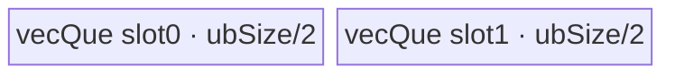
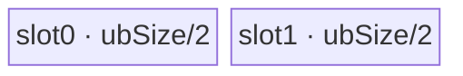
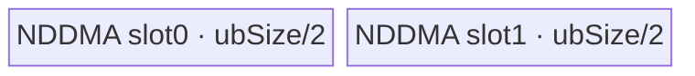
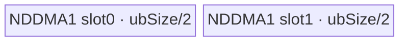
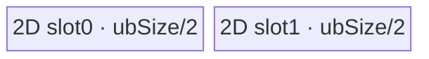
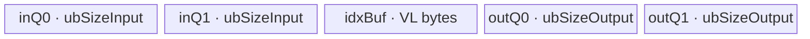

# SliceV2 950 ACLNN 算子知识

## 算子速览

| 项目 | 内容 |
|---|---|
| 实际入口 | 公开两段式 API `aclnnSliceV2GetWorkspaceSize` / `aclnnSliceV2`；内部节点 `StridedSliceV3V2` → `StridedSliceV3` |
| 计算语义 | 对 `axes[i]` 轴取 `self[..., starts[i] : ends[i] : steps[i], ...]`；未列轴全取；ACLNN 只接受正步长 |
| 输入输出 | `self/out` 为 ND，rank 分别为 1–8/0–8；dtype 同型，支持 FLOAT/FLOAT16/INT32/INT64/INT8/UINT8/BOOL/BFLOAT16；IntArray 在 L0 转为 INT64 tensor |
| 执行类型 | R-001/R-002/R-005 为 AIV_VECTOR（MoveAlign 搬运，无数值计算）；R-003/R-004 为 NDDMA；R-006 为 SIMT；R-007 为 AIV_VECTOR（MoveAlign + MicroAPI gather/reorder） |
| Kernel 路线 | R-001 key 100；R-002 key 101；R-003 key 102；R-004 key 103；R-005 key 150；R-006 key 200；R-007 key 300 |
| 核心资源 | GM、AIV `TQue/TQueBind/TBuf`、NDDMA `MultiCopyParams`、SIMT threads；算子节点固定申报 16 MiB workspace，但 Device entry 不读取 `workspace` |
| 来源闭包 | source_closed：公开 ACLNN → 校验/Contiguous/L0 launcher → StridedSliceV3 Tiling/POD → 单 Kernel router → 7 条 ACLNN 可达 body → 950 构建接线均已闭合 |
| 验证状态 | 已完成源码闭包检查；本次知识提取未执行编译、真机、数值或性能测试。 |

## 接口与语义

### 计算语义

令输入 rank 为 `d`，先把负轴归一化为 `axis += d`。对每个公开 API 切片项，令 `N=self.shape[axis]`，实现侧把负 `start/end` 加 `N`，再把 `start` 截断到 `[0,N]`，把 `end` 截断到 `[start,N]`；`steps[i]` 必须大于 0。输出该轴长度为 `(end-start+step-1)/step`，其余轴长度不变。Device 对展平输出下标恢复多维坐标，并读取 `input[begin[j] + coord[j]*strides[j]]`；MoveAlign/NDDMA 路线用等价的行偏移和多维搬运参数完成同一映射，不进行算术变换。

### 输入、输出与属性

| 参数 | shape/layout | dtype | 约束、默认值与语义 |
|---|---|---|---|
| `self` | ND，rank 1–8，可非连续 | FLOAT/FLOAT16/INT32/INT64/INT8/UINT8/BOOL/BFLOAT16 | 数据输入；空 tensor 在 ACLNN 第一段直接返回 workspace 0，不添加 Slice 节点 |
| `starts` | `aclIntArray` | 元素为 int64 | 与 `ends/axes/steps` 按位置定义起点；负值按轴长归一化 |
| `ends` | `aclIntArray` | 元素为 int64 | 半开区间终点，归一化后夹到 `[start,N]` |
| `axes` | `aclIntArray` | 元素为 int64 | 每项须在 `[-d,d-1]`，归一化后不得重复 |
| `steps` | `aclIntArray` | 元素为 int64 | 每项必须 `>0`；公开文档要求四个数组等长 |
| `out` | ND，rank 0–8，可非连续 | 与 `self` 相同 | view shape 必须等于 Host 按上述公式推导的 shape |
| `workspaceSize/executor` | Host 输出 | `uint64_t*` / `aclOpExecutor**` | executor 持有 Contiguous、Slice、ViewCopy 流程和临时对象 |
| `workspace/workspaceSize/stream` | Device 执行参数 | 地址/字节/stream | 第二段交给 `CommonOpExecutorRun`；调用者保持 workspace 和 executor 有效到流中任务完成 |

### 入口与版本

固定 commit 的公开最新入口为 `aclnnSliceV2`。第一段依次创建 executor、执行 `CheckParams`、处理空输入、调用框架 `Contiguous`、`l0op::StridedSliceV3V2` 和 `ViewCopy`；L0 把四个 IntArray 转为 INT64 tensor，做 `INFER_SHAPE(StridedSliceV3)`，再用 `ADD_TO_LAUNCHER_LIST_AICORE` 添加节点。950 公开支持由 `docs/aclnnSliceV2.md` 给出，`StridedSliceV3` OpDef、`ascend950` binary config、全局 AscendC binary config 和 CMake 均有对应接线。

实现的 `CheckArray` 只显式比较 `starts.size/ends.size` 与 `axes.size`，没有显式比较 `steps.size`；文档则要求四者等长。工程复用应遵守公开等长契约，不能依赖该固定实现对非等长 `steps` 的未定义接受行为。

## Host/Launcher 执行流程

### 参数校验与前处理

校验顺序固定为：所有六个 tensor/array 指针非空；`self/out` dtype 相同且在支持列表内；BF16 实现 gate 检查 SoC 枚举是否位于 `ASCEND910B..ASCEND910E` 闭区间，公开文档单独确认 Ascend 950 支持 BF16；`self.rank<=8`；axes 范围与去重；starts/ends 长度和正 steps；最后重算并核对 out shape。`self->IsEmpty()` 时仅释放 executor 给调用者并返回 workspace 0。非空时 `Contiguous(self)` 形成连续输入；L0 创建 begin/end/axis/stride 的 INT64 tensor，并由 infer-shape 生成临时连续 `sliceOut`，最后 `ViewCopy(sliceOut,out)` 适配用户输出 view。

### 参数、Workspace 与生命周期

`TilingPrepareForStridedSliceV3AscendC` 从 `PlatformAscendC` 读取 AIV core 数、UB 字节和 cache-line 字节，任何值 `<=0` 失败。Tiling 将原始 axes 扩为全 rank begin/end/stride，合并连续的未切轴，再计算 Route、`realCoreNum`、block/UB 切分和 POD。`RunStrideSliceTiling` 无条件写 `workspace[0]=16777216` 字节；`strided_slice_v3` 的 `workspace` 参数未被 body 使用，固定仓未公开 executor 对这 16 MiB 与 `Contiguous/ViewCopy` 临时区的最终 slice 布局。workspace 由调用者按第一段返回值分配，executor 管理 launcher 和临时 tensor，第二段在传入 stream 上执行。

### 启动图与失败传播

```text
aclnnSliceV2GetWorkspaceSize
  -> [可选框架节点] Contiguous(self)              # 实现/临时区为 opdev 框架边界
  -> StridedSliceV3V2 -> StridedSliceV3AiCore
       -> TilingForStridedSliceV3
       -> strided_slice_v3<<<realCoreNum>>>(x, begin, end, axes, strides, y, workspace, tiling)
  -> [框架节点] ViewCopy(sliceOut, out)            # 实现/临时区为 opdev 框架边界
aclnnSliceV2(workspace, size, executor, stream)
  -> CommonOpExecutorRun                           # 同一 executor/stream 保序
```

核心节点是单 Kernel：输入 `x/begin/end/axes/strides`，输出临时连续 `y`，POD 随 key 变化，blockDim=`realCoreNum`；workspace extent 为 16 MiB、owner 为调用者、节点 body 不消费。任何参数校验、executor 创建、Contiguous、L0 launcher 添加或 ViewCopy 返回空都会立即返回错误并阻断后续节点；固定仓把 executor 内具体 event、workspace offset 和框架节点 cleanup 作为框架边界。

## Route 与参数设计

### 分核与资源计算

令 `B=sizeof(T)`、`C=cacheLineSize`、`U=ubSize`、`O=∏outputShape`（Tiling 内 `totalOutputSize=O*B`）。正步长入口先计算 `outputShapeProd/inputShapeProd`；若任一维非正则置空域并走 SIMT no-op。一般分核要求每核约 1 KiB，`rightDiv=min(coreNum,ceil(totalOutputBytes/1024))`，沿左到右维选择 `blkIndex`，`blkFactor=ceil(dim/rightDiv)`，`blkTailFactor=dim%blkFactor`，`realCoreNum=ceil(dim/blkFactor)*∏_{i<blkIndex} output[i]`。小输出且 rank 不超过实现维数时单核全入 UB。MoveAlign/NDDMA 的正步长普通 UB 容量为 `(U-8192)/B/2` 个元素，体现 depth=2；gather 路线改用 `CalcUbSplitInfoNeg`，以 `ubOutBase=floor((U-8192)/2/(lastStride+1),C)` 分配每槽 `ubSizeInput=ubOutBase*lastStride`、`ubSizeOutput=ubOutBase`，并限制小 dtype gather 输入不超过 65536 字节。`ubInLoopSteps/ubOutLoopSteps` 分别是下一 UB tile 的输入/输出元素步长。

### Route 选择

| 顺序 | Route | Key/模板 | 精确选择条件与优先级 | 不适用去向 |
|---:|---|---|---|---|
| 1 | R-006 SIMT 空域 | 200 / `StridedSliceSIMT` | 任一输入或输出维 `<=0`，优先于全部分支 | Kernel no-op |
| 2 | R-001 MoveAlign compact | 100 / `StridedSliceMoveAlign` | 无负步长；`CalMaxSplitDim` 选 MoveAlign（末轴 stride=1 且输出末轴字节≥64，或 stride∈[2,16]、覆盖输入段≥C、输出总字节>1024）；UB 不切末轴，且非二维同轴特化 | R-002/R-005，或下一执行族 |
| 3 | R-002 MoveAlign last | 101 / `StridedSliceMoveAlignLastDim` | 同一 MoveAlign 外层条件，且 `ubIndex=rank-1`、`useGather=false` | R-001/R-005 |
| 4 | R-005 MoveAlign 2D | 150 / `StridedSliceMoveAlignTwoDim` | 同一 MoveAlign 外层条件，rank=2、`ubIndex=rank-2`、无 gather | R-001 |
| 5 | R-007 MoveAlign gather | 300 / `StridedSliceMoveAlignGather` | 全部步长正；末轴 stride∈[2,16]，末轴覆盖输入段字节≥C，输出总字节>1024；MoveAlign 的任一 UB 切轴 | NDDMA/SIMT |
| 6 | R-003 NDDMA multi | 102 / `StridedSliceNDDMA` | 未命中 MoveAlign；`validNumInCacheLine*B>=64`，或 shape 乘积超 uint32，或输出元素数≤1024；且 `ubIndex<rank-1` | R-004 |
| 7 | R-004 NDDMA last | 103 / `StridedSliceNDDMALastDim` | 同一 NDDMA 条件且 `ubIndex=rank-1` | R-003 |
| 8 | R-006 SIMT normal | 200 / `StridedSliceSIMT` | 未命中上述搬运密度路线且 shape 乘积不超 uint32 | 终点 fallback |

```text
if empty: key=200
else:                                      # ACLNN 已保证所有 steps > 0
  valid = GetValidNumInCacheLine()
  if lastStride == 1 and lastOut*B >= 64: family=MoveAlign
  else if lastStride > 1 and lastStride <= 16 and ((lastOut-1)*lastStride+1)*B >= C
          and totalOutputBytes > 1024: family=MoveAlignGather
  else if (lastStride == 1 and valid*B >= 64)
       or (lastStride > 1 and valid*B >= 64)
       or shapeExceedsUint32 or outputElements <= 1024: family=NDDMA
  else: family=SIMT
  MoveAlign: ubIndex==last ? 101 : (rank==2 && ubIndex==rank-2 ? 150 : 100)
  Gather: 300
  NDDMA: ubIndex==last ? 103 : 102
  SIMT: 200                              # shapeExceedsUint32 已在上一分支强制进 NDDMA
```

key 201 仅在 `SetSIMTTilingMode` 看到 shape overflow 时产生，但正步长 `CalMaxSplitDim` 会先因 shape overflow 强制选 NDDMA；key 301/302/303 只从 `isStrideNeg_` 分支产生，而公开 `aclnnSliceV2` 在进入 L0 前拒绝 `steps<=0`。因此这四个 key 均不是本卡 Route。

### 模板/实现执行矩阵

| Route | key/selector | dtype/shape/platform 完整命中条件 | 执行拓扑与 Kernel 节点 | 实际模板/body | 内存与同步特征 | tail/fallback |
|---|---|---|---|---|---|---|
| R-001 | 100 | 950，正 stride，MoveAlign，UB 切倒数 2–4 轴，排除 2D 特化 | 单 AIV Kernel | `StridedSliceMoveAlign<T,U>::ProcessPerBlock` | depth-2 绑定队列；loop-mode `DataCopyPad Compact` GM→UB→GM | `ubTailFactor/ubTailTailFactor` 改最外 UB 维 |
| R-002 | 101 | 950，正 stride=1 MoveAlign，UB 切末轴 | 单 AIV Kernel | `StridedSliceMoveAlignLastDim::{ProcessPerBlockInLastDim,ProcessPerBlockNLastDim}` | depth-2 绑定队列，线性 `DataCopyPad` | blk/ub 同轴与异轴两套尾块 |
| R-003 | 102 | 950，NDDMA，UB 覆盖 2–5 维 | 单 NDDMA Kernel | `StridedSliceNDDMA::ProcessPerBlock` | depth-2 队列；NDDMA GM→UB，Pad UB→GM | 尾 POD 改 `loopSize[inUbDims-1]` |
| R-004 | 103 | 950，NDDMA，UB 仅切末轴 | 单 NDDMA Kernel | `StridedSliceNDDMALastDim` | depth-2 队列；一维 NDDMA | blk/ub 同轴时输入 offset 乘 stride |
| R-005 | 150 | 950，2D MoveAlign，blk 与 ub 切 0 轴 | 单 AIV Kernel | `StridedSliceMoveAlignTwoDim::Process` | depth-2 绑定队列；紧凑二维搬运 | 最后一核从 `ubTailTailFactor` 取尾 |
| R-006 | 200 | 950，空域或普通 SIMT fallback，乘积≤UINT32_MAX | 单 SIMT Kernel | `StridedSliceDim{1..8}Compute` | 无 UB；1–7D 2048 threads，8D 1024；直接 GM load/store | grid-stride 循环天然尾保护；空域立即返回 |
| R-007 | 300 | 950，正末轴 stride 2–16，MoveAlign gather 条件 | 单 AIV Kernel | `StridedSliceMoveAlignGather::{GatherInOrder,Reorder4Output}` | 双缓冲 in/out queue + index TBuf；MTE2→MicroAPI gather→MTE3 | mask 保护末 VL，UB/blk 尾分别重算参数 |

### 隐藏性能 Guard

| Guard | Host/Tiling 条件 | Device/资源原因 | 影响 Route | 不满足时去向 | 源码符号 |
|---|---|---|---|---|---|
| 平台资源 | `coreNum>0 && ubSize>0 && cacheLineSize>0` | POD 与分核不能由零资源构造 | 全部 | `GRAPH_FAILED` | `TilingPrepareForStridedSliceV3AscendC`, `CheckPlatformParam` |
| MoveAlign 末轴 | `lastOut*B>=64`（stride=1） | 末轴连续段足够大才抵消分段搬运 | R-001/2/5 | NDDMA/SIMT | `CalMaxSplitDim` |
| gather | `lastStride<=16 && spanBytes>=C && totalOutputBytes>1024` | gather 索引与 cache-line 有效数据密度 | R-007 | NDDMA/SIMT | `CalMaxSplitDim` |
| NDDMA 密度 | `validNumInCacheLine*B>=64` | cache line 至少保留 64B 有效输出 | R-003/4 | SIMT；小域/溢出强制 NDDMA | `GetValidNumInCacheLine`, `CalMaxSplitDim` |
| MoveAlign ABI | src/loop stride≤UINT32_MAX，block/loop/dst stride≤UINT16_MAX | primitive 参数位宽 | R-001/5/7 | `ResetMovAlignV2Para` 向更内轴退化 | `MovAlignV2UbSplitLastTwo/Three/FourDim` |
| UB | 普通 `ubElementNum=(U-8192)/B/2`；gather 另按输入输出比例分割 | depth=2 且保留框架/索引空间 | AIV/NDDMA | 更内 UB 切分 | `Init`, `CalcUbSplitInfo`, `CalcUbSplitInfoNeg` |
| gather index | `ubSizeInput<=65536`（小 dtype 路径） | B8/B16 使用 uint16 gather index | R-007 | 缩小 `ubOutBase` | `CalcUbSplitInfoNeg` |
| SIMT 位宽 | shape prod `<=UINT32_MAX` | 普通 SIMT 使用 uint32 下标；overflow 已由 Host 分到 NDDMA | R-006 | NDDMA | `CalInputOutputSize`, `CalMaxSplitDim`, `SetSIMTTilingMode` |
| 空域 | 任一 input/output 维 `<=0` | 避免除零与无效搬运 | R-006 | key 200 no-op | `Init`, `RunStrideSliceTiling` |

### POD/ABI

所有结构由 `BEGIN_TILING_DATA_DEF/TILING_DATA_FIELD_DEF` 生成；固定仓没有宏展开后的 C++ 布局，因此 `sizeof/alignof/offsetof` 统一为“固定仓不可见”，不能用下表顺序外推 padding。

| 结构 | 字段 | 类型/位宽 | ABI 布局 | 单位 | Host/launcher producer | Device consumer | 边界 |
|---|---|---|---|---|---|---|---|
| `StridedSliceBaseTilingData` | `blkFactor` | int64/64 | 固定仓不可见 | 元素 | `CalcBlockSplitInfo/SetTwoDimTilingInfo` → `FillStridedSliceBaseTilingData` | Base 分核 helper | 主核块长 |
| 同上 | `blkTailFactor` | int64/64 | 固定仓不可见 | 元素 | 同上 | Base tail helper | 0 表示无尾核 |
| 同上 | `ubInLoopSteps` | int64/64 | 固定仓不可见 | 元素 | `CalStridedSliceRowsStepsParams` | 各 body 输入 tile offset | 可含 stride |
| 同上 | `ubOutLoopSteps` | int64/64 | 固定仓不可见 | 元素 | 同上 | 各 body 输出 tile offset | 连续输出 |
| 同上 | `ubSize` | int32/32 | 固定仓不可见 | 字节 | 普通为 `U`，gather 为 `ubSizeOutput` | `InitBuffer` | int32 窄化由平台 UB 上限保证 |
| 同上 | `ubFactor` | int32/32 | 固定仓不可见 | 元素 | `CalcUbSplitInfo*` | UB 主 tile | 必须>0 |
| 同上 | `ubTailFactor` | int32/32 | 固定仓不可见 | 元素 | `dim%ubFactor` 或 `blkFactor%ubFactor` | tail loop | 0 inactive |
| 同上 | `ubTailTailFactor` | int32/32 | 固定仓不可见 | 元素 | `blkTailFactor%ubFactor` | blk/ub 同轴尾核 | 0 inactive |
| 同上 | `realCoreNum` | int16/16 | 固定仓不可见 | core | 分核函数 | `blockIdx>=realCoreNum` guard | Host 另设 blockDim 同值 |
| 同上 | `inputDims` | int16/16 | 固定仓不可见 | 维 | 性能合并后 rank | Base/router body | 1–8 |
| 同上 | `blkIndex` | int16/16 | 固定仓不可见 | 轴号 | `CalcBlockSplitInfo` | 地址/循环 helper | 0-based |
| 同上 | `ubIndex` | int16/16 | 固定仓不可见 | 轴号 | `CalcUbSplitInfo*` | body 路线内循环 | 0-based |
| 同上 | `outputShape[8]` | int64[8] | 固定仓不可见 | 元素 | `FillTilingData` | 地址和循环 helper | 仅前 `inputDims` 活跃 |
| 同上 | `begin[8]` | int64[8] | 固定仓不可见 | 元素下标 | `ConstructBeginList/MakePerformanceParams` | `ParseBaseTilingDataV2` | ACLNN 本入口均为常量归一化值 |
| 同上 | `strides[8]` | int64[8] | 固定仓不可见 | 元素步长 | `ConstructStrideList` | 地址/NDDMA/gather | 本入口均>0 |
| 同上 | `inputSteps[8]` | int64[8] | 固定仓不可见 | 元素 | 后缀乘积 | Base 地址 helper | 可能乘法溢出，固定仓无额外检查 |
| 同上 | `rowsOffsetSteps[8]` | int64[8] | 固定仓不可见 | 输出行 | 输出后缀乘积 | core/UB 行映射 | 同上 |
| `StridedSliceMoveAlignParams` | `blockCount` | uint16/16 | 固定仓不可见 | block | `MovAlignV2UbSplit*` | `DataCopyExtParams.blockCount` | 超限退化 |
| 同上 | `blockLen` | uint32/32 | 固定仓不可见 | 字节 | 同上 | `DataCopyPad.blockLen` | 超限退化 |
| 同上 | `srcStride` | uint32/32 | 固定仓不可见 | 字节 | 同上 | body 转为“尾到头间隔” | Host 保存的是头到头跨度 |
| 同上 | `dstStride` | uint32/32 | 固定仓不可见 | 字节 | 同上 | loop-mode/CopyOut | compact 路线常为 blockLen |
| 同上 | `loop1Size` | uint16/16 | 固定仓不可见 | 次 | 同上 | loop mode | 默认1 |
| 同上 | `loop2Size` | uint16/16 | 固定仓不可见 | 次 | 同上 | loop mode | 默认1 |
| 同上 | `loop1SrcStride` | uint32/32 | 固定仓不可见 | 字节 | 同上 | loop mode | 超限退化 |
| 同上 | `loop1DstStride` | uint16/16 | 固定仓不可见 | 字节 | 同上 | loop mode | 超限退化 |
| 同上 | `loop2SrcStride` | uint32/32 | 固定仓不可见 | 字节 | 同上 | loop mode | 超限退化 |
| 同上 | `loop2DstStride` | uint16/16 | 固定仓不可见 | 字节 | 同上 | loop mode | 超限退化 |
| `StridedSliceMATilingData` | `stridedSliceBaseTilingData` | nested | 固定仓不可见 | N/A | `FillStridedSliceBaseTilingData` | `ParseBaseTilingDataV2` | R-001 |
| 同上 | `moveAlignParams` | nested | 固定仓不可见 | 混合 | `SetMoveAlignParams` | MoveAlign copy/loop mode | R-001 |
| `StridedSliceMALastDimTilingData` | `stridedSliceBaseTilingData` | nested | 固定仓不可见 | N/A | `FillStridedSliceBaseTilingData` | `ParseBaseTilingDataV2` | R-002 |
| `StridedSliceNDDMATilingData` | `stridedSliceBaseTilingData` | nested | 固定仓不可见 | N/A | `FillStridedSliceBaseTilingData` | `ParseNDDMATilingData` | R-003/4 |
| 同上 | `nddmaTotalNum` | int64/64 | 固定仓不可见 | 元素 | `SetNddmaTilingMode` 各 loopSize 乘积 | CopyOut blockLen | UB 主 tile |
| 同上 | `ubSizeInput` | int32/32 | 固定仓不可见 | 字节 | 正步长普通路线保持默认0 | 负/gather NDDMA body | R-003/4 inactive |
| 同上 | `nddmaLoopSize[5]` | int64[5] | 固定仓不可见 | 次 | `SetNddmaTilingMode` | `MultiCopyLoopInfo.loopSize` | 左侧补1 |
| 同上 | `nddmaLoopSrcStride[5]` | int64[5] | 固定仓不可见 | 元素 | stride×输入后缀积 | NDDMA source stride | 正值 |
| 同上 | `nddmaLoopDstStride[5]` | int64[5] | 固定仓不可见 | 元素 | 输出后缀积 | NDDMA destination stride | 紧凑输出 |
| `StridedSliceMALast2DimTilingData` | `blkFactor` | int64/64 | 固定仓不可见 | 元素 | `FillStridedSliceTilingData150` | 2D block main loop | 主核行数 |
| 同上 | `blkTailFactor` | int64/64 | 固定仓不可见 | 元素 | `FillStridedSliceTilingData150` | 2D last-core loop | 0 表示无尾核 |
| 同上 | `ubInLoopSteps` | int64/64 | 固定仓不可见 | 元素 | `SetRowsStepsParamsFor150` | 2D input tile offset | 含输入 stride |
| 同上 | `ubOutLoopSteps` | int64/64 | 固定仓不可见 | 元素 | `SetRowsStepsParamsFor150` | 2D output tile offset | 紧凑输出 |
| 同上 | `ubSize` | int32/32 | 固定仓不可见 | 字节 | `U` | depth-2 queue | R-005 |
| 同上 | `ubFactor` | int32/32 | 固定仓不可见 | 元素 | Host UB 切分 | 2D main tile | 必须>0 |
| 同上 | `ubTailFactor` | int32/32 | 固定仓不可见 | 元素 | `blkFactor%ubFactor` | 普通核 tile tail | 0 inactive |
| 同上 | `ubTailTailFactor` | int32/32 | 固定仓不可见 | 元素 | `blkTailFactor%ubFactor` | 最后一核 tile tail | 0 inactive |
| 同上 | `realCoreNum` | int16/16 | 固定仓不可见 | core | `SetTwoDimTilingInfo` | block guard | R-005 |
| 同上 | `moveAlignParams.blockCount` | uint16/16 | 固定仓不可见 | block | `SetShortMoveAlignParams` | 2D CopyIn blockCount | 位宽 guard |
| 同上 | `moveAlignParams.blockLen` | uint32/32 | 固定仓不可见 | 字节 | 同上 | 2D CopyIn/CopyOut blockLen | 末轴有效字节 |
| 同上 | `moveAlignParams.srcStride` | uint32/32 | 固定仓不可见 | 字节 | 同上 | 2D CopyIn srcStride | Host 存头到头跨度 |
| 同上 | `moveAlignParams.dstStride` | uint32/32 | 固定仓不可见 | 字节 | 同上 | 2D CopyIn dstStride | compact |
| 同上 | `outputShape[2]` | int64[2] | 固定仓不可见 | 元素 | `FillStridedSliceTilingData150` | output row address | 仅 rank=2 |
| 同上 | `begin[2]` | int64[2] | 固定仓不可见 | 元素下标 | 同上 | input base address | 归一化 |
| 同上 | `strides[2]` | int64[2] | 固定仓不可见 | 元素步长 | 同上 | input row address | >0 |
| 同上 | `inputSteps[2]` | int64[2] | 固定仓不可见 | 元素 | `SetRowsStepsParamsFor150` | input suffix address | rank=2 |
| `StridedSliceSIMTTilingData` | `isEmptyTensor` | uint16/16 | 固定仓不可见 | bool | `Init` | SIMT early return | 0/1 |
| 同上 | `inputDims` | int16/16 | 固定仓不可见 | 维 | 性能合并 rank | SIMT specialization | 1–8 |
| 同上 | `begin[8]` | int64[8] | 固定仓不可见 | 元素下标 | Host | SIMT input index | 正规化 |
| 同上 | `strides[8]` | int64[8] | 固定仓不可见 | 元素步长 | Host | SIMT input index | >0 |
| 同上 | `outputShapeProd[8]` | int64[8] | 固定仓不可见 | 元素 | `CalInputOutputSize` | 输出坐标反解 | 后缀积 |
| 同上 | `inputShapeProd[8]` | int64[8] | 固定仓不可见 | 元素 | 同上 | 输入展平下标 | 后缀积 |
| `StridedSliceMAGatherTilingData` | `stridedSliceBaseTilingData` | nested | 固定仓不可见 | N/A | Host base producer | gather base parser | R-007 |
| 同上 | `moveAlignParams` | nested | 固定仓不可见 | 混合 | `SetMoveAlignParams` | MoveAlign copy/loop mode | R-007 |
| 同上 | `ubSizeInput` | int32/32 | 固定仓不可见 | 字节/slot | `CalcUbSplitInfoNeg` | `inQue_ InitBuffer` | depth=2 |

### Route 源码闭包

| Route | Key/selector | Host/Tiling producer | POD/参数 | Kernel entry/router 节点 | Kernel body/直接依赖 | 构建接线 |
|---|---|---|---|---|---|---|
| R-001 | 100 | common `CalMaxSplitDim/SetMovAlignV2TilingMode` | `StridedSliceMATilingData` | `strided_slice_v3` → `StridedSliceMoveAlignProcess` | `strided_slice_move_align.h`, `strided_slice_base.h` | V3 CMake + ascendc_config |
| R-002 | 101 | 同上，UB 切末轴 | `StridedSliceMALastDimTilingData` | router → `StridedSliceMoveAlignLastDimProcess` | `strided_slice_move_align_last_dim.h` | 同上 |
| R-003 | 102 | `SetNddmaTilingMode` | `StridedSliceNDDMATilingData` | router → `StridedSliceNDDMAProcess` | `strided_slice_nddma.h`, base | 同上 |
| R-004 | 103 | 同上，UB 切末轴 | 同上 | router → `StridedSliceNDDMALastDimProcess` | `strided_slice_nddma_last_dim.h`, base | 同上 |
| R-005 | 150 | `SetTwoDimTilingInfo/MovAlignV2UbSplitLastTwoDim` | `StridedSliceMALast2DimTilingData` | router → `StridedSliceMoveAlignTwoDimProcess` | `strided_slice_move_align_two_dim.h` | 同上 |
| R-006 | 200 | `SetSIMTTilingMode/FillStridedSliceTilingDataSIMT` | `StridedSliceSIMTTilingData` | router → `StridedSliceSIMTProcess` | `strided_slice_simt.h`, base | 同上 |
| R-007 | 300 | `CalMaxSplitDim/CalcUbSplitInfoNeg/SetMovAlignV2TilingMode` | `StridedSliceMAGatherTilingData` | router → `StridedSliceMoveAlignGatherProcess` | `strided_slice_move_align_gather.h`, base reorder | 同上 |

## Kernel 实现

### 公共执行流程

`strided_slice_v3` 按 key 解析匹配 POD 并调用一个 body，未知 key 没有 else 错误分支且不写输出。模板把同字节宽 dtype 作为搬运位模式处理：4B→`int32_t`、8B→`int64_t`、1B→`int8_t`，其余保留 `DTYPE_X`；因此没有 cast、round 或算术精度变化。所有非 SIMT body 从 `GetBlockIdx()` 映射到 `blkIndex/blkFactor` 域，并以 Base 的 `GetInputGmAddr/GetOutputGmAddr` 计算元素 offset。普通搬运通过 Queue EnQue/DeQue 保证 MTE2→MTE3；R-007 在中间插入 MicroAPI gather/reorder。单 Kernel 无跨 Device 节点 workspace 边。

### Route R-001：MoveAlign compact

#### 适用条件

##### 选择证据

| 层级 | 文件 | 符号 | 源码谓词/参数 | 结果/下一跳 |
|---|---|---|---|---|
| API | `conversion/strided_slice_v3/op_api/aclnn_slice_v2.cpp` | `CheckArray` | 每个 step `>0` | 排除所有负 stride key |
| Tiling | `conversion/strided_slice/op_host/arch35/strided_slice_tiling_arch35.cpp` | `CalMaxSplitDim` | stride=1 且末轴输出≥64B，或 stride 2–16 且覆盖段≥cache line、总输出>1KiB | `maxSplitDim=4` |
| Tiling | 同上 | `SetMovAlignV2TilingMode` | `ubIndex!=rank-1`；若 `ubIndex=rank-2` 还要求 rank≠2 | key 100 |
| Router | `conversion/strided_slice_v3/op_kernel/strided_slice_v3_apt.cpp` | `strided_slice_v3` | `TILING_KEY_IS(100)` | `StridedSliceMoveAlignProcess` |

#### Device 数据流

##### 函数级调用链

```text
strided_slice_v3(key=100)
  -> StridedSliceMoveAlignProcess
    -> StridedSliceMoveAlign<T,U>::Init
       -> ParseBaseTilingDataV2 -> ParseCopyInTilingData -> InitBuffer(vecQue,2,ubSize/2)
    -> Process -> ProcessPerBlock
       -> SetLoopModePara -> DataCopyPad<Compact>(GM->UB)
       -> EnQue/DeQue -> DataCopyPad(UB->GM) -> FreeTensor
```

##### 源码等价伪码

```text
# 伪码
if blockIdx >= realCoreNum: return
(outerLoops, tileLoops) = CalcProcessLoopsNum(blockIdx)
row0 = GetProcessRowsOffset(blockIdx)
for outer in [0, outerLoops):
  in0  = GetInputGmAddr(row0 + outer*rowsOffsetSteps[ubIndex])
  out0 = GetOutputGmAddr(row0 + outer*rowsOffsetSteps[ubIndex])
  for tile in [0, tileLoops):
    q = alloc(); compact_copy(q, x[in0+tile*ubInLoopSteps], moveAlignParams)
    queue_commit(q); copy(y[out0+tile*ubOutLoopSteps], q, valid_output_bytes); free(q)
  if ubTailFactor>0: repeat with tail's outer loop/blockCount and tail output bytes
```

#### 内存与数据搬运

##### 资源与搬运表

| 层级/缓冲区 | offset/地址公式 | extent/容量公式 | dtype/layout | producer | consumer | owner/lifetime | 对齐/复用 |
|---|---|---|---|---|---|---|---|
| GM x | `GetInputGmAddr(row)+tile*ubInLoopSteps` | loop-mode block/loop 参数覆盖段 | T 位模式/ND | ACLNN self | Compact MTE2 | 调用者；Kernel 全程 | stride 位宽 guard |
| `vecQue_` | Queue slot | depth 2 × `ubSize/2` | T/compact UB | `DataCopyPad` | MTE3 | TPipe；Alloc→Free | double buffer |
| GM y | `GetOutputGmAddr(row)+tile*ubOutLoopSteps` | 有效输出元素 | T/ND | MTE3 | ViewCopy | executor 临时 tensor | 非 32B 尾由 DataCopyPad 处理 |
| workspace | 参数传入但不读 | 16 MiB Host 申报 | bytes | executor | N/A | 调用者 | 不参与 UB 账 |

##### 分层内存布局



##### 字节账与复用顺序

```text
UB_total = 2 * (ubSize/2) = ubSize
ubSize <= platform UB；Host 以 (platformUB-8192)/(B*2) 计算有效 tile 上界
dynamic_ub = N/A
workspace_total(node) = 16 MiB（Device 未读取）
```

| 复用子区 | 写入者 | 读取者/消费点 | 下一次覆盖 | 同步或释放依据 | 安全条件 |
|---|---|---|---|---|---|
| Queue slot | GM→UB MTE2 | UB→GM MTE3 | 下一 tile 分配 | EnQue/DeQue/FreeTensor | 不在 Free 前重分配 |

#### 同步、精度与尾块

##### 同步与数值边界表

| 阶段 | primitive/机制 | producer | consumer/等待点 | 保护对象 | 精度/尾块 |
|---|---|---|---|---|---|
| MTE2→MTE3 | Queue EnQue/DeQue | `DataCopyPad<Compact>` | `DataCopyPad` CopyOut | 当前 slot | 位拷贝，无 cast；tail 改 `blockCount/loop1/loop2` |
| loop mode | `SetLoopModePara/ResetLoopModePara` | 当前 CopyIn 参数 | 下一 primitive | 全局 loop-mode 状态 | 每次 CopyIn 后立即 reset |

#### 关键实现

##### 符号证据表

| 阶段 | 文件 | 符号/模板实例 | 实现事实 |
|---|---|---|---|
| Host/Tiling producer | `conversion/strided_slice/op_host/arch35/strided_slice_tiling_arch35.cpp` | `MovAlignV2UbSplitLastTwo/Three/FourDim` | 生成 MoveAlign 参数并在位宽超限时退化 |
| Kernel entry/router | `conversion/strided_slice_v3/op_kernel/strided_slice_v3_apt.cpp` | key 100 | 解析 `StridedSliceMATilingData` |
| Device body/helper | `conversion/strided_slice/op_kernel/arch35/strided_slice_move_align.h` | `ProcessPerBlock` | loop-mode compact CopyIn、Queue、CopyOut 和 tail |

### Route R-002：MoveAlign last-dim

#### 适用条件

##### 选择证据

| 层级 | 文件 | 符号 | 源码谓词/参数 | 结果/下一跳 |
|---|---|---|---|---|
| Tiling | `conversion/strided_slice/op_host/arch35/strided_slice_tiling_arch35.cpp` | `MovAlignV2UbSplitLastOneDim` | MoveAlign family、`ubIndex=rank-1`、`useGather=false` | key 101 |
| Router | `conversion/strided_slice_v3/op_kernel/strided_slice_v3_apt.cpp` | `strided_slice_v3` | key 101 | `StridedSliceMoveAlignLastDimProcess` |

#### Device 数据流

##### 函数级调用链

```text
router(101) -> MoveAlignLastDim::Init -> ParseBaseTilingDataV2 -> InitBuffer(depth=2)
  -> Process
     -> blkIndex==ubIndex ? ProcessPerBlockInLastDim : ProcessPerBlockNLastDim
     -> DataCopyPad(GM->UB) -> Queue -> DataCopyPad(UB->GM)
```

##### 源码等价伪码

```text
# 伪码
if ubIndex != rank-1 or blockIdx>=realCoreNum: return
if blkIndex==ubIndex:
  row=blockIdx/blkSplitOutNum; offset=(blockIdx%blkSplitOutNum)*blkFactor
  for tile in this_core_tiles: copy x[row_base+offset+tile*ubFactor] -> y[row_base_out+offset+tile*ubFactor]
else:
  for row in this_core_rows:
    for tile in outputLast/ubFactor: copy ubFactor contiguous elements
copy remaining ubTailFactor elements with tail blockLen
```

#### 内存与数据搬运

##### 资源与搬运表

| 层级/缓冲区 | offset/地址公式 | extent/容量公式 | dtype/layout | producer | consumer | owner/lifetime | 对齐/复用 |
|---|---|---|---|---|---|---|---|
| GM x/y | 同轴：row base + core offset + tile offset；异轴：每行 base + tile offset | main `ubFactor*B`，tail `ubTailFactor*B` | T/连续末轴 | GM/Queue | Queue/GM | 调用者/executor | Pad 保护尾块 |
| `vecQue_` | Queue slot | depth 2 × `ubSize/2` | T | MTE2 | MTE3 | tile lifetime | double buffer |

##### 分层内存布局



##### 字节账与复用顺序

```text
UB_total = ubSize；dynamic_ub=N/A；workspace_total(node)=16 MiB（未读）
```

| 复用子区 | 写入者 | 读取者/消费点 | 下一次覆盖 | 同步或释放依据 | 安全条件 |
|---|---|---|---|---|---|
| Queue slot | CopyIn | CopyOut | 下一 tile | Queue + FreeTensor | tail blockLen 不得沿用 main |

#### 同步、精度与尾块

##### 同步与数值边界表

| 阶段 | primitive/机制 | producer | consumer/等待点 | 保护对象 | 精度/尾块 |
|---|---|---|---|---|---|
| GM→UB→GM | Queue | MTE2 | MTE3 DeQue | slot | 位拷贝；main/tail blockLen 分开 |
| core tail | `GetLastDimSplitLoopCnt` 或 `GetHandleRowsNum` | POD | loop bounds | 最后一核/行 | 防越界 |

#### 关键实现

##### 符号证据表

| 阶段 | 文件 | 符号/模板实例 | 实现事实 |
|---|---|---|---|
| Host/Tiling producer | common tiling cpp | `MovAlignV2UbSplitLastOneDim` | key 101 |
| Kernel entry/router | V3 apt cpp | `StridedSliceMoveAlignLastDimProcess` | 按 dtype 字节宽实例化 |
| Device body/helper | `strided_slice_move_align_last_dim.h` | 两个 `ProcessPerBlock*` | blk/ub 同轴和异轴地址、尾块 |

### Route R-003：NDDMA multi-dim

#### 适用条件

##### 选择证据

| 层级 | 文件 | 符号 | 源码谓词/参数 | 结果/下一跳 |
|---|---|---|---|---|
| Tiling | common tiling cpp | `CalMaxSplitDim` | 未命中 MoveAlign，cache-line 有效数据≥64B，或小输出/shape overflow 强制 | NDDMA family |
| Tiling | 同上 | `SetNddmaTilingMode` | `rank-ubIndex>1` | key 102，生成最多5维 loop |
| Router | V3 apt cpp | `strided_slice_v3` | key 102 | `StridedSliceNDDMAProcess` |

#### Device 数据流

##### 函数级调用链

```text
router(102) -> StridedSliceNDDMA::Init -> ParseNDDMATilingData -> InitBuffer(vecQue,2,ubSize/2)
  -> Process -> CalcProcessLoopsNum/GetProcessRowsOffset -> ProcessPerBlock
     -> SetLoopInfo -> DataCopy<T,5>(GM->UB) -> Queue -> DataCopyPad(UB->GM)
```

##### 源码等价伪码

```text
# 伪码
loopInfo[d] = {size=nddmaLoopSize[4-d], srcStride=..., dstStride=...}; unused dims={1,0,0}
tail.loopSize[inUbDims-1]=ubTailFactor
for outer in this_core_outer_loops:
  in0/out0 = multidim row address
  for tile in tileLoops:
    q=NDDMA5(x[in0+tile*ubInLoopSteps], loopInfo)
    y[out0+tile*ubOutLoopSteps] = valid nddmaTotalNum elements from q
  if tail: repeat with tail loopInfo and scaled output bytes
```

#### 内存与数据搬运

##### 资源与搬运表

| 层级/缓冲区 | offset/地址公式 | extent/容量公式 | dtype/layout | producer | consumer | owner/lifetime | 对齐/复用 |
|---|---|---|---|---|---|---|---|
| GM x | row base + tile*ubInLoopSteps | NDDMA loop hyper-rectangle | T/strided ND | self | NDDMA MTE2 | caller | src strides in elements |
| `vecQue_` | slot | depth2 × `ubSize/2` | T/compact | NDDMA | CopyOut | TPipe | double buffer |
| GM y | row base + tile*ubOutLoopSteps | main `nddmaTotalNum*B`; tail `/ubFactor*tail*B` | T/ND compact | MTE3 | ViewCopy | executor | DataCopyPad tail |

##### 分层内存布局



##### 字节账与复用顺序

```text
UB_total=ubSize；NDDMA logical extent=product(loopSize)*B<=slot bytes
dynamic_ub=N/A；workspace_total(node)=16 MiB（未读）
```

| 复用子区 | 写入者 | 读取者/消费点 | 下一次覆盖 | 同步或释放依据 | 安全条件 |
|---|---|---|---|---|---|
| Queue slot | NDDMA | CopyOut | 下一 tile | EnQue/DeQue/Free | loop product 不超过 slot |

#### 同步、精度与尾块

##### 同步与数值边界表

| 阶段 | primitive/机制 | producer | consumer/等待点 | 保护对象 | 精度/尾块 |
|---|---|---|---|---|---|
| NDDMA→MTE3 | Queue | `DataCopy<T,5>` | `DataCopyPad` | slot | 位拷贝；tail 只改最外活跃 loopSize |

#### 关键实现

##### 符号证据表

| 阶段 | 文件 | 符号/模板实例 | 实现事实 |
|---|---|---|---|
| Host/Tiling producer | common tiling cpp | `SetNddmaTilingMode` | loop size/src/dst stride 与 totalNum |
| Kernel entry/router | V3 apt cpp | key 102 | NDDMA POD 到 body |
| Device body/helper | `strided_slice_nddma.h` | `SetLoopInfo/ProcessPerBlock` | 5D NDDMA、Queue、tail |

### Route R-004：NDDMA last-dim

#### 适用条件

##### 选择证据

| 层级 | 文件 | 符号 | 源码谓词/参数 | 结果/下一跳 |
|---|---|---|---|---|
| Tiling | common tiling cpp | `SetNddmaTilingMode` | NDDMA family 且 `rank-ubIndex==1` | key 103 |
| Router | V3 apt cpp | key 103 | `StridedSliceNDDMALastDimProcess` | 一维 NDDMA body |

#### Device 数据流

##### 函数级调用链

```text
router(103) -> NDDMALastDim::Init -> ParseNDDMATilingData -> depth2 queue
  -> Process -> (blkIndex==ubIndex ? ProcessPerBlockInLastDim : ProcessPerBlock)
     -> DataCopy<T,1>(GM->UB) -> Queue -> DataCopyPad(UB->GM)
```

##### 源码等价伪码

```text
# 伪码
main.loopSize[0]=ubFactor; main.srcStride[0]=lastStride; dstStride[0]=1
tail.loopSize[0]=ubTailFactor
if blkIndex==ubIndex: core input offset=(core-in-row)*blkFactor*lastStride
else: iterate assigned rows
for each main tile: NDDMA1 gather strided elements, then copy compact UB to y
if tail: repeat with tail.loopSize
```

#### 内存与数据搬运

##### 资源与搬运表

| 层级/缓冲区 | offset/地址公式 | extent/容量公式 | dtype/layout | producer | consumer | owner/lifetime | 对齐/复用 |
|---|---|---|---|---|---|---|---|
| GM x/y | row base；同轴输入 core offset×stride，输出不乘 stride | main/tail elements | T | GM/NDDMA | NDDMA/GM | caller/executor | 一维 stride |
| `vecQue_` | slot | depth2 × `ubSize/2` | T | NDDMA1 | MTE3 | tile | double buffer |

##### 分层内存布局



##### 字节账与复用顺序

```text
UB_total=ubSize；dynamic_ub=N/A；workspace_total(node)=16 MiB（未读）
```

| 复用子区 | 写入者 | 读取者/消费点 | 下一次覆盖 | 同步或释放依据 | 安全条件 |
|---|---|---|---|---|---|
| Queue slot | NDDMA1 | CopyOut | next tile | Queue+Free | tail uses separate loopSize/blockLen |

#### 同步、精度与尾块

##### 同步与数值边界表

| 阶段 | primitive/机制 | producer | consumer/等待点 | 保护对象 | 精度/尾块 |
|---|---|---|---|---|---|
| NDDMA→MTE3 | Queue | strided GM read | compact GM write | slot | no cast；grid/core/tile bounds all explicit |

#### 关键实现

##### 符号证据表

| 阶段 | 文件 | 符号/模板实例 | 实现事实 |
|---|---|---|---|
| Host/Tiling producer | common tiling cpp | `SetNddmaTilingMode` | key 103 when one active UB dim |
| Kernel entry/router | V3 apt cpp | key 103 | NDDMA last entry |
| Device body/helper | `strided_slice_nddma_last_dim.h` | `SetLoopInfo`, two Process methods | input stride、core offset、tail |

### Route R-005：MoveAlign 2D

#### 适用条件

##### 选择证据

| 层级 | 文件 | 符号 | 源码谓词/参数 | 结果/下一跳 |
|---|---|---|---|---|
| Tiling | common tiling cpp | `MovAlignV2UbSplitLastTwoDim` | MoveAlign、rank=2、UB 切0轴 | key 150 |
| Tiling | 同上 | `SetTwoDimTilingInfo` | 以 UB 每核行数与 4KiB 输出目标共同决定 `realCoreNum` | 2D POD |
| Router | V3 apt cpp | key 150 | `StridedSliceMoveAlignTwoDimProcess` | 2D body |

#### Device 数据流

##### 函数级调用链

```text
router(150) -> MoveAlignTwoDim::Init -> read begin[2] -> InitBuffer(vecQue,2,ubSize/2)
  -> Process -> compact DataCopyPad(GM->UB) -> Queue -> DataCopyPad(UB->GM)
```

##### 源码等价伪码

```text
# 伪码
if blockIdx>=realCoreNum: return
tileLoops = (last core with blkTail ? blkTailFactor : blkFactor)/ubFactor
row0=blockIdx*blkFactor
in0=begin[1]+(begin[0]+row0*stride[0])*inputSteps[1]
out0=row0*outputShape[1]
for tile: compact_copy blockCount=ubFactor rows, blockLen=lastOut*B
tailRows = last core ? ubTailTailFactor : ubTailFactor; if tailRows: repeat
```

#### 内存与数据搬运

##### 资源与搬运表

| 层级/缓冲区 | offset/地址公式 | extent/容量公式 | dtype/layout | producer | consumer | owner/lifetime | 对齐/复用 |
|---|---|---|---|---|---|---|---|
| GM x | `begin1+(begin0+row0*stride0)*inputSteps1` | rows×lastOut | T/2D ND | self | Compact MTE2 | caller | Host 可在 begin1=0 且整末轴<256B时搬全末轴 |
| `vecQue_` | slot | depth2×`ubSize/2` | T | MTE2 | MTE3 | tile | double buffer |
| GM y | `row0*outputShape1` | compact rows | T | MTE3 | ViewCopy | executor | tailRows controls blockCount |

##### 分层内存布局



##### 字节账与复用顺序

```text
UB_total=ubSize；dynamic_ub=N/A；workspace_total(node)=16 MiB（未读）
```

| 复用子区 | 写入者 | 读取者/消费点 | 下一次覆盖 | 同步或释放依据 | 安全条件 |
|---|---|---|---|---|---|
| Queue slot | 2D CopyIn | CopyOut | next tile | Queue lifecycle | last core chooses ubTailTailFactor |

#### 同步、精度与尾块

##### 同步与数值边界表

| 阶段 | primitive/机制 | producer | consumer/等待点 | 保护对象 | 精度/尾块 |
|---|---|---|---|---|---|
| MTE2→MTE3 | Queue | compact 2D CopyIn | compact output | slot | raw bit copy；tail blockCount only |

#### 关键实现

##### 符号证据表

| 阶段 | 文件 | 符号/模板实例 | 实现事实 |
|---|---|---|---|
| Host/Tiling producer | common tiling cpp | `SetTwoDimTilingInfo`, `FillStridedSliceTilingData150` | row/core split and short MoveAlign POD |
| Kernel entry/router | V3 apt cpp | key 150 | 2D entry |
| Device body/helper | `strided_slice_move_align_two_dim.h` | `Process` | closed 2D address/copy/tail |

### Route R-006：SIMT normal / empty

#### 适用条件

##### 选择证据

| 层级 | 文件 | 符号 | 源码谓词/参数 | 结果/下一跳 |
|---|---|---|---|---|
| Tiling | common tiling cpp | `RunStrideSliceTiling` | empty 优先，或正 stride 未命中搬运密度路线 | SIMT |
| Tiling | 同上 | `SetSIMTTilingMode` | `isShapeExceedUint32=false` | key 200、blockDim=全部 AIV cores |
| Router | V3 apt cpp | key 200 | `StridedSliceSIMTProcess` | normal SIMT |

#### Device 数据流

##### 函数级调用链

```text
router(200) -> StridedSliceSIMT::Init -> normalize begin/read GM bindings
  -> Process -> ProcessNormalShape
     -> GetUintDivMagicAndShift for output suffix products
     -> asc_vf_call<StridedSliceDim{1..8}Compute>(threads)
```

##### 源码等价伪码

```text
# 伪码; one SIMT thread stream
if isEmptyTensor: return
threads = rank==8 ? 1024 : 2048
for idx=blockIdx*threads+threadIdx; idx<outputSize; idx+=blockNums*threads:
  coord = unflatten_u32(idx, outputShapeProd, magic, shift)
  inputIndex = Σ(begin[d]+stride[d]*coord[d])*input_suffix_product
  y[idx]=x[inputIndex]
```

#### 内存与数据搬运

##### 资源与搬运表

| 层级/缓冲区 | offset/地址公式 | extent/容量公式 | dtype/layout | producer | consumer | owner/lifetime | 对齐/复用 |
|---|---|---|---|---|---|---|---|
| GM x | `inputIndex` | one T/thread iteration | T/ND | self | SIMT load | caller | no alignment assumption |
| registers | coord[rank], magic/shift/stride temp | fixed by specialization | uint32/int32 | thread | index math | thread lifetime | no shared/dynamic UB |
| GM y | `idx` | one T | T/flat ND | thread store | ViewCopy | executor | volatile output pointer |

##### 分层内存布局

N/A：R-006 不分配 AIV UB、shared/dynamic UB 或 Queue；线程直接 GM 读写，仅使用 thread-local registers。

##### 字节账与复用顺序

```text
UB_total=0；dynamic_ub=0；workspace_total(node)=16 MiB（未读）
threadsPerBlock = rank==8 ? 1024 : 2048；numBlocks=platform AIV core count
```

| 复用子区 | 写入者 | 读取者/消费点 | 下一次覆盖 | 同步或释放依据 | 安全条件 |
|---|---|---|---|---|---|
| thread registers | current loop iteration | address calculation | next grid-stride iteration | program order | idx<outputSize |

#### 同步、精度与尾块

##### 同步与数值边界表

| 阶段 | primitive/机制 | producer | consumer/等待点 | 保护对象 | 精度/尾块 |
|---|---|---|---|---|---|
| thread mapping | grid-stride loop | block/thread index | GM store | unique y[idx] | no atomic/barrier；`idx<outputSize` tail |
| index division | `Simt::UintDiv` magic/shift | Host suffix product | coord | uint32 index | key 200 requires product≤UINT32_MAX |

#### 关键实现

##### 符号证据表

| 阶段 | 文件 | 符号/模板实例 | 实现事实 |
|---|---|---|---|
| Host/Tiling producer | common tiling cpp | `CalInputOutputSize/SetSIMTTilingMode` | key 200 and full core count |
| Kernel entry/router | V3 apt cpp | key 200 | SIMT normal entry |
| Device body/helper | `strided_slice_simt.h` | `ProcessNormalShape`, `StridedSliceDim1..8Compute` | thread counts, unflatten, direct copy |

### Route R-007：MoveAlign Gather

#### 适用条件

##### 选择证据

| 层级 | 文件 | 符号 | 源码谓词/参数 | 结果/下一跳 |
|---|---|---|---|---|
| Tiling | common tiling cpp | `CalMaxSplitDim` | positive lastStride 2–16，覆盖输入段≥cache line，输出总字节>1KiB | `useGather=true,maxSplitDim=4` |
| Tiling | 同上 | `CalcUbSplitInfoNeg/SetMovAlignV2TilingMode` | 按输入 stride 分割双缓冲并生成 MoveAlign loop | key 300 |
| Router | V3 apt cpp | key 300 | `StridedSliceMoveAlignGatherProcess` | gather body |

#### Device 数据流

##### 函数级调用链

```text
router(300) -> MoveAlignGather::Init
  -> ParseBaseTilingDataV2/ParseCopyInTilingData
  -> InitBuffer(inQue,2,ubSizeInput), outQue(2,ubSizeOutput), idxBuf(vlCnt*sizeof(T))
  -> ProcessPerBlock -> GenGatherIndex
     -> DataCopyPad GM->inQue -> GatherSlice
        -> MicroAPI::DataCopyGather -> Reorder4Output -> outQue
     -> DataCopyPad outQue->GM
```

##### 源码等价伪码

```text
# 伪码
idx[lane]=lane*lastStride
for each core/outer/tile:
  in = compact MoveAlign copy of the covered source span
  for each vector chunk and outer row:
    reg = gather(in, idx + row/input offsets, tailMask)
    store reg compactly to outUB (B8 uses DIST_PACK_B16)
  reorder padded 4D UB layout to compact logical order
  copy valid output blocks to y
tail tile recomputes covered input blockLen and active outer loop size
```

#### 内存与数据搬运

##### 资源与搬运表

| 层级/缓冲区 | offset/地址公式 | extent/容量公式 | dtype/layout | producer | consumer | owner/lifetime | 对齐/复用 |
|---|---|---|---|---|---|---|---|
| `inQue_` | slot | depth2×`ubSizeInput` | T/padded source span | MoveAlign MTE2 | gather | TPipe/tile | input proportional to stride |
| `outQue_` | slot | depth2×`ubSizeOutput` | T/axis3 block-aligned then reordered | gather/reorder | MTE3 | TPipe/tile | output slot separate from input |
| `idxBuf_` | base0 | `vlCnt*sizeof(T)` bytes | RangeType indices | `GenGatherIndex` | DataCopyGather | kernel lifetime | B8 halves effective VL and packs B16 |
| GM y | output row/tile formula | compact valid count | T | outQue MTE3 | ViewCopy | executor | CopyOut merges aligned rows or blockCount |

##### 分层内存布局



##### 字节账与复用顺序

```text
UB_total = 2*ubSizeInput + 2*ubSizeOutput + vlCnt*sizeof(T)
ubSizeInput = ubOutBase*lastStride；ubSizeOutput=ubOutBase
ubOutBase = floor((platformUB-8192)/(2*(lastStride+1)), cacheLineSize)
=> queue total <= platformUB-8192；reserve covers idx/helper space
dynamic_ub=N/A；workspace_total(node)=16 MiB（未读）
```

| 复用子区 | 写入者 | 读取者/消费点 | 下一次覆盖 | 同步或释放依据 | 安全条件 |
|---|---|---|---|---|---|
| inQ slot | MoveAlign MTE2 | gather | next alloc after Free | inQue EnQue/DeQue/Free | gather completes before free |
| outQ slot | gather+reorder | MTE3 | next alloc after Free | outQue EnQue/DeQue/Free | reorder completes before enqueue |
| idxBuf | GenGatherIndex | every tile | never overwritten | kernel program order | lastStride fixed for route |

#### 同步、精度与尾块

##### 同步与数值边界表

| 阶段 | primitive/机制 | producer | consumer/等待点 | 保护对象 | 精度/尾块 |
|---|---|---|---|---|---|
| MTE2→V | inQue | CopyIn | gather DeQue | in slot | tail mask from axis3 count |
| V→MTE3 | outQue | gather/reorder | CopyOut DeQue | out slot | B8 gather casts storage view only，bit pattern preserved |
| vector tail | `UpdateMask<T>` | axis3 remaining count | DataCopyGather/store | lanes | invalid lanes not committed as valid output |

#### 关键实现

##### 符号证据表

| 阶段 | 文件 | 符号/模板实例 | 实现事实 |
|---|---|---|---|
| Host/Tiling producer | common tiling cpp | `CalMaxSplitDim`, `CalcUbSplitInfoNeg`, `MovAlignV2UbSplit*` | gather guard、UB 比例、copy params |
| Kernel entry/router | V3 apt cpp | key 300 | `StridedSliceMAGatherTilingData` |
| Device body/helper | `strided_slice_move_align_gather.h` | `GenGatherIndex/GatherInOrder/GatherSlice/ProcessPerBlock` | index vector、mask、pack、reorder、queue lifetime |

## 算子特定优化

### Trick T-001：按 cache-line 有效密度在 MoveAlign、NDDMA 与 SIMT 间分流

#### 触发与源码依据

- 适用 Route：R-001～R-007。
- 触发条件：正步长入口；末轴 stride、末轴覆盖字节、cache-line 内有效元素、输出规模与 uint32 乘积共同决定执行族。
- Golden 来源：[`conversion/strided_slice/op_host/arch35/strided_slice_tiling_arch35.cpp:537-568`](../../../../../../../cann-ops-raw/ascendc/ops-math/165d41f02a43a62324b434cb6bda7c533b14da3e/conversion/strided_slice/op_host/arch35/strided_slice_tiling_arch35.cpp#L537-L568)

**官方源码（固定 Commit 连续逐字摘录）**：

```cpp
int64_t validNum = GetValidNumInCacheLine();
if (lastOneStride_ == 1) {
    if (lastOneOutputDim_ * xDtypeSize_ >= RESERVE_LAST_DIM_SIZE) {
        maxSplitDim_ = MAX_MOV_ALIGN_V2_UB_SPLIT_AXIS_NUM;
        return;
    }
    if (validNum * xDtypeSize_ >= RESERVE_LAST_DIM_SIZE) {
        maxSplitDim_ = MAX_NDDMA_UB_SPLIT_AXIS_NUM;
        return;
    }
}
```

#### 机制与设计原因

该决策没有把所有 slice 都退化为逐元素 SIMT。连续末轴达到 64B 时选最多四维 MoveAlign；连续段不足但一个 cache line 中仍有至少 64B 有效点时选最多五维 NDDMA；稀疏且规模不小的剩余场景才用 SIMT。stride 2–16 且覆盖段至少一个 cache line 时另走 gather。判据直接来自 `B`、shape、stride 和平台 cache-line，不依赖实测阈值外推。

#### 迁移边界

- 适用：ND slice、输出紧凑、源布局可由后缀乘积描述的数据搬运算子。
- 前提：平台提供 MoveAlign/NDDMA/SIMT，且 Host 能获得 cache-line、UB、core 数。
- 失效：primitive 参数位宽不满足时需向内轴退化；极稀疏场景保留 SIMT。
- 未验证：本次知识提取未执行编译、真机、数值或性能测试。

#### 错误做法

固定源码给出的反例是仅凭“stride 不为 1”强制 NDDMA：当 `validNum*B<64` 时它会保留 SIMT，而当 stride≤16 且覆盖段足够大时会优先 MoveAlign gather。

### Trick T-002：gather 输入/输出双缓冲按 stride 比例分配并限制索引宽度

#### 触发与源码依据

- 适用 Route：R-007。
- 触发条件：`useGather=true`，Host 进入 `CalcUbSplitInfoNeg`。
- Golden 来源：[`conversion/strided_slice/op_host/arch35/strided_slice_tiling_arch35.cpp:287-303`](../../../../../../../cann-ops-raw/ascendc/ops-math/165d41f02a43a62324b434cb6bda7c533b14da3e/conversion/strided_slice/op_host/arch35/strided_slice_tiling_arch35.cpp#L287-L303)

**官方源码（固定 Commit 连续逐字摘录）**：

```cpp
int32_t ubInFactor = isNddma_ ? 1 : std::abs(lastOneStride_);
ubInFactor = std::max(ubInFactor, 1);
int32_t ubOutBase = static_cast<int32_t>(
    (ubSize_ - UB_RESERVE_SIZE) / DOUBLE_BUFFER / (ubInFactor + 1) / cacheLineSize_ * cacheLineSize_);
ubOutBase = std::max(ubOutBase, static_cast<int32_t>(cacheLineSize_));
ubSizeInput_ = static_cast<int64_t>(ubOutBase * ubInFactor);
if (ubSizeInput_ > GATHER_MAX_IDX) {
    ubOutBase = GATHER_MAX_IDX / ubInFactor / cacheLineSize_ * cacheLineSize_;
    ubSizeInput_ = static_cast<int64_t>(ubOutBase * ubInFactor);
}
```

#### 机制与设计原因

末轴每产出一个元素要覆盖约 `stride` 个输入元素，因此输入 slot 取输出 slot 的 `stride` 倍；除以 `DOUBLE_BUFFER` 同时为两套 slot 预留空间，并向 cache-line 下对齐。B8/B16 gather 使用 uint16 index，Host 再把输入 slot 限制到 64 KiB。这样 Device 的索引类型、Queue 容量和 Host tile 上界形成闭环。

#### 迁移边界

- 适用：输入跨度与输出有效数近似固定比例、需要 gather 的 slice/采样。
- 前提：`stride<=16` 的当前 Route guard、cache-line 对齐、索引位宽与 dtype specialization 一致。
- 失效：比例切分后不能容纳至少一个 cache line 或索引范围超限时应缩 tile 或改 NDDMA/SIMT。
- 未验证：本次知识提取未执行编译、真机、数值或性能测试。

#### 错误做法

把输入输出 Queue 平分会在 stride>1 时使输入覆盖段先溢出；忽略 `GATHER_MAX_IDX` 会让 B8/B16 的 uint16 gather index 发生越界。

### Trick T-003：一次生成等差 gather index，跨全部 tile 复用

#### 触发与源码依据

- 适用 Route：R-007。
- 触发条件：正末轴 stride>1；`idxBuf_` 在 `ProcessPerBlock` 外层 tile 循环前生成。
- Golden 来源：[`conversion/strided_slice/op_kernel/arch35/strided_slice_move_align_gather.h:284-296`](../../../../../../../cann-ops-raw/ascendc/ops-math/165d41f02a43a62324b434cb6bda7c533b14da3e/conversion/strided_slice/op_kernel/arch35/strided_slice_move_align_gather.h#L284-L296)

**官方源码（固定 Commit 连续逐字摘录）**：

```cpp
if (lastDimStride_ > 0) {
    __VEC_SCOPE__
    {
        MicroAPI::MaskReg mask = MicroAPI::CreateMask<RangeType, MicroAPI::MaskPattern::ALL>();
        MicroAPI::RegTensor<RangeType> indexReg;
        MicroAPI::Arange(indexReg, 0);
        MicroAPI::Muls(indexReg, indexReg, RangeType(lastDimStride_), mask);
        MicroAPI::DataCopy(idxAddr, indexReg, mask);
    }
}
```

#### 机制与设计原因

`Arange×lastStride` 生成一个 VL 的索引并存入 `idxBuf_`，随后每个 tile 只通过 `Adds` 调整行和 VL 偏移，避免重复生成索引。`UpdateMask<T>(axis3 remaining)` 限制末 VL，B8 路线用 B16 register view 和 `DIST_PACK_B16` 保持输出紧凑。

#### 迁移边界

- 适用：固定 stride 的重复 gather tile。
- 前提：一个 VL 的索引类型覆盖 UB 输入 slot，且每个 tile 的 stride 不变。
- 失效：每行 stride 动态变化时必须重建索引；索引超宽时应改 uint32 或缩 UB。
- 未验证：本次知识提取未执行编译、真机、数值或性能测试。

#### 错误做法

在内层 tile 循环重复执行 `Arange/Muls` 会增加 Vector 指令；固定源码通过 kernel-lifetime `idxBuf_` 避免该重复物化。

## 模板与实现对比

| 对比维度 | R-001/2/5 MoveAlign | R-003/4 NDDMA | R-006 SIMT | R-007 Gather | 设计选择依据 |
|---|---|---|---|---|---|
| 命中条件/优先级 | 连续或可 compact 的高密度尾维 | MoveAlign 未命中但 cache-line 有效≥64B，或小域/大 shape guard | 稀疏 fallback/空域 | stride 2–16 且覆盖段≥cache line、输出>1KiB | 先 empty，再 MoveAlign/gather，再 NDDMA，最后 SIMT |
| 模板与 dtype | 按 1/2/4/8B 位模式 | 同左 | 同左；index 为 uint32 | B8/B16/B32/B64，RangeType/IdxType 随宽度 | Slice 不需要数值 cast |
| 循环与分核 | block→outer row→UB tile→MoveAlign loops | block→outer row→UB tile→最多5D MultiCopy | block/thread grid-stride 一元素/迭代 | block→tile→MoveAlign span→VL gather→reorder | 搬运连续度决定并行层级 |
| Queue/TBuf/寄存器/dynamic UB/通信 window | depth2 绑定 Queue | depth2 绑定 Queue | 仅寄存器 | depth2 in/out Queue + index TBuf + registers | 无通信、无 dynamic UB |
| 内存总占用与复用 | `ubSize` | `ubSize` | 0 | `2*in+2*out+idx` | Host 资源公式与 InitBuffer 一致 |
| 搬运/Vector/SIMT/NDDMA/通信 API | `DataCopyPad<Compact>` | `DataCopy<T,N>` + Pad | `asc_vf_call` direct GM | MoveAlign + `DataCopyGather` + reorder | 无 Cube/AIC/MIX_CV |
| 同步、精度与 tail | Queue；POD tail | Queue；tail loopSize | idx guard | 两 Queue；mask/pack/reorder | 全路线保持位精确复制 |
| fallback/失败边界 | 参数位宽退化内轴/执行族 | 密度不足到 SIMT | unknown key 无输出 | stride/密度不足到 NDDMA/SIMT | 无运行时跨 Kernel fallback |

## 平台差异

| 项目 | A2 | A3 | 950 |
|---|---|---|---|
| 支持状态 | 公开文档写支持，但固定 commit 无 ascend910b/其它 A2 OpDef、binary config 或 CMake 接线，未发布无后缀卡 | 公开文档写支持，但固定 commit 无对应 A3 OpDef、binary config 或 CMake 接线，未发布无后缀卡 | 支持；公开文档、`AddConfig("ascend950")`、binary config 与 CMake 闭合 |
| Host/Launcher | 固定仓缺失可确认接线 | 固定仓缺失可确认接线 | arch35 Tiling；AIV core/UB/cache-line 来自平台信息 |
| Kernel/资源 | 固定仓不可见 | 固定仓不可见 | `_apt` router，共享 arch35 MoveAlign/NDDMA/SIMT bodies |

## 限制与失败边界

- 公开 ACLNN 只接受正 `steps`；router 中 key 301/302/303 的负步长实现不是 `aclnnSliceV2` 可达 Route。key 201 也不可达：shape overflow 会在进入 `SetSIMTTilingMode` 前强制选 NDDMA。
- 文档要求 starts/ends/axes/steps 等长；固定实现只显式核对 starts/ends 与 axes，未显式核对 steps 与 axes。调用者必须遵守文档，不能依赖不等长行为。
- `self.rank<=8`，axes 必须合法且去重，self/out dtype 和推导 shape 必须一致；BF16 的实现 gate 使用 `ASCEND910B..ASCEND910E` 枚举闭区间，Ascend 950 支持结论由本算子公开文档的平台/dtype 表直接给出。
- Host 的 shape 后缀乘积、`totalOutputSize` 和若干 stride 乘积使用 int64，固定仓没有完整的有符号溢出检查；MoveAlign 仅对写入 uint16/uint32 primitive 字段的部分值做显式退化。
- Tiling 为核心节点申报 16 MiB workspace，但 `strided_slice_v3` body 不读它；executor 内 Contiguous/ViewCopy 的 workspace offset、owner 细分和事件实现属于固定仓外框架边界。
- unknown TilingKey 没有错误分支且不写输出；key 与 POD 必须成对复用。
- 固定仓宏未展开，POD 的 `sizeof/alignof/offsetof` 不可见；不得仅凭字段声明假设 padding。
- 本次知识提取未执行编译、单元测试、真机、数值或性能测试。

## 源码索引

### 链路索引

| 链路阶段 | 文件 | 关键符号 | 支撑内容 |
|---|---|---|---|
| 入口声明/约束 | `conversion/strided_slice_v3/docs/aclnnSliceV2.md` | `aclnnSliceV2GetWorkspaceSize/aclnnSliceV2` | 平台、dtype、shape、公式、错误契约 |
| 入口实现 | `conversion/strided_slice_v3/op_api/aclnn_slice_v2.cpp` | `CheckParams`, 两段式入口 | 校验、空域、Contiguous、ViewCopy、executor |
| 入口实现 | `conversion/strided_slice_v3/op_api/strided_slice_v3.cpp` | `StridedSliceV3V2/StridedSliceV3AiCore` | IntArray→tensor、infer、launcher |
| 平台注册 | `conversion/strided_slice_v3/op_host/strided_slice_v3_def.cpp` | `StridedSliceV3` OpDef | dtype/format 与 ascend950 AICore config |
| Host/Tiling | `conversion/strided_slice_v3/op_host/arch35/strided_slice_v3_tiling_arch35.cpp` | `TilingForStridedSliceV3` | axes/begin/end/stride 构造与平台参数 |
| POD | `conversion/strided_slice/op_host/arch35/strided_slice_tiling_arch35.h` | 全部 `BEGIN_TILING_DATA_DEF` | key-specific POD 字段和位宽 |
| Host/Tiling | `conversion/strided_slice/op_host/arch35/strided_slice_tiling_arch35.cpp` | `StrideSliceTiling::*` | Route、分核、UB、POD、workspace |
| Kernel entry | `conversion/strided_slice_v3/op_kernel/strided_slice_v3_apt.cpp` | `strided_slice_v3` | key→POD→process router |
| Kernel dispatch | `conversion/strided_slice/op_kernel/arch35/strided_slice.h` | `StridedSlice*Process` | dtype 字节宽实例化与 body 调用 |
| Kernel helper | `conversion/strided_slice/op_kernel/arch35/strided_slice_base.h` | `StridedSliceBase` | POD 解析、地址、core/tile、reorder |
| Kernel body | `conversion/strided_slice/op_kernel/arch35/strided_slice_move_align.h` | `StridedSliceMoveAlign` | R-001 compact MoveAlign |
| Kernel body | `conversion/strided_slice/op_kernel/arch35/strided_slice_move_align_last_dim.h` | `StridedSliceMoveAlignLastDim` | R-002 last-dim |
| Kernel body | `conversion/strided_slice/op_kernel/arch35/strided_slice_move_align_two_dim.h` | `StridedSliceMoveAlignTwoDim` | R-005 2D 特化 |
| Kernel body | `conversion/strided_slice/op_kernel/arch35/strided_slice_nddma.h` | `StridedSliceNDDMA` | R-003 5D NDDMA |
| Kernel body | `conversion/strided_slice/op_kernel/arch35/strided_slice_nddma_last_dim.h` | `StridedSliceNDDMALastDim` | R-004 1D NDDMA |
| Kernel body | `conversion/strided_slice/op_kernel/arch35/strided_slice_simt.h` | `StridedSliceSIMT` | R-006 uint32 SIMT |
| Kernel body | `conversion/strided_slice/op_kernel/arch35/strided_slice_move_align_gather.h` | `StridedSliceMoveAlignGather` | R-007 gather/reorder |
| 构建接线 | `conversion/strided_slice_v3/CMakeLists.txt` | `SUPPORT_COMPUTE_UNIT/add_all_modules_sources` | ascend950/mc62、arch35、依赖 strided_slice |
| 构建接线 | `scripts/kernel/binary_config/ascendc_config.json` | `StridedSliceV3` | 活动 AscendC compute unit 仅 ascend950 |

### 实现复用检查

| 检查项 | 可复用事实 | 不得改变的约束 | 源码符号 |
|---|---|---|---|
| ABI/POD | 按 key 使用 base/MoveAlign/NDDMA/SIMT/gather POD | 字段位宽、数组长度、key-POD 配对；宏布局不可猜 | Tiling header 注册与 V3 router |
| 调用顺序 | Contiguous→StridedSliceV3→ViewCopy；Kernel 内 CopyIn→Queue/Compute→CopyOut | executor/stream 保序，失败立即阻断 | ACLNN/L0 实现 |
| workspace/内存 | 节点申报16MiB；普通 route depth2 总量=ubSize；gather 按 stride 比例 | workspace body 未读不等于可删除；Queue depth 必须计入字节账 | `RunStrideSliceTiling`, 各 `InitBuffer` |
| 同步 | 普通 Queue 生命周期；gather 双 Queue；SIMT 直接按唯一 `idx` 读写 GM | 不得提前 Free/覆盖；SIMT 保留 `idx<outputSize` guard | 各可达 route body |
| 精度与尾块 | dtype 按字节位拷贝；main/tail POD 或 SIMT idx guard | 不增加 cast；保留 block/UB 同轴的 `ubTailTailFactor` | dispatch、各 Process |
| 失败边界 | 参数/平台资源失败返回；SIMT 是 Host fallback | unknown key 不写输出；负 key 对 ACLNN 不可达 | `CheckParams`, `CheckPlatformParam`, router |
