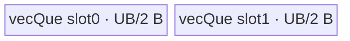
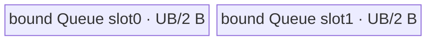
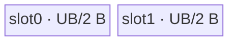
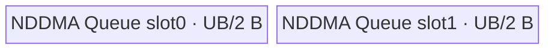
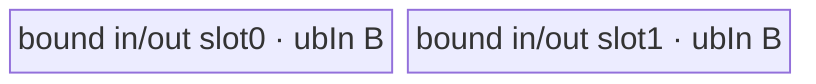
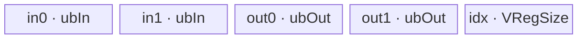
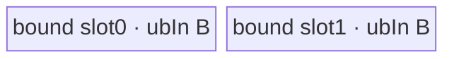

# StridedSlice 950 ACLNN 算子知识

## 算子速览

| 项目 | 内容 |
|---|---|
| 实际入口 | `aclnnStridedSliceGetWorkspaceSize` + `aclnnStridedSlice`，CANN 9.1.0 公开两段式 ACLNN；本固定版本只允许 RegBase/Ascend 950。 |
| 计算语义 | 对归一化后的每个输出坐标 `o[d]`，读取 `x[begin[d] + o[d] * strides[d]]`；mask 会在 InferShape 阶段扩展省略号、插入新轴或收缩轴。 |
| 输入输出 | `self/out` 为 ND、rank 0–8、同 dtype；公开 dtype 为 FP16/FP32/BF16、8/16/32/64 位有无符号整数、BOOL、COMPLEX32/64、HIFLOAT8、FLOAT8；`begin/end/strides` 是等长 INT32/INT64 数组，stride 非 0。 |
| 执行类型 | 单个算子拥有的 Device 节点；R-001/R-002/R-003 为 AIV 数据搬运，R-004/R-005 为 AIV+NDDMA，R-006/R-007 为 SIMT，R-008/R-009 为 AIV Vector/MicroAPI，R-010/R-011 为 NDDMA+AIV Vector/MicroAPI；router 明确 `KERNEL_TYPE_AIV_ONLY`，无 Cube/MIX_CV。 |
| Kernel 路线 | R-001 key 100；R-002 key 101；R-003 key 150；R-004 key 102；R-005 key 103；R-006 key 200；R-007 key 201；R-008 key 300；R-009 key 301；R-010 key 302；R-011 key 303。 |
| 核心资源 | GM 输入/输出；MoveAlign/NDDMA 路线使用 depth=2 Queue；Gather 另有 input/output Queue、索引 TBuf 和寄存器；UB2UB 原地复用绑定 Queue；大 shape SIMT 使用 128 B magic/shift TBuf；Tiling 固定声明 16 MiB workspace，但本 kernel 不读 `workspace`。 |
| 来源闭包 | `source_closed`：公开 ACLNN 校验与 executor、L0 AICore launcher、InferShape、arch35 Tiling/POD、11 个 key 的 AIV-only router/body、Ascend 950 OpDef/config/CMake 已闭合。 |
| 验证状态 | 已完成源码闭包检查；本次知识提取未执行编译、真机、数值或性能测试。 |

## 接口与语义

### 计算语义

设 InferShape 归一化后的有效维数为 `D`，输入行主序步长为 `inputSteps[d+1]`，输出坐标为 `o[d]`，则 kernel 的线性输入地址为：

```text
input_offset = begin[D-1] + o[D-1] * strides[D-1]
             + Σ(d=0..D-2) (begin[d] + o[d] * strides[d]) * inputSteps[d+1]
output_offset = row-major(o)
```

`strided_slice_util.h::InferShape` 先把稀疏 slice spec 展开为 dense spec，再按 stride 正负把 begin/end 规范到合法区间，形成 processing shape，最后应用 `newAxisMask` 和 `shrinkAxisMask`。Tiling 随后可把连续 stride=1 轴或连续 stride=-1 轴合并；这是地址等价变换，不改变公开输出 shape。数据本身不参与算术，所有路线按位搬运。

### 输入、输出与属性

| 参数 | shape/layout | dtype | 约束、默认值与语义 |
|---|---|---|---|
| `self` | ND，rank 0–8，可非连续 | 公开列表中的 1/2/4/8 B dtype | 非空时先 `Contiguous` 再 `ReFormat(..., ND)`；仅 Ascend 950。 |
| `begin` | 一维逻辑数组 | INT32/INT64 ACL 数组，API 内转 INT64 tensor | 与 end/strides 等长；空数组走 `ViewCopy(self,out)`，不启动 StridedSlice。 |
| `end` | 一维逻辑数组 | INT32/INT64 | 与 begin/strides 等长；越界值由 InferShape 规范化。 |
| `strides` | 一维逻辑数组 | INT32/INT64 | 每项非 0；`shrinkAxisMask` 置位轴必须为正 stride。 |
| `beginMask` | scalar | INT64 | bit=1 时忽略对应 begin，默认 0。 |
| `endMask` | scalar | INT64 | bit=1 时忽略对应 end，默认 0。 |
| `ellipsisMask` | scalar | INT64 | 最多一个 bit 为 1，默认 0。 |
| `newAxisMask` | scalar | INT64 | bit=1 时插入长度 1 的输出轴，默认 0。 |
| `shrinkAxisMask` | scalar | INT64 | bit=1 时取单点并从输出 shape 删除该轴，默认 0。 |
| `out` | ND，可非连续 | 与 self 相同 | InferShape 的 shape/scalar 属性必须与用户 out 一致；最后通过 `ViewCopy` 写入。 |

### 入口与版本

公开文档、声明和实现都只有未带版本后缀的 `aclnnStridedSlice` 两段式入口。`CheckDtypeValid` 先检查 `IsRegBase()`，否则直接返回 `ACLNN_ERR_PARAM_INVALID` 并记录“only support ASCEND950”；公开 API 产品表也仅 Ascend 950PR/950DT 为支持。目录级 README/CMake 中的 A2/A3 是图算子实现信号，不覆盖 ACLNN 文档的明确“不支持”，因此本卡仅覆盖 950，A2/A3 不发布。

## Host/Launcher 执行流程

### 参数校验与前处理

`aclnnStridedSliceGetWorkspaceSize` 的真实顺序是：创建 executor；检查五个指针；检查 RegBase、self/out dtype 属于列表且相同；检查 self rank≤8；检查三数组等长且 stride 非 0；检查 ellipsis 单 bit 与 shrink 轴 stride>0。`self->IsEmpty()` 时直接返回 workspace 0 和空计算 executor。否则 `Contiguous(self)`；若数组长度为 0，仅 `ViewCopy(selfContiguous,out)`；非空数组再 `ReFormat(...,ND)`、把三个 ACL 数组转成 INT64 tensor、调用 L0 `StridedSlice`、核对推导 shape、最后 `ViewCopy` 到可能非连续的 out。

L0 `StridedSlice` 重新执行 InferShape。ACLNN 已通过 RegBase gate，所以 `IsAiCoreSupport` 命中 AICore dtype 列表并由 `ADD_TO_LAUNCHER_LIST_AICORE` 添加 StridedSlice；AICPU 分支对该公开入口不可达。Tiling 的 `ConstructSliceParam` 取得 storage shape 和常量数组，`InferShape` 规范参数，`MakeSameDims` 重算逐轴输出长度，`MakePerformanceParams` 可拆分整除的末轴 stride，再合并连续轴。

### 参数、Workspace 与生命周期

`TilingPrepare4StridedSlice` 从平台取 AIV core 数、UB 字节数和 cache-line 字节数；三者任一≤0 即失败。正步长初始有效容量为 `(UB-8192)/sizeof(T)/2` 个元素。负步长/Gather 按 `2*UB_in + 2*UB_out` 切分，并把 `UB_in` 限制到 Gather 16-bit 索引可表达的 65536 B 范围。

每个非空 StridedSlice 节点都由 `RunStrideSliceTiling` 写 `workspaces[0]=16777216` B。Device entry 虽接收 `workspace`，11 条路线均不读取它；这 16 MiB 是框架拥有、stream 执行期间存活的保留 slice。API 返回的总 workspace 还可能包含 `Contiguous/ReFormat/ViewCopy` 的框架需求，其合计公式在固定算子源码中不可见。executor 由第一段接口移交给调用者，第二段 `CommonOpExecutorRun` 在给定 stream 上按 executor 顺序执行。

### 启动图与失败传播

算子拥有的核心图是单 Device 节点：

```text
aclnn GetWorkspaceSize
  -> [framework] Contiguous -> ReFormat/ConvertToTensor
  -> l0op::StridedSlice -> ADD_TO_LAUNCHER_LIST_AICORE
  -> Tiling4StridedSlice -> strided_slice(x,begin,end,strides,y,workspace,tiling)
  -> [framework] ViewCopy(stridedsliceOut, user out)
aclnnStridedSlice -> CommonOpExecutorRun(..., stream)
```

| 节点/边 | entry、参数与介质 | ordering、owner/lifetime | 失败传播 |
|---|---|---|---|
| 前处理边 | framework tensor；实现可为 view 或额外 kernel | executor 在同一 stream 编排；executor 持有中间 tensor | 任一步返回 null，第一段立即失败，不添加后续节点。 |
| StridedSlice 节点 | `strided_slice`，`blockDim=realCoreNum`（SIMT 为平台 AIV core 数），POD 按 key；输入/输出 GM；workspace slice 16 MiB、未消费 | executor/框架分配 workspace，至少存活到第二段执行完成 | Tiling/launcher 失败返回 null；不执行 ViewCopy。 |
| 后处理边 | StridedSlice GM 输出→用户 out，dtype/逻辑 shape 相同 | 同一 executor/stream 保证 producer 在 consumer 前 | shape 不一致或 ViewCopy 添加失败，第一段报错。 |

空 self 不添加计算；空 begin 只执行框架 ViewCopy。固定算子源码未展开 executor 内部 event 与跨 kernel workspace offset，因此这些属于明确框架边界。

## Route 与参数设计

### 分核与资源计算

Host 先计算 `outputShapeProd/inputShapeProd`；任一乘积超过 `UINT32_MAX` 置 `isShapeExceedUint32`。一般分核令每核至少约 1 KiB 输出：`rightDiv=min(coreNum,ceil(totalOutputBytes/minCoreProcessSize))`，沿左到右找到 `blkIndex`，取 `blkFactor=ceil(dim/rightDiv)`、`blkTailFactor=dim%blkFactor`，`realCoreNum=prod(outputShape[0:blkIndex])*ceil(outputShape[blkIndex]/blkFactor)`。2D 特化根据每核可容行数与每 4 KiB 输出估算核数。小输出且维数不超过路线最大 UB 轴数时可 `blkIndex=ubIndex=0, realCoreNum=1`。

一般 UB 从右向左累乘，至容量处取 `ubIndex`、`ubFactor=floor(ubElementNum/rightProduct)`；末维或 compact 行按 32 B 对齐。若 blk/UB 同轴，`ubFactor=min(ubFactor,blkFactor)`，并分别产生主核尾 tile `ubTailFactor=blkFactor%ubFactor` 与尾核尾 tile `ubTailTailFactor=blkTailFactor%ubFactor`。`ubInLoopSteps` 是相邻 tile 在输入中的元素步长，`ubOutLoopSteps` 是输出元素步长。

### Route 选择

下表中的 `S=totalOutputBytes`，`L=lastOutputDim`，`s=lastStride`，`B=sizeof(T)`，`C=cacheLineSize`，`V=GetValidNumInCacheLine()`；判断保持 `RunStrideSliceTiling→CalMaxSplitDim{Neg}` 的优先级。

| 顺序 | Route | Key/模板 | 精确选择条件与优先级 | 不适用去向 |
|---:|---|---|---|---|
| 1 | R-006 SIMT 空域 | 200 | 任一规范化 input/output dim≤0；优先于所有除法与路线选择。 | 非空进入正/负 stride 树。 |
| 2 | R-008 MoveAlign Gather | 300 | 存在负 stride、`S>1024`，且 `(s<0 或 s>1)`、`abs(s)≤16`、`((L-1)*abs(s)+1)*B≥C`；正 stride 全局场景还可由 `s>1 && s≤16 && ((L-1)*s+1)*B≥C && S>1024` 命中。 | 负树尝试 NDDMA/UB2UB/SIMT；正树尝试 NDDMA。 |
| 3 | R-009 MoveAlign UB2UB | 301 | 存在外轴负 stride、`S>1024`、末轴 `s==1`，且 `((L-1)*s+1)*B≥C/4`。 | R-006/R-007。 |
| 4 | R-010 NDDMA Gather | 302 | 存在负 stride、`S>1024`、末轴 `s<0`，MoveAlign Gather 未命中，且 `V*B≥C/2 && L*B≥C`。 | R-006/R-007。 |
| 5 | R-011 NDDMA UB2UB | 303 | 存在负 stride、`S>1024`、末轴 `s>1`，MoveAlign Gather 未命中，且 `V*B≥C/2 && L*B≥C`。 | R-006/R-007。 |
| 6 | R-001 MoveAlign compact | 100 | 无负 stride、末轴 `s==1` 且 `L*B≥64`；UB 不切末轴，且不是 2D 的 UB/blk 同切 0 轴特化。 | R-002/R-003 由 UB 轴细分；正稀疏 Gather 已在 R-008。 |
| 7 | R-002 MoveAlign last-dim | 101 | R-001 家族选择后 `ubIndex==D-1` 且 `useGather==false`。 | UB 切更外轴到 R-001/R-003。 |
| 8 | R-003 2D MoveAlign | 150 | R-001 家族、`D==2`、`ubIndex==D-2`，由 `MovAlignV2UbSplitLastTwoDim` 设置。 | 其他维数到 R-001。 |
| 9 | R-004 NDDMA multi-dim | 102 | 无负 stride，MoveAlign 未命中，且 `V*B≥64`；或最终 guard `isShapeExceedUint32 \|\| outputElements≤1024`，随后 `ubIndex!=D-1`。 | 末轴切分到 R-005。 |
| 10 | R-005 NDDMA last-dim | 103 | R-004 家族且 `ubIndex==D-1`。 | 更外轴到 R-004。 |
| 11 | R-007 SIMT B64 | 201 | 存在负 stride，且负向 MoveAlign/NDDMA guard 均未命中（包括 `S≤1024` 的提前返回），同时 input/output 总元素乘积超过 `UINT32_MAX`。正 stride 的大 shape 会被最终 NDDMA guard 截获。 | 乘积≤UINT32_MAX 到 R-006。 |
| 12 | R-006 SIMT normal | 200 | 前述路线均未命中且乘积≤`UINT32_MAX`，或空域；可覆盖正 stride 的稀疏大于1024元素 fallback及负 stride fallback。 | 终点。 |

```text
if empty: key=200
else if any stride<0:
  if outputBytes<=1024: SIMT(200/201)
  else if lastStride<0:
    if abs(lastStride)<=16 && spanBytes>=C: key=300
    else if validBytes>=C/2 && lastOutBytes>=C: key=302
    else: SIMT(200/201)
  else if lastStride==1:
    if spanBytes>=C/4: key=301
    else: SIMT(200/201)
  else:
    if lastStride<=16 && spanBytes>=C: key=300
    else if validBytes>=C/2 && lastOutBytes>=C: key=303
    else: SIMT(200/201)
else:
  if lastStride==1 && lastOutBytes>=64: MoveAlign -> 101/150/100 by ubIndex,D
  else if lastStride>1 && lastStride<=16 && spanBytes>=C && outputBytes>1024: key=300
  else if validBytes>=64 || shapeExceedsU32 || outputElements<=1024: NDDMA -> 103/102 by ubIndex
  else: SIMT(200/201)
```

### 模板/实现执行矩阵

| Route | key/selector | dtype/shape/platform 完整命中条件 | 执行拓扑与 Kernel 节点 | 实际模板/body | 内存与同步特征 | tail/fallback |
|---|---|---|---|---|---|---|
| R-001 | 100 | 950；MoveAlign；UB 切倒数 2–4 轴；非 2D 特化 | 单 AIV | `StridedSliceMoveAlign<T,U>::ProcessPerBlock` | 绑定 VECIN/VECOUT Queue depth 2；loop-mode `DataCopyPad` | 改写 blockCount/loop1/loop2 处理尾 tile。 |
| R-002 | 101 | 950；MoveAlign；UB 切末轴 | 单 AIV | `StridedSliceMoveAlignLastDim` | Queue depth 2；逐连续段搬运 | blk/UB 同轴和异轴分别循环；tail blockLen 精确。 |
| R-003 | 150 | 950；2D；UB/blk 切 0 轴 | 单 AIV | `StridedSliceMoveAlignTwoDim` | 精简 POD 与 Queue depth 2 | 尾核用 `ubTailTailFactor`。 |
| R-004 | 102 | 950；正 stride NDDMA；UB 切倒数 2–5 轴 | 单 AIV/NDDMA | `StridedSliceNDDMA<T,U>` | 5D MultiCopy→Queue→GM | 尾 tile替换最外 UB loopSize。 |
| R-005 | 103 | 950；正 stride NDDMA；UB 切末轴 | 单 AIV/NDDMA | `StridedSliceNDDMALastDim` | 1D MultiCopy | blk/UB 同轴和异轴分支。 |
| R-006 | 200 | 950；32-bit shape fallback/空域 | 单 SIMT | `StridedSliceSIMT` + Dim1..8Compute | 无 AIV Queue；每 thread 直接 GM load/store | `idx<outputSize`；空域不 launch VF。 |
| R-007 | 201 | 950；shape product>UINT32 | 单 SIMT | `StridedSliceSIMTBigShape` + B64 Dim1..8 | 128 B TBuf、UB barrier、64-bit index | 线程数按 rank 1:2048、2:1024、3/4:512、5–8:256。 |
| R-008 | 300 | 950；末轴小 stride Gather 条件 | 单 AIV Vector | `StridedSliceMoveAlignGather` | 双 input/output Queue + idx TBuf；MicroAPI Gather | tail 重算 span/index base，负轴再 reorder。 |
| R-009 | 301 | 950；外轴负、末轴连续 | 单 AIV Vector | `StridedSliceMoveAlignUb2Ub` | 绑定 Queue 原地 reorder；MTE2→V→MTE3 event | tail 改外层 loop size。 |
| R-010 | 302 | 950；NDDMA cache-line gather 条件、末轴负 | 单 NDDMA+Vector | `StridedSliceNDDMAGather` | NDDMA input Queue→Gather output Queue | tail index base 补偿末轴负向长度差。 |
| R-011 | 303 | 950；NDDMA cache-line 条件、外轴负/末轴正稀疏 | 单 NDDMA+Vector | `StridedSliceNDDMAUb2Ub` | NDDMA→绑定 Queue原地 reorder；显式 event | tail 替换最外 loopSize。 |

### 隐藏性能 Guard

| Guard | Host/Tiling 条件 | Device/资源原因 | 影响 Route | 不满足时去向 | 源码符号 |
|---|---|---|---|---|---|
| API 平台 | `IsRegBase()` | arch35 kernel/POD only | 全部 | ACLNN 参数错误 | `CheckDtypeValid` |
| UB reserve/DB | `ubElement=(UB-8192)/B/2` | Queue depth=2，并保留 8192 B Host 裕量 | 100–103/150 | 更外 UB 轴或 selector fallback | `StrideSliceTiling::Init` |
| Gather index | `ubSizeInput<=65536` | B8/B16 用 uint16 index | 300/302 | Host 缩小 `ubOutBase` | `CalcUbSplitInfoNeg` |
| MoveAlign 位宽 | src/loop stride≤UINT32、count/loop/dst stride≤UINT16 | `DataCopyExtParams/LoopModeParams` 字段窄化 | 100/150/300/301 | `ResetMovAlignV2Para` 向内移动 UB split 轴 | `MovAlignV2UbSplitLast*Dim` |
| cache-line density | `V*B≥64` 或 `≥C/2` | 避免稀疏 NDDMA 搬入大量无效 cache line | 102/103/302/303 | SIMT 或 MoveAlign | `CalMaxSplitDim*` |
| last stride Gather | `abs(s)≤16` 且 spanBytes≥C | Gather index范围和连续 GM burst | 300 | NDDMA/SIMT | `CalMaxSplitDim*` |
| B64 shape | prod(input/output)>UINT32_MAX | normal SIMT 的 idx/prod 为 uint32 | 201 | 200 | `CalInputOutputSize` |
| 空域 | 任一 input/output dim≤0 | 后续 UB/除法不安全且无输出 | 200 | 直接返回 | `Init` / `StridedSliceSIMT::Process` |

### POD/ABI

所有 POD 由 `BEGIN_TILING_DATA_DEF` 生成并通过对应 `REGISTER_TILING_DATA_CLASS` 序列化；声明给出字段顺序和源码位宽，但宏展开后的 `sizeof/alignof/offsetof` 在固定仓不可见。下表数组的“8×”是字段固定元素数，不是把多个字段合并。

| 结构 | 字段 | 类型/位宽 | ABI 布局 | 单位 | Host/launcher producer | Device consumer | 边界 |
|---|---|---|---|---|---|---|---|
| `StridedSliceBaseTilingData` | `blkFactor` | int64/64 | 顺序声明；offset不可见 | 元素 | `CalcBlockSplitInfo/SetTwoDimTilingInfo` | Base 分核循环 | >0，空域不使用 |
| 同上 | `blkTailFactor` | int64/64 | 同上 | 元素 | `outputShape[blkIndex]%blkFactor` | 尾核 | 0 表示整除 |
| 同上 | `ubInLoopSteps` | int64/64 | 同上 | 元素 | `CalStridedSliceRowsStepsParams` | tile 输入地址 | 可为负步长 |
| 同上 | `ubOutLoopSteps` | int64/64 | 同上 | 元素 | 同上 | tile 输出地址 | 正值 |
| 同上 | `ubSize` | int32/32 | 同上 | 字节 | 平台 UB 或 `ubSizeOutput` | `InitBuffer` | Host 向 int32 写入，平台值须可表示 |
| 同上 | `ubFactor` | int32/32 | 同上 | 元素 | `CalcUbSplitInfo*` | tile loop/ND loop | >0 |
| 同上 | `ubTailFactor` | int32/32 | 同上 | 元素 | 维长或 blkFactor 取模 | 主核 tail | 0 表示无 tail |
| 同上 | `ubTailTailFactor` | int32/32 | 同上 | 元素 | `blkTailFactor%ubFactor` | 尾核 tail | blk/UB 同轴时活动 |
| 同上 | `realCoreNum` | int16/16 | 同上 | AIV core | Host 计算 | core guard | 必须≤int16 可表示；固定源码无显式窄化检查 |
| 同上 | `inputDims` | int16/16 | 同上 | 轴数 | 规范化后 dimNum | 所有地址 helper | 1–8；scalar 经 EnsureNotScalar |
| 同上 | `blkIndex` | int16/16 | 同上 | 轴号 | 分核 | Base 地址 helper | [0,D) |
| 同上 | `ubIndex` | int16/16 | 同上 | 轴号 | UB 切分 | body 路线 | [0,D) |
| 同上 | `outputShape[8]` | int64×8 | 同上 | 元素/轴 | 规范化 shape | 地址/loop | 仅前 D 项活动 |
| 同上 | `begin[8]` | int64×8 | 同上 | 元素索引 | 规范化 begin | Base/各 body | 负值编码动态 begin 索引 |
| 同上 | `strides[8]` | int64×8 | 同上 | 元素步长 | 规范化 stride | 地址/reorder | 非 0 |
| 同上 | `inputSteps[8]` | int64×8 | 同上 | 元素 | 输入 shape 后缀积 | GM 地址 | 仅前 D 项活动 |
| 同上 | `rowsOffsetSteps[8]` | int64×8 | 同上 | 输出行 | 输出 shape 后缀积 | core/tile offset | 仅前 D 项活动 |
| `StridedSliceMoveAlignParams` | `blockCount` | uint16/16 | 顺序声明；offset不可见 | burst 数 | `MovAlignV2UbSplit*` | MoveAlign copy-in | ≤65535 |
| 同上 | `blockLen` | uint32/32 | 同上 | 字节 | 同上 | `DataCopyPad` | span/连续行字节 |
| 同上 | `srcStride` | uint32/32 | 同上 | 字节，Host 头到头；Device 转尾到头 | 同上 | copy-in | ≤UINT32 |
| 同上 | `dstStride` | uint32/32 | 同上 | 字节 | 同上 | copy-in | compact 路线可为 blockLen |
| 同上 | `loop1Size` | uint16/16 | 同上 | 次数 | 同上 | LoopMode | 默认1 |
| 同上 | `loop2Size` | uint16/16 | 同上 | 次数 | 同上 | LoopMode | 默认1 |
| 同上 | `loop1SrcStride` | uint32/32 | 同上 | 字节 | 同上 | LoopMode | ≤UINT32 |
| 同上 | `loop1DstStride` | uint16/16 | 同上 | 字节 | 同上 | LoopMode | ≤UINT16 |
| 同上 | `loop2SrcStride` | uint32/32 | 同上 | 字节 | 同上 | LoopMode | ≤UINT32 |
| 同上 | `loop2DstStride` | uint16/16 | 同上 | 字节 | 同上 | LoopMode | ≤UINT16 |
| `StridedSliceMATilingData` | `stridedSliceBaseTilingData` | nested | 外层首字段；offset不可见 | N/A | `Fill...100` | R-001 | 完整 Base POD |
| 同上 | `moveAlignParams` | nested | 外层次字段；offset不可见 | N/A | `SetMoveAlignParams` | R-001 | 完整 MoveAlign POD |
| `StridedSliceMALastDimTilingData` | `stridedSliceBaseTilingData` | nested | 唯一字段 | N/A | `Fill...101` | R-002 | 无 MoveAlign 参数 |
| `StridedSliceShortMoveAlignParams` | `blockCount` | uint16/16 | 顺序声明；offset不可见 | burst 数 | `SetShortMoveAlignParams` | R-003 | ≤UINT16 |
| 同上 | `blockLen` | uint32/32 | 同上 | 字节 | 同上 | R-003 copy | ≤UINT32 |
| 同上 | `srcStride` | uint32/32 | 同上 | 字节 | 同上 | R-003 copy | Host 头到头 |
| 同上 | `dstStride` | uint32/32 | 同上 | 字节 | 同上 | R-003 copy | compact 输出 |
| `StridedSliceMALast2DimTilingData` | `blkFactor` | int64/64 | 顺序声明；offset不可见 | 行 | `Fill...150` | R-003 | >0 |
| 同上 | `blkTailFactor` | int64/64 | 同上 | 行 | 同上 | R-003 | 0 可用 |
| 同上 | `ubInLoopSteps` | int64/64 | 同上 | 元素 | `SetRowsStepsParamsFor150` | R-003 | 输入 tile 步长 |
| 同上 | `ubOutLoopSteps` | int64/64 | 同上 | 元素 | 同上 | R-003 | 输出 tile 步长 |
| 同上 | `ubSize` | int32/32 | 同上 | 字节 | 平台 UB | Queue | depth=2 总量 |
| 同上 | `ubFactor` | int32/32 | 同上 | 行 | Host | R-003 | >0 |
| 同上 | `ubTailFactor` | int32/32 | 同上 | 行 | Host | 主核 tail | 0 可用 |
| 同上 | `ubTailTailFactor` | int32/32 | 同上 | 行 | Host | 尾核 tail | 0 可用 |
| 同上 | `realCoreNum` | int16/16 | 同上 | core | Host | core guard | int16 窄化 |
| 同上 | `moveAlignParams` | nested short | 同上 | N/A | Host | copy-in | 4 字段 |
| 同上 | `outputShape[2]` | int64×2 | 同上 | 元素 | Host | 输出地址 | 2D only |
| 同上 | `begin[2]` | int64×2 | 同上 | 索引 | Host | 输入地址 | 动态 begin 可编码 |
| 同上 | `strides[2]` | int64×2 | 同上 | 步长 | Host | 输入地址 | 正 stride路线 |
| 同上 | `inputSteps[2]` | int64×2 | 同上 | 元素 | Host | 输入地址 | 后缀积 |
| `StridedSliceNDDMATilingData` | `stridedSliceBaseTilingData` | nested | 首字段；offset不可见 | N/A | `Fill...NDDMA` | R-004/5/10/11 | Base POD |
| 同上 | `nddmaTotalNum` | int64/64 | 同上 | 元素 | loopSize 乘积 | copy-out 长度 | 主 tile |
| 同上 | `ubSizeInput` | int32/32 | 同上 | 字节 | `CalcUbSplitInfoNeg` | R-010/11 Queue | 正 NDDMA 路线为0且不读 |
| 同上 | `nddmaLoopSize[5]` | int64×5 | 同上 | 次数 | `SetNddmaTilingMode*` | MultiCopy loop | 未用高维补1 |
| 同上 | `nddmaLoopSrcStride[5]` | int64×5 | 同上 | 元素 | 同上 | MultiCopy source | Device API 接收时保持元素单位 |
| 同上 | `nddmaLoopDstStride[5]` | int64×5 | 同上 | 元素 | 同上 | MultiCopy destination | 负路线末维按 block 对齐 |
| `StridedSliceSIMTTilingData` | `isEmptyTensor` | uint16/16 | 顺序声明；offset不可见 | bool | Init 空域检查 | SIMT Process | 1 时直接返回 |
| 同上 | `inputDims` | int16/16 | 同上 | 轴数 | dimNum | Dim1..8 dispatch | 1–8 |
| 同上 | `begin[8]` | int64×8 | 同上 | 索引 | Host | SIMT Init | 动态编码可解引用 begin GM |
| 同上 | `strides[8]` | int64×8 | 同上 | 元素步长 | Host | thread 地址 | normal 路线窄化 int32 |
| 同上 | `outputShapeProd[8]` | int64×8 | 同上 | 元素 | 后缀积 | 坐标反解 | key200 要≤UINT32；key201 uint64 |
| 同上 | `inputShapeProd[8]` | int64×8 | 同上 | 元素 | 后缀积 | 输入地址 | key200 要≤UINT32；key201 uint64 |
| `StridedSliceMAGatherTilingData` | `stridedSliceBaseTilingData` | nested | 首字段；offset不可见 | N/A | `Fill...300` | R-008 | Base POD |
| 同上 | `moveAlignParams` | nested | 次字段 | N/A | Host | R-008 | MoveAlign POD |
| 同上 | `ubSizeInput` | int32/32 | 尾字段 | 字节 | Host | input Queue | depth=2 |
| `StridedSliceMAUB2UBTilingData` | `stridedSliceBaseTilingData` | nested | 首字段；offset不可见 | N/A | `Fill...301` | R-009 | Base POD |
| 同上 | `moveAlignParams` | nested | 次字段 | N/A | Host | R-009 | MoveAlign POD |
| 同上 | `ubSizeInput` | int32/32 | 尾字段 | 字节 | Host | bound Queue | depth=2 |

### Route 源码闭包

| Route | Key/selector | Host/Tiling producer | POD/参数 | Kernel entry/router 节点 | Kernel body/直接依赖 | 构建接线 |
|---|---|---|---|---|---|---|
| R-001 | 100 | `strided_slice_tiling_arch35.cpp::SetMovAlignV2TilingMode` | MATilingData | `strided_slice_apt.cpp::strided_slice` | `StridedSliceMoveAlign` + Base | OpDef `strided_slice_apt`; ascend950 CMake/config |
| R-002 | 101 | 同上/`MovAlignV2UbSplitLastOneDim` | MALastDim | 同上 | `StridedSliceMoveAlignLastDim` + Base | 同上 |
| R-003 | 150 | `MovAlignV2UbSplitLastTwoDim` | MALast2Dim | 同上 | `StridedSliceMoveAlignTwoDim` | 同上 |
| R-004 | 102 | `SetNddmaTilingMode` | NDDMATilingData | 同上 | `StridedSliceNDDMA` + Base | 同上 |
| R-005 | 103 | `SetNddmaTilingMode` | NDDMATilingData | 同上 | `StridedSliceNDDMALastDim` + Base | 同上 |
| R-006 | 200 | `SetSIMTTilingMode` | SIMTTilingData | 同上 | `StridedSliceSIMT` | 同上 |
| R-007 | 201 | `SetSIMTTilingMode` | SIMTTilingData | 同上 | `StridedSliceSIMTBigShape` | 同上 |
| R-008 | 300 | `SetMovAlignV2TilingMode{Neg}` | MAGather | 同上 | `StridedSliceMoveAlignGather` + Base reorder | 同上 |
| R-009 | 301 | `SetMovAlignV2TilingModeNeg` | MAUB2UB | 同上 | `StridedSliceMoveAlignUb2Ub` + Base reorder | 同上 |
| R-010 | 302 | `SetNddmaTilingModeNeg` | NDDMATilingData | 同上 | `StridedSliceNDDMAGather` + Base reorder | 同上 |
| R-011 | 303 | `SetNddmaTilingModeNeg` | NDDMATilingData | 同上 | `StridedSliceNDDMAUb2Ub` + Base reorder | 同上 |

## Kernel 实现

### 公共执行流程

所有核心路线只有一个 `strided_slice` Device 节点。router 以 `TILING_KEY_IS` 解析对应 POD，按 `sizeof(DTYPE_X)` 把 1/4/8 B dtype映射到同宽整数模板以实现按位搬运，2 B 类型直接用 `DTYPE_X`（Gather/UB2UB 的 else 明确实例化 `int16_t`）。Base 解析分核/UB 参数；动态 begin 用 Host 编码 `-10-i`，Device 再从 begin GM 取第 i 项、处理负索引并 clamp。每个 active core 按输出 row/tile 计算输入地址，且主 tile 后单独处理 tail。workspace 参数无 Device consumer。

### Route R-001：多维 MoveAlign compact

#### 适用条件

##### 选择证据

| 层级 | 文件 | 符号 | 源码谓词/参数 | 结果/下一跳 |
|---|---|---|---|---|
| Tiling | `.../strided_slice_tiling_arch35.cpp` | `CalMaxSplitDim` | 无负 stride、末轴 stride=1 且连续输出≥64 B；正稀疏 Gather 已另分 R-008 | maxSplitDim=4 |
| Tiling | 同上 | `MovAlignV2UbSplitLastTwo/Three/FourDim` | UB 不切末轴；2D 特化除外 | key 100 |
| Router | `.../strided_slice_apt.cpp` | `strided_slice` | `TILING_KEY_IS(100)` | `StridedSliceMoveAlignProcess` |

#### Device 数据流

##### 函数级调用链

```text
strided_slice -> StridedSliceMoveAlignProcess -> Init(ParseBase/ParseCopyIn, InitBuffer)
  -> Process -> SetCopyOutAlignParams -> ProcessPerBlock
    -> GetProcessRowsOffset/GetInputGmAddr
    -> SetLoopModePara -> DataCopyPad GM→Queue -> EnQue/DeQue
    -> DataCopyPad Queue→GM -> FreeTensor
```

##### 源码等价伪码

```text
if blockIdx>=realCoreNum: return
derive outerLoops, fullTileLoops, coreRowBase
for outer in outerLoops:
  inBase  = sliced input address(coreRowBase + outer*rowsOffsetSteps[ubIndex])
  outBase = row-major output address(...)
  for tile in fullTileLoops:
    copy compact loop2×loop1×blockCount bursts from inBase+tile*ubInLoopSteps into Queue
    copy valid compact bytes to outBase+tile*ubOutLoopSteps
  if ubTailFactor>0: repeat with outermost active loop/count replaced by tail
```

#### 内存与数据搬运

##### 资源与搬运表

| 层级/缓冲区 | offset/地址公式 | extent/容量公式 | dtype/layout | producer | consumer | owner/lifetime | 对齐/复用 |
|---|---|---|---|---|---|---|---|
| GM x | `GetInputGmAddr(row)+tile*ubInLoopSteps` | loop-mode span | T/ND | API input | MTE2 | caller | source stride字节；compact pad |
| `vecQue_` | Queue slot | `UB/2` B×depth2 | T/compact | DataCopyPad | MTE3 | TPipe/迭代 | 双缓冲；FreeTensor 后复用 |
| GM y | `GetOutputGmAddr(row)+tile*ubOutLoopSteps` | 有效输出字节 | T/ND | MTE3 | API/ViewCopy | executor | 非32B行用多 blockCount 保持有效尾 |

##### 分层内存布局



##### 字节账与复用顺序

```text
UB_total = 2 * (ubSize/2) = ubSize <= platform UB
dynamic_ub = N/A
workspace_total(node) = 16 MiB reserved, 0 B consumed by body
```

| 复用子区 | 写入者 | 读取者/消费点 | 下一次覆盖 | 同步或释放依据 | 安全条件 |
|---|---|---|---|---|---|
| Queue slot | MTE2 copy-in | MTE3 copy-out | 后续 tile | EnQue→DeQue→FreeTensor | 必须在 FreeTensor 后覆盖 |

#### 同步、精度与尾块

##### 同步与数值边界表

| 阶段 | primitive/机制 | producer | consumer/等待点 | 保护对象 | 精度/尾块 |
|---|---|---|---|---|---|
| GM→UB→GM | Queue | MTE2 | MTE3 DeQue | Queue slot | 按位搬运；tail 改 blockCount/loop size，不写 padding 到逻辑输出 |

#### 关键实现

##### 符号证据表

| 阶段 | 文件 | 符号/模板实例 | 实现事实 |
|---|---|---|---|
| Host/Tiling producer | `.../strided_slice_tiling_arch35.cpp` | `MovAlignV2UbSplitLast*Dim` | 生成 loop-mode 字节参数并做位宽 fallback |
| Kernel entry/router | `.../strided_slice_apt.cpp` | key100 | MATilingData→MoveAlignProcess |
| Device body/helper | `.../strided_slice_move_align.h` | `ProcessPerBlock` | compact 多维搬运与尾 tile |

### Route R-002：末轴连续 MoveAlign

#### 适用条件

##### 选择证据

| 层级 | 文件 | 符号 | 源码谓词/参数 | 结果/下一跳 |
|---|---|---|---|---|
| Tiling | `.../strided_slice_tiling_arch35.cpp` | `MovAlignV2UbSplitLastOneDim` | 非负路线、`ubIndex==D-1`、非 Gather | key101 |
| Router | `.../strided_slice_apt.cpp` | key101 | MALastDim POD | `StridedSliceMoveAlignLastDimProcess` |

#### Device 数据流

##### 函数级调用链

```text
strided_slice -> StridedSliceMoveAlignLastDimProcess -> Init
  -> Process -> ProcessPerBlockInLastDim | ProcessPerBlockNLastDim
    -> DataCopyPad GM→bound Queue→GM
```

##### 源码等价伪码

```text
if ubIndex!=D-1 or inactive core: return
if blkIndex==ubIndex:
  one or more cores share a row; offset=(blockIdx%blkSplit)*blkFactor
else:
  each core handles derived rows
for each full ubFactor segment: exact blockLen=ubFactor*sizeof(T) copy in/out
if tail: exact blockLen=ubTailFactor*sizeof(T) copy in/out
```

#### 内存与数据搬运

##### 资源与搬运表

| 层级/缓冲区 | offset/地址公式 | extent/容量公式 | dtype/layout | producer | consumer | owner/lifetime | 对齐/复用 |
|---|---|---|---|---|---|---|---|
| bound Queue | segment-local | `UB/2`×2 | T/linear | GM copy | GM copy | TPipe | exact tail bytes |

##### 分层内存布局



##### 字节账与复用顺序

```text
UB_total=UB; dynamic_ub=N/A; workspace node=16 MiB reserved/unread
```

| 复用子区 | 写入者 | 读取者/消费点 | 下一次覆盖 | 同步或释放依据 | 安全条件 |
|---|---|---|---|---|---|
| Queue slot | DataCopyPad in | DataCopyPad out | next segment | Queue FreeTensor | exact segment complete |

#### 同步、精度与尾块

##### 同步与数值边界表

| 阶段 | primitive/机制 | producer | consumer/等待点 | 保护对象 | 精度/尾块 |
|---|---|---|---|---|---|
| copy | bound Queue | MTE2 | MTE3 | segment | 无 cast；tail blockLen 精确 |

#### 关键实现

##### 符号证据表

| 阶段 | 文件 | 符号/模板实例 | 实现事实 |
|---|---|---|---|
| Host/Tiling producer | `.../strided_slice_tiling_arch35.cpp` | `MovAlignV2UbSplitLastOneDim` | key101 |
| Kernel entry/router | `.../strided_slice_apt.cpp` | key101 | MALastDim POD |
| Device body/helper | `.../strided_slice_move_align_last_dim.h` | two ProcessPerBlock methods | 同轴/异轴末维切分 |

### Route R-003：2D MoveAlign 特化

#### 适用条件

##### 选择证据

| 层级 | 文件 | 符号 | 源码谓词/参数 | 结果/下一跳 |
|---|---|---|---|---|
| Host/Tiling | `.../strided_slice_tiling_arch35.cpp` | `CalcBlockSplitInfo/CalcUbSplitInfo` | MoveAlign 家族且规范化后为2D、`ubIndex==0` | 计算行分核与 UB tile |
| Host/Tiling | 同上 | `MovAlignV2UbSplitLastTwoDim` | `dimNum==2 && !useGather` | key150 与短 POD |
| Router | `.../strided_slice_apt.cpp` | key150 | MALast2Dim | TwoDimProcess |

#### Device 数据流

##### 函数级调用链

```text
strided_slice -> StridedSliceMoveAlignTwoDimProcess -> Init(parse begin[2], Queue)
  -> Process -> DataCopyPad compact rows GM→Queue→GM
```

##### 源码等价伪码

```text
rowsBase=blockIdx*blkFactor
inBase=begin1+(begin0+rowsBase*stride0)*inputSteps1
outBase=rowsBase*outputShape1
repeat floor(coreRows/ubFactor) compact row bursts
tailCount = tail core ? ubTailTailFactor : ubTailFactor
copy tailCount rows with exact output bytes
```

#### 内存与数据搬运

##### 资源与搬运表

| 层级/缓冲区 | offset/地址公式 | extent/容量公式 | dtype/layout | producer | consumer | owner/lifetime | 对齐/复用 |
|---|---|---|---|---|---|---|---|
| `vecQue_` | per row tile | `ubSize/2`×2 | T/2D compact | GM | GM | TPipe | depth2 |

##### 分层内存布局



##### 字节账与复用顺序

```text
UB_total=ubSize; dynamic_ub=N/A; workspace node=16 MiB reserved/unread
```

| 复用子区 | 写入者 | 读取者/消费点 | 下一次覆盖 | 同步或释放依据 | 安全条件 |
|---|---|---|---|---|---|
| Queue slot | compact copy-in | exact copy-out | next row tile | FreeTensor | tail count已替换 |

#### 同步、精度与尾块

##### 同步与数值边界表

| 阶段 | primitive/机制 | producer | consumer/等待点 | 保护对象 | 精度/尾块 |
|---|---|---|---|---|---|
| copy | Queue | MTE2 | MTE3 | row tile | byte-preserving，尾核独立 tail |

#### 关键实现

##### 符号证据表

| 阶段 | 文件 | 符号/模板实例 | 实现事实 |
|---|---|---|---|
| Host/Tiling producer | `.../strided_slice_tiling_arch35.cpp` | `CalcBlockSplitInfo/MovAlignV2UbSplitLastTwoDim` | 2D 行分核并生成 key150 搬运参数 |
| Kernel entry/router | `.../strided_slice_apt.cpp` | key150 | 短 POD |
| Device body/helper | `.../strided_slice_move_align_two_dim.h` | `Process` | 2D 直接地址公式 |

### Route R-004：多维 NDDMA

#### 适用条件

##### 选择证据

| 层级 | 文件 | 符号 | 源码谓词/参数 | 结果/下一跳 |
|---|---|---|---|---|
| Tiling | `.../strided_slice_tiling_arch35.cpp` | `CalMaxSplitDim/SetNddmaTilingMode` | 正 stride、maxSplitDim=5、`D-ubIndex>1` | key102，最多5D loop |
| Router | `.../strided_slice_apt.cpp` | key102 | NDDMATilingData | NDDMAProcess |

#### Device 数据流

##### 函数级调用链

```text
strided_slice -> StridedSliceNDDMAProcess -> Init(ParseNDDMA, Queue)
  -> Process -> SetLoopInfo/SetCopyOutParams -> ProcessPerBlock
    -> DataCopy<T,5D> GM→Queue -> DataCopyPad Queue→GM
```

##### 源码等价伪码

```text
loopInfo inner-to-outer := {loopSize, source element stride, compact destination element stride}
pad unused dimensions with size=1,stride=0
for core outer row and full UB tile:
  NDDMA gather rectangular/strided region into compact UB
  copy nddmaTotalNum*sizeof(T) contiguous bytes to output
tail: replace outermost active loopSize with ubTailFactor and shrink output bytes proportionally
```

#### 内存与数据搬运

##### 资源与搬运表

| 层级/缓冲区 | offset/地址公式 | extent/容量公式 | dtype/layout | producer | consumer | owner/lifetime | 对齐/复用 |
|---|---|---|---|---|---|---|---|
| NDDMA source | Base sliced address+tile input step | MultiCopy 5D | T/ND strided | GM | NDDMA | caller | stride单位元素 |
| bound Queue | slot | `UB/2`×2 | T/compact | NDDMA | MTE3 | TPipe | depth2 |
| GM output | Base output+tile output step | total loop product | T/ND | MTE3 | ViewCopy | executor | tail 比例缩短 |

##### 分层内存布局



##### 字节账与复用顺序

```text
UB_total=2*(ubSize/2)=ubSize; dynamic_ub=N/A; workspace node=16 MiB reserved/unread
```

| 复用子区 | 写入者 | 读取者/消费点 | 下一次覆盖 | 同步或释放依据 | 安全条件 |
|---|---|---|---|---|---|
| Queue slot | NDDMA | MTE3 | next MultiCopy | Queue lifecycle | loop product fits slot |

#### 同步、精度与尾块

##### 同步与数值边界表

| 阶段 | primitive/机制 | producer | consumer/等待点 | 保护对象 | 精度/尾块 |
|---|---|---|---|---|---|
| MultiCopy→GM | Queue | NDDMA | MTE3 | compact tile | no cast；tail loopSize替换 |

#### 关键实现

##### 符号证据表

| 阶段 | 文件 | 符号/模板实例 | 实现事实 |
|---|---|---|---|
| Host/Tiling producer | `.../strided_slice_tiling_arch35.cpp` | `SetNddmaTilingMode` | loop size/src/dst元素步长 |
| Kernel entry/router | `.../strided_slice_apt.cpp` | key102 | NDDMA POD |
| Device body/helper | `.../strided_slice_nddma.h` | `SetLoopInfo/ProcessPerBlock` | 5D MultiCopy + tail |

### Route R-005：末轴 NDDMA

#### 适用条件

##### 选择证据

| 层级 | 文件 | 符号 | 源码谓词/参数 | 结果/下一跳 |
|---|---|---|---|---|
| Tiling | `.../strided_slice_tiling_arch35.cpp` | `SetNddmaTilingMode` | `D-ubIndex==1` | key103 |
| Router | `.../strided_slice_apt.cpp` | key103 | NDDMA POD | NDDMALastDimProcess |

#### Device 数据流

##### 函数级调用链

```text
strided_slice -> StridedSliceNDDMALastDimProcess -> Init
  -> Process -> ProcessPerBlockInLastDim | ProcessPerBlock -> SetLoopInfo
    -> DataCopy<T,1D> -> Queue -> DataCopyPad
```

##### 源码等价伪码

```text
1D MultiCopy loopSize=ubFactor, srcStride=lastStride, dstStride=1
if blkIndex==ubIndex: cores share row and input offset multiplies lastStride
else: each core iterates rows
copy full tiles; tail uses loopSize=ubTailFactor and exact output blockLen
```

#### 内存与数据搬运

##### 资源与搬运表

| 层级/缓冲区 | offset/地址公式 | extent/容量公式 | dtype/layout | producer | consumer | owner/lifetime | 对齐/复用 |
|---|---|---|---|---|---|---|---|
| Queue | tile slot | `UB/2`×2 | T/linear | 1D NDDMA | GM copy | TPipe | depth2 |

##### 分层内存布局


##### 字节账与复用顺序

```text
UB_total=ubSize; dynamic_ub=N/A; workspace node=16 MiB reserved/unread
```

| 复用子区 | 写入者 | 读取者/消费点 | 下一次覆盖 | 同步或释放依据 | 安全条件 |
|---|---|---|---|---|---|
| Queue slot | 1D NDDMA | MTE3 | next tile | Queue FreeTensor | tail loopSize精确 |

#### 同步、精度与尾块

##### 同步与数值边界表

| 阶段 | primitive/机制 | producer | consumer/等待点 | 保护对象 | 精度/尾块 |
|---|---|---|---|---|---|
| NDDMA | Queue | MTE2/NDDMA | MTE3 | tile | 按位；idx/outputSize guard |

#### 关键实现

##### 符号证据表

| 阶段 | 文件 | 符号/模板实例 | 实现事实 |
|---|---|---|---|
| Host/Tiling producer | `.../strided_slice_tiling_arch35.cpp` | `SetNddmaTilingMode` | key103 condition |
| Kernel entry/router | `.../strided_slice_apt.cpp` | key103 | NDDMA POD |
| Device body/helper | `.../strided_slice_nddma_last_dim.h` | `SetLoopInfo` | 1D sparse load |

### Route R-006：32-bit SIMT fallback

#### 适用条件

##### 选择证据

| 层级 | 文件 | 符号 | 源码谓词/参数 | 结果/下一跳 |
|---|---|---|---|---|
| Tiling | `.../strided_slice_tiling_arch35.cpp` | `SetSIMTTilingMode` | `!isShapeExceedUint32` 或空域 | key200，blockDim=platform AIV core count |
| Router | `.../strided_slice_apt.cpp` | key200 | SIMT POD | `StridedSliceSIMTProcess` |

#### Device 数据流

##### 函数级调用链

```text
strided_slice -> StridedSliceSIMTProcess -> Init(resolve begin)
  -> Process -> ProcessNormalShape -> asc_vf_call<StridedSliceDim{1..8}Compute>
```

##### 源码等价伪码

```text
if empty: return
precompute uint32 magic/shift for output suffix divisions
each SIMT thread:
  for idx=blockIdx*threads+threadIdx; idx<outputSize; idx+=blockNums*threads:
    decode row-major output coordinates using UintDiv magic/shift
    inputIndex=Σ(begin[d]+stride[d]*coord[d])*inputSuffix[d]
    output[idx]=input[inputIndex]
```

#### 内存与数据搬运

##### 资源与搬运表

| 层级/缓冲区 | offset/地址公式 | extent/容量公式 | dtype/layout | producer | consumer | owner/lifetime | 对齐/复用 |
|---|---|---|---|---|---|---|---|
| GM x/y | per-thread calculated scalar index | 1 element/thread iteration | T/ND | thread load | thread store | caller/executor | idx guard；无 UB staging |

##### 分层内存布局

N/A：该路线不分配 AIV Queue/TBuf 或 dynamic UB；坐标与 magic/shift 位于标量/寄存器参数，线程直接 GM load/store。

##### 字节账与复用顺序

```text
UB_total=0; dynamic_ub=N/A; workspace node=16 MiB reserved/unread
```

| 复用子区 | 写入者 | 读取者/消费点 | 下一次覆盖 | 同步或释放依据 | 安全条件 |
|---|---|---|---|---|---|
| N/A | 每线程独立寄存器 | 同线程地址计算 | 下一循环 | 程序顺序 | idx<outputSize |

#### 同步、精度与尾块

##### 同步与数值边界表

| 阶段 | primitive/机制 | producer | consumer/等待点 | 保护对象 | 精度/尾块 |
|---|---|---|---|---|---|
| SIMT | 无 barrier/atomic | 独立 thread | N/A | 唯一 output idx | 按位标量 copy；grid-stride loop 自带尾保护 |

#### 关键实现

##### 符号证据表

| 阶段 | 文件 | 符号/模板实例 | 实现事实 |
|---|---|---|---|
| Host/Tiling producer | `.../strided_slice_tiling_arch35.cpp` | `FillStridedSliceTilingDataSIMT` | 后缀积与 begin/stride |
| Kernel entry/router | `.../strided_slice_apt.cpp` | key200 | SIMT dispatch |
| Device body/helper | `.../strided_slice_simt.h` | `Dim1..8Compute` | rank 特化、32-bit索引、grid-stride loop |

### Route R-007：64-bit 大 shape SIMT

#### 适用条件

##### 选择证据

| 层级 | 文件 | 符号 | 源码谓词/参数 | 结果/下一跳 |
|---|---|---|---|---|
| Tiling | `.../strided_slice_tiling_arch35.cpp` | `CalInputOutputSize/SetSIMTTilingMode` | suffix product>UINT32_MAX 且 SIMT fallback | key201 |
| Router | `.../strided_slice_apt.cpp` | key201 | SIMT POD | SIMTBigShapeProcess |

#### Device 数据流

##### 函数级调用链

```text
strided_slice -> StridedSliceSIMTBigShapeProcess -> Init
  -> ProcessBigShape -> InitBuffer(128B) -> SetSimtDivMagic -> UB barrier
  -> asc_vf_call<StridedSliceDim{1..8}B64Compute>
```

##### 源码等价伪码

```text
store up to 7 uint64 magic and 7 uint64 shift values in 128B UB
DataSyncBarrier<UB>()
launch rank-specific SIMT body
each thread uses uint64 idx/shape products and grid-stride loop; direct GM scalar copy
```

#### 内存与数据搬运

##### 资源与搬运表

| 层级/缓冲区 | offset/地址公式 | extent/容量公式 | dtype/layout | producer | consumer | owner/lifetime | 对齐/复用 |
|---|---|---|---|---|---|---|---|
| `simtParamBuf_` | magic[0..6], shift[7..13] | `2*8*8=128` B | uint64 | outer AIV setup | SIMT threads | TPipe/kernel | UB barrier before read |
| GM x/y | uint64 computed index | 1 element/thread iteration | T/ND | thread load | thread store | caller/executor | idx<outputSize |

##### 分层内存布局


##### 字节账与复用顺序

```text
UB_total=128 B <= platform UB; dynamic_ub=N/A; workspace node=16 MiB reserved/unread
```

| 复用子区 | 写入者 | 读取者/消费点 | 下一次覆盖 | 同步或释放依据 | 安全条件 |
|---|---|---|---|---|---|
| 128B TBuf | `SetSimtDivMagic` | B64 threads | kernel end | `DataSyncBarrier<UB>` | barrier必须保留 |

#### 同步、精度与尾块

##### 同步与数值边界表

| 阶段 | primitive/机制 | producer | consumer/等待点 | 保护对象 | 精度/尾块 |
|---|---|---|---|---|---|
| magic publish | `DataSyncBarrier<MemDsbT::UB>` | outer AIV | SIMT VF | 128B magic/shift | uint64 index；thread count随rank下降，idx guard处理尾 |

#### 关键实现

##### 符号证据表

| 阶段 | 文件 | 符号/模板实例 | 实现事实 |
|---|---|---|---|
| Host/Tiling producer | `.../strided_slice_tiling_arch35.cpp` | `isShapeExceedUint32_` | key201 |
| Kernel entry/router | `.../strided_slice_apt.cpp` | key201 | B64 dispatch |
| Device body/helper | `.../strided_slice_simt_big_shape.h` | `SetSimtDivMagic/ProcessBigShape` | 128B UB和64-bit坐标 |

### Route R-008：MoveAlign + Gather

#### 适用条件

##### 选择证据

| 层级 | 文件 | 符号 | 源码谓词/参数 | 结果/下一跳 |
|---|---|---|---|---|
| Tiling | `.../strided_slice_tiling_arch35.cpp` | `CalMaxSplitDim{LastStrideNegative/Positive}` | abs(lastStride)≤16且末维 span≥cache line | `useGather=true` |
| Tiling | 同上 | `SetMovAlignV2TilingMode{Neg}` | MoveAlign+Gather | key300 |
| Router | `.../strided_slice_apt.cpp` | key300 | MAGather POD | MoveAlignGatherProcess |

#### Device 数据流

##### 函数级调用链

```text
strided_slice -> StridedSliceMoveAlignGatherProcess -> Init
  -> GenGatherIndex -> ProcessPerBlock -> DataCopyPad GM→inQue
  -> GatherSlice/GatherInOrder(DataCopyGather) -> optional Reorder4Output
  -> outQue→GM
```

##### 源码等价伪码

```text
generate vector index = arange*stride (positive) or reverse(arange)*abs(stride)
rollback GM base for every negative in-UB axis
copy contiguous span(s) into input Queue
for each inner vector chunk and outer row: register Gather selected lanes into output Queue
pack B8 via DIST_PACK_B16; reverse other negative axes in UB
copy only logical axis3 bytes per row to GM; tail uses recomputed span and loop count
```

#### 内存与数据搬运

##### 资源与搬运表

| 层级/缓冲区 | offset/地址公式 | extent/容量公式 | dtype/layout | producer | consumer | owner/lifetime | 对齐/复用 |
|---|---|---|---|---|---|---|---|
| `inQue_` | rollback-adjusted GM base | `ubSizeInput`×2 | T/spanned rows | MTE2 | Gather | TPipe | input span block-aligned |
| `outQue_` | compact selected values | `ubSizeOutput`×2 | T/compact | MicroAPI Gather | MTE3 | TPipe | last axis block-align in UB |
| `idxBuf_` | index vector | `vlCnt*sizeof(T)=VRegSize` B | int16/int32 | GenGatherIndex | Gather | TPipe/kernel | B≤2 uses16-bit |
| registers | one vector | VReg | Range/Idx/T | MicroAPI | store | V scope | B8临时16-bit后pack |

##### 分层内存布局


##### 字节账与复用顺序

```text
UB_total=2*ubSizeInput + 2*ubSizeOutput + VRegSize
Host: ubOutBase=floor((UB-8192)/2/(inFactor+1)/C)*C,
      ubSizeInput=ubOutBase*inFactor, ubSizeOutput=ubOutBase
=> Queue total <= UB-8192; idxBuf由保留量覆盖
workspace node=16 MiB reserved/unread
```

| 复用子区 | 写入者 | 读取者/消费点 | 下一次覆盖 | 同步或释放依据 | 安全条件 |
|---|---|---|---|---|---|
| inQ slot | MTE2 | Gather | next tile | DeQue/FreeTensor | Gather完成后释放 |
| outQ slot | Gather/reorder | MTE3 | next tile | EnQue/DeQue/FreeTensor | copy-out完成 |
| idxBuf | GenGatherIndex | all tiles | kernel end | 只读 | lastStride恒定 |

#### 同步、精度与尾块

##### 同步与数值边界表

| 阶段 | primitive/机制 | producer | consumer/等待点 | 保护对象 | 精度/尾块 |
|---|---|---|---|---|---|
| MTE2→V→MTE3 | two Queues | copy/Gather | Queue operations | separate slots | no numeric cast；B8仅位宽打包，tail mask=`axis3` |

#### 关键实现

##### 符号证据表

| 阶段 | 文件 | 符号/模板实例 | 实现事实 |
|---|---|---|---|
| Host/Tiling producer | `.../strided_slice_tiling_arch35.cpp` | `CalcUbSplitInfoNeg` | 双Queue容量和65536B guard |
| Kernel entry/router | `.../strided_slice_apt.cpp` | key300 | MAGather POD |
| Device body/helper | `.../strided_slice_move_align_gather.h` | `GatherInOrder/GenGatherIndex` | 寄存器Gather、B8 pack、tail |

### Route R-009：MoveAlign + UB2UB 原地翻转

#### 适用条件

##### 选择证据

| 层级 | 文件 | 符号 | 源码谓词/参数 | 结果/下一跳 |
|---|---|---|---|---|
| Tiling | `.../strided_slice_tiling_arch35.cpp` | `CalMaxSplitDimLastStrideOne` | 存在外轴负 stride、末轴1、span≥C/4 | maxSplitDim=4,useGather=false |
| Tiling | 同上 | `SetMovAlignV2TilingModeNeg` | `!useGather` | key301 |
| Router | `.../strided_slice_apt.cpp` | key301 | MAUB2UB POD | MoveAlignUb2UbProcess |

#### Device 数据流

##### 函数级调用链

```text
strided_slice -> StridedSliceMoveAlignUb2UbProcess -> Init(bound Queue)
  -> ProcessWithDataCopyGather -> GM→Queue -> MTE2_V event
  -> ReorderSlice/Reorder4Output in place -> V_MTE3 event -> Queue→GM
```

##### 源码等价伪码

```text
rollback GM base for negative outer in-UB axes
copy compact input tile into a bound Queue slot
wait MTE2→V; pairwise swap register vectors for negative axis groups in same UB slot
wait V→MTE3; copy compact logical bytes to GM
tail replaces outer active loop count
```

#### 内存与数据搬运

##### 资源与搬运表

| 层级/缓冲区 | offset/地址公式 | extent/容量公式 | dtype/layout | producer | consumer | owner/lifetime | 对齐/复用 |
|---|---|---|---|---|---|---|---|
| `inOutQue_` | one physical slot per allocation | `ubSizeInput`×2 | T/compact | MTE2 | Vector reorder then MTE3 | TPipe | true in-place alias |
| RegTensor | paired vectors | VReg | T/RT | load | swapped store | V scope | T=64-bit reinterprets uint32 halves |

##### 分层内存布局



##### 字节账与复用顺序

```text
UB_total=2*ubSizeInput; base POD ubSizeOutput is not allocated by this body
dynamic_ub=N/A; workspace node=16 MiB reserved/unread
```

| 复用子区 | 写入者 | 读取者/消费点 | 下一次覆盖 | 同步或释放依据 | 安全条件 |
|---|---|---|---|---|---|
| same Queue slot | MTE2 | Vector in-place + MTE3 | next tile | MTE2_V and V_MTE3 events, then FreeTensor | events不可删除 |

#### 同步、精度与尾块

##### 同步与数值边界表

| 阶段 | primitive/机制 | producer | consumer/等待点 | 保护对象 | 精度/尾块 |
|---|---|---|---|---|---|
| copy→reorder | `MTE2_V` flag/wait | MTE2 | Vector | bound slot | bitwise swap |
| reorder→copy | `V_MTE3` flag/wait | Vector | MTE3 | bound slot | tail mask由blockLen/loop size限定 |

#### 关键实现

##### 符号证据表

| 阶段 | 文件 | 符号/模板实例 | 实现事实 |
|---|---|---|---|
| Host/Tiling producer | `.../strided_slice_tiling_arch35.cpp` | `SetMovAlignV2TilingModeNeg` | key301 |
| Kernel entry/router | `.../strided_slice_apt.cpp` | key301 | MAUB2UB POD |
| Device body/helper | `.../strided_slice_move_align_negative_strides_ub2ub.h` | `ProcessWithDataCopyGather` | bound Queue + explicit events |

### Route R-010：NDDMA + Gather

#### 适用条件

##### 选择证据

| 层级 | 文件 | 符号 | 源码谓词/参数 | 结果/下一跳 |
|---|---|---|---|---|
| Tiling | `.../strided_slice_tiling_arch35.cpp` | `CalMaxSplitDimLastStrideNegative` | MoveAlign未命中，`V*B≥C/2 && L*B≥C` | useGather/isNddma=true |
| Tiling | 同上 | `SetNddmaTilingModeNeg` | useGather | key302 |
| Router | `.../strided_slice_apt.cpp` | key302 | NDDMA POD | NDDMAGatherProcess |

#### Device 数据流

##### 函数级调用链

```text
strided_slice -> StridedSliceNDDMAGatherProcess -> Init
  -> SetLoopInfo -> GenGatherIndex -> NDDMA GM→inQue
  -> GatherSlice/DataCopyGather -> Reorder4Output -> outQue→GM
```

##### 源码等价伪码

```text
NDDMA copies up to 4D strided region into block-aligned compact input UB
idx vector reverses last axis (NDDMA loop src stride is abs(stride))
Gather selected/reversed lanes; reorder other negative axes
copy logical row bytes; tail changes outermost loop size and adjusts idxBaseOffset
```

#### 内存与数据搬运

##### 资源与搬运表

| 层级/缓冲区 | offset/地址公式 | extent/容量公式 | dtype/layout | producer | consumer | owner/lifetime | 对齐/复用 |
|---|---|---|---|---|---|---|---|
| inQ | rollback GM base | `ubSizeInput`×2 | T/NDDMA compact | NDDMA | Gather | TPipe | last axis dst block aligned |
| outQ | compact logical | `ubSizeOutput`×2 | T/ND tile | Gather/reorder | MTE3 | TPipe | tail row-aware copy |
| idxBuf | reverse indices | VRegSize | int16/int32 | GenGatherIndex | Gather | TPipe | read-only |

##### 分层内存布局



##### 字节账与复用顺序

```text
UB_total=2*ubSizeInput+2*ubSizeOutput+VRegSize <= UB
dynamic_ub=N/A; workspace node=16 MiB reserved/unread
```

| 复用子区 | 写入者 | 读取者/消费点 | 下一次覆盖 | 同步或释放依据 | 安全条件 |
|---|---|---|---|---|---|
| in/out Queue slots | NDDMA/Gather | Gather/MTE3 | next tile | Queue lifecycle | tail loopInfo与copyOut一致 |

#### 同步、精度与尾块

##### 同步与数值边界表

| 阶段 | primitive/机制 | producer | consumer/等待点 | 保护对象 | 精度/尾块 |
|---|---|---|---|---|---|
| NDDMA→V→MTE3 | Queues | NDDMA/Gather | DeQue | tile | B8 pack；tail idxBaseOffset防止读错反向起点 |

#### 关键实现

##### 符号证据表

| 阶段 | 文件 | 符号/模板实例 | 实现事实 |
|---|---|---|---|
| Host/Tiling producer | `.../strided_slice_tiling_arch35.cpp` | `SetNddmaTilingModeNeg` | abs src stride、block-aligned dst |
| Kernel entry/router | `.../strided_slice_apt.cpp` | key302 | NDDMA POD |
| Device body/helper | `.../strided_slice_nddma_negative_strides_gather.h` | `GatherInOrder/ProcessPerBlock` | NDDMA+Gather+tail index补偿 |

### Route R-011：NDDMA + UB2UB 原地翻转

#### 适用条件

##### 选择证据

| 层级 | 文件 | 符号 | 源码谓词/参数 | 结果/下一跳 |
|---|---|---|---|---|
| Tiling | `.../strided_slice_tiling_arch35.cpp` | `CalMaxSplitDimLastStridePositive` | 存在外轴负 stride、末轴>1，MoveAlign未命中，cache-line guard通过 | isNddma=true,useGather=false |
| Tiling | 同上 | `SetNddmaTilingModeNeg` | !useGather | key303 |
| Router | `.../strided_slice_apt.cpp` | key303 | NDDMA POD | NDDMAUb2UbProcess |

#### Device 数据流

##### 函数级调用链

```text
strided_slice -> StridedSliceNDDMAUb2UbProcess -> Init(bound Queue)
  -> DataCopy<T,4D> GM→Queue -> MTE2_V event
  -> ReorderSlice/Reorder4Output in place -> V_MTE3 event -> GM
```

##### 源码等价伪码

```text
NDDMA directly samples positive last-axis stride into compact bound Queue
rollback GM base for negative outer axes
wait copy; reverse negative outer-axis groups in same UB memory
wait vector; copy logical rows to GM
tail substitutes outermost MultiCopy loopSize
```

#### 内存与数据搬运

##### 资源与搬运表

| 层级/缓冲区 | offset/地址公式 | extent/容量公式 | dtype/layout | producer | consumer | owner/lifetime | 对齐/复用 |
|---|---|---|---|---|---|---|---|
| bound Queue | rollback-adjusted NDDMA tile | `ubSizeInput`×2 | T/compact | NDDMA | Vector reorder/MTE3 | TPipe | same physical storage |

##### 分层内存布局



##### 字节账与复用顺序

```text
UB_total=2*ubSizeInput; dynamic_ub=N/A; workspace node=16 MiB reserved/unread
```

| 复用子区 | 写入者 | 读取者/消费点 | 下一次覆盖 | 同步或释放依据 | 安全条件 |
|---|---|---|---|---|---|
| bound slot | NDDMA | Vector/MTE3 | next tile | MTE2_V、V_MTE3、FreeTensor | event顺序与tail loopInfo一致 |

#### 同步、精度与尾块

##### 同步与数值边界表

| 阶段 | primitive/机制 | producer | consumer/等待点 | 保护对象 | 精度/尾块 |
|---|---|---|---|---|---|
| NDDMA→V | explicit event | NDDMA | Vector | bound slot | bitwise reorder |
| V→MTE3 | explicit event | Vector | output copy | bound slot | row tail由copyOut blockCount/Len限定 |

#### 关键实现

##### 符号证据表

| 阶段 | 文件 | 符号/模板实例 | 实现事实 |
|---|---|---|---|
| Host/Tiling producer | `.../strided_slice_tiling_arch35.cpp` | `SetNddmaTilingModeNeg` | key303 |
| Kernel entry/router | `.../strided_slice_apt.cpp` | key303 | NDDMA POD |
| Device body/helper | `.../strided_slice_nddma_negative_strides_ub2ub.h` | `ProcessWithDataCopyGather` | NDDMA+in-place+events |

## 算子特定优化

### Trick T-001：把连续正/负轴折叠后再做 Route 选择

#### 触发与源码依据

- 适用 Route：全部；尤其 R-001/R-004 与负 stride R-008–R-011。
- 触发条件：相邻轴均为 full slice 且 stride 同为 1，或常量 begin/end 下相邻 full 轴 stride 同为 -1。
- Golden 来源：[`conversion/strided_slice/op_host/arch35/strided_slice_tiling_arch35.cpp:1831-1856`](../../../../../../../cann-ops-raw/ascendc/ops-math/165d41f02a43a62324b434cb6bda7c533b14da3e/conversion/strided_slice/op_host/arch35/strided_slice_tiling_arch35.cpp#L1831-L1856)

**官方源码（固定 Commit 连续逐字摘录）**：

```cpp
const auto stride_i = endI > beginI ? std::min(param.strideList[i], endI - beginI) : param.strideList[i];
if (i == 0 || inputShapeI != outputShapeI || stride_i != 1 || perfParams.strideList[perfSize - 1] != 1 ||
    (!param.isBeginConst && (beginI < 0 || (i > 0 && param.beginList[i - 1] < 0)))) {
    int64_t realBeginValue =
        (!param.isBeginConst && beginI < 0) ? (UNCONST_BEGIN_VALUE - static_cast<int64_t>(i)) : beginI;
    perfParams.inputShape.AppendDim(inputShapeI);
    perfParams.outputShape.AppendDim(outputShapeI);
    perfParams.beginList.AppendDim(realBeginValue);
    perfParams.endList.AppendDim(endI);
    perfParams.strideList.AppendDim(stride_i);
    perfSize++;
    continue;
}

const auto perfIndex = perfSize - static_cast<size_t>(1);
perfParams.inputShape[perfIndex] *= inputShapeI;
perfParams.outputShape[perfIndex] *= outputShapeI;
perfParams.beginList[perfIndex] *= inputShapeI;
perfParams.endList[perfIndex] *= inputShapeI;
perfParams.strideList[perfIndex] = 1;
```

#### 机制与设计原因

在 Tiling 前把地址连续的轴合并，减少 Device 侧地址反解维数，也让 NDDMA/MoveAlign 在“最多 4/5 个 UB 内轴”的限制下覆盖更大原始 rank。begin 随内轴维长缩放，保持行主序线性地址等价；动态负 begin 不参与不安全合并。

#### 迁移边界

- 适用：行主序、相邻轴全部被选中且相同单位步长的切片。
- 前提：shape 乘法不溢出 int64；动态 begin 的负值编码不得跨轴合并。
- 失效：非 full slice、相邻 stride 不同或 mask 改变语义时保留独立轴，由其他 Route/SIMT 处理。
- 未验证：本次知识提取未执行编译、真机、数值或性能测试。

#### 错误做法

固定仓给出的反例 guard 是动态 begin 为负或相邻轴非 full/stride 非 1；忽略 guard 会改变 `begin*innerDim` 的地址语义。

### Trick T-002：Gather 与 UB2UB 两种负轴恢复按 cache-line 密度分流

#### 触发与源码依据

- 适用 Route：R-008/R-009/R-010/R-011。
- 触发条件：存在负 stride；末维稠密度与 span 分别满足 MoveAlign Gather、NDDMA Gather/UB2UB guard。
- Golden 来源：[`conversion/strided_slice/op_host/arch35/strided_slice_tiling_arch35.cpp:464-484`](../../../../../../../cann-ops-raw/ascendc/ops-math/165d41f02a43a62324b434cb6bda7c533b14da3e/conversion/strided_slice/op_host/arch35/strided_slice_tiling_arch35.cpp#L464-L484)

**官方源码（固定 Commit 连续逐字摘录）**：

```cpp
if (std::abs(lastOneStride_) <= MAX_GATHER_STRIDE && lastDimInLen * xDtypeSize_ >= cacheLineSize_) {
    maxSplitDim_ = MAX_MOV_ALIGN_V2_UB_SPLIT_AXIS_NUM;
    useGather_ = true;
    return;
}

// nddma + gather
int64_t validNum = GetValidNumInCacheLine();
if (validNum * xDtypeSize_ >= cacheLineSize_ / NDDMA_CACHE_LINE_FACTOR &&
    lastOneOutputDim_ * xDtypeSize_ >= cacheLineSize_) {
    maxSplitDim_ = MAX_NDDMA_UB_SPLIT_AXIS_NUM_NEG;
    useGather_ = true;
    isNddma_ = true;
    return;
}
```

#### 机制与设计原因

小绝对 stride 先搬连续 span，再用寄存器 Gather 选 lane；跨度更大但 cache line 内有效数据仍过半时改用 NDDMA。末轴已连续而负号在外轴时，绑定 Queue 上原地翻转，省掉独立 output Queue。Host 还把 Gather 输入限制到 64 KiB，使 B8/B16 的 uint16 索引不会溢出。

#### 迁移边界

- 适用：末轴 span、cache-line 大小和 dtype 宽度可在 Host 精确获得。
- 前提：MoveAlign 参数位宽、Gather 64 KiB 索引上限、UB 双缓冲账均满足。
- 失效：稀疏度过高或 shape 小时落到 SIMT；正步长密集场景走普通 MoveAlign/NDDMA。
- 未验证：本次知识提取未执行编译、真机、数值或性能测试。

#### 错误做法

固定仓的可验证反例是无视 cache-line/索引 guard 强行 Gather；这会越过 uint16 索引或搬入大量无效 span，源码明确改走 NDDMA/SIMT。

### Trick T-003：大 shape SIMT 把 64-bit 除法 magic 预置到 128 B UB

#### 触发与源码依据

- 适用 Route：R-007。
- 触发条件：输入或输出后缀积超过 `UINT32_MAX` 且选择 SIMT。
- Golden 来源：[`conversion/strided_slice/op_kernel/arch35/strided_slice_simt_big_shape.h:500-518`](../../../../../../../cann-ops-raw/ascendc/ops-math/165d41f02a43a62324b434cb6bda7c533b14da3e/conversion/strided_slice/op_kernel/arch35/strided_slice_simt_big_shape.h#L500-L518)

**官方源码（固定 Commit 连续逐字摘录）**：

```cpp
pipe_->InitBuffer(simtParamBuf_, SIMT_PARAM_LEN);
LocalTensor<uint64_t> simtParamLocal = simtParamBuf_.Get<uint64_t>();
uint64_t outputSize = tilingData_->outputShapeProd[0];
SetSimtDivMagic(simtParamLocal, inputDims);
DataSyncBarrier<MemDsbT::UB>();
```

#### 机制与设计原因

外层 AIV 每核只计算一次最多 7 组 64-bit magic/shift，SIMT threads 共享 128 B UB 并用 `Simt::UintDiv` 反解坐标，避免每线程重复构造除法参数。UB barrier 是从 producer 到线程 consumer 的必要发布点。

#### 迁移边界

- 适用：同一 block 内所有线程共享相同 shape divisor 的 64-bit 坐标反解。
- 前提：保留 128 B UB 和 barrier；rank≤8。
- 失效：32-bit 可表达时用 R-006 的寄存器参数；若删除 barrier 会失去 UB 可见性保证。
- 未验证：本次知识提取未执行编译、真机、数值或性能测试。

#### 错误做法

源码中的可验证错误边界是省略 `DataSyncBarrier<UB>` 后立即让 VF 读取刚写入的 magic/shift；固定实现显式保留该 barrier。

## 模板与实现对比

| 对比维度 | MoveAlign R-001/2/3 | NDDMA R-004/5 | SIMT R-006/7 | 负轴 R-008/9/10/11 | 设计选择依据 |
|---|---|---|---|---|---|
| 命中条件/优先级 | 连续末轴或小 stride span | cache-line 有效密度足够 | 稀疏/极端/空域 fallback | 任一负 stride，按末轴与密度细分 | 先减少 GM transaction，再保证通用性 |
| 模板与 dtype | 同宽整数按位搬运 | 同宽整数 MultiCopy | rank 1–8，32/64-bit index | Gather B8 pack；UB2UB同宽 swap | 无数值计算 |
| 循环与分核 | core→row→UB tile→loop-mode | core→row→UB tile→ND loop | block/thread grid-stride | core→tile→copy→reorder | shape与UB容量 |
| Queue/TBuf/寄存器/dynamic UB/通信 window | depth2 bound Queue | depth2 bound Queue | R-006无UB；R-007 128B TBuf | Gather双Queue+idx；UB2UB bound Queue | 无通信/window/dynamic UB |
| 内存总占用与复用 | `UB` | `UB` | 0/128B | Gather `2in+2out+idx`；UB2UB `2in` | Host UB字节账 |
| 搬运/Vector/SIMT/NDDMA/通信 API | DataCopyPad+LoopMode | MultiCopy | asc_vf_call direct GM | Gather/Reorder + MoveAlign/NDDMA | cache-line与stride |
| 同步、精度与 tail | Queue；POD tail | Queue；loopSize tail | idx guard/barrier | Queue或explicit events；mask/tail | 位级精确 |
| fallback/失败边界 | 参数位宽向内缩 UB 轴 | 稀疏转SIMT | 最终实现 | 索引/密度不满足转NDDMA/SIMT | 不存在 unknown-key Host producer |

## 平台差异

| 项目 | A2 | A3 | 950 |
|---|---|---|---|
| 支持状态 | 公开 `aclnnStridedSlice` 文档明确不支持；不建卡 | 公开文档明确不支持；不建卡 | Ascend 950PR/950DT 支持 |
| Host/Launcher | CMake存在 arch32 图算子信号，但固定范围无 arch32 实现且 ACLNN gate拒绝 | 同左 | arch35 Tiling；`IsRegBase` gate；AICore launcher |
| Kernel/资源 | 不进入本 ACLNN 闭包 | 不进入本 ACLNN 闭包 | AIV-only router；MoveAlign/NDDMA/SIMT 11 key |

## 限制与失败边界

- self/out 必须同 dtype 且属于公开列表，self rank≤8；begin/end/strides 等长，stride 非0；ellipsis 最多一位；shrink 轴 stride 必须正。
- `realCoreNum`、若干 loop/count 字段会窄化到 int16/uint16/uint32；MoveAlign 对 burst/stride 有显式 fallback，但 `realCoreNum` 的 int16 窄化没有独立 Host guard，复用时不得扩大平台核数语义。
- API 的空 self 直接返回，不执行 ViewCopy；begin 空数组仅做 ViewCopy。固定仓没有展开这些框架 kernel 的具体 UB/workspace/event 实现。
- Tiling 固定申请 16 MiB workspace，但 Device body 不读取；API 总 workspace 受前后框架节点影响，固定算子源码不可给出统一总公式或 slice offset。
- Tiling POD 宏生成后的精确 `sizeof/alignof/offsetof` 固定仓不可见；只能确认声明顺序、字段类型和 Host/Device 使用一致。
- `CommonOpExecutorRun` 的内部 stream/event 错误传播与资源释放细节固定仓不可见；算子层只确认第二段把 workspace/executor/stream交给框架。
- 本次知识提取未执行编译、真机、数值或性能测试。

## 源码索引

### 链路索引

| 链路阶段 | 文件 | 关键符号 | 支撑内容 |
|---|---|---|---|
| 入口声明/约束 | `conversion/strided_slice/docs/aclnnStridedSlice.md` | 产品表/原型/错误表 | 950-only公开性与接口约束 |
| 入口声明/约束 | `conversion/strided_slice/op_api/aclnn_strided_slice.h` | 两段式原型 | ABI入口 |
| 入口实现 | `conversion/strided_slice/op_api/aclnn_strided_slice.cpp` | `CheckParams/GetWorkspaceSize/aclnnStridedSlice` | gate、前后处理、executor |
| 入口实现 | `conversion/strided_slice/op_api/strided_slice.cpp` | `IsAiCoreSupport/StridedSliceAiCore` | L0 AICore launcher |
| Host/InferShape | `conversion/strided_slice/op_host/strided_slice_infershape.cpp` | `InferShape4StridedSlice` | const输入与输出shape |
| Host/InferShape | `conversion/strided_slice/op_host/strided_slice_util.h` | `InferShape` | mask展开与begin/end规范化 |
| Host/Tiling/POD | `conversion/strided_slice/op_host/arch35/strided_slice_tiling_arch35.h` | POD/`StrideSliceTiling` | ABI字段与Route常量 |
| Host/Tiling/POD | `conversion/strided_slice/op_host/arch35/strided_slice_tiling_arch35.cpp` | `Tiling4StridedSlice/RunStrideSliceTiling` | selector、分核、UB、workspace |
| Kernel entry/body | `conversion/strided_slice/op_kernel/strided_slice_apt.cpp` | `strided_slice` | AIV-only 11-key router |
| Kernel entry/body | `conversion/strided_slice/op_kernel/arch35/strided_slice.h` | `*Process` wrappers | dtype实例与body接线 |
| Kernel entry/body | `conversion/strided_slice/op_kernel/arch35/strided_slice_base.h` | Base地址/reorder helper | 公共地址、tail、负轴翻转 |
| Kernel entry/body | `conversion/strided_slice/op_kernel/arch35/strided_slice_move_align.h` | `StridedSliceMoveAlign` | key100 |
| Kernel entry/body | `conversion/strided_slice/op_kernel/arch35/strided_slice_move_align_last_dim.h` | `StridedSliceMoveAlignLastDim` | key101 |
| Kernel entry/body | `conversion/strided_slice/op_kernel/arch35/strided_slice_move_align_two_dim.h` | `StridedSliceMoveAlignTwoDim` | key150 |
| Kernel entry/body | `conversion/strided_slice/op_kernel/arch35/strided_slice_nddma.h` | `StridedSliceNDDMA` | key102 |
| Kernel entry/body | `conversion/strided_slice/op_kernel/arch35/strided_slice_nddma_last_dim.h` | `StridedSliceNDDMALastDim` | key103 |
| Kernel entry/body | `conversion/strided_slice/op_kernel/arch35/strided_slice_simt.h` | `StridedSliceSIMT` | key200 |
| Kernel entry/body | `conversion/strided_slice/op_kernel/arch35/strided_slice_simt_big_shape.h` | `StridedSliceSIMTBigShape` | key201 |
| Kernel entry/body | `conversion/strided_slice/op_kernel/arch35/strided_slice_move_align_gather.h` | `StridedSliceMoveAlignGather` | key300 |
| Kernel entry/body | `conversion/strided_slice/op_kernel/arch35/strided_slice_move_align_negative_strides_ub2ub.h` | `StridedSliceMoveAlignUb2Ub` | key301 |
| Kernel entry/body | `conversion/strided_slice/op_kernel/arch35/strided_slice_nddma_negative_strides_gather.h` | `StridedSliceNDDMAGather` | key302 |
| Kernel entry/body | `conversion/strided_slice/op_kernel/arch35/strided_slice_nddma_negative_strides_ub2ub.h` | `StridedSliceNDDMAUb2Ub` | key303 |
| 构建接线 | `conversion/strided_slice/op_host/strided_slice_def.cpp` | `AICore().AddConfig("ascend950")` | `strided_slice_apt`平台注册 |
| 构建接线 | `conversion/strided_slice/CMakeLists.txt` | `SUPPORT_COMPUTE_UNIT/SUPPORT_TILING_DIR` | ascend950→arch35 |
| 构建接线 | `conversion/strided_slice/op_host/config/ascend950/strided_slice_binary.json` | `op_list` | 950二进制输入dtype/format匹配 |

### 实现复用检查

| 检查项 | 可复用事实 | 不得改变的约束 | 源码符号 |
|---|---|---|---|
| ABI/POD | 11 key各有专用POD，Base可嵌套复用 | 字段顺序/位宽、数组长度8/5、Host与router key必须一致 | `strided_slice_tiling_arch35.h` registrations |
| 调用顺序 | API校验→Contiguous/ReFormat→AICore→ViewCopy | 空self/空begin短路与shape check顺序 | `aclnnStridedSliceGetWorkspaceSize` |
| workspace/内存 | node固定16MiB；body不读；UB按route字节账 | Gather双Queue/idx与UB2UB bound Queue不可混算 | `RunStrideSliceTiling`、各`InitBuffer` |
| 同步 | Queue用于普通/Gather；UB2UB显式events；B64 SIMT barrier | 原地覆盖前后的event/barrier不得删 | `ProcessWithDataCopyGather`、`ProcessBigShape` |
| 精度与尾块 | 按位搬运；同宽dtype共享模板；tail独立POD值 | B8 Gather pack、64-bit T 按uint32 halves翻转、tail mask/loop size | router wrappers、Gather/Base helpers |
| 失败边界 | ACLNN只950；MoveAlign位宽fallback；稀疏转SIMT | 不得用README/CMake信号发布A2/A3 ACLNN，不得让unknown key静默执行 | `CheckDtypeValid`、selector、router if-chain |