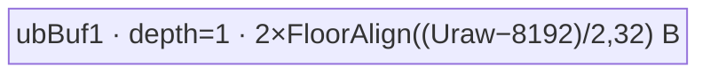
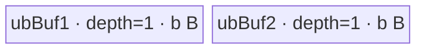
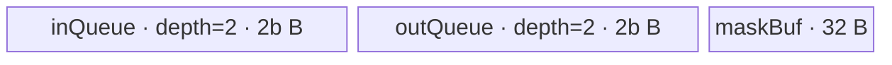
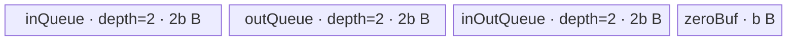

# Tril 950 ACLNN 算子知识

## 算子速览

| 项目 | 内容 |
|---|---|
| 实际入口 | `aclnnTrilGetWorkspaceSize` + `aclnnTril`，公开两段式 ACLNN；本文不包含 `aclnnInplaceTril` |
| 计算语义 | 对每个最后二维平面，`j <= i + diagonal` 时 `out[...,i,j]=self[...,i,j]`，否则写零 |
| 输入输出 | `self/out` 同 shape、同 dtype、同 storage format；rank 2–8；950 支持 1/2/4/8 字节 dtype，含 `BFLOAT16/COMPLEX32/COMPLEX64` |
| 执行类型 | 核心 `Tril` 节点为单 Kernel `AIV_VECTOR`；API 侧 `Contiguous/ViewCopy` 是可选框架搬运边界 |
| Kernel 路线 | R-001 全零、R-002 整体拷贝、R-003 Tiny mask、R-004 Medium 整平面、R-005 Normal 二维分块 |
| 核心资源 | GM 输入/输出、AIV UB `TBuf/TQue/TQueBind`、MicroAPI 寄存器；Tiling 固定声明 16 MiB user workspace，但核心 Kernel 只做非空检查 |
| 来源闭包 | `source_closed`：公开 API、executor 建图、950 Tiling/POD、20 个 key router、5 个 body、活动构建与 binary config 均闭合 |
| 验证状态 | 已完成源码闭包检查；本次知识提取未执行编译、真机、数值或性能测试。 |

## 接口与语义

### 计算语义

令输入 shape 为 `[D0,...,D(n-3), R, C]`，`H=∏Dk` 为前导维折叠后的矩阵数，属性为 `d=diagonal`。每个矩阵独立执行：

```text
out[h,i,j] = self[h,i,j],  j <= i + d
out[h,i,j] = 0,            j >  i + d
0 <= h < H, 0 <= i < R, 0 <= j < C
```

`d <= -R` 时没有保留元素；`d >= C-1` 时全部元素保留。实现按 dtype 字节宽度实例化整数搬运模板，不做数值 cast，因此保留区逐 bit 搬运，清零区写对应宽度的全零 bit pattern。

### 输入、输出与属性

| 参数 | shape/layout | dtype | 约束、默认值与语义 |
|---|---|---|---|
| `self` | rank 2–8，公开格式 ND；可为非连续 view | 950：`UINT8/INT8/INT16/INT32/INT64/FLOAT16/FLOAT/DOUBLE/BOOL/BF16/UINT16/UINT32/UINT64/COMPLEX32/COMPLEX64` | 非空指针；最后二维解释为 `R,C` |
| `diagonal` | 标量属性 | Host `int64_t` | 主对角线偏移；正值向右上，负值向左下 |
| `out` | 与 `self` view shape 相同，storage format 相同；可为非连续目标 view | 必须与 `self` 完全同 dtype | 非空指针；非原地 API 的独立输出对象 |
| `workspaceSize` | 标量出参 | `uint64_t*` | executor 所有节点所需 workspace 总量；核心 Tril Tiling 请求其中 16 MiB |
| `executor` | Host 对象出参 | `aclOpExecutor**` | 第一段构建，第二段在给定 stream 上消费 |

### 入口与版本

固定 Commit 只公开一组无版本后缀入口：第一段 `aclnnTrilGetWorkspaceSize(self, diagonal, out, workspaceSize, executor)`，第二段 `aclnnTril(workspace, workspaceSize, executor, stream)`。第二段直接调用 `CommonOpExecutorRun`。`aclnnInplaceTril*` 虽在同一文件中复用第一段实现，但属于原地语义，不纳入本卡。

公开文档明确支持 Ascend 950PR/950DT；`Tril` OpDef 把 `ascend950` 接到 `tril_apt`，目录 CMake、全局 AscendC binary config 和 `ascend950/tril_binary.json` 共同闭合 950。该固定实现没有更高版本的公开 `aclnnTrilV*`。

## Host/Launcher 执行流程

### 参数校验与前处理

1. `OP_CHECK_COMM_INPUT` 检查 `workspaceSize/executor`。
2. `CheckNotNull` 检查 `self/out`；`CheckDtypeValid` 依据 SoC 选择 950 `DTYPE_SUPPORT_LIST_REGBASE` 并检查两端 dtype 相同。
3. `CheckFormat` 要求 storage format 相同；`CheckShape` 拒绝 rank 小于 2，检查两端 rank 不超过框架上限 8，并要求 view shape 相同。
4. 创建 executor；若 `self->IsEmpty()`，直接返回空 executor 的 workspace 大小，不加入 Tril Kernel。
5. `l0op::Contiguous` 把非连续输入转换为连续张量；其内部实现属于 `aclnn_kernels` 框架边界。
6. `l0op::Tril` 分配与输入 storage shape/dtype/format 相同的连续结果，并通过 `ADD_TO_LAUNCHER_LIST_AICORE(Tril, op::AI_CORE, ...)` 加入核心节点。
7. `l0op::ViewCopy` 将连续结果提交到用户 `out`；非连续输出的具体搬运实现属于框架边界。

任一步返回空指针都立即返回 `ACLNN_ERR_INNER_NULLPTR`，executor 创建失败返回 `ACLNN_ERR_INNER_CREATE_EXECUTOR`；校验失败不构建执行图。

### 参数、Workspace 与生命周期

`TilingPrepare4Trilu` 从平台读取 AIV core 数 `Ccore=GetCoreNumAiv()` 和原始 UB 字节 `Uraw`；任一不大于零均失败。`TriangulatorTiling::GetPlatformInfo` 使用 `U=Uraw-8192` 作为资源预算，并读取 `V=GetVRegSize(context)`。

核心 Tiling 无条件令 `workspaceSizes[0]=16777216` 字节。Kernel entry 用 `GetUserWorkspace(workspace)` 取得其 slice，只检查结果是否为空，不读写该地址；所以这 16 MiB 是当前 ABI 要求而非算法中间量。ACLNN 第一段返回的是 `Contiguous + Tril + ViewCopy` 经 executor 汇总后的总 workspace，固定仓未公开三个节点的 slice offset 和 executor 对齐规则。workspace 由调用者在第二段之前分配，executor 与 workspace 至 `CommonOpExecutorRun` 返回前有效。

### 启动图与失败传播

```text
self view
  -> [framework Contiguous；连续输入时可复用，具体判定固定仓不可见]
  -> N1 Tril: ADD_TO_LAUNCHER_LIST_AICORE
       entry=tril(x,y,workspace,tiling)
       blockDim=usedCoreNum
       POD=随 Route 选择的 Triangulator*TilingData
       execution=AIV_VECTOR
  -> [framework ViewCopy；把连续 trilResult 写入 out view]
```

| 节点/边 | 输入→输出或介质 | ordering | owner/lifetime | 失败传播 |
|---|---|---|---|---|
| `Contiguous` | `self` view → `selfContiguous` | executor 建图顺序，第二段同一 `stream` 执行 | executor 持有中间 tensor；实现细节固定仓不可见 | 返回空则不添加 N1 |
| N1 `Tril` | 连续 GM `x` → 连续 GM `y` | `ADD_TO_LAUNCHER_LIST_AICORE` 节点；单 Kernel 内按 Queue/event 保序 | `l0op::Tril` 分配 `y`，executor 持有 | launcher 添加失败则第一段返回空 |
| `ViewCopy` | 连续 `trilResult` → 用户 `out` view | 位于 N1 之后；精确内部 event 固定仓不可见 | 用户拥有 `out`；executor 持有中间结果直到执行完成 | 返回空则第一段失败；运行时失败由 `CommonOpExecutorRun` 返回 |
| user workspace | executor 总 workspace，其中 N1 声明 16 MiB slice | 同一 stream 生命周期；N1 仅非空检查 | 用户分配，第二段借用 | `GetUserWorkspace==nullptr` 时 N1 无输出并返回 |

## Route 与参数设计

### 分核与资源计算

记 `B=GetSizeByDataType(dtype)∈{1,2,4,8}`，`H=matrixNum`，`R=row`，`C=col`，`U=Uraw-8192`，`V=vRegSize`。Tiling 先按下节的严格优先级选 mode，再生成 `key=10*mode+B`。

- R-001/R-002：`base=H*R*C` 个元素。若 `base*B<1024`，只用 1 核；否则 `normal=max(ceil(base/Ccore), floor(1024/B))`、`used=ceil(base/normal)`、`tail=base-normal*(used-1)`。此处 `tailCoreProcessNum` 是末核元素数。
- R-003/R-004/R-005：`used=min(baseBlock,Ccore)`，`normal=floor(baseBlock/used)`，`tail=baseBlock mod used`。此处 `tailCoreProcessNum` 是“多领一个 base block 的前缀核数量”；Device 的前 `tail` 核各处理 `normal+1` 个 block。
- 所有容量和地址计算均为有符号 `int64_t`。固定仓未见对 `H*R*C`、`R*C*B` 等乘法的显式溢出保护。

### Route 选择

| 顺序 | Route | Key/模板 | 精确选择条件与优先级 | 不适用去向 |
|---:|---|---|---|---|
| 1 | R-001 全零 | `1/2/4/8`；`SplitAll<T,0>` | `d <= -R` | R-002 |
| 2 | R-002 整体拷贝 | `11/12/14/18`；`SplitAll<T,1>` | 前项不命中且 `d >= C-1` | R-003 |
| 3 | R-003 Tiny mask | `31/32/34/38`；`SplitTinyShape<T>` | 前两项不命中且 `R*C*B <= V` | R-004 |
| 4 | R-004 Medium 整平面 | `41/42/44/48`；`SplitMediumShape<T,true>` | 前三项不命中且 `R*CeilAlign(C*B,V)*4 <= U` | R-005 |
| 5 | R-005 Normal 二维分块 | `21/22/24/28`；`SplitRowAndCol<T,true>` | 以上均不命中 | 无 Host fallback；进入该通用路线 |

```text
if d <= -R:                       mode=0, R-001
else if d >= C-1:                 mode=1, R-002
else if R*C*B <= V:               mode=3, R-003
else if R*ceil_align(C*B,V)*4<=U: mode=4, R-004
else:                             mode=2, R-005
key = mode*10 + B
```

### 模板/实现执行矩阵

| Route | key/selector | dtype/shape/platform 完整命中条件 | 执行拓扑与 Kernel 节点 | 实际模板/body | 内存与同步特征 | tail/fallback |
|---|---|---|---|---|---|---|
| R-001 全零 | `1,2,4,8` | 950；`d<=-R`；key 个位等于 dtype bytes | 单 N1 `tril` | `SplitAll<int{8,16,32,64}_t,OUTPUT_ZERO_MODE>` | 1 个扩大到 `2*bufferSize` 的 TBuf；一次 Duplicate 后 MTE3 输出 | 每核末 UB loop 按真实元素字节写；无下一 Route |
| R-002 整体拷贝 | `11,12,14,18` | 950；R-001 未命中；`d>=C-1` | 单 N1 | `SplitAll<T,OUTPUT_INPUT_MODE>` | 2 个等大 TBuf ping-pong，MTE2→MTE3 event | 末核、末 loop 精确长度 |
| R-003 Tiny mask | `31,32,34,38` | 950；极值未命中；`R*C*B<=V` | 单 N1 | `SplitTinyShape<T>` | in/out Queue depth 2；32 B mask；每矩阵占一个 VREG stride | `highTail` 处理最后一组矩阵 |
| R-004 Medium 整平面 | `41,42,44,48` | 950；前三项未命中；整组行 buffer 判定成立 | 单 N1 | `SplitMediumShape<T,true>` | in/out Queue depth 2；按整行 DMA，寄存器 Select | `highTail`；行内 mask 处理列尾 |
| R-005 Normal 二维分块 | `21,22,24,28` | 950；前四项均不命中 | 单 N1 | `SplitRowAndCol<T,true>` | 3 组 depth-2 Queue + zero TBuf；整块零/直拷/交界 Select | `rowTail/colTail` 与前缀余数核 |

### 隐藏性能 Guard

| Guard | Host/Tiling 条件 | Device/资源原因 | 影响 Route | 不满足时去向 | 源码符号 |
|---|---|---|---|---|---|
| 极值对角线 | `d<=-R` / `d>=C-1` | 避免逐行 mask；分别只写零或搬运输入 | R-001/R-002 | R-003 |
| Tiny VREG 容量 | `R*C*B<=V` | 一个矩阵可装入一次寄存器步长，Host 可预生成最多 256 bit mask | R-003 | R-004 |
| Medium UB 容量 | `R*CeilAlign(C*B,V)*4<=U` | depth-2 输入和输出 Queue 共需 4 份 buffer | R-004 | R-005 |
| Normal 保守 8 分区 | `bufferSize=FloorAlign(U/8,32)` | 实际分配 7 份 buffer，额外 1/8 预算作为余量 | R-005 | 无 |
| DMA 参数窄化 | `rowActual/highActual` 写入 `uint16_t blockCount`；字节长度写入 `uint32_t` | `DataCopyExtParams` ABI 位宽 | R-003/R-004/R-005 | 固定仓没有显式 fallback 或报错 |
| dtype-byte router | `B∈{1,2,4,8}` | binary config 使用 `DtypeByte`，同字节 dtype 复用整数模板 | 全部 | 未知 key 时 router 静默不调用 body |
| AIV/UB 有效性 | `Ccore>0 && Uraw>0` | 分核与 UB 容量的必要 producer | 全部 | Tiling `GRAPH_FAILED` |

### POD/ABI

所有字段均由 `TILING_DATA_FIELD_DEF` 生成并按下表源码顺序序列化。固定仓只包含宏调用，不含宏展开定义，因此能确认字段类型/顺序，不能从固定仓确认 `sizeof/alignof/offsetof`；Device 用相同结构名经 `GET_TILING_DATA_PTR_WITH_STRUCT` 读取。

| 结构 | 字段 | 类型/位宽 | ABI 布局 | 单位 | Host/launcher producer | Device consumer | 边界 |
|---|---|---|---|---|---|---|---|
| `TriangulatorTilingData` | `bufferSize` | `int64_t/64` | 第1字段；offset/总大小不可见 | byte | `SaveToTilingData: baseInfoOp.bufferSize` | `SplitAll::ParseTilingData`；mode 0 再乘 2 | 32 B 对齐后的单 buffer 基值 |
| 同上 | `usedCoreNum` | `int64_t/64` | 第2字段 | core | `DoTiling`/极值专用分核 | `SplitAll::Init` | blockIdx 越界返回 |
| 同上 | `normalCoreProcessNum` | `int64_t/64` | 第3字段 | element | `OutputZeroAndInputTiling` | `SplitAll::Init` | 非末核元素数 |
| 同上 | `tailCoreProcessNum` | `int64_t/64` | 第4字段 | element | `OutputZeroAndInputTiling` | `SplitAll::Init` | 末核元素数，不是余数核数量 |
| `TriangulatorTinyTilingData` | `bufferSize` | `int64_t/64` | 第1字段 | byte | `FloorAlign(U/4,32)` | 两组 Queue `InitBuffer` | 每 slot 容量 |
| 同上 | `planeArea` | `int64_t/64` | 第2字段 | element/matrix | `R*C` | DMA blockLen、GM offset | `planeArea*B<=V` |
| 同上 | `usedCoreNum` | `int64_t/64` | 第3字段 | core | `min(highOuter,Ccore)` | block guard/分配 | 大于零 |
| 同上 | `normalCoreProcessNum` | `int64_t/64` | 第4字段 | base block/core | `baseBlock/used` | `Process` | 前缀核可能加 1 |
| 同上 | `tailCoreProcessNum` | `int64_t/64` | 第5字段 | core count | `baseBlock%used` | `Process` | 与极值 POD 的同名字段语义不同 |
| 同上 | `highInner` | `int64_t/64` | 第6字段 | matrix/base block | `ComputeTinyInfo` | `ComputeBlockInfo` | 最后一块由 `highTail` 覆盖 |
| 同上 | `highOuter` | `int64_t/64` | 第7字段 | base block | `ComputeTinyInfo` | last-block 判断 | 同时为 baseBlockNum |
| 同上 | `highTail` | `int64_t/64` | 第8字段 | matrix | `H mod highInner`，零余数取 `highInner` | `ComputeBlockInfo` | 只在最后 base block 活动 |
| 同上 | `highMask[4]` | `uint64_t[4]/256` | 第9字段；数组内部连续 | bit/lane | `ComputeMask`，保留位设 1 | `SplitTinyShape::Init/DoVectorCopy` | `R*C*B<=V` 且当前 dtype key 决定 mask 展开 |
| `TriangulatorMediumTilingData` | `bufferSize` | `int64_t/64` | 第1字段 | byte | `FloorAlign(U/4,32)` | in/out Queue | 每 slot 容量 |
| 同上 | `row` | `int64_t/64` | 第2字段 | row | `R` | DMA blockCount、循环 | rank 后两维 |
| 同上 | `col` | `int64_t/64` | 第3字段 | element/row | `C` | DMA blockLen、VREG 切分 | rank 后一维 |
| 同上 | `copyCols` | `int64_t/64` | 第4字段 | element | Tril：`headRowsRaw>0 ? 1 : -headRowsRaw+1` | `DoVectorCopy` 中每行 mask 起点 | 仅 midRows 活动 |
| 同上 | `usedCoreNum` | `int64_t/64` | 第5字段 | core | 通用分核 | block guard | 大于零 |
| 同上 | `normalCoreProcessNum` | `int64_t/64` | 第6字段 | base block/core | 通用分核 | `Process` | 前缀核可能加 1 |
| 同上 | `tailCoreProcessNum` | `int64_t/64` | 第7字段 | core count | 通用分核余数 | `Process` | 前缀核数量 |
| 同上 | `highInner` | `int64_t/64` | 第8字段 | matrix/base block | `ComputeMediumInfo` | block extent/offset | 普通块矩阵数 |
| 同上 | `highOuter` | `int64_t/64` | 第9字段 | base block | `ComputeMediumInfo` | last-block 判断 | baseBlockNum |
| 同上 | `highTail` | `int64_t/64` | 第10字段 | matrix | 尾组计算 | block extent | 仅末块活动 |
| 同上 | `headRows` | `int64_t/64` | 第11字段 | row | `max(-d,0)` | 直接写零循环 | Tril 全零头部行数 |
| 同上 | `midRows` | `int64_t/64` | 第12字段 | row | `R-headRows-tailRows` | Select 循环 | 交界行数 |
| 同上 | `tailRows` | `int64_t/64` | 第13字段 | row | `max(R-C+d,0)` | 整行拷贝循环 | Tril 全保留尾部行数 |
| `TriangulatorNormalTilingData` | `bufferSize` | `int64_t/64` | 第1字段 | byte | `FloorAlign(U/8,32)` | 3 Queue + zeroBuf | 单 slot/Buf 容量 |
| 同上 | `row` | `int64_t/64` | 第2字段 | row | `R` | 二维 tile 索引 | 后两维 |
| 同上 | `col` | `int64_t/64` | 第3字段 | element/row | `C` | GM stride/planeArea | 后一维 |
| 同上 | `diagOffset` | `int64_t/64` | 第4字段 | element | `d` | tile 位置与行内 mask | Tril 判定使用 |
| 同上 | `usedCoreNum` | `int64_t/64` | 第5字段 | core | 通用分核 | block guard | 大于零 |
| 同上 | `normalCoreProcessNum` | `int64_t/64` | 第6字段 | tile/core | 通用分核 | `Process` | 前缀核可能加 1 |
| 同上 | `tailCoreProcessNum` | `int64_t/64` | 第7字段 | core count | 通用分核余数 | `Process` | 前缀核数量 |
| 同上 | `rowInner` | `int64_t/64` | 第8字段 | row/tile | `ComputeNormalInfo` | rowOuter、tile offset | `<=R` |
| 同上 | `colInner` | `int64_t/64` | 第9字段 | element/tile row | `ComputeNormalInfo` | colOuter、UB row stride | 按 32 B 或 VREG 粒度向下对齐 |

### Route 源码闭包

| Route | Key/selector | Host/Tiling producer | POD/参数 | Kernel entry/router 节点 | Kernel body/直接依赖 | 构建接线 |
|---|---|---|---|---|---|---|
| R-001 | `1/2/4/8` | `triangulator_tiling.cpp::ComputeTilingMode/DoTiling` | `TriangulatorTilingData` | `tril_apt.cpp::tril` → `triangulatorEntry<true>` | `split_all.h::SplitAll<T,0>` | `tril/CMakeLists.txt` + `ascendc_config.json::Tril` |
| R-002 | `11/12/14/18` | 同上 | `TriangulatorTilingData` | 同上 | `split_all.h::SplitAll<T,1>` | 同上 |
| R-003 | `31/32/34/38` | `ComputeTinyInfo/ComputeMask` | `TriangulatorTinyTilingData` | 同上 | `split_tiny_shape.h::SplitTinyShape<T>` | 同上 |
| R-004 | `41/42/44/48` | `ComputeMediumInfo` | `TriangulatorMediumTilingData` | 同上 | `split_medium_shape.h::SplitMediumShape<T,true>` | 同上 |
| R-005 | `21/22/24/28` | `ComputeNormalInfo` | `TriangulatorNormalTilingData` | 同上 | `split_row_and_col.h::SplitRowAndCol<T,true>` | 同上 |

## Kernel 实现

### 公共执行流程

`tril` entry 首先声明 `KERNEL_TYPE_AIV_ONLY`，再调用 `triangulatorEntry<true>`；模板布尔值 `true` 在 Device 侧表示 lower/Tril。router 先 `GetUserWorkspace` 并仅做空指针 guard，再按 20 个 key 解析对应 POD、创建局部 `TPipe`、实例化 body、依次调用 `Init/Process`。未知 key 没有显式错误或 fallback。所有 Route 都是同一 GM 输入到 GM 输出的单 AIV Kernel；没有 SIMT、NDDMA、通信、AIC/Cube 或 MIX_CV 节点。

### Route R-001：全零快速路径

#### 适用条件

##### 选择证据

| 层级 | 文件 | 符号 | 源码谓词/参数 | 结果/下一跳 |
|---|---|---|---|---|
| Host | `triangulator_tiling.cpp` | `ComputeTilingMode` | `!operatorType_ && diagOffset<=-row` | mode 0 |
| Host | 同上 | `ComputeTilingKey` | `0*10+B` | key `1/2/4/8` |
| Router | `triangulator_base.h` | `triangulatorEntry<true>` | `TILING_KEY_IS(OUTPUT_ZERO_INT*)` | `SplitAll<T,0>` |

#### Device 数据流

##### 函数级调用链

```text
tril -> triangulatorEntry<true>
  -> invokeTemplateSplitAll<T, OUTPUT_ZERO_MODE>
    -> SplitAll::Init -> SplitAll::Process -> SplitAll::ProcessPerLoop
      -> Duplicate(UB,0) -> DataCopyPad(UB->GM y)
```

##### 源码等价伪码

```text
cur = last_core ? tailElements : normalElements
gmBase = blockIdx * normalElements
bufBytes = 2 * POD.bufferSize
zero UB[bufBytes/B]; Duplicate(zero, 0, bufBytes/B); V_MTE3 wait
for each UB loop k:
    valid = last_loop ? tailLoopElements : min(cur, bufBytes/B)
    DataCopyPad(y[gmBase + k*normalLoopElements], zero, valid*B bytes)
PipeBarrier(MTE3)
```

#### 内存与数据搬运

##### 资源与搬运表

| 层级/缓冲区 | offset/地址公式 | extent/容量公式 | dtype/layout | producer | consumer | owner/lifetime | 对齐/复用 |
|---|---|---|---|---|---|---|---|
| GM `y` | `blockIdx*normalElements + loop*normalLoopElements` | `valid` elements | 原 dtype，flat ND | MTE3 | 用户输出 | 用户；Kernel 后有效 | 精确字节尾块 |
| `ubBuf1_` | UB allocator | `2*FloorAlign(U/2,32)` bytes | `T` | `Duplicate` | 每次 MTE3 | `TPipe`，全 Process | 全循环复用同一零块 |
| workspace | user slice | 16 MiB declared | 未读写 | Host | 仅 entry null guard | 用户 | N/A |

##### 分层内存布局



##### 字节账与复用顺序

```text
UB_total = 2*FloorAlign(U/2,32) <= U
dynamic_ub = N/A（AIV TPipe 静态 UB）
workspace_total = 16 MiB（核心 body 未使用）
```

| 复用子区 | 写入者 | 读取者/消费点 | 下一次覆盖 | 同步或释放依据 | 安全条件 |
|---|---|---|---|---|---|
| `ubBuf1_` 全区 | `Duplicate` 一次 | 所有 `DataCopyPad` | 不覆盖 | 初始 `V_MTE3` flag/wait；末尾 MTE3 barrier | 输出 DMA 只读同一零块 |

#### 同步、精度与尾块

##### 同步与数值边界表

| 阶段 | primitive/机制 | producer | consumer/等待点 | 保护对象 | 精度/尾块 |
|---|---|---|---|---|---|
| 清零→输出 | `HardEvent::V_MTE3` | `Duplicate` | 首次 MTE3 前 wait | zero UB | 无 cast；全零 bit pattern |
| 输出完成 | `PipeBarrier<PIPE_MTE3>` | 所有 MTE3 | Kernel 结束 | GM y | `copyParams.blockLen=valid*B` 精确处理末 loop |

#### 关键实现

##### 符号证据表

| 阶段 | 文件 | 符号/模板实例 | 实现事实 |
|---|---|---|---|
| Host/Tiling producer | `conversion/triu/op_host/arch35/triangulator_tiling.cpp` | `ComputeTilingMode`, `OutputZeroAndInputTiling` | 极值选择、至少 1024 B/核分配 |
| Kernel entry/router | `conversion/triu/op_kernel/arch35/triangulator_base.h` | `triangulatorEntry<true>` | 四个 byte key 映射 `SplitAll<T,0>` |
| Device body/helper | `conversion/triu/op_kernel/arch35/split_all.h` | `SplitAll<T,OUTPUT_ZERO_MODE>` | 单次 Duplicate、多次无 CopyIn 输出 |

### Route R-002：整体拷贝快速路径

#### 适用条件

##### 选择证据

| 层级 | 文件 | 符号 | 源码谓词/参数 | 结果/下一跳 |
|---|---|---|---|---|
| Host | `triangulator_tiling.cpp` | `ComputeTilingMode` | R-001 未命中且 `!operatorType_ && d>=C-1` | mode 1 |
| Host | 同上 | `ComputeTilingKey` | `10+B` | `11/12/14/18` |
| Router | `triangulator_base.h` | `triangulatorEntry<true>` | `OUTPUT_INPUT_INT*` | `SplitAll<T,1>` |

#### Device 数据流

##### 函数级调用链

```text
tril -> triangulatorEntry<true> -> invokeTemplateSplitAll<T,1>
  -> Init(two TBuf) -> Process(ping-pong)
    -> Wait MTE3_MTE2 -> DataCopyPad(GM x->UB)
    -> MTE2_MTE3 flag/wait -> DataCopyPad(UB->GM y) -> MTE3_MTE2 flag
```

##### 源码等价伪码

```text
bind core flat slice exactly as R-001
allocate buf0,buf1, each POD.bufferSize bytes
seed reusable[0], reusable[1] with MTE3_MTE2 flags
for k in UB loops, alternating buffer p=k&1:
    wait previous MTE3 on p
    copy x[coreBase+k*loopElements] -> p, valid*B
    wait MTE2 before MTE3
    copy p -> y[same offset], valid*B
    signal p reusable
wait both reusable flags and release event IDs
```

#### 内存与数据搬运

##### 资源与搬运表

| 层级/缓冲区 | offset/地址公式 | extent/容量公式 | dtype/layout | producer | consumer | owner/lifetime | 对齐/复用 |
|---|---|---|---|---|---|---|---|
| GM x/y | 同一 flat element offset | `valid` elements/loop | byte-exact dtype | MTE2/MTE3 | UB/GM | caller | no overlap required by non-inplace API |
| `ubBuf1_` | UB slot 0 | `FloorAlign(U/2,32)` B | `T` | MTE2 | MTE3 | TPipe | event 0 ping |
| `ubBuf2_` | UB slot 1 | 同上 | `T` | MTE2 | MTE3 | TPipe | event 1 pong |

##### 分层内存布局



##### 字节账与复用顺序

```text
b = FloorAlign(U/2,32)
UB_total = 2*b <= U
dynamic_ub = N/A
workspace_total = 16 MiB（核心 body 未使用）
```

| 复用子区 | 写入者 | 读取者/消费点 | 下一次覆盖 | 同步或释放依据 | 安全条件 |
|---|---|---|---|---|---|
| ping/pong 各自 | MTE2 CopyIn | MTE3 CopyOut | 下一个同奇偶 loop | `MTE3_MTE2` wait/flag | 每 buffer 独立 event ID |

#### 同步、精度与尾块

##### 同步与数值边界表

| 阶段 | primitive/机制 | producer | consumer/等待点 | 保护对象 | 精度/尾块 |
|---|---|---|---|---|---|
| CopyIn→CopyOut | `MTE2_MTE3` | input DMA | output DMA 前 wait | 当前 ping/pong | 不解释 dtype，仅按 B 字节搬运 |
| CopyOut→复用 | `MTE3_MTE2` | output DMA | 下次同 buffer CopyIn | 当前 ping/pong | 末 loop `blockLen=tailLoop*B` |

#### 关键实现

##### 符号证据表

| 阶段 | 文件 | 符号/模板实例 | 实现事实 |
|---|---|---|---|
| Host/Tiling producer | `conversion/triu/op_host/arch35/triangulator_tiling.cpp` | `ComputeTilingMode`, `OutputZeroAndInputTiling` | 整体拷贝选择和分核 |
| Kernel entry/router | `conversion/triu/op_kernel/arch35/triangulator_base.h` | `OUTPUT_INPUT_INT*` branches | byte key 到模板 |
| Device body/helper | `conversion/triu/op_kernel/arch35/split_all.h` | `ProcessPerLoop` | 双 buffer event 管线与精确字节 DMA |

### Route R-003：Tiny 预计算掩码路径

#### 适用条件

##### 选择证据

| 层级 | 文件 | 符号 | 源码谓词/参数 | 结果/下一跳 |
|---|---|---|---|---|
| Host | `triangulator_tiling.cpp` | `ComputeTilingMode` | 极值未命中且 `R*C*B<=V` | mode 3 |
| Host | 同上 | `ComputeTinyInfo/ComputeMask` | 对每个 `(r,c)` 在 `c<=r+d` 时置 mask bit | Tiny POD |
| Router | `triangulator_base.h` | `TINY_SHAPE_INT*` | key `31/32/34/38` | `SplitTinyShape<T>` |

#### Device 数据流

##### 函数级调用链

```text
tril -> SplitTinyShape::Init(mask + depth-2 queues)
  -> Process: CopyIn(next group) -> DoVectorCopy(current) -> CopyOut(current)
    -> zero destination VREG -> masked source VREG write -> GM
```

##### 源码等价伪码

```text
each base block owns highActual matrices; each matrix is DMA-padded to V bytes in UB
load Host highMask[4] into 32-B maskLocal
expand mask for B=1/2/4/8 to lane width
for each matrix repeat:
    vreg = load V/B lanes from xLocal
    store zero register to yLocal under full moveMask
    overwrite yLocal from vreg under precomputed lower-triangle mask
copy highActual rows of planeArea*B valid bytes back, skipping V-byte UB padding
```

#### 内存与数据搬运

##### 资源与搬运表

| 层级/缓冲区 | offset/地址公式 | extent/容量公式 | dtype/layout | producer | consumer | owner/lifetime | 对齐/复用 |
|---|---|---|---|---|---|---|---|
| GM x/y | `baseBlock*highInner*planeArea` | `highActual*planeArea` elements | packed matrix | GM/MTE | UB/GM | caller | last group uses highTail |
| `inQueue_` | TPipe | depth 2 × `b` | each matrix on V-byte UB stride | MTE2 | MicroAPI | TPipe | next group prefetched |
| `outQueue_` | TPipe | depth 2 × `b` | same padded layout | MicroAPI | MTE3 | TPipe | freed after CopyOut |
| maskBuf | TPipe | 32 B | 4×uint64 | Host POD copy | mask registers | Process lifetime | B-specific unpack |
| registers | VREG | `V/B` T lanes | `vreg/dreg/sreg` + masks | loads/duplicate | masked stores | vector scope | no GM materialization |

##### 分层内存布局



##### 字节账与复用顺序

```text
b = FloorAlign((Uraw-8192)/4,32)
UB_total = 2*b + 2*b + 32 = 4*b+32 <= Uraw-8160
dynamic_ub = N/A
workspace_total = 16 MiB（核心 body 未使用）
```

| 复用子区 | 写入者 | 读取者/消费点 | 下一次覆盖 | 同步或释放依据 | 安全条件 |
|---|---|---|---|---|---|
| inQueue slot | `CopyIn` | `DoVectorCopy` | Queue 再次 Alloc | `EnQue/DeQue/FreeTensor` | depth 2 支持一组预取 |
| outQueue slot | `DoVectorCopy` | `CopyOut` | Queue 再次 Alloc | `EnQue/DeQue/FreeTensor` | CopyOut 后释放 |
| maskBuf | `Init` CPU式 SetValue | 全部 vector repeats | 不覆盖 | 全 Process 只读 | plane mask 不随 H 改变 |

#### 同步、精度与尾块

##### 同步与数值边界表

| 阶段 | primitive/机制 | producer | consumer/等待点 | 保护对象 | 精度/尾块 |
|---|---|---|---|---|---|
| GM→Vector | depth-2 `TQue` | `DataCopyPad` | `DeQue` | padded input slot | valid bytes为 `planeArea*B`；pad不写 GM |
| Vector | MicroAPI mask | Host mask + zero register | masked store | 每矩阵 VREG | 无算术/cast；无效 lane由 DMA blockLen 屏蔽 |
| Vector→GM | depth-2 `TQue` | vector store | `DeQue` then DMA | output slot | `highTail` 限制最后组 matrix 数 |

#### 关键实现

##### 符号证据表

| 阶段 | 文件 | 符号/模板实例 | 实现事实 |
|---|---|---|---|
| Host/Tiling producer | `conversion/triu/op_host/arch35/triangulator_tiling.cpp` | `ComputeTinyInfo`, `ComputeMask` | H 分组、256-bit 保留 mask |
| Kernel entry/router | `conversion/triu/op_kernel/arch35/triangulator_base.h` | `invokeTemplateSplitTinyShape<T>` | Tiny POD 解析 |
| Device body/helper | `conversion/triu/op_kernel/arch35/split_tiny_shape.h` | `CopyIn/DoVectorCopy/CopyOut` | VREG stride、mask unpack、双 Queue |

### Route R-004：Medium 整平面路径

#### 适用条件

##### 选择证据

| 层级 | 文件 | 符号 | 源码谓词/参数 | 结果/下一跳 |
|---|---|---|---|---|
| Host | `triangulator_tiling.cpp` | `ComputeTilingMode` | 前三项未命中且 `R*CeilAlign(C*B,V)*4<=U` | mode 4 |
| Host | 同上 | `ComputeMediumInfo` | `highInner` + `head/mid/tailRows/copyCols` | Medium POD |
| Router | `triangulator_base.h` | `SPLIT_MEDIUM_INT*` | `41/42/44/48` | `SplitMediumShape<T,true>` |

#### Device 数据流

##### 函数级调用链

```text
tril -> SplitMediumShape<T,true>::Init
  -> Process pipeline
    -> CopyIn(highActual*R rows)
    -> DoVectorCopy(head zero, mid Select prefix, tail copy)
    -> CopyOut(highActual*R rows)
```

##### 源码等价伪码

```text
for each owned group of highActual full matrices:
    DMA every row, valid C*B bytes, into padded UB row of regCount multiples
    for each matrix:
      headRows: write zero registers (and skip corresponding x addresses)
      for i in [0,midRows):
        remaining = copyCols+i
        for each VREG chunk: load x; Select(x,zero,UpdateMask(remaining)); store valid row mask
      tailRows: copy source registers unchanged
    DMA valid C*B bytes per row to contiguous GM
```

#### 内存与数据搬运

##### 资源与搬运表

| 层级/缓冲区 | offset/地址公式 | extent/容量公式 | dtype/layout | producer | consumer | owner/lifetime | 对齐/复用 |
|---|---|---|---|---|---|---|---|
| GM group | `offset*highInner*R*C` | `highActual*R*C` elements | packed ND | GM/MTE | UB/GM | caller | last highTail |
| input Queue | TPipe | depth 2 × `b` | rows padded to `alignCount` (`32/B` or `V/B`) | MTE2 | Vector | TPipe | group prefetch |
| output Queue | TPipe | depth 2 × `b` | same | Vector | MTE3 | TPipe | group pipeline |
| registers | VREG | `regCount=min/aligned(C,V/B)` lanes/chunk | T + masks | loads/zero | Select/store | vector scope | row tail via rowMask |

##### 分层内存布局


##### 字节账与复用顺序

```text
b = FloorAlign(U/4,32)
UB_total = 2*b + 2*b = 4*b <= U
workspace_total = 16 MiB（核心 body 未使用）
```

| 复用子区 | 写入者 | 读取者/消费点 | 下一次覆盖 | 同步或释放依据 | 安全条件 |
|---|---|---|---|---|---|
| input slot | MTE2 | Vector | 后续 group | Queue lifecycle | depth 2 |
| output slot | Vector | MTE3 | 后续 group | Queue lifecycle | CopyOut 后 FreeTensor |

#### 同步、精度与尾块

##### 同步与数值边界表

| 阶段 | primitive/机制 | producer | consumer/等待点 | 保护对象 | 精度/尾块 |
|---|---|---|---|---|---|
| CopyIn/Compute | `TQue` | MTE2 | DeQue | input slot | DMA `blockCount=highActual*R`, `blockLen=C*B` |
| 行内选择 | `UpdateMask` + `Select` | source/zero VREG | output VREG | diagonal prefix | 无 cast；rowMask 限制 padded lane |
| Compute/CopyOut | `TQue` | vector | MTE3 | output slot | `highActual` 与有效行字节共同裁尾 |

#### 关键实现

##### 符号证据表

| 阶段 | 文件 | 符号/模板实例 | 实现事实 |
|---|---|---|---|
| Host/Tiling producer | `conversion/triu/op_host/arch35/triangulator_tiling.cpp` | `ComputeMediumInfo` | buffer、H 分组、行区段 |
| Kernel entry/router | `conversion/triu/op_kernel/arch35/triangulator_base.h` | `invokeTemplateSplitMediumShape<T,true>` | lower 实例 |
| Device body/helper | `conversion/triu/op_kernel/arch35/split_medium_shape.h` | `DoVectorCopy` | 头零/中 Select/尾直拷和整行 DMA |

### Route R-005：Normal 二维分块路径

#### 适用条件

##### 选择证据

| 层级 | 文件 | 符号 | 源码谓词/参数 | 结果/下一跳 |
|---|---|---|---|---|
| Host | `triangulator_tiling.cpp` | `ComputeTilingMode` | 前四项均不命中 | mode 2 |
| Host | 同上 | `ComputeNormalInfo` | 按 C、R、V、UB 计算 `rowInner/colInner` | Normal POD |
| Router | `triangulator_base.h` | `OUTPUT_NORMAL_INT*` | `21/22/24/28` | `SplitRowAndCol<T,true>` |

#### Device 数据流

##### 函数级调用链

```text
tril -> SplitRowAndCol<T,true>::Init
  -> Process: Duplicate(zeroBuf)
    -> ComputeBlockInfo(H,rowTile,colTile)
    -> CopyIn (zero tile bypass / crossing inQueue / copy tile inOutQueue)
    -> DoCopyVector (only crossing tile)
    -> CopyOut (zeroBuf / outQueue / bound inOutQueue)
```

##### 源码等价伪码

```text
tile = (h,rowIndex,colIndex)
head = colStart-(rowStart+d); tail=rowActual-colActual-head
position = head>=rowActual ? UPPER_RIGHT : tail>=rowActual ? LOWER_LEFT : ON_LINE
if UPPER_RIGHT: skip GM->UB; copy pre-zeroed zeroBuf -> GM
if LOWER_LEFT: GM->inOutQueue -> GM, without Vector Select
if ON_LINE:
    DMA strided rectangle -> inQueue
    per row/VREG chunk, Select source prefix of copyCols+i and zero suffix
    DMA output Queue -> strided GM rectangle
rowActual/colActual choose rowTail/colTail on last tiles
```

#### 内存与数据搬运

##### 资源与搬运表

| 层级/缓冲区 | offset/地址公式 | extent/容量公式 | dtype/layout | producer | consumer | owner/lifetime | 对齐/复用 |
|---|---|---|---|---|---|---|---|
| GM tile | `h*R*C + rowIndex*rowInner*C + colIndex*colInner` | `rowActual × colActual` | strided ND | GM/Kernel | UB/GM | caller | src/dst row stride `(C-colActual)*B` |
| `inQueue_` | TPipe | depth 2 × `b` | crossing tiles, padded row stride | MTE2 | Vector | TPipe | only ON_LINE |
| `outQueue_` | TPipe | depth 2 × `b` | crossing tiles | Vector | MTE3 | TPipe | only ON_LINE |
| `inOutQueue_` | TPipe bound VECIN→VECOUT | depth 2 × `b` | full-copy tiles | MTE2 | MTE3 | TPipe | avoids Vector materialization |
| `zeroBuf_` | TPipe | `b` | repeated zeros | Duplicate once | all zero tiles | Process | V_MTE3 protected |

##### 分层内存布局



##### 字节账与复用顺序

```text
b = FloorAlign(U/8,32)
UB_total = 2*b + 2*b + 2*b + b = 7*b <= 7/8*U
workspace_total = 16 MiB（核心 body 未使用）
```

| 复用子区 | 写入者 | 读取者/消费点 | 下一次覆盖 | 同步或释放依据 | 安全条件 |
|---|---|---|---|---|---|
| in/out Queue slots | MTE2/Vector | Vector/MTE3 | 后续 crossing tile | Queue lifecycle | ON_LINE 才分配 |
| bound inOut slot | MTE2 | MTE3 | 后续 full-copy tile | `TQueBind` EnQue/DeQue/FreeTensor | LOWER_LEFT tile |
| zeroBuf | Duplicate once | 多个 MTE3 | 不覆盖 | 初始 `V_MTE3` flag/wait | UPPER_RIGHT tile只读 |

#### 同步、精度与尾块

##### 同步与数值边界表

| 阶段 | primitive/机制 | producer | consumer/等待点 | 保护对象 | 精度/尾块 |
|---|---|---|---|---|---|
| zero init | `HardEvent::V_MTE3` | Duplicate | zero-tile MTE3 | zeroBuf | 全零 bit pattern |
| strided DMA | Queue/bound Queue | MTE2 | Vector 或 MTE3 | tile slot | `rowActual/colActual`；32 B UB stride |
| crossing compute | `UpdateMask` + `Select` | source/zero VREG | output Queue | diagonal tile | `rowMask` 屏蔽 UB padding；无 cast |
| core tail | 前缀余数分配 | Host POD | `Process` start/end | base tile domain | 最后二维 tile用 `rowTail/colTail` |

#### 关键实现

##### 符号证据表

| 阶段 | 文件 | 符号/模板实例 | 实现事实 |
|---|---|---|---|
| Host/Tiling producer | `conversion/triu/op_host/arch35/triangulator_tiling.cpp` | `ComputeNormalInfo` | 二维 tile 与保守 UB 八分之一 |
| Kernel entry/router | `conversion/triu/op_kernel/arch35/triangulator_base.h` | `invokeTemplateSplitRowAndCol<T,true>` | lower normal route |
| Device body/helper | `conversion/triu/op_kernel/arch35/split_row_and_col.h` | `ComputeBlockInfo/CopyIn/DoCopyVector/CopyOut` | 三类 tile、strided DMA、Queue 旁路、tail |

## 算子特定优化

### Trick T-001：极值对角线折叠为纯清零或纯搬运

#### 触发与源码依据

- 适用 Route：R-001、R-002
- 触发条件：Tril 的 `d<=-R` 或在前项不命中时 `d>=C-1`
- Golden 来源：[`conversion/triu/op_host/arch35/triangulator_tiling.cpp:198-216`](../../../../../../../cann-ops-raw/ascendc/ops-math/165d41f02a43a62324b434cb6bda7c533b14da3e/conversion/triu/op_host/arch35/triangulator_tiling.cpp#L198-L216)

**官方源码（固定 Commit 连续逐字摘录）**：

```cpp
if ((!operatorType_ && baseInfoOp.diagOffset <= -baseInfoOp.row) ||
    (operatorType_ && baseInfoOp.diagOffset >= baseInfoOp.col)) {
    splitCoreOp.tilingMode = OUTPUT_ZERO_MODE;
} else if (
    (!operatorType_ && baseInfoOp.diagOffset >= baseInfoOp.col - 1) ||
    (operatorType_ && baseInfoOp.diagOffset <= 1 - baseInfoOp.row)) {
    splitCoreOp.tilingMode = OUTPUT_INPUT_MODE;
```

#### 机制与设计原因

Host 在任何 UB 形状判断之前识别整张量结果。R-001 只在 UB 中生成一次零块并反复 MTE3；R-002 只做双 buffer DMA，完全跳过逐行对角线 mask 和 Select。分核还把非小张量的单核任务下限设为 `floor(1024/B)` 个元素，使每核普通 slice 至少约 1024 B。

#### 迁移边界

- 适用：结果可由属性和末二维边界证明为常量或恒等映射的三角掩码算子。
- 前提：边界比较必须使用完整 `R/C/d`，且 dtype 可按 bit 搬运/清零。
- 失效：非极值 `d` 必须进入 R-003/R-004/R-005，不能错误地整块处理。
- 未验证：本次知识提取未执行编译、真机、数值或性能测试。

#### 错误做法

固定仓提供的真实反例是跳过第一项优先级：当 `R/C` 极端或维度异常时改变 `if/else if` 顺序会改变 Route；API 已先保证 rank≥2，但没有理由把两个谓词合并成无优先级的独立判断。

### Trick T-002：Normal Route 按 tile 位置绕过输入或 Vector

#### 触发与源码依据

- 适用 Route：R-005
- 触发条件：二维 tile 完全位于 Tril 零区或保留区；只有跨对角线 tile 执行 Vector Select
- Golden 来源：[`conversion/triu/op_kernel/arch35/split_row_and_col.h:299-317`](../../../../../../../cann-ops-raw/ascendc/ops-math/165d41f02a43a62324b434cb6bda7c533b14da3e/conversion/triu/op_kernel/arch35/split_row_and_col.h#L299-L317)

**官方源码（固定 Commit 连续逐字摘录）**：

```cpp
if (info.position == ON_LINE) {
    LocalTensor<T> yLocal = outQueue_.DeQue<T>();
    AscendC::DataCopyPad(dstGm_[info.gmOffset], yLocal, copyOutParam);
    outQueue_.FreeTensor(yLocal);
} else if (info.position == UPPER_RIGHT && IS_LOWER || info.position == LOWER_LEFT && !IS_LOWER) {
    LocalTensor<T> yLocal = zeroBuf_.Get<T>();
    AscendC::DataCopyPad(dstGm_[info.gmOffset], yLocal, copyOutParam);
} else {
    LocalTensor<T> yLocal = inOutQueue_.DeQue<T>();
```

#### 机制与设计原因

`ComputeBlockInfo` 以 tile 左上角和对角线关系分类。Tril 的右上整块不 CopyIn，直接从共享零 TBuf 输出；左下整块经 `TQueBind<VECIN,VECOUT>` 搬运，不进入寄存器 Select；仅交界块分配普通 in/out Queue 并逐行 mask。这同时减少不必要的 GM 读取和 Vector 指令，并让一个零块跨 tile 复用。

#### 迁移边界

- 适用：掩码边界单调、可对矩形 tile 做全零/全保留分类的算子。
- 前提：`gmOffset`、row/col tail 和源/目标 stride 必须保持一致；全保留路径不能改变 bit。
- 失效：`position==ON_LINE` 必须保留 Select；不规则或数据依赖 mask 不能使用该分类。
- 未验证：本次知识提取未执行编译、真机、数值或性能测试。

#### 错误做法

若对 `UPPER_RIGHT` 仍执行 CopyIn，会增加固定源码明确省去的 GM 读取；若对 `ON_LINE` 使用 `inOutQueue_` 直拷，会保留本应清零的右上元素。

### Trick T-003：Tiny Route 把二维判定预计算为 256-bit Host mask

#### 触发与源码依据

- 适用 Route：R-003
- 触发条件：非极值且 `R*C*B<=V`
- Golden 来源：[`conversion/triu/op_host/arch35/triangulator_tiling.cpp:238-249`](../../../../../../../cann-ops-raw/ascendc/ops-math/165d41f02a43a62324b434cb6bda7c533b14da3e/conversion/triu/op_host/arch35/triangulator_tiling.cpp#L238-L249)

**官方源码（固定 Commit 连续逐字摘录）**：

```cpp
for (auto r = 0; r < baseInfoOp.row; ++r) {
    for (auto c = 0; c < baseInfoOp.col; ++c) {
        if ((!operatorType_ && c <= r + baseInfoOp.diagOffset) ||
            (operatorType_ && c >= r + baseInfoOp.diagOffset)) {
            splitCoreOp.highMask[idx / MASK_BIT_WIDTH] |= 1UL << (idx % MASK_BIT_WIDTH);
        }
        ++idx;
    }
}
```

#### 机制与设计原因

同 shape 的所有 H 个矩阵共享完全相同的三角 mask。Host 只生成一次 4×64-bit mask；Device 按 B 展开到对应 lane mask，并在每个矩阵重复使用。每矩阵先写零寄存器，再只在保留 lane 覆盖源值，避免 Device 为每个元素重新计算 `(i,j)`。

#### 迁移边界

- 适用：小平面、跨 batch mask 相同且 lane 数不超过单 VREG 的选择算子。
- 前提：`R*C*B<=V`，mask 位序必须与 row-major plane 和 dtype lane 宽一致。
- 失效：平面超过 VREG 转 R-004/R-005；mask 随 batch 变化时不能共享。
- 未验证：本次知识提取未执行编译、真机、数值或性能测试。

#### 错误做法

直接把 1-byte mask 用于 2/4/8-byte dtype 会造成 lane 对应错误；固定实现分别用 `DIST_US` 或一至三次 `MaskUnPack` 做宽度匹配。

## 模板与实现对比

| 对比维度 | R-001 全零 | R-002 拷贝 | R-003 Tiny | R-004 Medium | R-005 Normal | 设计选择依据 |
|---|---|---|---|---|---|---|
| 命中条件/优先级 | `d<=-R`，最高 | `d>=C-1`，第二 | plane bytes≤V | 整平面×4≤U | fallback | 先语义特化，再资源特化 |
| 模板与 dtype | `SplitAll<T,0>` | `SplitAll<T,1>` | `SplitTinyShape<T>` | `SplitMediumShape<T,true>` | `SplitRowAndCol<T,true>` | T 为同字节宽度整数类型 |
| 循环与分核 | flat element/UB loop | 同左 | H-group/base block | H-group/base block | H×rowTile×colTile | 从 flat 到二维 tile |
| Queue/TBuf/寄存器/dynamic UB/通信 window | 1 TBuf | 2 TBuf | 2+2 Queue、mask、VREG | 2+2 Queue、VREG | 2+2+2 Queue、zero TBuf、VREG | 均无 dynamic UB/通信 |
| 内存总占用与复用 | ≤U | ≤U | `4b+32` | `4b` | `7b`，Host 以 `U/8` 定 b | 与流水深度和旁路相配 |
| 搬运/Vector/SIMT/NDDMA/通信 API | Duplicate+MTE3 | DataCopyPad | padded DMA+masked MicroAPI | strided row DMA+Select | tile strided DMA+Select/旁路 | 全为 AIV Vector/MTE |
| 同步、精度与 tail | V→MTE3；byte tail | 双 event；byte tail | Queue；highTail | Queue；highTail/row mask | Queue/event；row/col tail | 无 cast/累加 |
| fallback/失败边界 | 无 | 无 | 不满足到 Medium | 不满足到 Normal | unknown key 静默无 body | Host selector 完整覆盖合法 B |

## 平台差异

| 项目 | A2 | A3 | 950 |
|---|---|---|---|
| 支持状态 | 公开文档写支持，但固定范围没有 A2 Host→Kernel 接线，未建卡 | 公开文档写支持，但固定范围没有 A3 Host→Kernel 接线，未建卡 | 公开文档、OpDef、CMake、binary config 均支持 |
| Host/Launcher | ACLNN dtype 分支含 `ASCEND910B`，实际 Tiling/Kernel 固定仓不可见 | ACLNN dtype 分支含 `ASCEND910_93`，实际 Tiling/Kernel 固定仓不可见 | `arch35` 的五路 selector 与 POD 闭合 |
| Kernel/资源 | 固定仓不可见 | 固定仓不可见 | `tril_apt` 单 AIV Kernel；UB/VREG 参数来自平台 |

## 限制与失败边界

- API 拒绝空 `self/out`、不支持 dtype、两端 dtype/shape/storage format 不同、rank<2 或 rank>8；空 tensor 在建图阶段成功短路，不启动 Kernel。
- 950 binary config 按 `DtypeByte` 将真实 dtype 映射到 1/2/4/8 字节整数模板；任何不在四种 byte key 中的路由没有显式错误 body。
- Tiling 未对 `H*R*C`、`R*C*B`、`R*CeilAlign(C*B,V)` 的 `int64_t` 乘法做显式溢出检查；Device 又把 DMA `blockCount` 窄化为 `uint16_t`、`blockLen/stride` 窄化为 `uint32_t`，固定仓没有对应 fallback。
- POD 宏定义、executor 汇总 workspace 的 slice offset/对齐、`Contiguous/ViewCopy` 内部节点和失败同步属于固定仓不可见边界；不得据此推断精确总 workspace 或跨节点 event。
- Kernel 要求 `GetUserWorkspace(workspace)` 非空，却不使用该地址；不能擅自把 Tiling 的 16 MiB workspace 改为零，否则会改变固定 ABI/entry guard。
- 公开 README 的总参数表对 `out` dtype 列表少于 ACLNN 文档和实现；本卡以公开 ACLNN 文档、950 `GetDtypeSupportList`、OpDef 与 `DtypeByte` binary config 的交集闭合实际入口。
- 本次知识提取未执行编译、单元测试、真机、数值或性能测试。

## 源码索引

### 链路索引

| 链路阶段 | 文件 | 关键符号 | 支撑内容 |
|---|---|---|---|
| 入口声明/约束 | `conversion/tril/docs/aclnnTril&aclnnInplaceTril.md` | `aclnnTrilGetWorkspaceSize/aclnnTril` | 公开平台、shape/dtype、两段式语义 |
| 入口声明/约束 | `conversion/tril/op_api/aclnn_tril.h` | ACLNN declarations | C ABI 与参数顺序 |
| 入口实现 | `conversion/tril/op_api/aclnn_tril.cpp` | `CheckParams`, `aclnnTrilGetWorkspaceSize`, `aclnnTril` | 校验、空域、executor 图、运行入口 |
| Launcher | `conversion/tril/op_api/tril.cpp` | `l0op::Tril` | 输出分配与 AICore launcher 节点 |
| OpDef | `conversion/tril/op_host/tril_def.cpp` | `ops::Tril` | 950 dtype/format 与 `tril_apt` 接线 |
| Host 注册 | `conversion/tril/op_host/arch35/tril_tiling.cpp` | `Tiling4Trilu<false,false>` | Tril lower selector 注册 |
| Host 公共入口 | `conversion/triu/op_host/arch35/triu_tiling.h` | `Tiling4Trilu`, `GetDiagonalValue` | shape 折叠、d/B producer |
| Platform producer | `conversion/triu/op_host/arch35/triu_tiling.cpp` | `TilingPrepare4Trilu` | AIV core/UB compile info |
| POD | `conversion/triu/op_host/arch35/triangulator_tiling.h` | `Triangulator*TilingData` | 四类序列化字段和 key 注册 |
| Selector/Tiling | `conversion/triu/op_host/arch35/triangulator_tiling.cpp` | `TriangulatorTiling::*` | 五路 mode、tile、core、workspace、key |
| Kernel entry | `conversion/tril/op_kernel/tril_apt.cpp` | `tril` | AIV_ONLY 与 lower entry |
| Router | `conversion/triu/op_kernel/arch35/triangulator_base.h` | `triangulatorEntry<true>` | 20 key 到模板映射 |
| Device body | `conversion/triu/op_kernel/arch35/split_all.h` | `SplitAll` | 全零/整体拷贝 body |
| Device body | `conversion/triu/op_kernel/arch35/split_tiny_shape.h` | `SplitTinyShape` | Tiny mask body |
| Device body | `conversion/triu/op_kernel/arch35/split_medium_shape.h` | `SplitMediumShape` | Medium body |
| Device body | `conversion/triu/op_kernel/arch35/split_row_and_col.h` | `SplitRowAndCol` | Normal tile body |
| 构建接线 | `conversion/tril/CMakeLists.txt` | `SUPPORT_COMPUTE_UNIT` | `ascend950/mc62` 与 arch35、triu 依赖 |
| Binary config | `conversion/tril/op_host/config/ascend950/tril_binary.json` | `Tril` entries | 1/2/4/8 byte DtypeByte binary |
| 全局构建接线 | `scripts/kernel/binary_config/ascendc_config.json` | `name=Tril` | ascend950/mc62、auto_sync=false、编译选项 |

每行只写一个文件，并确保该文件存在于 Frontmatter `sources`。

### 实现复用检查

| 检查项 | 可复用事实 | 不得改变的约束 | 源码符号 |
|---|---|---|---|
| ABI/POD | 四类 POD 可按 Route 复用 | 字段顺序、全部 64-bit、`tailCoreProcessNum` 的 Route 相关语义 | `triangulator_tiling.h::Triangulator*TilingData` |
| 调用顺序 | `Contiguous→Tril→ViewCopy` 与单 Kernel `Init→Process` | 空 tensor 短路；任一步失败阻断后续 | `aclnnTrilGetWorkspaceSize`, `triangulatorEntry` |
| workspace/内存 | 16 MiB N1 声明、五 Route UB 公式 | 不删除 user workspace 非空约束；Queue depth 必须计入 | `PostTiling`, 各 `InitBuffer` |
| 同步 | Queue 生命周期、SplitAll events、zeroBuf V→MTE3 | ping/pong 复用前必须等待前次 MTE3 | `SplitAll::ProcessPerLoop`, `SplitRowAndCol::Process` |
| 精度与尾块 | byte-exact搬运、零 bit、mask Select | key 必须与 B 对应；保留 high/row/col/UB tail | `ComputeTilingKey`, 各 `CopyOut` |
| 失败边界 | platform/UB/core/POD capacity 检查可复用 | unknown key、窄化与乘法溢出没有源码 fallback，不能推测补齐 | `TilingPrepare4Trilu`, `PostTiling`, `triangulatorEntry` |