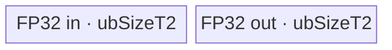

# UnfoldGrad A2/A3 ACLNN 算子知识

## 算子速览

| 项目 | 内容 |
|---|---|
| 实际入口 | `aclnnUnfoldGradGetWorkspaceSize` + `aclnnUnfoldGrad`，公开两段式 ACLNN，无版本后缀 |
| 计算语义 | 把 `gradOut[..., w, k, ...]` 按窗口起点 `w*step` scatter-add 回 `gradIn`；重叠窗口贡献相加，未覆盖位置为 0 |
| 输入输出 | `gradOut`/`gradIn`：ND，FLOAT/FLOAT16/BFLOAT16；`inputSizes`：Host `aclIntArray`，内部转 INT64 Tensor；输出 shape=`inputSizes` |
| 执行类型 | 公开契约内为单个 `AIV_VECTOR` 核心节点；实现还保留单个 AICPU CPU fallback 节点，executor 外围可插入 Contiguous/Cast/ViewCopy 框架节点 |
| Kernel 路线 | R-001～R-012：AIV，按轴、normal/big、overlap、dtype 分开；R-013/R-014：AICPU 串行/并行 fallback |
| 核心资源 | AIV：GM、单深度 VECIN/VECOUT Queue、FP32 workspace、pipe/event、AtomicAdd；AICPU：输入/输出 GM 与 CPU shard，无 AIV UB |
| 来源闭包 | source_closed：A2/A3 的公开声明、L2/L0 selector、InferShape、Tiling/POD、所有可达 AIV body、AICPU fallback 与构建收集均闭合 |
| 验证状态 | 已完成源码闭包检查；本次知识提取未执行编译、真机、数值或性能测试。 |

## 接口与语义

### 计算语义

令原输入 shape 为 `S=inputSizes`、`D=S[dim]`、`W=floor((D-size)/step)+1`。`gradOut` 在 `dim` 位置的长度为 `W`，末尾新增窗口内索引轴 `k∈[0,size)`；其余轴保持正向 Unfold 的顺序。对固定的外层坐标与内层坐标，输出满足：

```text
gradIn[..., x, ...] = Σ gradOut[..., w, ..., k]
                       over 0<=w<W, 0<=k<size, x=w*step+k
```

因此 `step<size` 时窗口重叠并累加；`step>=size` 时窗口互不重叠，间隙保持 0。AIV 低精度路线先转 FP32，在 FP32 workspace 中清零和 AtomicAdd，最后 `CAST_RINT` 回 T1；FP32 路线直接对 FP32 输出清零和累加。AICPU fallback 则用模板类型 `T` 原位累加，FLOAT16/BFLOAT16 不具备 AIV 路线的 FP32 累加顺序。

### 输入、输出与属性

| 参数 | shape/layout | dtype | 约束、默认值与语义 |
|---|---|---|---|
| `gradOut` | ND，rank 1～8；rank=`len(inputSizes)+1` | FLOAT/FLOAT16/BFLOAT16 | `shape[dim]=W`，最后一维=`size`；FRACTAL_NZ 被 L2 拦截 |
| `inputSizes` | Host 数组，长度不超过 8；内部为一维 Tensor | INT64 | 给出 `gradIn` shape；InferShape/Tiling 对其做值依赖 |
| `dim` | 标量属性 | INT64 | 公开契约只允许 `len(inputSizes)-1` 或 `-2`；L2 实现只检查 `0<=dim<len(inputSizes)`，其余轴落 AICPU，属于公开契约外行为 |
| `size` | 标量属性 | INT64 | `0<size<=inputSizes[dim]`；AIV 上限由 dtype/轴共同限制 |
| `step` | 标量属性 | INT64 | `step>0`；AIV selector 以 `max(size,step)` 检查上限 |
| `gradIn` | ND，shape=`inputSizes` | 文档要求与 `gradOut` 相同 | L2 仅分别检查二者均在支持列表，未显式检查相等；结果按 `gradOut` dtype 生成后交给 ViewCopy |

### 入口与版本

公开文档和头文件只定义无后缀 `aclnnUnfoldGrad` 版本族。第一段接口创建 executor、校验参数、为空 Tensor 直接返回零 workspace，否则依次建立 `Contiguous(gradOut)`、`inputSizes` Tensor、`Contiguous(inputSizes)`、`l0op::UnfoldGrad`、同 dtype `Cast`、`ReFormat` 和 `ViewCopy`。第二段仅把 workspace/executor/stream 交给 `CommonOpExecutorRun`。固定 Commit 不存在更高版本公开入口。

A2/A3 的 README、OpDef `ascend910b`/`ascend910_93`、binary config 与 CMake compute-unit 列表一致。README、OpDef 与 binary config 声称支持 950，但算子 CMake 的 `SUPPORT_COMPUTE_UNIT` 未列 `ascend950`；该平台构建接线冲突不纳入本卡，也不发布 `_950` 卡。

## Host/Launcher 执行流程

### 参数校验与前处理

1. `OP_CHECK_COMM_INPUT` 检查 `workspaceSize/executor`，`CheckNotNull` 检查三项 tensor/array。
2. `CheckDtypeValid` 分别要求 `gradOut/gradIn` 属于 FLOAT/FLOAT16/BFLOAT16；`CheckShapeValid` 限制 rank 1～8、`len(inputSizes)=rank(gradOut)-1`、`shape(gradIn)=inputSizes`。
3. 检查 `0<=dim<rank(gradOut)-1`、`size>0`、`step>0`，拒绝 `gradOut` 的 FRACTAL_NZ；更严格的窗口 shape 和 `size<=inputSizes[dim]` 由 Tiling/AICPU 检查。
4. 空 `gradOut` 或空 `gradIn` 时不加入计算节点，返回 `workspaceSize=0`。
5. 非空时把 `gradOut` 连续化；把 Host `aclIntArray` 复制到 executor 管理的 INT64 Tensor 后再连续化。InferShape 按 `inputSizes` 原样设置内部输出 shape。
6. `l0op::UnfoldGrad` 用 `IsAiCoreSupport` 选择 AIV 或 AICPU；返回值再经同 dtype Cast、ReFormat 和 ViewCopy 写入用户 `gradIn`。任一步返回空指针即终止第一段。

### 参数、Workspace 与生命周期

AIV Tiling 计算 `usrWorkspaceSize=4*Π inputSizes[i]` 字节，并把 `usrWorkspaceSize + GetLibApiWorkSpaceSize()` 写到 kernel 节点 workspace。Device 通过 `GetUserWorkspace(workspace)` 跳过库保留区：低精度路线把用户区解释为 FLOAT、按 `gradInBlockOffset` 分片，生命周期覆盖“清零→AtomicAdd→CAST_RINT 输出”；FP32 路线虽仍申请同样用户区，但实际清零/累加直接落 `gradIn`。executor 总 workspace 还包含 Contiguous/Cast/ViewCopy 等框架节点，固定仓未公开各节点 slice offset；owner 是 executor/调用者，第二段执行结束后才可释放。

AICPU OpDef 通过 `ApplyMathAicpuDefaultCfg` 注册 `libmath_aicpu_kernels.so`、`CUSTAICPUKernel` 和字符串 workspaceSize=`100`；该配置的单位及 executor 最终切片固定仓不可见。AICPU body 本身不读取 workspace。

### 启动图与失败传播

```text
aclnnUnfoldGradGetWorkspaceSize
  -> Contiguous(gradOut) + ConvertToTensor/Contiguous(inputSizes)       [框架边界]
  -> INFER_SHAPE(UnfoldGrad)
  -> IsAiCoreSupport
       true  -> ADD_TO_LAUNCHER_LIST_AICORE(UnfoldGrad)
                -> unfold_grad<<<blockDim=useCoreNum>>>(gradOut,inputSizes,internalOut,workspace,tiling)
       false -> ADD_TO_LAUNCHER_LIST_AICPU(UnfoldGrad)
                -> UnfoldGradCpuKernel::Compute(gradOut,inputSizes,internalOut,attrs)
  -> Cast(internalOut, gradOut.dtype) -> ReFormat -> ViewCopy(gradIn)   [框架边界]
aclnnUnfoldGrad
  -> CommonOpExecutorRun(workspace, workspaceSize, executor, stream)
```

两条 selector 分支互斥，每次只有一个算子自有核心节点。AIV 输入为连续 `gradOut` 和值依赖 `inputSizes`，输出为 executor 内部 Tensor；低精度 AIV 的中间边是用户 workspace `[0,4*ΠS)`、FLOAT/ND，producer 为清零与 AtomicAdd，consumer 为最终 cast-copy helper。AICPU 直接写内部输出。后续 Cast/ReFormat/ViewCopy 的精确 kernel、workspace slice 与 event 对固定仓不可见；可确认的是它们按加入 executor 的先后顺序交给同一 `CommonOpExecutorRun`/stream，任一构造失败会阻止 executor 交付，运行期错误由框架状态返回。

## Route 与参数设计

### 分核与资源计算

记 `B=Π gradOut.shape[i], i<dim`，`I=Π gradOut.shape[i], i>=dim`，`O=Π inputSizes[i], i>=dim`，`C=GetCoreNumAiv()`：

```text
useCoreNum       = ceil(B / ceil(B/C))
batchPerCore     = ceil(B/useCoreNum)
batchTailCore    = B-(useCoreNum-1)*batchPerCore
core input base  = blockIdx*batchPerCore*I
core output base = blockIdx*batchPerCore*O
```

普通低精度：`ubSizeT2=floor(UB/(512*5))*1024`，`ubSizeT1=floor(UB/(512*5))*512`，总量 `ubSizeT1+2*ubSizeT2<=UB`。普通 FP32：`ubSizeT2=floor((UB/2)/1024)*1024`，两队列总量 `2*ubSizeT2<=UB`。final-axis big 低精度改为 `ubSizeT2=floor(UB/3)*2`、`ubSizeT1=floor(UB/3)`；FP32 为 `ubSizeT2=UB`。

最后轴令 `need=size`，仅在 `step>=size` 时改为 `need=step`；`col=floor(ubSizeT2/(16*4)/need)*size`，`need>col` 进入 big。普通路线 `tasksOnce=floor(ubSizeT2/(16*4)/need)*size*16`。big 路线按 `padded=ceil(size*typeSizeT1/32)*32/typeSizeT1*4` 计算 `tasksOnce=floor(ubSizeT2/padded)*size`。倒数第二轴用 `rowAvail=ceil(size/8)*8`、`lcm=lcm(size,16)`、`rowT2=lcm/size*rowAvail`、`colOnce=floor(ubSizeT2/4/rowT2/16)*16`、`tasksOnce=colOnce*lcm/size`。两者均令 `loop=floor(handle/tasksOnce)`、`tail=handle%tasksOnce`。

### Route 选择

| 顺序 | Route | Key/模板 | 精确选择条件与优先级 | 不适用去向 |
|---:|---|---|---|---|
| 1 | R-001 final-normal-overlap-fp32 | 211 / `<float,float,false>` | AiCore capable；末轴；`step<size`；normal；FLOAT | 后续行 |
| 2 | R-002 final-normal-overlap-low | 221/231 / `<half\|bf16,float,true>` | 同上；FLOAT16/BFLOAT16 | 后续行 |
| 3 | R-003 final-normal-nonoverlap-fp32 | 311 | AiCore capable；末轴；`step>=size`；normal；FLOAT | 后续行 |
| 4 | R-004 final-normal-nonoverlap-low | 321/331 | 同上；FLOAT16/BFLOAT16 | 后续行 |
| 5 | R-005 final-big-overlap-fp32 | 1211 | AiCore capable；末轴；`step<size`；big；FLOAT | 后续行 |
| 6 | R-006 final-big-overlap-low | 1221/1231 | 同上；FLOAT16/BFLOAT16 | 后续行 |
| 7 | R-007 final-big-nonoverlap-fp32 | 1311 | AiCore capable；末轴；`step>=size`；big；FLOAT | 后续行 |
| 8 | R-008 final-big-nonoverlap-low | 1321/1331 | 同上；FLOAT16/BFLOAT16 | 后续行 |
| 9 | R-009 second-overlap-fp32 | 212 | AiCore capable；倒数第二轴；`step<size`；FLOAT | 后续行 |
| 10 | R-010 second-overlap-low | 222/232 | 同上；FLOAT16/BFLOAT16 | 后续行 |
| 11 | R-011 second-nonoverlap-fp32 | 312 | AiCore capable；倒数第二轴；`step>=size`；FLOAT | 后续行 |
| 12 | R-012 second-nonoverlap-low | 322/332 | 同上；FLOAT16/BFLOAT16 | 后续行 |
| 13 | R-013 AICPU-serial | 无 TilingKey / `DoCompute<T>` | `!IsAiCoreSupport && element_num<=524288` | R-014 |
| 14 | R-014 AICPU-parallel | 无 TilingKey / `DoCompute<T>` | `!IsAiCoreSupport && element_num>524288` | 参数失败 |

```text
if dim is last and max(size,step)<=limit(dtype,last) or
   dim is second-last and max(size,step)<=limit(dtype,second-last):
    keyBase = (step<size ? 200 : 300) + 10*dtypeMode
    if dim==last:
        key = keyBase + 1 + (sizeLevel==BIG ? 1000 : 0)
    else:
        key = keyBase + 2
else:
    AICPU; element_num<=512Ki elements ? serial : ParallelFor
```

### 模板/实现执行矩阵

| Route | key/selector | dtype/shape/platform 完整命中条件 | 执行拓扑与 Kernel 节点 | 实际模板/body | 内存与同步特征 | tail/fallback |
|---|---|---|---|---|---|---|
| R-001/R-003 | 211/311 | FLOAT，末轴 normal，分别 overlap/nonoverlap | 单 AIV | `UnfoldGradFinalAxe<float,float,false>` | 2×T2 Queue；输出清零+AtomicAdd | `loop+tail`；无 fallback |
| R-002/R-004 | 221,231/321,331 | FP16/BF16，其余同上 | 单 AIV | `<half\|bfloat16_t,float,true>` | T1 Queue+2×T2 Queue；FP32 workspace | tail 后 CAST_RINT |
| R-005/R-007 | 1211/1311 | FLOAT，末轴 big | 单 AIV | `UnfoldGradFinalAxeBigSize<float,float,false>` | 1×T2 VECOUT；直接 padded DMA AtomicAdd | `curHandleNum/size` 整除 |
| R-006/R-008 | 1221,1231/1321,1331 | FP16/BF16，末轴 big | 单 AIV | `<half\|bfloat16_t,float,true>` | T1 Queue+T2 VECOUT；FP32 workspace | padded copy/cast |
| R-009/R-011 | 212/312 | FLOAT，倒数第二轴 | 单 AIV | `UnfoldGradFinalSecondAxe<float,float,false>` | 2×T2 Queue；五次 transpose/rearrange | `tailColLength` |
| R-010/R-012 | 222,232/322,332 | FP16/BF16，倒数第二轴 | 单 AIV | `<half\|bfloat16_t,float,true>` | T1 Queue+2×T2 Queue；FP32 workspace | CAST_RINT |
| R-013 | L0 fallback | 非 AIV capable，`N<=524288` | 单 AICPU | `DoCompute<T>`→`Process<T>` | CPU 顺序遍历，无 UB/Atomic | 每元素 fold 循环 |
| R-014 | L0 fallback | 非 AIV capable，`N>524288` | 单 AICPU | `ParallelFor`→`Process<T>` | 按输出元素无冲突分片 | shard 失败返回错误 |

### 隐藏性能 Guard

| Guard | Host/Tiling 条件 | Device/资源原因 | 影响 Route | 不满足时去向 | 源码符号 |
|---|---|---|---|---|---|
| 公开 AIV 上限 | last: FLOAT `max<=49088`、low `<=32720`; second-last: FLOAT `<=88`、low `<=72` | 保证 `tasksOnce>0` 与 UB transpose 可容纳 | R-001～R-012 | AICPU | `op_api/unfold_grad.cpp::IsAiCoreSupport` |
| normal/big | `need>col` | 16×FP32 transpose normal 路线放不下一个有效单元 | R-001～R-008 | big body；若 padded 仍放不下则 Tiling 失败 | `UnfoldGradTiling::Tiling4Block/TilingBlock4SizeLevelBig` |
| second-axis UB | `tasksOnceMaxPerCore>0` | `lcm/size*rowAvail` 行布局必须至少容纳 16 行 | R-009～R-012 | Tiling GRAPH_FAILED | `Tiling4Block` |
| repeat 上限 | transpose loop 以 `MAX_REPEATTIME=255` 分段 | `TransDataTo5HD.repeatTimes` 位宽/上限 | normal/second routes | 255 次块循环+tail | `TransDataForUnfold1/2/3/4and5` |
| big 输出 stride | `step>=paddedBytes/4` | `dstStride` 为无符号；不足时不能表达负 stride | R-005～R-008 | 逐窗口单 block Atomic DMA | `SumFP32ResInGMFinalAxeBigSize` |
| 空域 | L2 `gradOut.IsEmpty()\|\|gradIn.IsEmpty()` | 避免 `B=0` 导致分核除法及无效 launch | 全部 | 零 workspace 成功返回 | `aclnnUnfoldGradGetWorkspaceSize` |
| AICPU 并行阈值 | `element_num>1024*512` | 大输出按 CPU 核分 shard | R-013/R-014 | 串行或 ParallelFor | `UnfoldGradCpuKernel::DoCompute` |

### POD/ABI

`UnfoldGradTilingData` 的 28 个字段均由宏声明为 `int64_t`。固定仓不包含 `register/tilingdata_base.h` 的宏定义，因此结构整体 `sizeof/alignof/offsetof` 不可见；下表“序号”只陈述源码声明顺序，不能当作字节 offset。Host `SetTilingData` 与 Device `ParseTilingData` 一一同名读写。

| 结构 | 字段 | 类型/位宽 | ABI 布局 | 单位 | Host/launcher producer | Device consumer | 边界 |
|---|---|---|---|---|---|---|---|
| `UnfoldGradTilingData` | `batchNum` | int64/64 | 序号1；offset不可见 | batch | `Π gradOut[i],i<dim` | 各 body 的 batch 循环 | 初值1 |
| 同上 | `batchNumPerCore` | int64/64 | 序号2；offset不可见 | batch/core | `ceil(batchNum/useCoreNum)` | core GM offset | 正常核 |
| 同上 | `batchNumTailCore` | int64/64 | 序号3；offset不可见 | batch | `batchNum-(useCoreNum-1)*batchNumPerCore` | 尾核批次数 | 最后一核 |
| 同上 | `maxBatchNum4Ub` | int64/64 | 序号4；offset不可见 | batch | `tasksOnce/max(I,O)` | 仅解析，body 未读取 | inactive |
| 同上 | `useCoreNum` | int64/64 | 序号5；offset不可见 | AIV core | 平衡公式并 `SetBlockDim` | 尾核判断 | `<=totalCoreNum` |
| 同上 | `ubSizeT1` | int64/64 | 序号6；offset不可见 | byte | dtype/sizeLevel UB 分区 | T1 Queue/GM cast tile | FP32 为0 |
| 同上 | `ubSizeT2` | int64/64 | 序号7；offset不可见 | byte | dtype/sizeLevel UB 分区 | T2 Queue 与 tile 公式 | 正值 |
| 同上 | `outputNumPerCore` | int64/64 | 序号8；offset不可见 | element/batch | `Π inputSizes[dim:]` | 输出/workspace stride | 正值 |
| 同上 | `inputNumPerCore` | int64/64 | 序号9；offset不可见 | element/batch | `Π gradOut.shape[dim:]` | 输入 stride | 正值 |
| 同上 | `iterationNumPerCore` | int64/64 | 序号10；offset不可见 | iteration | second axis=`gradOutSizeDim` | second-axis `k` loop | last axis 为0 |
| 同上 | `handleNUMOnceIterationPerCore` | int64/64 | 序号11；offset不可见 | element | last=`W*size`; second=`lastDim` | loop/tail 域 | 正值 |
| 同上 | `tasksOnceMaxPerCore` | int64/64 | 序号12；offset不可见 | element/tile | UB 公式 | CopyIn/offset/loop | 必须>0 |
| 同上 | `inputSizeLength` | int64/64 | 序号13；offset不可见 | rank | `input_sizes.shape[0]` | 仅保存/分支上下文 | 1～8 |
| 同上 | `rowAvailableLengthSrc` | int64/64 | 序号14；offset不可见 | FP32 element/row | `ceil(size/8)*8` | second-axis transpose | 仅 second |
| 同上 | `lowestCommonMultiple` | int64/64 | 序号15；offset不可见 | element | `lcm(size,16)` | redundancy/transpose | 必须>0 |
| 同上 | `colOnceMaxPerUB` | int64/64 | 序号16；offset不可见 | row | second-axis UB 公式 | full tile pretreatment | 仅 second |
| 同上 | `tailColLength` | int64/64 | 序号17；offset不可见 | row | `ceil(tail*need/lcm)` | tail pretreatment | tail=0 inactive |
| 同上 | `typeSizeT1` | int64/64 | 序号18；offset不可见 | byte/element | FLOAT=4，low=2 | DMA/cast/padding | 支持值2/4 |
| 同上 | `typeSizeT2` | int64/64 | 序号19；offset不可见 | byte/element | 固定4 | FP32 tile/workspace | 固定4 |
| 同上 | `width` | int64/64 | 序号20；offset不可见 | element | 固定8 | transpose 行宽 | 固定8 |
| 同上 | `gradOutSizeDim` | int64/64 | 序号21；offset不可见 | element | `gradOut.shape[dim]` | loopSize/iteration | 等于W |
| 同上 | `inputSizeLastDim` | int64/64 | 序号22；offset不可见 | element | `inputSizes[last]` | second-axis stride | 正值 |
| 同上 | `dim` | int64/64 | 序号23；offset不可见 | axis | attr[0] | 仅解析；body族由 key 决定 | 非负 |
| 同上 | `size` | int64/64 | 序号24；offset不可见 | element/window | attr[1] | 所有搬运/累加 | >0 |
| 同上 | `step` | int64/64 | 序号25；offset不可见 | element | attr[2] | 输出地址/overlap 分支 | >0 |
| 同上 | `loop` | int64/64 | 序号26；offset不可见 | tile | `handle/tasksOnce` | full-tile 循环 | 可为0 |
| 同上 | `tail` | int64/64 | 序号27；offset不可见 | element | `handle%tasksOnce` | 尾 tile | 可为0 |
| 同上 | `sizeLevel` | int64/64 | 序号28；offset不可见 | enum | normal=0/big=1 | 条件分配；key body | 仅末轴可big |

源码声明实际为 28 个字段（序号1～28）；`SetTilingData`/`ParseTilingData` 同样覆盖 28 项，固定仓未出现额外隐藏字段。

### Route 源码闭包

| Route | Key/selector | Host/Tiling producer | POD/参数 | Kernel entry/router 节点 | Kernel body/直接依赖 | 构建接线 |
|---|---|---|---|---|---|---|
| R-001～R-004 | 211/221/231/311/321/331 | `IsAiCoreSupport`; `DoTiling/SetTilingKey` | `UnfoldGradTilingData` | `unfold_grad` dtype guard | `UnfoldGradFinalAxe` + base | per-op CMake；910b/910_93 binary JSON |
| R-005～R-008 | 1211/1221/1231/1311/1321/1331 | 同上 + `TilingBlock4SizeLevelBig` | 同上 | `unfold_grad` big branches | `UnfoldGradFinalAxeBigSize` + base | 同上 |
| R-009～R-012 | 212/222/232/312/322/332 | 同上 + second-axis formulas | 同上 | `unfold_grad` second branches | `UnfoldGradFinalSecondAxe` + base | 同上 |
| R-013/R-014 | `!IsAiCoreSupport` | `l0op::UnfoldGrad`；AICPU attrs/tensors | 无 Tiling POD | `UnfoldGradCpuKernel::Compute` | `DoCompute<T>/Process<T>` | `func.cmake` 收集 `*_aicpu.cpp/*_def.cpp`；默认 AICPU cfg |

## Kernel 实现

### 公共执行流程

AIV 路线均由单一 entry `unfold_grad` 解析 Tiling，取 `GetUserWorkspace`，按编译期 `ORIG_DTYPE_GRAD_OUT` 和 TilingKey 实例化 body。每个 block 负责连续的外层 batch，最后一个 block 使用 `batchNumTailCore`。普通与 second-axis body 都遵循 `CopyIn→可选 T1→FP32 Cast→transpose/rearrange/add→Atomic CopyOut`；big body省掉 transpose，直接按窗口 padded DMA AtomicAdd。低精度每批先把 FP32 workspace 分片清零，累加结束后分块读取、`CAST_RINT`、写 T1 输出；FP32 每批直接清零输出。

AICPU 路线由 `Compute` 检查 tensor/attrs，按 dtype 调 `DoCompute<T>`。每个输出元素独占写入：先求覆盖它的最左/最右窗口，再顺序累加；大于 524288 个输出元素时才按输出 index 调 `ParallelFor`，因此 shard 间无写冲突。

### Route R-001：末轴普通重叠 FP32

#### 适用条件

##### 选择证据

| 层级 | 文件 | 符号 | 源码谓词/参数 | 结果/下一跳 |
|---|---|---|---|---|
| L0 | `op_api/unfold_grad.cpp` | `IsAiCoreSupport` | `dim=rank(inputSizes)-1 && max(size,step)<=49088` | AICORE |
| Tiling | `op_host/unfold_grad_tiling.cpp` | `SetTilingKey` | `step<size`、`sizeLevel=0`、FLOAT mode=1 | key 211 |
| Router | `op_kernel/unfold_grad.cpp` | `unfold_grad` | `ORIG_DTYPE=FLOAT32 && TILING_KEY_IS(211)` | `<float,float,false>` |

#### Device 数据流

##### 函数级调用链

```text
UnfoldGradAiCore -> unfold_grad -> InitFinalAxe -> UnfoldGrad::Init
  -> Process -> SetGMtoZero
  -> ProcessFinalAxes -> CopyInFinalAxes -> ComputeFinalAxes
     -> TransDataForUnfold1 -> AccumulateFinalAxes -> TransDataForUnfold2
  -> SumFP32ResInGMFinalAxes<float>
```

##### 源码等价伪码

```text
for batch in core_batches:
  zero gradIn[batch*O : (batch+1)*O] by ubSizeT2 tiles
  for tile in full_tiles plus optional tail:
    duplicate computeIn to zero; DMA contiguous gradOut tile with padded rows
    transpose1: window-major -> 16-lane layout, split repeat at 255
    zero the same computeIn allocation
    for each window j: computeIn[j*step*16 : +size*16] += computeOut[j*size*16 : +size*16]
    transpose2 back
    AtomicAdd valid covered interval to gradIn; overlap blocks are emitted separately
```

#### 内存与数据搬运

##### 资源与搬运表

| 层级/缓冲区 | offset/地址公式 | extent/容量公式 | dtype/layout | producer | consumer | owner/lifetime | 对齐/复用 |
|---|---|---|---|---|---|---|---|
| GM input | `core*batchPerCore*I + batch*I + tile*tasksMax` | `curHandleNum` 有效元素，DMA 分 padded row | FP32/ND | API input | CopyIn | caller；kernel 只读 | 32B pad |
| VECIN `computeInQueueSrc` | UB 子区 | `ubSizeT2` B | FP32 | DMA，随后 Duplicate | transpose1、Add dst、transpose2 src | pipe；单 tile | depth1；同物理区原地改写 |
| VECOUT `computeOutQueueDst` | UB 子区 | `ubSizeT2` B | FP32 transpose scratch/result | transpose1/Add/transpose2 | CopyOut | pipe；DeQue 后释放 | depth1 |
| GM output | `core*batchPerCore*O + batch*O + tile offset` | O elements/batch | FP32/ND | zero + AtomicAdd | API result | executor/caller | overlap 累加 |

##### 分层内存布局


##### 字节账与复用顺序

```text
UB_total = ubSizeT2 + ubSizeT2 <= UB
dynamic_ub = N/A
workspace_total = 4*Π(inputSizes) + libApiWorkspace（本 Route 实际不消费用户区）
```

| 复用子区 | 写入者 | 读取者/消费点 | 下一次覆盖 | 同步或释放依据 | 安全条件 |
|---|---|---|---|---|---|
| computeIn | CopyIn/transpose source | transpose1 | Duplicate 清零 | PIPE_V barrier | transpose1 已提交 |
| computeIn | Duplicate/Add | transpose2 | 下一 tile DMA | EnQue/DeQue/FreeTensor + barriers | CopyOut 已消费 computeOut |

#### 同步、精度与尾块

##### 同步与数值边界表

| 阶段 | primitive/机制 | producer | consumer/等待点 | 保护对象 | 精度/尾块 |
|---|---|---|---|---|---|
| 清零/搬入 | `SetFlag/WaitFlag`, `PipeBarrier` | V/MTE3 | MTE2/V | Queue 子区 | FP32；DMA right pad=0 |
| transpose/add | `PIPE_V` barrier | TransData/Add | 后续 Vector op | 两 scratch | repeat 255 分段；tail repeat=1 时 stride=0 |
| 写出 | `SetAtomicAdd<float>` | compute result | GM | 重叠输出 | `loop` 后按 `tail` 有效长度写 |

#### 关键实现

##### 符号证据表

| 阶段 | 文件 | 符号/模板实例 | 实现事实 |
|---|---|---|---|
| Host/Tiling producer | `op_host/unfold_grad_tiling.cpp` | `Tiling4Block/SetTilingKey` | 生成 normal tile 与 key211 |
| Kernel entry/router | `op_kernel/unfold_grad.cpp` | key211 branch | 映射 FP32 final-axis body |
| Device body/helper | `op_kernel/unfold_grad_final_axe.h` | `ComputeFinalAxes/SumFP32ResInGMFinalAxes` | 双 transpose、窗口 scatter-add、Atomic CopyOut |

### Route R-002：末轴普通重叠 FP16/BFLOAT16

#### 适用条件

##### 选择证据

| 层级 | 文件 | 符号 | 源码谓词/参数 | 结果/下一跳 |
|---|---|---|---|---|
| L0 | `op_api/unfold_grad.cpp` | `IsAiCoreSupport` | 末轴且 `max(size,step)<=32720` | AICORE |
| Tiling | `op_host/unfold_grad_tiling.cpp` | `GetDataTypeKey/SetTilingKey` | `step<size`、normal、FP16 mode2/BF16 mode3 | 221/231 |
| Router | `op_kernel/unfold_grad.cpp` | `unfold_grad` | dtype guard + key | `<half\|bfloat16_t,float,true>` |

#### Device 数据流

##### 函数级调用链

```text
unfold_grad -> UnfoldGradFinalAxe<T1,float,true>::Init/Process
  -> SetMIDGMtoZero(workspace FP32)
  -> CopyInFinalAxes<T1> -> Cast(CAST_NONE,T1->FP32)
  -> TransData1 -> Add -> TransData2 -> AtomicAdd(workspace)
  -> CopyToOutBigShapeOnePage -> CopyGMToGMOnceCastFromFP32(CAST_RINT)
```

##### 源码等价伪码

```text
for batch: zero FP32 workspace slice
for tile: padded DMA T1 -> Cast all padded lanes to FP32 -> same transpose/scatter as R-001
          AtomicAdd FP32 into workspace
for chunks of ubSizeT1/typeSizeT1 output elements:
  DMA workspace FP32 -> VECOUT; Cast RINT -> T1 VECIN; DMA -> gradIn
```

#### 内存与数据搬运

##### 资源与搬运表

| 层级/缓冲区 | offset/地址公式 | extent/容量公式 | dtype/layout | producer | consumer | owner/lifetime | 对齐/复用 |
|---|---|---|---|---|---|---|---|
| `inQueueSrc` | UB | `ubSizeT1` B | T1 | CopyIn / output Cast | input Cast / CopyOut | pipe | depth1，跨阶段复用 |
| `computeInQueueSrc` | UB | `ubSizeT2` B | FP32 | input Cast、Duplicate/Add | transpose | pipe | depth1 |
| `computeOutQueueDst` | UB | `ubSizeT2` B | FP32 | transpose / workspace DMA | Atomic CopyOut / output Cast | pipe | depth1 |
| workspace | `gradInBlockOffset + batch*O` | O FP32/batch | FP32/ND | zero+AtomicAdd | final cast | executor user workspace | core 分片无重叠 |
| output | 对应 batch O | O T1 | FP16/BF16 | CAST_RINT + DMA | caller | caller | 有效元素写 |

##### 分层内存布局


##### 字节账与复用顺序

```text
UB_total = ubSizeT1 + 2*ubSizeT2 <= UB
workspace_total = 4*Π(inputSizes) + libApiWorkspace
```

| 复用子区 | 写入者 | 读取者/消费点 | 下一次覆盖 | 同步或释放依据 | 安全条件 |
|---|---|---|---|---|---|
| inQueue | input DMA | T1→FP32 Cast | final FP32→T1 Cast | FreeTensor + event | 核心 tile 已结束 |
| workspace batch slice | SetMIDGMtoZero | AtomicAdd/final DMA | 无 | MTE3/V flags | final DMA 后才释放 |

#### 同步、精度与尾块

##### 同步与数值边界表

| 阶段 | primitive/机制 | producer | consumer/等待点 | 保护对象 | 精度/尾块 |
|---|---|---|---|---|---|
| 输入 cast | Queue + `CAST_NONE` | MTE2 T1 | Vector FP32 | padded input | FP16/BF16 精确提升到 FP32 |
| 累加 | FP32 Add + AtomicAdd | transpose | workspace | 重叠贡献 | tail 只提交有效范围 |
| 输出 cast | `CAST_RINT` | workspace DMA | MTE3 T1 | output chunk | 回原 dtype，最后 chunk 缩短 blockLen |

#### 关键实现

##### 符号证据表

| 阶段 | 文件 | 符号/模板实例 | 实现事实 |
|---|---|---|---|
| Host/Tiling producer | `op_host/unfold_grad_tiling.cpp` | `GetDataTypeKey/Tiling4Block` | 低精度 UB 1:2:2 分区 |
| Kernel entry/router | `op_kernel/unfold_grad.cpp` | key221/231 | T1 不同，T2 固定 float，ISCAST=true |
| Device body/helper | `op_kernel/unfold_grad.h`, `unfold_grad_final_axe.h` | `CopyGMToGMOnceCastFromFP32` 等 | FP32 workspace 生命周期和 RINT 回写 |

### Route R-003：末轴普通非重叠 FP32

#### 适用条件

##### 选择证据

| 层级 | 文件 | 符号 | 源码谓词/参数 | 结果/下一跳 |
|---|---|---|---|---|
| L0 | `op_api/unfold_grad.cpp` | `IsAiCoreSupport` | 末轴 FLOAT，`max<=49088` | AICORE |
| Tiling | `op_host/unfold_grad_tiling.cpp` | `SetTilingKey` | `step>=size`、normal | 311 |
| Router | `op_kernel/unfold_grad.cpp` | key311 | FLOAT32 | `<float,float,false>` |

#### Device 数据流

##### 函数级调用链

```text
unfold_grad -> UnfoldGradFinalAxe<float,float,false>
  -> SetGMtoZero -> CopyIn -> Transpose1 -> Add -> Transpose2
  -> SumFP32ResInGMFinalAxes(step>=size branch)
```

##### 源码等价伪码

```text
与 R-001 相同计算；need=step 决定 tile。
CopyOut 对完整 padded row 使用 blockCount-1 次批量 DMA，dstStride=(step-size)*4；
最后 row 单独按 tailBlockDstNum 写出，间隙保留预先清零的 0。
```

#### 内存与数据搬运

##### 资源与搬运表

| 层级/缓冲区 | offset/地址公式 | extent/容量公式 | dtype/layout | producer | consumer | owner/lifetime | 对齐/复用 |
|---|---|---|---|---|---|---|---|
| computeIn | UB | `ubSizeT2` | FP32 | CopyIn/Add | transpose | pipe/tile | depth1 |
| computeOut | UB | `ubSizeT2` | FP32 | transpose | CopyOut | pipe/tile | depth1 |
| output rows | `tileBase + row*step` | size elements/row | FP32 | Atomic DMA | caller | caller | 正 `dstStride`；间隙为0 |

##### 分层内存布局


##### 字节账与复用顺序

```text
UB_total=2*ubSizeT2<=UB; workspace_total=4*ΠS+lib（用户区未消费）
```

| 复用子区 | 写入者 | 读取者/消费点 | 下一次覆盖 | 同步或释放依据 | 安全条件 |
|---|---|---|---|---|---|
| 两 Queue | 同 R-001 | 同 R-001 | 下一 tile | Queue+barrier | 尾 row 写完 |

#### 同步、精度与尾块

##### 同步与数值边界表

| 阶段 | primitive/机制 | producer | consumer/等待点 | 保护对象 | 精度/尾块 |
|---|---|---|---|---|---|
| CopyOut | AtomicAdd + strided DataCopyPad | FP32 result | GM | 每窗口 size 段 | `dstStride=(step-size)*4`；tail row 单写 |

#### 关键实现

##### 符号证据表

| 阶段 | 文件 | 符号/模板实例 | 实现事实 |
|---|---|---|---|
| Host/Tiling producer | `op_host/unfold_grad_tiling.cpp` | `neededAmountForOneSize/SetTilingKey` | need=step，key311 |
| Kernel entry/router | `op_kernel/unfold_grad.cpp` | key311 | FP32 normal body |
| Device body/helper | `op_kernel/unfold_grad_final_axe.h` | `SumFP32ResInGMFinalAxes` | 非重叠 strided 批量写 |

### Route R-004：末轴普通非重叠 FP16/BFLOAT16

#### 适用条件

##### 选择证据

| 层级 | 文件 | 符号 | 源码谓词/参数 | 结果/下一跳 |
|---|---|---|---|---|
| L0 | `op_api/unfold_grad.cpp` | `IsAiCoreSupport` | 末轴 low dtype，`max<=32720` | AICORE |
| Tiling | `op_host/unfold_grad_tiling.cpp` | `SetTilingKey` | `step>=size`、normal、mode2/3 | 321/331 |
| Router | `op_kernel/unfold_grad.cpp` | key321/331 | dtype compile guard | `<T1,float,true>` |

#### Device 数据流

##### 函数级调用链

```text
unfold_grad -> low-precision FinalAxe
  -> zero FP32 workspace -> T1 CopyIn/Cast -> transpose/add -> strided AtomicAdd workspace
  -> FP32 DMA/Cast RINT/View output
```

##### 源码等价伪码

```text
R-003 的非重叠地址网络 + R-002 的 FP32 workspace/cast；
每窗口的间隙先在 workspace 清零，最终整页 cast-copy 到 T1 输出。
```

#### 内存与数据搬运

##### 资源与搬运表

| 层级/缓冲区 | offset/地址公式 | extent/容量公式 | dtype/layout | producer | consumer | owner/lifetime | 对齐/复用 |
|---|---|---|---|---|---|---|---|
| T1 Queue | UB | `ubSizeT1` | FP16/BF16 | DMA/final Cast | Cast/MTE3 | pipe | depth1 |
| two FP32 Queues | UB | each `ubSizeT2` | FP32 | Cast/transpose | Add/Atomic DMA | pipe | depth1 |
| workspace/output | batch O | O FP32 then O T1 | ND | zero/Atomic/Cast | caller | executor | 间隙为0 |

##### 分层内存布局


##### 字节账与复用顺序

```text
UB_total=ubSizeT1+2*ubSizeT2<=UB; workspace_total=4*ΠS+lib
```

| 复用子区 | 写入者 | 读取者/消费点 | 下一次覆盖 | 同步或释放依据 | 安全条件 |
|---|---|---|---|---|---|
| T1 Queue | input DMA | input Cast | output Cast | FreeTensor/events | 累加已落 workspace |
| workspace | zero/Atomic | final cast | 无 | MTE3/V flags | 批次完成 |

#### 同步、精度与尾块

##### 同步与数值边界表

| 阶段 | primitive/机制 | producer | consumer/等待点 | 保护对象 | 精度/尾块 |
|---|---|---|---|---|---|
| 全流程 | Queue/event/Atomic | T1 DMA/FP32 Vector | workspace/output | 三 UB 子区 | FP32 累加；CAST_RINT；strided tail |

#### 关键实现

##### 符号证据表

| 阶段 | 文件 | 符号/模板实例 | 实现事实 |
|---|---|---|---|
| Host/Tiling producer | `op_host/unfold_grad_tiling.cpp` | low normal formulas | need=step，key321/331 |
| Kernel entry/router | `op_kernel/unfold_grad.cpp` | key321/331 | low dtype FinalAxe |
| Device body/helper | `op_kernel/unfold_grad.h`, `unfold_grad_final_axe.h` | cast/copy helpers | FP32 workspace 后整页回写 |

### Route R-005：末轴 Big 重叠 FP32

#### 适用条件

##### 选择证据

| 层级 | 文件 | 符号 | 源码谓词/参数 | 结果/下一跳 |
|---|---|---|---|---|
| Tiling | `op_host/unfold_grad_tiling.cpp` | `Tiling4Block` | 末轴、`step<size`、`size>floor(ubSizeT2/(64*size))*size` | sizeLevel=BIG |
| Tiling | 同上 | `SetTilingKey` | FLOAT mode1 + overlap + final + BIG | 1211 |
| Router | `op_kernel/unfold_grad.cpp` | key1211 | FLOAT32 | `UnfoldGradFinalAxeBigSize<float,float,false>` |

#### Device 数据流

##### 函数级调用链

```text
unfold_grad -> InitFinalAxeBigSize -> Init(仅 computeOut Queue)
  -> Process -> SetGMtoZero -> ProcessFinalAxeBigSize
  -> CopyInFinalAxeBigSize -> SumFP32ResInGMFinalAxeBigSize<float>
```

##### 源码等价伪码

```text
for batch: zero FP32 output
for tile (tasksOnce is size multiple):
  duplicate computeOut to 0
  DataCopyPad blockCount=curHandleNum/size, blockLen=size*4, rightPadding to 32B
  because step<size<=paddedElements:
    for every window i: AtomicAdd padded block from local[i*padded] to output[tileBase+i*step]
```

#### 内存与数据搬运

##### 资源与搬运表

| 层级/缓冲区 | offset/地址公式 | extent/容量公式 | dtype/layout | producer | consumer | owner/lifetime | 对齐/复用 |
|---|---|---|---|---|---|---|---|
| `computeOutQueueDst` | UB | `ubSizeT2=UB` | FP32，window rows padded 32B | Duplicate+DataCopyPad | per-window Atomic DMA | pipe/tile | depth1；无 computeIn |
| input | `batch*I+tile*tasksMax` | `blockCount*size` valid | FP32/ND | caller | DMA | caller | 每 row right pad |
| output | `batch*O+tileWindow*step` | padded row 写；有效域由下个重叠 add 修正 | FP32 | zero+AtomicAdd | caller | caller | overlap |

##### 分层内存布局


##### 字节账与复用顺序

```text
UB_total=ubSizeT2=UB; workspace_total=4*ΠS+lib（用户区未消费）
tasksOnce=floor(ubSizeT2/ceil(size*4/32)*32)*size
```

| 复用子区 | 写入者 | 读取者/消费点 | 下一次覆盖 | 同步或释放依据 | 安全条件 |
|---|---|---|---|---|---|
| computeOut | zero+CopyIn | all window Atomic DMAs | next tile | MTE2_MTE3/MTE3_S + FreeTensor | 全部 block 已提交 |

#### 同步、精度与尾块

##### 同步与数值边界表

| 阶段 | primitive/机制 | producer | consumer/等待点 | 保护对象 | 精度/尾块 |
|---|---|---|---|---|---|
| CopyIn→Out | MTE2_MTE3 flag | padded DMA | Atomic MTE3 | 单 UB | FP32；tail 保持 size 整除 |
| overlap | per-window `SetAtomicAdd` | local row | GM | 重叠范围 | padded 额外 lane 依赖预清零与后续有效域；源码无独立 mask |

#### 关键实现

##### 符号证据表

| 阶段 | 文件 | 符号/模板实例 | 实现事实 |
|---|---|---|---|
| Host/Tiling producer | `op_host/unfold_grad_tiling.cpp` | `TilingBlock4SizeLevelBig` | UB 全给 T2，tile 保持 size 倍数 |
| Kernel entry/router | `op_kernel/unfold_grad.cpp` | key1211 | big FP32 body |
| Device body/helper | `op_kernel/unfold_grad_final_axe_big_size.h` | `CopyIn.../Sum...` | 跳过 transpose，逐 window padded Atomic DMA |

### Route R-006：末轴 Big 重叠 FP16/BFLOAT16

#### 适用条件

##### 选择证据

| 层级 | 文件 | 符号 | 源码谓词/参数 | 结果/下一跳 |
|---|---|---|---|---|
| Tiling | `op_host/unfold_grad_tiling.cpp` | big selector | 末轴 overlap、big、low dtype | 1221/1231 |
| Router | `op_kernel/unfold_grad.cpp` | key1221/1231 | FP16/BF16 guard | `BigSize<T1,float,true>` |

#### Device 数据流

##### 函数级调用链

```text
BigSize<T1,float,true>::Process
  -> SetMIDGMtoZero -> CopyInFinalAxeBigSize(T1 padded)
  -> Cast(CAST_NONE, padded T1 -> FP32 computeOut)
  -> per-window AtomicAdd FP32 workspace
  -> CopyToOutBigShapeOnePage(CAST_RINT)
```

##### 源码等价伪码

```text
paddedT1Bytes=ceil(size*2/32)*32; paddedFP32Bytes=(paddedT1Bytes/2)*4
tile windows fit floor(ubSizeT2/paddedFP32Bytes)
DMA padded T1 rows -> Cast entire ubSizeT1 region to FP32 ->
for window: AtomicAdd padded FP32 row at output step offset -> final RINT cast page
```

#### 内存与数据搬运

##### 资源与搬运表

| 层级/缓冲区 | offset/地址公式 | extent/容量公式 | dtype/layout | producer | consumer | owner/lifetime | 对齐/复用 |
|---|---|---|---|---|---|---|---|
| `inQueueSrc` | UB first partition | `ubSizeT1=floor(UB/3)` | T1 padded rows | CopyIn / final cast | input cast / MTE3 | pipe | depth1 |
| `computeOutQueueDst` | UB second partition | `ubSizeT2=2*floor(UB/3)` | FP32 padded rows | Cast | Atomic workspace / output DMA | pipe | depth1 |
| workspace | output-shaped | `4*ΠS` | FP32 | zero+Atomic | final cast | executor | batch/core slice |

##### 分层内存布局


##### 字节账与复用顺序

```text
UB_total=ubSizeT1+ubSizeT2<=UB; workspace_total=4*ΠS+lib
```

| 复用子区 | 写入者 | 读取者/消费点 | 下一次覆盖 | 同步或释放依据 | 安全条件 |
|---|---|---|---|---|---|
| T1 Queue | padded input | FP32 Cast | output cast | FreeTensor | input tile 已累加 |
| FP32 Queue | input Cast | all Atomic DMA | workspace read tile | flags/FreeTensor | MTE3 完成 |

#### 同步、精度与尾块

##### 同步与数值边界表

| 阶段 | primitive/机制 | producer | consumer/等待点 | 保护对象 | 精度/尾块 |
|---|---|---|---|---|---|
| Cast/Atomic | V/MTE flags | T1 DMA | FP32 workspace | 两 Queue | CAST_NONE 提升，Atomic FP32，RINT 降精度；tail 是整窗口 |

#### 关键实现

##### 符号证据表

| 阶段 | 文件 | 符号/模板实例 | 实现事实 |
|---|---|---|---|
| Host/Tiling producer | `op_host/unfold_grad_tiling.cpp` | `TilingBlock4SizeLevelBig` | 1:2 UB 分区、padded tile |
| Kernel entry/router | `op_kernel/unfold_grad.cpp` | key1221/1231 | low dtype big body |
| Device body/helper | `op_kernel/unfold_grad_final_axe_big_size.h` | `CopyIn.../Sum...` | padded cast 后逐窗口 Atomic |

### Route R-007：末轴 Big 非重叠 FP32

#### 适用条件

##### 选择证据

| 层级 | 文件 | 符号 | 源码谓词/参数 | 结果/下一跳 |
|---|---|---|---|---|
| Tiling | `op_host/unfold_grad_tiling.cpp` | `Tiling4Block/SetTilingKey` | 末轴、`step>=size`、big、FLOAT | 1311 |
| Router | `op_kernel/unfold_grad.cpp` | key1311 | FLOAT32 | `BigSize<float,float,false>` |

#### Device 数据流

##### 函数级调用链

```text
unfold_grad -> BigSize<float,float,false>::Process
  -> zero output -> padded CopyIn
  -> SumFP32ResInGMFinalAxeBigSize(step versus paddedElements branch)
```

##### 源码等价伪码

```text
paddedElements=ceil(size*4/32)*32/4
if step>=paddedElements:
  one strided Atomic DMA with blockCount windows and dstStride=step*4-paddedBytes
else:
  for each window: one Atomic DMA (unsigned dstStride cannot represent overlap of padded rows)
```

#### 内存与数据搬运

##### 资源与搬运表

| 层级/缓冲区 | offset/地址公式 | extent/容量公式 | dtype/layout | producer | consumer | owner/lifetime | 对齐/复用 |
|---|---|---|---|---|---|---|---|
| computeOut | UB | UB bytes | FP32 padded windows | CopyIn | strided/per-window DMA | pipe | depth1 |
| output | `tileBase+i*step` | paddedBytes per window | FP32 | zero+Atomic | caller | caller | stride guard |

##### 分层内存布局


##### 字节账与复用顺序

```text
UB_total=UB; workspace_total=4*ΠS+lib（用户区未消费）
```

| 复用子区 | 写入者 | 读取者/消费点 | 下一次覆盖 | 同步或释放依据 | 安全条件 |
|---|---|---|---|---|---|
| computeOut | CopyIn | batch/per-window MTE3 | next tile | MTE3_S | all windows done |

#### 同步、精度与尾块

##### 同步与数值边界表

| 阶段 | primitive/机制 | producer | consumer/等待点 | 保护对象 | 精度/尾块 |
|---|---|---|---|---|---|
| CopyOut | Atomic DMA + stride guard | padded local | output | window rows | FP32；tail整窗口；间隙预清零 |

#### 关键实现

##### 符号证据表

| 阶段 | 文件 | 符号/模板实例 | 实现事实 |
|---|---|---|---|
| Host/Tiling producer | `op_host/unfold_grad_tiling.cpp` | big nonoverlap key | key1311 |
| Kernel entry/router | `op_kernel/unfold_grad.cpp` | key1311 | FP32 big body |
| Device body/helper | `op_kernel/unfold_grad_final_axe_big_size.h` | `SumFP32ResInGMFinalAxeBigSize` | padded stride 二级 guard |

### Route R-008：末轴 Big 非重叠 FP16/BFLOAT16

#### 适用条件

##### 选择证据

| 层级 | 文件 | 符号 | 源码谓词/参数 | 结果/下一跳 |
|---|---|---|---|---|
| Tiling | `op_host/unfold_grad_tiling.cpp` | `SetTilingKey` | 末轴、nonoverlap、big、mode2/3 | 1321/1331 |
| Router | `op_kernel/unfold_grad.cpp` | key1321/1331 | low dtype | `BigSize<T1,float,true>` |

#### Device 数据流

##### 函数级调用链

```text
BigSize low Process -> zero FP32 workspace -> padded T1 DMA/Cast
  -> guarded strided or per-window Atomic FP32 DMA -> page CAST_RINT to output
```

##### 源码等价伪码

```text
paddedFP32Elements=ceil(size*2/32)*32/2
if step>=paddedFP32Elements: batched positive-stride Atomic DMA
else: per-window Atomic DMA
finally scan complete workspace page, Cast RINT to T1 output
```

#### 内存与数据搬运

##### 资源与搬运表

| 层级/缓冲区 | offset/地址公式 | extent/容量公式 | dtype/layout | producer | consumer | owner/lifetime | 对齐/复用 |
|---|---|---|---|---|---|---|---|
| T1 Queue | UB | floor(UB/3) | low padded | DMA/final cast | Cast/MTE3 | pipe | depth1 |
| FP32 Queue | UB | 2*floor(UB/3) | FP32 padded | Cast/workspace DMA | Atomic/output cast | pipe | depth1 |
| workspace/output | output-shaped | O FP32 then O T1 | ND | zero/Atomic/RINT | caller | executor | stride guard |

##### 分层内存布局


##### 字节账与复用顺序

```text
UB_total=ubSizeT1+ubSizeT2<=UB; workspace_total=4*ΠS+lib
```

| 复用子区 | 写入者 | 读取者/消费点 | 下一次覆盖 | 同步或释放依据 | 安全条件 |
|---|---|---|---|---|---|
| 两 Queue | input DMA/Cast | Atomic | final cast/next tile | flags+FreeTensor | workspace 已可见 |

#### 同步、精度与尾块

##### 同步与数值边界表

| 阶段 | primitive/机制 | producer | consumer/等待点 | 保护对象 | 精度/尾块 |
|---|---|---|---|---|---|
| 全流程 | V/MTE2/MTE3 flags + Atomic | input | workspace/output | padded rows | FP32 accumulation；RINT；tail整窗口 |

#### 关键实现

##### 符号证据表

| 阶段 | 文件 | 符号/模板实例 | 实现事实 |
|---|---|---|---|
| Host/Tiling producer | `op_host/unfold_grad_tiling.cpp` | big low formulas | keys1321/1331 |
| Kernel entry/router | `op_kernel/unfold_grad.cpp` | keys1321/1331 | low big body |
| Device body/helper | `op_kernel/unfold_grad_final_axe_big_size.h`, `unfold_grad.h` | big Sum + cast helper | stride guard、workspace、RINT |

### Route R-009：倒数第二轴重叠 FP32

#### 适用条件

##### 选择证据

| 层级 | 文件 | 符号 | 源码谓词/参数 | 结果/下一跳 |
|---|---|---|---|---|
| L0 | `op_api/unfold_grad.cpp` | `IsAiCoreSupport` | `dim=rank(inputSizes)-2`、FLOAT、`max(size,step)<=88` | AICORE |
| Tiling | `op_host/unfold_grad_tiling.cpp` | `SetTilingKey` | `step<size`、second axis、mode1 | 212 |
| Router | `op_kernel/unfold_grad.cpp` | key212 | FLOAT32 | `UnfoldGradFinalSecondAxe<float,float,false>` |

#### Device 数据流

##### 函数级调用链

```text
unfold_grad -> InitFinalSecondAxe -> Process -> SetGMtoZero
  -> for k in gradOutSizeDim:
       CopyInFinalSecondAxes
       -> ComputeFinalSecondAxes
          -> TransDataForUnfold3 -> Duplicate -> rearrangement4Redundancy
          -> TransDataForUnfold4and5 -> UB DataCopy -> TransDataForUnfold4and5
       -> SumFP32ResInGMFinalSecondAxes<float>
```

##### 源码等价伪码

```text
for batch: zero output
for window k in W:
  for last-axis tile:
    DMA curHandleNum*size contiguous FP32
    transpose3 by lcm(size,16), row width 8
    zero source scratch; DataCopy repeat blocks to insert rowAvail-size zeros
    transpose4/5 back to padded rows; copy whole scratch; transpose4/5 to output orientation
    AtomicAdd blockCount=size rows, each rowHandleNum FP32,
              dstStride=(lastDim-rowHandleNum)*4
  srcStart += size*lastDim; dstStart += step*lastDim
```

#### 内存与数据搬运

##### 资源与搬运表

| 层级/缓冲区 | offset/地址公式 | extent/容量公式 | dtype/layout | producer | consumer | owner/lifetime | 对齐/复用 |
|---|---|---|---|---|---|---|---|
| computeIn | UB | `ubSizeT2` | FP32 | CopyIn，随后 zero/rearrange | transpose stages | pipe/tile | depth1，双角色 |
| computeOut | UB | `ubSizeT2` | FP32 transpose scratch | transpose/rearrange | CopyOut | pipe/tile | depth1 |
| input | `batch*I + k*size*lastDim + tile*tasksMax*size` | `curHandleNum*size` | FP32/ND | caller | CopyIn | caller | contiguous |
| output | `batch*O + k*step*lastDim + tile*tasksMax` | size rows×curHandleNum | FP32/ND | zero+AtomicAdd | caller | caller | row stride |

##### 分层内存布局


##### 字节账与复用顺序

```text
UB_total=2*ubSizeT2<=UB
workspace_total=4*ΠS+lib（用户区未消费）
tasksOnce=colOnce*lcm(size,16)/size
```

| 复用子区 | 写入者 | 读取者/消费点 | 下一次覆盖 | 同步或释放依据 | 安全条件 |
|---|---|---|---|---|---|
| computeIn | CopyIn | transpose3 | Duplicate/rearrangement | PIPE_V barrier | transpose3 完成 |
| computeOut | transpose3 | rearrangement/transpose4/5 | next stage in same tile | Vector 顺序+barrier | 地址区间按公式不提前覆盖 |

#### 同步、精度与尾块

##### 同步与数值边界表

| 阶段 | primitive/机制 | producer | consumer/等待点 | 保护对象 | 精度/尾块 |
|---|---|---|---|---|---|
| CopyIn | MTE3_MTE2/S_MTE2/V_MTE2 flags | prior output | DMA | computeIn | tail blockLen=`tail*size*4` |
| Vector network | PIPE_V barriers | transpose/rearrange | next transpose | both scratch | repeat<=255；tailh=1 stride=0 |
| CopyOut | AtomicAdd FP32 | computeOut | GM | overlapping windows | `tailColLength` controls pretreatment rows |

#### 关键实现

##### 符号证据表

| 阶段 | 文件 | 符号/模板实例 | 实现事实 |
|---|---|---|---|
| Host/Tiling producer | `op_host/unfold_grad_tiling.cpp` | second-axis branch | lcm/rowAvail/colOnce/tailCol |
| Kernel entry/router | `op_kernel/unfold_grad.cpp` | key212 | FP32 second-axis body |
| Device body/helper | `op_kernel/unfold_grad_final_second_axe.h` | `ComputeFinalSecondAxes/Sum...` | 五阶段重排与 row-strided AtomicAdd |

### Route R-010：倒数第二轴重叠 FP16/BFLOAT16

#### 适用条件

##### 选择证据

| 层级 | 文件 | 符号 | 源码谓词/参数 | 结果/下一跳 |
|---|---|---|---|---|
| L0 | `op_api/unfold_grad.cpp` | `IsAiCoreSupport` | 倒数第二轴、low dtype、`max<=72` | AICORE |
| Tiling | `op_host/unfold_grad_tiling.cpp` | dtype/key | overlap + mode2/3 + second | 222/232 |
| Router | `op_kernel/unfold_grad.cpp` | key222/232 | low dtype guard | `FinalSecondAxe<T1,float,true>` |

#### Device 数据流

##### 函数级调用链

```text
FinalSecondAxe<T1,float,true>::Process
  -> zero FP32 workspace -> CopyIn T1/Cast FP32
  -> transpose3/redundancy/transpose4&5/copy/transpose4&5
  -> AtomicAdd FP32 workspace -> full-page CAST_RINT output
```

##### 源码等价伪码

```text
对 R-009 的每个 tile，CopyIn blockLen=curHandleNum*size*2；
CAST_NONE 到 FP32 后执行相同五阶段网络；窗口贡献进入 FP32 workspace；
完成 batch 后按 ubSizeT1 容量分块 CAST_RINT 回 T1。
```

#### 内存与数据搬运

##### 资源与搬运表

| 层级/缓冲区 | offset/地址公式 | extent/容量公式 | dtype/layout | producer | consumer | owner/lifetime | 对齐/复用 |
|---|---|---|---|---|---|---|---|
| T1 Queue | UB | `ubSizeT1` | FP16/BF16 | input DMA/final cast | Cast/MTE3 | pipe | depth1 |
| FP32 in/out Queues | UB | each `ubSizeT2` | FP32 | Cast/transposes | Atomic/output cast | pipe | depth1 |
| workspace | batch/core O slice | O FP32 | ND | zero+Atomic | final cast | executor | window overlap |

##### 分层内存布局


##### 字节账与复用顺序

```text
UB_total=ubSizeT1+2*ubSizeT2<=UB; workspace_total=4*ΠS+lib
```

| 复用子区 | 写入者 | 读取者/消费点 | 下一次覆盖 | 同步或释放依据 | 安全条件 |
|---|---|---|---|---|---|
| T1 Queue | input DMA | input Cast | output Cast | FreeTensor/events | all Atomic writes for batch complete |
| workspace | zero/Atomic | final cast | 无 | MTE3_S/V_MTE2 | batch fully accumulated |

#### 同步、精度与尾块

##### 同步与数值边界表

| 阶段 | primitive/机制 | producer | consumer/等待点 | 保护对象 | 精度/尾块 |
|---|---|---|---|---|---|
| Cast/network | Queue+barriers | T1 DMA | FP32 vector | three queues | FP32 accumulation；pretreatment tailCol |
| output | Atomic + CAST_RINT | FP32 result | T1 GM | workspace/output | final chunk blockLen 缩短 |

#### 关键实现

##### 符号证据表

| 阶段 | 文件 | 符号/模板实例 | 实现事实 |
|---|---|---|---|
| Host/Tiling producer | `op_host/unfold_grad_tiling.cpp` | second low branch | 1:2:2 UB 与 key222/232 |
| Kernel entry/router | `op_kernel/unfold_grad.cpp` | key222/232 | low second body |
| Device body/helper | `op_kernel/unfold_grad_final_second_axe.h`, `unfold_grad.h` | CopyIn/Compute/Sum/cast helper | FP32 workspace 闭环 |

### Route R-011：倒数第二轴非重叠 FP32

#### 适用条件

##### 选择证据

| 层级 | 文件 | 符号 | 源码谓词/参数 | 结果/下一跳 |
|---|---|---|---|---|
| L0 | `op_api/unfold_grad.cpp` | `IsAiCoreSupport` | 倒数第二轴 FLOAT，`max<=88` | AICORE |
| Tiling | `op_host/unfold_grad_tiling.cpp` | `SetTilingKey` | `step>=size`、second、mode1 | 312 |
| Router | `op_kernel/unfold_grad.cpp` | key312 | FLOAT32 | `FinalSecondAxe<float,float,false>` |

#### Device 数据流

##### 函数级调用链

```text
unfold_grad -> FP32 FinalSecondAxe -> zero output
  -> per window/tile CopyIn -> five-stage transpose/redundancy network
  -> AtomicAdd rows at dstStart; dstStart advances step*lastDim
```

##### 源码等价伪码

```text
计算网络与 R-009 相同；TilingKey 仅表示 step>=size。
每完成一个 unfold window，srcStart+=size*lastDim，dstStart+=step*lastDim；
size 个 row 写入后，未覆盖的轴间隙保留清零值。
```

#### 内存与数据搬运

##### 资源与搬运表

| 层级/缓冲区 | offset/地址公式 | extent/容量公式 | dtype/layout | producer | consumer | owner/lifetime | 对齐/复用 |
|---|---|---|---|---|---|---|---|
| FP32 in/out Queues | UB | each `ubSizeT2` | FP32 | Copy/transpose | Atomic DMA | pipe/tile | depth1 |
| output window | `batch*O+k*step*lastDim+tileBase` | size×curHandleNum | FP32 | AtomicAdd | caller | caller | gap remains zero |

##### 分层内存布局



##### 字节账与复用顺序

```text
UB_total=2*ubSizeT2<=UB; workspace_total=4*ΠS+lib（用户区未消费）
```

| 复用子区 | 写入者 | 读取者/消费点 | 下一次覆盖 | 同步或释放依据 | 安全条件 |
|---|---|---|---|---|---|
| two scratch | CopyIn/transposes | CopyOut | next tile | Queue/barrier | size rows written |

#### 同步、精度与尾块

##### 同步与数值边界表

| 阶段 | primitive/机制 | producer | consumer/等待点 | 保护对象 | 精度/尾块 |
|---|---|---|---|---|---|
| network/write | PIPE_V + Atomic FP32 | scratch | GM | row tiles | same tailCol/255 split；axis gaps zero |

#### 关键实现

##### 符号证据表

| 阶段 | 文件 | 符号/模板实例 | 实现事实 |
|---|---|---|---|
| Host/Tiling producer | `op_host/unfold_grad_tiling.cpp` | key312 | nonoverlap second |
| Kernel entry/router | `op_kernel/unfold_grad.cpp` | key312 | FP32 second body |
| Device body/helper | `op_kernel/unfold_grad_final_second_axe.h` | `ProcessFinalSecondAxes` | step*lastDim 输出推进 |

### Route R-012：倒数第二轴非重叠 FP16/BFLOAT16

#### 适用条件

##### 选择证据

| 层级 | 文件 | 符号 | 源码谓词/参数 | 结果/下一跳 |
|---|---|---|---|---|
| L0 | `op_api/unfold_grad.cpp` | `IsAiCoreSupport` | 倒数第二轴 low，`max<=72` | AICORE |
| Tiling | `op_host/unfold_grad_tiling.cpp` | key selector | nonoverlap + second + mode2/3 | 322/332 |
| Router | `op_kernel/unfold_grad.cpp` | key322/332 | dtype guard | `FinalSecondAxe<T1,float,true>` |

#### Device 数据流

##### 函数级调用链

```text
low FinalSecondAxe -> zero FP32 workspace -> T1 DMA/Cast
  -> five-stage second-axis network -> row AtomicAdd workspace
  -> full-page FP32 DMA/Cast RINT/T1 output
```

##### 源码等价伪码

```text
R-011 的 nonoverlap window address advance + R-010 的 FP32 workspace/cast；
所有未覆盖 row 在 workspace 初始化时置0，最终随整页 cast 输出。
```

#### 内存与数据搬运

##### 资源与搬运表

| 层级/缓冲区 | offset/地址公式 | extent/容量公式 | dtype/layout | producer | consumer | owner/lifetime | 对齐/复用 |
|---|---|---|---|---|---|---|---|
| T1 Queue | UB | ubSizeT1 | low | DMA/cast | FP32 network/MTE3 | pipe | depth1 |
| FP32 Queues | UB | 2×ubSizeT2 | FP32 | Cast/transposes | Atomic/final cast | pipe | depth1 |
| workspace | output-shaped | 4*ΠS | FP32 | zero/window writes | final cast | executor | gaps zero |

##### 分层内存布局


##### 字节账与复用顺序

```text
UB_total=ubSizeT1+2*ubSizeT2<=UB; workspace_total=4*ΠS+lib
```

| 复用子区 | 写入者 | 读取者/消费点 | 下一次覆盖 | 同步或释放依据 | 安全条件 |
|---|---|---|---|---|---|
| T1/FP32 scratch | input/cast/network | Atomic/final cast | next tile/stage | Queue+events | workspace batch complete |

#### 同步、精度与尾块

##### 同步与数值边界表

| 阶段 | primitive/机制 | producer | consumer/等待点 | 保护对象 | 精度/尾块 |
|---|---|---|---|---|---|
| all | Queue/barrier/Atomic | input tile | workspace/output | three Queue + GM | FP32 accumulate/RINT；gap zero；tailCol |

#### 关键实现

##### 符号证据表

| 阶段 | 文件 | 符号/模板实例 | 实现事实 |
|---|---|---|---|
| Host/Tiling producer | `op_host/unfold_grad_tiling.cpp` | key322/332 | low nonoverlap second |
| Kernel entry/router | `op_kernel/unfold_grad.cpp` | key322/332 | low second body |
| Device body/helper | `op_kernel/unfold_grad_final_second_axe.h`, `unfold_grad.h` | process/cast helpers | workspace 精度与地址推进 |

### Route R-013：AICPU 串行 fallback

#### 适用条件

##### 选择证据

| 层级 | 文件 | 符号 | 源码谓词/参数 | 结果/下一跳 |
|---|---|---|---|---|
| L0 | `op_api/unfold_grad.cpp` | `IsAiCoreSupport/UnfoldGrad` | 不是“末轴/倒数第二轴且 max 在阈值内” | `UnfoldGradAiCpu` |
| AICPU | `op_kernel_aicpu/unfold_grad_aicpu.cpp` | `DoCompute<T>` | `element_num<=1024*512` | 当前线程串行 `Process<T>` |
| dtype router | 同上 | `Compute` | BF16/FP16/FLOAT | 对应 `Eigen::bfloat16/Eigen::half/float` |

#### Device 数据流

##### 函数级调用链

```text
UnfoldGradAiCpu -> ADD_TO_LAUNCHER_LIST_AICPU
  -> UnfoldGradCpuKernel::Compute -> CheckParam -> DoCompute<T>
  -> for idx in [0,element_num): Process<T>
```

##### 源码等价伪码

```text
for idx in output elements:
  j = idx / (iterNum*inputSizes[dim])
  k = (idx % (iterNum*inputSizes[dim])) % iterNum
  x = (idx % (iterNum*inputSizes[dim])) / iterNum
  left = first w satisfying w*step <= x < w*step+size
  right = min(x/step, gradOutDimSize-1)
  output[idx]=T(0)
  for w=left..right:
    output[idx] += input[j*(W*iterNum*size) + (k+w*iterNum)*size + (x-w*step)]
```

#### 内存与数据搬运

##### 资源与搬运表

| 层级/缓冲区 | offset/地址公式 | extent/容量公式 | dtype/layout | producer | consumer | owner/lifetime | 对齐/复用 |
|---|---|---|---|---|---|---|---|
| input GM | 伪码中的扁平 index | `batch*W*iterNum*size` | T/ND | caller | CPU load | executor | 无显式对齐要求 |
| output GM | `idx` | `batch*iterNum*inputSizes[dim]` | T/ND | `Process<T>` | 后续 Cast/ViewCopy | executor | 每元素唯一写者 |
| AICPU workspace config | executor slice 不可见 | cfg 字符串 `100` | 固定仓不可见 | runtime | runtime | executor | body 未读取 |

##### 分层内存布局

N/A：该 Route 在 AICPU 上逐元素访问输入/输出，不分配 AIV `TQue/TBuf`；CPU cache/register 布局由编译器与运行时决定，固定仓不可见。

##### 字节账与复用顺序

```text
UB_total=N/A
dynamic_ub=N/A
workspace_total=executor 依据 AICPU 默认 cfg 与外围框架节点计算；精确 slice 固定仓不可见
```

| 复用子区 | 写入者 | 读取者/消费点 | 下一次覆盖 | 同步或释放依据 | 安全条件 |
|---|---|---|---|---|---|
| output[idx] | 当前 `Process<T>` | executor 后续节点 | 无 | 串行函数返回 | idx 不重复 |

#### 同步、精度与尾块

##### 同步与数值边界表

| 阶段 | primitive/机制 | producer | consumer/等待点 | 保护对象 | 精度/尾块 |
|---|---|---|---|---|---|
| element loop | 普通 CPU 顺序 | input loads | output store | 单 idx | T 类型顺序加；边界由 left/right 保证 |
| node ordering | AICPU launcher/framework | CPU kernel | 后续 executor node | internal output | stream/task 可见性细节固定仓不可见 |

#### 关键实现

##### 符号证据表

| 阶段 | 文件 | 符号/模板实例 | 实现事实 |
|---|---|---|---|
| Host/Tiling producer | `op_api/unfold_grad.cpp` | `UnfoldGrad/UnfoldGradAiCpu` | AIV 不 capable 时添加 AICPU task |
| Kernel entry/router | `op_kernel_aicpu/unfold_grad_aicpu.cpp` | `Compute` | dtype switch 与参数校验 |
| Device body/helper | 同上 | `DoCompute<T>/Process<T>` | 串行逐输出 gather-sum |

### Route R-014：AICPU 并行 fallback

#### 适用条件

##### 选择证据

| 层级 | 文件 | 符号 | 源码谓词/参数 | 结果/下一跳 |
|---|---|---|---|---|
| L0 | `op_api/unfold_grad.cpp` | `IsAiCoreSupport` | false | AICPU |
| AICPU | `op_kernel_aicpu/unfold_grad_aicpu.cpp` | `DoCompute<T>` | `element_num>524288` | `ParallelFor` |
| shard | 同上 | `max_core_num` | `max(1,GetCPUNum(ctx)-kResvCpuNum)`，再截到 element_num | 每 shard 连续 idx |

#### Device 数据流

##### 函数级调用链

```text
UnfoldGradCpuKernel::DoCompute<T>
  -> CpuKernelUtils::ParallelFor(ctx, element_num, element_num/max_core_num, shard)
  -> shard(start,end) -> Process<T>(idx) for idx in [start,end)
```

##### 源码等价伪码

```text
cores=min(element_num,max(1,cpuNum-reservedCpuNum)); require cores>0
ParallelFor contiguous output ranges:
  each worker executes exactly R-013 Process formula for its idx range
if ParallelFor returns error: kernel returns failure and executor must not treat output as complete
```

#### 内存与数据搬运

##### 资源与搬运表

| 层级/缓冲区 | offset/地址公式 | extent/容量公式 | dtype/layout | producer | consumer | owner/lifetime | 对齐/复用 |
|---|---|---|---|---|---|---|---|
| input | shared read-only flat tensor | full gradOut | T/ND | caller | all shards | executor | concurrent reads |
| output shard | `[start,end)` | disjoint range | T/ND | one worker | executor | ParallelFor | no Atomic required |
| scheduler metadata | runtime | 固定仓不可见 | CPU runtime | ParallelFor | workers | runtime | shard size=`element_num/cores` 参数 |

##### 分层内存布局

N/A：无 AIV UB；真实 CPU worker stack/cache 与 `ParallelFor` 调度缓冲固定仓不可见。

##### 字节账与复用顺序

```text
UB_total=N/A; dynamic_ub=N/A; AICPU runtime workspace slice 固定仓不可见
```

| 复用子区 | 写入者 | 读取者/消费点 | 下一次覆盖 | 同步或释放依据 | 安全条件 |
|---|---|---|---|---|---|
| output shard | owning worker | executor next node | 无 | ParallelFor join/return | shard ranges disjoint |

#### 同步、精度与尾块

##### 同步与数值边界表

| 阶段 | primitive/机制 | producer | consumer/等待点 | 保护对象 | 精度/尾块 |
|---|---|---|---|---|---|
| shards | `ParallelFor` join | workers | DoCompute return | full output | 每元素内部 T 顺序累加；无跨 worker reduce |
| failure | `KERNEL_HANDLE_ERROR` | runtime status | executor | output validity | 任一并行错误整体失败 |

#### 关键实现

##### 符号证据表

| 阶段 | 文件 | 符号/模板实例 | 实现事实 |
|---|---|---|---|
| Host/Tiling producer | `op_api/unfold_grad.cpp` | `UnfoldGradAiCpu` | 选择 AICPU task |
| Kernel entry/router | `op_kernel_aicpu/unfold_grad_aicpu.cpp` | `Compute/DoCompute<T>` | dtype 与阈值分支 |
| Device body/helper | 同上 | `ParallelFor` lambda/`Process<T>` | disjoint output shard |

## 算子特定优化

### Trick T-001：用 FP32 workspace 隔离低精度重叠累加

#### 触发与源码依据

- 适用 Route：R-002、R-004、R-006、R-008、R-010、R-012。
- 触发条件：Kernel 模板 `ISCAST=true`，即 `gradOut` 为 FLOAT16 或 BFLOAT16。
- Golden 来源：[`conversion/unfold_grad/op_kernel/unfold_grad.h:77-84`](../../../../../../../cann-ops-raw/ascendc/ops-math/165d41f02a43a62324b434cb6bda7c533b14da3e/conversion/unfold_grad/op_kernel/unfold_grad.h#L77-L84)

**官方源码（固定 Commit 连续逐字摘录）**：

```cpp
if (ISCAST) {
    pipe->InitBuffer(inQueueSrc, 1, ubSizeT1);
}
if (sizeLevel == SIZE_LEVEL_NORMAL) {
    pipe->InitBuffer(computeInQueueSrc, 1, T2SrcDataSize);
}
pipe->InitBuffer(computeOutQueueDst, 1, T2DstDataSize);
```

#### 机制与设计原因

`ISCAST` 由 router 对 FP16/BF16 固定为 true；Host 同时把 T1/T2 字节数设为 2/4 并为完整输出申请 `4*ΠS` 用户 workspace。输入 Queue 保留 T1，核心两个 Queue 与 Atomic 目标均为 T2=FLOAT；CopyIn 后使用 `CAST_NONE` 提升，所有窗口重叠贡献在 FP32 中相加，最后 `CopyGMToGMOnceCastFromFP32` 以 `CAST_RINT` 回 T1。这不仅改变精度顺序，也避免每次窗口贡献都先降精度。normal 路线的 1:2:2 UB 分区恰好覆盖一个 T1 Queue 和两个等字节 FP32 Queue；big 路线去掉 computeIn，把 UB 改成 1:2。

#### 迁移边界

- 适用：需要把多个窗口贡献 scatter-add 到同一低精度输出的 AIV 算子。
- 前提：可提供完整 FP32 output-shaped workspace，且 Host、Device 对 workspace 的元素偏移都按 FP32 解释；最终允许 `CAST_RINT`。
- 失效：若 workspace 不足或 ABI 仍按 T1 字节寻址，不能复用；FLOAT 应走 `ISCAST=false` 直接输出路线，契约外 shape 由 AICPU fallback 处理。
- 未验证：本次知识提取未执行编译、真机、数值或性能测试。

#### 错误做法

固定仓未提供可验证反例；从现有实现可确定，不能在 Host 仍按 `4*ΠS` 分片时把 Device workspace 指针改成 T1，也不能省略累加前清零或在最后一次 Atomic 写完成前复用该分片。

## 模板与实现对比

| 对比维度 | R-001～R-004 末轴 normal | R-005～R-008 末轴 big | R-009～R-012 倒数第二轴 | R-013/R-014 AICPU | 设计选择依据 |
|---|---|---|---|---|---|
| 命中条件/优先级 | 末轴且 transpose tile 可容纳 | 末轴且 normal `col` 不足 | 倒数第二轴 | `!IsAiCoreSupport` | L0 先定 AIV/AICPU，Tiling 再定 key |
| 模板与 dtype | FinalAxe，FP32/low 拆分 | BigSize，FP32/low 拆分 | FinalSecondAxe，FP32/low 拆分 | `DoCompute<T>` | low AIV 强制 T2=float |
| 循环与分核 | AIV core→batch→tile→window | AIV core→batch→tile→window DMA | AIV core→batch→window→last-axis tile | output idx 串行或 shard | 外层 batch 互不重叠 |
| Queue/TBuf/寄存器/dynamic UB/通信 window | FP32 2 Queue；low 3 Queue | FP32 1 Queue；low 2 Queue | 同 normal | 无 AIV UB | big 省 transpose scratch |
| 内存总占用与复用 | FP32 `2*T2`；low `T1+2*T2` | FP32 `T2=UB`；low `T1+T2` | 与 normal 同 | runtime cache 不可见 | Host 分区不超过 UB |
| 搬运/Vector/SIMT/NDDMA/通信 API | DataCopyPad、TransDataTo5HD、Add | padded DataCopyPad + Atomic | TransDataTo5HD、DataCopy redundancy、Atomic | CPU flat loads/stores | 均无 Cube/AIC/MIX_CV |
| 同步、精度与 tail | pipe/event；FP32 或 FP32→RINT | 同；tail 为整窗口 | pipe/event；tailCol pretreatment | ParallelFor join；T 精度 | 低精度 AIV 与 AICPU 数值顺序不同 |
| fallback/失败边界 | Tiling guard→big/失败 | padded tile<=0 则失败 | tasksOnce<=0 失败 | 参数/ParallelFor 错误 | 公开契约内应命中 AIV |

## 平台差异

| 项目 | A2 | A3 | 950 |
|---|---|---|---|
| 支持状态 | 支持：README、OpDef、ascend910b binary、CMake 一致 | 支持：README、OpDef、ascend910_93 binary、CMake 一致 | 不发布：README/OpDef/ascend950 binary 声称支持，但活动 per-op CMake compute-unit 列表缺失，存在发布冲突 |
| Host/Launcher | 共用 root Host/Tiling；AIV core 数和 UB 运行期查询 | 同 A2 | root 实现存在，但固定仓无法消解构建接线冲突 |
| Kernel/资源 | 共用同一 entry/body；资源公式取平台 C/UB | 同 A2 | binary config 存在，未形成无冲突 active build 闭包 |

## 限制与失败边界

- 公开契约只允许末轴/倒数第二轴及文档列出的 `max(size,step)` 上限；L2 实现未按文档主动拒绝其它轴/更大值，而是进入 AICPU。该行为只能视为实现 fallback，不能扩展公开承诺。
- L2 只检查 `size>0`，`size<=inputSizes[dim]` 和窗口 shape 等式分别在 AICPU/Tiling 检查；Tiling 还要求 `tasksOnceMaxPerCore>0`、`lowestCommonMultiple>0`。任何失败终止核心节点构造/启动。
- `gradIn` 与 `gradOut` dtype 的相等关系在文档中要求，但 L2 固定源码仅分别检查支持集合；ViewCopy 对 dtype 不等的最终行为属于框架边界，固定仓不可见，不应依赖。
- 28 字段 Tiling 宏的 `sizeof/alignof/offsetof` 因 `tilingdata_base.h` 不在固定仓而不可见；迁移 ABI 时必须使用同一 CANN 生成宏，不能手工假定连续 224B。
- executor 外围 Contiguous/Cast/ReFormat/ViewCopy 的具体 Kernel、workspace slice、stream/event 实现与 `GetLibApiWorkSpaceSize` 数值固定仓不可见；本卡只闭合算子拥有的 selector、POD 与核心 body。
- BigSize body 把每个窗口按 32B 对齐后的 `neededSpaceForOnePaddedSize` 写到 GM；padding lane 为 0，但固定仓未给出用户输出物理分配尾部的对齐容量证明。复用时必须保留框架的 tensor storage 分配边界，不能只按逻辑元素数裸分配 GM。
- AIV low 路线为 FP32 累加后 RINT；AICPU low fallback 按 T 类型逐项累加。两者默认确定性，但固定源码未证明二者逐 bit 一致。
- 950 公开支持证据与活动 CMake compute-unit 列表冲突，故未创建 `_950` 正式卡。
- 本次知识提取未执行编译、真机、数值或性能测试。

## 源码索引

### 链路索引

| 链路阶段 | 文件 | 关键符号 | 支撑内容 |
|---|---|---|---|
| 入口声明/约束 | `conversion/unfold_grad/README.md` | `产品支持情况/功能说明` | 产品支持矩阵与逻辑算子语义 |
| 入口声明/约束 | `conversion/unfold_grad/docs/aclnnUnfoldGrad.md` | `aclnnUnfoldGrad*` | 产品、接口、参数、确定性与公开约束 |
| 入口声明/约束 | `conversion/unfold_grad/op_api/aclnn_unfold_grad.h` | 两段式声明 | ABI 参数顺序 |
| 入口实现 | `conversion/unfold_grad/op_api/aclnn_unfold_grad.cpp` | `CheckParams/GetWorkspaceSize/aclnnUnfoldGrad` | L2 校验、executor 图、空域、运行 |
| 入口实现 | `conversion/unfold_grad/op_api/unfold_grad.cpp` | `IsAiCoreSupport/UnfoldGradAiCore/UnfoldGradAiCpu` | AIV/AICPU selector 与 launcher |
| Host/Launcher | `conversion/unfold_grad/op_host/unfold_grad_def.cpp` | `ops::UnfoldGrad` | dtype/format/value-depend/平台注册 |
| Host/Launcher | `conversion/unfold_grad/op_host/unfold_grad_infershape.cpp` | `InferShapeForUnfoldGrad` | 输出 shape/dtype |
| Host/Launcher | `conversion/unfold_grad/op_host/unfold_grad_tiling.h` | `UnfoldGradTilingData/UnfoldGradTiling` | POD 声明与 Host 状态 |
| Host/Launcher | `conversion/unfold_grad/op_host/unfold_grad_tiling.cpp` | `DoTiling/Tiling4Block/SetTilingKey` | 校验、分核、UB/workspace、key |
| Kernel entry/body | `conversion/unfold_grad/op_kernel/unfold_grad.cpp` | `unfold_grad` | dtype guard、全部 key 到模板映射 |
| Kernel entry/body | `conversion/unfold_grad/op_kernel/unfold_grad.h` | `UnfoldGrad` base | Queue、清零、workspace cast-copy、POD consumer |
| Kernel entry/body | `conversion/unfold_grad/op_kernel/unfold_grad_final_axe.h` | `UnfoldGradFinalAxe` | 末轴 normal transpose/add/copyout |
| Kernel entry/body | `conversion/unfold_grad/op_kernel/unfold_grad_final_axe_big_size.h` | `UnfoldGradFinalAxeBigSize` | 末轴 big padded DMA/Atomic |
| Kernel entry/body | `conversion/unfold_grad/op_kernel/unfold_grad_final_second_axe.h` | `UnfoldGradFinalSecondAxe` | 倒数第二轴重排网络 |
| Kernel entry/body | `conversion/unfold_grad/op_kernel_aicpu/unfold_grad_aicpu.cpp` | `Compute/DoCompute/Process` | AICPU fallback 与并行分片 |
| 构建接线 | `conversion/unfold_grad/op_kernel_aicpu/unfold_grad_aicpu_def.cpp` | `ApplyMathAicpuDefaultCfg` | AICPU OpDef 调用 |
| 构建接线 | `common/inc/aicpu/aicpu_op_def.h` | `ApplyMathAicpuDefaultCfg` | AICPU so/lib/workspace 配置 |
| 构建接线 | `conversion/unfold_grad/CMakeLists.txt` | `SUPPORT_COMPUTE_UNIT/add_all_modules_sources` | A2/A3 active compute units 与 950 冲突 |
| 构建接线 | `cmake/func.cmake` | `add_all_modules_sources` | L2/Host/Tiling/AICPU 源收集规则 |
| 构建接线 | `conversion/unfold_grad/op_host/config/ascend910b/unfold_grad_binary.json` | `UnfoldGrad` op_list | A2 三 dtype binary |
| 构建接线 | `conversion/unfold_grad/op_host/config/ascend910_93/unfold_grad_binary.json` | `UnfoldGrad` op_list | A3 三 dtype binary |
| 构建接线 | `conversion/unfold_grad/op_host/config/ascend950/unfold_grad_binary.json` | `UnfoldGrad` op_list | 950 实现信号及冲突证据 |

每行只写一个文件，并确保该文件存在于 Frontmatter `sources`。

### 实现复用检查

| 检查项 | 可复用事实 | 不得改变的约束 | 源码符号 |
|---|---|---|---|
| ABI/POD | 28 个同名 int64 producer/consumer | 字段声明顺序、宏生成 ABI、T1/T2 字节单位 | `UnfoldGradTilingData/SetTilingData/ParseTilingData` |
| 调用顺序 | selector 后单核心节点，外围 Cast/ReFormat/ViewCopy | 低精度必须累加完再整页 cast；AICPU 与 AIV 互斥 | `aclnnUnfoldGradGetWorkspaceSize/l0op::UnfoldGrad` |
| workspace/内存 | low AIV 使用 output-shaped FP32 user workspace | offset 是 FP32 element 的 `gradInBlockOffset`；owner 到 final cast 后 | `InitFinal*/SetMIDGMtoZero/CopyToOutBigShapeOnePage` |
| 同步 | Queue depth1 + pipe/event + Atomic | Duplicate/transpose/DMA 间 barrier；FreeTensor 不得提前 | `PipeSync/Process*/SumFP32Res*` |
| 精度与尾块 | low AIV `CAST_NONE→FP32 accumulate→CAST_RINT` | normal tail、big 整窗口、second tailCol 各自公式 | `CopyIn*/Compute*/CopyGMToGMOnceCastFromFP32` |
| 失败边界 | AIV 阈值外 AICPU；Tiling/ParallelFor 错误上抛 | 不能把公开契约外 fallback 当公开支持扩展；950 冲突不发布 | `IsAiCoreSupport/DoTiling/DoCompute` |

- [SetAtomicAdd](../../../../apis/simd_api/basic_api/atomic_operations/set_atomic_add.md)
