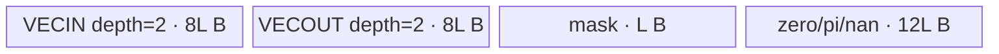
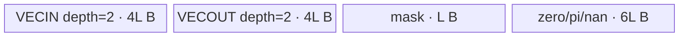
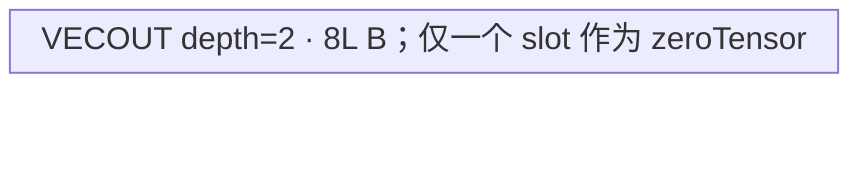
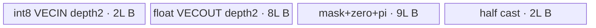
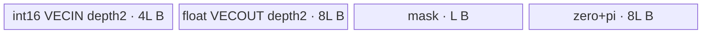
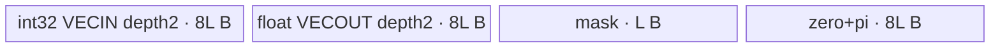
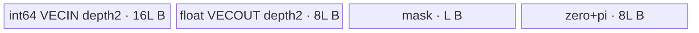

# AngleV2 A2/A3 ACLNN 算子知识

## 算子速览

| 项目 | 内容 |
|---|---|
| 实际入口 | `aclnnAngleV2GetWorkspaceSize` + `aclnnAngleV2`，无版本后缀，公开 ACLNN 两段式接口 |
| 计算语义 | 实数/整数逐元素返回相位 `0` 或 `π`，实数 NaN 保持 NaN；`complex64` 返回主值辐角 `atan2(imag, real)` 并修正有符号零、无穷和 NaN |
| 输入输出 | ND，rank 0～8；`float16→float16`，`float32→float32`，`complex64/bool/uint8/int8/int16/int32/int64→float32`；shape 不变 |
| 执行类型 | 所有 Route 均为单 Kernel `AIV_VECTOR`；不存在 Cube/AIC、MIX_CV、SIMT、NDDMA 或通信节点 |
| Kernel 路线 | R-001 complex64；R-002 float32；R-003 float16；R-004 bool/uint8；R-005 int8；R-006 int16；R-007 int32；R-008 int64 |
| 核心资源 | GM 输入/输出、双缓冲 `VECIN/VECOUT` Queue、按 Route 分配的 `VECCALC` TBuf、Vector pipe/barrier；Kernel 不读传入的 workspace |
| 来源闭包 | `source_closed`：公开 ACLNN 约束经 `AngleV2` OpDef、Tiling/POD、key router、八条可达 AIV body 和 A2/A3 binary/构建注册闭合；自动生成的 ACLNN executor 壳作为框架边界 |
| 验证状态 | 已完成源码闭包检查；本次知识提取未执行编译、真机、数值或性能测试。 |

## 接口与语义

### 计算语义

对第 `i` 个元素，`out_i = angle(x_i)`。对非复数输入，Kernel 实现为：`x_i >= 0` 时输出 `0`，`x_i < 0` 时输出 `π`；浮点 NaN 通过第二次 `x_i == x_i` 比较改写为 NaN。对 `bool` 与 `uint8`，有效域全为非负，专用 Route 不读取 `x`，直接生成全零。对 `complex64`，输入 GM 以交错 `[real_0, imag_0, ...]` 的 float 读取，先算 `atan(imag/real)`，再按象限补 `±π`，并显式覆盖 `±0`、`±∞` 与 NaN 的主值边界。

### 输入、输出与属性

| 参数 | shape/layout | dtype | 约束、默认值与语义 |
|---|---|---|---|
| `x` | ND；rank 0～8；公开接口支持非连续 Tensor | `BOOL, UINT8, INT8, INT16, INT32, INT64, FLOAT16, FLOAT, COMPLEX64` | 必选；`AutoContiguous()` 使算子 Kernel 看到连续 storage；元素总数由 storage shape 乘积产生 |
| `out` | ND；shape 必须与 `x` 相同；公开接口支持非连续 Tensor | `FLOAT16` 仅对应 `x=FLOAT16`，其余为 `FLOAT` | 必选；OpDef 中输出 dtype 与输入 dtype 列表按位置一一映射；自动连续化后的回写细节属于固定仓不可见的 executor 框架边界 |
| `workspaceSize` | 标量 | `uint64_t*` | 第一段返回 Device workspace 大小；Tiling 固定登记一个 16 MiB system workspace slice |
| `executor` | 不适用 | `aclOpExecutor**` | 第一段生成并拥有计算流程，第二段消费 |
| `workspace` | Device 地址 | 字节区 | 第二段输入；Kernel entry 形参存在但 body 未读取 |
| `stream` | ACL runtime stream | `aclrtStream` | 第二段在该 stream 提交执行 |

### 入口与版本

固定仓只公开无后缀 `aclnnAngleV2`，未发现同语义更高版本，因此它是 A2/A3 实际支持的最新公开版本。文档的两段式原型与错误码公开，`op_host/CMakeLists.txt` 以 `ACLNNTYPE aclnn` 发布 `AngleV2` OpDef。第一段自动生成实现、executor 内部节点对象及 `AutoContiguous` 具体辅助调用未以源码落在固定仓，按框架边界处理；算子拥有的 OpDef、Tiling、POD、router 和 Device body 均可见。

## Host/Launcher 执行流程

### 参数校验与前处理

公开第一段依次承担空指针、输入 dtype、rank `<=8`、`x/out` shape 相等检查；文档给出 `161001` 空指针和 `161002` 参数无效。OpDef 将两端都标为 `AutoContiguous()`，因此非连续 Tensor 在框架侧物化/回写，具体函数和额外 workspace 切片固定仓不可见。Host Tiling 读取 `GetInputShape(0)->GetStorageShape()` 计算 `totalLength`，读取平台 SoC、AIV core 数与 UB 大小，再读取输入 dtype。A2/A3 若 rank `>8`，Tiling 自身仅记录 warning；公开 ACLNN 应在更早的第一段拒绝该输入。

### 参数、Workspace 与生命周期

`AngleV2Tiling::Init` 令 `currentWorkSpace[0] = 16 * 1024 * 1024`，该 slice 由 executor/runtime 分配并至少活到 stream 上 Kernel 完成；`angle_v2(x,y,workspace,tiling)` 保留 workspace ABI 形参但不解引用。输入/输出连续临时区若存在，其大小、offset 和 owner 固定仓不可见，不能与这 16 MiB 推测合并。Tiling POD 保存在 raw tiling buffer，由 launch 前产生、Kernel 启动时只读。

### 启动图与失败传播

单 Kernel 图：

```text
aclnnAngleV2GetWorkspaceSize(x, out)
  -> ACLNN 生成 executor / AutoContiguous 框架边界
  -> AngleV2 OpDef + TilingAngleV2(context)
       -> AngleV2Tiling::Init()
       -> AngleV2Tiling::RunKernelTiling()
  -> 返回 workspaceSize 与 executor
aclnnAngleV2(workspace, workspaceSize, executor, stream)
  -> stream 上启动 angle_v2(x_contiguous, y_contiguous, workspace[0:16MiB], tiling)
       -> key router -> 恰好一个 AIV_VECTOR body
  -> 可选的非连续 out 回写（固定仓不可见）
```

| 节点/边 | entry/介质 | 参数与范围 | ordering、owner/lifetime | 失败传播 |
|---|---|---|---|---|
| Host Tiling | `TilingAngleV2` | `blockDim=coreNum`；POD 为 `AngleV2TilingData` | executor 构建阶段；raw tiling buffer 持续到 launch 完成 | `RunKernelTiling` 返回值上传；但包装函数没有检查 `Init()` 返回值，这是源码可见的失败传播缺口 |
| K-001 | `angle_v2` | `x,y,workspace,tiling`；单 AIV grid，block 数为 `coreNum` | 第二段指定 stream；单节点无跨 Kernel edge | 未知 key 走完 `if/else` 而不写输出，entry 无显式错误返回 |
| GM 输出边 | `y_contiguous→out` | shape 与输入相同 | 框架 stream 顺序与 owner 细节固定仓不可见 | 回写失败行为固定仓不可见 |

## Route 与参数设计

### 分核与资源计算

令 `N=storage_shape_size`，`B=32B`，`R=256B`。`dataPerRepeat=128` 仅用于 FP16，其他 A2/A3 dtype 均为 64；`coreNum=min(platformAivCores, ceil(N/dataPerRepeat))`。`alignNum` 为 FP16/INT16 的 16、INT8 的 32、其余 dtype 的 8；`N_a=ceil(N/alignNum)*alignNum`，`blockNum=N_a/alignNum`。前 `formerNum=blockNum%coreNum` 个核处理 `formerLength=ceil(blockNum/coreNum)*alignNum` 元素，其余 `tailNum=coreNum-formerNum` 个核处理 `tailLength=floor(blockNum/coreNum)*alignNum` 元素。

A2/A3 均走非 ASCEND910 的 UB 公式：`tileLength=floor((UB_platform-8000)/(bytesPerData*dataPerRepeat))*dataPerRepeat`。`bytesPerData` 依次为 complex64 66、float32 29、float16 15、bool/uint8 15（保守值）、int8 21、int16 21、int32 25、int64 33 字节/逻辑元素。Device 在 `blockLength<=tileLength` 时把 tile 缩为 `ceil(blockLength/mask)*mask`；每核 `tileNum=floor((blockLength-1)/tileLength)`，再处理 `lastTileLength=blockLength-tileNum*tileLength`。

### Route 选择

| 顺序 | Route | Key/模板 | 精确选择条件与优先级 | 不适用去向 |
|---:|---|---|---|---|
| 1 | R-001 complex64 | key 1 / `AngleV2Complex<float>` | `dType==DT_COMPLEX64` | R-002 |
| 2 | R-002 float32 | key 2 / `AngleV2<float>` | dtype switch 的 default；公开/OpDef 可达默认值仅 `DT_FLOAT` | R-003 |
| 3 | R-003 float16 | key 3 / `AngleV2<half>` | `dType==DT_FLOAT16` | R-004 |
| 4 | R-004 bool/uint8 | key 4/5 / `AngleV2U8<float>` | `DT_BOOL` 或 `DT_UINT8`；两 key body、POD、输出与内存相同 | R-005 |
| 5 | R-005 int8 | key 6 / `AngleV2Int<int8_t,float>` | `dType==DT_INT8` | R-006 |
| 6 | R-006 int16 | key 7 / `AngleV2Int<int16_t,float>` | `dType==DT_INT16` | R-007 |
| 7 | R-007 int32 | key 8 / `AngleV2Int<int32_t,float>` | `dType==DT_INT32` | R-008 |
| 8 | R-008 int64 | key 9 / `AngleV2Int<int64_t,float>` | `dType==DT_INT64` | 失败/未知 key 无输出 |

```text
switch input dtype:
  complex64 -> key 1 -> R-001
  float16   -> key 3 -> R-003
  bool      -> key 4 -> R-004
  uint8     -> key 5 -> R-004
  int8      -> key 6 -> R-005
  int16     -> key 7 -> R-006
  int32     -> key 8 -> R-007
  int64     -> key 9 -> R-008
  default   -> key 2 -> R-002  # OpDef 公开可达仅 float32
```

### 模板/实现执行矩阵

| Route | key/selector | dtype/shape/platform 完整命中条件 | 执行拓扑与 Kernel 节点 | 实际模板/body | 内存与同步特征 | tail/fallback |
|---|---|---|---|---|---|---|
| R-001 complex64 | 1 | A2/A3，complex64，rank≤8 | K-001 单 AIV | `AngleV2Complex<float>::Process` | 2 Queue + 11 TBuf；显式 MTE2/V barrier | 末核按 complex64 4 元素对齐回退地址/缩输入拷贝 |
| R-002 float32 | 2 | A2/A3，float32，rank≤8 | K-001 单 AIV | `AngleV2<float>::Process` | 双 Queue + mask/zero/pi/nan | 32B 对齐尾 tile |
| R-003 float16 | 3 | A2/A3，float16，rank≤8 | K-001 单 AIV | `AngleV2<half>::Process` | 与 R-002 同拓扑，元素字节和 mask=128 不同 | 16 元素对齐尾 tile |
| R-004 bool/uint8 | 4/5 | A2/A3，bool 或 uint8，rank≤8 | K-001 单 AIV | `AngleV2U8<float>::Process` | 仅双深度 VECOUT；显式 `PIPE_ALL` | 不读输入；复用同一零 tile 覆盖所有 GM tile |
| R-005 int8 | 6 | A2/A3，int8，rank≤8 | K-001 单 AIV | `AngleV2Int<int8_t,float>` | 双 Queue + 4 TBuf；int8→half→float | 输出对齐差通过末核回退/缩写 |
| R-006 int16 | 7 | A2/A3，int16，rank≤8 | K-001 单 AIV | `AngleV2Int<int16_t,float>` | 双 Queue + 3 TBuf；直接 int16→float | 输出对齐差通过末核回退/缩写 |
| R-007 int32 | 8 | A2/A3，int32，rank≤8 | K-001 单 AIV | `AngleV2Int<int32_t,float>` | 双 Queue + 3 TBuf；直接 int32→float | 输入输出同 8 元素对齐 |
| R-008 int64 | 9 | A2/A3，int64，rank≤8 | K-001 单 AIV | `AngleV2Int<int64_t,float>` | 双 Queue + 3 TBuf；mask 减半、repeat 加倍 | 输入 4/输出 8 元素对齐差由末核修正 |

### 隐藏性能 Guard

| Guard | Host/Tiling 条件 | Device/资源原因 | 影响 Route | 不满足时去向 | 源码符号 |
|---|---|---|---|---|---|
| AIV core 可用 | `GetCoreNumAiv()!=0` | blockDim 和分母要求正核数 | 全部 | `Init` 返回失败，但 wrapper 未检查该返回值 | `angle_v2_tiling.cpp::AngleV2Tiling::Init` |
| 8 KiB Select 预留 | `socVersion!=ASCEND910` | `DoSelect` 在 `__CCE_AICORE__>=200` 使用 VSEL mode 2 临时 UB | 全部 A2/A3 | tile 变小；若 `UB<=8000`，源码无安全 fallback | `CalTilingAligned`、`DoSelect` |
| repeat 上限 | R-004 的 `actualRepeatTimes<=509` 才能从现有地址式证明完整初始化 | `Duplicate` repeat 参数为 uint8；源码 full-chunk 循环没有给 `zeroTensor` 加 `i*255*mask` offset | R-004 | `<=255` 一次完成，256～509 为一次255-repeat加余段；`>=510` 时重复覆盖首段并跳到余段，固定仓无正确 fallback | `AngleV2U8::Init/Process` |
| dtype router | key 必须为 1～9 | entry 为串行 `if/else`，A2/A3 不编译 key 10 BF16 body | 全部 | 未知 key 静默无输出 | `angle_v2.cpp::angle_v2` |
| 非空元素域 | `N>0` 是 Device 公式隐含条件 | `N=0` 时单核 `blockLength=0`，`CalTileLength` 可令 `tileLength=0`，随后发生除零 | 全部 | 固定仓无 empty fallback | `AngleV2Base::BaseMemberDataInit/CalTileLength` |
| 末核 dtype 对齐差 | 仅 complex64/int8/int16/int64 且最后一核 | 输入与 float32 输出的 32B 元素数不同 | R-001/R-005/R-006/R-008 | 回退 `currentOffset`，不能回退时缩小输入或输出 tail 搬运 | `AngleV2Complex::Init`、`AngleV2Int::InitDataAddress` |

### POD/ABI

`BEGIN_TILING_DATA_DEF` 宏定义所在依赖不在固定仓；因此只能确认字段声明顺序、源码类型和 Host/Device 对称使用，不能从固定仓确认宏展开后的 `sizeof/alignof/offsetof`。

| 结构 | 字段 | 类型/位宽 | ABI 布局 | 单位 | Host/launcher producer | Device consumer | 边界 |
|---|---|---|---|---|---|---|---|
| `AngleV2TilingData` | `totalLength` | `int64_t/64` | 第1字段；精确 offset/sizeof 固定仓不可见 | 元素 | `set_totalLength(N)` | `BaseMemberDataInit` 保存总有效长度；complex/int tail 对齐修正 | shape 乘积溢出检查固定仓不可见 |
| 同上 | `formerNum` | `int64_t/64` | 第2字段；offset 固定仓不可见 | core | `blockNum % coreNum` | 判断 `GetBlockIdx()<formerNum` | `[0,coreNum-1]` |
| 同上 | `tailNum` | `int64_t/64` | 第3字段；offset 固定仓不可见 | core | `coreNum-formerNum` | 识别最后一核 `formerNum+tailNum-1` | 与 formerNum 合计 coreNum |
| 同上 | `formerLength` | `int64_t/64` | 第4字段；offset 固定仓不可见 | 元素/core | `ceil(blockNum/coreNum)*alignNum` | 前 formerNum 核 blockLength 与 offset | 32B 对齐对应元素数 |
| 同上 | `tailLength` | `int64_t/64` | 第5字段；offset 固定仓不可见 | 元素/core | `floor(blockNum/coreNum)*alignNum` | 其余核 blockLength 与 offset | 可为 0；源码仍启动这些核 |
| 同上 | `alignNum` | `int64_t/64` | 第6字段；offset 固定仓不可见 | 元素/32B block | dtype switch：16、32 或 8 | 保存但 Kernel body 不再参与公式 | BOOL/UINT8 走 default 8 |
| 同上 | `totalLengthAligned` | `int64_t/64` | 第7字段；offset 固定仓不可见 | 元素 | `ceil(N/alignNum)*alignNum` | int/complex 输入输出对齐差计算 | 包含 padding 元素域 |
| 同上 | `tileLength` | `int64_t/64` | 第8字段；offset 固定仓不可见 | 元素/tile | UB 公式向下对齐到 dataPerRepeat | `CalTileLength`、Queue/TBuf 容量、循环步长 | 要求正值；无显式下限 guard |
| 同上 | `dataPerRepeat` | `int64_t/64` | 第9字段；offset 固定仓不可见 | 元素/repeat | FP16=128，其余=64 | 转为 `mask`，控制 repeat/mask 和 tile 缩放 | router key 与 dtype 必须一致 |

### Route 源码闭包

| Route | Key/selector | Host/Tiling producer | POD/参数 | Kernel entry/router 节点 | Kernel body/直接依赖 | 构建接线 |
|---|---|---|---|---|---|---|
| R-001 | 1 | `angle_v2_tiling.cpp::SetTilingKeyMode/CalTilingAligned` | `AngleV2TilingData`，66 B/elem | `angle_v2.cpp::angle_v2` | `angle_v2_complex.h::AngleV2Complex` + `angle_v2_base.h` | A2/A3 binary JSON + `ascendc_config.json` |
| R-002 | 2 | 同上，29 B/elem | 同 POD | 同 entry | `angle_v2.h::AngleV2<float>` + base | 同上 |
| R-003 | 3 | 同上，15 B/elem | 同 POD | 同 entry | `angle_v2.h::AngleV2<half>` + base | 同上 |
| R-004 | 4/5 | 同上，保守 15 B/elem | 同 POD | 同 entry | `angle_v2_u8.h::AngleV2U8<float>` + base | 同上 |
| R-005 | 6 | 同上，21 B/elem | 同 POD | 同 entry | `angle_v2_int.h::AngleV2Int<int8_t,float>` + base | 同上 |
| R-006 | 7 | 同上，21 B/elem | 同 POD | 同 entry | `angle_v2_int.h::AngleV2Int<int16_t,float>` + base | 同上 |
| R-007 | 8 | 同上，25 B/elem | 同 POD | 同 entry | `angle_v2_int.h::AngleV2Int<int32_t,float>` + base | 同上 |
| R-008 | 9 | 同上，33 B/elem | 同 POD | 同 entry | `angle_v2_int.h::AngleV2Int<int64_t,float>` + base | 同上 |

## Kernel 实现

### 公共执行流程

`angle_v2` 解析同一 POD，以 key 选择恰好一个模板，创建栈上 `TPipe`，调用 `Init→Process`。`AngleV2Base::BaseMemberDataInit` 把 block id 映射到连续 GM 区间；前 former 核起点为 `formerLength*blockIdx`，其余为 `formerLength*formerNum + tailLength*(blockIdx-formerNum)`。每条计算 Route 都是 `GM→VECIN→Vector→VECOUT→GM`；R-004 省略输入和 VECIN。Queue 的 `Alloc/EnQue/DeQue/FreeTensor` 提供 tile 生命周期，complex Route 另有显式 pipe barrier。单节点无跨 Kernel workspace 边。

### Route R-001：complex64 辐角

#### 适用条件

##### 选择证据

| 层级 | 文件 | 符号 | 源码谓词/参数 | 结果/下一跳 |
|---|---|---|---|---|
| API | `docs/aclnnAngleV2.md` | `aclnnAngleV2GetWorkspaceSize` | `x=COMPLEX64,out=FLOAT` | 进入 AngleV2 |
| Tiling | `op_host/angle_v2_tiling.cpp` | `SetTilingKeyMode` | `dType==DT_COMPLEX64` | key 1 |
| Router | `op_kernel/angle_v2.cpp` | `angle_v2` | `TILING_KEY_IS(1)` | `AngleV2Complex<float>` |

#### Device 数据流

##### 函数级调用链

```text
angle_v2 -> AngleV2Complex<float>::Init -> BaseMemberDataInit
         -> Process -> BufferGet -> CopyInComplex -> SplitComplex
         -> Compute -> Atan<float,false> -> 象限修正 -> CornerProcess
         -> CornerProcessRealINF/RealNINF/NAN -> CopyOut
```

##### 源码等价伪码

```text
currentOffset = per-core offset; complexTail = 2*lastTileLength
若最后一核且 output-align8 与 input-complex-align4 有差：回退 currentOffset；无法回退则缩 complexTail
for full tile and final tile:
  copy interleaved float[2*logicalCount] from x GM
  barrier(MTE2); GatherMask odd/even lanes -> real, imag
  ratio = imag / real; result = native Atan(ratio)
  根据 imag 符号与 real<0/==0 加 ±pi 或选 ±pi/2
  覆盖 signed-zero、real/imag infinity 组合和任一 NaN
  barrier(V); copy logicalCount float results to y GM
```

#### 内存与数据搬运

##### 资源与搬运表

| 层级/缓冲区 | offset/地址公式 | extent/容量公式 | dtype/layout | producer | consumer | owner/lifetime | 对齐/复用 |
|---|---|---|---|---|---|---|---|
| x GM | `2*(currentOffset+tileOffset)` | `2*logicalCount` | float interleaved complex64 | ACLNN input | `CopyInComplex` | caller/executor | complex64 按4元素32B对齐 |
| inQueue | Queue slot | `2*L*4` B/slot，depth2 | float interleaved | DataCopy | SplitComplex | TPipe/每 tile | 2 slots |
| outQueue | Queue slot | `L*4` B/slot，depth2 | float | Compute/CornerProcess | CopyOut | TPipe/每 tile | result 在 CornerProcess 中 DeQue 后再 EnQue |
| TBuf | 各独立 TBuf | masks `2L` B；9个 float TBuf `36L` B | uint8/float | BufferGet/Vector | Compute helpers | Kernel lifetime | temp1～5 跨阶段复用 |
| y GM | `currentOffset+tileOffset` | `logicalCount` | float ND | CopyOut | caller | caller/executor | 最后 padding 写不属于有效 shape |

##### 分层内存布局


##### 字节账与复用顺序

```text
UB_actual = 16L + 8L + 2L + 36L = 62L bytes
Host conservative bound = 66L bytes; L <= floor((UB_platform-8000)/66/64)*64
dynamic_ub = N/A
workspace_total = 16 MiB system slice（Kernel 不读）
```

| 复用子区 | 写入者 | 读取者/消费点 | 下一次覆盖 | 同步或释放依据 | 安全条件 |
|---|---|---|---|---|---|
| temp1～temp5 | Atan/象限/Corner helpers | 后续 Vector step | 下一 helper 或下 tile | 连续 `PIPE_V` barrier | 不得删除相邻 barrier；别名关系按源码局部 LocalTensor 绑定保持 |
| Queue slots | CopyIn/Compute | Split/CopyOut | 下一 tile | EnQue/DeQue/FreeTensor | depth2 容量乘入 UB |

#### 同步、精度与尾块

##### 同步与数值边界表

| 阶段 | primitive/机制 | producer | consumer/等待点 | 保护对象 | 精度/尾块 |
|---|---|---|---|---|---|
| GM→UB | `PipeBarrier<PIPE_MTE2>` | DataCopy | Gather/Compute | inQueue tile | complex float 两 lane；tail 用 `complexTailLength` |
| Vector 链 | `PipeBarrier<PIPE_V>` | 每个 Div/Atan/Compare/Select/Add | 下一指令 | temp/mask/result | 全程 float；mask=64，repeat 由 tile 计算 |
| 特殊值 | 显式 Select | CornerProcess helpers | output EnQue | result | 保留 ±0 象限、±∞组合，任一 NaN→NaN |
| UB→GM | Queue + barrier | CornerProcess | CopyOut | result tile | 只保证 shape 内前 N 个结果有效 |

#### 关键实现

##### 符号证据表

| 阶段 | 文件 | 符号/模板实例 | 实现事实 |
|---|---|---|---|
| Host/Tiling producer | `op_host/angle_v2_tiling.cpp` | `SetTilingKeyMode/GetUsedBytesPerDataInKernel` | key1、66 B/elem、mask64 |
| Kernel entry/router | `op_kernel/angle_v2.cpp` | `angle_v2` key1 | 映射 `AngleV2Complex<float>` |
| Device body/helper | `op_kernel/angle_v2_complex.h` | `SplitComplex/Compute/CornerProcess/CopyOut` | GatherMask、Atan、象限及特殊值闭合 |

### Route R-002：float32 符号相位

#### 适用条件

##### 选择证据

| 层级 | 文件 | 符号 | 源码谓词/参数 | 结果/下一跳 |
|---|---|---|---|---|
| API/OpDef | `angle_v2_def.cpp` | `AngleV2::Input/Output` | `DT_FLOAT→DT_FLOAT` | 可达 dtype |
| Tiling | `angle_v2_tiling.cpp` | `SetTilingKeyMode` | switch default | key2 |
| Router | `angle_v2.cpp` | `angle_v2` | key2 | `AngleV2<float>` |

#### Device 数据流

##### 函数级调用链

```text
angle_v2 -> AngleV2<float>::Init -> BaseMemberDataInit
         -> Process -> BufferGet -> CopyIn -> Compute(Compare/DoSelect twice) -> CopyOut
```

##### 源码等价伪码

```text
prepare zero/pi/nan float tiles
for each full/tail tile:
  DataCopy x; result = select(x>=0, 0, pi)
  result = select(x==x, result, nan)
  DataCopy result to y
```

#### 内存与数据搬运

##### 资源与搬运表

| 层级/缓冲区 | offset/地址公式 | extent/容量公式 | dtype/layout | producer | consumer | owner/lifetime | 对齐/复用 |
|---|---|---|---|---|---|---|---|
| x/y GM | `coreOffset+iL` | tile 有效/对齐长度 | float ND | caller/CopyOut | CopyIn/caller | executor | 8元素/32B |
| in/out Queue | slot | 各 `L*4` B/slot，depth2 | float | DMA/Compute | Compute/DMA | TPipe | 合计16L B |
| mask/zero/pi/nan | 独立 TBuf | `L + 3*4L` B | uint8/float | BufferGet/Compare | Select | Kernel | 常量 tile 跨循环复用 |

##### 分层内存布局



##### 字节账与复用顺序

```text
UB_total = 8L+8L+L+12L = 29L <= UB_platform-8000
dynamic_ub = N/A; workspace_total = 16 MiB system slice
```

| 复用子区 | 写入者 | 读取者/消费点 | 下一次覆盖 | 同步或释放依据 | 安全条件 |
|---|---|---|---|---|---|
| mask | first Compare | first Select | second Compare | Vector 顺序/auto_sync | Compare 与对应 Select 不可重排 |
| Queue slots | CopyIn/Compute | Compute/CopyOut | 下一 tile | EnQue/DeQue/FreeTensor | 保持 Queue 生命周期 |

#### 同步、精度与尾块

##### 同步与数值边界表

| 阶段 | primitive/机制 | producer | consumer/等待点 | 保护对象 | 精度/尾块 |
|---|---|---|---|---|---|
| Copy/Compute | Queue + 构建配置 `auto_sync:true` | DMA | Compare | tile | float，mask64，repeat=`ceil(count/64)` |
| NaN | `x==x` mask | Compare | Select | result | NaN→NaN；±0 均满足 `>=0`→+0 |
| tail | aligned blockLen | Host POD | CopyIn/Out | last tile | 32B 粒度含 padding，shape 外值无语义 |

#### 关键实现

##### 符号证据表

| 阶段 | 文件 | 符号/模板实例 | 实现事实 |
|---|---|---|---|
| Host/Tiling producer | `angle_v2_tiling.cpp` | `SetTilingKeyMode/CalTilingAligned` | key2、29 B/elem、align8 |
| Kernel entry/router | `angle_v2.cpp` | key2 branch | `AngleV2<float>` |
| Device body/helper | `angle_v2.h` | `BufferGet/Compute/CopyOut` | 0/π/NaN 两级 Select |

### Route R-003：float16 符号相位

#### 适用条件

##### 选择证据

| 层级 | 文件 | 符号 | 源码谓词/参数 | 结果/下一跳 |
|---|---|---|---|---|
| API/OpDef | `angle_v2_def.cpp` | dtype mapping | `DT_FLOAT16→DT_FLOAT16` | 可达 |
| Tiling | `angle_v2_tiling.cpp` | `SetTilingKeyMode/GetNeedCoreNum` | FP16 | key3、mask128 |
| Router | `angle_v2.cpp` | key3 branch | key3 | `AngleV2<half>` |

#### Device 数据流

##### 函数级调用链

```text
angle_v2 -> AngleV2<half>::Init/BaseMemberDataInit -> Process
         -> BufferGet -> CopyIn -> Compute -> CopyOut
```

##### 源码等价伪码

```text
与 R-002 同一 body；所有 x/result/zero/pi/nan 为 half
mask=128，blockLen=count/16；按 half 比较，pi 与 NaN 转 half 后 Select
```

#### 内存与数据搬运

##### 资源与搬运表

| 层级/缓冲区 | offset/地址公式 | extent/容量公式 | dtype/layout | producer | consumer | owner/lifetime | 对齐/复用 |
|---|---|---|---|---|---|---|---|
| x/y GM | `offset+tileOffset` | count | half ND | caller/CopyOut | CopyIn/caller | executor | 16元素/32B |
| in/out Queue | slot | 各 `2L` B/slot，depth2 | half | DMA/Compute | Compute/DMA | TPipe | 合计8L B |
| mask/zero/pi/nan | 独立 | `L+6L` B | uint8/half | BufferGet | Compute | Kernel | 常量跨 tile |

##### 分层内存布局



##### 字节账与复用顺序

```text
UB_total = 4L+4L+L+6L = 15L <= UB_platform-8000
dynamic_ub = N/A; workspace_total = 16 MiB system slice
```

| 复用子区 | 写入者 | 读取者/消费点 | 下一次覆盖 | 同步或释放依据 | 安全条件 |
|---|---|---|---|---|---|
| mask/Queue | 同 R-002 | 同 R-002 | 下一 Compare/tile | auto_sync + Queue | 保持 half mask128 和 stride8 |

#### 同步、精度与尾块

##### 同步与数值边界表

| 阶段 | primitive/机制 | producer | consumer/等待点 | 保护对象 | 精度/尾块 |
|---|---|---|---|---|---|
| Compute | half Compare/Select | input Queue | output Queue | result | 无升精度；π/NaN 先 cast half |
| tail | mask128/repeat uint8 | POD | DataCopy | last tile | 16元素/32B对齐 |

#### 关键实现

##### 符号证据表

| 阶段 | 文件 | 符号/模板实例 | 实现事实 |
|---|---|---|---|
| Host/Tiling producer | `angle_v2_tiling.cpp` | FP16 cases | key3、mask128、15 B/elem |
| Kernel entry/router | `angle_v2.cpp` | key3 | `AngleV2<half>` |
| Device body/helper | `angle_v2.h` | `AngleV2<half>::Compute` | half 0/π/NaN |

### Route R-004：bool/uint8 零生成

#### 适用条件

##### 选择证据

| 层级 | 文件 | 符号 | 源码谓词/参数 | 结果/下一跳 |
|---|---|---|---|---|
| API | `aclnnAngleV2.md` | dtype table | BOOL/UINT8→FLOAT | 可达 |
| Tiling | `angle_v2_tiling.cpp` | key switch | BOOL=4，UINT8=5 | 同 Route |
| Router | `angle_v2.cpp` | key4/key5 branches | 两者均实例化 `AngleV2U8<float>` | 同 body |

#### Device 数据流

##### 函数级调用链

```text
angle_v2 -> AngleV2U8<float>::Init -> BaseMemberDataInit
         -> Process -> Alloc outQueue tile -> Duplicate(0) -> PIPE_ALL
         -> 对全部 full/tail tile 直接 DataCopy 同一零 tile到 y GM
```

##### 源码等价伪码

```text
actualRepeat = ceil(L/64)
if actualRepeat<=255: loopCnt保持1，Duplicate首地址actualRepeat次
else: repeat=255; loopCnt=floor(actualRepeat/255); repeatLeft=actualRepeat%255
      full-chunk循环每次仍写zeroTensor首地址；余段从255*loopCnt*64处写
# 因 full-chunk 没有 i offset，只有 loopCnt<=1（actualRepeat<=509）可证明完整初始化
barrier(ALL)
for every tile: copy zeroTensor[0:tileLength] to y
tail: copy zeroTensor[0:lastTileLength] to y
# x GM 从未绑定或读取
```

#### 内存与数据搬运

##### 资源与搬运表

| 层级/缓冲区 | offset/地址公式 | extent/容量公式 | dtype/layout | producer | consumer | owner/lifetime | 对齐/复用 |
|---|---|---|---|---|---|---|---|
| x GM | N/A | N/A | bool/uint8 | caller | 无 | caller | 完全省略 GM→UB |
| outQueue | Queue slot | `4L` B/slot，depth2 | float | Duplicate | 所有 CopyOut | TPipe/Kernel | 同一已分配 slot 不 EnQue/DeQue，跨 tile 只读复用 |
| y GM | `offset+tileOffset` | 8元素对齐 tile | float | DataCopy | caller | executor | 32B |

##### 分层内存布局



##### 字节账与复用顺序

```text
UB_actual = 2*4L = 8L bytes
Host bound = 15L bytes（沿用 default，保守多算7L）
dynamic_ub = N/A; workspace_total = 16 MiB system slice
```

| 复用子区 | 写入者 | 读取者/消费点 | 下一次覆盖 | 同步或释放依据 | 安全条件 |
|---|---|---|---|---|---|
| outQueue allocated slot | Duplicate | 所有 tile 的 DataCopy | Kernel 结束 | `PIPE_ALL` 后不再写 | 输出元素恒为 float 0；不要在循环内改写该 slot |

#### 同步、精度与尾块

##### 同步与数值边界表

| 阶段 | primitive/机制 | producer | consumer/等待点 | 保护对象 | 精度/尾块 |
|---|---|---|---|---|---|
| zero build→DMA | `PipeBarrier<PIPE_ALL>` | Duplicate | 首次及后续 DataCopy | zeroTensor | 精确 float +0 |
| repeat 窄化 | uint8 repeat + 可选余段 | Duplicate | `PIPE_ALL` 后 DataCopy | zeroTensor | `actualRepeat<=509` 可闭合；更大 tile 的中间段初始化缺失 |
| GM tail | blockLen=count/8 | POD/tail | DataCopy | y | 32B 对齐；只认 shape 内 N 元素 |

#### 关键实现

##### 符号证据表

| 阶段 | 文件 | 符号/模板实例 | 实现事实 |
|---|---|---|---|
| Host/Tiling producer | `angle_v2_tiling.cpp` | BOOL/UINT8 cases | key4/5、mask64、保守15 B/elem |
| Kernel entry/router | `angle_v2.cpp` | key4/key5 | 同 `AngleV2U8<float>` |
| Device body/helper | `angle_v2_u8.h` | `Init/Process` | 不读 x、一次生成零 tile、多次 CopyOut |

### Route R-005：int8 两级 Cast

#### 适用条件

##### 选择证据

| 层级 | 文件 | 符号 | 源码谓词/参数 | 结果/下一跳 |
|---|---|---|---|---|
| API/OpDef | `angle_v2_def.cpp` | dtype mapping | INT8→FLOAT | 可达 |
| Tiling | `angle_v2_tiling.cpp` | key/alignment | INT8 | key6、align32 |
| Router | `angle_v2.cpp` | key6 | key6 | `AngleV2Int<int8_t,float>` |

#### Device 数据流

##### 函数级调用链

```text
angle_v2 -> AngleV2Int<int8_t,float>::Init -> InitDataAddress
         -> Process/BufferGet -> CopyIn -> Cast2Float(int8→half→float)
         -> Compare/DoSelect(0,pi) -> CopyOut
```

##### 源码等价伪码

```text
last core: reconcile input align32 vs output align8 by address back or shorter output tail
for tile:
  copy int8; cast 128-lane int8 -> half; cast 64-lane half -> float
  result = select(result>=0, 0.0f, pi); copy float output
```

#### 内存与数据搬运

##### 资源与搬运表

| 层级/缓冲区 | offset/地址公式 | extent/容量公式 | dtype/layout | producer | consumer | owner/lifetime | 对齐/复用 |
|---|---|---|---|---|---|---|---|
| x/y GM | corrected `currentOffset+tileOffset` | input/output blockLen 分别 count/32、count/8 | int8/float | caller/CopyOut | CopyIn/caller | executor | 末核可回退重算重写 |
| in/out Queue | slot | depth2：`2L + 8L` B | int8/float | DMA/Cast | Cast/DMA | TPipe | 10L |
| calc | 独立 TBuf | mask L + zero/pi 8L + half 2L | uint8/float/half | Cast/Compare | Select | Kernel | 11L |

##### 分层内存布局



##### 字节账与复用顺序

```text
UB_total = 2L+8L+L+8L+2L = 21L <= UB_platform-8000
dynamic_ub = N/A; workspace_total = 16 MiB
```

| 复用子区 | 写入者 | 读取者/消费点 | 下一次覆盖 | 同步或释放依据 | 安全条件 |
|---|---|---|---|---|---|
| result outQueue slot | half→float Cast | Compare，随后 Select 原地覆盖 | CopyOut/下一 tile | Queue lifecycle | Cast 后只需符号；原地 Select 必须保留 |

#### 同步、精度与尾块

##### 同步与数值边界表

| 阶段 | primitive/机制 | producer | consumer/等待点 | 保护对象 | 精度/尾块 |
|---|---|---|---|---|---|
| Cast | `CAST_NONE` 两级 | int8 input | float compare | half/result | int8 可由 half 精确表示，再转 float |
| tail | backshift/`lastTileLengthOut` | InitDataAddress | CopyOut | last core | 避免按 align32 写越 float 输出对齐域 |

#### 关键实现

##### 符号证据表

| 阶段 | 文件 | 符号/模板实例 | 实现事实 |
|---|---|---|---|
| Host/Tiling producer | `angle_v2_tiling.cpp` | INT8 cases | key6、align32、21B/elem |
| Kernel entry/router | `angle_v2.cpp` | key6 | int8/float specialization |
| Device body/helper | `angle_v2_int.h` | `InitDataAddress/Cast2Float/Compute` | 两级 Cast、末核输出修正 |

### Route R-006：int16 直接 Cast

#### 适用条件

##### 选择证据

| 层级 | 文件 | 符号 | 源码谓词/参数 | 结果/下一跳 |
|---|---|---|---|---|
| API/OpDef | `angle_v2_def.cpp` | dtype mapping | INT16→FLOAT | 可达 |
| Tiling/Router | `angle_v2_tiling.cpp` / `angle_v2.cpp` | key7 branches | INT16 | `AngleV2Int<int16_t,float>` |

#### Device 数据流

##### 函数级调用链

```text
angle_v2 -> AngleV2Int<int16_t,float>::Init/InitDataAddress
         -> Process -> CopyIn -> Cast2Float(int16→float) -> Compare/Select -> CopyOut
```

##### 源码等价伪码

```text
在 A2/A3 的 __CCE_AICORE__>=200 路径直接 CAST_NONE int16->float
按 float 结果符号选择 0/pi；末核协调 input align16 与 output align8
```

#### 内存与数据搬运

##### 资源与搬运表

| 层级/缓冲区 | offset/地址公式 | extent/容量公式 | dtype/layout | producer | consumer | owner/lifetime | 对齐/复用 |
|---|---|---|---|---|---|---|---|
| x/y GM | corrected offset | count/16 与 count/8 block | int16/float | caller/CopyOut | CopyIn/caller | executor | 末核回退/缩写 |
| Queue | slot | input4L + output8L | int16/float | DMA/Compute | Compute/DMA | TPipe | depth2 |
| calc | 独立 | maskL + zero/pi8L | uint8/float | BufferGet/Compare | Select | Kernel | 无 A2/A3 half fallback buffers |

##### 分层内存布局



##### 字节账与复用顺序

```text
UB_total = 4L+8L+L+8L = 21L <= UB_platform-8000
dynamic_ub=N/A; workspace_total=16 MiB
```

| 复用子区 | 写入者 | 读取者/消费点 | 下一次覆盖 | 同步或释放依据 | 安全条件 |
|---|---|---|---|---|---|
| result slot | direct Cast | Compare/Select | CopyOut | Queue | 不启用源码中 `__CCE_AICORE__<200` 的 half/pair-reduce 分支 |

#### 同步、精度与尾块

##### 同步与数值边界表

| 阶段 | primitive/机制 | producer | consumer/等待点 | 保护对象 | 精度/尾块 |
|---|---|---|---|---|---|
| Cast | `CAST_NONE` | int16 | float Compare | result | int16→float 精确 |
| tail | address back/short output | Init | DMA | final core | 32B 输入输出对齐差 |

#### 关键实现

##### 符号证据表

| 阶段 | 文件 | 符号/模板实例 | 实现事实 |
|---|---|---|---|
| Host/Tiling producer | `angle_v2_tiling.cpp` | INT16 cases | key7、align16、21B/elem |
| Kernel entry/router | `angle_v2.cpp` | key7 | int16 specialization |
| Device body/helper | `angle_v2_int.h` | `Cast2Float` >=200 branch | direct Cast |

### Route R-007：int32 直接 Cast

#### 适用条件

##### 选择证据

| 层级 | 文件 | 符号 | 源码谓词/参数 | 结果/下一跳 |
|---|---|---|---|---|
| API/OpDef | `angle_v2_def.cpp` | dtype mapping | INT32→FLOAT | 可达 |
| Tiling/Router | `angle_v2_tiling.cpp` / `angle_v2.cpp` | key8 | INT32 | `AngleV2Int<int32_t,float>` |

#### Device 数据流

##### 函数级调用链

```text
angle_v2 -> AngleV2Int<int32_t,float>::Init -> Process
         -> CopyIn -> Cast2Float(int32→float) -> Compare/Select -> CopyOut
```

##### 源码等价伪码

```text
copy int32 tile; Cast(result,input,CAST_NONE,mask64,repeat,CastKeepParams)
result = select(result>=0,0,pi); copy float tile
```

#### 内存与数据搬运

##### 资源与搬运表

| 层级/缓冲区 | offset/地址公式 | extent/容量公式 | dtype/layout | producer | consumer | owner/lifetime | 对齐/复用 |
|---|---|---|---|---|---|---|---|
| x/y GM | `offset+tileOffset` | count/8 blocks | int32/float | caller/CopyOut | CopyIn/caller | executor | 相同32B对齐 |
| Queue | slot | input8L+output8L | int32/float | DMA/Compute | Compute/DMA | TPipe | depth2 |
| calc | 独立 | maskL+zero/pi8L | uint8/float | Compare/BufferGet | Select | Kernel | 常量复用 |

##### 分层内存布局



##### 字节账与复用顺序

```text
UB_total=8L+8L+L+8L=25L <= UB_platform-8000
dynamic_ub=N/A; workspace_total=16 MiB
```

| 复用子区 | 写入者 | 读取者/消费点 | 下一次覆盖 | 同步或释放依据 | 安全条件 |
|---|---|---|---|---|---|
| result | Cast | Compare/Select | CopyOut | Queue | float cast 只用于符号判断；大整数精确值损失不改变可表示 int32 的符号 |

#### 同步、精度与尾块

##### 同步与数值边界表

| 阶段 | primitive/机制 | producer | consumer/等待点 | 保护对象 | 精度/尾块 |
|---|---|---|---|---|---|
| Cast/Select | auto_sync + Queue | Cast | Compare | result | int32→float 可失低位，但相位只依赖符号 |
| tail | identical 8-element align | POD | DMA | last tile | 无 dtype 对齐回退 |

#### 关键实现

##### 符号证据表

| 阶段 | 文件 | 符号/模板实例 | 实现事实 |
|---|---|---|---|
| Host/Tiling producer | `angle_v2_tiling.cpp` | INT32 cases | key8、25B/elem |
| Kernel entry/router | `angle_v2.cpp` | key8 | int32 specialization |
| Device body/helper | `angle_v2_int.h` | `Cast2Float/Compute` | CastKeep + sign Select |

### Route R-008：int64 符号 Cast

#### 适用条件

##### 选择证据

| 层级 | 文件 | 符号 | 源码谓词/参数 | 结果/下一跳 |
|---|---|---|---|---|
| API/OpDef | `angle_v2_def.cpp` | dtype mapping | INT64→FLOAT | 可达 |
| Tiling/Router | `angle_v2_tiling.cpp` / `angle_v2.cpp` | key9 | INT64 | `AngleV2Int<int64_t,float>` |

#### Device 数据流

##### 函数级调用链

```text
angle_v2 -> AngleV2Int<int64_t,float>::Init/InitDataAddress
         -> Process -> CopyIn -> Cast2Float(CAST_FLOOR) -> Compare/Select -> CopyOut
```

##### 源码等价伪码

```text
maskInt64=mask/2=32; repeatInt64=2*repeat
last core: coordinate input align4 and output/host align8
Cast float result from int64 with CAST_FLOOR; only its sign drives select(0,pi)
```

#### 内存与数据搬运

##### 资源与搬运表

| 层级/缓冲区 | offset/地址公式 | extent/容量公式 | dtype/layout | producer | consumer | owner/lifetime | 对齐/复用 |
|---|---|---|---|---|---|---|---|
| x/y GM | corrected offset | input count/4、output count/8 blocks | int64/float | caller/CopyOut | CopyIn/caller | executor | last input可缩/地址回退 |
| Queue | slot | input16L+output8L | int64/float | DMA/Compute | Compute/DMA | TPipe | depth2 |
| calc | 独立 | maskL+zero/pi8L | uint8/float | Compare/BufferGet | Select | Kernel | A2/A3不分配旧架构额外buf |

##### 分层内存布局



##### 字节账与复用顺序

```text
UB_total=16L+8L+L+8L=33L <= UB_platform-8000
dynamic_ub=N/A; workspace_total=16 MiB
```

| 复用子区 | 写入者 | 读取者/消费点 | 下一次覆盖 | 同步或释放依据 | 安全条件 |
|---|---|---|---|---|---|
| result | int64 Cast | sign Compare/Select | CopyOut | Queue | 保持 mask32/repeat×2 与 CastDownParams |

#### 同步、精度与尾块

##### 同步与数值边界表

| 阶段 | primitive/机制 | producer | consumer/等待点 | 保护对象 | 精度/尾块 |
|---|---|---|---|---|---|
| Cast | `RoundMode::CAST_FLOOR` | int64 | Compare | result | 数值低位丢失不改变非零 int64 符号；相位只依赖符号 |
| tail | `lastTileLengthIn`/backshift | InitDataAddress | CopyIn | last core | 输入4元素/32B、输出8元素/32B |

#### 关键实现

##### 符号证据表

| 阶段 | 文件 | 符号/模板实例 | 实现事实 |
|---|---|---|---|
| Host/Tiling producer | `angle_v2_tiling.cpp` | INT64 cases | key9、33B/elem |
| Kernel entry/router | `angle_v2.cpp` | key9 | int64 specialization |
| Device body/helper | `angle_v2_int.h` | `InitDataAddress/Cast2Float` | mask/repeat变换、末核输入修正 |

## 算子特定优化

### Trick T-001：非负整型直接零生成并跨 tile 复用

#### 触发与源码依据

- 适用 Route：R-004
- 触发条件：输入 dtype 为 BOOL 或 UINT8，Host 分别产生 key 4/5，两者 router 均实例化 `AngleV2U8<float>`。
- Golden 来源：[`math/angle_v2/op_kernel/angle_v2_u8.h:50-77`](../../../../../../../cann-ops-raw/ascendc/ops-math/165d41f02a43a62324b434cb6bda7c533b14da3e/math/angle_v2/op_kernel/angle_v2_u8.h#L50-L77)

**官方源码（固定 Commit 连续逐字摘录）**：

```cpp
        LocalTensor<yType> zeroTensor = outQueue.AllocTensor<yType>();

        for (uint32_t i = 0; i < loopCnt; i++) {
            Duplicate(
                zeroTensor, static_cast<yType>(0.0), this->mask, repeatTimes, this->dupDstBlockStride,
                this->dupDstRepeatStride);
        }
        if (repeatLeft >= 1) {
            Duplicate(
                zeroTensor[repeatTimes * loopCnt * this->mask], static_cast<yType>(0.0), this->mask, repeatLeft, this->dupDstBlockStride,
                this->dupDstRepeatStride);
        }

        PipeBarrier<PIPE_ALL>();
```

#### 机制与设计原因

BOOL/UINT8 数学域不含负数，相位恒为 0。该 Route 完全不绑定 `xGm`、不分配 VECIN，也不做 Compare/Select；在 `actualRepeatTimes<=509` 时，每核对一个 float Queue slot 完整生成零 tile，再把同一物理 slot 搬到所有 GM tile。`mask=64` 来自 POD `dataPerRepeat`。这减少输入 GM 搬运、Vector 比较和 UB 使用；但 `actualRepeatTimes>=510` 时 full-chunk 循环没有偏移，重复覆盖首段而使中间区域未被源码初始化，不能把该循环概括成正确的任意长度分段。

#### 迁移边界

- 适用：输出为逐元素常量且输入有效域可静态证明结果恒定的 elementwise 算子。
- 前提：BOOL/UINT8 语义、float 输出、32B 对齐 tail、`actualRepeatTimes<=509`，且 zeroTensor 在所有 DMA 完成前不被覆盖。
- 失效：有符号整数、浮点或 complex 必须进入其他 Route 并读取输入；`actualRepeatTimes>=510` 需要修正 full-chunk 地址推进后才能复用该机制。
- 未验证：本次知识提取未执行编译、真机、数值或性能测试。

#### 错误做法

将零 `Duplicate` 移入 tile 循环会重复计算；删除 `PIPE_ALL` 会失去源码明确给出的 Vector 写→DMA 读顺序。现有 full-chunk 循环不推进目标 offset，不能据此宣称支持任意多段初始化。

### Trick T-002：末核回退地址协调异宽输入与 float 输出

#### 触发与源码依据

- 适用 Route：R-001、R-005、R-006、R-008
- 触发条件：最后一核，且 Host 的 `totalLengthAligned` 与按实际输入/输出 32B 元素数重新对齐的长度存在 `diffLength`。
- Golden 来源：[`math/angle_v2/op_kernel/angle_v2_int.h:73-81`](../../../../../../../cann-ops-raw/ascendc/ops-math/165d41f02a43a62324b434cb6bda7c533b14da3e/math/angle_v2/op_kernel/angle_v2_int.h#L73-L81)

**官方源码（固定 Commit 连续逐字摘录）**：

```cpp
            if (GetBlockIdx() == this->formerNum + this->tailNum - 1) {
                if (this->offset < diffLength) {
                    // back the compute elements when the address can not back
                    lastTileLengthOut = this->lastTileLength - diffLength;
                } else {
                    // address back to avoid data stampede
                    currentOffset = this->offset - diffLength;
                }
            }
```

#### 机制与设计原因

Host 用输入 dtype 选单一 `alignNum` 分核，但输出固定为 float 时每 32B 的元素数可能不同。最后一核优先把输入和输出 GM 起点同时向前回退 `diffLength`，用确定性重算/重写换取两侧 DMA 都保持整 block；若首核无法回退，则只缩短对应输入或输出 tail 搬运。该机制避免为异宽尾部另开非对齐 DMA Route。

#### 迁移边界

- 适用：输入输出元素宽度不同、计算幂等、允许最后一块与前块重叠重算的逐元素单 Kernel。
- 前提：回退区仍属于同一 Tensor、重写值确定一致、单 stream/无跨核原子依赖。
- 失效：原地非幂等更新、有跨元素状态或输出重叠写不一致时必须使用独立 tail 方案。
- 未验证：本次知识提取未执行编译、真机、数值或性能测试。

#### 错误做法

直接按输入对齐长度写 float 输出可能越过输出的 32B 对齐域；源码通过回退或缩短 `lastTileLengthOut/In` 避免该情形。

## 模板与实现对比

| 对比维度 | R-001 complex | R-002/003 real float | R-004 u8/bool | R-005～008 signed int | 设计选择依据 |
|---|---|---|---|---|---|
| 命中条件/优先级 | key1 | key2/3 | key4/5 | key6～9 | dtype 单 switch，无资源 fallback |
| 模板与 dtype | complex64→float | 同 dtype float/half | 不读 x，float y | xType→float | 输出 dtype/数学域决定 body |
| 循环与分核 | 通用分核，复杂 tail | 通用 | 一次生成零 tile后多次 DMA | 通用+异宽末核修正 | 都由同 POD 控制 |
| Queue/TBuf | 24L Queue+38L TBuf | 8/16L Queue+7/13L TBuf | 8L Queue | 10～24L Queue+9～11L TBuf | Host按每 Route字节上界选 L |
| 内存总占用与复用 | 实际62L，Host66L | FP16 15L/FP32 29L | 实际8L，Host15L | 21/21/25/33L | bool/u8 与 complex 使用保守上界 |
| 搬运/Vector API | GatherMask、Div、Atan、Select | Compare、Select | Duplicate、DataCopy | Cast、Compare、Select | 逐 dtype 最短可用管线 |
| 同步、精度与 tail | 显式 MTE2/V；float特殊值 | auto_sync；half不升精度 | PIPE_ALL；精确+0 | auto_sync；cast只供符号 | complex需要长依赖链 |
| fallback/失败边界 | 无算法 fallback | 无 | repeat≤509可闭合；更大值无正确分段fallback | 旧架构分支不属A2/A3 | unknown key均静默无输出 |

## 平台差异

| 项目 | A2 | A3 | 950 |
|---|---|---|---|
| 支持状态 | 公开 ACLNN 支持；`ascend910b` 注册与 binary config 闭合 | 公开 ACLNN 支持；`ascend910_93` 注册与 binary config 闭合 | ACLNN 文档、OpDef 和 per-op binary JSON 声称支持，但活动 `ascendc_config.json` 的两处 AngleV2 compute_units 均缺 `ascend950`；平台接线冲突，未发布 `_950` 卡 |
| Host/Launcher | 共用 Tiling；rank>8 在 ACLNN 前段失败 | 同 A2 | OpDef 增 BF16，Tiling rank>8 显式失败；因构建冲突不形成正式闭包 |
| Kernel/资源 | `__CCE_AICORE__>=200` Vector 路径，VSEL mode2预留8KiB | 同 A2 | entry含 arch3510 BF16分支且有 ascend950 binary JSON，但缺活动全局构建接线 |

## 限制与失败边界

- 公开 ACLNN 只保证 rank 0～8、shape 相同和列出的 dtype；固定仓未给每一维 size 上限、总元素乘法溢出检查或 dtype/shape 最大值。
- `TilingAngleV2` 调用 `tilingObject.Init()` 后不检查返回值便执行 `RunKernelTiling()`；平台信息空、AIV core 数为0等 Init 失败的实际最终错误传播固定仓无法闭合。
- 零元素 Tensor 没有 Device guard；源码公式可产生 `tileLength=0` 后除零。公开 ACLNN 生成前段是否额外拒绝 empty Tensor固定仓不可见，不应假设支持。
- `repeatTimes` 在多数 Route 窄化为 `uint8_t`，Host tile 公式没有显式上限 guard。R-004 试图处理大 repeat，但 full-chunk 循环未推进目标地址，只有 `actualRepeatTimes<=509` 可从源码证明零 tile 完整初始化；固定仓没有更大 tile 的正确 fallback。
- unknown key 不报错且不写输出；公开入口依赖 Host key 与 router 一致。
- 950 的公开/注册/构建证据冲突，按正式发布 Gate 跳过 `angle_v2_950.md`，不得只凭 arch3510 分支或 ascend950 目录推定闭包。
- ACLNN 自动生成 header/实现、executor 内部节点、非连续 Tensor 临时区与回写细节固定仓不可见；这些仅作为框架边界，不用于推测额外 workspace。

## 源码索引

### 链路索引

| 链路阶段 | 文件 | 关键符号 | 支撑内容 |
|---|---|---|---|
| 入口声明/约束 | `math/angle_v2/docs/aclnnAngleV2.md` | 两段式原型/错误表 | API、平台、dtype、rank、非连续与错误 |
| 入口构建 | `math/angle_v2/op_host/CMakeLists.txt` | `add_modules_sources` | `ACLNNTYPE aclnn` |
| OpDef | `math/angle_v2/op_host/angle_v2_def.cpp` | `ops::AngleV2` | dtype映射、AutoContiguous、A2/A3注册 |
| POD | `math/angle_v2/op_host/angle_v2_tiling.h` | `AngleV2TilingData` | 9字段声明顺序 |
| Host/Tiling | `math/angle_v2/op_host/angle_v2_tiling.cpp` | `AngleV2Tiling` | key、分核、tile、workspace、POD producer |
| A2 binary | `math/angle_v2/op_host/config/ascend910b/angle_v2_binary.json` | `AngleV2 op_list` | A2 dtype binary接线 |
| A3 binary | `math/angle_v2/op_host/config/ascend910_93/angle_v2_binary.json` | `AngleV2 op_list` | A3 dtype binary接线 |
| Kernel router | `math/angle_v2/op_kernel/angle_v2.cpp` | `angle_v2` | key→模板与950 BF16 guard |
| 公共 Device | `math/angle_v2/op_kernel/angle_v2_base.h` | `AngleV2Base` | block/tile、Select平台路径 |
| float Device | `math/angle_v2/op_kernel/angle_v2.h` | `AngleV2` | FP16/FP32实现 |
| u8 Device | `math/angle_v2/op_kernel/angle_v2_u8.h` | `AngleV2U8` | BOOL/UINT8零生成 |
| int Device | `math/angle_v2/op_kernel/angle_v2_int.h` | `AngleV2Int` | int8/16/32/64 Cast与tail |
| complex Device | `math/angle_v2/op_kernel/angle_v2_complex.h` | `AngleV2Complex` | atan、象限、特殊值 |
| 全局构建接线 | `scripts/kernel/binary_config/ascendc_config.json` | 两处 `AngleV2` entry | A2/A3 compute_units与950缺口 |

### 实现复用检查

| 检查项 | 可复用事实 | 不得改变的约束 | 源码符号 |
|---|---|---|---|
| ABI/POD | 共用9个int64字段与key | 字段顺序、元素单位、key/dtype一致性 | `AngleV2TilingData`、`BaseMemberDataInit` |
| 调用顺序 | 单 Kernel `Init→Process` | router只启动一个匹配body；unknown key不可当fallback | `angle_v2` |
| workspace/内存 | 16MiB system slice；Kernel不读 | Queue depth2必须乘入；8KiB Select预留；临时区不可臆测 | `Init`、各Route `InitBuffer` |
| 同步 | Queue lifecycle；complex显式barrier；R-004 PIPE_ALL | 不可删除temp复用和DMA前barrier | 各 `Process/Compute` |
| 精度与尾块 | float/half/complex/int各自管线 | complex特殊值、int mask/repeat、末核异宽修正 | `CornerProcess*`、`Cast2Float`、`InitDataAddress` |
| 失败边界 | ACLNN前段拒绝非法公开参数 | 不补 empty/unknown key/Init返回传播 | API错误表、`TilingAngleV2`、`angle_v2` |
