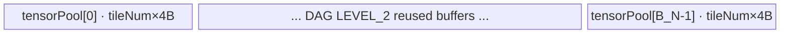
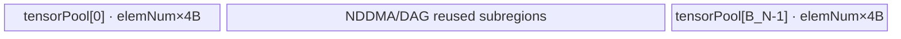
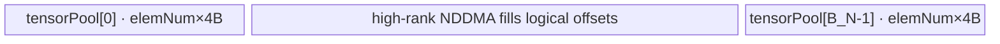

# Atan2 950 ACLNN 算子知识

## 算子速览

| 项目 | 内容 |
|---|---|
| 实际入口 | `aclnnAtan2GetWorkspaceSize` + `aclnnAtan2`，公开 ACLNN 两段式接口；固定仓未声明版本后缀入口。 |
| 计算语义 | 对 broadcast 后的每个位置计算带象限与符号零修正的 `out = atan2(self, other)`，其中 `self` 是 y 坐标、`other` 是 x 坐标。 |
| 输入输出 | 950 公开范围为 BFLOAT16/FLOAT16/FLOAT32、ND、rank≤8、两输入可 broadcast；API 允许非连续输入输出并在核心前后插入通用节点。 |
| 执行类型 | Atan2 核心及公开 dtype 间可选 Cast Kernel 均由 `KERNEL_TYPE_AIV_ONLY` 执行；R-002/R-003 的 broadcast 搬入使用 NDDMA，R-001/R-004 使用 AIV Vector/UB 搬运。无 Cube/AIC/MIX_CV 节点。 |
| Kernel 路线 | R-001 mode 202 单轴 Advance；R-002 mode 1 NDDMA≤5 维；R-003 mode 2 NDDMA>5 维外循环；R-004 mode 101/102/103/104/109 UB Broadcast。 |
| 核心资源 | GM 输入输出；静态或 `TBuf<VECCALC>` tensor pool；编译期 DAG buffer ID 与 ping-pong；MicroAPI 寄存器；核心 Tiling 声明 16 MiB workspace，但 `atan2` body 不读 workspace。 |
| 来源闭包 | `source_closed`：公开 ACLNN→连续化/类型提升与 AIV Cast→950 l0 AICore launcher→broadcast Tiling/POD→AIV router/scheduler→Atan2 MicroAPI body及 950 构建接线闭合；通用 Contiguous/ViewCopy 执行器内部为框架边界。 |
| 验证状态 | 已完成源码闭包检查；本次知识提取未执行编译、真机、数值或性能测试。 |

## 接口与语义

### 计算语义

令两输入按标准 broadcast 映射到输出索引 `i`，核心先计算 `q=self_i/other_i`，以奇数 13 阶 Taylor 多项式和 `pi/8`、`pi/4` 变换近似 `atan(q)`，随后按输入符号修正象限。源码还逐掩码覆盖 `±0` 与 `±inf` 的组合：例如 `(+0, x<0)->+pi`、`(-0, x<0)->-pi`，以及 `(±inf, ±inf)->±pi/4 或 ±3pi/4`。输出有效域是 broadcast shape；公开语义是 `atan2`，不能简化成不保留象限信息的普通 `atan(self/other)`。

### 输入、输出与属性

| 参数 | shape/layout | dtype | 约束、默认值与语义 |
|---|---|---|---|
| `self` | ND，rank≤8；可非连续 | 950：BFLOAT16、FLOAT16、FLOAT32 | 必填，y 坐标；shape 必须与 `other` 可 broadcast。 |
| `other` | ND，rank≤8；可非连续 | 950：BFLOAT16、FLOAT16、FLOAT32 | 必填，x 坐标；可与 `self` 不同 dtype，API 先做类型提升并 Cast 到同一计算 dtype。 |
| `out` | ND，rank≤8；可非连续 | 950：BFLOAT16、FLOAT16、FLOAT32 | 必填；shape 必须严格等于两输入 broadcast shape，核心结果最终 Cast/ViewCopy 到该对象。 |
| `workspaceSize` | Host 标量 | `uint64_t*` | 第一段输出完整 Executor 所需字节数。 |
| `executor` | Host 对象 | `aclOpExecutor**` | 第一段创建并移交，保存全部通用节点和 Atan2 核心启动。 |
| `workspace/workspaceSize/stream` | Device workspace 与 ACL stream | 指针、`uint64_t`、`aclrtStream` | 第二段原样传给 `CommonOpExecutorRun`；调用者拥有存储与 stream。 |

### 入口与版本

固定提交只公开无版本后缀的 `aclnnAtan2GetWorkspaceSize/aclnnAtan2`，因此它是 950 实际支持的最新公开版本。本卡不包含共享实现函数旁的 `aclnnInplaceAtan2`：原地输出是另一逻辑语义。

公开产品表明确支持 Ascend 950PR/950DT，并把 950 dtype 收窄为 BFLOAT16/FLOAT16/FLOAT32；实现侧由 `Atan2::AICore().AddConfig("ascend950", ...)`、ascend950 binary config 的三个 dtype 实例、`SUPPORT_COMPUTE_UNIT "ascend950"` 与 `arch35` Tiling 接线共同确认。

## Host/Launcher 执行流程

### 参数校验与前处理

1. `aclnnAtan2GetWorkspaceSize` 进入 `ExecAtan2GetWorkspaceSize`，创建唯一 Executor；创建失败返回 `ACLNN_ERR_INNER_CREATE_EXECUTOR`。
2. `CheckParams` 依次检查 `self/other/out` 非空、两输入 dtype 在当前平台表内、rank≤8、输入可 broadcast、推导 shape 与 `out` 相同；失败分别返回空指针或参数非法。
3. 任一输入为空时直接写 `workspaceSize=0`、移交 Executor 并成功返回，不创建核心 Kernel。
4. 对非 ND 的 `self` 只记录 warning；随后分别调用 `l0op::Contiguous(self/other)`，任一失败即停止。
5. `InferDtype` 使用 `PromoteType`；若提升结果不在平台算子结果表，则回落 FLOAT。两连续输入分别 Cast 到 `targetDtype`。同 dtype 时 `l0op::Cast` 直接返回输入；950 三种公开 dtype 的六个异型转换组合全部在 `REGBASE_AICORE_DTYPE_SUPPORT_LIST`，进入 AICore Cast，且其 arch35 entry 设置 `KERNEL_TYPE_AIV_ONLY`。
6. `l0op::Atan2` 以 broadcast shape 分配临时输出。950 公开三 dtype 经提升仍落在 `{FLOAT,FLOAT16,BF16}`，`IsAiCoreSupport` 为真，加入一个 `Atan2` AICore launcher；AICPU 分支不在 950 公开 dtype 范围内。
7. 核心结果 Cast 到 `out.dtype`，适用同一 no-op/AIV-only 规则，再用 `ViewCopy` 写回可能非连续的 `out`。每个返回空指针的通用节点都会阻断后续图构建。
8. 第一段读取 Executor 聚合 workspace 并移交所有权；第二段 `aclnnAtan2` 调用 `CommonOpExecutorRun` 在给定 stream 上执行。

### 参数、Workspace 与生命周期

调用者持有输入、输出、第二段 workspace 和 stream。`uniqueExecutor` 持有连续化结果、Cast 结果、核心临时输出和 launch 描述；`ReleaseTo(executor)` 后这些对象的生命周期转给公开 Executor。

Atan2 核心 Tiling 在公共 `BroadcastBaseTiling::DoTiling` 中将 `workspaces[0]` 设为 `16*1024*1024` 字节；核心 entry 虽接收 `workspace`，但 `atan2_op/BroadcastSch` 未读取它。完整 `workspaceSize=uniqueExecutor->GetWorkspaceSize()` 还包含通用 Contiguous/Cast/ViewCopy 可能物化的临时 Tensor；框架如何合并切片、offset 和别名固定仓不可见。

### 启动图与失败传播

```text
aclnnAtan2GetWorkspaceSize
  -> Contiguous(self)? -> Cast(targetDtype)?
  -> Contiguous(other)? -> Cast(targetDtype)?
  -> l0op::Atan2 -> ADD_TO_LAUNCHER_LIST_AICORE(Atan2)
       -> atan2<schMode><<<blockDim, stream>>>(x1, x2, y, workspaceSlice, tiling)
  -> Cast(kernelOut, out.dtype)? -> ViewCopy(..., out)?
aclnnAtan2
  -> CommonOpExecutorRun(workspace, workspaceSize, executor, stream)
```

Atan2 核心自身只有一个 Device 节点，无核心节点间 workspace edge。`?` 节点按条件物化：Cast 的 950 路由和 AIV-only family 已由直接依赖闭合，但其内部 POD/workspace 细节不属于本逻辑算子；Contiguous/ViewCopy 的实际 kernel、内部 POD、workspace 切片与 event 描述是固定仓不可见边界。同一 Executor/stream 保持提交顺序；第一段任一 `CHECK_RET` 阻断后继节点，第二段的执行错误由 `CommonOpExecutorRun` 返回。

## Route 与参数设计

### 分核与资源计算

先右对齐两输入 shape，按每轴 broadcast flag 合并相邻等价轴；broadcast 轴的输入 stride 写 0。令 `D[]` 为合轴后的输出维度、`L=|D|`、`U` 为 950 每核 UB 字节数、`C=GetCoreNumAiv()`。Atan2 DAG 的最大 dtype 总为 FP32，记 `smax=4`；`B_N=OpDag::GetBufferNum<true,true>()`、`B_U=OpDag::GetBufferNum<false,true>()` 是 DAG 在 NDDMA/UB-broadcast cache 模式下编译期算出的物理 buffer 数。

单轴 Advance：

```text
tile0       = floor((U / B_N) / 512) * 512 / 4                  # 元素
if C*(512/min_input_dtype_bytes) > N:
    tile = 512/min_input_dtype_bytes
else if C*tile0 > N:
    tile = floor((N/C)/(512/4))*(512/4)
else:
    tile = tile0
ubOuter     = ceil(N/tile)
blockFormer = ceil(ubOuter/C); if blockFormer==1: blockFormer=2
blockNum    = ceil(ubOuter/blockFormer)
```

多轴 route：

```text
maxElem = floor(((U*8)/(B*32)) / (256*8/min_dtype_bits))
          * (256*8/min_dtype_bits)                             # B=B_N 或 B_U
从最内轴向外累乘，找到首个超过 maxElem 的轴 ubSplitAxis
ubFormer = maxElem / product(D[ubSplitAxis+1:])
ubOuter  = ceil(D[ubSplitAxis]/ubFormer)
ubTail   = D[ubSplitAxis]-(ubOuter-1)*ubFormer
fused    = product(D[:ubSplitAxis]) * ubOuter
blockFormer = ceil(fused/C)
blockNum    = ceil(fused/blockFormer)
blockTail   = fused-(blockNum-1)*blockFormer
```

`preferMultiCore=false`，所以公共 Tiling 的二次缩 tile 分支不活跃。两类公式都以非零 `C/U/aliveNum/tile/maxElem` 为成功前提。

### Route 选择

| 顺序 | Route | Key/模板 | 精确选择条件与优先级 | 不适用去向 |
|---:|---|---|---|---|
| 1 | R-001 单轴 Advance | `GET_TPL_TILING_KEY(202)`；`BroadcastOneDimAdvanceSch<Atan2Dag<T>::OpDag>` | 两输入经 Contiguous；合轴后 `L==1`；`InputSize+OutputSize=3≤4` 且 `VarSize=0`，故选 Advance 而非 mode 201。 | `L!=1` 进入多轴选择；Tiling 失败直接失败。 |
| 2 | R-004 UB Broadcast | mode 101/102/103/104/109；`BroadcastUbSch<OpDag,R>` | `L>1` 且存在 broadcast；若任一 CopyInBrc 输入为非尾轴 broadcast、尾轴非 broadcast 且 `tail_bytes>=NDDMA_dcache/2`，或首个 broadcast 输入 dtype 为 F16/BF16 且 `D[-1]%(32/sizeof(dtype))==0`，优先选 UB；`R=L-ubSplitAxis` 为 1..4，否则 `R=-1/mode109`。 | 条件 false 转 NDDMA；资源计算失败直接失败。 |
| 3 | R-002 NDDMA 无外循环 | `GET_TPL_TILING_KEY(1)`；`BroadcastNddmaSch<OpDag,false>` | `L>1`、UB 条件 false、`L-ubSplitAxis≤5`。 | 运行 rank>5 转 R-003；Tiling 失败直接失败。 |
| 4 | R-003 NDDMA 外循环 | `GET_TPL_TILING_KEY(2)`；`BroadcastNddmaSch<OpDag,true>` | `L>1`、UB 条件 false、`L-ubSplitAxis>5`。 | 无其它 fallback；失败终止。 |

```text
collapse(self.shape, other.shape, out.shape)
if collapsed_rank == 1:
    mode = 202
else:
    ub = IsBigNLastBrc()
         || (first_broadcast_dtype in {F16,BF16} && last_dim aligned to 32 bytes)
    if ub:
        running_rank = shapeLen-ubSplitAxis
        mode = 100 + (running_rank<=4 ? running_rank : 9)
    else:
        mode = (shapeLen-ubSplitAxis>5 ? 2 : 1)
key = GET_TPL_TILING_KEY(mode)
```

### 模板/实现执行矩阵

| Route | key/selector | dtype/shape/platform 完整命中条件 | 执行拓扑与 Kernel 节点 | 实际模板/body | 内存与同步特征 | tail/fallback |
|---|---|---|---|---|---|---|
| R-001 单轴 Advance | mode 202 | 950；F16/BF16/F32；非空；连续化后合轴 rank 1 | 单 AIV Kernel | `BroadcastOneDimAdvanceSch<Atan2Dag<T>::OpDag>`→CopyIn/Cast/Atan2Compute/Cast/CopyOut | 静态 `LocalTensor(TPosition, bufId*blockLen)`；buffer ID ping-pong；`GetTensor/ReleaseTensor` | 最后一核重算 `blockTail/ubTail`；逐 tile 传真实 count。 |
| R-002 NDDMA 无外循环 | mode 1 | 950；多轴；UB selector false；运行 rank≤5 | 单 AIV Kernel，CopyInBrc 使用 5D NDDMA或连续 MoveAlign | `BroadcastNddmaSch<OpDag,false>` | 单 `TBuf<VECCALC>` tensor pool；NDDMA `MultiCopyParams<5>`；cache/ping-pong | `ubSplitSize` 在最后逻辑 tile 取 `ubTail`；stride相等退化为一段 `DataCopyPad`。 |
| R-003 NDDMA 外循环 | mode 2 | 同上但运行 rank>5 | 单 AIV Kernel，外层软件循环+5D NDDMA | `BroadcastNddmaSch<OpDag,true>` | 对最外溢出维逐次计算 GM/UB offset；内层仍是 5D NDDMA | 外层 `nddmaProduct` 完整覆盖高维；无 fallback。 |
| R-004 UB Broadcast | mode 101–104/109 | 950；多轴；大 NLast 或 F16/BF16 尾轴 32B 对齐；运行 rank决定静态/动态 rank | 单 AIV Kernel | `BroadcastUbSch<OpDag,1..4/-1>`→CopyIn+`Broadcast`→公共 DAG | 每个 CopyInBrc 同时占搬入子区与 broadcast 结果子区；stride0输入按 tile cache | 尾 tile更新 dst/src局部 shape；动态 rank>4用 mode109。 |

### 隐藏性能 Guard

| Guard | Host/Tiling 条件 | Device/资源原因 | 影响 Route | 不满足时去向 | 源码符号 |
|---|---|---|---|---|---|
| 950 dtype | 公开 dtype为 F16/BF16/F32；核心三 Tensor dtype必须相同 | binary config仅三个实例，DAG模板按 `DTYPE_X1` 实例化 | 全部 | 非公开 dtype不属于本卡；Tiling dtype不等或其它 dtype返回失败 | `CheckDtypeValid`、`Atan2Tiling::CheckDtype/DoOpTiling` |
| 空域 | `self.IsEmpty() \|\| other.IsEmpty()` | 避免 `dimLength/maxElem` 为0与无意义 launch | 全部之前 | Host 成功、workspaceSize=0、无 Kernel | `ExecAtan2GetWorkspaceSize` |
| 单轴 fast path | `L==1 && 3≤4 && VarSize==0` | 固定线性地址和 512B tile，无通用轴索引/NDDMA参数 | R-001 | 多轴 selector | `BroadcastBaseTiling::DoTiling` |
| UB selector | `IsBigNLastBrc()` 或 16-bit尾轴按32B对齐 | 大非尾广播避免 NDDMA dcache压力；对齐尾轴适合 UB Broadcast primitive | R-004 | R-002/R-003 | `IsUbBroadcast` |
| NDDMA维数 | `shapeLen-ubSplitAxis≤5` | `MultiCopyParams<T,5>` 只能描述5个内层 loop | R-002/R-003 | 大于5走软件外循环 R-003 | `SetSchMode`、`BroadcastNddmaWithLoop` |
| UB容量 | `maxElem>0` 且 `U>=extraSize(0)` | `B*maxElem*4` 物理 tensor pool必须放入 UB，并按256B repeat对齐 | 全部 | Tiling `GRAPH_FAILED` | `BroadcastGetMaxElemNum/DoBrodcastTiling` |
| AIV-only | `BroadcastSch::Process` 执行 `KERNEL_TASK_TYPE_DEFAULT(KERNEL_TYPE_AIV_ONLY)` | Atan2Compute 使用 Vector MicroAPI，没有 AIC/Cube body | 全部 | 非 AIV 不应执行该 entry | `BroadcastSch::Process` |
| MicroAPI tail | `loopNum=ceil(count/64)`，每轮 `UpdateMask(count)` | FP32 256B vector寄存器一次64 lane，末轮屏蔽无效 lane | 全部 | N/A；有效 lane仍输出 | `Atan2Compute::Atan2Compute` |

### POD/ABI

`BroadcastOneDimTilingDataAdvance` 是普通结构，按字段类型自然布局可由固定定义确定为 16 字节、8 字节对齐，offset 如下。`BroadcastBaseTilingData<OpDag>` 含依赖 DAG 数量的模板数组；固定仓没有输出具体实例化后的 `sizeof/offsetof`，因此不猜测其最终编译器布局，只保留字段类型、顺序与 producer/consumer。

| 结构 | 字段 | 类型/位宽 | ABI 布局 | 单位 | Host/launcher producer | Device consumer | 边界 |
|---|---|---|---|---|---|---|---|
| `BroadcastOneDimTilingDataAdvance` | `dimLen` | `int64_t`/64 | offset 0；struct sizeof 16/align 8 | 元素 | `DoOneDimFormerTilingAdvance: dims.back()[0]` | `Init/Process` 重算 tile/core尾部 | 必须 >0。 |
| 同上 | `tileNum` | `int32_t`/32 | offset 8 | 元素/tile | `GetOneDimUBFormerAdvance`，后续可缩小 | `blockEleLen/blockLen`、循环步长 | 必须 >0；乘4形成每 buffer字节。 |
| 同上 | `blockNum` | `int16_t`/16 | offset 12 | AIV core | `ceil(ubOuter/blockFormer)` 窄化写入 | 最后核判断与分核 | Host未显式检查超过 INT16_MAX。 |
| 同上 | `scalarFlag` | `int16_t`/16 | offset 14 | 输入位图 | 每个 collapsed input dim==1 时置对应 bit | `CopyIn` 判断按标量 Duplicate或线性搬入 | 两输入使用 bit0/bit1。 |
| `BroadcastBaseTilingData<OpDag>` | `scheMode` | `int32_t`/32 | 模板实例最终 offsetof固定仓不可见 | mode | 结构字段未在 `AdaptBroadcastBaseTilingData` 显式赋值；route由模板 key决定 | 当前 scheduler不读取 | inactive，不能依赖其值。 |
| 同上 | `shapeLen` | `int32_t`/32 | 同上 | 合轴维数 | `tilingData.shapeLen` | 轴循环、运行 rank、NDDMA参数 | 1..8；本 POD route为>1。 |
| 同上 | `ubSplitAxis` | `int32_t`/32 | 同上 | 轴索引 | `GetBlockSplitFactor` | GM offset、局部 shape、NDDMA loop | `[0,shapeLen)`。 |
| 同上 | `ubFormer` | `int32_t`/32 | 同上 | 轴元素/tile | `maxElem/product(inner dims)` | 整 tile地址、shape和 loop | 由 uint32中间产生；必须 >0。 |
| 同上 | `ubTail` | `int32_t`/32 | 同上 | 轴元素 | `D[axis]-(ubOuter-1)*ubFormer` | 最后逻辑 tile | `1..ubFormer`。 |
| 同上 | `ubOuter` | `int64_t`/64 | 同上 | tile/切分轴 | `ceil(D[axis]/ubFormer)` | realIdx、cache与尾 tile判断 | 必须 >0。 |
| 同上 | `blockFormer` | `int64_t`/64 | 同上 | tile/core | `ceil(fused/C)` | 普通核 loop与起始逻辑 tile | 必须 >0。 |
| 同上 | `blockTail` | `int64_t`/64 | 同上 | tile | `fused-(blockNum-1)*blockFormer` | 最后一核 loop | `1..blockFormer`。 |
| 同上 | `dimProductBeforeUbInner` | `int64_t`/64 | 同上 | 外层 tile product | 赋值 `fusedProduct` | `BroadcastGetAxesIndices` 除法展开外层坐标 | 维度乘法无显式溢出检查。 |
| 同上 | `elemNum` | `int64_t`/64 | 同上 | FP32-capacity 元素/buffer | `BroadcastGetMaxElemNum` | `blockEleNum_` 与 TBuf每子区长度 | 必须 >0。 |
| 同上 | `blockNum` | `int64_t`/64 | 同上 | AIV core | `ceil(fused/blockFormer)`，并写 `SetBlockDim` | `GetBlockNum`和最后核判断 | 必须 >0。 |
| 同上 | `outputDims[8]` | `int64_t[8]` | 同上 | 元素/轴 | 合轴输出 dims | 轴坐标、NDDMA与 UB Broadcast shape | 仅前 `shapeLen` 有效。 |
| 同上 | `outputStrides[8]` | `int64_t[8]` | 同上 | 元素 stride | 合轴输出连续 stride | 输出 offset、NDDMA dst stride | 仅前 `shapeLen` 有效。 |
| 同上 | `inputDims[2][2]` | `int64_t[2][2]` | 同上 | 元素 | `SetInputParams` 只处理非 CopyInBrc；Atan2两输入均跳过 | 本 DAG未读取 | inactive。 |
| 同上 | `inputBrcDims[2][8]` | `int64_t[2][8]` | 同上 | 元素/轴 | `SetInputNddmaParams` 按 CopyInBrc节点顺序写入 | UB Broadcast局部 src shape | 仅前 `shapeLen` 有效。 |
| 同上 | `inputVecBrcDims[0][8]` | 零长度模板数组 | 同上 | N/A | `VecBrcSize==0`，不写 | 不读 | inactive；零长度数组具体 ABI依编译器扩展。 |
| 同上 | `inputStrides[2][8]` | `int64_t[2][8]` | 同上 | 元素 stride | Atan2两输入为 CopyInBrc，`SetInputParams` 跳过 | 普通 CopyIn路径不活跃 | inactive。 |
| 同上 | `inputBrcStrides[2][8]` | `int64_t[2][8]` | 同上 | 元素 stride | `SetInputNddmaParams` 写两输入合轴 stride | NDDMA/UB Broadcast GM offset与广播判断 | broadcast轴为0。 |
| 同上 | `inputVecBrcStrides[0]` | 零长度模板数组 | 同上 | N/A | `VecBrcSize==0` | 不读 | inactive。 |
| 同上 | `scalarData[16]` | `char[16]` | 同上 | 原始字节 | 初始零数组复制；Atan2 `VarSize==0` | `SetScalar<0>`编译期不执行 | inactive。 |

### Route 源码闭包

| Route | Key/selector | Host/Tiling producer | POD/参数 | Kernel entry/router 节点 | Kernel body/直接依赖 | 构建接线 |
|---|---|---|---|---|---|---|
| R-001 单轴 Advance | `GET_TPL_TILING_KEY(202)` | `Atan2Tiling::DoOpTiling`→`BroadcastBaseTiling::DoTiling/DoOneDimOpTilingAdvance` | `BroadcastOneDimTilingDataAdvance` | `atan2<202>`→`BroadcastSch<202,OpDag>` | `broadcast_sch_one_dim_advance.h` + `Atan2Compute` + `Vec::Cast/CopyIn/CopyOut` | `atan2_def.cpp`、ascend950 binary config、`CMakeLists.txt` |
| R-002 NDDMA 无外循环 | mode1 | 同上→`DoBroadcastOpTiling/SetSchMode(false)` | `BroadcastBaseTilingData<OpDag>` | `atan2<1>`→`BroadcastNddmaSch<OpDag,false>` | `broadcast_sch_nddma.h`、`broadcast_utils.h::BroadcastNddmaWithoutLoop`、Atan2 DAG | 同上 |
| R-003 NDDMA 外循环 | mode2 | 同上，运行 rank>5 | 同上 | `atan2<2>`→`BroadcastNddmaSch<OpDag,true>` | `BroadcastNddmaWithLoop`及 offset helpers、Atan2 DAG | 同上 |
| R-004 UB Broadcast | mode101–104/109 | 同上→`IsUbBroadcast/SetSchMode(true)` | 同上 | `atan2<101..109>`→`BroadcastUbSch<OpDag,R>` | `broadcast_sch_ub_broadcast.h::CopyInAndVecBrc/CvecBrc`、Atan2 DAG | 同上 |

## Kernel 实现

### 公共执行流程

`atan2<schMode>` 仅转调 `atan2_op<schMode,DTYPE_X1>`；后者构造 `BroadcastSch<Mode,Atan2Dag<T>::OpDag>` 并传入 `x1,x2,y`。所有 Route 的 DAG 逻辑顺序都是两路 CopyInBrc→必要时 `Cast<float,T,0>`→`Atan2Compute<T>`→`Cast<T,float,1>`→CopyOut；F32 的同 dtype Cast 被 DAG 元编程消除，F16/BF16 则在 FP32 中计算后降回原 dtype。

### Route R-001：单轴 Advance

#### 适用条件

##### 选择证据

| 层级 | 文件 | 符号 | 源码谓词/参数 | 结果/下一跳 |
|---|---|---|---|---|
| API | `math/atan2/op_api/aclnn_atan2.cpp` | `ExecAtan2GetWorkspaceSize` | 非空、两输入连续化并 Cast到 target dtype | 调用 l0 Atan2。 |
| l0 | `math/atan2/op_api/atan2.cpp` | `IsAiCoreSupport/Atan2` | dtype为 F16/BF16/F32 | AICore launcher。 |
| Tiling | `opbase/.../broadcast_tiling.h` | `DoTiling` | 合轴 `L==1` 且 DAG参数数≤4、无 Var | `DoOneDimOpTilingAdvance`，mode202。 |
| Router | `opbase/.../broadcast_sch.h` | `BroadcastSch::Process` | `schMode==202` | `BroadcastOneDimAdvanceSch`。 |

#### Device 数据流

##### 函数级调用链

```text
atan2<202>(x1,x2,y,workspace,tiling)
  -> BroadcastSch<202,Atan2Dag<T>::OpDag>::Process
    -> InitSocState -> BroadcastOneDimAdvanceSch::Init
    -> Process -> Run(offset,count,pingPong)
      -> CopyInBrc x1 -> Cast x1 to FP32
      -> CopyInBrc x2 -> Cast x2 to FP32
      -> Atan2Compute<T>::Atan2Compute -> Atan/AtanLT1/TaylorSeriesExpansion/PostProcess
      -> Cast FP32 to T -> CopyOut y
```

##### 源码等价伪码

```text
# 伪码
coreBase = blockIdx * blockFormer * tileNum
loopCount = lastCore ? blockTail : blockFormer
for tile in [0, loopCount):
    count = (lastCore && tile==loopCount-1) ? ubTail : tileNum
    pingPong = tile & 1
    for input k in {0,1}:
        if scalarFlag bit k: load GM[k][0] once for first two pipeline iterations; Duplicate count lanes
        else: CopyIn GM[k][coreBase + tile*tileNum : +count]
        Cast<T->float>(count) unless T=float
    for each 64-lane FP32 register group under UpdateMask(count):
        q=x1/x2; atan_q=range_reduced_13th_order_polynomial(q)
        apply ±pi quadrant masks; apply signed-zero and infinity masks
    Cast<float->T, RoundMode(1)> unless T=float
    CopyOut y[coreBase + tile*tileNum : +count]
```

#### 内存与数据搬运

##### 资源与搬运表

| 层级/缓冲区 | offset/地址公式 | extent/容量公式 | dtype/layout | producer | consumer | owner/lifetime | 对齐/复用 |
|---|---|---|---|---|---|---|---|
| x1/x2 GM | scalar为0；否则 `(blockFormer*tileNum*blockIdx+offset)*sizeof(T)` | `count*sizeof(T)` | T/ND linear | caller/Contiguous+Cast | `CopyIn` | caller/Executor到核心结束 | `DataCopyPad`，有效 count。 |
| tensorPool子区 | `bufId*blockLen` | `tileNum*4` bytes | 按节点重解释为 T或FP32 | CopyIn/Cast/compute | 后继 DAG节点 | 静态 UB；由编译期 ID控制 | `B_N` 子区，ping-pong；LEVEL_2生命周期复用。 |
| MicroAPI寄存器 | 寄存器态 | 每批64个FP32 lane及常量/mask寄存器 | FP32 | `DataCopy`/Duplicate | Atan2 helper | 单次寄存器循环 | 最后一批 mask；不写无效 lane。 |
| y GM | `(blockFormer*tileNum*blockIdx+offset)*sizeof(T)` | `count*sizeof(T)` | T/ND linear | CopyOut | out Cast/ViewCopy | Executor | 仅有效元素。 |
| 核心 workspace | 未寻址 | Tiling声明16 MiB | N/A | Executor | 核心不消费 | Executor | 不可扣除完整图其它节点需求。 |

##### 分层内存布局



##### 字节账与复用顺序

```text
blockLen = tileNum * OpDag::MaxDtypeBytes = tileNum * 4
UB_total = B_N * blockLen
tileNum  = floor((U/B_N)/512)*512/4（随后只可能缩小）
UB_total <= U
dynamic_ub = N/A
workspace_total(core request) = 16*1024*1024；body read = 0
```

| 复用子区 | 写入者 | 读取者/消费点 | 下一次覆盖 | 同步或释放依据 | 安全条件 |
|---|---|---|---|---|---|
| DAG `bufId`子区 | CopyIn/Cast/Atan2/Cast | 下一 DAG节点 | 输入最后一次消费后由 LEVEL_2 allocator分给后续节点 | `GetTensor/ReleaseTensor` | buffer ID表必须与 DAG拓扑一致。 |
| ping/pong子区 | 第 t 个 tile | 同 tile DAG | t+2 tile | `pingPong=t&1` + position同步 | 每个 consumer在复用前完成。 |

#### 同步、精度与尾块

##### 同步与数值边界表

| 阶段 | primitive/机制 | producer | consumer/等待点 | 保护对象 | 精度/尾块 |
|---|---|---|---|---|---|
| GM→UB | `GetTensor<VECIN>`/`ReleaseTensor<VECIN>` | CopyIn | Cast/compute取得 VECCALC | 当前 bufId | `DataCopyPad`只按 count搬入。 |
| DAG计算 | `GetTensor/ReleaseTensor<VECCALC>` | 每节点 | 后继节点 | LEVEL_2复用子区 | F16/BF16先升FP32；F32 Cast NoOp。 |
| atan2 | `UpdateMask<float>` | 64-lane载入 | MicroAPI算术/Select | 寄存器 lane | Taylor 13阶；末轮mask。 |
| UB→GM | `GetTensor/ReleaseTensor<VECOUT>` | 末 Cast | CopyOut | 输出子区 | 降精度使用 `RoundMode(1)`；只写 count。 |

#### 关键实现

##### 符号证据表

| 阶段 | 文件 | 符号/模板实例 | 实现事实 |
|---|---|---|---|
| Host/Tiling producer | `opbase/.../broadcast_tiling.h` | `DoOneDimOpTilingAdvance` | 512B对齐 tile、核数与4字段 POD。 |
| Kernel entry/router | `math/atan2/op_kernel/atan2_apt.cpp`、`broadcast_sch.h` | `atan2<202>`、`BroadcastSch<202,...>` | AIV-only单 Kernel映射到 Advance scheduler。 |
| Device body/helper | `broadcast_sch_one_dim_advance.h`、`atan2_dag.h` | `Process/Run/Atan2Compute/PostProcess` | 线性GM地址、ping-pong、FP32寄存器算法和tail mask。 |

### Route R-002：NDDMA 无外循环

#### 适用条件

##### 选择证据

| 层级 | 文件 | 符号 | 源码谓词/参数 | 结果/下一跳 |
|---|---|---|---|---|
| API/l0 | `math/atan2/op_api/*.cpp` | `ExecAtan2GetWorkspaceSize/Atan2` | 同 R-001，非空 950三 dtype | AICore launcher。 |
| Tiling selector | `broadcast_tiling.h` | `IsUbBroadcast/SetSchMode` | 多轴；UB谓词 false；`shapeLen-ubSplitAxis≤5` | mode1。 |
| Router | `broadcast_sch.h` | `BroadcastSch::Process` | `schMode==1` | `BroadcastNddmaSch<OpDag,false>`。 |

#### Device 数据流

##### 函数级调用链

```text
atan2<1> -> BroadcastSch<1,OpDag>::Process
  -> BroadcastNddmaSch<OpDag,false>::Init(TPipe,x1,x2,y)
  -> Process -> Run(...)
    -> CopyInBrc x1/x2
       -> BroadcastNddmaWithoutLoop -> DataCopy<T,5> 或 DataCopyMoveAlign
    -> Cast/Atan2Compute/Cast
    -> BroadcastBaseSch::CopyOut
```

##### 源码等价伪码

```text
# 伪码
loops = lastCore ? blockTail : blockFormer
axes = decode(blockFormer*blockIdx, outputDims, ubSplitAxis)
for u in [0,loops):
    split = axes[ubSplitAxis]==ubOuter-1 ? ubTail : ubFormer
    for each input:
        gmOffset = sum(axes[j]*inputStride[j]) + axes[splitAxis]*stride*ubFormer
        if inputStride[splitAxis] != outputStride[splitAxis]:
            construct 5D loopSize/srcStride/dstStride; NDDMA GM->UB broadcast
        else: DataCopyPad one contiguous block
    Cast to FP32; run same 64-lane Atan2 pipeline; Cast to T
    CopyOut at broadcast output offset, split*outputStride[splitAxis] elements
    increment axes with carry
```

#### 内存与数据搬运

##### 资源与搬运表

| 层级/缓冲区 | offset/地址公式 | extent/容量公式 | dtype/layout | producer | consumer | owner/lifetime | 对齐/复用 |
|---|---|---|---|---|---|---|---|
| 输入 GM | `BroadcastGetGmOffset(axes,inputBrcStride,axis,ubFormer)` | NDDMA loop描述的 broadcast tile | T/collapsed ND | caller | CopyInBrc | caller | stride0表达 broadcast。 |
| tensorPool | `bufId*elemNum*4` | `B_N*elemNum*4` | mixed T/FP32 | scheduler | DAG | TPipe/TBuf，Kernel lifetime | cache buffer ID+ping-pong。 |
| NDDMA loop | N/A | 固定5层 `loopSize`；src/dst stride为元素 stride | T | `BroadcastSetNddmaConfigWithoutLoop` | `DataCopy<T,5>` | 当前 CopyIn | config `{false,0,0,false}`；constValue=0。 |
| 输出 GM | `BroadcastGetGmOffset(...outputStrides...)` | `split*outputStride[axis]` 元素 | T/linear tile | CopyOut | 后处理 | Executor | tail取 ubTail。 |

##### 分层内存布局



##### 字节账与复用顺序

```text
maxElem = floor(((U*8)/(B_N*32))/(256*8/min_dtype_bits))*(256*8/min_dtype_bits)
UB_total = B_N * maxElem * 4 <= U
dynamic_ub = N/A
workspace_total(core request)=16 MiB；body read=0
```

| 复用子区 | 写入者 | 读取者/消费点 | 下一次覆盖 | 同步或释放依据 | 安全条件 |
|---|---|---|---|---|---|
| CopyInBrc cache | NDDMA/MoveAlign | Cast | stride0同广播块的后续 tile | `GetTensor<VECIN>`→`ReleaseTensor`与 cache buffer ID | 仅当 stride/realIdx条件证明地址相同。 |
| DAG子区 | Cast/Atan2/Cast | 后继 | 最后消费后 | VECCALC位置同步 | 物理容量统一按4B最大dtype。 |

#### 同步、精度与尾块

##### 同步与数值边界表

| 阶段 | primitive/机制 | producer | consumer/等待点 | 保护对象 | 精度/尾块 |
|---|---|---|---|---|---|
| NDDMA搬入 | `GetTensor<VECIN>`/`ReleaseTensor` | DataCopy | Cast | 输入子区 | 5D loop完整描述广播；连续时一段copy。 |
| Vector compute | VECCALC位置同步 | Cast | Atan2/Cast | tensorPool | 同 R-001 FP32与64-lane mask。 |
| 输出 | VECOUT位置同步 | 末 Cast | DataCopyPad | 输出子区 | tileLength由实际 split产生。 |

#### 关键实现

##### 符号证据表

| 阶段 | 文件 | 符号/模板实例 | 实现事实 |
|---|---|---|---|
| Host/Tiling producer | `broadcast_tiling.h`、`broadcast_tiling.cpp` | `DoBroadcastOpTiling/SetSchMode/DoBrodcastTiling` | mode1、POD、blockDim与UB公式。 |
| Kernel entry/router | `atan2_apt.cpp`、`broadcast_sch.h` | `atan2<1>` | 映射 NDDMA false scheduler。 |
| Device body/helper | `broadcast_sch_nddma.h`、`util/broadcast_utils.h`、`atan2_dag.h` | `CopyInBrc/BroadcastNddmaWithoutLoop/Atan2Compute` | 5D NDDMA参数、GM offset与完整计算。 |

### Route R-003：NDDMA 外循环

#### 适用条件

##### 选择证据

| 层级 | 文件 | 符号 | 源码谓词/参数 | 结果/下一跳 |
|---|---|---|---|---|
| API/l0 | `math/atan2/op_api/*.cpp` | `ExecAtan2GetWorkspaceSize/Atan2` | 同 R-001 | AICore launcher。 |
| Tiling selector | `broadcast_tiling.h` | `SetSchMode(false)` | 多轴、UB false、`shapeLen-ubSplitAxis>5` | mode2。 |
| Router | `broadcast_sch.h` | `BroadcastSch::Process` | `schMode==2` | `BroadcastNddmaSch<OpDag,true>`。 |

#### Device 数据流

##### 函数级调用链

```text
atan2<2> -> BroadcastSch<2,OpDag>::Process
  -> BroadcastNddmaSch<OpDag,true>::Init/Process/Run
    -> CopyInBrc
      -> BroadcastNddmaWithLoop
        -> BroadcastFuseAxes/UpdateNddmaAxesIndices/GetNddmaOffset
        -> repeated DataCopy<T,5>
    -> Cast/Atan2Compute/Cast/CopyOut
```

##### 源码等价伪码

```text
# 伪码；核/tile循环与 R-002 相同
nddmaProduct = product(outputDims[splitAxis+1 : shapeLen-5]) * split
for h in [0,nddmaProduct):
    decode/update high-rank nddmaIndices
    ubOff = dot(nddmaIndices, outputStrides)
    gmOff = dot(nddmaIndices, inputStrides)
    DataCopy<T,5>(UB[ubOff], GM[base+gmOff], inner5DParams)
run Cast->Atan2Compute->Cast over split*outputStride[splitAxis]
CopyOut only the valid tile
```

#### 内存与数据搬运

##### 资源与搬运表

| 层级/缓冲区 | offset/地址公式 | extent/容量公式 | dtype/layout | producer | consumer | owner/lifetime | 对齐/复用 |
|---|---|---|---|---|---|---|---|
| 输入 GM | base GM offset + `nddmaGmOffset` | 每次内5维 NDDMA片 | T/collapsed ND | caller | repeated NDDMA | caller | 外溢维软件循环。 |
| tensorPool | `bufId*elemNum*4 + nddmaUbOffset*sizeof(T)` | 总 `B_N*elemNum*4` | T/FP32 | NDDMA/DAG | compute | TBuf | 同 R-002 ping-pong/cache。 |
| 内5维 params | N/A | `MultiCopyParams<T,5>` | loop metadata | Host POD + Device helper | DataCopy | 寄存器/栈态 | 高维已由外循环剥离。 |
| 输出 GM | output broadcast offset | 有效 tile | T | CopyOut | executor后处理 | Executor | 尾 tile不写padding。 |

##### 分层内存布局



##### 字节账与复用顺序

```text
UB_total = B_N * elemNum * 4 <= U
nddmaProduct只改变同一子区内写入次数，不增加UB容量
dynamic_ub=N/A
workspace_total(core request)=16 MiB；body read=0
```

| 复用子区 | 写入者 | 读取者/消费点 | 下一次覆盖 | 同步或释放依据 | 安全条件 |
|---|---|---|---|---|---|
| NDDMA输入子区 | 外循环多次DataCopy | 整 tile Cast | 下一 tile | 所有外循环完成后才进入 DAG后继 | `nddmaProduct`与offset覆盖完整且不越 `elemNum`。 |
| DAG/ping-pong | 同 R-002 | 同 R-002 | t+2 tile | position同步 | 同 R-002。 |

#### 同步、精度与尾块

##### 同步与数值边界表

| 阶段 | primitive/机制 | producer | consumer/等待点 | 保护对象 | 精度/尾块 |
|---|---|---|---|---|---|
| 高维搬入 | 顺序软件循环+NDDMA | 每次内5维 copy | 循环结束后的 Cast | 输入逻辑 tile | 高维offset由三个临时 index槽表达；shape最多8。 |
| Vector/输出 | 与 R-002 相同的 position同步 | DAG | CopyOut | tensorPool | FP32计算与mask tail不变。 |

#### 关键实现

##### 符号证据表

| 阶段 | 文件 | 符号/模板实例 | 实现事实 |
|---|---|---|---|
| Host/Tiling producer | `broadcast_tiling.h` | `SetSchMode` | 运行 rank>5选 mode2。 |
| Kernel entry/router | `broadcast_sch.h` | `BroadcastSch<2,...>` | `withLoop=true`。 |
| Device body/helper | `broadcast_sch_nddma.h`、`broadcast_utils.h` | `BroadcastNddmaWithLoop` | 外维循环、内5D NDDMA和GM/UB offset。 |

### Route R-004：UB Broadcast

#### 适用条件

##### 选择证据

| 层级 | 文件 | 符号 | 源码谓词/参数 | 结果/下一跳 |
|---|---|---|---|---|
| API/l0 | `math/atan2/op_api/*.cpp` | `ExecAtan2GetWorkspaceSize/Atan2` | 同 R-001 | AICore launcher。 |
| Tiling selector | `broadcast_tiling.h` | `IsBigNLastBrc/IsUbBroadcast` | 大 NLast，或首 broadcast输入为F16/BF16且尾轴32B对齐 | UB route。 |
| mode | `broadcast_tiling.h` | `SetSchMode(true)` | runningRank 1..4→101..104；>4→109 | 静态或动态 rank实例。 |
| Router | `broadcast_sch.h` | `BroadcastSch::Process` | mode101–104/109 | `BroadcastUbSch<OpDag,R>`。 |

#### Device 数据流

##### 函数级调用链

```text
atan2<101..104/109> -> BroadcastSch::Process
  -> BroadcastUbSch<OpDag,R>::Init
     -> GetCopyInBrcInfo -> InitBuffer(TBuf, B_U*elemNum*4)
  -> Process/Run
    -> CopyInAndVecBrc x1/x2
       -> Vec::CopyIn -> CvecBrc -> AscendC::Broadcast<T,R>
    -> Cast/Atan2Compute/Cast
    -> CopyOut
```

##### 源码等价伪码

```text
# 伪码
for assigned tile:
    split = isTail ? ubTail : ubFormer
    for input k:
        realIdx=(blockIdx*blockFormer+u)%ubOuter
        if stride_on_split==0 && u>0 && realIdx>0:
            reuse cached broadcast result; continue
        srcLen = stride_on_split!=0 ? split*stride : cached former/tail src product
        CopyIn GM[k][broadcast_offset] -> inputSubBuf
        update dst/src local shapes for former/tail
        Broadcast<T,R>(broadcastSubBuf,inputSubBuf,shape,tiling)
    run FP32 Atan2 DAG for split*outputStride[splitAxis]
    CopyOut valid output tile
```

#### 内存与数据搬运

##### 资源与搬运表

| 层级/缓冲区 | offset/地址公式 | extent/容量公式 | dtype/layout | producer | consumer | owner/lifetime | 对齐/复用 |
|---|---|---|---|---|---|---|---|
| 输入 GM | broadcast stride点积 | `srcLen*sizeof(T)` | T/collapsed ND | caller | Vec::CopyIn | caller | stride0输入可能跨 tile缓存。 |
| 搬入子区 | combined buffer ID的第二项 | `elemNum*4`物理容量 | T | CopyIn | `CvecBrc` | TBuf | 与broadcast输出不同子区。 |
| broadcast子区 | combined buffer ID第一项 | `elemNum*4` | T/UB logical broadcast | `AscendC::Broadcast<T,R>` | Cast | TBuf/cache | R=1..4编译期特化，R=-1动态。 |
| 计算/输出子区 | DAG buffer IDs | 每区 `elemNum*4` | FP32/T | Cast/Atan2/Cast | CopyOut | TBuf | LEVEL_2复用与ping-pong。 |
| y GM | output stride点积 | 有效 tile | T | CopyOut | executor后处理 | Executor | tail shape驱动有效长度。 |

##### 分层内存布局


##### 字节账与复用顺序

```text
UB_total = B_U * elemNum * 4 <= U
B_U = OpDag::GetBufferNum<false,true>()，已包含CopyInBrc staging/cache与DAG复用
dynamic_ub=N/A
workspace_total(core request)=16 MiB；body read=0
```

| 复用子区 | 写入者 | 读取者/消费点 | 下一次覆盖 | 同步或释放依据 | 安全条件 |
|---|---|---|---|---|---|
| CopyIn staging | Vec::CopyIn | `CvecBrc` | 下一需重载 tile | VECIN→VECCALC position同步 | broadcast完成后才覆盖。 |
| broadcast cache | `AscendC::Broadcast` | Cast/Atan2 | 地址模式改变或cache周期结束 | cache buffer ID与 stride/realIdx guard | stride0且相同逻辑源块才跳过搬入。 |
| calc/output | DAG | 后继/CopyOut | 消费后 | VECCALC/VECOUT同步 | 同 R-001。 |

#### 同步、精度与尾块

##### 同步与数值边界表

| 阶段 | primitive/机制 | producer | consumer/等待点 | 保护对象 | 精度/尾块 |
|---|---|---|---|---|---|
| CopyIn→Broadcast | VECIN release，VECCALC get | DMA | Broadcast | staging子区 | srcLen按广播stride与tail计算。 |
| Broadcast→compute | VECCALC release/get | Broadcast | Cast/Atan2 | cache子区 | former/tail分别更新shape。 |
| compute→CopyOut | 同公共 DAG | Atan2/Cast | VECOUT | 输出子区 | FP32中间、64-lane mask与有效tile写回。 |

#### 关键实现

##### 符号证据表

| 阶段 | 文件 | 符号/模板实例 | 实现事实 |
|---|---|---|---|
| Host/Tiling producer | `broadcast_tiling.h` | `IsBigNLastBrc/IsUbBroadcast/SetSchMode` | UB route完整谓词与静态/动态rank key。 |
| Kernel entry/router | `broadcast_sch.h` | `BroadcastSch<101..104/109,...>` | 映射 `BroadcastUbSch<R>`。 |
| Device body/helper | `broadcast_sch_ub_broadcast.h`、`atan2_dag.h` | `CopyInAndVecBrc/CvecBrc/Atan2Compute` | 搬入、UB broadcast cache、FP32运算和tail。 |

## 算子特定优化

### Trick T-001：单轴 Advance 以 512B tile 和静态 buffer ID 降低调度开销

#### 触发与源码依据

- 适用 Route：R-001。
- 触发条件：合轴 rank=1、DAG输入输出总数≤4且无 Var。
- Golden 来源：[`broadcast_tiling.h:140-145`](https://gitcode.com/cann/opbase/blob/d574f5571391390f8b619c6a134b65c819842318/pkg_inc/op_common/atvoss/broadcast/broadcast_tiling.h#L140-L145)

**官方源码（固定 Commit 连续逐字摘录）**：

```cpp
if constexpr ((OpDag::InputSize + OpDag::OutputSize <= MAX_IN_OUT_ARGS_NUMBER) && OpDag::VarSize <= 0) {
    status = DoOneDimOpTilingAdvance();
}
```

#### 机制与设计原因

Advance route直接以 `bufId*tileNum*4` 构造 LocalTensor，不创建通用 `TPipe/TBuf`对象；Host按512B对齐产生 tile。当初算每核只有一个 tile时，把 `blockFormer`改为2，减少启动核数并让核内 ping/pong 两轮成立。该机制改变调度和 UB寻址，不改变 Atan2数学管线。

#### 迁移边界

- 适用：可完全合成一维、参数数≤4、无动态 Scalar Var的逐元素 DAG。
- 前提：950、非空 shape、编译期 buffer IDs 与最大 dtype字节数已闭合。
- 失效：合轴后多维必须转 R-002/R-003/R-004。
- 未验证：本次知识提取未执行编译、真机、数值或性能测试。

#### 错误做法

固定仓未提供可验证反例；不可在多维 broadcast 上强套线性 offset，因为输入 stride0与轴进位会丢失。

### Trick T-002：Host 在 NDDMA 与 UB Broadcast 间按形状和对齐专门化

#### 触发与源码依据

- 适用 Route：R-002、R-003、R-004。
- 触发条件：多轴；大 NLast或16-bit尾轴32B对齐选 UB，否则按运行 rank选择 NDDMA。
- Golden 来源：[`broadcast_tiling.h:505-520`](https://gitcode.com/cann/opbase/blob/d574f5571391390f8b619c6a134b65c819842318/pkg_inc/op_common/atvoss/broadcast/broadcast_tiling.h#L505-L520)

**官方源码（固定 Commit 连续逐字摘录）**：

```cpp
if (IsBigNLastBrc()) {
    return true;
}
if (dTypeSize != 0 && lastDim % (BLOCK_LENGTH / dTypeSize) == 0 && ubBroadcastDtypes.count(inputDtype)) {
    return true;
}
```

#### 机制与设计原因

UB route显式物化一份输入 tile再调用 Broadcast；NDDMA route则用5维 loop/stride从GM直接生成 broadcast后的 UB布局。Host把对16-bit且尾轴32B对齐的形状交给前者，把其余形状交给后者；超过5个运行维度时仅在外溢维加软件循环，内层仍保留5D搬运。

#### 迁移边界

- 适用：含 CopyInBrc节点的连续多轴 broadcast DAG。
- 前提：dtype属于 selector集合、stride来自合法合轴、UB buffer数与 NDDMA维数相符。
- 失效：单轴转 R-001；非连续输入在本 ACLNN入口先 Contiguous，不进入非连续 scheduler。
- 未验证：本次知识提取未执行编译、真机、数值或性能测试。

#### 错误做法

固定仓未提供可验证反例；不能用目录名或“broadcast”字样直接固定某一种搬运，真实选择依赖尾轴字节、dcache阈值和运行 rank。

### Trick T-003：FP32范围缩减多项式与特殊值掩码闭合精度语义

#### 触发与源码依据

- 适用 Route：全部 Route。
- 触发条件：每个有效 FP32 lane；F16/BF16先升精度。
- Golden 来源：[`atan2_dag.h:314-326`](../../../../../../../cann-ops-raw/ascendc/ops-math/165d41f02a43a62324b434cb6bda7c533b14da3e/math/atan2/op_kernel/arch35/atan2_dag.h#L314-L326)

**官方源码（固定 Commit 连续逐字摘录）**：

```cpp
MicroAPI::Abs(absReg, xReg, mask);
MicroAPI::Min(absReg, absReg, thresholdReg, mask);
AtanLT1(tmpReg0, tmpReg1, addReg1, addReg3, addReg5, addReg7, addReg9, mask);
MicroAPI::Mul(yReg, yReg, signReg, mask);
```

#### 机制与设计原因

实现先把绝对值裁到 `1e7` 防止后续变换溢出，再用 `(x-1)/(x+1)` 与 `tan(pi/8)` 两级范围缩减，使13阶奇多项式作用于较小自变量；恢复符号、象限后，`PostProcess`用掩码逐项覆盖符号零与无穷组合。F16/BF16只在入口/出口 Cast，核心除法、多项式和选择均为 FP32。

#### 迁移边界

- 适用：要求 atan2象限与 `±0/±inf`规则的浮点逐元素实现。
- 前提：FP32 MicroAPI、64-lane mask和相同常量位模式可用。
- 失效：改变多项式阶数、阈值、Cast顺序或特殊值Select顺序会改变数值边界，不能视为等价模板替换。
- 未验证：本次知识提取未执行编译、真机、数值或性能测试。

#### 错误做法

固定仓未提供独立错误实现；源码注释中单纯 `atan(x1/x2)` 只覆盖基本值，若省略后续象限与 `PostProcess` 掩码，会丢失本 body明确实现的符号零和无穷语义。

## 模板与实现对比

| 对比维度 | R-001 单轴 Advance | R-002 NDDMA≤5D | R-003 NDDMA>5D | R-004 UB Broadcast | 设计选择依据 |
|---|---|---|---|---|---|
| 命中条件/优先级 | collapsed rank=1，最先判 | 多轴、UB false、运行rank≤5 | 多轴、UB false、运行rank>5 | 多轴且大NLast或16-bit尾轴对齐 | Host固定决策树。 |
| 模板与 dtype | `AdvanceSch<Atan2Dag<T>>`，T三种 | `NddmaSch<...,false>` | `NddmaSch<...,true>` | `UbSch<...,1..4/-1>` | dtype只改变输入/输出 Cast；FP32核心相同。 |
| 循环与分核 | 线性 tile/core | 轴坐标+tile/core | 再加外溢维 NDDMA循环 | 轴坐标+tile/core | 由合轴 rank与5D上限决定。 |
| Queue/TBuf/寄存器/dynamic UB/通信 window | 静态LocalTensor；MicroAPI寄存器 | TBuf tensorPool+NDDMA params | 同左+高维index | TBuf staging/cache+Broadcast | 均无 dynamic UB/通信。 |
| 内存总占用与复用 | `B_N*tile*4`，ping-pong | `B_N*elemNum*4` | 同左 | `B_U*elemNum*4` | Host按同一编译期buffer数反推tile上限。 |
| 搬运/Vector/SIMT/NDDMA/通信 API | DataCopyPad+Vector | 5D DataCopy或MoveAlign+Vector | 软件loop×5D DataCopy+Vector | DataCopyPad+Broadcast+Vector | 无SIMT/通信。 |
| 同步、精度与 tail | position同步、FP32、count mask | 同左，轴tail | 同左，高维offset | 同左，former/tail shape | 数学 body完全共享。 |
| fallback/失败边界 | 多轴转其它 route | rank>5转R-003；非失败fallback | 无后继 | selector false转NDDMA | route选定后的资源/POD失败均直接失败。 |

## 平台差异

| 项目 | A2 | A3 | 950 |
|---|---|---|---|
| 支持状态 | 公开文档支持，但固定仓无 A2 Host/Tiling/Kernel/构建闭包，本卡不覆盖 | 公开文档支持，但固定仓无 A3 Host/Tiling/Kernel/构建闭包，本卡不覆盖 | 公开文档与 ascend950实现接线一致，支持。 |
| Host/Launcher | L2/l0可见，但目标 Device实现固定仓不可见 | 同 A2 | `arch35 Atan2Tiling` + broadcast公共 Tiling。 |
| Kernel/资源 | 固定仓不可见 | 固定仓不可见 | 单 AIV-only Kernel；NDDMA或UB Broadcast搬入；FP32 MicroAPI计算。 |

## 限制与失败边界

- 950 公开范围仅 BFLOAT16/FLOAT16/FLOAT32；不能用通用源码中的较宽输入列表扩大发布范围。Tiling还要求核心两输入和输出 dtype完全相同，ACLNN通过前置 Cast满足。
- rank>8、不可 broadcast、输出 shape不等、空指针会在第一段失败；空 Tensor是成功无 Kernel的独立终点。
- `BroadcastOneDimTilingDataAdvance::blockNum` 为 int16，Host从 uint64计算后直接赋值，固定仓未见显式窄化上界检查。
- 维度合并、元素连乘、`fusedProduct`和地址 stride使用 int64/uint64，固定仓未见完整乘法溢出检查。
- 核心 workspace声明16 MiB但未被 body读取；完整 Executor workspace的切片、别名和通用节点 event由框架管理，固定仓不可见。
- `BroadcastBaseTilingData<Atan2Dag<T>::OpDag>` 中零长度 VecBrc数组及最终 `sizeof/offsetof`依赖编译器模板实例化，固定仓未输出布局值；复用时应使用同一官方定义，不得手写猜测 ABI。
- 本次知识提取未执行编译、真机、数值或性能测试。

## 源码索引

### 链路索引

| 链路阶段 | 文件 | 关键符号 | 支撑内容 |
|---|---|---|---|
| 入口声明/约束 | `math/atan2/docs/aclnnAtan2&aclnnInplaceAtan2.md` | 产品表、`aclnnAtan2`章节 | 950公开支持、dtype/shape/layout与错误语义。 |
| 入口声明/约束 | `math/atan2/op_api/aclnn_atan2.h` | `aclnnAtan2GetWorkspaceSize/aclnnAtan2` | 两段式C ABI。 |
| 入口实现 | `math/atan2/op_api/aclnn_atan2.cpp` | `CheckParams/InferDtype/ExecAtan2GetWorkspaceSize` | 校验、空域、Contiguous/Cast/Atan2/Cast/ViewCopy图。 |
| 入口实现 | `math/atan2/op_api/atan2.cpp` | `IsAiCoreSupport/Atan2AiCore/Atan2` | AICore dtype selector与launcher。 |
| Host/Tiling/Launcher | `math/atan2/op_host/atan2_def.cpp` | `Atan2::Atan2` | ascend950 OpDef与三dtype注册。 |
| Host/Tiling/Launcher | `math/atan2/op_host/arch35/atan2_tiling_arch35.cpp` | `Atan2Tiling::DoOpTiling/TilingForAtan2` | dtype模板、key与公共 broadcast Tiling入口。 |
| POD/参数 | `math/atan2/op_kernel/arch35/atan2_struct.h` | `ASCENDC_TPL_ARGS_DECL/SEL` | 合法 schMode集合。 |
| Kernel entry/body | `math/atan2/op_kernel/atan2_apt.cpp` | `atan2/atan2_op` | entry、模板实参与scheduler调用。 |
| Kernel entry/body | `math/atan2/op_kernel/arch35/atan2_dag.h` | `Atan2Compute/Atan/AtanLT1/PostProcess/Atan2Dag` | FP32多项式、象限、特殊值、Cast DAG。 |
| 构建接线 | `math/atan2/op_host/config/ascend950/atan2_binary.json` | `op_list` | F16/BF16/F32 binary实例。 |
| 构建接线 | `math/atan2/CMakeLists.txt` | `SUPPORT_COMPUTE_UNIT/SUPPORT_TILING_DIR` | 仅ascend950和arch35接线。 |
| 直接依赖/API图 | `math/cast/op_api/cast.cpp` | `REGBASE_AICORE_DTYPE_SUPPORT_LIST/Cast` | 950公开 dtype 的同型 no-op、六个异型 AICore转换闭合。 |
| 直接依赖/Kernel | `math/cast/op_kernel/cast_apt.cpp` | `cast` | arch35 Cast entry为 AIV-only。 |
| 直接依赖/构建 | `math/cast/CMakeLists.txt` | `SUPPORT_COMPUTE_UNIT/SUPPORT_TILING_DIR` | Cast的ascend950/arch35构建接线。 |
| Host/Tiling/Launcher | `common/inc/op_host/math_tiling_templates_registry.h` | `TilingRegistry::DoTilingImpl` | priority注册模板的调用与失败终点。 |
| POD/参数 | `pkg_inc/op_common/atvoss/broadcast/broadcast_base_struct.h` | 三类 TilingData与schMode宏 | POD字段与route mode ABI。 |
| POD/参数 | `pkg_inc/op_common/atvoss/broadcast/broadcast_tiling_base.h` | route常量、`BroadcastComputeParams/BroadcastCompileInfo` | mode编号、对齐常量、UB公式输入。 |
| Host/Tiling/Launcher | `pkg_inc/op_common/atvoss/broadcast/broadcast_tiling.h` | `BroadcastBaseTiling` | route决策、UB/core/tile/POD/workspace。 |
| Host/Tiling/Launcher | `src/op_common/atvoss/broadcast/broadcast_tiling.cpp` | `DimensionCollapse/DoBrodcastTiling` | 合轴、stride、分核公式。 |
| Kernel entry/body | `pkg_inc/op_common/atvoss/broadcast/broadcast_sch.h` | `BroadcastSch::Process` | mode到AIV scheduler映射。 |
| Kernel entry/body | `pkg_inc/op_common/atvoss/broadcast/broadcast_sch_one_dim_advance.h` | `Init/Process/Run` | 线性route、静态UB与ping-pong。 |
| Kernel entry/body | `pkg_inc/op_common/atvoss/broadcast/broadcast_sch_nddma.h` | `BroadcastNddmaSch` | NDDMA route循环、cache与DAG执行。 |
| Kernel entry/body | `pkg_inc/op_common/atvoss/broadcast/broadcast_sch_ub_broadcast.h` | `BroadcastUbSch` | UB Broadcast route与buffer复用。 |
| Kernel entry/body | `pkg_inc/op_common/atvoss/util/broadcast_utils.h` | NDDMA config/offset helpers | 5D loop参数、外维循环和MoveAlign。 |
| Kernel entry/body | `pkg_inc/op_common/atvoss/util/dag.h` | `DAGSch/GetBufferNum/GetBufferIds` | Cast NoOp消除、buffer数量与物理ID。 |
| Kernel entry/body | `pkg_inc/op_common/atvoss/util/vec.h` | `Cast/CopyIn/CopyInBrc/CopyOut` | Vector Cast round参数与GM搬运API实参。 |

### 实现复用检查

| 检查项 | 可复用事实 | 不得改变的约束 | 源码符号 |
|---|---|---|---|
| ABI/POD | 可复用 mode202四字段和多轴公共 POD定义 | 字段顺序、位宽、数组维度、零长度成员与key模板必须一致 | `BroadcastOneDimTilingDataAdvance/BroadcastBaseTilingData` |
| 调用顺序 | Contiguous→promote Cast→Atan2→out Cast→ViewCopy；Kernel内CopyIn→Cast→Atan2→Cast→CopyOut | 不能省略象限/PostProcess或改变特殊值Select顺序 | `ExecAtan2GetWorkspaceSize/Atan2Dag` |
| workspace/内存 | Host以编译期buffer数反推tile；核心不读workspace | `B_N/B_U`、4B最大dtype、512/256B对齐与owner/lifetime必须同步修改 | `BroadcastGetMaxElemNum/GetBufferNum/InitBuffer` |
| 同步 | 复用官方 buffer ID和TPosition同步图 | 不能在最后 consumer前覆盖或跨 ping/pong错误复用 | `GetBufferIds/GetTensor/ReleaseTensor` |
| 精度与尾块 | F16/BF16升FP32、13阶多项式、64-lane mask、有效count写回 | Cast round数值、阈值、常量位模式、ubTail/shape更新不得变 | `Atan2Compute/Process/CopyOut` |
| 失败边界 | 空域Host成功；route选定后Tiling失败终止 | 不得把 950实现外推到A2/A3，也不得把失败自动改为AICPU fallback | `ExecAtan2GetWorkspaceSize/Atan2Tiling/SetSchMode` |
