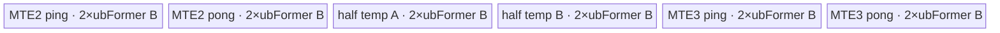
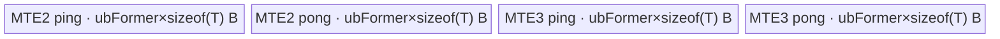

# BitwiseNot 950 ACLNN 算子知识

## 算子速览

| 项目 | 内容 |
|---|---|
| 实际入口 | 公开两段式 API `aclnnBitwiseNotGetWorkspaceSize` + `aclnnBitwiseNot`，固定仓未发现同语义更高版本入口。 |
| 计算语义 | BOOL 输入逐元素计算逻辑非；整数输入逐元素翻转全部二进制位，即 `out[i] = ~self[i]`。 |
| 输入输出 | 公开契约为同 shape、同 dtype、ND；`self` 可非连续。公开 dtype 为 INT8、UINT8、INT16、INT32、INT64、BOOL。 |
| 执行类型 | executor 组合图；核心节点 R-001 `LogicalNot` 与 R-002 `Invert` 均为单 Kernel `AIV_VECTOR`，entry 明确 `KERNEL_TYPE_AIV_ONLY`。框架 `Contiguous/ViewCopy` 按连续性出现；无 Cube/AIC/MIX_CV。 |
| Kernel 路线 | R-001 BOOL 半精度逻辑非 DAG；R-002 整数原生 `AscendC::Not` DAG。空 Tensor 在 ACLNN Host 提前成功返回，不启动 Kernel。 |
| 核心资源 | 每个核心节点使用 GM、单个 `TBuf<VECCALC>` 物理池及 Mutex pipe 协议；R-001 为 6 个 `ubFormer*2` 字节子区，R-002 为 4 个 `ubFormer*sizeof(T)` 子区；各自申报 16 MiB system workspace。 |
| 来源闭包 | `source_closed`：公开 ACLNN、executor 组图、BOOL/整数 L0 selector、950 Tiling/POD、两个 AIV entry/body、ATVOSS 调度与构建接线均已闭合；通用 `Contiguous/ViewCopy/CommonOpExecutorRun` 保留为框架边界。 |
| 验证状态 | 已完成源码闭包检查；本次知识提取未执行编译、真机、数值或性能测试。 |

## 接口与语义

### 计算语义

设 `N = product(self.shape)`。对 `0 <= i < N`：

- `self.dtype == BOOL` 时，`out[i] = !self[i]`。950 body 把 BOOL 的物理 `int8_t` 值升为 `half`，计算 `abs(x-1)`，再降回 `int8_t`；对合法 BOOL 值 `{0,1}` 分别得到 `{1,0}`。
- `self.dtype` 为公开整数类型时，`out[i] = ~self[i]`，每个结果位都是对应输入位的取反。`AscendC::Not` 直接在原 dtype 位宽上执行，不经数值 Cast。

输出仅覆盖逻辑有效元素。输入为空时第一段接口把 workspace 写为 0 并返回空执行器图，不进入 Tiling。

### 输入、输出与属性

| 参数 | shape/layout | dtype | 约束、默认值与语义 |
|---|---|---|---|
| `self` | 公开格式 ND；shape 任意但维数不得超过 `MAX_SUPPORT_DIMS_NUMS`；可非连续 | INT8、UINT8、INT16、INT32、INT64、BOOL | 必须非空指针；950 实现白名单另含 UINT16/UINT32/UINT64，但公开文档/header 未声明，不能当作公开承诺。 |
| `out` | 与 `self` 同 shape、公开格式 ND | 与 `self` 相同 | 必须非空指针；实现拒绝私有 storage format，并要求 dtype、shape 与输入相同。 |
| `workspaceSize` | Host 标量输出 | `uint64_t` | 第一段由 executor 汇总；空 Tensor 固定为 0。非空时还包含核心节点申报的 16 MiB system workspace 及可能的框架前后处理空间。 |
| `executor` | Host 对象 | `aclOpExecutor**` | 第一段创建并转移所有权，保存 `Contiguous -> LogicalNot/Invert -> ViewCopy` 任务图。 |
| `workspace` | Device 地址 | `void*` | 第二段传入；大小必须采用同一次第一段返回值。R-001 entry 显式拒绝空 workspace 或空 user workspace。 |
| `stream` | runtime stream | `aclrtStream` | `CommonOpExecutorRun` 在该 stream 上提交 executor 图。 |

### 入口与版本

固定仓公开入口只有无版本后缀的 `aclnnBitwiseNotGetWorkspaceSize/aclnnBitwiseNot`，没有同语义 V2 或原地版本，因此它就是 950 实际支持的最新公开版本。公开产品表明确列出 Ascend 950PR/950DT 支持。

公开文档和 header 的 dtype 范围是 INT8、UINT8、INT16、INT32、INT64、BOOL；`aclnn_bitwise_not.cpp::DTYPE_SUPPORT_LIST_950` 在 RegBase 运行时还接受 UINT16、UINT32、UINT64，且 950 `Invert` binary/body 对这三种类型有接线。因为它们没有进入公开接口表，本卡只把它们记录为实现侧扩展，不扩大发布契约，也不以这些 dtype 建额外 Route。

## Host/Launcher 执行流程

### 参数校验与前处理

`aclnnBitwiseNotGetWorkspaceSize` 的实际顺序是：

1. 创建 `aclOpExecutor`，失败返回 `ACLNN_ERR_INNER_CREATE_EXECUTOR`。
2. `CheckParams` 依次检查 `self/out` 非空、950 RegBase dtype 白名单、两者 dtype 相同、storage format 不是私有格式、维数不超过框架上限、shape 相同。任何检查失败立即返回。
3. `self->IsEmpty()` 时写 `workspaceSize=0`，转移 executor 并成功返回，不调用 `Contiguous/LogicalNot/Invert/ViewCopy`。
4. `l0op::Contiguous(self)` 把非连续输入物化为连续 Tensor；连续输入可由框架复用。失败返回内部空指针错误。
5. selector 读取原 `self.dtype`：BOOL 调 `l0op::LogicalNot(selfContiguous)`；其余已通过白名单的 dtype 调 `l0op::Invert(selfContiguous)`。两者都分配同 view shape、同 dtype 的临时输出并添加一个 AICore task。
6. `l0op::ViewCopy(notOpOut,out)` 将核心结果写到用户输出；失败立即返回。
7. executor 汇总 workspace 并把所有权转移给调用者。第二段只调用 `CommonOpExecutorRun` 并原样返回其状态。

### 参数、Workspace 与生命周期

`selfContiguous` 与 `notOpOut` 由同一个 executor 管理；用户 `self/out/workspace` 必须覆盖第二段异步执行的生命周期。核心节点的 Tiling 均写 `workspaceSizes[0]=16777216` 字节。R-001 entry 调 `GetUserWorkspace(workspace)` 后只校验非空，不读取该地址；R-002 entry 不读取 workspace。该 16 MiB 是 system workspace 申报，不能据此推断 ACLNN 对外总 workspace 恰为 16 MiB：`Contiguous/ViewCopy` 是否物化及其空间由 executor 统一计算，固定 API 文件没有展开通用分配算法。

两个核心节点都是单 Kernel，节点之间没有核心算子自有的 workspace edge。executor 组合图的临时 Tensor 是 GM 交接介质，owner 为 executor；前序任务失败会阻断后续任务执行，第二段把框架运行状态直接传播。

### 启动图与失败传播

```text
empty(self)
  -> workspaceSize=0 -> success；无 Device 节点

non-empty self
  -> [framework Contiguous；可能复用或产生 GM 临时 Tensor]
  -> dtype selector
       -> R-001 BOOL:
          Host task LogicalNot -> entry logical_not
          blockDim=EleBaseTilingDataV2.blockNum, key=101, AIV_ONLY
       -> R-002 integer:
          Host task Invert -> entry invert
          blockDim=EleBaseTilingData.blockNum, key=101, AIV_ONLY
  -> [framework ViewCopy；核心临时输出 GM -> 用户 out]
```

核心节点只有一个，因此没有 Device 核心节点间 workspace 边。`Contiguous -> core -> ViewCopy` 的 ordering 由同一 executor 的数据依赖与传入 stream 保证；临时 Tensor 在消费完成前由 executor 持有。第一段任何空指针/launcher 失败均停止继续组图；R-001 Device entry 还在 `workspace==nullptr` 或 `GetUserWorkspace(workspace)==nullptr` 时无输出返回，R-002 的未知 key/dtype 编译分支也无输出。

## Route 与参数设计

### 分核与资源计算

令 `N` 为输出 storage shape 各维乘积，`C_avail=GetCoreNumAiv()`，`U` 为每核 UB 字节。ATVOSS 对当前 DAG 计算 `B=BufferNum`、`w=MaxDtypeBytes`、`b=MinDtypeBytes*8`：

```text
C_candidate = ceil(N * b / 32768)                         # 32768 bits = 4 KiB/core
C = min(C_candidate, C_avail)
blockFormer = align_up(ceil(N / C), 512)                  # 元素
blockNum = ceil(N / blockFormer)                          # 实际 blockDim
blockTail = N - (blockNum - 1) * blockFormer              # 元素

rawTile = floor(U * 8 / (B * w * 8))                     # 元素
alignFactor = 256 * 8 / b                                 # 元素；256-byte repeat
ubFormer = floor(rawTile / alignFactor) * alignFactor     # 元素
loopFormer = ceil(blockFormer / ubFormer)
loopTail = ceil(blockTail / ubFormer)
tailFormer = blockFormer - (loopFormer - 1) * ubFormer
tailTail = blockTail - (loopTail - 1) * ubFormer
```

R-001 的物理输入/输出类型为 `int8_t`，中间类型为 `half`，因此 `B=6,w=2,b=8`，`alignFactor=256`，`UB_pool=12*ubFormer` 字节。R-002 对 `T` 取各整数 dtype，有 `B=4,w=sizeof(T),b=8*sizeof(T)`，`alignFactor=256/sizeof(T)`，`UB_pool=4*ubFormer*sizeof(T)` 字节。两条 Route 都要求 `C_avail!=0` 且 `ubFormer!=0`；shape 任一维为 0 会令公共 Tiling 失败，但 ACLNN 已在此前拦截空 Tensor。

每核 GM 起点为 `blockFormer*blockIdx*sizeof(T)`。末核用 tail-block 的 loop/tail 字段，其余核用 former-block 字段；每个 tile 的最后一次只搬运、计算、写回实际 `tailNum` 个元素。

### Route 选择

| 顺序 | Route | Key/模板 | 精确选择条件与优先级 | 不适用去向 |
|---:|---|---|---|---|
| 1 | R-001 BOOL 半精度逻辑非 | key 101；`LogicalNotDag<int8_t>::OpDag` | 非空且 `self.dtype==DT_BOOL`；ACLNN selector 在任何整数分支之前显式判断 BOOL | 非 BOOL 到 R-002；空 Tensor Host 成功短路；非法 dtype 参数失败。 |
| 2 | R-002 整数原生 Not | key 101；`InvertDag<T>::OpDag` | 非空且 dtype 通过 950 白名单并且不为 BOOL；公开范围内 `T in {int8_t,uint8_t,int16_t,int32_t,int64_t}` | 不支持 dtype 在参数检查失败；Tiling dtype switch 未命中则失败。 |

```text
if self/out invalid: fail
if empty(self): success without Route
selfContiguous = Contiguous(self)
if self.dtype == BOOL:
    R-001 -> LogicalNot -> key 101 -> LogicalNotDag<int8_t>
else:
    R-002 -> Invert -> dtype switch -> InvertDag<T> -> key 101
ViewCopy(coreOut, out)
```

### 模板/实现执行矩阵

| Route | key/selector | dtype/shape/platform 完整命中条件 | 执行拓扑与 Kernel 节点 | 实际模板/body | 内存与同步特征 | tail/fallback |
|---|---|---|---|---|---|---|
| R-001 BOOL 半精度逻辑非 | BOOL selector；101 | 950、非空、BOOL、输入输出同 shape/dtype、非私有 format | 单 AIV Kernel `logical_not` | `ElementwiseSch<0,LogicalNotDag<int8_t>::OpDag>`；CopyIn→Cast half→Adds(-1)→Abs→Cast int8→CopyOut | LEVEL_2；6 子区；MTE2/V/MTE3 Mutex；16 MiB system workspace | former/tail block 与 tile；空 workspace/userWS 或未知 key 无输出。 |
| R-002 整数原生 Not | integer selector；101；binary dtype | 950、非空、公开整数 dtype、输入输出同 shape/dtype、非私有 format | 单 AIV Kernel `invert` | `ElementwiseSch<0,InvertDag<T>::OpDag>`；CopyIn→`AscendC::Not`→CopyOut | LEVEL_2；4 子区；MTE2/V/MTE3 Mutex；16 MiB system workspace | dtype switch/Tiling 失败终点；末核/末 tile 仅处理有效元素。 |

### 隐藏性能 Guard

| Guard | Host/Tiling 条件 | Device/资源原因 | 影响 Route | 不满足时去向 | 源码符号 |
|---|---|---|---|---|---|
| 空域短路 | `self->IsEmpty()` | 公共 Elewise Tiling 禁止任一维为 0，并会计算 core/tile 除法 | R-001/R-002 | Host 直接成功，workspace=0 | `aclnnBitwiseNotGetWorkspaceSize`; `ElewiseTiling` |
| AIV 核数 | `GetCoreNumAiv()!=0` | `C=min(ceil(N*b/32768),C_avail)` 必须非 0 | 两条 Route | Tiling `GRAPH_FAILED` | `ElewiseBaseTiling::GetPlatformInfo`; `ElewiseTiling` |
| UB tile | `floor(U*8/(B*w*8))` 经 repeat 对齐后非 0 | scheduler 一次分配 `B*ubFormer*w`，tile 必须容纳至少一个 256-byte repeat 对齐域 | 两条 Route | Tiling `GRAPH_FAILED` | `GetMaxElemNum`; `ElewiseTiling` |
| dtype 同一 | API `self.dtype==out.dtype`；Invert Tiling 再验 input/output dtype 相同 | body 的 GM 与 LocalTensor 都按同一编译期 `T` 解释 | R-002，API 层也约束 R-001 | 参数或 Tiling 失败 | `CheckDtypeValid`; `InvertTiling::CheckAndGetOutputDtype` |
| BOOL workspace | `workspace!=nullptr && GetUserWorkspace(workspace)!=nullptr` | `logical_not` entry 显式保护 system/user workspace 协议，即使 DAG 不读取 userWS | R-001 | Device entry 直接返回，不写输出 | `logical_not` |
| key/router | `TILING_KEY_IS(101UL)` | entry 只实例化 key 101 的 scheduler | 两条 Route | entry 返回、无输出 | `logical_not`; `invert` |
| 公开 dtype 边界 | 文档/header 未列 UINT16/UINT32/UINT64 | 实现白名单/binary 的额外能力不等于公开 API 承诺 | R-002 | 不作为公开 Route；调用者不应依赖 | `DTYPE_SUPPORT_LIST_950`; `invert_binary.json` |

### POD/ABI

两条 Route 使用同布局的 `EleBaseTilingData`；`EleBaseTilingDataV2` 只是它的类型别名。该结构按源码声明顺序为 `alignof=8`、`sizeof=80` 字节。

| 结构 | 字段 | 类型/位宽 | ABI 布局 | 单位 | Host/launcher producer | Device consumer | 边界 |
|---|---|---|---|---|---|---|---|
| `EleBaseTilingData` | `dim0` | `int64_t`/64 | offset 0，size 8 | 元素 | `AdaptEleBaseTilingData <- elewiseTilingData.dim0=N` | scheduler 不读取 | 非空时 `N>0`；乘法溢出检查在固定实现中不可见。 |
| 同上 | `coreNum` | `int32_t`/32 | offset 8，size 4 | AIV core | `static_cast<int32_t>(C)` | scheduler 不读取 | Host 先要求平台核数非 0；有显式窄化。 |
| 同上 | `ubFormer` | `int32_t`/32 | offset 12，size 4 | 元素/tile | `static_cast<int32_t>(aligned rawTile)` 的结构赋值 | `Init` 算 `blockLen`；`Process` full tile 长度 | 必须非 0；`int64_t -> int32_t` 赋值的上界检查固定仓不可见。 |
| 同上 | `blockFormer` | `int64_t`/64 | offset 16，size 8 | 元素/core | `align_up(ceil(N/C),512)` | `CalcBlockOffset`; core GM base | 最后实际 block 可能小于此值。 |
| 同上 | `blockNum` | `int64_t`/64 | offset 24，size 8 | block | `ceil(N/blockFormer)`；Host 同时 `SetBlockDim` | `Process` 判断末核 | `blockDim` 必须与字段一致。 |
| 同上 | `ubLoopOfFormerBlock` | `int64_t`/64 | offset 32，size 8 | tile loop | `ceil(blockFormer/ubFormer)` | 非末核 `Process::loopNum` | 至少 1。 |
| 同上 | `ubLoopOfTailBlock` | `int64_t`/64 | offset 40，size 8 | tile loop | `ceil(blockTail/ubFormer)` | 末核 `Process::loopNum` | 至少 1。 |
| 同上 | `ubTailOfFormerBlock` | `int64_t`/64 | offset 48，size 8 | 元素 | `blockFormer-(loops-1)*ubFormer` | 非末核最终 `Run` 的 `tileLength` | 范围 `(0,ubFormer]`。 |
| 同上 | `ubTailOfTailBlock` | `int64_t`/64 | offset 56，size 8 | 元素 | `blockTail-(loops-1)*ubFormer` | 末核最终 `Run` 的 `tileLength` | 范围 `(0,ubFormer]`。 |
| 同上 | `elemNum` | `int64_t`/64 | offset 64，size 8 | 元素 | `maxElemNum`，等于 `ubFormer` | 当前 scheduler 不读取 | 冗余字段；不能替代 `ubFormer`。 |
| 同上 | `scheMode` | `uint64_t`/64 | offset 72，size 8 | 枚举值 | `GetScheMode()` 固定写 1 | 当前 entry 的 `ElementwiseSch<0,...>` 不读取 | inactive；模板 mode 由 entry 编译期写死为 0。 |

### Route 源码闭包

| Route | Key/selector | Host/Tiling producer | POD/参数 | Kernel entry/router 节点 | Kernel body/直接依赖 | 构建接线 |
|---|---|---|---|---|---|---|
| R-001 BOOL 半精度逻辑非 | API BOOL 分支；101 | `logical_not_tiling_arch35.cpp::LogicalNotTiling::RunTiling`；opbase `ElewiseBaseTiling/ElewiseTiling` | `EleBaseTilingDataV2` 全字段；16 MiB workspace；blockDim=`blockNum` | `logical_not_apt.cpp::logical_not` | `LogicalNotDag<int8_t>`；opbase `ElementwiseSch`, `Vec::{CopyIn,Cast,Adds,Abs,CopyOut}`, `sync.h` | `logical_not_def.cpp`; binary JSON；`logical_not/CMakeLists.txt`; 全局 `ascendc_config.json` |
| R-002 整数原生 Not | API non-BOOL 分支；dtype switch；101 | `invert_tiling_arch35.cpp::InvertTiling::{RunTiling,SetTilingData}`；opbase公共 Tiling | `EleBaseTilingData` 全字段；16 MiB workspace；blockDim=`blockNum` | `invert_apt.cpp::invert` 的 key/dtype 分支 | `InvertDag<T>`；opbase `ElementwiseSch`, `Vec::{CopyIn,Not,CopyOut}`, `sync.h` | `invert_def.cpp`; binary JSON；`invert/CMakeLists.txt`; 全局 `ascendc_config.json` |

## Kernel 实现

### 公共执行流程

两条 Route 都由 API 先物化连续输入，再通过 L0 `ADD_TO_LAUNCHER_LIST_AICORE` 添加一个核心 task。Tiling 将 storage shape 合轴为 `N`，生产相同 ABI 的 former/tail block 与 tile 字段，entry 解析 POD 并构造 `TPipe + ElementwiseSch<0,DAG>`。

`ElementwiseSch::Init` 把输入/输出 GM 基址偏移到 `blockFormer*blockIdx*sizeof(T)`，一次性用 `TPipe::InitBuffer` 建立 `B*ubFormer*MaxDtypeBytes` 的单个 `TBuf<VECCALC>` 物理池。`Process` 遍历本核 tile，ping/pong 取 `tileIndex&1`；每个 `Run` 按 DAG 拓扑执行 CopyIn、全部 Vector 节点和 CopyOut。CopyIn/compute/CopyOut 分别通过 `Mutex::Lock/Unlock<PIPE_MTE2/PIPE_V/PIPE_MTE3>` 获取和释放对应物理子区。

GM 搬运统一使用 `DataCopyPad`：`blockCount=1`、`blockLen=tileLength*sizeof(T)` 字节、`srcStride=dstStride=0`、输入 padding 禁用。Vector API 的 `count` 都是当前 tile 的真实有效元素数，因此对齐出的 UB lane 不参与计算或写回。

### Route R-001：BOOL 半精度逻辑非

#### 适用条件

##### 选择证据

| 层级 | 文件 | 符号 | 源码谓词/参数 | 结果/下一跳 |
|---|---|---|---|---|
| API | `math/bitwise_not/op_host/op_api/aclnn_bitwise_not.cpp` | `aclnnBitwiseNotGetWorkspaceSize` | `self->GetDataType()==DT_BOOL` | `l0op::LogicalNot(selfContiguous)` |
| L0 | `math/logical_not/op_api/logical_not.cpp` | `LogicalNot` | 无 dtype fallback；分配同 dtype输出 | `LogicalNotAiCore` 添加 AICore task |
| Tiling | `math/logical_not/op_host/arch35/logical_not_tiling_arch35.cpp` | `LogicalNotTiling::RunTiling` | `DoTiling<LogicalNotDag<int8_t>::OpDag>` 成功 | workspace=16 MiB，key=101，blockDim=`blockNum` |
| Router | `math/logical_not/op_kernel/logical_not_apt.cpp` | `logical_not` | workspace/userWS 非空且 `TILING_KEY_IS(101)` | `ElementwiseSch<0,LogicalNotDag<int8_t>::OpDag>` |

#### Device 数据流

##### 函数级调用链

```text
aclnnBitwiseNotGetWorkspaceSize -> l0op::LogicalNot -> LogicalNotAiCore
  -> Host AICore task LogicalNot -> Tiling4LogicalNot
    -> LogicalNotTiling::RunTiling
      -> ElewiseBaseTiling::DoTiling<LogicalNotDag<int8_t>::OpDag>
        -> ElewiseTiling -> EleBaseTilingDataV2
  -> __global__ __aicore__ logical_not(x,y,workspace,tiling)
    -> ElementwiseSch<0,LogicalNotDag<int8_t>>::Init(x,y)
    -> ElementwiseSch::Process -> Run(tileOffset,tileLength,pingPong)
      -> Vec::CopyIn<int8_t> -> DataCopyPad
      -> Vec::Cast<half,int8_t,0> -> AscendC::Cast(CAST_NONE,count)
      -> Vec::Adds<half>(scalar=-1.0h,count)
      -> Vec::Abs<half>(count)
      -> Vec::Cast<int8_t,half,0> -> AscendC::Cast(CAST_NONE,count)
      -> Vec::CopyOut<int8_t> -> DataCopyPad
```

##### 源码等价伪码

```text
# 伪码
coreBase = blockFormer * blockIdx
loopNum,lastLen = select former/tail fields by (blockIdx == blockNum-1)
offset = 0
for tile = 0 .. loopNum-1:
    count = (tile == loopNum-1) ? lastLen : ubFormer
    pp = tile & 1
    in_i8[pp][0:count] = GM_x[coreBase+offset : +count]
    tmp0_h[0:count] = Cast<half>(in_i8[pp], CAST_NONE)
    tmp1_h[0:count] = Adds(tmp0_h, half(-1.0))
    tmp0_h[0:count] = Abs(tmp1_h)              # LEVEL_2 temp slot轮换
    out_i8[pp][0:count] = Cast<int8_t>(tmp0_h, CAST_NONE)
    GM_y[coreBase+offset : +count] = out_i8[pp][0:count]
    offset += ubFormer
```

#### 内存与数据搬运

##### 资源与搬运表

| 层级/缓冲区 | offset/地址公式 | extent/容量公式 | dtype/layout | producer | consumer | owner/lifetime | 对齐/复用 |
|---|---|---|---|---|---|---|---|
| GM `x` | `coreBase+tileOffset` bytes | `count` bytes | BOOL 物理 int8/flat ND | Contiguous | CopyIn | executor Tensor；kernel 全程只读 | core base 按 512 元素；只搬有效 count。 |
| MTE2 ping/pong | `bufId*blockLen`，`blockLen=2*ubFormer` | 各 `2*ubFormer` 字节；逻辑有效 `count` 字节 | int8 | `DataCopyPad` | Cast0 | `TBuf`；按 tile parity | 物理按最大 dtype half 预留；输入只占前 `count` 字节。 |
| LEVEL_2 temp A | compile-time temp buf id | `2*ubFormer` 字节 | half | Cast0 或 Abs | Adds 或 Cast1 | 当前 tile 内轮换；跨 tile 复用 | 与 temp B 交替承载一元链中间值。 |
| LEVEL_2 temp B | compile-time temp buf id | `2*ubFormer` 字节 | half | Adds | Abs | 当前 tile 内；消费后释放 | `half(-1)` 是编译期 scalar，不占 tensor 子区。 |
| MTE3 ping/pong | `bufId*blockLen` | 各 `2*ubFormer` 字节；逻辑有效 `count` 字节 | int8 | Cast1 | CopyOut | `TBuf`；搬出完成后复用 | 最终 Cast 直接落 output 子区，无额外物化。 |
| GM `y` | `coreBase+tileOffset` bytes | `count` bytes | BOOL 物理 int8/flat ND | CopyOut | ViewCopy | executor 临时 Tensor | 仅写有效元素。 |

##### 分层内存布局



##### 字节账与复用顺序

```text
InputSizeWoScalar = 1
Lvl12Mte3Count = 1
TempCalcNodeSize = 2
BufferNum(LEVEL_2) = 1*2 + 1*2 + 2 = 6
blockLen = ubFormer * MaxDtypeBytes = 2*ubFormer bytes
UB_total = 6 * 2*ubFormer = 12*ubFormer bytes <= U
ubFormer % 256 == 0
dynamic_ub = N/A
LogicalNot system workspace = 16777216 bytes
```

| 复用子区 | 写入者 | 读取者/消费点 | 下一次覆盖 | 同步或释放依据 | 安全条件 |
|---|---|---|---|---|---|
| MTE2 ping/pong | CopyIn/MTE2 | Cast0/V | 同 parity 的下下个 tile | `Get/ReleaseTensor<VECIN>` 与 VECCALC lock | Cast0 完成并释放后才可再搬入。 |
| temp A/B | Cast0/Adds/Abs | 后继 Vector 节点 | 当前 tile 的后继节点或下一 tile | 每个 `RunNormalOp` 的 `Get/ReleaseTensor<VECCALC>`，输入在 `PostArgs` 释放 | 后继读取结束前不得覆盖；DAG LEVEL_2 映射保证活跃值不别名。 |
| MTE3 ping/pong | Cast1/V | CopyOut/MTE3 | 同 parity 的下下个 tile | VECCALC 与 `Get/ReleaseTensor<VECOUT>` | 搬出完成后才能作为后续 output 子区。 |

#### 同步、精度与尾块

##### 同步与数值边界表

| 阶段 | primitive/机制 | producer | consumer/等待点 | 保护对象 | 精度/尾块 |
|---|---|---|---|---|---|
| GM→UB | `DataCopyPad` + MTE2 mutex | GM x | Cast0 | MTE2 ping/pong | `blockCount=1,blockLen=count` bytes，stride=0，pad=false。 |
| BOOL→half | `AscendC::Cast`, mode 0 | int8 input | Adds | temp half | mode 0 为 `CAST_NONE`；合法 0/1 可精确表示。 |
| 逻辑变换 | `Adds(-1)` 后 `Abs` | half x | Cast1 | 两个 temp | `abs(x-1)` 对 0/1 精确得到 1/0；没有浮点累加。 |
| half→BOOL | `AscendC::Cast`, mode 0 | Abs | CopyOut | MTE3 ping/pong | 结果恰为 0/1，无舍入歧义。 |
| UB→GM | `DataCopyPad` + MTE3 mutex | Cast1 | GM y | MTE3 ping/pong | `blockLen=count` bytes，只写有效 tail。 |
| core/tile tail | POD former/tail 字段 | Tiling | scheduler | GM/UB 有效域 | 末核和末 tile 传真实 `count`，对齐 padding 不参与 Vector API。 |

#### 关键实现

##### 符号证据表

| 阶段 | 文件 | 符号/模板实例 | 实现事实 |
|---|---|---|---|
| Host/Tiling producer | `math/logical_not/op_host/arch35/logical_not_tiling_arch35.cpp` | `LogicalNotTiling::RunTiling`; `TilingPrepareForLogicalNot` | BOOL DAG Tiling、16 MiB、key 101、AIV blockDim。 |
| Kernel entry/router | `math/logical_not/op_kernel/logical_not_apt.cpp` | `logical_not` | workspace guard、AIV-only、key 101 到 scheduler。 |
| Device body/helper | `math/logical_not/op_kernel/arch35/logical_not_dag.h` | `LogicalNotDag<int8_t>` | CopyIn→Cast→Adds→Abs→Cast→CopyOut。 |
| Scheduler dependency | `opbase/.../elewise_sch.h`; `util/vec.h`; `util/sync.h` | `ElementwiseSch::{Init,Process,Run}`; `Vec::*`; `Get/ReleaseTensor` | GM offset、tile 循环、单 TBuf 分区、DMA 参数、Vector count 与 Mutex 协议。 |

### Route R-002：整数原生 Not

#### 适用条件

##### 选择证据

| 层级 | 文件 | 符号 | 源码谓词/参数 | 结果/下一跳 |
|---|---|---|---|---|
| API | `math/bitwise_not/op_host/op_api/aclnn_bitwise_not.cpp` | `aclnnBitwiseNotGetWorkspaceSize` | dtype 已通过白名单且 `!=DT_BOOL` | `l0op::Invert(selfContiguous)` |
| L0 | `math/invert/op_api/invert.cpp` | `IsAiCoreSupport`; `Invert` | 950 `IsRegBase()` 且 dtype 在 REGBASE list | `InvertAiCore` 添加 AICore task |
| Tiling | `math/invert/op_host/arch35/invert_tiling_arch35.cpp` | `InvertTiling::RunTiling` | input/output dtype 相同；switch 选择 `InvertDag<T>` | `SetTilingData`: 16 MiB、key 101、blockDim |
| Router | `math/invert/op_kernel/invert_apt.cpp` | `invert` | `TILING_KEY_IS(101)` 且 `DTYPE_X` 命中编译期分支 | `ElementwiseSch<0,InvertDag<T>::OpDag>` |

#### Device 数据流

##### 函数级调用链

```text
aclnnBitwiseNotGetWorkspaceSize -> l0op::Invert
  -> IsAiCoreSupport(RegBase,dtype) -> InvertAiCore
  -> Host AICore task Invert -> TilingInvert
    -> InvertTiling::RunTiling
      -> CheckAndGetOutputDtype
      -> DoTiling<InvertDag<T>::OpDag> -> ElewiseTiling
      -> SetTilingData
  -> __global__ __aicore__ invert(x,y,workspace,tiling)
    -> dtype branch -> ElementwiseSch<0,InvertDag<T>>::Init(x,y)
    -> ElementwiseSch::Process -> Run(tileOffset,tileLength,pingPong)
      -> Vec::CopyIn<T> -> DataCopyPad
      -> Vec::Not<T> -> AscendC::Not(dst,src,count)
      -> Vec::CopyOut<T> -> DataCopyPad
```

##### 源码等价伪码

```text
# 伪码；T = int8,uint8,int16,int32,int64（公开范围）
coreBase = blockFormer * blockIdx
loopNum,lastLen = select former/tail fields by (blockIdx == blockNum-1)
offset = 0
for tile = 0 .. loopNum-1:
    count = (tile == loopNum-1) ? lastLen : ubFormer
    pp = tile & 1
    inT[pp][0:count] = GM_x[coreBase+offset : +count]
    outT[pp][0:count] = AscendC::Not(inT[pp], count)
    GM_y[coreBase+offset : +count] = outT[pp][0:count]
    offset += ubFormer
```

#### 内存与数据搬运

##### 资源与搬运表

| 层级/缓冲区 | offset/地址公式 | extent/容量公式 | dtype/layout | producer | consumer | owner/lifetime | 对齐/复用 |
|---|---|---|---|---|---|---|---|
| GM `x` | `(blockFormer*blockIdx+tileOffset)*sizeof(T)` | `count*sizeof(T)` | T/flat ND | Contiguous | CopyIn | executor Tensor；只读 | blockFormer 按 512 元素。 |
| MTE2 ping/pong | `bufId*blockLen` | 各 `ubFormer*sizeof(T)` | T | `DataCopyPad` | `AscendC::Not` | `TBuf`；按 parity | `blockLen=count*sizeof(T)` 有效搬运。 |
| MTE3 ping/pong | `bufId*blockLen` | 各 `ubFormer*sizeof(T)` | T | `AscendC::Not` | CopyOut | `TBuf`；搬出后复用 | `Not` 直接写 output 子区，无 temp。 |
| GM `y` | 与 x 相同元素 offset | `count*sizeof(T)` | T/flat ND | CopyOut | ViewCopy | executor 临时 Tensor | 只写有效元素。 |

##### 分层内存布局



##### 字节账与复用顺序

```text
TempCalcNodeSize = 0                 # Not 结果直连 CopyOut
BufferNum(LEVEL_2) = InputSize*2 + Lvl12Mte3Count*2 = 4
blockLen = ubFormer * sizeof(T)
UB_total = 4 * ubFormer * sizeof(T) <= U
ubFormer % (256/sizeof(T)) == 0
dynamic_ub = N/A
Invert system workspace = 16777216 bytes
```

| 复用子区 | 写入者 | 读取者/消费点 | 下一次覆盖 | 同步或释放依据 | 安全条件 |
|---|---|---|---|---|---|
| MTE2 ping/pong | CopyIn/MTE2 | Not/V | 同 parity 的下下个 tile | MTE2/V lock-unlock | Not 读取完成前不得再搬入。 |
| MTE3 ping/pong | Not/V | CopyOut/MTE3 | 同 parity 的下下个 tile | V/MTE3 lock-unlock | CopyOut 完成前不得覆盖。 |

#### 同步、精度与尾块

##### 同步与数值边界表

| 阶段 | primitive/机制 | producer | consumer/等待点 | 保护对象 | 精度/尾块 |
|---|---|---|---|---|---|
| GM→UB | `DataCopyPad`; PIPE_MTE2 mutex | GM x | Not | MTE2 ping/pong | `blockCount=1,blockLen=count*sizeof(T),stride=0,pad=false`。 |
| 位取反 | `AscendC::Not(dst,src,count)`; PIPE_V mutex | input UB | CopyOut | MTE3 ping/pong | 原 dtype 位宽，无 Cast、scale、round；只处理 count。 |
| UB→GM | `DataCopyPad`; PIPE_MTE3 mutex | Not | GM y | MTE3 ping/pong | 与输入同字节数，尾 tile 只写有效 count。 |
| core/tile tail | POD former/tail | Tiling | scheduler | GM/UB 有效域 | 末核/末 tile 的 count 防止访问 padding。 |

#### 关键实现

##### 符号证据表

| 阶段 | 文件 | 符号/模板实例 | 实现事实 |
|---|---|---|---|
| Host/Tiling producer | `math/invert/op_host/arch35/invert_tiling_arch35.cpp` | `InvertTiling::{RunTiling,SetTilingData}` | dtype 选择模板；workspace、key、blockDim。 |
| Kernel entry/router | `math/invert/op_kernel/invert_apt.cpp` | `invert`; 各 `DTYPE_X` branch | key 101 与 binary dtype 到 `InvertDag<T>`。 |
| Device body/helper | `math/invert/op_kernel/arch35/invert_dag.h` | `InvertDag<T>` | CopyIn→Not→CopyOut，LEVEL_2。 |
| Scheduler dependency | `opbase/.../elewise_sch.h`; `util/vec.h`; `util/sync.h` | `ElementwiseSch`; `Vec::Not`; Mutex wrapper | 单 TBuf、ping/pong、DMA、Vector count 和释放顺序。 |

## 算子特定优化

### Trick T-001：在 ACLNN 层按 BOOL/整数拆分为两种原生语义核心

#### 触发与源码依据

- 适用 Route：R-001、R-002
- 触发条件：非空输入；BOOL 精确命中 `DT_BOOL`，其余通过白名单的整数落入 `else`
- Golden 来源：[`math/bitwise_not/op_host/op_api/aclnn_bitwise_not.cpp:138-149`](../../../../../../../cann-ops-raw/ascendc/ops-math/165d41f02a43a62324b434cb6bda7c533b14da3e/math/bitwise_not/op_host/op_api/aclnn_bitwise_not.cpp#L138-L149)

**官方源码（固定 Commit 连续逐字摘录）**：

```cpp
  auto selfContiguous = l0op::Contiguous(self, uniqueExecutor.get());
  CHECK_RET(selfContiguous != nullptr, ACLNN_ERR_INNER_NULLPTR);

  // 进行BitwiseNot计算
  const aclTensor* notOpOut = nullptr;
  if (self->GetDataType() == op::DataType::DT_BOOL) {
    notOpOut = l0op::LogicalNot(selfContiguous, uniqueExecutor.get());
  } else {
    notOpOut = l0op::Invert(selfContiguous, uniqueExecutor.get());
  }
  CHECK_RET(notOpOut != nullptr, ACLNN_ERR_INNER_NULLPTR);
```

#### 机制与设计原因

BOOL 与整数“非”不是同一数值解释。Host 在添加 task 前分流，使 BOOL 使用保持 `{0,1}` 逻辑域的 `abs(half(x)-1)`，整数使用位宽保持的 `AscendC::Not`。两条路线都保留原 dtype 的 GM 接口，因此不需要在 ACLNN 图中插入额外 Cast；只在 BOOL Kernel 的 UB 内做 half 中间计算。该机制同时避免把 BOOL 的逻辑非误实现为对 int8 存储字节逐位取反。

#### 迁移边界

- 适用：一个公开 API 同时承载 BOOL 逻辑语义与整数按位语义，并能在 Host 获取 dtype。
- 前提：BOOL 存储值满足合法 `{0,1}`；整数输出 dtype/shape 与输入相同；两条目标 Op 均已在目标平台接线。
- 失效：未知 dtype 在参数检查失败；若 BOOL 走 `Invert` 会改变语义，若整数走 `LogicalNot` 会丢失位级结果。
- 未验证：本次知识提取未执行编译、真机、数值或性能测试。

#### 错误做法

把所有输入统一发送到 `Invert` 会让 BOOL 物理字节 `0/1` 变为 `0xFF/0xFE`，不符合公开逻辑非语义；源码通过显式 BOOL 分支规避该错误。

### Trick T-002：Invert DAG 让 Not 结果直接占用双缓冲输出子区

#### 触发与源码依据

- 适用 Route：R-002
- 触发条件：950、key 101、任一已实例化整数 dtype
- Golden 来源：[`math/invert/op_kernel/arch35/invert_dag.h:24-32`](../../../../../../../cann-ops-raw/ascendc/ops-math/165d41f02a43a62324b434cb6bda7c533b14da3e/math/invert/op_kernel/arch35/invert_dag.h#L24-L32)

**官方源码（固定 Commit 连续逐字摘录）**：

```cpp
template <typename U>
struct InvertDag {
    using OpCopyIn = Bind<Vec::CopyIn<U>, Placeholder::In0<U>>;
    using OpResult = Bind<Vec::Not<U>, OpCopyIn>;
    using OpCopyOut = Bind<Vec::CopyOut<U>, Placeholder::Out0<U>, OpResult>;

    using Outputs = Elems<OpCopyOut>;
    using MemCfg = MemOptCfg<MemLevel::LEVEL_2>;
    using OpDag = DAGSch<Outputs, void, MemCfg>;
```

#### 机制与设计原因

该 DAG 只有一个计算节点，且 `OpResult` 直连 `CopyOut`。LEVEL_2 内存规划不为它保留额外 temp，而让 `Vec::Not` 直接写 MTE3 ping/pong 子区；物理池因此只有两份输入和两份输出，共 `4*ubFormer*sizeof(T)` 字节。相比先把结果物化到独立 temp 再复制到输出子区，这一拓扑减少一个 UB 中间值及一次 Vector copy。

#### 迁移边界

- 适用：单输入、单输出、单 Vector 节点，结果可直接作为 CopyOut 源的逐元素变换。
- 前提：输出 dtype 与输入相同；Vector primitive 支持该 dtype；MTE3 子区在计算和搬出之间遵守 Mutex 生命周期。
- 失效：若后续增加另一个消费者、需要保留 `Not` 中间值或输出 dtype 改变，必须重新由 DAG 内存规划证明能否直连。
- 未验证：本次知识提取未执行编译、真机、数值或性能测试。

#### 错误做法

固定仓未提供可验证反例；迁移时不得在没有生命周期证明的情况下手工让多消费者中间值别名输出子区。

## 模板与实现对比

| 对比维度 | R-001 BOOL 半精度逻辑非 | R-002 整数原生 Not | 设计选择依据 |
|---|---|---|---|
| 命中条件/优先级 | `dtype==BOOL` 显式第一分支 | 已通过白名单且非 BOOL | 公开语义按逻辑域/位域拆分。 |
| 模板与 dtype | `LogicalNotDag<int8_t>`；中间 half | `InvertDag<T>`；T 保持整数 dtype | BOOL 缺少直接逻辑 primitive 路线；整数使用原生 Not。 |
| 循环与分核 | `b=8`，tile 对齐 256 元素 | `b=8*sizeof(T)`，tile 对齐 `256/sizeof(T)` 元素 | 同一公共 Elewise Tiling，按最小/最大 dtype 字节参数化。 |
| Queue/TBuf/寄存器/dynamic UB/通信 window | 单 `TBuf`，6 子区；无 TQue/dynamic UB/通信 | 单 `TBuf`，4 子区；无 TQue/dynamic UB/通信 | LEVEL_2 DAG 活跃值数量不同。 |
| 内存总占用与复用 | `12*ubFormer` 字节；2 个 half temp 轮换 | `4*ubFormer*sizeof(T)`；无 temp | 最终计算都直接写 MTE3 子区。 |
| 搬运/Vector/SIMT/NDDMA/通信 API | DataCopyPad；Cast/Adds/Abs/Cast | DataCopyPad；Not | 均为 AIV Vector，无 SIMT/NDDMA/通信。 |
| 同步、精度与 tail | MTE2/V/MTE3 mutex；half 中间值；真实 count | 同一 mutex；无 Cast/round；真实 count | scheduler 的 former/tail POD 共用。 |
| fallback/失败边界 | workspace/userWS 空或 key 非 101 无输出 | dtype/key 未命中无输出；非 RegBase L0 可落 AICPU，但不属于 950 Route | 950 两条公开 Route 均有完整 AIV body。 |

## 平台差异

| 项目 | A2 | A3 | 950 |
|---|---|---|---|
| 支持状态 | 公开文档声明支持，但固定源码无法闭合全部公开 dtype 的核心实现，未生成正式卡 | 公开文档声明支持，但固定源码无法闭合全部公开 dtype 的核心实现，未生成正式卡 | 公开支持；BOOL 与公开整数 dtype 的 AIV 链闭合 |
| Host/Launcher | 非 RegBase `Invert` 仅 INT16/UINT16 走 AICore，其余整数走 AICPU；AICPU `Invert` body 固定仓不可见 | 同左；固定仓没有可证明的 A3 全 dtype 活动构建映射 | RegBase selector：BOOL `LogicalNotAiCore`；全部实现白名单整数 `InvertAiCore` |
| Kernel/资源 | `math/invert` 活动 CMake/binary 仅列 ascend950；无法将 950 body 外推 | 同左；`mc62` 不能单独证明 A3 | 两个 key 101 AIV-only entry；ATVOSS LEVEL_2；各 16 MiB system workspace |

## 限制与失败边界

- 公开契约只列 INT8、UINT8、INT16、INT32、INT64、BOOL。950 实现白名单和 Invert binary 额外接线 UINT16、UINT32、UINT64，但公开文档/header 未同步；本卡不把实现侧扩展提升为公开支持。
- 公开文档只承诺 ND。实现 `CheckFormat` 实际只拒绝私有 storage format，并在错误文字中列出 ND/NCHW/NHWC/HWCN/NDHWC/NCDHW；这些额外 format 不在本卡扩大发布。
- shape 乘积、`ubFormer` 从 `int64_t` 写入 `int32_t` 的溢出/窄化保护在固定公共 Tiling 中不可见；复用实现必须维持框架允许的 shape/UB 上界。
- R-001 假设 BOOL 物理值是合法 0/1。固定仓没有定义非法 BOOL 存储字节的结果契约。
- 两个核心节点申报 16 MiB system workspace，但 ACLNN 对外总 workspace 还受 `Contiguous/ViewCopy` 是否物化影响；固定仓未在本 API 内展开 executor 的通用 workspace offset/对齐算法。
- `Contiguous`、`ViewCopy`、executor 的自动生成 inner bridge 与 runtime launch 是允许的框架边界；其各自 Kernel、workspace slice 与内部 event 不是 BitwiseNot 所拥有，固定源码范围未展开。
- A2/A3 的公开整数路线会从 `l0op::Invert` 落入 AICPU，固定源码及直接依赖没有 `Invert` AICPU 注册/body；同时 `math/invert` 活动接线只列 ascend950。因此无后缀卡不满足 `source_closed`，未生成。
- 本次知识提取未执行编译、真机、数值或性能测试。

## 源码索引

### 链路索引

| 链路阶段 | 文件 | 关键符号 | 支撑内容 |
|---|---|---|---|
| 入口声明/约束 | `math/bitwise_not/docs/aclnnBitwiseNot.md` | 产品支持表、函数原型、参数表 | 950 公开性、两段式入口与公开 dtype/ND 约束。 |
| 入口声明/约束 | `math/bitwise_not/op_host/op_api/aclnn_bitwise_not.h` | `aclnnBitwiseNotGetWorkspaceSize`; `aclnnBitwiseNot` | 公开符号和组合图说明。 |
| 入口实现 | `math/bitwise_not/op_host/op_api/aclnn_bitwise_not.cpp` | `CheckParams`; 两段式函数 | 950 白名单、空域、Contiguous、dtype selector、ViewCopy、executor。 |
| Host/Launcher | `math/logical_not/op_api/logical_not.cpp` | `LogicalNotAiCore`; `LogicalNot` | BOOL 临时输出和 AICore launcher。 |
| Host/Tiling | `math/logical_not/op_host/arch35/logical_not_tiling_arch35.cpp` | `LogicalNotTiling::RunTiling` | BOOL POD、workspace、key、blockDim。 |
| Kernel entry/body | `math/logical_not/op_kernel/logical_not_apt.cpp` | `logical_not` | workspace guard、AIV-only、key router。 |
| Kernel entry/body | `math/logical_not/op_kernel/arch35/logical_not_dag.h` | `LogicalNotDag<int8_t>` | BOOL 计算 DAG 与 LEVEL_2。 |
| 构建接线 | `math/logical_not/op_host/logical_not_def.cpp` | `LogicalNot::LogicalNot` | 950 BOOL dtype、op file 和 AICore config。 |
| 构建接线 | `math/logical_not/op_host/config/ascend950/logical_not_binary.json` | `LogicalNot` binary item | 950 BOOL binary。 |
| 构建接线 | `math/logical_not/CMakeLists.txt` | `SUPPORT_COMPUTE_UNIT`; `SUPPORT_TILING_DIR` | ascend950/mc62 与 arch35 接线。 |
| Host/Launcher | `math/invert/op_api/invert.cpp` | `IsAiCoreSupport`; `InvertAiCore`; `InvertAiCpu`; `Invert` | RegBase 全整数 AICore selector及非 950 AICPU 缺口。 |
| Host/Tiling | `math/invert/op_host/arch35/invert_tiling_arch35.cpp` | `InvertTiling::{RunTiling,SetTilingData}` | dtype 模板、POD、workspace、key、blockDim。 |
| Kernel entry/body | `math/invert/op_kernel/invert_apt.cpp` | `invert` | AIV-only key/dtype router。 |
| Kernel entry/body | `math/invert/op_kernel/arch35/invert_dag.h` | `InvertDag<T>` | CopyIn→Not→CopyOut 与 LEVEL_2。 |
| 构建接线 | `math/invert/op_host/invert_def.cpp` | `Invert::Invert` | 950 八整数 dtype 与 AICore config。 |
| 构建接线 | `math/invert/op_host/config/ascend950/invert_binary.json` | `Invert` binary items | 八个 950 dtype binary 实例。 |
| 构建接线 | `math/invert/CMakeLists.txt` | `SUPPORT_COMPUTE_UNIT`; `SUPPORT_TILING_DIR` | ascend950 与 arch35 接线。 |
| 构建接线 | `scripts/kernel/binary_config/ascendc_config.json` | `Invert`; `LogicalNot` | 950 compute units、SIMD VF fusion 与 auto_sync 配置。 |
| Host/Tiling | `opbase/.../elewise_base_struct.h` | `EleBaseTilingData`; `EleBaseTilingDataV2` | POD 字段、顺序与别名。 |
| Host/Tiling | `opbase/.../elewise_tiling.h` | `ElewiseBaseTiling::DoTiling` | DAG 资源参数到公共 Tiling 参数。 |
| Host/Tiling | `opbase/.../elewise_tiling.cpp` | `ElewiseTiling`; `AdaptEleBaseTilingData` | core/block/tile/tail 公式与逐字段 producer。 |
| Kernel body | `opbase/.../elewise_sch.h` | `ElementwiseSch::{Init,Process,Run,CopyIn,CopyOut}` | GM offset、单 TBuf、tile 循环、buffer ID 和函数调用顺序。 |
| Kernel body | `opbase/.../util/dag.h` | `DAGSch`; `GetBufferNumImpl`; `GetBufferIdsImpl` | LEVEL_2 内存规划和 ping/pong 映射。 |
| Kernel body | `opbase/.../util/node.h` | `DagNodeInfo`; `GetBufferNumLevel2` | temp/input/output 子区计数公式。 |
| Kernel body | `opbase/.../util/vec.h` | `Vec::{Cast,Adds,Abs,Not,CopyIn,CopyOut}` | Vector primitive 与 DataCopyPad 实参。 |
| Kernel body | `opbase/.../util/sync.h` | `GetTensor`; `ReleaseTensor` | MTE2/V/MTE3 Mutex 协议。 |

### 实现复用检查

| 检查项 | 可复用事实 | 不得改变的约束 | 源码符号 |
|---|---|---|---|
| ABI/POD | 两条 Route 共用 80-byte `EleBaseTilingData` 布局 | 字段顺序、位宽、offset、元素单位；`blockDim==blockNum` | `EleBaseTilingData`; `AdaptEleBaseTilingData` |
| 调用顺序 | `Contiguous -> dtype selector -> single core task -> ViewCopy` | BOOL 必须先于整数分流；失败不得继续追加后续节点 | `aclnnBitwiseNotGetWorkspaceSize` |
| workspace/内存 | 每个核心节点申报 16 MiB；R-001 6 子区，R-002 4 子区 | 对外总 workspace 由 executor 返回；不得把 system reserve 当作唯一 workspace；子区按 MaxDtypeBytes 分配 | `LogicalNotTiling::RunTiling`; `InvertTiling::SetTilingData`; `ElementwiseSch::Init` |
| 同步 | MTE2→V→MTE3 的 buffer mutex，tile parity ping/pong | 消费/搬出完成前不得覆盖同一 buf id | `GetTensor`; `ReleaseTensor`; `ElementwiseSch::Run` |
| 精度与尾块 | BOOL `int8->half->abs(x-1)->int8`；整数原 dtype Not；真实 tile count | BOOL 合法域 0/1；Cast mode 0；末核/末 tile 字段选择不能省略 | `LogicalNotDag`; `InvertDag`; `ElementwiseSch::Process` |
| 失败边界 | 空 Tensor Host 成功；未知 dtype/key、空 R-001 workspace 按原路径终止 | 不得把无输出返回伪装成 fallback；A2/A3 AICPU body缺失不能外推 950 body | `CheckParams`; `logical_not`; `invert`; `Invert::IsAiCoreSupport` |