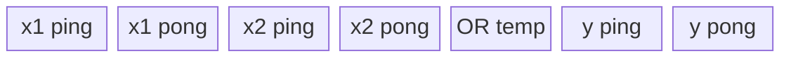

```mermaid
block-beta
  columns 7
  x1p["x1 ping · tileNum*sizeof(T)"]
  x1q["x1 pong · tileNum*sizeof(T)"]
  x2p["x2 ping · tileNum*sizeof(T)"]
  x2q["x2 pong · tileNum*sizeof(T)"]
  calc["OR temp · tileNum*sizeof(T)"]
  yp["y ping · tileNum*sizeof(T)"]
  yq["y pong · tileNum*sizeof(T)"]
```

# BitwiseOrTensor 950 ACLNN 算子知识

## 算子速览

| 项目 | 内容 |
|---|---|
| 实际入口 | `aclnnBitwiseOrTensorGetWorkspaceSize` + `aclnnBitwiseOrTensor`，公开两段式 ACLNN；不包含 Scalar 与 Inplace 入口。 |
| 计算语义 | 广播后逐元素 `out = cast(self, P) OR cast(other, P)`，`P=PromoteType(self.dtype, other.dtype)`；`P=BOOL` 时 OR 等价逻辑或，最后转换为 `out.dtype`。 |
| 输入输出 | `self/other` 为 ND、0–8 维、BOOL 或八种整数；shape 可广播；`out.shape` 必须等于广播 shape。950 的 `out` 还可为 FLOAT/FLOAT16/DOUBLE/BFLOAT16/COMPLEX64/COMPLEX128。 |
| 执行类型 | 核心 `BitwiseOr`/BOOL `LogicalOr` 均为单 AIV Kernel；调度节点包含 AIV_VECTOR、NDDMA 或 UB Broadcast。条件 `Cast` 为 AIV_VECTOR（`INT64→DOUBLE` 的 Cast primitive 使用 Tiling 保留的 SIMT local memory）或 AICPU。 |
| Kernel 路线 | R-001 一维 advance；R-002 多维 NDDMA；R-003 多维 UB Broadcast；R-004 BOOL 对应 `LogicalOr` 的同组三路线。空 Tensor 在 Host 成功短路，无 Device Route。 |
| 核心资源 | 核心节点使用 GM、AIV local tensor pool、MTE2/V/MTE3 mutex；NDDMA 路线用五维 `MultiCopyParams`；每个核心节点声明 16 MiB workspace 但 entry 不读 workspace。Cast 节点另有双缓冲 Queue 或 AICPU tensor。 |
| 来源闭包 | source_closed：公开 Tensor API→校验/Promote/Contiguous/Cast→BitwiseOr 或 LogicalOr→Cast/ViewCopy→950 Host/Tiling/POD→全部核心 scheduler/body→构建接线已闭合；Contiguous/ViewCopy 与 executor 为明确框架边界。 |
| 验证状态 | 已完成源码闭包检查；本次知识提取未执行编译、真机、数值或性能测试。 |

## 接口与语义

### 计算语义

令 `S`、`O` 为 `self`、`other`，`B=broadcast_shape(S.shape,O.shape)`，`P=PromoteType(S.dtype,O.dtype)`。每个 `i∈B` 先按广播地址得到 `s_i,o_i`，再计算 `r_i=cast_P(s_i) | cast_P(o_i)`；若 `P=BOOL`，源码改提交 `LogicalOr`，其 BOOL DAG 仍以 `uint8_t` 的 `Or` 计算 0/1。最后 `r` 转为 `out.dtype` 并由 `ViewCopy` 写入可能非连续的 `out`。整数转浮点/复数输出是结果的数值转换，不改变 OR 本身的整数域。

### 输入、输出与属性

| 参数 | shape/layout | dtype | 约束、默认值与语义 |
|---|---|---|---|
| `self` | ND，0–8 维，可非连续 | BOOL、INT8/16/32/64、UINT8/16/32/64 | 必选；与 `other` 可 Promote 且可广播。 |
| `other` | ND，0–8 维，可非连续 | 同 `self` 支持集 | 必选；与 `self` 可 Promote 且可广播。 |
| `out` | ND，0–8 维，可非连续；shape 精确等于广播结果 | 上述 BOOL/整数；950 额外 FLOAT/FLOAT16/DOUBLE/BFLOAT16/COMPLEX64/COMPLEX128 | Promote 后的结果必须可转换到该 dtype。 |
| `workspaceSize` | 标量 Host 输出 | `uint64_t*` | executor 中所有实际节点与中间张量需要的 Device workspace 总量。 |
| `executor` | Host 对象 | `aclOpExecutor**` | 保存条件节点和临时 tensor；第二段前保持有效。 |

### 入口与版本

本卡只覆盖非原地 `aclnnBitwiseOrTensor`。固定仓只有这一公开 Tensor 版本；Scalar 和 `aclnnInplaceBitwiseOrTensor` 虽位于同目录，但语义/生命周期不同，不并入。公开文档把 Ascend 950PR/950DT 列为支持；算子 CMake 的 `SUPPORT_COMPUTE_UNIT`、OpDef AICore config、binary config 又共同接线 `ascend950`，因此 950 证据一致。

## Host/Launcher 执行流程

### 参数校验与前处理

`GetWorkspaceSizeCommon` 严格按 `self/other/out` 非空→输入 dtype 白名单→`PromoteType` 非 UNDEFINED 且可 cast 到 `out.dtype`→三者维数≤8、输入可广播且 `out.shape` 等于广播 shape的顺序检查。任一失败立即返回。任一输入为空时写 `workspaceSize=0`、释放 executor，且不添加 Contiguous/Cast/核心/ViewCopy 节点。

非空时的真实顺序为：`Contiguous(self)`→`Cast(...,P)`→`Contiguous(other)`→`Cast(...,P)`→`P==BOOL ? LogicalOr : BitwiseOr`→`Cast(...,out.dtype)`→`ViewCopy(...,out)`。`l0op::Cast` 在源/目标 dtype 相等时直接返回原 tensor，不创建节点；其余转换先查 950 regbase AICore pair 表，否则在 AICPU dtype 集合中查找并提交 AICPU Cast。`Contiguous`/`ViewCopy` 的内部实现和 executor 的 stream 编排属于框架边界，但其调用顺序、失败短路和对象生命周期在本仓可见。

### 参数、Workspace 与生命周期

核心 Broadcast Tiling 每个节点把 `workspace[0]` 固定写为 `16*1024*1024` 字节；`bitwise_or`/`logical_or` entry 参数含 workspace 却不读取。Cast AIV Tiling 写 `MINIMAL_WORKSPACE`，AICPU Cast 使用任务空间。ACLNN 返回的总 `workspaceSize` 由 `uniqueExecutor->GetWorkspaceSize()` 汇总节点 workspace、中间 tensor 与对齐，固定源码未暴露汇总公式；用户分配的 workspace、executor 和 stream 交给 `CommonOpExecutorRun`，执行完后才可释放。

### 启动图与失败传播

```text
empty(self) || empty(other) -> success(workspace=0), no launch
otherwise:
  Contiguous(self) [framework node iff needed]
  -> Cast self to P [no-op / AIV Cast / AICPU Cast]
  -> Contiguous(other) [framework node iff needed]
  -> Cast other to P [no-op / AIV Cast / AICPU Cast]
  -> P==BOOL ? logical_or(AIV) : bitwise_or(AIV)
  -> Cast result to out.dtype [no-op / AIV Cast / AICPU Cast]
  -> ViewCopy(result,out) [framework node]
```

所有节点属于同一 executor 并在第二段指定 stream 上提交；前置创建/加入 launcher 失败返回空指针，`CHECK_RET` 立即阻断后续节点。核心节点输入是 executor 临时 tensor，输出也由 executor 分配；直到 ViewCopy 消费后才可回收。AICore Cast 的 GM 输入/输出分别是相邻临时 tensor；AICPU `CastTask<T,S>` 对 `[start,end)` 逐元素 `static_cast<S>`，输出再交给下一 executor 节点。

## Route 与参数设计

### 分核与资源计算

核心先把 scalar shape 规范为 `{1}`，再按广播模式合并相邻同 broadcast flag 的轴，生成每输入/输出 `dims` 与元素 stride（broadcast 轴 stride=0）。合轴为一维时固定选 advance：`aliveNum=GetBufferNum<true,true>()=7`，`tileNum=floor((ubSize/aliveNum)/512)*512/sizeof(T)`；若元素不足 `coreNum*512/sizeof(T)`，tile 降为一个 512B cache line，否则按核均分向下对齐。`ubOuter=ceil(dimLen/tileNum)`，初始 `blockFormer=ceil(ubOuter/coreNum)`，若为1则改2以形成 ping/pong，`blockNum=ceil(ubOuter/blockFormer)`。

多维时 `maxElemNum=floor(((ubSize*8)/(bufferNum*maxDtypeBits))/alignFactor)*alignFactor`，`alignFactor=256*8/minDtypeBits`。从末轴累计直到超过上限，得到 `ubSplitAxis/ubFormer/ubOuter/ubTail`；`fusedProduct=ubOuter*Π(outputDims[0:ubSplitAxis])`，`blockFormer=ceil(fusedProduct/coreNum)`、`blockNum=ceil(fusedProduct/blockFormer)`、`blockTail=fusedProduct-(blockNum-1)*blockFormer`。NDDMA 的 `bufferNum=7`；UB Broadcast 为 CopyInBrc 源和广播结果增加临时区，`bufferNum=9`。核心 dtype 同宽，故 `maxDtypeBits=minDtypeBits=8*sizeof(T)`。

### Route 选择

| 顺序 | Route | Key/模板 | 精确选择条件与优先级 | 不适用去向 |
|---:|---|---|---|---|
| 1 | R-001 Integer 1D advance | `schMode=202` | `P!=BOOL`，两输入/一输出同 dtype，合轴后 rank=1；DAG 参数数3≤4且 VarSize=0 | rank>1→R-002/R-003 |
| 2 | R-002 Integer NDDMA | `schMode=1/2` | `P!=BOOL`、rank>1，且无广播，或有广播但不满足 UB 条件；`runningRank<=5` 为1，否则2 | `IsUbBroadcast()==true`→R-003 |
| 3 | R-003 Integer UB Broadcast | `schMode=101/102/103/104/109` | `P!=BOOL`、rank>1 且：大 NLast（尾轴字节≥NDDMA dcache/2），或广播输入 dtype 为 INT8/UINT8/INT16/UINT16 且输出尾轴按32B对齐 | 条件假→R-002 |
| 4 | R-004 BOOL LogicalOr | 同 202、1/2、101–104/109 | `P==BOOL`；选择式与 R-001～R-003 相同，但 Host 提交 `LogicalOr`，DAG 的 `T=uint8_t` | 非 BOOL→R-001～R-003 |

```text
if empty input: Host success, no Route
else P = PromoteType(self.dtype, other.dtype)
     coreOp = (P == BOOL ? LogicalOr : BitwiseOr)
     collapse contiguous core inputs
     if collapsed_rank == 1: schMode = 202
     else if IsUbBroadcast(): schMode = 100 + min(runningRank, 9)
     else: schMode = (runningRank > 5 ? 2 : 1)
```

### 模板/实现执行矩阵

| Route | key/selector | dtype/shape/platform 完整命中条件 | 执行拓扑与 Kernel 节点 | 实际模板/body | 内存与同步特征 | tail/fallback |
|---|---|---|---|---|---|---|
| R-001 | 202 | 950、整数 P、合轴 rank1 | 条件 Cast→单 `bitwise_or`→条件 Cast | `BroadcastOneDimAdvanceSch<BitwiseOrCompute<T>::OpDag>` | 7 个 tile 子区；MTE2/V/MTE3 mutex；ping/pong | 最后一核 `blockTail`、最后 tile `ubTail` |
| R-002 | 1/2 | 950、整数 P、rank>1、NDDMA selector | 条件 Cast→单 `bitwise_or`→条件 Cast | `BroadcastNddmaSch<...,false/true>` | 7×`elemNum*sizeof(T)` TBuf；CopyInBrc 用5D NDDMA | mode2 外循环覆盖 runningRank>5；尾 tile 用 ubTail |
| R-003 | 101–104/109 | 950、整数 P、rank>1、UB selector | 条件 Cast→单 `bitwise_or`→条件 Cast | `BroadcastUbSch<...,R=1..4/-1>` | 9×tile TBuf；CopyIn+AscendC Broadcast；同一广播块可跨 loop 缓存 | 109 为动态 rank；最后轴/块按 ubTail |
| R-004 | 同上 | 950、`P=BOOL` | 条件 Cast→单 `logical_or`→条件 Cast | `LogicalOrCompute<uint8_t>::OpDag` 配同组 scheduler | 与同 schMode 的整数路线同构，元素宽1B | 同组 tail；失败不切 BitwiseOr |

### 隐藏性能 Guard

| Guard | Host/Tiling 条件 | Device/资源原因 | 影响 Route | 不满足时去向 | 源码符号 |
|---|---|---|---|---|---|
| dtype 一致 | core 的 x1/x2/y dtype 全相同 | DAG 模板只有单一 `T` | 全部 | Tiling `GRAPH_FAILED` | `BitwiseOrTiling::DoOpTiling` |
| 512B 一维 tile | `floor((ubSize/7)/512)>0` | advance 子区和双缓冲按 cache line 切分 | R-001/R-004(202) | Tiling 失败 | `GetOneDimUBFormerAdvance` |
| UB 上限 | `maxElemNum>0` 且 `ubSize>extraSize` | tensor pool 总字节不得超过 UB | R-002/R-003/R-004 | Tiling 失败 | `BroadcastGetMaxElemNum`,`DoBrodcastTiling` |
| NDDMA rank | `runningRank<=5` 选 mode1，否则 mode2 | `MultiCopyParams` 固定5维；高 rank 需外循环 | R-002/R-004 | mode2，不是失败 | `SetSchMode`,`BroadcastNddmaWithLoop` |
| UB rank specialization | runningRank 1..4→101..104，>4→109 | 固定 rank Broadcast 避免动态 rank；高 rank用通用 body | R-003/R-004 | 109 | `SetSchMode`,`BroadcastUbSch::CvecBrc` |
| 950 Cast selector | dtype相同无节点；pair∈REGBASE表→AIV；否则两端在AICPU表→AICPU | 选择可用执行体 | 所有 API Route 的条件边 | 不支持则返回 nullptr | `l0op::Cast`,`IsAiCoreSupport`,`IsAiCpuSupport` |

### POD/ABI

| 结构 | 字段 | 类型/位宽 | ABI 布局 | 单位 | Host/launcher producer | Device consumer | 边界 |
|---|---|---|---|---|---|---|---|
| `BroadcastOneDimTilingDataAdvance` | `dimLen` | int64/64 | sizeof=16, alignof=8, offset=0 | 元素 | 合轴输出元素数 | `Init` 计算 ubOuter/tail | >0 |
| 同上 | `tileNum` | int32/32 | offset=8 | 元素/tile | 512B 对齐 UB 公式 | blockLen、循环步长 | >0 |
| 同上 | `blockNum` | int16/16 | offset=12 | AIV 核 | `ceil(ubOuter/blockFormer)`，写入时窄化 | 最后一核判断 | 固定仓未见显式 int16 溢出检查 |
| 同上 | `scalarFlag` | int16/16 | offset=14 | bitset | 输入维为1则置对应 bit | 标量输入 Duplicate；Tensor API 广播一维可命中 | 两输入用 bit0/bit1 |
| `BroadcastBaseTilingData<OpDag>` | `scheMode` | int32/32 | sizeof=632, alignof=8, offset=0 | key镜像 | 本算子 Adapt 未赋值 | 当前 scheduler 不读 | inactive |
| 同上 | `shapeLen` | int32/32 | offset=4 | 轴 | 合轴 rank | scheduler、NDDMA配置 | 2..8 |
| 同上 | `ubSplitAxis` | int32/32 | offset=8 | 轴索引 | 末轴向前容量扫描 | 地址、shape与MultiCopy | [0,shapeLen) |
| 同上 | `ubFormer` | int32/32 | offset=12 | 元素/切分轴 | `maxElemNum/innerProduct` | GM offset、tile shape | >0，存在int32窄化 |
| 同上 | `ubTail` | int32/32 | offset=16 | 元素/切分轴 | split remainder | 最后一UB块 | 1..ubFormer |
| 同上 | `ubOuter` | int64/64 | offset=24 | tile | `ceil(axisDim/ubFormer)` | realIdx与缓存判断 | >0 |
| 同上 | `blockFormer` | int64/64 | offset=32 | tile/核 | `ceil(fusedProduct/coreNum)` | 每核循环、起始索引 | >0 |
| 同上 | `blockTail` | int64/64 | offset=40 | tile | fused remainder | 最后一核循环 | 1..blockFormer |
| 同上 | `dimProductBeforeUbInner` | int64/64 | offset=48 | tile乘积 | `fusedProduct` | 初始 axesIndices | >0 |
| 同上 | `elemNum` | int64/64 | offset=56 | 元素/子区 | UB容量公式 | `InitBuffer` pool slice | 256B repeat 对齐 |
| 同上 | `blockNum` | int64/64 | offset=64 | AIV 核 | 分核公式 | `GetBlockNum`与尾核 | ≤平台AIV核数 |
| 同上 | `outputDims[8]` | int64[8] | offset=72 | 元素/轴 | 合轴输出dims | axes、NDDMA/UB shape | 仅前shapeLen活跃 |
| 同上 | `outputStrides[8]` | int64[8] | offset=136 | 元素stride | 连续输出stride | GM/UB offset | 仅前shapeLen活跃 |
| 同上 | `inputDims[2][2]` | int64[4] | offset=200 | 元素 | 非 CopyInBrc 的 former/tail | 本 DAG 两输入均 CopyInBrc，不读 | inactive |
| 同上 | `inputBrcDims[2][8]` | int64[16] | offset=232 | 元素/轴 | 两个 CopyInBrc 的合轴dims | UB Broadcast shape | NDDMA仅间接需要stride |
| 同上 | `inputStrides[2][8]` | int64[16] | offset=360 | 元素stride | 普通 CopyIn stride | 本 DAG不读 | inactive |
| 同上 | `inputBrcStrides[2][8]` | int64[16] | offset=488 | 元素stride | 两输入合轴stride | NDDMA/UB CopyInBrc | broadcast轴为0 |
| 同上 | `scalarData[16]` | char[16] | offset=616 | 原始字节 | 默认全0，本算子无Var | 不读 | inactive |
| `CastTilingData` | `blockNum` | int64/64 | 宏顺序字段0 | 核 | Cast分核公式 | 各Cast body尾核 | AICPU路线不使用 |
| 同上 | `ubFormer` | int64/64 | 宏顺序字段1 | 元素 | Cast UB容量公式 | Queue容量/tile | >0 |
| 同上 | `blockFormer` | int64/64 | 宏顺序字段2 | 元素/核 | 8元素对齐均分 | GM block offset | >0 |
| 同上 | `ubLoopOfFormerBlock` | int64/64 | 宏顺序字段3 | loop | ceil(blockFormer/ubFormer) | 非尾核循环 | >0 |
| 同上 | `ubLoopOfTailBlock` | int64/64 | 宏顺序字段4 | loop | ceil(blockTail/ubFormer) | 尾核循环 | >0 |
| 同上 | `ubTailOfFormerBlock` | int64/64 | 宏顺序字段5 | 元素 | former remainder | 非尾核最后tile | >0 |
| 同上 | `ubTailOfTailBlock` | int64/64 | 宏顺序字段6 | 元素 | tail remainder | 尾核最后tile | >0 |
| 同上 | `regCopyInStep` | int64/64 | 宏顺序字段7 | 元素/寄存器搬运 | policy load dist+VL | `CastMicro` | 非Micro可为0 |
| 同上 | `regCopyOutStep` | int64/64 | 宏顺序字段8 | 元素/寄存器搬运 | policy store dist+VL | `CastMicro` | 非Micro可为0 |
| 同上 | `ubFormerRegLoop` | int64/64 | 宏顺序字段9 | reg loop | input bits/每次load bits | `CastMicro::Process` | 非Micro为0 |
| 同上 | `ubTailOfFormerRegLoop` | int64/64 | 宏顺序字段10 | reg loop | former tail公式 | `CastMicro` | 非Micro为0 |
| 同上 | `ubTailOfTailRegLoop` | int64/64 | 宏顺序字段11 | reg loop | tail-core tail公式 | `CastMicro` | 非Micro为0 |

### Route 源码闭包

| Route | Key/selector | Host/Tiling producer | POD/参数 | Kernel entry/router 节点 | Kernel body/直接依赖 | 构建接线 |
|---|---|---|---|---|---|---|
| R-001 | 202 | `bitwise_or_tiling.cpp::DoOpTiling`; `broadcast_tiling.h::DoOneDimOpTilingAdvance` | `BroadcastOneDimTilingDataAdvance` | `bitwise_or_apt.cpp::bitwise_or`→`BroadcastSch<202>` | `BroadcastOneDimAdvanceSch`; `Vec::Or/CopyIn/CopyOut` | `bitwise_or/CMakeLists.txt` ascend950 |
| R-002 | 1/2 | `BroadcastBaseTiling::DoBroadcastOpTiling/SetSchMode` | `BroadcastBaseTilingData<OpDag>` | `BroadcastSch<1/2>` | `BroadcastNddmaSch`; `broadcast_utils.h` | 同上 |
| R-003 | 101–104/109 | `IsUbBroadcast/SetSchMode` | 同上 | `BroadcastSch<101..109>` | `BroadcastUbSch`; AscendC Broadcast；`Vec::Or` | 同上 |
| R-004 | 同组 | `logical_or_tiling_arch35.cpp::DoOpTiling` | 同组 POD | `logical_or_apt.cpp::logical_or` | `LogicalOrCompute<uint8_t>`+同组 scheduler | `logical_or/CMakeLists.txt` ascend950 |

## Kernel 实现

### 公共执行流程

核心 entry 参数固定为 `(x1,x2,y,workspace,tiling)`，workspace 不读；模板 `schMode` 由 Host key实例化。`BitwiseOrCompute<T>` 与 BOOL `LogicalOrCompute<uint8_t>` 都是 `CopyInBrc(x1), CopyInBrc(x2) -> Vec::Or -> CopyOut`，无 cast、累加或精度变化。每 tile 的有效 `count` 直接传给 `AscendC::Or(dst,src1,src2,count)`；CopyIn/Out fallback 用单 block `DataCopyPad`，字节长度为 `count*sizeof(T)`。

条件 Cast 节点在 core 前后独立启动：AIV entry `cast` 由 `GetCastPolicy<src,dst>` 选择 direct/dst-bool/through/two-cast/Micro body；TilingKey 恒0。AICPU fallback 建立 dtype→`CastTask<T,S>` 表，逐元素转换。它们与核心通过 executor-owned GM tensor 交接，不共享核心 UB。

### Route R-001：Integer 1D advance

#### 适用条件

##### 选择证据

| 层级 | 文件 | 符号 | 源码谓词/参数 | 结果/下一跳 |
|---|---|---|---|---|
| API | `aclnn_bitwise_or_tensor.cpp` | `GetWorkspaceSizeCommon` | `P!=BOOL` | `l0op::BitwiseOr` |
| Tiling | `broadcast_tiling.h` | `DoTiling` | `dims.back().size()==1 && inputAllContiguous && args<=4 && VarSize<=0` | mode202 |
| Router | `broadcast_sch.h` | `BroadcastSch::Process` | `schMode==202` | `BroadcastOneDimAdvanceSch` |

#### Device 数据流

##### 函数级调用链

```text
bitwise_or<T,202>(x1,x2,y,workspace,tiling)
  -> BroadcastSch<202,BitwiseOrCompute<T>::OpDag>::Process
    -> BroadcastOneDimAdvanceSch::Init
    -> Process -> Run(CopyInBrc x1, CopyInBrc x2, Vec::Or, CopyOut)
```

##### 源码等价伪码

```text
blockStart = blockFormer * tileNum * blockIdx
loops = lastBlock ? blockTail : blockFormer
for tile i in [0, loops):
  valid = (i == loops-1) ? ubTailNum : tileNum
  pingPong = i & 1
  x1UB = scalarFlag.bit0 ? Duplicate(x1[0], valid) : DataCopyPad(x1[blockStart+i*tileNum], valid)
  x2UB = scalarFlag.bit1 ? Duplicate(x2[0], valid) : DataCopyPad(x2[blockStart+i*tileNum], valid)
  yUB = Or(x1UB, x2UB, valid)
  DataCopyPad(y[blockStart+i*tileNum], yUB, valid)
```

#### 内存与数据搬运

##### 资源与搬运表

| 层级/缓冲区 | offset/地址公式 | extent/容量公式 | dtype/layout | producer | consumer | owner/lifetime | 对齐/复用 |
|---|---|---|---|---|---|---|---|
| x1/x2 GM | `blockFormer*tileNum*blockIdx + tileOffset` | `valid` | T/ND | API临时tensor | CopyIn | executor/核心期间 | scalar时只读元素0 |
| tile pool | `bufId*tileNum*sizeof(T)` | 7×`tileNum*sizeof(T)` | byte slices | MTE2/V | V/MTE3 | scheduler/Kernel | bufferIds按ping/pong复用 |
| y GM | 同block基址+tileOffset | valid | T/ND | CopyOut | 后置Cast | executor | 只写有效元素 |

##### 分层内存布局



##### 字节账与复用顺序

```text
UB_total = 7 * tileNum * sizeof(T)
tileNum = floor((UB/7)/512)*512/sizeof(T)
dynamic_ub = N/A
workspace_total(core node) = 16 MiB, entry未读
```

| 复用子区 | 写入者 | 读取者/消费点 | 下一次覆盖 | 同步或释放依据 | 安全条件 |
|---|---|---|---|---|---|
| ping/pong输入slice | MTE2 CopyIn | V Or | 同奇偶下一tile | `GetTensor/ReleaseTensor` MTE2→V mutex | i按奇偶交替 |
| OR输出slice | V Or | MTE3 CopyOut | 下次bufferId复用 | V→MTE3 mutex | CopyOut释放后覆盖 |

#### 同步、精度与尾块

##### 同步与数值边界表

| 阶段 | primitive/机制 | producer | consumer/等待点 | 保护对象 | 精度/尾块 |
|---|---|---|---|---|---|
| CopyIn→Or | MTE2/V Mutex | DataCopyPad/Duplicate | Or前 `GetTensor<VECCALC>` | 输入slice | `valid`限制尾块 |
| Or→CopyOut | V/MTE3 Mutex | `AscendC::Or` | CopyOut前 `GetTensor<VECOUT>` | 输出slice | 整数位精确，无cast |

#### 关键实现

##### 符号证据表

| 阶段 | 文件 | 符号/模板实例 | 实现事实 |
|---|---|---|---|
| Host/Tiling producer | `opbase/.../broadcast_tiling.h` | `DoOneDimFormerTilingAdvance` | 512B tile、blockFormer=1时改2 |
| Kernel entry/router | `bitwise_or_apt.cpp` | `bitwise_or<202>` | AIV entry到advance scheduler |
| Device body/helper | `opbase/.../broadcast_sch_one_dim_advance.h` | `Process/CopyIn/RunNormalOp/CopyOut` | 双缓冲、count与tail |

### Route R-002：Integer NDDMA broadcast

#### 适用条件

##### 选择证据

| 层级 | 文件 | 符号 | 源码谓词/参数 | 结果/下一跳 |
|---|---|---|---|---|
| Tiling | `broadcast_tiling.h` | `IsUbBroadcast` | 无broadcast或UB谓词为false | NDDMA |
| Tiling | 同上 | `SetSchMode` | runningRank≤5 / >5 | mode1 / mode2 |
| Router | `broadcast_sch.h` | `Process` | 1/2 | `BroadcastNddmaSch<false/true>` |

#### Device 数据流

##### 函数级调用链

```text
bitwise_or<T,1|2>
  -> BroadcastNddmaSch::Init/Process
    -> CopyInBrc(x1): BroadcastNddmaWithoutLoop|WithLoop
    -> CopyInBrc(x2): same
    -> BroadcastBaseSch::RunNormalOp<Vec::Or>
    -> CopyOut
```

##### 源码等价伪码

```text
axes = decode(blockFormer*blockIdx)
for ubLoopIdx in blockFormer/blockTail:
  split = lastUbOnAxis ? ubTail : ubFormer
  for each input:
    gmOffset = sum(axes[j]*inputStride[j])
    if outputStride[splitAxis] != inputStride[splitAxis]:
      build 5D loopSize/srcStride/dstStride
      mode1: one MultiCopy
      mode2: loop high-rank prefix and issue one 5D MultiCopy per prefix index
    else: one aligned DataCopyPad
  Or(dst,x1UB,x2UB,split*outputStride[splitAxis])
  CopyOut(valid count)
```

#### 内存与数据搬运

##### 资源与搬运表

| 层级/缓冲区 | offset/地址公式 | extent/容量公式 | dtype/layout | producer | consumer | owner/lifetime | 对齐/复用 |
|---|---|---|---|---|---|---|---|
| NDDMA input slices | `BroadcastGetGmOffset` | 5D loop product | T/broadcast strides | MultiCopy | Or | Kernel tile | broadcast stride 0 repeats source |
| TBuf pool | `bufId*elemNum*sizeof(T)` | `7*elemNum*sizeof(T)` | local byte pool | NDDMA/V | V/MTE3 | TPipe/Kernel | ping/pong ids |
| y GM | output stride offset | `split*outputStride[axis]` | T/ND | CopyOut | next ACLNN node | executor | tail exact |

##### 分层内存布局



##### 字节账与复用顺序

```text
UB_total = 7 * elemNum * sizeof(T)
elemNum = 256B-repeat-aligned floor of UB capacity
dynamic_ub = N/A
workspace_total(core node) = 16 MiB
```

| 复用子区 | 写入者 | 读取者/消费点 | 下一次覆盖 | 同步或释放依据 | 安全条件 |
|---|---|---|---|---|---|
| NDDMA input ping/pong | MTE2 MultiCopy | V Or | 下个同奇偶tile | MTE2/V mutex | CopyInBrc缓存条件成立时不提前覆盖 |
| output ping/pong | V Or | MTE3 | 下个同奇偶tile | V/MTE3 mutex | 有效count提交后 |

#### 同步、精度与尾块

##### 同步与数值边界表

| 阶段 | primitive/机制 | producer | consumer/等待点 | 保护对象 | 精度/尾块 |
|---|---|---|---|---|---|
| NDDMA→V | `GetTensor<VECIN>`/Release | 5D DataCopy | Or | input slice | loopSize含ubSplitSize |
| V→GM | VECCALC/VECOUT mutex | Or | CopyOut | output slice | `ubTail`仅最后split |

#### 关键实现

##### 符号证据表

| 阶段 | 文件 | 符号/模板实例 | 实现事实 |
|---|---|---|---|
| Host/Tiling producer | `broadcast_tiling.cpp` | `GetBlockSplitFactor/DoBrodcastTiling` | UB/核切分公式 |
| Kernel entry/router | `broadcast_sch.h` | `BroadcastSch<1/2>` | mode映射 |
| Device body/helper | `broadcast_sch_nddma.h`,`broadcast_utils.h` | `CopyInBrc`,`BroadcastNddmaWithoutLoop/WithLoop` | 5D参数、高rank循环、tail |

### Route R-003：Integer UB Broadcast

#### 适用条件

##### 选择证据

| 层级 | 文件 | 符号 | 源码谓词/参数 | 结果/下一跳 |
|---|---|---|---|---|
| Tiling | `broadcast_tiling.h` | `IsBigNLastBrc/IsUbBroadcast` | big NLast，或B8/B16且尾轴32B对齐 | UB Broadcast |
| Tiling | 同上 | `SetSchMode` | runningRank 1..4 / >4 | 101..104 /109 |
| Router | `broadcast_sch.h` | `Process` | 对应mode | `BroadcastUbSch<R>` |

#### Device 数据流

##### 函数级调用链

```text
bitwise_or<T,101..104|109>
  -> BroadcastUbSch::Init/Process
    -> CopyInAndVecBrc(x1)
    -> CopyInAndVecBrc(x2)
    -> Vec::Or
    -> CopyOut
```

##### 源码等价伪码

```text
for tile:
  for each CopyInBrc input:
    inputLen = stride[axis]!=0 ? split*stride[axis] : cached former/tail input length
    DataCopyPad(compactInput)
    AscendC::Broadcast(expandedInput, compactInput, dstShape, srcShape, rank-specialized tiling)
  Or(yUB, expandedX1, expandedX2, valid)
  CopyOut(y)
```

#### 内存与数据搬运

##### 资源与搬运表

| 层级/缓冲区 | offset/地址公式 | extent/容量公式 | dtype/layout | producer | consumer | owner/lifetime | 对齐/复用 |
|---|---|---|---|---|---|---|---|
| compact input | input broadcast GM offset | inputLength | T/compact | DataCopyPad | AscendC Broadcast | tile | broadcast轴只搬一次 |
| expanded input | pool combined buffer id | valid output tile | T/output shape | Broadcast | Or | tile/cache interval | broadcast轴不变时跨loop缓存 |
| pool | combined ids | `9*elemNum*sizeof(T)` | local | MTE2/V | V/MTE3 | TPipe | temp含两组broadcast结果 |

##### 分层内存布局


##### 字节账与复用顺序

```text
UB_total = 9 * elemNum * sizeof(T)
UB_total <= platform UB
dynamic_ub = N/A
workspace_total(core node) = 16 MiB
```

| 复用子区 | 写入者 | 读取者/消费点 | 下一次覆盖 | 同步或释放依据 | 安全条件 |
|---|---|---|---|---|---|
| compact→expanded pair | MTE2/Vector Broadcast | Or | 下一broadcast index变化 | MTE2/V mutex | stride=0缓存条件保持同源块 |
| OR/output | V | MTE3 | 下一ping/pong轮 | V/MTE3 mutex | CopyOut完成 |

#### 同步、精度与尾块

##### 同步与数值边界表

| 阶段 | primitive/机制 | producer | consumer/等待点 | 保护对象 | 精度/尾块 |
|---|---|---|---|---|---|
| Copy→Broadcast | MTE2/V mutex | compact copy | Broadcast | compact slice | tail shape改写为ubTail |
| Broadcast→Or | V mutex | expanded tensor | Or | expanded slice | 无数值转换 |
| Or→CopyOut | V/MTE3 mutex | Or | CopyOut | y slice | valid长度 |

#### 关键实现

##### 符号证据表

| 阶段 | 文件 | 符号/模板实例 | 实现事实 |
|---|---|---|---|
| Host/Tiling producer | `broadcast_tiling.h` | `IsUbBroadcast/SetSchMode` | dtype/alignment/rank selector |
| Kernel entry/router | `broadcast_sch.h` | `BroadcastSch<101..109>` | rank模板映射 |
| Device body/helper | `broadcast_sch_ub_broadcast.h` | `CopyInAndVecBrc/CvecBrc/Run` | compact copy、Broadcast、缓存与tail |

### Route R-004：BOOL LogicalOr

#### 适用条件

##### 选择证据

| 层级 | 文件 | 符号 | 源码谓词/参数 | 结果/下一跳 |
|---|---|---|---|---|
| API | `aclnn_bitwise_or_tensor.cpp` | `GetWorkspaceSizeCommon` | `P==DT_BOOL` | `l0op::LogicalOr` |
| L0 | `logical_or.cpp` | `IsAiCoreSupport` | 950 regbase且BOOL | AICore LogicalOr |
| Host/Router | logical_or tiling/entry | BOOL→`LogicalOrCompute<uint8_t>` | 同广播selector | 202/1/2/101..109 |

#### Device 数据流

##### 函数级调用链

```text
logical_or<bool,schMode>
  -> LogicalOrCompute<uint8_t>::OpDag
  -> 对应 OneDimAdvance / NDDMA / UB scheduler
  -> CopyInBrc<uint8_t> -> Or<uint8_t> -> CopyOut<uint8_t>
```

##### 源码等价伪码

```text
沿R-001/R-002/R-003相同shape、offset、tile与tail网络搬入BOOL字节
y[i] = uint8(x1[i]) | uint8(x2[i])
沿相同有效长度搬出；API后置Cast若out不是BOOL再创建Cast节点
```

#### 内存与数据搬运

##### 资源与搬运表

| 层级/缓冲区 | offset/地址公式 | extent/容量公式 | dtype/layout | producer | consumer | owner/lifetime | 对齐/复用 |
|---|---|---|---|---|---|---|---|
| BOOL GM | 对应scheduler公式 | valid bytes | uint8/ND | executor | LogicalOr | executor | BOOL按1B表示 |
| local pool | 对应schMode | 7或9×tile bytes | uint8 | Copy/Broadcast | Or/CopyOut | Kernel | 与同组Route相同 |

##### 分层内存布局


##### 字节账与复用顺序

```text
UB_total = (schMode为202/1/2 ? 7 : 9) * tile_elements * 1B
dynamic_ub = N/A
workspace_total(core node) = 16 MiB
```

| 复用子区 | 写入者 | 读取者/消费点 | 下一次覆盖 | 同步或释放依据 | 安全条件 |
|---|---|---|---|---|---|
| 输入/输出pool | 对应Copy/Broadcast/Or | 下游阶段 | 下一tile | 同组mutex | 与R-001～R-003相同 |

#### 同步、精度与尾块

##### 同步与数值边界表

| 阶段 | primitive/机制 | producer | consumer/等待点 | 保护对象 | 精度/尾块 |
|---|---|---|---|---|---|
| 全流程 | 同schMode scheduler mutex | Copy/Broadcast/Or | 下一阶段 | local slice | BOOL无精度转换；tail同组Route |

#### 关键实现

##### 符号证据表

| 阶段 | 文件 | 符号/模板实例 | 实现事实 |
|---|---|---|---|
| Host/Tiling producer | `logical_or_tiling_arch35.cpp` | BOOL branch | `uint8_t` DAG与通用broadcast tiling |
| Kernel entry/router | `logical_or_apt.cpp` | bool branch | entry选择 `LogicalOrCompute<uint8_t>` |
| Device body/helper | `logical_or_dag.h` | `LogicalOrCompute` | CopyInBrc→Or→CopyOut |

## 算子特定优化

### Trick T-001：合轴一维直接进入 512B advance 双缓冲路线

#### 触发与源码依据

- 适用 Route：R-001、R-004 的 mode202。
- 触发条件：合轴 rank=1、核心输入连续、DAG输入+输出≤4且无Var。
- Golden 来源：[`broadcast_tiling.h:1062-1093`](https://gitcode.com/cann/opbase/blob/d574f5571391390f8b619c6a134b65c819842318/pkg_inc/op_common/atvoss/broadcast/broadcast_tiling.h#L1062-L1093)

**官方源码（固定 Commit 连续逐字摘录）**：

```cpp
uint64_t dimLength = tilingData.dims.back()[0];
int32_t tileNum = brcOneDimTilingDataAdvance->tileNum;
uint64_t blockNum = coreNum;
int32_t inputcacheLineNum = CACHE_LINE_512 / inputDTypeSize;
int32_t cacheLineNum = CACHE_LINE_512 / dTypeSize;
if (coreNum * inputcacheLineNum > dimLength) {
    tileNum = inputcacheLineNum;
} else if (coreNum * tileNum  > dimLength) {
    tileNum = (dimLength / blockNum) / cacheLineNum * cacheLineNum;
}
uint64_t ubOuter = (dimLength + tileNum - 1) / tileNum;
uint64_t blockFormer = (ubOuter + coreNum - 1) / coreNum;
if (blockFormer == 1) {
    blockFormer = DB_LOOP;
}
```

#### 机制与设计原因

广播模式完全一致的相邻轴先合并；一维时省去通用8轴 POD、axes 解码和 Broadcast/NDDMA shape构造。tile 按512B定界，元素较少时缩小 tile；每核原本只有一tile时把 `blockFormer` 改2，减少实际启动核数并让相邻tile通过 `i&1` 使用不同 buffer id。

#### 迁移边界

- 适用：两输入同形或广播模式可完全合轴的逐元素二元 DAG。
- 前提：连续核心输入、参数数≤4、无Var、UB足以容纳7个512B对齐子区。
- 失效：rank>1改用R-002/R-003；tileNum算为0则Tiling失败。
- 未验证：本次知识提取未执行编译、真机、数值或性能测试。

#### 错误做法

固定仓未提供可验证反例；迁移时若仍按 `blockFormer=1` 启满核，会改变源码明确采用的双缓冲调度。

### Trick T-002：按广播形态在 NDDMA 与 UB Broadcast 间分流

#### 触发与源码依据

- 适用 Route：R-002/R-003/R-004。
- 触发条件：多维合轴结果；big NLast 或 B8/B16尾轴32B对齐选UB，否则NDDMA。
- Golden 来源：[`broadcast_tiling.h:493-520`](https://gitcode.com/cann/opbase/blob/d574f5571391390f8b619c6a134b65c819842318/pkg_inc/op_common/atvoss/broadcast/broadcast_tiling.h#L493-L520)

**官方源码（固定 Commit 连续逐字摘录）**：

```cpp
if (broadcastIdx == -1) { // 纯elewise场景走NDDMA
    return false;
}
if constexpr (OpDag::CopyBrcSize == 0) {
    return true;
}
if (IsBigNLastBrc()) {
    return true;
}
auto inputDtype = inputDesc->GetDataType();
int64_t dTypeSize = ge::GetSizeByDataType(inputDtype);
if (dTypeSize != 0 && lastDim % (BLOCK_LENGTH / dTypeSize) == 0 && ubBroadcastDtypes.count(inputDtype)) {
    return true;
}
return false;
```

#### 机制与设计原因

NDDMA把 broadcast stride=0 直接编码进5维 MultiCopy，避免先搬紧凑块再做Vector Broadcast；但 big NLast 或B8/B16尾轴对齐时选择UB Broadcast，先搬紧凑输入再以固定rank Broadcast展开。两路线使用不同 bufferNum（7/9），Host 在计算 `elemNum` 前先选择路线，保证资源公式与Device实际分配一致。

#### 迁移边界

- 适用：含 CopyInBrc 的多维二元逐元素图。
- 前提：950 NDDMA/UB Broadcast API、合轴rank≤8、dtype在对应selector条件内。
- 失效：纯一维去mode202；NDDMA runningRank>5必须用mode2外循环；UB rank>4必须用109动态rank。
- 未验证：本次知识提取未执行编译、真机、数值或性能测试。

#### 错误做法

固定仓未提供可验证反例；不能在选完 `elemNum` 后再切换路线，否则7/9子区字节账不一致。

## 模板与实现对比

| 对比维度 | R-001 1D advance | R-002 NDDMA | R-003 UB Broadcast | R-004 BOOL | 设计选择依据 |
|---|---|---|---|---|---|
| 命中条件/优先级 | rank1最先 | rank>1且UB selector假 | rank>1且UB selector真 | P=BOOL后复用前三选择 | dtype分核心op，shape分scheduler |
| 模板与 dtype | `T`八种整数 | 同 | 同 | `uint8_t` | BOOL不送BitwiseOr OpDef |
| 循环与分核 | 线性tile、512B | axes+5D/高rank循环 | axes+rank Broadcast | 同组 | 合轴rank/硬件搬运能力 |
| Queue/TBuf/寄存器/dynamic UB/通信 window | 7 slices | 7-slice TBuf | 9-slice TBuf | 7或9 | CopyInBrc展开是否需额外temp |
| 内存总占用与复用 | `7*tile*sizeof(T)` | 同形式 | `9*tile*sizeof(T)` | sizeof=1 | Host bufferNum参与tile上限 |
| 搬运/Vector/SIMT/NDDMA/通信 API | DataCopyPad+Or | 5D DataCopy+Or | DataCopyPad+Broadcast+Or | 同组 | 无Cube/通信 |
| 同步、精度与 tail | Mutex、整数精确 | 同+ubTail | 同+shape tail | BOOL字节精确 | count限制有效lane |
| fallback/失败边界 | rank>1 | UB selector真转R-003 | selector假转R-002 | 非BOOL转整数路线 | 无未知key fallback |

## 平台差异

| 项目 | A2 | A3 | 950 |
|---|---|---|---|
| 支持状态 | 公开文档写支持，但固定仓无当前实现接线，未建卡 | 同左 | 支持且源码闭合 |
| Host/Launcher | l0 selector可见，Host/Tiling/Kernel/build固定仓缺失 | 同左 | arch35 Broadcast + Cast/LogicalOr直接依赖 |
| Kernel/资源 | 固定仓不可见 | 固定仓不可见 | AIV Vector、NDDMA/UB Broadcast、条件AIV/AICPU Cast |

## 限制与失败边界

- `self/other/out` 空指针、输入dtype不支持、Promote失败、结果不可cast到out、广播失败、out shape不匹配或任一rank>8均在第一段失败。
- 空 Tensor 成功但不启动任何节点；核心 Tiling本身拒绝非正维，二者不能混淆。
- `BroadcastOneDimTilingDataAdvance::blockNum` 从 `uint64_t` 写入 `int16_t`，固定仓未见显式窄化检查；多维 `ubFormer` 写入int32也未见显式上界检查。
- executor总workspace的逐节点offset、Contiguous/ViewCopy内部POD与具体stream event由框架生成，固定仓不可见；卡中只声明可见的调用序与owner/lifetime。
- AIV Cast 的部分精细转换由 AscendC primitive 内部完成；`INT64→DOUBLE` Tiling保留32KiB local memory，primitive内部SIMT线程映射固定仓不可见。AICPU Cast则由本仓逐元素 `static_cast` 闭合。
- 本次知识提取未执行编译、真机、数值或性能测试。

## 源码索引

### 链路索引

| 链路阶段 | 文件 | 关键符号 | 支撑内容 |
|---|---|---|---|
| 入口声明/约束 | `math/bitwise_or/docs/aclnnBitwiseOrTensor&aclnnInplaceBitwiseOrTensor.md` | `aclnnBitwiseOrTensor*` | 950支持、参数、错误边界 |
| 入口实现 | `math/bitwise_or/op_api/aclnn_bitwise_or_tensor.cpp` | `CheckParams`,`GetWorkspaceSizeCommon` | ACLNN launch graph |
| 入口实现 | `math/bitwise_or/op_api/bitwise_or.cpp` | `BitwiseOr`,`IsAiCoreSupport` | 950 core selector |
| Host/Tiling/Launcher | `math/bitwise_or/op_host/arch35/bitwise_or_tiling.cpp` | `BitwiseOrTiling` | dtype分支、key、注册 |
| Kernel entry/body | `math/bitwise_or/op_kernel/bitwise_or_apt.cpp` | `bitwise_or` | AIV entry |
| Kernel entry/body | `math/bitwise_or/op_kernel/arch35/bitwise_or_dag.h` | `BitwiseOrCompute` | OR DAG |
| 构建接线 | `math/bitwise_or/CMakeLists.txt` | `SUPPORT_COMPUTE_UNIT` | ascend950接线 |
| 入口实现 | `math/logical_or/op_api/logical_or.cpp` | `LogicalOr` | BOOL core selector |
| Host/Tiling/Launcher | `math/logical_or/op_host/arch35/logical_or_tiling_arch35.cpp` | BOOL branch | BOOL Broadcast Tiling |
| Kernel entry/body | `math/logical_or/op_kernel/logical_or_apt.cpp` | `logical_or` | BOOL entry |
| Kernel entry/body | `math/logical_or/op_kernel/arch35/logical_or_dag.h` | `LogicalOrCompute` | BOOL OR DAG |
| 入口实现 | `math/cast/op_api/cast.cpp` | `Cast`,`IsAiCoreSupport` | 条件Cast selector |
| Host/Tiling/Launcher | `math/cast/op_host/arch35/cast_tiling.cpp` | `CastTiling` | Cast资源/POD |
| Kernel entry/body | `math/cast/op_kernel/cast_apt.cpp` | `cast` | Cast policy router |
| Kernel entry/body | `math/cast/op_kernel/arch35/cast_impl.h` | `CastDirect/CastTwo/CastMicro` | AIV Cast body |
| Kernel entry/body | `math/cast/op_kernel_aicpu/cast_aicpu.cpp` | `CastTask`,`CastCpuKernel` | AICPU fallback |
| Host/Tiling/Launcher | `opbase/.../broadcast_base_struct.h` | Broadcast POD | key与ABI |
| Host/Tiling/Launcher | `opbase/.../broadcast_tiling.h` | `BroadcastBaseTiling` | selector/参数生产 |
| Host/Tiling/Launcher | `opbase/.../broadcast_tiling.cpp` | `DimensionCollapse`,`DoBrodcastTiling` | 合轴/分块公式 |
| Kernel entry/body | `opbase/.../broadcast_sch.h` | `BroadcastSch` | key router |
| Kernel entry/body | `opbase/.../broadcast_sch_one_dim_advance.h` | `BroadcastOneDimAdvanceSch` | 1D body |
| Kernel entry/body | `opbase/.../broadcast_sch_nddma.h` | `BroadcastNddmaSch` | NDDMA body |
| Kernel entry/body | `opbase/.../broadcast_sch_ub_broadcast.h` | `BroadcastUbSch` | UB Broadcast body |
| Kernel entry/body | `opbase/.../broadcast_utils.h` | `BroadcastNddma*` | 5D参数与地址 |
| Kernel entry/body | `opbase/.../vec.h` | `Vec::Or/CopyInBrc/CopyOut` | primitives参数 |
| Kernel entry/body | `opbase/.../sync.h` | `GetTensor/ReleaseTensor` | MTE2/V/MTE3 mutex |

### 实现复用检查

| 检查项 | 可复用事实 | 不得改变的约束 | 源码符号 |
|---|---|---|---|
| ABI/POD | 一维16B POD；多维632B POD | 字段顺序、int16/int32窄化、inactive数组 | Broadcast POD structs |
| 调用顺序 | Contiguous→Cast→core→Cast→ViewCopy | BOOL必须LogicalOr；任一步失败阻断 | `GetWorkspaceSizeCommon` |
| workspace/内存 | core 16MiB；pool 7/9 slices | executor总offset不可臆测；bufferNum必须先于tile公式确定 | `DoTiling`,`InitBuffer` |
| 同步 | MTE2/V/MTE3以bufferId Mutex交接 | ping/pong和缓存条件不可删除 | `sync.h`, schedulers |
| 精度与尾块 | core纯整数/BOOL Or；Cast独立处理转换 | Or前必须Promote，Or后才转out dtype；有效count必须用tail | `Vec::Or`,`l0op::Cast` |
| 失败边界 | Host校验、Tiling dtype/rank/UB检查 | 不得把空Tensor送入核心Tiling；不支持Cast pair返回nullptr | `CheckParams`,`DoTiling`,`Cast` |

- [Or](../../../../apis/simd_api/basic_api/memory_vector_compute/logical_compute/or.md)
- [LogicalOr](../../../../apis/simd_api/adv_api/math_compute/logical_or_interface/logical_or.md)
