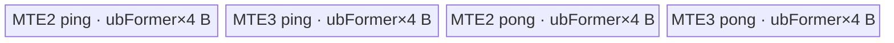
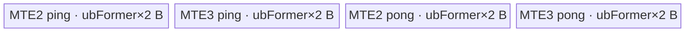

# Ceil 950 ACLNN 算子知识

## 算子速览

| 项目 | 内容 |
|---|---|
| 实际入口 | 公开两段式 API `aclnnCeilGetWorkspaceSize` + `aclnnCeil`；本卡明确不包含 `aclnnInplaceCeil`。 |
| 计算语义 | 对每个逻辑元素计算 `out[i] = ceil(self[i])`，即取不小于输入的最小整数值，并以输入 dtype 表示。 |
| 输入输出 | `self/out` 同 shape、同 dtype，ND、至多 8 维、可非连续；950 支持 FLOAT16、FLOAT、DOUBLE、BFLOAT16。 |
| 执行类型 | executor 图中的核心 `Ceil` 为单节点：FLOAT/FLOAT16/BFLOAT16 走 `AIV_VECTOR`；DOUBLE 走 AICPU/CPU 分片。外围 `Contiguous/ViewCopy` 是框架节点。无 Cube/AIC/MIX_CV。 |
| Kernel 路线 | R-001 FP32 AIV；R-002 FP16/BF16 AIV；R-003 DOUBLE AICPU。 |
| 核心资源 | AIV：GM + 一个 `TBuf<VECCALC>` 切成 MTE2/MTE3 各自 ping/pong 的 4 个等长子区；Tiling 申报 16 MiB workspace，但 `ceil` entry 不读 `workspace`。AICPU：GM 输入/输出、CPU 分片及配置的 100 B workspace。 |
| 来源闭包 | `source_closed`：公开 ACLNN、executor 组图、L0 selector、950 Tiling/POD、AIV entry/body、AICPU fallback 与构建接线均闭合；通用 `Contiguous/ViewCopy` 和 executor 调度保留为框架边界。 |
| 验证状态 | 已完成源码闭包检查；本次知识提取未执行编译、真机、数值或性能测试。 |

## 接口与语义

### 计算语义

设 `N = product(self.shape)`。对 `0 <= i < N`，结果满足：

```text
out[i] = ceil(self[i])
```

AIV 路线不升精度：FP32、FP16、BF16 均在自身位宽上执行 `MicroAPI::Truncate<T, RoundMode::CAST_CEIL, ZEROING>`，随后把输入的符号位合入结果。该合并尤其保留负零以及 `-1 < x <= 0` 取整后零值的负号。DOUBLE 不进入 AIV，而由 AICPU 的 Eigen `array().ceil()` 以 double 处理。固定仓没有额外的 NaN/Inf 替换或饱和逻辑。

公开 API header 第 24 行文字误写为“向下取整”，但同一 header 的公式、公开接口文档、README、AIV 的 `CAST_CEIL` 以及 AICPU 的 `array().ceil()` 均一致指向向上取整；本卡按可执行实现记录该语义，并在限制中保留此文档瑕疵。

### 输入、输出与属性

| 参数 | shape/layout | dtype | 约束、默认值与语义 |
|---|---|---|---|
| `self` | ND；与 `out` 同 shape；至多 8 维；可非连续 | FLOAT16、FLOAT、DOUBLE、BFLOAT16 | 必须非空指针；950 使用含 BF16 的 dtype 白名单。空 Tensor 在第一段直接成功返回，不创建核心任务。 |
| `out` | ND；与 `self` 同 shape；可非连续 | 与 `self` 完全相同 | 必须非空指针；最终由 `ViewCopy` 写入用户视图。 |
| `workspaceSize` | Host 标量输出 | `uint64_t` | 由 executor 汇总；AIV Ceil 节点的 Tiling 固定申报 16 MiB，外围框架节点可能增加总量。 |
| `executor` | Host 对象 | `aclOpExecutor**` | 第一段创建并转移所有权；内含 `Contiguous -> Ceil -> ViewCopy` 的实际任务序列。 |
| `workspace` | Device 地址 | `void*` | 第二段输入；容量必须使用第一段返回值。 |
| `stream` | runtime stream | `aclrtStream` | `CommonOpExecutorRun` 用该 stream 执行 executor 中的任务。 |

### 入口与版本

公开入口为无版本后缀的 `aclnnCeilGetWorkspaceSize/aclnnCeil`，固定仓不存在同语义的更高公开版本。`aclnnInplaceCeil` 虽与本入口共享内部 `ExecCeilGetWorkspaceSize`，但它直接改写输入，属于独立逻辑变体，不纳入本卡。

公开产品表明确列出 Ascend 950、A3、A2 支持。950 实现由四层证据闭合：`IsRegBase(DAV_3510)` 选择含 BF16 的 API/AICore白名单；`Ceil` OpDef 对 `ascend950` 注册 `ceil_apt`；950 binary config 列出 FP16/BF16/FP32；算子 CMake 将 `ascend950` 映射至 `arch35` Tiling。DOUBLE 则由 L0 selector 进入公开源码内的 AICPU route。A2/A3 的公开表虽为支持，但本固定仓的活动 CMake、OpDef、Tiling 和 Kernel 仅闭合 950，因此不生成无后缀卡。

## Host/Launcher 执行流程

### 参数校验与前处理

`ExecCeilGetWorkspaceSize` 的执行顺序是：

1. `CHECK_NOT_NULL(self, out)`，再创建 `aclOpExecutor`；创建失败返回 `ACLNN_ERR_INNER_CREATE_EXECUTOR`。
2. `CheckDtypeValid` 先要求 `self.dtype == out.dtype`，950/RegBase 再使用 `{DOUBLE, FLOAT, FLOAT16, BFLOAT16}` 白名单。
3. `CheckSameShape1In1Out` 要求 shape 相同且 `self` 维数不超过 `MAX_SUPPORT_DIMS_NUMS=8`。
4. `self->IsEmpty()` 时写 `workspaceSize=0`、转移 executor 并成功返回；不调用后续节点，因此零维 shape 不会进入 950 Tiling 的零维失败分支。
5. `l0op::Contiguous(self)`：连续输入可由框架复用，非连续输入由框架添加连续化任务；失败返回 `ACLNN_ERR_INNER_NULLPTR`。
6. `l0op::Ceil(selfContiguous)` 分配同 view shape、同 dtype 的临时 `out`。950 的 FP16/BF16/FP32 命中 AICore；DOUBLE 不在 AICore 白名单，命中 AICPU。
7. `l0op::ViewCopy(ceilResult, out)` 把连续临时结果写回可能非连续的用户输出；失败返回内部空指针错误。
8. `uniqueExecutor->GetWorkspaceSize()` 汇总 workspace，随后把 executor 所有权转移给调用者。第二段 `aclnnCeil` 仅调用 `CommonOpExecutorRun`。

### 参数、Workspace 与生命周期

`l0op::Ceil` 用 `executor->AllocTensor(self->GetViewShape(), self->GetDataType())` 创建核心输出，生命周期覆盖核心任务与后续 `ViewCopy`。AIV Tiling 的 `SetTilingData` 把 Ceil 节点 workspace slice 固定设为 `16,777,216` B；`ceil(GM_ADDR input_x, GM_ADDR output_y, GM_ADDR workspace, GM_ADDR tiling)` 保留该 ABI 参数但函数体不读取它，因此这是运行时/框架预留而不是算法中间数据。AICPU OpDef 的默认配置写 `opInfo.workspaceSize="100"`，其 body 同样只读取输入输出 Tensor。

ACLNN 总 workspace 不能简化为上述单节点值：非连续 `Contiguous/ViewCopy` 的临时区、executor 的对齐与 slice offset 均由框架实现决定，固定算子源码不可见。所有临时 Tensor、workspace slice 和任务都由第一段产生的 executor 持有；调用者只负责分配总 workspace，并在第二段完成前保持输入、输出、workspace、executor 和 stream 有效。

### 启动图与失败传播

```text
aclnnCeilGetWorkspaceSize
  -> [非空] l0op::Contiguous(self)
  -> l0op::Ceil(selfContiguous)
       -> R-001/R-002: ADD_TO_LAUNCHER_LIST_AICORE(Ceil)
       -> R-003:       ADD_TO_LAUNCHER_LIST_AICPU(Ceil)
  -> l0op::ViewCopy(ceilResult, out)
  -> executor.GetWorkspaceSize

aclnnCeil(workspace, workspaceSize, executor, stream)
  -> CommonOpExecutorRun(..., stream)
```

| 节点/边 | entry 与参数 | 交接介质 | ordering 与 owner/lifetime | 失败传播 |
|---|---|---|---|---|
| `Contiguous` | 框架 L0 节点；输入 `self` | executor 管理的连续 Tensor；offset/extent 固定仓不可见 | executor 按同一 stream 的任务序列保证后续 Ceil 可见；持有至消费者结束 | 返回空指针时不再组 Ceil |
| AIV Ceil | `ceil(input_x, output_y, workspace, tiling)`；`blockDim=baseTiling.blockNum`；POD=`CeilTilingData` | 连续 GM 输入 -> 连续临时 GM 输出；独占 16 MiB workspace slice 但 body 未读 | 单 AIV kernel；任务完成后临时输出供 `ViewCopy` 消费 | Tiling/launch 失败阻断后续节点并由 executor 返回错误 |
| AICPU Ceil | `CeilCpuKernel::Compute`；AICPU context 传 1 输入/1 输出 | 连续 GM 输入 -> 连续临时 GM 输出；配置 100 B workspace | `ParallelFor` 返回后当前节点完成；executor 再提交/完成 ViewCopy | 参数或分片失败返回非 OK，阻断后续节点 |
| `Ceil -> ViewCopy` | producer 为 AIV/AICPU Ceil，consumer 为框架 `ViewCopy` | `ceilResult`，shape/dtype 与输入相同；物理 workspace offset 固定仓不可见 | 同一 executor/stream 的先后依赖；临时 Tensor 由 executor 持有 | Ceil 失败时不产生有效 `ceilResult` |
| `ViewCopy` | 框架 L0 节点 | 连续临时结果 -> 用户 `out` 视图 | 完成前 `out` 不可作为最终结果读取 | 失败由 `CommonOpExecutorRun` 返回 |

## Route 与参数设计

### 分核与资源计算

以下公式只适用于 AIV 的 R-001/R-002。令 `N=product(storage_shape)`、`s=sizeof(T)` B、`P=平台 AIV 核数`、`U=平台 UB 字节数`、`B=CeilDAG::BufferNum=4`：

```text
C = min(ceil(N * (8s) / 32768), P)                     # 目标核数；32768 bit = 4 KiB/核
blockFormer = ceil(ceil(N / C) / 512) * 512           # 元素；源码常量名虽含 BYTE，实际直接作用于元素数
blockNum = ceil(N / blockFormer)                       # 实际 blockDim
blockTail = N - (blockNum - 1) * blockFormer           # 元素

alignFactor = 256 / s                                  # 元素；每 tile 对齐 256 B
maxElemNums = floor(U / (B * s))                       # 元素
ubFormer = floor(maxElemNums / alignFactor) * alignFactor

ubLoopFormer = ceil(blockFormer / ubFormer)
ubLoopTail = ceil(blockTail / ubFormer)
ubTailFormer = blockFormer - (ubLoopFormer - 1) * ubFormer
ubTailTail = blockTail - (ubLoopTail - 1) * ubFormer
```

`ubFormer==0`、平台 AIV 核数为 0、UB 小于 extra size、shape 含 0 或 shape 不相等都会使 Tiling 失败。`blockNum` 而非 `C` 写入 `SetBlockDim`。DAG 的 LEVEL_2 内存策略把一个输入和一个直连 CopyOut 的计算结果各做 ping/pong，不分配额外 temp buffer，因此 `UB_total=4*ubFormer*s <= U`。

### Route 选择

| 顺序 | Route | Key/模板 | 精确选择条件与优先级 | 不适用去向 |
|---:|---|---|---|---|
| 1 | R-001 FP32 AIV | key `7`；`schMode=1,dType=TPL_FP32(3)` | 950 `IsRegBase(curArch)`；`self.dtype==FLOAT`；API shape/dtype 校验通过且非空；L0 `IsAiCoreSupport=true` | dtype 为 FP16/BF16 到 R-002；DOUBLE 到 R-003 |
| 2 | R-002 FP16/BF16 AIV | FP16 key `3`；BF16 key `5`；`schMode=1` | 950；dtype 为 FLOAT16 或 BFLOAT16；其余前置条件同 R-001 | DOUBLE 到 R-003；其它 dtype 在 API 校验失败 |
| 3 | R-003 DOUBLE AICPU | 无 TilingKey；AICPU `Ceil` | 950；dtype 为 DOUBLE；API 白名单接受，但 `IsAiCoreSupport` 的 AICore 列表不含 DOUBLE | 无下一 Route；AICPU 错误向上传播 |

```text
if self/out null or dtype mismatch or dtype not in {F16,F32,BF16,F64}
   or shape mismatch or rank > 8:
    ACLNN error
else if self.IsEmpty():
    success, workspaceSize=0, no core task
else:
    selfContiguous = Contiguous(self)
    if dtype == FLOAT:          R-001, AIV key 7
    else if dtype == FLOAT16:   R-002, AIV key 3
    else if dtype == BFLOAT16:  R-002, AIV key 5
    else:                       R-003, AICPU DOUBLE
    ViewCopy(coreResult, out)
```

### 模板/实现执行矩阵

| Route | key/selector | dtype/shape/platform 完整命中条件 | 执行拓扑与 Kernel 节点 | 实际模板/body | 内存与同步特征 | tail/fallback |
|---|---|---|---|---|---|---|
| R-001 FP32 AIV | key 7 | 950/DAV_3510；FLOAT；同 shape；rank<=8；非空 | 单 AIV kernel `ceil` | `ElementwiseSch<1,CeilDAG<float>::OpDag>` -> `CeilCustom<float>` | 4 个 `ubFormer*4` B pool slice；MTE2/V/MTE3 Mutex；MicroAPI 寄存器 | former/tail core + 尾 tile + mask；Tiling 失败无 fallback |
| R-002 FP16/BF16 AIV | key 3/5 | 950；FLOAT16 或 BFLOAT16；其余同 R-001 | 单 AIV kernel `ceil` | `ElementwiseSch<1,CeilDAG<half/bfloat16_t>::OpDag>` -> `CeilCustom<T>` | 4 个 `ubFormer*2` B pool slice；16-bit sign merge | 同 R-001；dtype 不在模板集合时无执行 body |
| R-003 DOUBLE AICPU | `IsAiCoreSupport=false` | 950；DOUBLE；同 shape；rank<=8；非空 | 单 AICPU kernel `CeilCpuKernel` | `ComputeCeil<double>` -> Eigen `array().ceil()` | GM + CPU shard；`ParallelFor` 完成同步；配置 100 B workspace | `[start,end)` 精确覆盖；AICPU 参数/ParallelFor 失败终止 |

### 隐藏性能 Guard

| Guard | Host/Tiling 条件 | Device/资源原因 | 影响 Route | 不满足时去向 | 源码符号 |
|---|---|---|---|---|---|
| AICore dtype | `CheckType(dtype,{FLOAT,FLOAT16,BFLOAT16})` | 950 binary 和 AIV模板只实例化这三类 | R-001/R-002 | DOUBLE 进入 AICPU | `math/ceil/op_api/ceil.cpp::IsAiCoreSupport` |
| 空域 | ACLNN `self->IsEmpty()` 先返回；底层 Tiling 对任一 dim=0 失败 | 通用 Elewise Tiling 要求 `dim0>0`，避免 `C=0` 与空循环 | 全部 | ACLNN 空 Tensor 成功且无 kernel；绕过 ACLNN 的底层空域失败 | `ExecCeilGetWorkspaceSize`; `ElewiseTiling` |
| tile 非零 | `ubFormer=floor((U/(4s))/(256/s))*(256/s) != 0` | 至少需要 4 个 pool slice，且 tile 按 256 B 对齐 | R-001/R-002 | Tiling `GRAPH_FAILED` | `GetMaxElemNum`; `ElewiseTiling` |
| core 非零 | 平台 `GetCoreNumAiv()>0` | 分核公式要除以 `coreNum` | R-001/R-002 | Tiling `GRAPH_FAILED` | `ElewiseBaseTiling::GetPlatformInfo`; `ElewiseTiling` |
| shape/dtype一致 | Host/API 与 Tiling 均校验 | entry 假定一进一出同元素域、同位宽，使用相同元素 offset | 全部 | API 返回参数错误或 Tiling 失败 | `CheckParamsCeil`; `CeilTiling::CheckShape/CalcOutputDtype` |
| tile count 窄化 | scheduler 的 `tileLength:uint64_t` 传给 `CeilCustom(...,uint32_t count)`，后者 `loopNum:uint16_t` | MicroAPI 循环计数和 mask 参数宽度有限 | R-001/R-002 | 固定仓没有独立的显式上界错误；由平台 UB 导出的 tile 上界约束，超界行为不得外推 | `ElementwiseSch::RunOp`; `CeilCustom` |
| 模板参数集合 | `schMode in {0,1}` 且 dtype in `{1,2,3}`；当前 Host 固定 `scheMode=1` | 编译器只生成声明/选择集合内的 specialization | R-001/R-002 | 非法值生成无效 key/无 body | `ceil_struct.h`; `CeilTiling::SetTilingData` |

### POD/ABI

`CeilTilingData` 只包装一个 `EleBaseTilingData`。按固定声明的标准布局，外层 `sizeof=80` B、`alignof=8` B，`baseTiling` offset 0；各字段如下。

| 结构 | 字段 | 类型/位宽 | ABI 布局 | 单位 | Host/launcher producer | Device consumer | 边界 |
|---|---|---|---|---|---|---|---|
| `CeilTilingData.baseTiling` | `dim0` | `int64_t`/64 | offset 0，size 8 | 元素 | `AdaptEleBaseTilingData: = elewiseTilingData.dim0` | 当前 `ElementwiseSch` 不读取 | shape 各维乘积；乘法溢出检查固定仓不可见 |
| 同上 | `coreNum` | `int32_t`/32 | offset 8，size 4 | AIV 核 | `static_cast<int32_t>(elewiseTilingData.coreNum)` | 当前 body 不读取 | Host 已按平台核数截断；uint64/int64 到 int32 的显式范围检查不可见 |
| 同上 | `ubFormer` | `int32_t`/32 | offset 12，size 4 | 元素/tile | `= elewiseTilingData.ubFormer`（隐式窄化） | `ElementwiseSch::Init/Process`：pool、`blockLen`、整 tile | 必须非 0；按 256 B 对齐 |
| 同上 | `blockFormer` | `int64_t`/64 | offset 16，size 8 | 元素/常规 block | `= elewiseTilingData.blockFormer` | `CalcBlockOffset`: `blockFormer*blockIdx*sizeof(T)` | 对 512 元素对齐；最后 block 例外 |
| 同上 | `blockNum` | `int64_t`/64 | offset 24，size 8 | block | `= elewiseTilingData.blockNum`; 同值传 `SetBlockDim` | 判断 `blockIdx==blockNum-1` | 正数；必须与实际 launch blockDim 一致 |
| 同上 | `ubLoopOfFormerBlock` | `int64_t`/64 | offset 32，size 8 | tile loop | `ceil(blockFormer/ubFormer)` | 非尾 block 的 `loopNum` | 至少 1 |
| 同上 | `ubLoopOfTailBlock` | `int64_t`/64 | offset 40，size 8 | tile loop | `ceil(blockTail/ubFormer)` | 最后 block 的 `loopNum` | 至少 1 |
| 同上 | `ubTailOfFormerBlock` | `int64_t`/64 | offset 48，size 8 | 元素 | `blockFormer-(loops-1)*ubFormer` | 非尾 block 最后一 tile 的 `tailNum` | `1..ubFormer` |
| 同上 | `ubTailOfTailBlock` | `int64_t`/64 | offset 56，size 8 | 元素 | `blockTail-(loops-1)*ubFormer` | 最后 block 最后一 tile 的 `tailNum` | `1..ubFormer` |
| 同上 | `elemNum` | `int64_t`/64 | offset 64，size 8 | 元素 | `= maxElemNum` | 当前 `ElementwiseSch` 不读取 | inactive 字段；不要当作真实 N |
| 同上 | `scheMode` | `uint64_t`/64 | offset 72，size 8 | 模板枚举 | `GetScheMode()=1` | entry 的编译期模板实参 `schMode`; POD值本身不在 body 内读取 | 值 1 编码到 key 低 1 bit；声明中的 mode 0 当前 Host 不可达 |
| AICPU context | N/A | N/A | 无 Ceil 私有 POD | N/A | `ADD_TO_LAUNCHER_LIST_AICPU` 交给框架生成 | `CpuKernelContext::Input/Output` | AICPU 调度 context 的内部 ABI 固定仓不可见 |

### Route 源码闭包

| Route | Key/selector | Host/Tiling producer | POD/参数 | Kernel entry/router 节点 | Kernel body/直接依赖 | 构建接线 |
|---|---|---|---|---|---|---|
| R-001 FP32 AIV | key 7 | `ceil.cpp::IsAiCoreSupport`; `CeilTiling::RunTiling/SetTilingData`; `ElewiseTiling` | `CeilTilingData{EleBaseTilingData}` | `ceil<1,TPL_FP32>` | `ElementwiseSch`; `CeilDAG<float>`; `CeilCustom<float>`; `Vec::CopyIn/CopyOut` | `ceil_def.cpp`; `ceil_binary.json`; `math/ceil/CMakeLists.txt`; `cmake/func.cmake` |
| R-002 FP16/BF16 AIV | key 3/5 | 同上，dtype 分支设置 `TPL_FP16/TPL_BF16` | 同一 POD | `ceil<1,TPL_FP16/BF16>` | `ElementwiseSch`; `CeilDAG<half/bfloat16_t>`; `CeilCustom<T>` | 同上 |
| R-003 DOUBLE AICPU | L0 fallback | `ceil.cpp::Ceil/CeilAiCpu` | AICPU context；无 Tiling POD | `REGISTER_CPU_KERNEL("Ceil",CeilCpuKernel)` | `CeilCpuKernel::Compute/ComputeCeil<double>` | `ceil_aicpu_def.cpp`; `aicpu_op_def.h`; `cmake/func.cmake` |

## Kernel 实现

### 公共执行流程

R-001/R-002 共用单 Kernel AIV 图：entry 声明 `KERNEL_TYPE_AIV_ONLY`，解析 `CeilTilingData`，构造一个 `TPipe` 和对应 dtype 的 `ElementwiseSch<schMode,CeilDAG<T>::OpDag>`。scheduler 用 `blockFormer*blockIdx` 绑定每核 GM base，按 `ubFormer` 循环；每 tile 执行 `CopyIn -> CeilCustom -> CopyOut`，tile 序号 `i&1` 选择 ping/pong。R-003 不经过该 entry/Tiling，而由 AICPU context 直接调用 CPU kernel。

三条 Route 在 ACLNN 层都处于 `Contiguous -> core Ceil -> ViewCopy` 中间。核心输出是 executor 管理的连续临时 Tensor；核心完成后才允许 ViewCopy 消费。固定仓没有 Ceil 核心之间的多 Kernel workspace 边。

### Route R-001：FP32 AIV

#### 适用条件

##### 选择证据

| 层级 | 文件 | 符号 | 源码谓词/参数 | 结果/下一跳 |
|---|---|---|---|---|
| API | `math/ceil/op_api/aclnn_ceil.cpp` | `CheckDtypeValid/CheckParamsCeil` | RegBase 白名单含 FLOAT；self/out dtype、shape相同，rank<=8 | 进入连续化；否则参数错误 |
| L0 | `math/ceil/op_api/ceil.cpp` | `IsAiCoreSupport` | `IsRegBase(curArch)` 且 dtype 在 `{FLOAT,FLOAT16,BFLOAT16}` | `CeilAiCore` |
| Tiling | `math/ceil/op_host/arch35/ceil_tiling_arch35.cpp` | `CeilTiling::RunTiling` | output dtype `DT_FLOAT` | `dType=TPL_FP32`; `DoTiling<CeilDAG<float>>` |
| Key | 同上 + `ceil_struct.h` | `SetTilingData`; template declaration | `scheMode=1`, UINT list index=1；dtype raw value=3，左移1 bit | key `1 \| (3<<1) = 7` |
| Router | `math/ceil/op_kernel/ceil_apt.cpp` | `ceil<schMode,dType>` | `if constexpr(dType==TPL_FP32)` | `ElementwiseSch<1,CeilDAG<float>::OpDag>` |

#### Device 数据流

##### 函数级调用链

```text
ADD_TO_LAUNCHER_LIST_AICORE(Ceil, selfContiguous, ceilResult)
  -> ceil<1,TPL_FP32>(input_x, output_y, workspace, tiling)
    -> GET_TILING_DATA_WITH_STRUCT(CeilTilingData)
    -> ElementwiseSch<1,CeilDAG<float>::OpDag>::Init(input_x,output_y)
    -> ElementwiseSch::Process
      -> ElementwiseSch::Run(tileOffset,tileLength,pingPong)
        -> CopyIn -> Vec::CopyIn<float> -> DataCopyPad
        -> RunNormalOp -> CeilCustom<float>
          -> MicroAPI::DataCopy -> Truncate<CAST_CEIL,ZEROING>
          -> Duplicate/And/Or -> MicroAPI::DataCopy
        -> CopyOut -> Vec::CopyOut<float> -> DataCopyPad
  -> executor stream edge
  -> l0op::ViewCopy(ceilResult,out)
```

##### 源码等价伪码

```text
# 源码等价伪码
gmBaseElem = blockFormer * blockIdx
loopNum = (blockIdx == blockNum-1) ? ubLoopOfTailBlock : ubLoopOfFormerBlock
tailNum = (blockIdx == blockNum-1) ? ubTailOfTailBlock : ubTailOfFormerBlock

for tile in [0, loopNum):
    count = (tile == loopNum-1) ? tailNum : ubFormer
    offset = tile * ubFormer
    pp = tile & 1
    mte2Buf = pool[MTE2(pp) * (ubFormer*4)]
    mte3Buf = pool[MTE3(pp) * (ubFormer*4)]
    DataCopyPad(mte2Buf, input_x[gmBaseElem+offset], count*4 bytes)

    vl = VECTOR_REG_WIDTH / 4
    for regLoop in [0, ceil(count/vl)):
        mask = UpdateMask<float>(remaining count)
        vin = load(mte2Buf + regLoop*vl)
        vceil = Truncate<CAST_CEIL,ZEROING>(vin, mask)
        sign = bits(vin) & 0x80000000
        merged = bits(vceil) | sign
        store(mte3Buf + regLoop*vl, merged, mask)

    DataCopyPad(output_y[gmBaseElem+offset], mte3Buf, count*4 bytes)
```

#### 内存与数据搬运

##### 资源与搬运表

| 层级/缓冲区 | offset/地址公式 | extent/容量公式 | dtype/layout | producer | consumer | owner/lifetime | 对齐/复用 |
|---|---|---|---|---|---|---|---|
| GM input | `(blockFormer*blockIdx + tile*ubFormer)*4` B | 有效 `count*4` B | FP32/ND连续 | `Contiguous`/用户输入 | `Vec::CopyIn<float>` | executor/用户；核心期间有效 | tile base 按元素公式；tail 按真实 count |
| MTE2 ping | pool `[0,blockLen)` | `blockLen=ubFormer*4` B | FP32线性 | CopyIn tile 偶数 | `CeilCustom` | `TPipe/TBuf`，本 kernel | 与 pong 双缓冲；Mutex MTE2->V |
| MTE3 ping | pool `[blockLen,2*blockLen)` | `blockLen` | FP32线性 | `CeilCustom` | CopyOut tile 偶数 | 同上 | 计算结果直接落 CopyOut buffer，无 temp |
| MTE2 pong | pool `[2*blockLen,3*blockLen)` | `blockLen` | FP32线性 | CopyIn tile 奇数 | `CeilCustom` | 同上 | 下一奇数 tile 覆盖前须过 Mutex |
| MTE3 pong | pool `[3*blockLen,4*blockLen)` | `blockLen` | FP32线性 | `CeilCustom` | CopyOut tile 奇数 | 同上 | 同上 |
| 寄存器 | `regLoop*vl` | `vin/vceil:uint32视图` + `vregOutInt:uint32` + mask | FP32/uint32 lanes | MicroAPI load/truncate/bitwise | MicroAPI store | 单个 `__VEC_SCOPE__` 循环 | mask 禁止 tail 无效 lane 提交 |
| GM output | `(blockFormer*blockIdx + tile*ubFormer)*4` B | `count*4` B | FP32/ND连续 | `Vec::CopyOut<float>` | `ViewCopy` | executor 临时 Tensor | 只写有效 count |
| Ceil workspace | executor 分配的节点 slice | 16,777,216 B | opaque bytes | Tiling `currentWorkspace[0]` | entry 参数存在但未读 | executor，节点执行期间 | 算法不复用该 slice |

##### 分层内存布局



##### 字节账与复用顺序

```text
blockLen = ubFormer * 4
UB_total = 4 * blockLen = 4 * ubFormer * 4 <= U
dynamic_ub = N/A（AIV TBuf，不是 SIMT dynamic UB）
workspace_total(core Ceil) = 16,777,216 B；body 消费 0 B
=> ubFormer = align_down(floor(U/16), 64 elements)
```

| 复用子区 | 写入者 | 读取者/消费点 | 下一次覆盖 | 同步或释放依据 | 安全条件 |
|---|---|---|---|---|---|
| MTE2 ping/pong | `Vec::CopyIn` | `CeilCustom` | 同奇偶性的下一 tile | `Get/ReleaseTensor<VECIN>` 与 `VECCALC` 的 Mutex | V 完成读取后 MTE2 才可覆盖 |
| MTE3 ping/pong | `CeilCustom` | `Vec::CopyOut` | 同奇偶性的下一 tile | `VECCALC` 与 `VECOUT` Mutex | MTE3 完成搬出后 V 才可覆盖 |
| MicroAPI regs | 当前 `regLoop` | 当前 bitwise/store | 下一 `regLoop` | `__VEC_SCOPE__` 顺序与 mask | store 完成且仅 active lanes 有效 |

#### 同步、精度与尾块

##### 同步与数值边界表

| 阶段 | primitive/机制 | producer | consumer/等待点 | 保护对象 | 精度/尾块 |
|---|---|---|---|---|---|
| GM->UB | `Mutex::Lock/Unlock<PIPE_MTE2>` | DataCopyPad | PIPE_V 取同 buffer | MTE2 ping/pong | `blockCount=1, blockLen=count*4 B, stride=0`; pad disabled |
| UB compute | `Mutex::Lock/Unlock<PIPE_V>` | MTE2 buffer | CeilCustom/后续 MTE3 | 输入与输出子区 | FP32 原位宽；`CAST_CEIL`; ZEROING；mask 仅覆盖 count |
| UB->GM | `Mutex::Lock/Unlock<PIPE_MTE3>` | CeilCustom output | DataCopyPad | MTE3 ping/pong | `count*4 B`，不提交尾部无效 lane |
| reg tail | `loopNum=ceil(count/vl)` + `UpdateMask` | 当前 tile count | MicroAPI 各指令 | 最后一向量寄存器 | 符号位操作与 store 使用同一 mask |

#### 关键实现

##### 符号证据表

| 阶段 | 文件 | 符号/模板实例 | 实现事实 |
|---|---|---|---|
| Host/Tiling producer | `math/ceil/op_host/arch35/ceil_tiling_arch35.cpp` | `CeilTiling::RunTiling/SetTilingData` | FP32 DAG、key、blockDim、16 MiB workspace |
| Kernel entry/router | `math/ceil/op_kernel/ceil_apt.cpp` | `ceil<1,TPL_FP32>` | AIV-only，构造 `ElementwiseSch<1,CeilDAG<float>>` |
| Device body/helper | `math/ceil/op_kernel/arch35/ceil_dag.h` | `CeilCustom<float>` | CAST_CEIL、32-bit 符号位合并、masked load/store |
| Scheduler dependency | `opbase/.../elewise_sch.h` | `ElementwiseSch::Init/Process/Run` | 分核地址、tile loop、TBuf 与 Mutex 生命周期 |

### Route R-002：FP16/BF16 AIV

#### 适用条件

##### 选择证据

| 层级 | 文件 | 符号 | 源码谓词/参数 | 结果/下一跳 |
|---|---|---|---|---|
| API/L0 | `math/ceil/op_api/aclnn_ceil.cpp`; `op_api/ceil.cpp` | `CheckDtypeValid`; `IsAiCoreSupport` | 950 且 dtype 为 FLOAT16/BFLOAT16 | AICore；否则 DOUBLE AICPU |
| Tiling | `math/ceil/op_host/arch35/ceil_tiling_arch35.cpp` | `CeilTiling::RunTiling` | `DT_FLOAT16` 或 `DT_BF16` | `DoTiling<CeilDAG<half/bfloat16_t>>` |
| Key | 同上 + `ceil_struct.h` | `SetTilingData` | scheMode list index 1；dtype raw value 1 或 2 | FP16 key 3；BF16 key 5 |
| Router | `math/ceil/op_kernel/ceil_apt.cpp` | `ceil` constexpr branches | `dType==TPL_FP16/TPL_BF16` | 对应 `CeilDAG<T>` |

#### Device 数据流

##### 函数级调用链

```text
ceil<1,TPL_FP16 or TPL_BF16>
  -> ElementwiseSch<1,CeilDAG<T>::OpDag>::Init/Process
    -> Vec::CopyIn<T> -> DataCopyPad(count*2 B)
    -> CeilCustom<T>
      -> Truncate<T,CAST_CEIL,ZEROING>
      -> Duplicate<uint16_t>(0x8000) -> And(input bits) -> Or(ceil bits)
    -> Vec::CopyOut<T> -> DataCopyPad(count*2 B)
  -> executor stream edge -> ViewCopy
```

##### 源码等价伪码

```text
# 源码等价伪码；分核/tile循环与 R-001 相同
vl = VECTOR_REG_WIDTH / 2
for regLoop in [0, ceil(count/vl)):
    mask = UpdateMask<T>(remaining count)
    vin = load<T>(mte2Buf + regLoop*vl)
    vceil = Truncate<T,CAST_CEIL,ZEROING>(vin, mask)
    sign16 = bits16(vin) & 0x8000
    merged16 = bits16(vceil) | sign16
    store<T>(mte3Buf + regLoop*vl, merged16, mask)
```

#### 内存与数据搬运

##### 资源与搬运表

| 层级/缓冲区 | offset/地址公式 | extent/容量公式 | dtype/layout | producer | consumer | owner/lifetime | 对齐/复用 |
|---|---|---|---|---|---|---|---|
| GM input/output | `(blockFormer*blockIdx+tile*ubFormer)*2` B | 每侧有效 `count*2` B | FP16 或 BF16，连续 ND | Contiguous/CopyOut | CopyIn/ViewCopy | 用户或 executor | 256 B tile 对齐；tail 真实字节数 |
| MTE2 ping/pong | pool 子区 0/2 | 每区 `ubFormer*2` B | T线性 | CopyIn | CeilCustom | `TPipe/TBuf` | double buffer |
| MTE3 ping/pong | pool 子区 1/3 | 每区 `ubFormer*2` B | T线性 | CeilCustom | CopyOut | 同上 | 直连输出，无 temp |
| 寄存器 | `regLoop*vl` | T输入/T结果、uint16 sign/merge、mask | 16-bit lanes | load/truncate/bitwise | store | 单 reg loop | FP16/BF16 都按原始 16-bit 符号位操作 |
| Ceil workspace | 节点 slice | 16,777,216 B | opaque | Host Tiling | entry 未读 | executor | 不参与算法 |

##### 分层内存布局



##### 字节账与复用顺序

```text
blockLen = ubFormer * 2
UB_total = 4 * ubFormer * 2 <= U
dynamic_ub = N/A
workspace_total(core Ceil) = 16,777,216 B；body 消费 0 B
=> ubFormer = align_down(floor(U/8), 128 elements)
```

| 复用子区 | 写入者 | 读取者/消费点 | 下一次覆盖 | 同步或释放依据 | 安全条件 |
|---|---|---|---|---|---|
| MTE2 ping/pong | CopyIn | CeilCustom | 同 parity 下一 tile | MTE2/V Mutex | compute 释放输入后覆盖 |
| MTE3 ping/pong | CeilCustom | CopyOut | 同 parity 下一 tile | V/MTE3 Mutex | copyout 完成后覆盖 |

#### 同步、精度与尾块

##### 同步与数值边界表

| 阶段 | primitive/机制 | producer | consumer/等待点 | 保护对象 | 精度/尾块 |
|---|---|---|---|---|---|
| CopyIn | MTE2 Mutex + DataCopyPad | GM | CeilCustom | MTE2 buffer | `count*2` B，无 padding写入 |
| Compute | V Mutex + MicroAPI mask | CopyIn | CopyOut | 输入/输出UB | 不升 FP32；分别以 FP16/BF16 `CAST_CEIL` |
| Sign merge | uint16 Duplicate/And/Or | input bits + truncate bits | masked store | 每个 active lane | 保留 bit15；tail lane不提交 |
| CopyOut | MTE3 Mutex + DataCopyPad | CeilCustom | GM | MTE3 buffer | 仅 `count*2` B |

#### 关键实现

##### 符号证据表

| 阶段 | 文件 | 符号/模板实例 | 实现事实 |
|---|---|---|---|
| Host/Tiling producer | `math/ceil/op_host/arch35/ceil_tiling_arch35.cpp` | dtype branches | FP16/BF16分别生产 dType 和 DAG Tiling |
| Kernel entry/router | `math/ceil/op_kernel/ceil_apt.cpp` | `ceil<1,TPL_FP16/BF16>` | 两个编译期 specialization |
| Device body/helper | `math/ceil/op_kernel/arch35/ceil_dag.h` | `CeilCustom<half/bfloat16_t>` | 16-bit CAST_CEIL 与符号位合并 |
| Scheduler dependency | `opbase/.../vec.h`; `elewise_sch.h`; `sync.h` | `CopyIn/CopyOut`; scheduler | 2 B搬运、ping/pong与 pipe Mutex |

### Route R-003：DOUBLE AICPU

#### 适用条件

##### 选择证据

| 层级 | 文件 | 符号 | 源码谓词/参数 | 结果/下一跳 |
|---|---|---|---|---|
| API | `math/ceil/op_api/aclnn_ceil.cpp` | `CheckDtypeValid` | 950 dtype 白名单包含 DOUBLE，且 out 同 dtype/shape | 通过 API 校验 |
| L0 | `math/ceil/op_api/ceil.cpp` | `IsAiCoreSupport/Ceil` | DOUBLE 不在 `{FLOAT,FLOAT16,BFLOAT16}` | `CeilAiCpu` |
| AICPU OpDef | `math/ceil/op_kernel_aicpu/ceil_aicpu_def.cpp` | `ops::Ceil` | 输入输出列表含 DOUBLE | `CUSTAICPUKernel/libmath_aicpu_kernels.so` |
| AICPU router | `math/ceil/op_kernel_aicpu/ceil_aicpu.cpp` | `CeilCpuKernel::Compute` | `data_type==DT_DOUBLE` | `ComputeCeil<double>` |

#### Device 数据流

##### 函数级调用链

```text
CeilAiCpu
  -> ADD_TO_LAUNCHER_LIST_AICPU(Ceil, selfContiguous, ceilResult)
  -> REGISTER_CPU_KERNEL("Ceil", CeilCpuKernel)
    -> CeilCpuKernel::Compute(ctx)
      -> validate 1 input / 1 output / non-null Tensor handles
      -> ComputeCeil<double>(x,y,data_size,ctx)
        -> CpuKernelUtils::ParallelFor(n=data_size/8, minUnit=1, shard_ceil)
          -> Eigen::Map<double>[start:end]
          -> map_y = map_x.array().ceil().matrix()
  -> executor stream edge -> ViewCopy
```

##### 源码等价伪码

```text
# 源码等价伪码
require ctx.inputs == 1 and ctx.outputs == 1
require xTensor != null and yTensor != null
require dtype == DOUBLE
n = x.GetDataSize() / 8
ParallelFor(ctx, n, minimumShard=1):
    for shard [start,end):
        mapX = Eigen row-vector view(xData + start, end-start)
        mapY = Eigen row-vector view(yData + start, end-start)
        mapY = ceil(mapX)
if ParallelFor failed: return INNER_ERROR
return OK
```

#### 内存与数据搬运

##### 资源与搬运表

| 层级/缓冲区 | offset/地址公式 | extent/容量公式 | dtype/layout | producer | consumer | owner/lifetime | 对齐/复用 |
|---|---|---|---|---|---|---|---|
| AICPU input GM | `xData + start*8` B | `(end-start)*8` B | DOUBLE连续行向量视图 | Contiguous | Eigen map | executor/用户 | 分片区间不重叠 |
| AICPU output GM | `yData + start*8` B | `(end-start)*8` B | DOUBLE连续行向量视图 | Eigen ceil | ViewCopy | executor临时 Tensor | 每个 shard 独占 `[start,end)` |
| CPU shard state | `start/end` | 固定仓不公开线程数和调度队列容量 | Host integers | `ParallelFor` | shard lambda | AICPU runtime | `minUnit=1`；实际分片策略固定仓不可见 |
| AICPU workspace | 框架指定 slice | 100 B | opaque | `ApplyMathAicpuDefaultCfg` | body 未显式读取 | AICPU runtime/executor | 不得与 AIV 的16 MiB混同 |

##### 分层内存布局

N/A：该 Route 不使用 AIV UB/TQue/TBuf，也无 SIMT dynamic UB；实际路径是 AICPU runtime 将不重叠的 DOUBLE GM 区间交给 CPU shard。

##### 字节账与复用顺序

```text
UB_total = N/A（AICPU）
dynamic_ub = N/A
workspace_total(core AICPU config) = 100 B
GM input bytes = N * 8
GM output bytes = N * 8
```

| 复用子区 | 写入者 | 读取者/消费点 | 下一次覆盖 | 同步或释放依据 | 安全条件 |
|---|---|---|---|---|---|
| output shard `[start,end)` | 当前 shard lambda | 后续 ViewCopy | executor 释放临时 Tensor 前不覆盖 | `ParallelFor` 返回后当前节点完成 | shard 区间互不重叠；输入输出为不同临时 Tensor |

#### 同步、精度与尾块

##### 同步与数值边界表

| 阶段 | primitive/机制 | producer | consumer/等待点 | 保护对象 | 精度/尾块 |
|---|---|---|---|---|---|
| CPU 分片 | `CpuKernelUtils::ParallelFor` | runtime shard producer | `ComputeCeil` 等待返回 | 所有 `[start,end)` | DOUBLE Eigen ceil；`n=data_size/8` 精确覆盖 |
| 节点完成 | 返回码 | `ParallelFor` | executor/ViewCopy | 整个临时输出 | 失败转 `KERNEL_STATUS_INNER_ERROR`，不提交有效后续结果 |

#### 关键实现

##### 符号证据表

| 阶段 | 文件 | 符号/模板实例 | 实现事实 |
|---|---|---|---|
| Host/Launcher producer | `math/ceil/op_api/ceil.cpp` | `Ceil/CeilAiCpu` | DOUBLE 的 AICore capability 失败后添加 AICPU task |
| Kernel entry/router | `math/ceil/op_kernel_aicpu/ceil_aicpu.cpp` | `CeilCpuKernel::Compute`; `REGISTER_CPU_KERNEL` | 1进1出校验与 DOUBLE dispatch |
| Device body/helper | 同上 | `ComputeCeil<double>` | data_size/8、ParallelFor、Eigen ceil |
| 构建/ABI | `ceil_aicpu_def.cpp`; `common/inc/aicpu/aicpu_op_def.h` | `ApplyMathAicpuDefaultCfg` | kernel so、100 B workspace、format agnostic配置 |

## 算子特定优化

### Trick T-001：取整后显式合回输入符号位

#### 触发与源码依据

- 适用 Route：R-001、R-002。
- 触发条件：950 AIV dtype 为 FLOAT/FP16/BF16；每个 MicroAPI register loop 的 active mask。
- Golden 来源：[`math/ceil/op_kernel/arch35/ceil_dag.h:49-61`](../../../../../../../cann-ops-raw/ascendc/ops-math/165d41f02a43a62324b434cb6bda7c533b14da3e/math/ceil/op_kernel/arch35/ceil_dag.h#L49-L61)

**官方源码（固定 Commit 连续逐字摘录）**：

```cpp
mask = MicroAPI::UpdateMask<T, MicroAPI::RegTraitNumOne>(count);
MicroAPI::DataCopy(vregInput, (__ubuf__ T*)(srcAddr + loopIdx * vlSize));
MicroAPI::Truncate<T, RoundMode::CAST_CEIL, MicroAPI::MaskMergeMode::ZEROING>(
    vregOutput, vregInput, mask);
MicroAPI::Duplicate(vregOutInt, UINT32_SIGN, mask);
MicroAPI::And(vregOutInt, vregOutInt, (MicroAPI::RegTensor<uint32_t>&)vregInput, mask);
MicroAPI::Or(vregOutInt, vregOutInt, (MicroAPI::RegTensor<uint32_t>&)vregOutput, mask);
MicroAPI::DataCopy(
    (__ubuf__ T*)(dstAddr + loopIdx * vlSize), (MicroAPI::RegTensor<T>&)vregOutInt, mask);
```

#### 机制与设计原因

`Truncate<CAST_CEIL>` 先生成数值结果；随后 `Duplicate(0x80000000/0x8000)` 建立符号位掩码，`And` 从原输入位型提取符号，`Or` 合入取整结果。这样无需标量分支或额外比较，就能保留输入为负时的结果符号，尤其覆盖 ceiling 结果为零的负小数与负零。FP32 使用 uint32 视图，FP16/BF16 使用 uint16 视图；所有操作复用同一 active mask，所以不扩大 tail 写入范围。

#### 迁移边界

- 适用：IEEE 风格 sign bit 位于最高位、取整 primitive 可能不保留零符号的逐元素路线。
- 前提：FLOAT/FP16/BF16 位型与 `0x80000000/0x8000` 对应；结果 buffer 可按无符号同宽寄存器重解释；使用同一 mask。
- 失效：DOUBLE 不能套用 16/32-bit 掩码，当前实现改走 AICPU；整数 dtype 不属于公开 API。
- 未验证：本次知识提取未执行编译、真机、数值或性能测试。

#### 错误做法

直接只存 `Truncate` 结果会丢失源码显式维护的符号位语义；固定仓未提供删除该合并后的可验证反例或性能数据。

### Trick T-002：LEVEL_2 DAG 让计算结果直落双缓冲 CopyOut 子区

#### 触发与源码依据

- 适用 Route：R-001、R-002。
- 触发条件：单输入、单 `CeilCustom`、单输出 DAG；`MemCfg=LEVEL_2`；输出节点直接绑定 `CeilCustom`。
- Golden 来源：[`math/ceil/op_kernel/arch35/ceil_dag.h:90-99`](../../../../../../../cann-ops-raw/ascendc/ops-math/165d41f02a43a62324b434cb6bda7c533b14da3e/math/ceil/op_kernel/arch35/ceil_dag.h#L90-L99)

**官方源码（固定 Commit 连续逐字摘录）**：

```cpp
template <typename U>
struct CeilDAG {
    using OpCopyIn0 = Bind<Vec::CopyIn<U>, Placeholder::In0<U>>;
    using OpLogResult = Bind<CeilDag1::CeilCustom<U>, OpCopyIn0>;
    using OpCopyOut = Bind<Vec::CopyOut<U>, Placeholder::Out0<U>, OpLogResult>;
    using Outputs = Elems<OpCopyOut>;
    using MemCfg = MemOptCfg<MemLevel::LEVEL_2>;
    using OpDag = DAGSch<Outputs, void, MemCfg>;
};
```

#### 机制与设计原因

该图没有额外 temp 节点。DAG 分析得到一个 MTE2 输入和一个直连 MTE3 输出，两者各分配 ping/pong，共 4 个 `ubFormer*s` 子区。`CeilCustom` 直接写 scheduler 分配给 CopyOut 的子区，避免再物化一个计算临时 Tensor；相邻 tile 以 `i&1` 交替，MTE2、V、MTE3 通过 buffer ID 上的 Mutex 建立生产消费关系。

#### 迁移边界

- 适用：一进一出、计算结果只有一个 CopyOut 消费者的逐元素 DAG。
- 前提：DAG 的存活节点分析仍得到 `TempCalcNodeSize=0`；四个子区总量不超过平台 UB；结果 dtype 与输出 dtype相同。
- 失效：增加额外消费者、升精度中间值或多输出后必须重新计算 BufferNum、MaxDtypeBytes 和 buffer ID，不能继续硬编码 4 子区。
- 未验证：本次知识提取未执行编译、真机、数值或性能测试。

#### 错误做法

在 `CeilCustom` 与 `CopyOut` 之间无证据地增加同尺寸 temp buffer，会破坏 Host 的 `bufferDivisor=4*s*8` 与 Device `InitBuffer` 一致性；固定仓未提供其它 fallback DAG。

## 模板与实现对比

| 对比维度 | R-001 FP32 AIV | R-002 FP16/BF16 AIV | R-003 DOUBLE AICPU | 设计选择依据 |
|---|---|---|---|---|
| 命中条件/优先级 | FLOAT，950 AICore capability | FP16/BF16，950 AICore capability | DOUBLE，AICore capability false | L0 dtype 白名单优先 AICore，否则 AICPU |
| 模板与 dtype | `CeilDAG<float>` | `CeilDAG<half/bfloat16_t>` | `ComputeCeil<double>` | binary config 与 AICPU OpDef 的 dtype集合 |
| 循环与分核 | AIV block/tile/reg loop | 同左，16-bit `vl` 更大 | runtime `ParallelFor` shard | AIV UB与向量宽度 vs CPU runtime |
| Queue/TBuf/寄存器/dynamic UB/通信 window | 4×`ubFormer*4` B TBuf + 32-bit regs | 4×`ubFormer*2` B TBuf + 16-bit regs | 无 AIV UB；CPU shard state | dtype字节数与执行设备 |
| 内存总占用与复用 | `16*ubFormer` B，MTE2/MTE3 ping/pong | `8*ubFormer` B，同样4子区 | 输入/输出各 `8N` B；配置100 B workspace | DAG LEVEL_2或AICPU runtime |
| 搬运/Vector/SIMT/NDDMA/通信 API | DataCopyPad + MicroAPI Truncate/bitwise | 同左，uint16位操作 | Eigen map + ParallelFor | 无 SIMT/NDDMA/通信 |
| 同步、精度与 tail | MTE2/V/MTE3 Mutex；FP32；mask | 同步相同；不升精度；16-bit mask | ParallelFor完成；DOUBLE；shard端点 | 各执行族真实同步机制 |
| fallback/失败边界 | Tiling/launch失败，无 device fallback | 同左 | 参数/ParallelFor失败 | selector 只在 launch 前选一次 |

## 平台差异

| 项目 | A2 | A3 | 950 |
|---|---|---|---|
| 支持状态 | 公开产品表写支持，但固定仓没有 A2 活动 Host/Tiling/Kernel 全链，未生成卡 | 公开产品表写支持，但固定仓没有 A3 活动 Host/Tiling/Kernel 全链，未生成卡 | 支持；公开 API、AIV FP16/BF16/FP32 与 AICPU DOUBLE 闭合 |
| Host/Launcher | API selector 对 DAV_2201 有能力信号，但实际 Kernel 接线固定仓不可见 | 同 A2 | `IsRegBase(DAV_3510)`；arch35 Tiling；DOUBLE AICPU |
| Kernel/资源 | 固定仓不可见 | 固定仓不可见 | `ceil_apt` AIV + `CeilCpuKernel`；4区UB；AIV 16 MiB/AICPU 100 B workspace配置 |

## 限制与失败边界

- 公开 API 仅接受 FLOAT16、FLOAT、DOUBLE、BFLOAT16，且 self/out 必须同 dtype、同 shape、rank<=8；其它 dtype 返回 `ACLNN_ERR_PARAM_INVALID`。
- 空 Tensor 在 ACLNN 第一段被短路为成功且 workspace 0；底层 Tiling 若被直接以零维调用则失败，两者不可混为同一入口行为。
- AIV shape 乘积 `dim0` 的乘法溢出检查、`ubFormer` 的 int64->int32 范围校验、`tileLength` 到 uint32 和 register loop 到 uint16 的完整静态上界证明在固定仓不可见；不得用超大 shape 外推安全性。
- `blockFormer` 使用数值 512 对元素数做对齐，尽管常量名是 `CACHE_LINE_BYTE_LENGTH`；移植时必须保持源码单位，不能再乘 dtype size。
- AIV Tiling 固定申报 16 MiB workspace，而 entry 不读该参数；不能擅自删除，因为它是 Host/Runtime ABI 的已发布资源事实。
- AICPU `Compute` 检查 Tensor handle 但未显式检查 `x->GetData()/y->GetData()` 返回值；实际 data pointer 保证属于 AICPU runtime 边界。
- API header 的中文摘要误写“向下取整”，但同文件公式与全部可执行实现均为 ceiling；迁移接口说明时应修正文案，不能改变实现。
- `Contiguous/ViewCopy` 的具体 Kernel、workspace offset、临时 Tensor 对齐、stream 内部事件以及 `CommonOpExecutorRun` 的清理细节属于通用框架边界，固定算子源码不可见。
- A2/A3 的公开支持与当前固定仓缺少实现闭包并存；因此没有生成 `ceil.md`，不得复用 950 arch35 细节补齐。
- 本次知识提取未执行编译、单元测试、真机、数值或性能测试。

## 源码索引

### 链路索引

| 链路阶段 | 文件 | 关键符号 | 支撑内容 |
|---|---|---|---|
| 入口声明/约束 | `math/ceil/docs/aclnnCeil&aclnnInplaceCeil.md` | `aclnnCeilGetWorkspaceSize/aclnnCeil` | 公开性、产品、dtype/shape、两段式接口 |
| 入口声明/约束 | `math/ceil/op_api/aclnn_ceil.h` | ACLNN prototypes | 参数 ABI 与计算图；含文案瑕疵 |
| 入口实现 | `math/ceil/op_api/aclnn_ceil.cpp` | `ExecCeilGetWorkspaceSize`; `aclnnCeil` | 校验、空域、Contiguous/Ceil/ViewCopy、executor |
| 入口直接依赖 | `common/inc/op_api/level2_base.h` | `CheckSameShape1In1Out`; `GetDtypeSupportListV2` | rank/shape与950 dtype白名单选择 |
| 入口直接依赖 | `common/inc/op_api/aclnn_check.h` | `IsRegBase` | DAV_3510 RegBase 判定 |
| L0 selector | `math/ceil/op_api/ceil.cpp` | `IsAiCoreSupport`; `CeilAiCore`; `CeilAiCpu`; `Ceil` | AIV/AICPU路线选择与 task 添加 |
| Host/Tiling | `math/ceil/op_host/ceil_def.cpp` | `ops::Ceil` | ascend950 AICore config 与 `ceil_apt` 文件名 |
| Host/Tiling | `math/ceil/op_host/arch35/ceil_tiling_arch35.cpp` | `CeilTiling`; `Tiling4Ceil` | dtype、shape、DAG Tiling、key、blockDim、workspace |
| POD | `math/ceil/op_kernel/arch35/ceil_tiling_struct.h` | `CeilTilingData` | 外层 POD |
| 模板 key | `math/ceil/op_kernel/arch35/ceil_struct.h` | `ASCENDC_TPL_ARGS_DECL/SEL` | schMode/dtype模板集合 |
| Tiling直接依赖 | `pkg_inc/op_common/atvoss/elewise/elewise_base_struct.h` | `EleBaseTilingData` | POD字段与顺序 |
| Tiling直接依赖 | `pkg_inc/op_common/atvoss/elewise/elewise_tiling.h` | `ElewiseBaseTiling::DoTiling` | DAG的dtype/buffer参数接入 |
| Tiling直接依赖 | `src/op_common/atvoss/elewise/elewise_tiling.cpp` | `ElewiseTiling`; `AdaptEleBaseTilingData` | 分核、tile、tail公式与POD producer |
| Tiling key依赖 | `include/utils/tiling/template_argument.h` | `FastEncodeTilingKeyDirect` | key位拼接和UINT list索引编码 |
| Kernel entry/body | `math/ceil/op_kernel/ceil_apt.cpp` | `ceil` | AIV-only entry、dtype specialization |
| Kernel entry/body | `math/ceil/op_kernel/arch35/ceil_dag.h` | `CeilDAG`; `CeilCustom` | CAST_CEIL、符号位、register loop |
| Scheduler直接依赖 | `pkg_inc/op_common/atvoss/elewise/elewise_sch.h` | `ElementwiseSch` | GM offset、TBuf、tile loop、调用与同步 |
| Scheduler直接依赖 | `pkg_inc/op_common/atvoss/util/dag.h` | `DAGSch` | BufferNum、LEVEL_2、buffer ID |
| Scheduler直接依赖 | `pkg_inc/op_common/atvoss/util/node.h` | `DagNodeInfo` | 存活节点与4子区推导 |
| 搬运直接依赖 | `pkg_inc/op_common/atvoss/util/vec.h` | `Vec::CopyIn/CopyOut` | DataCopyPad参数 |
| 同步直接依赖 | `pkg_inc/op_common/atvoss/util/sync.h` | `GetTensor/ReleaseTensor` | MTE2/V/MTE3 Mutex |
| AICPU body | `math/ceil/op_kernel_aicpu/ceil_aicpu.cpp` | `CeilCpuKernel` | DOUBLE dispatch、ParallelFor、Eigen ceil |
| AICPU config | `math/ceil/op_kernel_aicpu/ceil_aicpu_def.cpp` | AICPU `ops::Ceil` | dtype与默认配置接入 |
| AICPU config | `common/inc/aicpu/aicpu_op_def.h` | `ApplyMathAicpuDefaultCfg` | kernel so与100 B workspace |
| 构建接线 | `math/ceil/op_host/config/ascend950/ceil_binary.json` | `Ceil` op_list | 950 FP16/BF16/FP32 binaries |
| 构建接线 | `math/ceil/CMakeLists.txt` | `SUPPORT_COMPUTE_UNIT`; `add_all_modules_sources` | ascend950->arch35、API/Host模块 |
| 构建接线 | `cmake/func.cmake` | `add_all_modules_sources` | API/Tiling/AICPU/OpDef源码收集规则 |

### 实现复用检查

| 检查项 | 可复用事实 | 不得改变的约束 | 源码符号 |
|---|---|---|---|
| ABI/POD | `CeilTilingData` 直接复用 `EleBaseTilingData` | 80 B布局、字段顺序/位宽/单位、inactive字段不得改变 | `CeilTilingData`; `EleBaseTilingData` |
| 调用顺序 | `Contiguous -> Ceil -> ViewCopy`；AIV entry 内 `Init -> Process` | 空 Tensor短路；producer失败必须阻断consumer | `ExecCeilGetWorkspaceSize`; `ceil` |
| workspace/内存 | AIV 4个等长pool slice；AICPU配置100 B | AIV Host申报16 MiB、body虽不读也不能改 ABI；pool按最大dtype字节切分 | `SetTilingData`; `ElementwiseSch::Init`; `ApplyMathAicpuDefaultCfg` |
| 同步 | MTE2/V/MTE3 Mutex；AICPU ParallelFor完成 | ping/pong buffer ID、同parity覆盖时序、shard不重叠 | `GetTensor/ReleaseTensor`; `ParallelFor` |
| 精度与尾块 | 各dtype原位宽CAST_CEIL；DOUBLE Eigen；mask/tail | FP16/BF16不升精度；符号位合并常量与dtype宽度；只写count | `CeilCustom`; `ComputeCeil` |
| 失败边界 | Host校验、Tiling guard、AICPU返回码均可复用 | 不把A2/A3缺失链补成950复用；不把DOUBLE路由到AIV | `CheckParamsCeil`; `ElewiseTiling`; `IsAiCoreSupport` |

- [Truncate](../../../../apis/simd_api/basic_api/reg_vector_compute/type_conversion/truncate.md)
