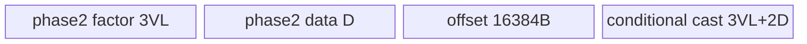
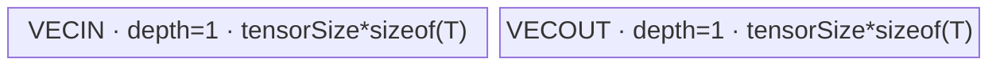
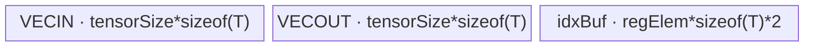

# Cumsum 950 ACLNN 算子知识

## 算子速览

| 项目 | 内容 |
|---|---|
| 实际入口 | `aclnnCumsumV2GetWorkspaceSize` + `aclnnCumsumV2`，公开 ACLNN 两段式接口；同族旧入口 `aclnnCumsum` 不纳入本卡。 |
| 计算语义 | 沿 `dim` 做正向/反向、包含/排除式前缀和；`exclusive=false` 时先加后写，`exclusive=true` 时先写累计值再加当前元素。 |
| 输入输出 | `self/out` 同 shape、同 dtype、ND、rank≤8，支持非连续 Tensor；950 公开 dtype 为 FLOAT/FLOAT16/BFLOAT16/INT32/INT64/INT8/UINT8 及 AICPU fallback 的 DOUBLE/INT16/COMPLEX64/COMPLEX128。 |
| 执行类型 | 单个语义节点：AIV_VECTOR；浮点跨核 Route 的 GM→UB add-factor 广播含 NDDMA，整数跨核 Route 含 `SyncAll`；不支持的 dtype 为 AICPU fallback。所有 AICore entry 均是 `KERNEL_TYPE_AIV_ONLY` 或 `KERNEL_TYPE_MIX_AIV_1_0`（AIV=1、AIC=0），不含 Cube/AIC/MIX_CV。 |
| Kernel 路线 | R-001～R-008：FP32/FP16/BF16 的 8 个 Sklansky key；R-009～R-011：整数 3 个 key；R-012～R-017：AICPU scalar/小张量/三种并行分支。 |
| 核心资源 | AIV 使用 GM、UB `TBuf/TQue`、MicroAPI RegTensor；跨 UB 使用 memo，跨核复用输出 GM 并以 `SyncAll` 分阶段；整数 key 11002 另有 `midBuf`。Cumsum 节点固定请求 16 MiB system workspace，但这些 body 不把它作为算法中间数组。 |
| 来源闭包 | source_closed：公开 V2 API→连续化/同 dtype Cast→L0 dtype selector→950 Tiling/POD→11 个 AIV key 或 AICPU fallback→构建/config 全部闭合。 |
| 验证状态 | 已完成源码闭包检查；本次知识提取未执行编译、真机、数值或性能测试。 |

## 接口与语义

### 计算语义

令输入折叠为 `[M,R,N]`，其中 `R=shape[dim]`、`M=∏shape[:dim]`、`N=∏shape[dim+1:]`。对固定 `(m,n)`：

- `reverse=false, exclusive=false`：`y[m,r,n]=Σ_{k=0..r}x[m,k,n]`；
- `reverse=false, exclusive=true`：`y[m,r,n]=Σ_{k=0..r-1}x[m,k,n]`，空和为 0；
- `reverse=true, exclusive=false`：`y[m,r,n]=Σ_{k=r..R-1}x[m,k,n]`；
- `reverse=true, exclusive=true`：`y[m,r,n]=Σ_{k=r+1..R-1}x[m,k,n]`。

浮点 AIV 路线对 FP16/BF16 先升为 FP32 做树形加法，最后 `CAST_RINT` 回原 dtype；FP32 原精度累加。整数 AIV 按输入整数类型加法，不做扩宽，溢出行为由对应整数加法 primitive 决定。AICPU fallback 也以模板类型 `T` 累加。

### 输入、输出与属性

| 参数 | shape/layout | dtype | 约束、默认值与语义 |
|---|---|---|---|
| `self` | ND，rank 0～8；可非连续 | 950 文档支持 FLOAT、FLOAT16、INT32、DOUBLE、UINT8、INT8、INT16、INT64、COMPLEX64、COMPLEX128、BFLOAT16 | 非空指针；V2 要求与 `out` dtype/shape 相同。空 Tensor 在 ACLNN Host 直接成功返回。 |
| `dim` | Host scalar | INT64 | rank 0 按 rank 1 校验，范围 `[-rank,rank-1]`；负数在 Tiling/AICPU 归一化。API 将 `dim==0` 转成 INT64 axis Tensor，其余合法 rank≤8 值转成 INT32。 |
| `exclusive` | Host scalar | BOOL | `false` 为 inclusive，`true` 为 exclusive。 |
| `reverse` | Host scalar | BOOL | `false` 正向，`true` 反向。 |
| `out` | 与 `self` 相同；可非连续 | 与 `self` 相同 | 非空指针，最终由 `ViewCopy` 写回用户 view。 |
| `workspaceSize/executor` | Host 输出 | — | 第一段返回整个 executor 图的聚合 workspace 和 owner。 |
| `workspace/stream` | Device workspace + ACL stream | — | 第二段交给 `CommonOpExecutorRun`；各节点按 executor 在同一 stream 排序。 |

### 入口与版本

固定仓同时公开 `aclnnCumsum` 与 `aclnnCumsumV2`；目录 README 的 ACLNN 调用说明指向 V2，V2 直接暴露 `exclusive/reverse` 且调用五参 `l0op::Cumsum`，故本卡按同语义版本族选择最新 `aclnnCumsumV2`。旧入口还含只在特定 A2/A3 shape 上进入 `CumsumCube` 的分支；它不是本卡实际入口，也不用于补写 V2。950 README、V2 API 文档、`IsRegBase` selector、`Cumsum` 的 `ascend950` OpDef 与 binary config 一致证明公开支持。

## Host/Launcher 执行流程

### 参数校验与前处理

`aclnnCumsumV2GetWorkspaceSize` 的顺序不可交换：

1. `CREATE_EXECUTOR`；失败返回 `ACLNN_ERR_INNER_CREATE_EXECUTOR`。
2. `CheckParamsWithoutDtype`：`self/out` 非空；按当前 `NpuArch` 取 dtype 白名单；两者 dtype 相同；shape 相同且 rank≤8；`dim` 合法。失败分别返回 `ACLNN_ERR_PARAM_NULLPTR` 或 `ACLNN_ERR_PARAM_INVALID`。
3. `self->IsEmpty()` 时 workspace=0，释放 executor，完全不添加 Cumsum 节点。
4. `l0op::Contiguous(self)`；随后无条件 `l0op::Cast(contiguousSelf,out.dtype)`。V2 已要求同 dtype，因此 Cast 是框架节点边界，不改变 Cumsum dtype。
5. 构造常量 axis Tensor：`dim==0 || dim>INT32_MAX` 用 INT64，否则 INT32；公开合法 dim≤7，使得实际 INT64 特例是 0。
6. `l0op::Cumsum(castSelf,dimTensor,exclusive,reverse,executor)` 分配连续中间输出并按 950 dtype 选择 AICore/AICPU。
7. `l0op::ViewCopy(cumsumOut,out)` 处理非连续输出；最后返回 executor 聚合 workspace。

### 参数、Workspace 与生命周期

`l0op::Cumsum` 分配与 `self` view shape/dtype 相同的 ND 中间 `out`，生命周期归 executor。AICore Tiling 对浮点与整数均把 Cumsum 节点 `workspace[0]` 设为 `16*1024*1024` 字节；整数 entry 要求 `workspace!=nullptr` 并调用 `SetSysWorkspace`，浮点 body 没有算法性 workspace 读写。该 16 MiB 是 system workspace，不是跨核前缀数组：跨核浮点和整数路线都把各核局部结果先写 `y` 中间 GM，再以 `SyncAll` 读取前序分片边界并原位修正。ACLNN 第一段返回的总量还可能包含 Contiguous/Cast/ViewCopy 的框架 workspace，固定仓未展开 executor 分配器的精确聚合 offset。

### 启动图与失败传播

非空输入的逻辑图是单 stream 多节点 executor 图，但 Cumsum 核心语义只有一个 Device/CPU 节点：

```text
self --Contiguous--> contiguousSelf --Cast(same dtype)--> castSelf
  --Cumsum(AIV key 1001..1112/11000..11002, or AICPU Cumsum)--> cumsumOut
  --ViewCopy--> out
```

| 节点 | Host 添加函数 | entry/body | block/grid/POD | 输入→输出 | workspace/ordering/失败 |
|---|---|---|---|---|---|
| Contiguous | `l0op::Contiguous` | 框架边界 | 固定仓不可见 | user view→连续中间 | executor/stream；null 阻断后续。 |
| Cast | `l0op::Cast` | 框架边界 | 固定仓不可见 | 同 dtype 连续中间→`castSelf` | executor/stream；null 阻断后续。 |
| Cumsum AIV | `CumsumAiCore`/`ADD_TO_LAUNCHER_LIST_AICORE` | `cumsum`→`cumsumSimd` 或 `cumsumSimdInt` | Tiling `SetBlockDim`；对应 POD | `castSelf,axis`→连续 `cumsumOut` | 节点 system workspace 16 MiB；同 stream；launcher 失败返回 null。 |
| Cumsum AICPU | `CumsumAiCpu`/`ADD_TO_LAUNCHER_LIST_AICPU` | `CumsumCpuKernel::Compute` | CPU runtime task attrs | 同上 | AICPU task space；ParallelFor 失败传播为 kernel status。 |
| ViewCopy | `l0op::ViewCopy` | 框架边界 | 固定仓不可见 | `cumsumOut`→user `out` view | 同 stream；null 阻断第一段。 |

## Route 与参数设计

### 分核与资源计算

公共三轴为 `M,R,N`。浮点 Tiling 用硬件 `coreNum=AIV core count`、`UB`、cache line `CL`、UB block `B`、vector register `VL`，并把 core 上限截到 64。`dtCast=(dtype∈{FP16,BF16})`，`alignN=ceil_align(N*sizeof(dtype),B)`，而路线比较统一以 FP32 计算宽度 `N*4` 为准。

浮点先判断 `N*4>=CL`；否则判断 `R*N*4>=CL`；再否则判断 `M*R*N*4>=CL`。切分辅助式为：`blockCount=min(len,cores)`，`blockFactor=ceil(len/blockCount)`，随后重新收紧 `blockCount=ceil(len/blockFactor)`，尾长为余数或 factor；单 block 时主 factor 置 0。UB 切分同式。单向/双向由 `alignN<=VL/4` 且 `DoFold` 得到 `foldCount>1` 决定；fold 只取 2 的幂，`foldLen>=256`，FP16/BF16 最多 4 fold。

整数 Tiling 先令 `maxTensorSize=min(floor(UB/4/B)*B/sizeof(T),0xff00)`（输入/输出各 depth 1，保留 double-buffer 预算），`minTensorSize=CL/sizeof(T)`；对 8-bit 类型把参与比较的 `VL` 除 2。它计算 `laLpUnit/rLpUnit/raLpUnit`，再比较 `LA`、`R/2`、`RA` 的 `CalcAxisWeight`，优先 LA、其次 RA、最后 R 分核。`usedCoreCnt=ceil(loopCount/ceil(loopCount/coreNum))`。

### Route 选择

| 顺序 | Route | Key/模板 | 精确选择条件与优先级 | 不适用去向 |
|---:|---|---|---|---|
| 1 | R-001 单向核内全载 | 1001 | 浮点族；`N*4>=CL && R*(dtCast?3CL:CL)<=UB`，或小 N 决策树中单向且 R 全载/借 M 后全载，或 `M*R*N*4<CL` | 继续浮点 key |
| 2 | R-002 双向核内全载 | 1002 | 浮点族；`N*4<CL && R*N*4>=CL`，`JudgeSklanskyPatten=TWOWAY`，未被 `borrowM>1` 改写，双向六缓冲总量≤UB | R-004/R-006/R-008 |
| 3 | R-003 单向跨 UB | 1011 | 浮点族；R 不全载但无需借 R 核，或借 M 后 R 不全载；单向 UB factor 取 `LastPow2(MaxForFullUb(UB-8192-512-8192,...))` | 跨核路线 |
| 4 | R-004 双向跨 UB | 1012 | 小 N、双向、R 不全载、`M>coreNum/2`；R factor 按双向缓冲余量计算后取 `LastPow2` | 跨核路线 |
| 5 | R-005 单向跨核 | 1101 | 浮点族且 M/N 不足以用核、借 R；借后主 R block 可全载，重新判型为单向 | R-007 |
| 6 | R-006 双向跨核 | 1102 | 借 R 后重新判型为双向，主 R block 的折叠六缓冲总量≤UB | R-008 |
| 7 | R-007 单向跨核+跨 UB | 1111 | 借 R、单向，主 R block 不能全载 | 失败（无更多浮点 fallback） |
| 8 | R-008 双向跨核+跨 UB | 1112 | 借 R、双向，主 R block 六缓冲不能全载 | 失败（无更多浮点 fallback） |
| 9 | R-009 整数连续 RA | 11000 / `CumNoSplit<T>` | 950 AICore 整数 dtype；分核轴不是 R，且 `rightAxisLen*sizeof(T)>=effectiveVL` | R-010 |
| 10 | R-010 整数 Gather/Scatter | 11001 / `CumSplitAR<T>` | 分核轴不是 R，且 `rightAxisLen*sizeof(T)<effectiveVL` | R-011 |
| 11 | R-011 整数跨核 Group-R | 11002 / `CumWithGroup<T>` | 权重选择 R 分核，即 `RWeight/2` 严格胜过按优先级先检查的 LA/RA 权重 | 失败 |
| 12 | R-012 AICPU scalar | `CumsumCpuKernel` | 950 不在 REGBASE AICore 白名单且 rank=0、1 element | R-013 |
| 13 | R-013 AICPU 小张量连续 | 同上 | fallback dtype，非 scalar，`bytes<=512KiB && outer==1` | R-014 |
| 14 | R-014 AICPU 小张量 batched | 同上 | fallback dtype，非 scalar，`bytes<=512KiB && outer>1` | R-015 |
| 15 | R-015 AICPU 大张量连续并行 | 同上 | `bytes>512KiB && outer==1` | R-016 |
| 16 | R-016 AICPU 大张量 inner 并行 | 同上 | `bytes>512KiB && outer>1 && inner>=avail_cores` | R-017 |
| 17 | R-017 AICPU 大张量 outer chunk | 同上 | `bytes>512KiB && outer>1 && inner<avail_cores` | kernel status 失败 |

```text
ACLNN V2 non-empty
  -> dtype in REGBASE_AICORE={FP32,FP16,BF16,INT32,INT64,INT8,UINT8}?
     -> yes, float?
        -> yes: N*4 >= CL?
           -> yes: R*(dtCast?3CL:CL) <= UB ? 1001 :
                   M>core/2 or M*ceil(N*4/CL)>core/2 ? 1011 : borrow R -> 1101/1111
           -> no: R*N*4 >= CL?
                  -> no: 1001
                  -> yes: one-way/two-way fold + R full/UB split + M/borrow-M/borrow-R
                          -> 1001/1002/1011/1012/1101/1102/1111/1112
        -> no: choose core axis by LAWeight, RWeight/2, RAWeight
               -> R axis: 11002
               -> non-R and right*sizeof(T)>=effectiveVL: 11000
               -> non-R: 11001
     -> no: AICPU
            -> scalar / <=512KiB outer==1 / <=512KiB outer>1 /
               >512KiB outer==1 / >512KiB outer>1 inner>=cores / final outer-chunk
```

### 模板/实现执行矩阵

| Route | key/selector | dtype/shape/platform 完整命中条件 | 执行拓扑与 Kernel 节点 | 实际模板/body | 内存与同步特征 | tail/fallback |
|---|---|---|---|---|---|---|
| R-001 | 1001 | 浮点 selector 的全载/退化单向叶 | 单 AIV | `CumsumOnewaySs<T,float>`→`CumsumOnewaySklansky` | xBuf；半精度另有 2× cast buf；事件同步 | M/N/R 尾参数由 POD |
| R-002 | 1002 | 双向 fold 且全载 | 单 AIV | `CumsumTwowaySs<T,float>` | fold/unfold+10.25KiB 固定缓冲 | reverse 非对齐头单独搬出 |
| R-003 | 1011 | 单向 R 跨 UB | 单 AIV | `CumsumUbSsOnewaySs`→`CumsumUbSklansky<Oneway>` | R 块 memo Sklansky | UB/R/M/N 尾循环 |
| R-004 | 1012 | 双向 R 跨 UB | 单 AIV | `CumsumUbSsTwowaySs`→`CumsumUbSklansky<Twoway>` | 双向缓冲+memo/index/data | fold/UB 尾块 |
| R-005 | 1101 | 单向借 R 核且核内全载 | 单 AIV，核内阶段→跨核阶段 | `CumsumCoreSsOnewaySs` + `CumsumCoreSklansky` | `pipe.Reset` 后复用 UB；每轮 `SyncAll`；NDDMA addFactor | inactive 核仍参加同步 |
| R-006 | 1102 | 双向借 R 核且全载 | 同上 | `CumsumCoreSsTwowaySs` + core Sklansky | 同上 | 双向/核尾 fold |
| R-007 | 1111 | 单向借 R 且跨 UB | 同上 | `CumsumCoreSsUbSsOnewaySs` | 核内 memo 后跨核 GM 原位修正 | R/N/UB/core 多级 tail |
| R-008 | 1112 | 双向借 R 且跨 UB | 同上 | `CumsumCoreSsUbSsTwowaySs` | 最大缓冲组合，阶段复用 | 同上 |
| R-009 | 11000 | 整数、非 R 分核、大 RA | 单 AIV | `CumNoSplit`→`DataCopyTDRightACum` | in/out TQue depth1，各 `tensorSize*sizeof(T)` | DMA repeat/stride 超限逐块 fallback |
| R-010 | 11001 | 整数、非 R 分核、小 RA | 单 AIV | `CumSplitAR`→`GatherCum` | 上述双 queue+index TBuf | TD-RA/TD-LA/TD-R 内部分支 |
| R-011 | 11002 | 整数 R 分核 | 单 AIV，局部扫描→跨核修正 | `CumWithGroup` | 双 queue+midBuf；两级 `SyncAll`，读写 yGM | 首/末核、reverse、exclusive 特判 |
| R-012～017 | AICPU | fallback dtype + 表中 shape/bytes 条件 | 单 AICPU task | `CumsumCpuKernel` | CPU vector/std::vector/ParallelFor | ParallelFor status 传播 |

### 隐藏性能 Guard

| Guard | Host/Tiling 条件 | Device/资源原因 | 影响 Route | 不满足时去向 | 源码符号 |
|---|---|---|---|---|---|
| 950 dtype selector | `IsRegBase && dtype∈REGBASE_DTYPE_SUPPORT_LIST` | 只有 7 dtype 有 950 AIV 实例 | 全部 | AICPU | `op_api/cumsum.cpp::IsAiCoreSupport` |
| float compute width | `N*4`、`R*N*4` | FP16/BF16 升 FP32 | R-001～008 | 下一级树 | `CumsumAscendcTilingImpl::TilingStrategy` |
| half UB multiplier | `dtCast?3:1` | 原 dtype xBuf+FP32 castBuf | 浮点 | 更细 UB route | `MaxForFullUb/CalcXBufSize` |
| fold eligibility | `alignN<=VL/4 && foldCount>1` | 双向需一寄存器容纳多个 N fold | 偶数 Route | 单向 Route | `JudgeSklanskyPatten/DoFold` |
| fold alignment | FP16/BF16 `foldCount<=4`，`foldLen>=256` | 原 dtype buffer 32B 对齐、树规模下限 | R-002/4/6/8 | 单向 | `DoFold` |
| core cap | `coreNum=min(AIVCore,64)` | POD 只准备 6 行、最多 64 R 分片 | 跨核 | 截断到64 | `Init` |
| schedule mode | key∈{1101,1102,1111,1112,11002} | 所有 block 必须到 `SyncAll` | 跨核 | Tiling 失败 | 两个 `DoTiling/WriteTilingData` |
| int UB budget | `tensorSize<=min(UB/4,0xff00*sizeof(T))/sizeof(T)` | 两个 depth1 queue，且 B8 index 防溢出 | R-009～011 | 缩 tile | `GetAxisLpUnit` |
| DMA limit | `blockCount<=0xfff && stride<=0xffffffff` | DataCopyExt 参数位宽 | R-009～011 | 显式逐 block Copy | `CumCopyIn/CumCopyOut` |
| bank-group conflict | 512B 并行跨度条件 | Gather/Scatter UB bank group | R-010/011 | 增加 block padding/调整 factor | `CheckBGC/KCheckBGC` |
| integer workspace pointer | `workspace!=nullptr` | `SetSysWorkspace` 前置 | R-009～011 | entry 直接 return | `cumsumSimdInt` |
| AICPU parallel threshold | `bytes>512*1024` | 小张量避免线程调度 | R-012～017 | 串行 body | `CumsumCompute` |

### POD/ABI

所有结构由 `BEGIN_TILING_DATA_DEF` 宏序列化。固定仓能证明字段声明顺序与源码类型，不能在不展开外部注册宏的情况下证明生成类型的 `sizeof/alignof/offsetof`；下表统一记为“固定仓不可见”，实现复用时必须以 CANN 9.1 生成头为准。嵌套结构按“顶层字段→下层结构字段”递归消费，每个字段单列。

| 结构 | 字段 | 类型/位宽 | ABI 布局 | 单位 | Host/launcher producer | Device consumer | 边界 |
|---|---|---|---|---|---|---|---|
| `CumsumFoldPara` | `foldCount` | int32/32 | 固定仓不可见 | 次 | `FillFoldPara` | two-way init/process | 0 表 inactive |
| 同上 | `foldLen` | int64/64 | 固定仓不可见 | R element | 同上 | two-way fold | 0 表 inactive |
| 同上 | `sklanskyIter` | int32/32 | 固定仓不可见 | 次 | `log2(foldLen)` | `FirstSkalansky` | foldLen>0 时读 |
| `CumsumBlockPara` | `blockCount` | int32/32 | 固定仓不可见 | block | `DoBlockSplit` | block/core route | ≥1（非空） |
| 同上 | `blockFactor` | int64/64 | 固定仓不可见 | element | 同上 | offset | 单 block 时 0 |
| 同上 | `blockTailFactor` | int64/64 | 固定仓不可见 | element | 同上 | tail | 最后一块有效长 |
| `UbParaUnit` | `ubCount` | int32/32 | 固定仓不可见 | tile | `DoUbSplit` | UB loops | 非空≥1 |
| 同上 | `ubFactor` | int32/32 | 固定仓不可见 | element | 同上 | tile offset | 单 tile 时 0 |
| 同上 | `ubTailFactor` | int32/32 | 固定仓不可见 | element | 同上 | tail | 最后一 tile |
| `CumsumUbPara` | `mainCoreUbPara` | struct | 固定仓不可见 | — | `FillUbPara` | 主核 | inactive 可全0 |
| 同上 | `tailCoreUbPara` | struct | 固定仓不可见 | — | 同上 | 尾核 | 尾核必用 |
| `CumsumIterGroupTiling` | `iterGroupBlockFactor` | int64/64 | 固定仓不可见 | R element | `InitIterGroupTiling` | core add start | — |
| 同上 | `iterGroupMainBlockCount` | int32/32 | 固定仓不可见 | core | 同上 | `Judge/CalcUbLoopInfo` | 可0 |
| 同上 | `iterGroupTailBlockCount` | int32/32 | 固定仓不可见 | core | 同上 | 同上 | 可0 |
| 同上 | `iterGroupMainCoreUbFactorCount` | int32/32 | 固定仓不可见 | tile | `InitIterGroupUbTiling` | core UB loop | 可0 |
| 同上 | `iterGroupMainCoreUbFactor` | int32/32 | 固定仓不可见 | R element | 同上 | 同上 | 单 tile可0 |
| 同上 | `iterGroupMainCoreUbTailFactor` | int32/32 | 固定仓不可见 | R element | 同上 | 同上 | — |
| 同上 | `iterGroupTailCoreUbFactorCount` | int32/32 | 固定仓不可见 | tile | 同上 | 同上 | 可0 |
| 同上 | `iterGroupTailCoreUbFactor` | int32/32 | 固定仓不可见 | R element | 同上 | 同上 | 单 tile可0 |
| 同上 | `iterGroupTailCoreUbTailFactor` | int32/32 | 固定仓不可见 | R element | 同上 | 同上 | — |
| `CumsumSklanskyItersTiling` | `iterGroupCount` | int32/32 | 固定仓不可见 | group | outer tiling | `CalcIterGroupOffset` | active row>0 |
| 同上 | `iterGroupAddCount` | int32/32 | 固定仓不可见 | R block | `2^iter` | add-factor position | — |
| 同上 | `iterGroupAddOffset` | int32/32 | 固定仓不可见 | R block | `2*addCount` | 同上 | — |
| 同上 | `iterGroupStartOffset` | int32/32 | 固定仓不可见 | R block | `addCount-1` | 同上 | — |
| 同上 | `iterGroupCoreNum` | int32/32 | 固定仓不可见 | core/group | floor(core/group) | 分组 | >0 active |
| 同上 | `mainIterGroupMainNTiling` | struct | 固定仓不可见 | — | `InitIterGroupTiling` | 主group主N | — |
| 同上 | `tailIterGroupMainNTiling` | struct | 固定仓不可见 | — | 同上 | 尾group主N | — |
| 同上 | `mainIterGroupTailNTiling` | struct | 固定仓不可见 | — | 同上 | 主group尾N | — |
| 同上 | `tailIterGroupTailNTiling` | struct | 固定仓不可见 | — | 同上 | 尾group尾N | — |
| `CumsumSklanskyTilingData` | `lenM` | int64/64 | 固定仓不可见 | element | `Init` shape fold | 全浮点 body | 乘法溢出未显式检查 |
| 同上 | `lenR` | int64/64 | 固定仓不可见 | element | 同上 | 同上 | axis 长 |
| 同上 | `lenN` | int64/64 | 固定仓不可见 | element | 同上 | 同上 | — |
| 同上 | `exclusive` | int32/32 | 固定仓不可见 | bool | attrs | CopyIn offset | 0/1 |
| 同上 | `reverse` | int32/32 | 固定仓不可见 | bool | attrs | 地址符号 | 0/1 |
| 同上 | `realCoreNum` | int32/32 | 固定仓不可见 | core | route tiling | inner guard | 空域0 |
| 同上 | `xBufSize` | int32/32 | 固定仓不可见 | byte | `CalcBufferSize` | `InitBuffer` | B 对齐 |
| 同上 | `xUnfoldBufSize` | int32/32 | 固定仓不可见 | byte | `CalcXUnfoldBufSize` | two-way computeBuf | 非双向0 |
| 同上 | `ubSklanskyBufSize` | int32/32 | 固定仓不可见 | byte | 常量8192 | memo预算 | 非UB路线不读 |
| 同上 | `addFactorRepeatTimesMain` | int32/32 | 固定仓不可见 | repeat | outer tiling | NDDMA broadcast | 跨核主N |
| 同上 | `addFactorRepeatTimesTail` | int32/32 | 固定仓不可见 | repeat | 同上 | 同上 | 跨核尾N |
| 同上 | `coreGroupCount` | int32/32 | 固定仓不可见 | group | `M*nBorrow` | core guard | 跨核 |
| 同上 | `coreGroupCoreNum` | int32/32 | 固定仓不可见 | core/group | `core/coreGroup` | core index | 跨核 |
| 同上 | `sklanskyItersCount` | int32/32 | 固定仓不可见 | 次 | `ceil(log2(rBorrow))` | `SyncAll` loop | ≤6 |
| 同上 | `addFactorBufferSize` | int32/32 | 固定仓不可见 | byte | `3*VL` | core TBuf | 跨核 |
| 同上 | `addDataBufferSize` | int32/32 | 固定仓不可见 | byte | UB余量公式 | core TBuf | 跨核 |
| 同上 | `addFactorOffsetBufferSize` | int32/32 | 固定仓不可见 | byte | 16384 | gather index | 跨核 |
| 同上 | `nBorrow` | int32/32 | 固定仓不可见 | 分片 | selector | block→N | ≥1 |
| 同上 | `rBorrow` | int32/32 | 固定仓不可见 | 分片 | selector | block→R/core tree | ≥1 |
| 同上 | `mBorrow` | int32/32 | 固定仓不可见 | fold | `CalcBorrowM` | oneway M fold | ≥1 |
| 同上 | `mainCoreMainUbFoldPara` | struct | 固定仓不可见 | — | fill | 双向主核主UB | inactive0 |
| 同上 | `mainCoreTailUbFoldPara` | struct | 固定仓不可见 | — | fill | 双向主核尾UB | inactive0 |
| 同上 | `tailCoreMainUbFoldPara` | struct | 固定仓不可见 | — | fill | 双向尾核主UB | inactive0 |
| 同上 | `tailCoreTailUbFoldPara` | struct | 固定仓不可见 | — | fill | 双向尾核尾UB | active fallback |
| 同上 | `mBlockPara` | struct | 固定仓不可见 | — | fill | M block mapping | — |
| 同上 | `rBlockPara` | struct | 固定仓不可见 | — | fill | R block mapping | — |
| 同上 | `nBlockPara` | struct | 固定仓不可见 | — | fill | N block mapping | — |
| 同上 | `mUbPara` | struct | 固定仓不可见 | — | fill | M UB loop | — |
| 同上 | `rUbPara` | struct | 固定仓不可见 | — | fill | R UB loop | — |
| 同上 | `nUbPara` | struct | 固定仓不可见 | — | fill | N UB loop | — |
| 同上 | `sklanskyItersTiling0..5` | 6×struct | 固定仓不可见 | iteration row | `FillSklanskyItersTiling` | core tree rows | 仅前 count 行读 |
| `Cum4IntTilingData` | `tilingKey` | int64/64 | 固定仓不可见 | key | `CalcTilingKey` | router/POD debug | 11000..11002 |
| 同上 | `isExclusive` | int64/64 | 固定仓不可见 | bool | attrs | exclusive offset | 0/1 |
| 同上 | `isReverse` | int64/64 | 固定仓不可见 | bool | attrs | traversal | 0/1 |
| 同上 | `isRBlockAxis` | int64/64 | 固定仓不可见 | bool | `GetMCTilingInfo` | exclusive/core group | 0/1 |
| 同上 | `tensorSize` | int64/64 | 固定仓不可见 | element/queue | `GetAxisLpUnit` | `InitBuffer` | ≤0xff00 |
| 同上 | `usedCoreCnt` | int64/64 | 固定仓不可见 | core | `GetMCTilingInfo` | cross-core | >0 |
| 同上 | `blockOffset` | int64/64 | 固定仓不可见 | element | 同上 | GM base | — |
| 同上 | `ntcLALen` | int64/64 | 固定仓不可见 | LA element | 同上 | non-tail core loops | — |
| 同上 | `tcLALen` | int64/64 | 固定仓不可见 | LA element | 同上 | tail core | — |
| 同上 | `laLpUnit` | int64/64 | 固定仓不可见 | LA element | `GetAxisLpUnit` | LA tile | >0 |
| 同上 | `laOffset` | int64/64 | 固定仓不可见 | element | `R*N` | GM formula | — |
| 同上 | `ntcRLen` | int64/64 | 固定仓不可见 | R element | `GetMCTilingInfo` | non-tail core | — |
| 同上 | `tcRLen` | int64/64 | 固定仓不可见 | R element | 同上 | tail core | — |
| 同上 | `rLpUnit` | int64/64 | 固定仓不可见 | R element | `GetAxisLpUnit` | tile scan | >0 |
| 同上 | `rOffset` | int64/64 | 固定仓不可见 | element | `rightAxisLen` | GM stride | — |
| 同上 | `ntcRALen` | int64/64 | 固定仓不可见 | RA element | `GetMCTilingInfo` | non-tail core | — |
| 同上 | `tcRALen` | int64/64 | 固定仓不可见 | RA element | 同上 | tail core | — |
| 同上 | `raLpUnit` | int64/64 | 固定仓不可见 | RA element | `GetAxisLpUnit` | RA tile/midBuf | >0 |

### Route 源码闭包

| Route | Key/selector | Host/Tiling producer | POD/参数 | Kernel entry/router 节点 | Kernel body/直接依赖 | 构建接线 |
|---|---|---|---|---|---|---|
| R-001～008 | 1001..1112 | `cumsum_tiling.cpp::TilingCumsumForAscendc`；`cumsum_tiling_ascendc_arch35.cpp::CumsumAscendcTilingImpl` | `CumsumSklanskyTilingData` | `cumsum_apt.cpp::cumsum/cumsumSimd` | 8 route wrapper + four `cumsum_base` bodies | `cumsum_def.cpp`、ascend950 binary、CMake |
| R-009～011 | 11000..11002 | `Cumsum4IntTiling` | `Cum4IntTilingData` | `cumsum/cumsumSimdInt` | `cumsum_4_int.h` | 同上 |
| R-012～017 | `!IsAiCoreSupport` | `op_api/cumsum.cpp::Cumsum` | AICPU attrs，不用 AscendC POD | AICPU launcher→`CumsumCpuKernel::Compute` | `cumsum_aicpu.cpp` | `cumsum_aicpu_def.cpp`、CMake |

## Kernel 实现

### 公共执行流程

所有 AIV key 都从 `cumsum(x,axis,y,workspace,tiling)` 进入；编译期 dtype 把浮点送到 `cumsumSimd`、整数送到 `cumsumSimdInt`。浮点 router 按 8 个 key 实例化对应 wrapper，整数 router 按 3 个 key 实例化；未知 key 不写输出。浮点 `KERNEL_TASK_TYPE_DEFAULT(AIV_ONLY)`，跨核 4 key 改为 `MIX_AIV_1_0`；整数 key 11002 同理，均明确 AIC 数为 0。

浮点 route 的共同核心是 Sklansky 前缀树：先把每个 R tile 搬入 UB，FP16/BF16 升 FP32，按距离 `2^k` 将每组首前缀加到后半组；exclusive 通过输入整体错一行并对序列端补 0 实现，reverse 通过负地址方向和反向树实现。R 超 UB 时再对 tile 末值做一层 memo Sklansky；R 跨核时局部结果先落 `yGM`，每一核间迭代先 `SyncAll`，广播前一分组末值并原位加到后续分组。

整数 route 使用 `M=LA,R,RA=N`；连续 RA 用 DataCopy+寄存器逐 R 加，较小 RA 用 Gather/Scatter 改变 VF 观察布局。R 分核时先各核局部扫描并写 yGM，再全核同步；每核收集所有前序核的末行求和，第二次同步后把该 add-factor 加回自身所有输出。

后续每条 Route 都在自己的五个固定小节中给出完整差异；框架 Contiguous/Cast/ViewCopy 不伪造成算子自有 body。

### Route R-001：单向核内全载 Sklansky

#### 适用条件

##### 选择证据

| 层级 | 文件 | 符号 | 源码谓词/参数 | 结果/下一跳 |
|---|---|---|---|---|
| L0 | `math/cumsum/op_api/cumsum.cpp` | `IsAiCoreSupport` | 950 且 T∈FP32/FP16/BF16 | AICore |
| Tiling | `.../cumsum_tiling_ascendc_arch35.cpp` | `TilingStrategy` 及叶函数 | 大 N 的 R 全载；或小 N 的退化/单向全载叶；见 Route 选择决策树 | key 1001 |
| Router | `math/cumsum/op_kernel/cumsum_apt.cpp` | `cumsumSimd` | `TILING_KEY_IS(1001)` 且 T 为三种浮点 | `CumsumOnewaySs<T,float>` |

#### Device 数据流

##### 函数级调用链

```text
CumsumAiCore -> cumsum -> cumsumSimd(key=1001)
  -> CumsumOnewaySs::Init/Process
    -> CallOneWaySklansky -> CumsumOnewaySklansky::BaseProcessPre
      -> CopyIn[Exclusive] -> CopyInDataCast -> ComputeInner(k)
      -> BaseCopyOut
```

##### 源码等价伪码

```text
for each block's M/N tile:
  base = m*R*N + rOffset*N + nOffset
  DataCopyPad blockCount=R, blockLen=nFactor*sizeof(T), srcStride=(N-nFactor)*sizeof(T)
  if exclusive: shift input by one R row; zero first/last row according to reverse
  if T is FP16/BF16: cast compact padded tile to FP32
  for k in [0, ceil(log2(R))):
    step=2^k; group=2^(k+1)
    for every group and each of step destination rows:
      dst_row += group's prefix-factor row using masked RegTensor Add
  if promoted: CAST_RINT back to T
  DataCopyPad UB -> yGM with symmetric stride and exact nFactor/R tail
```

#### 内存与数据搬运

##### 资源与搬运表

| 层级/缓冲区 | offset/地址公式 | extent/容量公式 | dtype/layout | producer | consumer | owner/lifetime | 对齐/复用 |
|---|---|---|---|---|---|---|---|
| x/y GM | `m*R*N+r*N+n` | active M×R×N | T/ND | API/CopyOut | CopyIn/user | executor | N tile strided |
| `inBufX_` | UB 0 | `xBufSize` bytes | T/folded rows | CopyIn | compute/CopyOut FP32 | pipe, whole route | compact+padding |
| `inCastBufX_` | 独立 UB | `xBufSize*4/sizeof(T)` | FP32 | Cast | compute/CAST_RINT | only FP16/BF16 | 同一物理区承载结果 |
| workspace | — | 16 MiB system | — | framework | `SetSysWorkspace`仅整数 | executor | 本 route 不读 |

##### 分层内存布局


##### 字节账与复用顺序

```text
UB_total = xBufSize + (dtCast ? 2*xBufSize : 0)
xBufSize = dtCast ? floor(xBufferMax/3/B)*B : xBufferMax
UB_total <= platform UB
dynamic_ub = N/A
workspace_total(node request) = 16 MiB system workspace
```

| 复用子区 | 写入者 | 读取者/消费点 | 下一次覆盖 | 同步或释放依据 | 安全条件 |
|---|---|---|---|---|---|
| cast/result buf | `Cast`/Sklansky Add | `CAST_RINT`/CopyOut | 下一 M/N tile | MTE2_V、V_MTE3、MTE3_V/MTE2 | 上一 tile 已搬出 |
| original buf | CopyIn | Cast 或 FP32 compute | 下一 tile CopyIn | FP32 用 MTE3_MTE2；half 用 V_MTE2 flag | 不提前覆盖 |

#### 同步、精度与尾块

##### 同步与数值边界表

| 阶段 | primitive/机制 | producer | consumer/等待点 | 保护对象 | 精度/尾块 |
|---|---|---|---|---|---|
| MTE2→V | `MTE2_V` event | DataCopyPad | Cast/Add | input UB | pad lane 不写 GM |
| V tree | RegTensor masked Add | previous tree row | next k | same UB | FP16/BF16 in FP32；mask=`nAddFactor*mFold` |
| V→MTE3 | `V_MTE3` | Add/Cast | CopyOut | result UB | `CAST_RINT` |
| reuse | `MTE3_MTE2`/`MTE3_V` | CopyOut | next CopyIn | same TBuf | exact R/N/M tail factors |

#### 关键实现

##### 符号证据表

| 阶段 | 文件 | 符号/模板实例 | 实现事实 |
|---|---|---|---|
| Host/Tiling producer | `math/cumsum/op_host/arch35/cumsum_tiling_ascendc_arch35.cpp` | `NGreaterClRFullLoad/RNGreaterClRFullLoad/MRNGreaterCl` | key、M/N/UB 切分 |
| Kernel entry/router | `math/cumsum/op_kernel/cumsum_apt.cpp` | `cumsumSimd<1001>` | key→oneway |
| Device body/helper | `.../cumsum_oneway_ss.h`；`.../cumsum_oneway_sklansky.h` | `CumsumOnewaySs`、`ComputeInner` | 地址、树加法、exclusive/reverse、cast/tail |

### Route R-002：双向核内全载 Sklansky

#### 适用条件

##### 选择证据

| 层级 | 文件 | 符号 | 源码谓词/参数 | 结果/下一跳 |
|---|---|---|---|---|
| Tiling | `.../cumsum_tiling_ascendc_arch35.cpp` | `JudgeSklanskyPatten/RNGreaterClRFullLoad` | `alignN<=VL/4`、foldCount>1、未借M改写、双向六缓冲总量≤UB | key1002 |
| Router | `cumsum_apt.cpp` | `cumsumSimd` | key1002 | `CumsumTwowaySs<T,float>` |

#### Device 数据流

##### 函数级调用链

```text
cumsumSimd(1002) -> CumsumTwowaySs::Process
  -> CumsumTwowaySklansky::BaseProcessPre
  -> CopyIn -> FirstSkalansky -> VfGatherBeforeSecondSkalansky
  -> SecondSkalansky -> BaseCopyOut
```

##### 源码等价伪码

```text
for each M assigned to block:
  zero folded input; copy R in foldLen-row groups, one N row padded to VL
  optional FP16/BF16->FP32 cast
  first tree: prefix-scan each fold independently
  gather compact [foldCount,foldLen,N] into secondfoldBuffer
  second tree: gather each fold's boundary value, add it to all later folds
  optional CAST_RINT
  reverse dirty prefix: MicroAPI unaligned gather -> 256B staging -> exact head copy
  copy remaining compact output to yGM
```

#### 内存与数据搬运

##### 资源与搬运表

| 层级/缓冲区 | offset/地址公式 | extent/容量公式 | dtype/layout | producer | consumer | owner/lifetime | 对齐/复用 |
|---|---|---|---|---|---|---|---|
| fold original | UB | `xBufSize` | T/VL-row fold | CopyIn | Cast/first tree | route | padded zero |
| fold promoted | UB | dtCast?`2*xBufSize`:alias original | FP32 | Cast | first tree | route | alias for FP32 |
| unfolded | UB | `xUnfoldBufSize` | FP32 compact | gather | second tree/CopyOut | route | B aligned |
| no-align | UB | VL=256B | T | VF gather | MTE3 head | route | reverse only active |
| second index/data | UB | `VL*32=8192B` + `VL*8=2048B` | int32+FP32 | index/gather | second tree | route | fixed |

##### 分层内存布局


##### 字节账与复用顺序

```text
UB_total = xBuf + (dtCast?2*xBuf:0) + xUnfold + 256 + 8192 + 2048
xBuf = floor((UB-xUnfold-256-2048-8192)/(dtCast?3:1)/B)*B
workspace_total = 16 MiB system
```

| 复用子区 | 写入者 | 读取者/消费点 | 下一次覆盖 | 同步或释放依据 | 安全条件 |
|---|---|---|---|---|---|
| foldBuffer | CopyIn/Cast/first tree | gather | next M | MTE2_V + local barriers | gather completed |
| secondfold | gather/second tree | CopyOut | next M | V_MTE3 | exact effective span |

#### 同步、精度与尾块

##### 同步与数值边界表

| 阶段 | primitive/机制 | producer | consumer/等待点 | 保护对象 | 精度/尾块 |
|---|---|---|---|---|---|
| zero/copy | V_MTE2 + MTE2_V | Duplicate/DataCopy | Cast | padded fold | exclusive首行少搬1 |
| tree | MicroAPI LocalMemBar/gather | first tree | second tree | fold/unfold | two-level FP32 tree |
| output | V_MTE3 | cast/tree | MTE3 | output | reverse dirty head via unaligned staging |

#### 关键实现

##### 符号证据表

| 阶段 | 文件 | 符号/模板实例 | 实现事实 |
|---|---|---|---|
| Host/Tiling producer | `.../cumsum_tiling_ascendc_arch35.cpp` | `DoFold/RNGreaterClRFullLoad/CalcBufferSize` | fold与缓冲式 |
| Kernel entry/router | `cumsum_apt.cpp` | key1002 | 双向模板 |
| Device body/helper | `.../cumsum_twoway_ss.h`；`.../cumsum_twoway_sklansky.h` | `FirstSkalansky/SecondSkalansky/VfNoAlignCopyOut` | 两级树与reverse tail |

### Route R-003：单向跨 UB Sklansky

#### 适用条件

##### 选择证据

| 层级 | 文件 | 符号 | 源码谓词/参数 | 结果/下一跳 |
|---|---|---|---|---|
| Tiling | `...cumsum_tiling_ascendc_arch35.cpp` | `NGreaterClRNotFullLoad/RNGreaterClRNotFullLoadNotBorrowR/RNGreaterClBorrowM` | R 不全载且不借 R 核；R tile=`LastPow2(MaxForFullUb(UB-16896,...))` | 1011 |
| Router | `cumsum_apt.cpp` | key1011 | — | `CumsumUbSsOnewaySs<T,float>` |

#### Device 数据流

##### 函数级调用链

```text
CumsumUbSsOnewaySs::Process -> for M/N tile
  -> CumsumUbSklansky::BaseProcess
    -> for each R-UB tile: Oneway::BaseProcess -> SkalanskyBetweenUb -> BaseCopyOut
```

##### 源码等价伪码

```text
memo[0:memoLen]=0
for ubIndex over R in forward/reverse order:
  run R-tile one-way tree exactly as R-001
  cacheID = trailing-ones level of ubIndex
  for memo level j: add memo[j] to every row of current tile
                    clear lower completed level; write current last row to memo[cacheID]
  copy corrected tile to yGM
```

#### 内存与数据搬运

##### 资源与搬运表

| 层级/缓冲区 | offset/地址公式 | extent/容量公式 | dtype/layout | producer | consumer | owner/lifetime | 对齐/复用 |
|---|---|---|---|---|---|---|---|
| inner buffers | 同R-001 | `xBuf+(dtCast?2xBuf:0)` | T/FP32 | inner | inner/copyout | route | tile reuse |
| memo | level×perMemo | `memoLen*perMemoSize*4` | FP32 | tile boundary | later tile | route | Host预算8192B |

##### 分层内存布局


##### 字节账与复用顺序

```text
UB_total = xBuf + (dtCast?2*xBuf:0) + memoBytes
xBuf uses UB-8192(memo budget)-8192(index reserve)-512(data reserve)
memoBytes <= 8192 by Host selector budget
```

| 复用子区 | 写入者 | 读取者/消费点 | 下一次覆盖 | 同步或释放依据 | 安全条件 |
|---|---|---|---|---|---|
| memo level j | current tile boundary | subsequent tile add | cacheID schedule | sequential VF | current output fixed before update |

#### 同步、精度与尾块

##### 同步与数值边界表

| 阶段 | primitive/机制 | producer | consumer/等待点 | 保护对象 | 精度/尾块 |
|---|---|---|---|---|---|
| inner | R-001 events | Copy/tree | memo | xBuf | FP32 promotion |
| inter-UB | sequential MicroAPI | memo previous level | tile Add | prefix factor | `ubTailFactorR` and reverse offset |

#### 关键实现

##### 符号证据表

| 阶段 | 文件 | 符号/模板实例 | 实现事实 |
|---|---|---|---|
| Host/Tiling producer | `...cumsum_tiling_ascendc_arch35.cpp` | `RNotFullLoad*` | power-of-two R tile |
| Kernel entry/router | `cumsum_apt.cpp` | 1011 | UB wrapper |
| Device body/helper | `...cumsum_ub_ss_oneway_ss.h`；`...cumsum_ub_sklansky.h` | `BaseProcess/SkalanskyBetweenUb` | memo tree与tail |

### Route R-004：双向跨 UB Sklansky

#### 适用条件

##### 选择证据

| 层级 | 文件 | 符号 | 源码谓词/参数 | 结果/下一跳 |
|---|---|---|---|---|
| Tiling | `...cumsum_tiling_ascendc_arch35.cpp` | `RNGreaterClRNotFullLoadNotBorrowR` | 双向判型、M足够用核、R不全载；按双向余量求 R factor | 1012 |
| Router | `cumsum_apt.cpp` | key1012 | — | `CumsumUbSsTwowaySs<T,float>` |

#### Device 数据流

##### 函数级调用链

```text
CumsumUbSsTwowaySs::Process
 -> CumsumUbSklansky<T,Twoway>::BaseProcess
   -> each R tile: Twoway::CopyIn/FirstTree/Gather/SecondTree
   -> VfBetweenUbAddTwoway -> write memo -> Twoway::BaseCopyOut
```

##### 源码等价伪码

```text
for each M:
  zero memo
  for each R tile:
    two-way scan tile as R-002 using tile-specific fold POD
    gather memo prefix factor by N-index, add to all tile rows
    gather corrected first/last row into memo[cacheID]
    exact CopyOut including reverse unaligned head
```

#### 内存与数据搬运

##### 资源与搬运表

| 层级/缓冲区 | offset/地址公式 | extent/容量公式 | dtype/layout | producer | consumer | owner/lifetime | 对齐/复用 |
|---|---|---|---|---|---|---|---|
| inner two-way | 同R-002 | `xBuf+(dtCast?2xBuf:0)+xUnfold+10496` | T/FP32 | inner | inner | route | per R tile |
| UB memo | level×perMemo | `memoLen*perMemoSize*4` | FP32 | boundary | later tile | route | ≤8192B budget |
| UB add-factor idx/data | — | 8192+512B | uint32/FP32 | generated | inter-UB add | route | fixed |

##### 分层内存布局


##### 字节账与复用顺序

```text
UB_total = innerTwoWayBytes + memoBytes + 8192 + 512
xBuf producer subtracts all fixed regions before /3 for promoted dtype
workspace_total = 16 MiB system
```

| 复用子区 | 写入者 | 读取者/消费点 | 下一次覆盖 | 同步或释放依据 | 安全条件 |
|---|---|---|---|---|---|
| inner fold/unfold | current R tile | memo + CopyOut | next R tile | V/MTE events | output and memo committed |
| memo | boundary gather | next tile add | cache schedule | sequential VF | N factor fixed per route |

#### 同步、精度与尾块

##### 同步与数值边界表

| 阶段 | primitive/机制 | producer | consumer/等待点 | 保护对象 | 精度/尾块 |
|---|---|---|---|---|---|
| inner | 同R-002 | first/second tree | inter-UB | unfolded FP32 | main/tail fold POD |
| inter-UB | gather/index + masked Add | memo | current tile | prefix factor | reverse uses first row as boundary |

#### 关键实现

##### 符号证据表

| 阶段 | 文件 | 符号/模板实例 | 实现事实 |
|---|---|---|---|
| Host/Tiling producer | `...cumsum_tiling_ascendc_arch35.cpp` | `RNGreaterClRNotFullLoadNotBorrowR/CalcBufferSize` | fold与UB预算 |
| Kernel entry/router | `cumsum_apt.cpp` | 1012 | UB+two-way |
| Device body/helper | `...cumsum_ub_ss_twoway_ss.h`；`cumsum_ub_sklansky.h`；`cumsum_twoway_sklansky.h` | nested bodies | 两层核内树+跨UB树 |

### Route R-005：单向跨核 Sklansky

#### 适用条件

##### 选择证据

| 层级 | 文件 | 符号 | 源码谓词/参数 | 结果/下一跳 |
|---|---|---|---|---|
| Tiling | `...cumsum_tiling_ascendc_arch35.cpp` | `NGreaterClRNotFullLoadBorrowR/RNGreaterClRNotFullLoadBorrowR` | M/N 不足用核而借 R；主 R block 单向且可在 UB 全载 | 1101，schedule mode 1 |
| Router | `cumsum_apt.cpp` | key1101 | AIV=1,AIC=0 | `CumsumCoreSsOnewaySs<T,float,CumsumOnewaySklansky>` |

#### Device 数据流

##### 函数级调用链

```text
cumsumSimd(1101)
 -> CoreSsOneway::Process
    -> local Oneway::BaseProcess/CopyOut (each core's R segment -> yGM)
 -> CumsumCoreSklansky::Process
    -> PreProcess(pipe.Reset)
    -> for ssi: SyncAll -> CopyInAddFactor(NDDMA broadcast)
                -> Cast -> LoopAddData -> Add -> CastBack -> yGM
```

##### 源码等价伪码

```text
core maps to (m, rShard, nShard); scan its R segment and write yGM
pipe.Reset()  // local-scan UB no longer live
for k in [0,ceil(log2(rBorrow))):
  SyncAll()  // all blockDim, including inactive blocks
  group current R shards in spans 2^(k+1)
  broadcast previous half's last y row for nFactor via 2D NDDMA
  each active helper core loops assigned destination R rows:
    compact-copy y rows -> UB; promote if needed; add broadcast factor;
    CAST_RINT if needed; copy corrected rows back to same yGM offsets
```

#### 内存与数据搬运

##### 资源与搬运表

| 层级/缓冲区 | offset/地址公式 | extent/容量公式 | dtype/layout | producer | consumer | owner/lifetime | 对齐/复用 |
|---|---|---|---|---|---|---|---|
| local scan UB | route-local | `xBuf+(dtCast?2xBuf:0)` | T/FP32 | CopyIn | local scan | before Reset | whole R shard |
| yGM intermediate | block's `(m,rShard,nShard)` | exact output slice | T/ND | local scan | cross-core phase | executor output | in-place correction |
| addFactor | UB | `3*VL` | T | NDDMA from yGM | Add | after Reset | repeated rows |
| addData | UB | Host `addDataBufferSize` | T | compact DataCopyPad | Add/CopyOut | after Reset | R tile |
| factor/data cast | UB | half: `3*VL` + `2*addData` | FP32 | Cast | Add | after Reset | conditional |
| factor offsets | UB | 16384B | uint32 | CreateVecIndex | tail-N gather | after Reset | — |

##### 分层内存布局


##### 字节账与复用顺序

```text
phase-1 UB = xBuf + (dtCast?2*xBuf:0)
phase-2 UB = 3VL + D + 16384 + (dtCast ? 3VL + 2D : 0)
D = dtCast ? floor((UB-2*3VL-16384)/3/B)*B : UB-3VL-16384
peak UB <= UB; phases do not add because pipe.Reset
```

| 复用子区 | 写入者 | 读取者/消费点 | 下一次覆盖 | 同步或释放依据 | 安全条件 |
|---|---|---|---|---|---|
| whole local-scan UB | oneway body | CopyOut yGM | core phase buffers | `pipe.Reset` after local output | all local result already GM-resident |
| yGM corrected rows | earlier tree iter | later iter addFactor | in-place next iter | `SyncAll` at next iter start | every block reaches barrier |

#### 同步、精度与尾块

##### 同步与数值边界表

| 阶段 | primitive/机制 | producer | consumer/等待点 | 保护对象 | 精度/尾块 |
|---|---|---|---|---|---|
| local→cross-core | first loop `SyncAll` | every local scan | addFactor NDDMA | yGM | exclusive only first shard injects zero |
| each tree row | `SyncAll` | prior GM writes | next iteration | all output shards | inactive core must not return |
| DMA/V | MTE2_V,V_MTE3,MTE3_MTE2 | DataCopy/Cast/Add | next stage | phase2 UB | main/tail N uses gather offsets |

#### 关键实现

##### 符号证据表

| 阶段 | 文件 | 符号/模板实例 | 实现事实 |
|---|---|---|---|
| Host/Tiling producer | `...cumsum_tiling_ascendc_arch35.cpp` | `TilingStrategyOuterTd*` | core group、6行 tree、UB参数 |
| Kernel entry/router | `cumsum_apt.cpp` | key1101 `MIX_AIV_1_0` | 无AIC |
| Device body/helper | `cumsum_core_ss_oneway_ss.h`；`cumsum_core_sklansky.h` | `Process/CopyInAddFactor/LoopAddData` | yGM阶段、NDDMA、SyncAll |

### Route R-006：双向跨核 Sklansky

#### 适用条件

##### 选择证据

| 层级 | 文件 | 符号 | 源码谓词/参数 | 结果/下一跳 |
|---|---|---|---|---|
| Tiling | `...cumsum_tiling_ascendc_arch35.cpp` | `RNGreaterClRNotFullLoadBorrowRTwoway` | 借 R 后双向，主 R shard 的 fold/original/unfold/fixed 总量≤UB | 1102 |
| Router | `cumsum_apt.cpp` | key1102 | AIV=1,AIC=0 | `CumsumCoreSsTwowaySs<T,float,CumsumTwowaySklansky>` |

#### Device 数据流

##### 函数级调用链

```text
CoreSsTwoway::Process -> local Twoway FirstTree/Gather/SecondTree/CopyOut
 -> CoreSklansky::Process -> Reset -> [SyncAll,NDDMA factor,GM in-place Add]*
```

##### 源码等价伪码

```text
per core: two-level folded FP32 prefix tree on assigned R shard -> yGM
for every cross-core tree level:
  all-core barrier
  obtain previous group's boundary y row by NDDMA broadcast
  add boundary into each row assigned to current helper core, preserving N tail mask
```

#### 内存与数据搬运

##### 资源与搬运表

| 层级/缓冲区 | offset/地址公式 | extent/容量公式 | dtype/layout | producer | consumer | owner/lifetime | 对齐/复用 |
|---|---|---|---|---|---|---|---|
| local two-way phase | — | `xBuf+(dtCast?2xBuf:0)+xUnfold+10496` | T/FP32 | two-way | yGM | before Reset | fold-specific |
| cross-core phase | — | `3VL+D+16384+(dtCast?3VL+2D:0)` | T/FP32/index | NDDMA/CopyIn | Add/CopyOut | after Reset | same formulas R-005 |
| yGM | exact output | output extent | T/ND | local tree | cross-core | executor | in-place |

##### 分层内存布局



##### 字节账与复用顺序

```text
peak = max(localTwoWayBytes, crossCoreBytes)
crossCoreBytes = 3VL+D+16384+(dtCast?3VL+2D:0) <= UB
workspace=16MiB system; algorithm edge is yGM, not workspace
```

| 复用子区 | 写入者 | 读取者/消费点 | 下一次覆盖 | 同步或释放依据 | 安全条件 |
|---|---|---|---|---|---|
| whole UB | local two-way | yGM CopyOut | phase2 TBuf | pipe.Reset | local GM commit complete |
| yGM | current tree level | next level | in-place Add | SyncAll | blockDim all participates |

#### 同步、精度与尾块

##### 同步与数值边界表

| 阶段 | primitive/机制 | producer | consumer/等待点 | 保护对象 | 精度/尾块 |
|---|---|---|---|---|---|
| local | two-way events/barriers | fold trees | yGM | UB | reverse dirty head |
| global | SyncAll each level | MTE3 prior level | NDDMA next | yGM | FP16/BF16 promoted per phase |

#### 关键实现

##### 符号证据表

| 阶段 | 文件 | 符号/模板实例 | 实现事实 |
|---|---|---|---|
| Host/Tiling producer | `...cumsum_tiling_ascendc_arch35.cpp` | `RNGreaterClRNotFullLoadBorrowRTwoway/TilingStrategyOuterTd` | key/fold/core tree |
| Kernel entry/router | `cumsum_apt.cpp` | 1102 | composite template |
| Device body/helper | `cumsum_core_ss_twoway_ss.h`；`cumsum_twoway_sklansky.h`；`cumsum_core_sklansky.h` | local+global tree | full pipeline |

### Route R-007：单向跨核与跨 UB Sklansky

#### 适用条件

##### 选择证据

| 层级 | 文件 | 符号 | 源码谓词/参数 | 结果/下一跳 |
|---|---|---|---|---|
| Tiling | `...cumsum_tiling_ascendc_arch35.cpp` | 两个 `*BorrowR` | 借 R、单向，主 R shard 不满足 full-UB | 1111，schedule1 |
| Router | `cumsum_apt.cpp` | 1111 | — | `CoreSsUbSsOnewaySs<T,float,UbSklansky<Oneway>>` |

#### Device 数据流

##### 函数级调用链

```text
CoreSsUbSsOneway::Process
 -> local UbSklansky::BaseProcess -> each UB tile Oneway -> memo correction -> yGM
 -> CoreSklansky::Process -> Reset -> each level SyncAll/NDDMA/GM correction
```

##### 源码等价伪码

```text
for core's R shard and every N tile:
  prefix each UB tile; apply/update per-core memo; emit corrected local shard to yGM
reset UB
perform cross-core Sklansky exactly on yGM, adding previous shard groups to later groups
exclusive zero injection occurs only at logical sequence edge; reverse flips R offsets
```

#### 内存与数据搬运

##### 资源与搬运表

| 层级/缓冲区 | offset/地址公式 | extent/容量公式 | dtype/layout | producer | consumer | owner/lifetime | 对齐/复用 |
|---|---|---|---|---|---|---|---|
| local x/cast | — | `xBuf+(dtCast?2xBuf:0)` | T/FP32 | CopyIn | oneway | phase1 | — |
| local memo | — | `memoLen*perMemo*4`≤8192 | FP32 | tile boundary | later tile | phase1 | power-level cache |
| cross-core TBuf | — | formula R-005 | T/FP32/index | GM factor/data | GM correction | phase2 | Reset reuse |

##### 分层内存布局


##### 字节账与复用顺序

```text
phase1 = xBuf+(dtCast?2xBuf:0)+memoBytes
phase2 = 3VL+D+16384+(dtCast?3VL+2D:0)
peak=max(phase1,phase2)<=UB because pipe.Reset
```

| 复用子区 | 写入者 | 读取者/消费点 | 下一次覆盖 | 同步或释放依据 | 安全条件 |
|---|---|---|---|---|---|
| memo/inner x | local UB tree | yGM | phase2 | Reset | all local tiles copied out |
| yGM | local/cross tree | next global level | in-place | SyncAll | no early return |

#### 同步、精度与尾块

##### 同步与数值边界表

| 阶段 | primitive/机制 | producer | consumer/等待点 | 保护对象 | 精度/尾块 |
|---|---|---|---|---|---|
| UB tiles | MTE/V events | local inner | memo/copy | tile | R UB tail |
| cores | SyncAll | previous GM level | next | yGM | R-core/N-core tail POD |

#### 关键实现

##### 符号证据表

| 阶段 | 文件 | 符号/模板实例 | 实现事实 |
|---|---|---|---|
| Host/Tiling producer | `...cumsum_tiling_ascendc_arch35.cpp` | `*BorrowR/CalcBufferSize/OuterTd` | two-layer split |
| Kernel entry/router | `cumsum_apt.cpp` | 1111 | triple composite |
| Device body/helper | `cumsum_core_ss_ub_ss_oneway_ss.h`；`cumsum_ub_sklansky.h`；`cumsum_core_sklansky.h` | local UB + global core | full hierarchy |

### Route R-008：双向跨核与跨 UB Sklansky

#### 适用条件

##### 选择证据

| 层级 | 文件 | 符号 | 源码谓词/参数 | 结果/下一跳 |
|---|---|---|---|---|
| Tiling | `...cumsum_tiling_ascendc_arch35.cpp` | `RNGreaterClRNotFullLoadBorrowRTwoway` | 借 R、双向，主 R shard 的六缓冲总量>UB，按余量切 UB | 1112 |
| Router | `cumsum_apt.cpp` | 1112 | — | `CoreSsUbSsTwowaySs<T,float,UbSklansky<Twoway>>` |

#### Device 数据流

##### 函数级调用链

```text
CoreSsUbSsTwoway::Process
 -> UbSklansky<Twoway>::BaseProcess
    -> each UB tile two-way two-level tree -> inter-UB memo -> yGM
 -> CoreSklansky::Process -> Reset -> cross-core tree
```

##### 源码等价伪码

```text
per core:
  for each R-UB tile: folded two-way scan; apply memo prefix; update memo; write yGM
all cores:
  for each cross-core tree row: SyncAll; broadcast boundary; compact add into later shards
tail POD independently selects main/tail core × main/tail UB fold parameters
```

#### 内存与数据搬运

##### 资源与搬运表

| 层级/缓冲区 | offset/地址公式 | extent/容量公式 | dtype/layout | producer | consumer | owner/lifetime | 对齐/复用 |
|---|---|---|---|---|---|---|---|
| local two-way+memo | — | two-way inner + memo + inter-UB idx/data | T/FP32 | fold trees | yGM | phase1 | Host subtracts fixed budgets |
| cross-core | — | formula R-005 | T/FP32/index | yGM | yGM | phase2 | whole UB Reset |
| yGM | output offsets | full result | T/ND | 3 hierarchy levels | final user | executor | local→UB→core correction |

##### 分层内存布局


##### 字节账与复用顺序

```text
phase1 = xBuf+(dtCast?2xBuf:0)+xUnfold+10496+memoBytes+8192+512
phase2 = 3VL+D+16384+(dtCast?3VL+2D:0)
peak=max(phase1,phase2)<=UB
```

| 复用子区 | 写入者 | 读取者/消费点 | 下一次覆盖 | 同步或释放依据 | 安全条件 |
|---|---|---|---|---|---|
| entire phase1 UB | local folded/inter-UB tree | yGM CopyOut | phase2 | pipe.Reset | no live UB state crosses phase |
| output GM | previous hierarchy level | next hierarchy | in-place | local events/SyncAll | full block participation |

#### 同步、精度与尾块

##### 同步与数值边界表

| 阶段 | primitive/机制 | producer | consumer/等待点 | 保护对象 | 精度/尾块 |
|---|---|---|---|---|---|
| fold | local barriers/events | first tree | second | fold buffers | four fold POD variants |
| UB | sequential memo | prior tile | current | memo | reverse/exclusive edge |
| core | SyncAll | prior shard correction | next | yGM | inactive blocks participate |

#### 关键实现

##### 符号证据表

| 阶段 | 文件 | 符号/模板实例 | 实现事实 |
|---|---|---|---|
| Host/Tiling producer | `...cumsum_tiling_ascendc_arch35.cpp` | `BorrowRTwoway/FillFoldPara/OuterTd` | all hierarchy POD |
| Kernel entry/router | `cumsum_apt.cpp` | 1112 | deepest composite |
| Device body/helper | `cumsum_core_ss_ub_ss_twoway_ss.h` + three base headers | nested calls | fold→UB→core trees |

### Route R-009：整数连续 RA DataCopy 扫描

#### 适用条件

##### 选择证据

| 层级 | 文件 | 符号 | 源码谓词/参数 | 结果/下一跳 |
|---|---|---|---|---|
| L0 | `op_api/cumsum.cpp` | `REGBASE_DTYPE_SUPPORT_LIST` | INT32/INT64/INT8/UINT8 | AICore（public reachable；kernel 的 UINT64 实例对 V2 不可达） |
| Tiling | `...cumsum_tiling_ascendc_int_arch35.cpp` | `CalcTilingKey` | `isRBlockAxis==0 && rightAxisLen*dtypeSize>=effectiveVL` | 11000 |
| Router | `cumsum_apt.cpp` | `cumsumSimdInt` | key11000，workspace非空 | `CumNoSplit<T>` |

#### Device 数据流

##### 函数级调用链

```text
cumsumSimdInt(11000) -> SetSysWorkspace
 -> CumNoSplit::Init/Process
   -> DataCopyTDRightACum::CopyTDRightAProcess
     -> ForwardProcess/ReverseProcess -> InnerProcess
       -> CumCopyIn -> CumCopyTDRightA(RegTensor Add) -> CumCopyOut
```

##### 源码等价伪码

```text
core gets LA or RA partition; outUB=0
for each LA tile, RA tile, and R tile in forward/reverse order:
  copy blockCount=rLen rows, each blockLen=raLen elements,
       gmGap=rightAxisLen, ubGap=align(raLen,blockElem)
  yReg = previous tile's saved boundary (zero for sequence edge)
  for r row: yReg += xReg(mask=valid RA); store yReg to outUB
  exclusive shifts input/output one R row and injects zero at logical edge
  copy exact valid rLen×raLen back; preserve last row in outUB for next tile
```

#### 内存与数据搬运

##### 资源与搬运表

| 层级/缓冲区 | offset/地址公式 | extent/容量公式 | dtype/layout | producer | consumer | owner/lifetime | 对齐/复用 |
|---|---|---|---|---|---|---|---|
| inGM/outGM | `la*laOffset+r*rOffset+ra+blockOffset` | assigned slice | T/ND | API/kernel | kernel/user | executor | strided R rows |
| inQue | UB | `tensorSize*sizeof(T)`, depth1 | T/padded RA rows | CumCopyIn | VF | pipe route | block aligned |
| outQue | UB | same | T/padded RA rows | VF | CumCopyOut/next boundary | pipe route | persistent boundary |

##### 分层内存布局



##### 字节账与复用顺序

```text
UB_total = 2*tensorSize*sizeof(T)
tensorSize <= floor(UB/4/B)*B/sizeof(T), capped 0xff00
=> declared queues use <= UB/2; remainder is guard/headroom
workspace_total = 16 MiB system
```

| 复用子区 | 写入者 | 读取者/消费点 | 下一次覆盖 | 同步或释放依据 | 安全条件 |
|---|---|---|---|---|---|
| outLocal boundary row | previous R tile | next tile initial yReg | next VF scan | V_MTE2/MTE3_V events | same LA/RA sequence |
| queues | current tile | GM copy | next tile | MTE3_V and FreeTensor | exact tail copied |

#### 同步、精度与尾块

##### 同步与数值边界表

| 阶段 | primitive/机制 | producer | consumer/等待点 | 保护对象 | 精度/尾块 |
|---|---|---|---|---|---|
| MTE2→V | `InsertSync(MTE2_V)` | CumCopyIn | VF | inLocal | blockCount/stride overflow逐行fallback |
| V reuse | `V_MTE2` | VF output | next copy | outLocal/inLocal | integer same dtype Add |
| V→MTE3 | `V_MTE3`,`MTE3_V` | VF | CumCopyOut/next VF | outLocal | `raLeft/rLeft/tail core` |

#### 关键实现

##### 符号证据表

| 阶段 | 文件 | 符号/模板实例 | 实现事实 |
|---|---|---|---|
| Host/Tiling producer | `...cumsum_tiling_ascendc_int_arch35.cpp` | `GetAxisLpUnit/GetMCTilingInfo/CalcTilingKey` | tile/core/key |
| Kernel entry/router | `cumsum_apt.cpp` | `CumNoSplit<T>` | key11000 |
| Device body/helper | `cumsum_4_int.h` | `DataCopyTDRightACum/CumCopyTDRightA/CumCopyIn/Out` | DMA与逐R寄存器累加 |

### Route R-010：整数 Gather/Scatter 多布局扫描

#### 适用条件

##### 选择证据

| 层级 | 文件 | 符号 | 源码谓词/参数 | 结果/下一跳 |
|---|---|---|---|---|
| Tiling | `...cumsum_tiling_ascendc_int_arch35.cpp` | `CalcTilingKey` | `isRBlockAxis==0 && rightAxisLen*dtypeSize<effectiveVL` | 11001 |
| Router | `cumsum_apt.cpp` | key11001 | integer template | `CumSplitAR<T>` |

#### Device 数据流

##### 函数级调用链

```text
CumSplitAR::Process -> GatherCum::Process
 -> [CumGatherTDRightA | GatherRightATDLeftAProcess | CumGatherRightATDR]
 -> DataCopyPad/CumCopyIn -> MicroAPI Gather/Add/Scatter -> CumCopyOut
```

##### 源码等价伪码

```text
if rOffset>VL/2-elements or (VL/rOffset>=rLpUnit and laLpUnit==1):
  scan R with direct Gather indices for RA
else if laLpUnit>1:
  gather several LA sequences at once; optional block padding avoids 512B bank-group pattern
else:
  split R into two VF phases; gather/scatter a virtual [rParts,RA] layout
for every branch: carry prior R-tile boundary in outUB, shift/zero for exclusive,
                  reverse all R address increments when requested
```

#### 内存与数据搬运

##### 资源与搬运表

| 层级/缓冲区 | offset/地址公式 | extent/容量公式 | dtype/layout | producer | consumer | owner/lifetime | 对齐/复用 |
|---|---|---|---|---|---|---|---|
| in/out queue | UB | each `tensorSize*sizeof(T)`, depth1 | T | DMA | Gather/Scatter/GM | route | same budget R-009 |
| `idxBuf` | UB after queues | `regElem*sizeof(T)*2` bytes | retrieved as int32 index tensor | constructor | gather indices | route | B8 uses B16-compatible index/mask |
| bank padding | end of LA×R tile | +`blockElem` elements when BGC | T | zero/unused | address separation | tile | no GM output |

##### 分层内存布局



##### 字节账与复用顺序

```text
UB_total = 2*tensorSize*sizeof(T) + regElem*sizeof(T)*2
tensorSize budget uses only UB/4 per queue, leaving headroom for idx/padding
dynamic_ub=N/A; workspace=16MiB system
```

| 复用子区 | 写入者 | 读取者/消费点 | 下一次覆盖 | 同步或释放依据 | 安全条件 |
|---|---|---|---|---|---|
| outUB | Scatter | CopyOut/next tile boundary | next branch call | V_MTE3/MTE3_V | local barriers before gather-after-store |
| idx regs/buf | Arange/Create | Gather/Scatter | next VF scope | VF scope/barrier | mask protects B8/tail |

#### 同步、精度与尾块

##### 同步与数值边界表

| 阶段 | primitive/机制 | producer | consumer/等待点 | 保护对象 | 精度/尾块 |
|---|---|---|---|---|---|
| DMA/V | same five HardEvents | queues | VF/GM | UB | DMA repeat/stride fallback |
| VF | `LocalMemBar`/`PipeBarrier<PIPE_V>` | Scatter | later Gather | output UB | dirty R padding zeroed |
| mask | `UpdateMask<T>` | Host factors | Add/Scatter | valid RA/R tail | B8 mask count doubled where required |

#### 关键实现

##### 符号证据表

| 阶段 | 文件 | 符号/模板实例 | 实现事实 |
|---|---|---|---|
| Host/Tiling producer | `...cumsum_tiling_ascendc_int_arch35.cpp` | `AdjustTensor4TD*/CheckBGC` | layout tile与bank guard |
| Kernel entry/router | `cumsum_apt.cpp` | `CumSplitAR<T>` | key11001 |
| Device body/helper | `cumsum_4_int.h` | `GatherCum::Process`及三分支 | Gather/Scatter索引、同步、tail |

### Route R-011：整数 Group-R 跨核扫描

#### 适用条件

##### 选择证据

| 层级 | 文件 | 符号 | 源码谓词/参数 | 结果/下一跳 |
|---|---|---|---|---|
| Tiling | `...cumsum_tiling_ascendc_int_arch35.cpp` | `GetMCTilingInfo/CalcTilingKey` | 权重最终选择 R 为分核轴，`isRBlockAxis=1` | 11002、schedule1 |
| Router | `cumsum_apt.cpp` | key11002 | `MIX_AIV_1_0` | `CumWithGroup<T>` |

#### Device 数据流

##### 函数级调用链

```text
CumWithGroup::Process
 -> local DataCopyTDRightACum or GatherCum -> yGM
 -> SyncAll
 -> AfterProcess -> GetPrevCoresResult(yGM boundaries)
 -> SyncAll -> CrossCoreCum/CrossCoreCum4BigRA -> yGM in-place
```

##### 源码等价伪码

```text
each core scans its R interval locally and writes yGM
SyncAll()
prevCoreCnt = reverse ? lastCore-block : block
for every LA/RA tile:
  gather the terminal R row from each logically preceding core; sum them into midUB
  SyncAll()  // all cores execute even prevCoreCnt==0
  if prevCoreCnt>0:
    reload this core's output rows from yGM
    add midUB factor to every row with Gather/Scatter or contiguous RegTensor loop
    write corrected rows to same yGM
```

#### 内存与数据搬运

##### 资源与搬运表

| 层级/缓冲区 | offset/地址公式 | extent/容量公式 | dtype/layout | producer | consumer | owner/lifetime | 对齐/复用 |
|---|---|---|---|---|---|---|---|
| in/out queues | — | each `tensorSize*sizeof(T)` | T | local scan/reload | local/cross scan | route | depth1 |
| `midBuf` | UB | `raLpUnit*sizeof(T)` | T/one boundary row | `GetPrevCoresResult` | CrossCoreCum | route | RA exact; register masks tail |
| optional idxBuf | UB | `regElem*sizeof(T)*2` | indices | GatherCum | local scan | before global barrier | only small RA local path |
| yGM | `block*blockOffset + la*laOffset + r*rOffset + ra` | full output | T/ND | local scan | boundary gather/reload/final | executor | algorithm intermediate and final |

##### 分层内存布局


##### 字节账与复用顺序

```text
UB_total = 2*tensorSize*sizeof(T) + raLpUnit*sizeof(T) + (smallRA?idxBytes:0)
tensorSize<=UB/4/sizeof(T), and tiling reserves 2048B in Group-R adjustment
workspace=16MiB system; cross-core edge=yGM
```

| 复用子区 | 写入者 | 读取者/消费点 | 下一次覆盖 | 同步或释放依据 | 安全条件 |
|---|---|---|---|---|---|
| yGM local results | local core | other cores boundary gather | in-place corrected write | first SyncAll | all local CopyOut done |
| midUB | boundary reducer | this core cross-add | next LA/RA tile | second SyncAll + loop order | all cores reach barrier |
| queues | local phase | cross-core reload/add | next tile | MTE events | same block owner |

#### 同步、精度与尾块

##### 同步与数值边界表

| 阶段 | primitive/机制 | producer | consumer/等待点 | 保护对象 | 精度/尾块 |
|---|---|---|---|---|---|
| local→boundary | `SyncAll` | all local scans | boundary GM reads | yGM | schedule mode1 required |
| boundary→correction | `SyncAll` inside every LA/RA loop | all cores' reads | in-place writes | yGM/mid | core0 also waits |
| correction | MTE2_V,V_MTE3,MTE3_V | reload/Add | GM | queues | `ntc/tc R`, RA tail, reverse prevCore order |

#### 关键实现

##### 符号证据表

| 阶段 | 文件 | 符号/模板实例 | 实现事实 |
|---|---|---|---|
| Host/Tiling producer | `...cumsum_tiling_ascendc_int_arch35.cpp` | `GetMCTilingInfo/WriteTilingData` | R分核、block offset、schedule1 |
| Kernel entry/router | `cumsum_apt.cpp` | key11002 | AIV-only mix declaration |
| Device body/helper | `cumsum_4_int.h` | `CumWithGroup::Process/GetPrevCoresResult/InnerProcess4After` | two barriers、GM中间、tail |

### Route R-012：AICPU scalar 直拷

#### 适用条件

##### 选择证据

| 层级 | 文件 | 符号 | 源码谓词/参数 | 结果/下一跳 |
|---|---|---|---|---|
| L0 | `op_api/cumsum.cpp` | `IsAiCoreSupport/Cumsum` | 950 public dtype 不在 AICore 7 dtype 集 | `CumsumAiCpu` |
| AICPU | `op_kernel_aicpu/cumsum_aicpu.cpp` | `IsScalarTensor/CumsumCompute` | rank=0 且 element=1 | `output[0]=input[0]` |

#### Device 数据流

##### 函数级调用链

```text
CumsumAiCpu -> CumsumCpuKernel::Compute -> CumsumCheck
 -> CumsumCompute<T> -> IsScalarTensor -> direct copy
```

##### 源码等价伪码

```text
validate 2 inputs/1 output, dtype dispatch, non-null buffers
if input.rank==0 && elements==1: output[0]=input[0]; return OK
```

#### 内存与数据搬运

##### 资源与搬运表

| 层级/缓冲区 | offset/地址公式 | extent/容量公式 | dtype/layout | producer | consumer | owner/lifetime | 对齐/复用 |
|---|---|---|---|---|---|---|---|
| input/output | index0 | sizeof(T) | CPU-visible tensor | executor | direct copy/user | AICPU task | no temp |

##### 分层内存布局

N/A：AICPU 直接标量赋值，不使用 AIV UB/TQue/TBuf/dynamic UB。

##### 字节账与复用顺序

```text
UB_total=N/A; dynamic_ub=N/A; algorithm_temp=0
executor/AICPU runtime task memory exact bytes = 固定仓不可见
```

| 复用子区 | 写入者 | 读取者/消费点 | 下一次覆盖 | 同步或释放依据 | 安全条件 |
|---|---|---|---|---|---|
| N/A | — | — | — | single assignment | distinct executor tensors |

#### 同步、精度与尾块

##### 同步与数值边界表

| 阶段 | primitive/机制 | producer | consumer/等待点 | 保护对象 | 精度/尾块 |
|---|---|---|---|---|---|
| scalar | CPU assignment | input | output | one T | attrs无影响，语义仍为唯一元素 |

#### 关键实现

##### 符号证据表

| 阶段 | 文件 | 符号/模板实例 | 实现事实 |
|---|---|---|---|
| Host/Tiling producer | `op_api/cumsum.cpp` | `CumsumAiCpu` | fallback launcher |
| Kernel entry/router | `op_kernel_aicpu/cumsum_aicpu.cpp` | `Compute/CUMSUM_COMPUTE_CASE` | dtype dispatch |
| Device body/helper | 同上 | `IsScalarTensor/CumsumCompute` | direct copy |

### Route R-013：AICPU 小张量连续序列

#### 适用条件

##### 选择证据

| 层级 | 文件 | 符号 | 源码谓词/参数 | 结果/下一跳 |
|---|---|---|---|---|
| AICPU | `cumsum_aicpu.cpp` | `CumsumCompute/CumsumComputeSmall` | 非scalar，`data_size<=512KiB && outer==1` | `ComputeCumsumContiguous` |

#### Device 数据流

##### 函数级调用链

```text
Compute -> CumsumCompute<T> -> MakeLayout -> CumsumComputeSmall
 -> ComputeCumsumContiguous<T>(seqs=[0,inner))
```

##### 源码等价伪码

```text
for seq in [0,M): acc=0
  for d in forward [0,R) or reverse [R-1..0]:
    exclusive ? (out=acc; acc+=in) : (acc+=in; out=acc)
```

#### 内存与数据搬运

##### 资源与搬运表

| 层级/缓冲区 | offset/地址公式 | extent/容量公式 | dtype/layout | producer | consumer | owner/lifetime | 对齐/复用 |
|---|---|---|---|---|---|---|---|
| input/output | `seq*depth+d` | M×R | T/contiguous | executor/loop | loop/user | task | sequential dependency |
| `acc` | scalar | sizeof(T) | T | loop | loop | stack per seq | reset each seq |

##### 分层内存布局

N/A：CPU 标量累加器替代 AIV UB。

##### 字节账与复用顺序

```text
algorithm_temp=sizeof(T); UB_total=N/A; workspace exact runtime bytes=固定仓不可见
```

| 复用子区 | 写入者 | 读取者/消费点 | 下一次覆盖 | 同步或释放依据 | 安全条件 |
|---|---|---|---|---|---|
| acc | current d | next d | next sequence reset | program order | one independent sequence |

#### 同步、精度与尾块

##### 同步与数值边界表

| 阶段 | primitive/机制 | producer | consumer/等待点 | 保护对象 | 精度/尾块 |
|---|---|---|---|---|---|
| loop | CPU program order | acc[d] | acc[d±1] | scalar | T-precision, exact R endpoint |

#### 关键实现

##### 符号证据表

| 阶段 | 文件 | 符号/模板实例 | 实现事实 |
|---|---|---|---|
| Host/Tiling producer | `op_api/cumsum.cpp` | `CumsumAiCpu` | dtype fallback |
| Kernel entry/router | `cumsum_aicpu.cpp` | `CumsumComputeSmall` | bytes/layout selector |
| Device body/helper | 同上 | `ComputeCumsumContiguous<T>` | scalar prefix loop |

### Route R-014：AICPU 小张量 batched

#### 适用条件

##### 选择证据

| 层级 | 文件 | 符号 | 源码谓词/参数 | 结果/下一跳 |
|---|---|---|---|---|
| AICPU | `cumsum_aicpu.cpp` | `CumsumComputeSmall` | 非scalar，`bytes<=512KiB && outer>1` | `ComputeCumsumBatched` 全域 |

#### Device 数据流

##### 函数级调用链

```text
CumsumComputeSmall -> ComputeCumsumBatched<T>(inners=[0,M),outers=[0,N))
 -> AccumulateRowExclusive/Inclusive
```

##### 源码等价伪码

```text
acc[N]=0
for m: zero acc
  for r in traversal order:
    prefetch next row
    for n: exclusive ? out=acc;acc+=in : acc+=in;out=acc
```

#### 内存与数据搬运

##### 资源与搬运表

| 层级/缓冲区 | offset/地址公式 | extent/容量公式 | dtype/layout | producer | consumer | owner/lifetime | 对齐/复用 |
|---|---|---|---|---|---|---|---|
| GM/CPU tensor | `m*R*N+r*N+n` | full | T/contiguous | executor | loops | task | row contiguous |
| `std::vector<T> acc` | n | `N*sizeof(T)` | T | fill/update | row loop | function lifetime | reused per M |

##### 分层内存布局

N/A：CPU heap vector `acc[N]` 是实际临时区。

##### 字节账与复用顺序

```text
algorithm_temp=N*sizeof(T); UB_total=N/A
```

| 复用子区 | 写入者 | 读取者/消费点 | 下一次覆盖 | 同步或释放依据 | 安全条件 |
|---|---|---|---|---|---|
| acc vector | R row | next R row | next M `fill(0)` | serial loop | fixed M only |

#### 同步、精度与尾块

##### 同步与数值边界表

| 阶段 | primitive/机制 | producer | consumer/等待点 | 保护对象 | 精度/尾块 |
|---|---|---|---|---|---|
| prefetch/loop | `__builtin_prefetch` + program order | next input row/current acc | row add | input cache/acc | T precision; N exact span |

#### 关键实现

##### 符号证据表

| 阶段 | 文件 | 符号/模板实例 | 实现事实 |
|---|---|---|---|
| Host/Tiling producer | `op_api/cumsum.cpp` | fallback selector | AICPU |
| Kernel entry/router | `cumsum_aicpu.cpp` | `CumsumComputeSmall` | outer>1 |
| Device body/helper | 同上 | `ComputeCumsumBatched/AccumulateRow*` | vectorizable N loop/prefetch |

### Route R-015：AICPU 大张量连续序列并行

#### 适用条件

##### 选择证据

| 层级 | 文件 | 符号 | 源码谓词/参数 | 结果/下一跳 |
|---|---|---|---|---|
| AICPU | `cumsum_aicpu.cpp` | `CumsumComputeParallel` | `bytes>512KiB && outer==1` | ParallelFor over M sequences |

#### Device 数据流

##### 函数级调用链

```text
CumsumComputeParallel -> CpuKernelUtils::ParallelFor(inner,per_unit_size,shard)
 -> each shard ComputeCumsumContiguous<T>
```

##### 源码等价伪码

```text
avail=max(1,max(cpuNum,2)-2); maxCore=min(avail,M); perUnit=M/maxCore
ParallelFor M sequences; each worker runs independent serial R prefix loop
```

#### 内存与数据搬运

##### 资源与搬运表

| 层级/缓冲区 | offset/地址公式 | extent/容量公式 | dtype/layout | producer | consumer | owner/lifetime | 对齐/复用 |
|---|---|---|---|---|---|---|---|
| shard | seq range | disjoint M×R | T | runtime | worker | ParallelFor call | no overlap |
| acc | per sequence | sizeof(T) | T | worker | worker | worker stack | reset |

##### 分层内存布局

N/A：CPU workers 各持标量 accumulator。

##### 字节账与复用顺序

```text
algorithm_temp≈active_workers*sizeof(T); exact ParallelFor runtime overhead=固定仓不可见
```

| 复用子区 | 写入者 | 读取者/消费点 | 下一次覆盖 | 同步或释放依据 | 安全条件 |
|---|---|---|---|---|---|
| output shard | worker | final task | none | ParallelFor completion | disjoint seq ranges |

#### 同步、精度与尾块

##### 同步与数值边界表

| 阶段 | primitive/机制 | producer | consumer/等待点 | 保护对象 | 精度/尾块 |
|---|---|---|---|---|---|
| worker join | ParallelFor runtime | shards | kernel return | output | failure becomes kernel status; exact barrier internal不可见 |

#### 关键实现

##### 符号证据表

| 阶段 | 文件 | 符号/模板实例 | 实现事实 |
|---|---|---|---|
| Host/Tiling producer | `op_api/cumsum.cpp` | AICPU launcher | route owner |
| Kernel entry/router | `cumsum_aicpu.cpp` | `CumsumComputeParallel` first branch | shard formula |
| Device body/helper | 同上 | `ComputeCumsumContiguous` | worker body |

### Route R-016：AICPU 大张量 inner 并行

#### 适用条件

##### 选择证据

| 层级 | 文件 | 符号 | 源码谓词/参数 | 结果/下一跳 |
|---|---|---|---|---|
| AICPU | `cumsum_aicpu.cpp` | `CumsumComputeParallel` second branch | `bytes>512KiB && outer>1 && inner>=avail_cores` | shard M, full N per worker |

#### Device 数据流

##### 函数级调用链

```text
ParallelFor(inner,inner/avail,shard)
 -> ComputeCumsumBatched<T>(M shard,N full)
```

##### 源码等价伪码

```text
each worker owns disjoint M range
for each owned M: allocate/reuse acc[N], traverse R, update full contiguous N rows
```

#### 内存与数据搬运

##### 资源与搬运表

| 层级/缓冲区 | offset/地址公式 | extent/容量公式 | dtype/layout | producer | consumer | owner/lifetime | 对齐/复用 |
|---|---|---|---|---|---|---|---|
| worker tensor shard | M range | disjoint M×R×N | T | runtime | worker | call | row contiguous |
| worker acc | N | `N*sizeof(T)` per active shard invocation | T | vector constructor/fill | worker | shard | reused per M |

##### 分层内存布局

N/A：每个并行 shard 的 CPU `std::vector<T>` 是实际临时区。

##### 字节账与复用顺序

```text
algorithm_temp≈active_workers*N*sizeof(T); runtime worker count exact scheduling=固定仓不可见
```

| 复用子区 | 写入者 | 读取者/消费点 | 下一次覆盖 | 同步或释放依据 | 安全条件 |
|---|---|---|---|---|---|
| acc | worker R row | next R | next M fill | worker order | one shard-private vector |

#### 同步、精度与尾块

##### 同步与数值边界表

| 阶段 | primitive/机制 | producer | consumer/等待点 | 保护对象 | 精度/尾块 |
|---|---|---|---|---|---|
| shard | ParallelFor | workers | return | disjoint M | per_unit=floor(M/avail), runtime covers tail |

#### 关键实现

##### 符号证据表

| 阶段 | 文件 | 符号/模板实例 | 实现事实 |
|---|---|---|---|
| Host/Tiling producer | `op_api/cumsum.cpp` | AICPU | fallback |
| Kernel entry/router | `cumsum_aicpu.cpp` | parallel second branch | condition/formula |
| Device body/helper | 同上 | `ComputeCumsumBatched` | full-N row scan |

### Route R-017：AICPU 大张量 outer chunk 并行

#### 适用条件

##### 选择证据

| 层级 | 文件 | 符号 | 源码谓词/参数 | 结果/下一跳 |
|---|---|---|---|---|
| AICPU | `cumsum_aicpu.cpp` | `CumsumComputeParallel` final branch | `bytes>512KiB && outer>1 && inner<avail_cores` | split N chunks for every M |

#### Device 数据流

##### 函数级调用链

```text
Calc chunksPerInner/chunkSize/actualChunks/totalUnits
 -> ParallelFor(totalUnits,perUnit,shard)
 -> unit -> (m,nChunk) -> ComputeCumsumBatched(one M, N subrange)
```

##### 源码等价伪码

```text
chunksPerM=ceil(avail/M); chunkSize=ceil(N/chunksPerM)
unit=m*actualChunks+chunk
worker creates acc[nEnd-nBegin], scans all R for that disjoint N subrange
```

#### 内存与数据搬运

##### 资源与搬运表

| 层级/缓冲区 | offset/地址公式 | extent/容量公式 | dtype/layout | producer | consumer | owner/lifetime | 对齐/复用 |
|---|---|---|---|---|---|---|---|
| work unit | `(m,nBegin:nEnd)` | R×chunk | T | unit mapping | worker | ParallelFor | disjoint by M,N |
| acc | chunk-local | `(nEnd-nBegin)*sizeof(T)` | T | vector | worker | unit | reused across R |

##### 分层内存布局

N/A：CPU chunk-local vector 替代 UB。

##### 字节账与复用顺序

```text
per-unit temp=chunkSize*sizeof(T) (last chunk smaller)
aggregate/runtime overhead=固定仓不可见
```

| 复用子区 | 写入者 | 读取者/消费点 | 下一次覆盖 | 同步或释放依据 | 安全条件 |
|---|---|---|---|---|---|
| output chunk | worker | final output | none | ParallelFor completion | units disjoint |

#### 同步、精度与尾块

##### 同步与数值边界表

| 阶段 | primitive/机制 | producer | consumer/等待点 | 保护对象 | 精度/尾块 |
|---|---|---|---|---|---|
| units | ParallelFor join | chunk workers | kernel return | full output | `nEnd=min(nBegin+chunkSize,N)` |

#### 关键实现

##### 符号证据表

| 阶段 | 文件 | 符号/模板实例 | 实现事实 |
|---|---|---|---|
| Host/Tiling producer | `op_api/cumsum.cpp` | AICPU launcher | selector |
| Kernel entry/router | `cumsum_aicpu.cpp` | final parallel branch | unit formulas |
| Device body/helper | 同上 | lambda + `ComputeCumsumBatched` | N chunk tail and full-R dependency |

## 算子特定优化

### Trick T-001：按 N 宽度与 fold 可行性选择单向/双向 Sklansky

#### 触发与源码依据

- 适用 Route：R-001～R-008。
- 触发条件：只有 `alignN<=VL/4` 且 fold 搜索得到 `foldCount>1` 才使用双向；否则单向。
- Golden 来源：[`math/cumsum/op_host/arch35/cumsum_tiling_ascendc_arch35.cpp:1112-1127`](../../../../../../../cann-ops-raw/ascendc/ops-math/165d41f02a43a62324b434cb6bda7c533b14da3e/math/cumsum/op_host/arch35/cumsum_tiling_ascendc_arch35.cpp#L1112-L1127)

**官方源码（固定 Commit 连续逐字摘录）**：

```cpp
void CumsumAscendcTilingImpl::JudgeSklanskyPatten(int64_t rLen, int64_t alignN)
{
    if (alignN > static_cast<int64_t>(vRegSize_) / CONST_4) {
        ssPatten_ = SklanskyPattern::SS_ONEWAY;
        return;
    }

    DoFold(rLen, alignN, foldCount_, foldLen_);

    if (foldCount_ == 1) {
        ssPatten_ = SklanskyPattern::SS_ONEWAY;
        return;
    }

    ssPatten_ = SklanskyPattern::SS_TWOWAY;
}
```

#### 机制与设计原因

双向算法先在每个 fold 内做树，再 gather 后做 fold 间树，可扩大窄 N 下每个 VL 的有效并行度；但它需要 unfolded、index 和 add-factor 固定缓冲。Host 用 `VL/4` 和实际 fold 搜索把资源/对齐不合适的输入退回单向，避免无条件物化第二套布局。`foldCount/foldLen/sklanskyIter` 随主/尾 core/UB 写入 POD，Device 不再运行时搜索。

#### 迁移边界

- 适用：R 轴前缀扫描、N 较窄、可将多个独立序列折入 VL。
- 前提：950 AIV、浮点 dtype、foldLen≥256；半精度 fold≤4 且缓冲满足 UB。
- 失效：宽 N 或 foldCount=1 必须用单向；双向超 UB 用跨 UB 双向或单向相应 Route。
- 未验证：本次知识提取未执行编译、真机、数值或性能测试。

#### 错误做法

固定仓给出的真实反例是 `alignN>VL/4` 或 `foldCount==1` 仍强制双向：这会违反 Host 的资源/有效 fold guard；不得绕过该选择条件。

### Trick T-002：跨核树把全核同步放在 inactive-core 分支之前

#### 触发与源码依据

- 适用 Route：R-005～R-008。
- 触发条件：`rBorrow>1`，`sklanskyItersCount=ceil(log2(rBorrow))`。
- Golden 来源：[`math/cumsum/op_kernel/arch35/cumsum_base/cumsum_core_sklansky.h:159-181`](../../../../../../../cann-ops-raw/ascendc/ops-math/165d41f02a43a62324b434cb6bda7c533b14da3e/math/cumsum/op_kernel/arch35/cumsum_base/cumsum_core_sklansky.h#L159-L181)

**官方源码（固定 Commit 连续逐字摘录）**：

```cpp
__aicore__ inline void CumsumCoreSklansky<T, PromtT>::Process()
{
    PreProcess();

    for (int32_t i = 0; i < coreSsPara_.sklanskyItersCount; i++) {
        // 核间全同步，必须保证blockdim的所有核都能走到这里，下边有continue，所以放在这里
        SyncAll();

        // 计算addFactor的轮次
        if (i == 0) {
            CalcAddFactorCircleCount();
        }

        // 不工作的核跳过
        if (this->blockIdx_ >= coreSsPara_.coreGroupCount * coreSsPara_.coreGroupCoreNum) {
            continue;
        }

        if (!CalcIterGroupOffset(i)) {
            continue;
        }
```

#### 机制与设计原因

每一轮的 add-factor 都来自上一轮写入 yGM 的边界行；`SyncAll` 既是可见性边，也是 barrier 参与协议。把它放在 inactive-core `continue` 之前，允许 blockDim 为满足所有 group 的最大值而某些轮次仅部分核执行实际 Add，同时不会因参与者数不一致死锁或读到旧 GM。

#### 迁移边界

- 适用：同一 kernel 内借 R 分核、以输出 GM 为阶段介质的树形扫描。
- 前提：Host 设置 schedule mode 1；所有 launch block 都执行相同迭代次数。
- 失效：若任意 block 在 barrier 前 return，必须重构启动图或同步协议，不能复用此写法。
- 未验证：本次知识提取未执行编译、真机、数值或性能测试。

#### 错误做法

把 inactive-core 判断移到 `SyncAll` 前是源码注释明确排除的错误做法，会破坏全核 barrier 参与协议。

### Trick T-003：局部扫描结束后 Reset 整个 pipe，分阶段复用 UB

#### 触发与源码依据

- 适用 Route：R-005～R-008。
- 触发条件：局部 Sklansky 已把完整分片写入 yGM，进入跨核 correction。
- Golden 来源：[`math/cumsum/op_kernel/arch35/cumsum_base/cumsum_core_sklansky.h:194-205`](../../../../../../../cann-ops-raw/ascendc/ops-math/165d41f02a43a62324b434cb6bda7c533b14da3e/math/cumsum/op_kernel/arch35/cumsum_base/cumsum_core_sklansky.h#L194-L205)

**官方源码（固定 Commit 连续逐字摘录）**：

```cpp
template <typename T, typename PromtT>
__aicore__ inline void CumsumCoreSklansky<T, PromtT>::PreProcess()
{
    this->pipe_.Reset();
    this->pipe_.InitBuffer(addFactor_, coreSsPara_.addFactorBufferSize);
    this->pipe_.InitBuffer(addData_, coreSsPara_.addDataBufferSize);
    this->pipe_.InitBuffer(addFactorOffset_, coreSsPara_.addFactorOffsetBufferSize);
    if constexpr (!IsSameType<T, PromtT>::value) {
        this->pipe_.InitBuffer(addFactorCasted_, coreSsPara_.addFactorBufferSize);
        this->pipe_.InitBuffer(addDataCasted_, coreSsPara_.addDataBufferSize * ADD_DATA_CASTED_MULTI);
    }
}
```

#### 机制与设计原因

局部扫描与跨核 correction 的 buffer 生命周期不重叠：前者结果已提交到 yGM，后者只需 add-factor/add-data/index。`pipe.Reset` 使峰值按两阶段最大值而不是两阶段总和计算；半精度的 phase2 再按 `factor + castFactor + data + 2*castData + offset` 精确切 UB。

#### 迁移边界

- 适用：单 kernel 内存在明确 GM 提交点的串行阶段。
- 前提：Reset 前所有 MTE3 完成，之后不再持有任何旧 LocalTensor/TQue 引用。
- 失效：仍需读取局部 UB 中间量时不能 Reset，应改用显式不重叠子区或 workspace。
- 未验证：本次知识提取未执行编译、真机、数值或性能测试。

#### 错误做法

固定仓未提供可验证的错误实现；从生命周期契约可直接确定 Reset 后继续使用旧 LocalTensor 是非法迁移。

### Trick T-004：整数 R 分核用输出 GM 做边界归约与原位修正

#### 触发与源码依据

- 适用 Route：R-011。
- 触发条件：Host 权重选择 R 轴分核，key11002。
- Golden 来源：[`math/cumsum/op_kernel/arch35/cumsum_4_int.h:1416-1434`](../../../../../../../cann-ops-raw/ascendc/ops-math/165d41f02a43a62324b434cb6bda7c533b14da3e/math/cumsum/op_kernel/arch35/cumsum_4_int.h#L1416-L1434)

**官方源码（固定 Commit 连续逐字摘录）**：

```cpp
template <typename T>
__aicore__ inline void CumWithGroup<T>::Process()
{
    LocalTensor<T> inLocal = inQue.AllocTensor<T>();
    LocalTensor<T> outLocal = outQue.AllocTensor<T>();

    if (tilingPtr->raLpUnit >= regElem) {
        DataCopyTDRightACum<T> op(tilingPtr, blockIdx);
        op.CopyTDRightAProcess(inGM, outGM, inLocal, outLocal);
    } else {
        GatherCum<T> op(tilingPtr, pipe, blockIdx);
        op.Process(inGM, outGM, inLocal, outLocal);
    }
    AscendC::SyncAll();
    AfterProcess(inLocal, outLocal);

    inQue.FreeTensor(inLocal);
    outQue.FreeTensor(outLocal);
}
```

#### 机制与设计原因

每核先用最适合 RA 宽度的局部 body 完成自己的 R 段，输出 GM 同时充当跨核介质；同步后只收集每个前序核的终端行到很小的 `midBuf`，再把该行广播加到本核所有输出。这样不需要 `R×N` workspace 物化，只额外保留 `raLpUnit*sizeof(T)` 的边界行。

#### 迁移边界

- 适用：可将全局 scan 分解为“局部 scan + 前序块总和”的结合型运算。
- 前提：加法满足相同次序约束可接受；schedule mode 1 与两个全核同步点完整保留。
- 失效：跨核边界不是单行可概括，或输出不能作为中间介质时，需要独立 workspace/多 kernel。
- 未验证：本次知识提取未执行编译、真机、数值或性能测试。

#### 错误做法

删除局部输出后的第一次 `SyncAll` 会让边界 gather 读取未完成的 yGM；删除 `AfterProcess` 内同步会允许原位修正覆盖其他核尚未读取的边界行。

## 模板与实现对比

| 对比维度 | R-001/003/005/007 单向浮点 | R-002/004/006/008 双向浮点 | R-009 连续整数 | R-010/011 Gather/跨核整数 | R-012～017 AICPU | 设计选择依据 |
|---|---|---|---|---|---|---|
| 命中条件/优先级 | 宽 N、fold不可行或单向叶 | 窄 N 且 fold>1 | 大 RA、非R分核 | 小 RA 或 R 分核 | dtype不在950 AICore集 | dtype→N/CL→R/UB→核利用率 |
| 模板与 dtype | `Oneway<T,float>` | `Twoway<T,float>` | `CumNoSplit<T>` | `CumSplitAR/CumWithGroup<T>` | `CumsumCompute<T>` | FP16/BF16 promote；整数不promote |
| 循环与分核 | M/N/R tile；可UB/core tree | fold内+fold间；可UB/core tree | LA/RA core，R serial | Gather布局或R core两阶段 | M/N shard，R serial | R依赖不直接线程切断 |
| Queue/TBuf/寄存器/dynamic UB/通信 window | x/cast/memo/core TBuf | 另有unfold/index/data | 双depth1 queue | 双queue+idx/mid | CPU scalar/vector | 资源随层级按需分配 |
| 内存总占用与复用 | 跨核时Reset phase reuse | 同上，固定缓冲更多 | ≤UB/2 queue主预算 | headroom容纳idx/mid | N或chunk宽CPU temp | peak而非总和控制 |
| 搬运/Vector/SIMT/NDDMA/通信 API | DataCopyPad+MicroAPI Add；core用NDDMA | Gather/unalign+Add；core NDDMA | strided DataCopyPad | Gather/Scatter+GM boundary | CPU prefetch/ParallelFor | 与N连续度和tile层级匹配 |
| 同步、精度与 tail | MTE events，FP32 tree，POD tail | 另有LocalMemBar/dirty head | events，T精度 | events+SyncAll | program order/runtime join | exclusive/reverse通过偏移实现 |
| fallback/失败边界 | selector到其它key | selector到单向/跨UB | key11001 | key11002/无更多 | status error | unknown key无输出 |

## 平台差异

| 项目 | A2 | A3 | 950 |
|---|---|---|---|
| 支持状态 | 公开 README/API 写支持；固定仓活动 CMake 指向缺失的 `op_host/arch32`，无法发布 source_closed 无后缀卡 | 同左 | 公开支持且 source_closed |
| Host/Launcher | `DAV_2201` AICore dtype selector可见，但 arch32 Tiling/POD/Kernel 不可见 | 同左 | `IsRegBase` 7 dtype AICore，其余 AICPU |
| Kernel/资源 | 固定仓不可见 | 固定仓不可见 | arch35 11 AIV key；AICPU fallback；16MiB system workspace |

## 限制与失败边界

- 本卡只覆盖最新同族公开入口 `aclnnCumsumV2`。旧 `aclnnCumsum` 的 `CumsumCube` 条件分支不属于实际入口；不据此引入 Cube/CV 路线。
- A2/A3 虽有公开支持与 L0 selector，固定 commit 中 CMake 声明 `arch32`，但 `math/cumsum/op_host/arch32` 与对应 Kernel 均不存在；因此无法闭合，未生成 `cumsum.md`。
- API rank≤8、shape相同、dtype相同；空 Tensor 在 API 早退。shape 乘积 `M/R/N`、offset 和 AICPU `data_size` 的乘法未见显式溢出检查。
- 950 AICore public reachable dtype 只有 FP32/FP16/BF16/INT32/INT64/INT8/UINT8；binary/Kernel 中 UINT64 实例不是 V2 L0 selector 可达路线。DOUBLE/INT16/COMPLEX64/COMPLEX128 走 AICPU。
- `CumsumCpuKernel::ParseAxis` 以 `int32_t*` 读取 axis buffer，即使检查允许 INT64；V2 只会为合法 `dim==0` 构造 INT64 axis，但 framework tensor 字节序/存储细节不在固定仓中，迁移时不可泛化到任意 INT64 axis 值。
- 浮点树形加法次序不等同串行数学和；公开文档只声明默认确定性实现，不声明与 CPU 串行逐项相加逐 bit 一致。
- unknown TilingKey、未实例化 dtype 的 `if constexpr` 分支不会写输出；Host/config 正确匹配是必要条件。整数 entry 在 workspace null 时直接 return。
- executor 聚合 workspace 各节点的 offset、自动生成 ACLNN bridge、Contiguous/Cast/ViewCopy body、生成 POD 的精确 `sizeof/alignof/offsetof`、硬件 UB/CL/VL 的具体 950 数值均为固定仓不可见边界。
- 本次知识提取未执行编译、单元测试、真机、数值、性能测试或 validator。

## 源码索引

### 链路索引

| 链路阶段 | 文件 | 关键符号 | 支撑内容 |
|---|---|---|---|
| 入口声明/约束 | `math/cumsum/README.md` | 产品表、调用说明 | Cumsum公开支持面与V2默认调用入口 |
| 入口声明/约束 | `math/cumsum/docs/aclnnCumsumV2.md` | 产品表、原型、约束 | 950公开性、dtype/rank、确定性 |
| 入口声明/约束 | `math/cumsum/op_api/aclnn_cumsum.h` | `aclnnCumsumV2*` | C ABI |
| 入口实现 | `math/cumsum/op_api/aclnn_cumsum.cpp` | `CheckParamsWithoutDtype/aclnnCumsumV2GetWorkspaceSize` | 校验与executor图 |
| 入口实现 | `math/cumsum/op_api/cumsum.cpp` | `IsAiCoreSupport/CumsumAiCore/CumsumAiCpu/Cumsum` | dtype后端选择 |
| OpDef | `math/cumsum/op_host/cumsum_def.cpp` | `class Cumsum` | ascend950 AICore config |
| Host/Tiling | `math/cumsum/op_host/arch35/cumsum_tiling.cpp` | `TilingCumsumForAscendc/TilingPrepare4Cumsum` | dtype Tiling dispatch、硬件参数 |
| POD | `math/cumsum/op_host/arch35/cumsum_tiling_ascendc_arch35.h` | `CumsumSklanskyTilingData`及嵌套结构 | 浮点 ABI |
| Host/Tiling | `math/cumsum/op_host/arch35/cumsum_tiling_ascendc_arch35.cpp` | `CumsumAscendcTilingImpl` | 8浮点route、资源/分核/fold/workspace |
| POD | `math/cumsum/op_host/arch35/cumsum_tiling_ascendc_int_arch35.h` | `Cum4IntTilingData` | 整数 ABI |
| Host/Tiling | `math/cumsum/op_host/arch35/cumsum_tiling_ascendc_int_arch35.cpp` | `Cumsum4IntTiling` | 3整数route、tile/core/workspace |
| Kernel entry/body | `math/cumsum/op_kernel/cumsum_apt.cpp` | `cumsum/cumsumSimd/cumsumSimdInt` | 11 key router、task type |
| Kernel body | `math/cumsum/op_kernel/arch35/cumsum_oneway_ss.h` | `CumsumOnewaySs` | key1001 wrapper、M/N core/tile映射 |
| Kernel body | `math/cumsum/op_kernel/arch35/cumsum_twoway_ss.h` | `CumsumTwowaySs` | key1002 wrapper、M core映射 |
| Kernel body | `math/cumsum/op_kernel/arch35/cumsum_ub_ss_oneway_ss.h` | `CumsumUbSsOnewaySs` | key1011 wrapper、M/N UB循环 |
| Kernel body | `math/cumsum/op_kernel/arch35/cumsum_ub_ss_twoway_ss.h` | `CumsumUbSsTwowaySs` | key1012 wrapper |
| Kernel body | `math/cumsum/op_kernel/arch35/cumsum_core_ss_oneway_ss.h` | `CumsumCoreSsOnewaySs` | key1101 local→core组合 |
| Kernel body | `math/cumsum/op_kernel/arch35/cumsum_core_ss_twoway_ss.h` | `CumsumCoreSsTwowaySs` | key1102 local→core组合 |
| Kernel body | `math/cumsum/op_kernel/arch35/cumsum_core_ss_ub_ss_oneway_ss.h` | `CumsumCoreSsUbSsOnewaySs` | key1111三层组合 |
| Kernel body | `math/cumsum/op_kernel/arch35/cumsum_core_ss_ub_ss_twoway_ss.h` | `CumsumCoreSsUbSsTwowaySs` | key1112三层组合 |
| Kernel body | `math/cumsum/op_kernel/arch35/cumsum_base/cumsum_base.h` | `CumsumBase/GetPromoteType` | GM绑定与promote类型 |
| Kernel body | `math/cumsum/op_kernel/arch35/cumsum_base/cumsum_oneway_sklansky.h` | `CumsumOnewaySklansky` | 单向树、cast、exclusive/reverse |
| Kernel body | `math/cumsum/op_kernel/arch35/cumsum_base/cumsum_twoway_sklansky.h` | `CumsumTwowaySklansky` | 双向fold树、unaligned tail |
| Kernel body | `math/cumsum/op_kernel/arch35/cumsum_base/cumsum_ub_sklansky.h` | `CumsumUbSklansky` | 跨UB memo树 |
| Kernel body | `math/cumsum/op_kernel/arch35/cumsum_base/cumsum_core_sklansky.h` | `CumsumCoreSklansky` | 跨核NDDMA、SyncAll、pipe Reset |
| Kernel body | `math/cumsum/op_kernel/arch35/cumsum_4_int.h` | `CumNoSplit/CumSplitAR/CumWithGroup` | 整数11种内部数据布局与跨核修正 |
| Kernel entry/body | `math/cumsum/op_kernel_aicpu/cumsum_aicpu.cpp` | `CumsumCpuKernel` | CPU fallback六route |
| 构建接线 | `math/cumsum/op_kernel_aicpu/cumsum_aicpu_def.cpp` | `Cumsum` AICPU OpDef | AICPU dtype/config |
| 构建接线 | `math/cumsum/op_host/config/ascend950/cumsum_binary.json` | `op_type=Cumsum` | 950 dtype/axis/attr binary实例 |
| 构建接线 | `math/cumsum/CMakeLists.txt` | `SUPPORT_COMPUTE_UNIT/add_all_modules_sources` | ascend950 arch35、A2/A3 arch32缺口 |

### 实现复用检查

| 检查项 | 可复用事实 | 不得改变的约束 | 源码符号 |
|---|---|---|---|
| ABI/POD | `[M,R,N]`、主尾block/UB、fold、core group 参数化 | 字段声明顺序/位宽；inactive 0；生成布局需同版本头 | 两个 Tiling header + `Fill/WriteTilingData` |
| 调用顺序 | Contiguous→Cast→Cumsum→ViewCopy；局部scan→UB tree→core tree | 任一失败必须阻断；空Tensor不launch | `aclnnCumsumV2GetWorkspaceSize` |
| workspace/内存 | 16MiB system；算法跨核介质为 yGM；pipe Reset 降峰值 | 不能把system workspace误作算法数组；Reset后旧UB引用失效 | `DoTiling/PreProcess/CumWithGroup` |
| 同步 | MTE/V events、LocalMemBar、schedule1+SyncAll | inactive block也必须参加每轮全核barrier | `InsertSync/CoreSklansky::Process/InnerProcess4After` |
| 精度与尾块 | half/bf16→FP32树→CAST_RINT；整数T精度；main/tail POD | fold/tree加法次序、mask、reverse/exclusive偏移不可改 | `CopyInExclusive/DoFold/BaseCopyOut/GetExclusiveInfo` |
| 失败边界 | dtype fallback AICPU；DMA超限逐块；ParallelFor status传播 | unknown key/null workspace不得静默当成功实现 | `IsAiCoreSupport/CumCopyIn/cumsumSimdInt/CumsumComputeParallel` |
