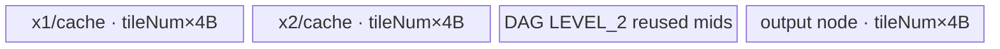
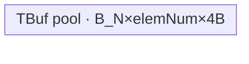

# Div 950 ACLNN 算子知识

## 算子速览

| 项目 | 内容 |
|---|---|
| 实际入口 | `aclnnDivGetWorkspaceSize` + `aclnnDiv`，公开 ACLNN 两段式接口；入口内部固定使用 `MODE_REAL_DIV=0`。 |
| 计算语义 | 两输入 broadcast 后逐元素真实除法 `out_i=self_i/other_i`；本入口没有 rounding 属性，不包含 `DivMod/DivMods` 的 trunc/floor 语义。 |
| 输入输出 | 950 公开输入为 FLOAT/FLOAT16/DOUBLE/INT32/INT64/INT16/INT8/UINT8/BOOL/COMPLEX64/COMPLEX128/BFLOAT16，ND、rank≤8、允许非连续；输出为可由推导 dtype 转换的同集合 dtype，shape 等于 broadcast shape。 |
| 执行类型 | R-001～R-009 的 RealDiv 核心为 AIV_VECTOR；R-002/R-003/R-005/R-007～R-009 的搬入含 NDDMA。DOUBLE/COMPLEX64/COMPLEX128 的 R-010/R-011 为 AiCPU。可选 Cast 为 no-op、AIV-only 或 AiCPU；无 Cube/AIC/MIX_CV。 |
| Kernel 路线 | 连续：R-001 mode202、R-002 mode1、R-003 mode2、R-004 mode101–104/109；非连续：R-005 mode301、R-006 mode302、R-007 mode303、R-008 mode304、R-009 mode305；AiCPU：R-010 fast、R-011 general broadcast。 |
| 核心资源 | AIV 路线使用 GM、一个 `TBuf<VECCALC>` 或静态 tensor pool、编译期 buffer ID、MicroAPI/Vector 寄存器和 16 MiB 核心 workspace 声明；AiCPU 路线使用输入输出 GM 与栈上最多 8 维 stride/coordinate 数组。 |
| 来源闭包 | `source_closed`：公开 ACLNN→dtype/shape/stride 前处理→可选 Cast→RealDiv AICore/AiCPU selector→950 Tiling/POD→全部连续/非连续 scheduler 或 AiCPU body→构建接线闭合；通用 Contiguous/ViewCopy 与 Executor 内部 workspace 编排是框架边界。 |
| 验证状态 | 已完成源码闭包检查；本次知识提取未执行编译、真机、数值或性能测试。 |

## 接口与语义

### 计算语义

令 `S=broadcast(self.shape, other.shape)`，对 `S` 中每个输出坐标 `i`，按输入有效 stride 映射到 `self_i`、`other_i` 后计算 `q_i=self_i/other_i`。`aclnnDiv` 将内部 mode 固定为 `MODE_REAL_DIV(0)`，因此不存在用户可选的舍入模式：整数与 bool 按 API 推导规则先选择计算 dtype，950 的 INT32/BOOL 核心直接产生 FP32，其他普通整数先 Cast 为 FP32；只有另外的 `aclnnDivMod/Mods` 才承载 trunc/floor，不属于本卡。

DOUBLE 与 complex 计算进入 AiCPU，浮点除零不预检；AiCPU 的整数模板会预扫分母零值，但 `aclnnDiv` 的 950 推导不会把普通整数保留到该 AiCPU route。复数分母模为零时仍使用标准复数除法表达式，不做 CPU/GPU 特殊对齐。

### 输入、输出与属性

| 参数 | shape/layout | dtype | 约束、默认值与语义 |
|---|---|---|---|
| `self` | ND，rank≤8，可非连续 | 950 公开 12 类 dtype | 必填；与 `other` 可 broadcast。 |
| `other` | ND，rank≤8，可非连续 | 同 `self` | 必填；与 `self` 满足类型推导关系。 |
| `out` | ND，shape严格等于 broadcast shape，可非连续 | 推导结果可转换到的公开 dtype | 必填；核心临时结果经可选 Cast 和 ViewCopy 写入。 |
| rounding | N/A | N/A | `aclnnDiv` 无该参数；内部恒传 `MODE_REAL_DIV=0`。 |
| `workspaceSize` | Host 标量 | `uint64_t*` | 第一段返回完整 Executor 的 Device workspace 字节数。 |
| `executor` | Host 对象 | `aclOpExecutor**` | 保存前处理、Cast、RealDiv、ViewCopy 节点及其依赖。 |
| `workspace/workspaceSize/stream` | Device workspace/ACL stream | 指针、`uint64_t`、`aclrtStream` | 第二段交给 `CommonOpExecutorRun`。 |

### 入口与版本

固定提交只公开无版本后缀的 `aclnnDivGetWorkspaceSize/aclnnDiv`，是 950 当前公开版本。`aclnnInplaceDiv`、标量 `Divs` 和带 mode 的 `DivMod/DivMods` 是不同入口语义，不合并。公开文档明确支持 Ascend 950PR/950DT；`RealDiv::AICore().AddConfig("ascend950")`、ascend950 binary config、`SUPPORT_COMPUTE_UNIT "ascend950"` 与 `arch35` Tiling/entry 共同确认 950 实现。

## Host/Launcher 执行流程

### 参数校验与前处理

1. 创建唯一 Executor；依次检查三指针、rank≤8、broadcast 与输出 shape、平台 dtype 表、推导/输出转换关系、非私有 format。
2. 任一输入为空时写 `workspaceSize=0` 并成功返回，不创建 Device 节点。
3. 950 使用 `InferDivModeDtype(...,0)`：先 `PromoteType`；若结果不是 INT32/BOOL 且不是浮点/复数，则升为 FLOAT。两路整数（INT64/INT16/INT8/UINT8）因此进入 FLOAT；INT32/BOOL 保留为核心输入但 RealDiv 输出 FP32。
4. 对每个输入，若 dtype 已是计算 dtype 且 `IsRealDivSupportNonContiguous` 为真，则 `CreateView` 原样保留 storage shape、view stride 和 offset；否则先 `Contiguous`，再调用 `l0op::Cast`。同 dtype Cast 是 no-op；950 支持表内 pair 走 AIV-only Cast，其余合法 pair 走 AiCPU Cast。
5. `l0op::RealDiv(..., MODE_REAL_DIV, executor)` 推导 broadcast shape并分配临时输出。950 计算 dtype `{F16,BF16,F32,INT32,BOOL}` 进入 AICore；DOUBLE/COMPLEX64/COMPLEX128 进入 AiCPU。
6. 核心结果再 Cast 到 `out.dtype`，最后 `ViewCopy` 写回可能非连续的 `out`。任一空结果阻断后续图构建。
7. 第一段聚合 workspace并移交 Executor；第二段在指定 stream 上执行。

### 参数、Workspace 与生命周期

调用者拥有输入、输出、workspace 与 stream。第一段期间 `uniqueExecutor` 拥有 Contiguous/Cast 临时张量、RealDiv 临时输出和 launcher 描述，`ReleaseTo(executor)` 后转移所有权。AICore Broadcast Tiling 固定声明 `16*1024*1024` 字节核心 workspace，`real_div` entry 接收但 DAG/scheduler 不寻址；完整 `workspaceSize` 还包含前后通用节点，Executor 的切片 offset、别名和事件细节固定仓不可见。AiCPU route 由 `AicpuTaskSpace("RealDiv")` 管理任务空间。

### 启动图与失败传播

```text
aclnnDivGetWorkspaceSize
  -> CreateView(input) OR Contiguous(input) -> Cast(input, computeDtype)?
  -> l0op::RealDiv(mode=0)
       -> AICore RealDiv [R-001..R-009]
          OR AiCPU RealDiv [R-010/R-011]
  -> Cast(coreOut, out.dtype)? -> ViewCopy(out)
aclnnDiv
  -> CommonOpExecutorRun(workspace, workspaceSize, executor, stream)
```

核心只有一个 RealDiv Device 节点；可选 Cast 是同一 Executor 中位于它之前/之后的独立节点。同一 stream 保持提交顺序，前一节点或 launcher 创建失败即阻断后继。核心没有跨 Kernel workspace edge；其输入输出临时张量由 Executor 持有到消费结束。

## Route 与参数设计

### 分核与资源计算

连续 AIV route 右对齐 shape、把 broadcast 轴输入 stride 置 0 并合并相邻等价轴。记合轴输出维数 `L`、AIV 核数 `C`、UB 字节 `U`、最大中间 dtype 字节 `smax=4`、NDDMA/UB cache DAG buffer 数分别 `B_N=OpDag::GetBufferNum<true,true>()` 与 `B_U=OpDag::GetBufferNum<false,true>()`。

```text
# mode202
tile0 = floor((U/B_N)/512)*512/4
tile  = 按 C 与 N 再缩小，并保持 512B/4=128 元素对齐
ubOuter=ceil(N/tile); blockFormer=ceil(ubOuter/C); blockNum=ceil(ubOuter/blockFormer)

# 多轴
maxElem=floor(((U*8)/(B*32))/(256*8/minDtypeBits))*(256*8/minDtypeBits)
从内向外累乘输出维，确定 ubSplitAxis
ubFormer=maxElem/product(innerDims); ubOuter=ceil(D[axis]/ubFormer)
ubTail=D[axis]-(ubOuter-1)*ubFormer
fused=product(D[:axis])*ubOuter
blockFormer=ceil(fused/C); blockNum=ceil(fused/blockFormer)
blockTail=fused-(blockNum-1)*blockFormer
```

非连续优先识别≤4维的最后两轴转置或 NLast 转置；不满足约束则进入 304/305 通用非连续 NDDMA。AiCPU 按输出元素数分片：fast route 阈值 7168/35840，general route阈值 2048/16384；并行核数为 `max(1, CPU_num-2)`，中等规模最多4核且不超过元素数。

### Route 选择

| 顺序 | Route | Key/模板 | 精确选择条件与优先级 | 不适用去向 |
|---:|---|---|---|---|
| 1 | R-010 AiCPU fast | `NoBcastComputeImpl<T>` | compute dtype为 DOUBLE/COMPLEX64/COMPLEX128，且 shape相同或任一输入仅1元素 | 非简单广播→R-011 |
| 2 | R-011 AiCPU general | `BcastComputeImpl<T>` | 同上且需要一般 broadcast | shape校验失败→错误 |
| 3 | R-001 单轴 Advance | mode202 | AICore dtype；输入均连续；合轴后 `L==1`；DAG参数3≤4且无 Var | 多轴→R-004/R-002/R-003 |
| 4 | R-004 UB Broadcast | mode101–104/109 | 连续、多轴；大 NLast broadcast，或首个广播输入为F16/BF16且尾轴32B对齐 | false→R-002/R-003 |
| 5 | R-002 NDDMA≤5维 | mode1 | 连续、多轴、UB条件false、运行rank≤5 | rank>5→R-003 |
| 6 | R-003 NDDMA外循环 | mode2 | 连续、多轴、UB条件false、运行rank>5 | 无 fallback |
| 7 | R-007 Last transpose | mode303 | 存在非连续输入；支持检查通过；shape≤3且仅最后两轴转置 | 其它非连续选择 |
| 8 | R-005 NLast NDDMA | mode301 | 支持检查通过、shape≤4、尾轴连续；尾轴broadcast或 UB selector false | UB可用→R-006 |
| 9 | R-006 NLast UB | mode302 | 同上、尾轴非broadcast且 UB selector true | false→R-005 |
| 10 | R-008 通用非连续 NDDMA | mode304 | 专用非连续支持检查失败；运行rank≤5 | rank>5→R-009 |
| 11 | R-009 通用非连续外循环 | mode305 | 同上、运行rank>5 | 无 fallback |

```text
if computeDtype not in {F16,BF16,F32,INT32,BOOL}: AiCPU fast/general
else if all inputs contiguous:
  if collapsedRank==1: 202
  else if IsUbBroadcast(): 101..104/109
  else: runningRank<=5 ? 1 : 2
else if noncontiguous-specialized-supported:
  if last-two-axes transpose: 303
  else if !lastAxisBroadcast && IsUbBroadcast(): 302
  else: 301
else: runningRank<=5 ? 304 : 305
```

### 模板/实现执行矩阵

| Route | key/selector | dtype/shape/platform 完整命中条件 | 执行拓扑与 Kernel 节点 | 实际模板/body | 内存与同步特征 | tail/fallback |
|---|---|---|---|---|---|---|
| R-001 | 202 | 950 AICore dtype；连续；合轴rank1 | 单AIV | `BroadcastOneDimAdvanceSch<DivDag>` | 静态pool、buffer ID ping-pong | 最后核/最后tile真实count |
| R-002 | 1 | 连续多轴；NDDMA；rank≤5 | 单AIV+NDDMA | `BroadcastNddmaSch<...,false>` | 单TBuf pool；5D MultiCopy | `ubTail` |
| R-003 | 2 | 同上rank>5 | 单AIV+NDDMA | `BroadcastNddmaSch<...,true>` | 高维软件外循环+5D NDDMA | `ubTail` |
| R-004 | 101–104/109 | 连续多轴；UB selector true | 单AIV | `BroadcastUbSch<...,R>` | CopyIn与broadcast结果分别占pool子区 | 动态rank>4用109 |
| R-005 | 301 | 支持的NLast非连续；NDDMA | 单AIV+NDDMA | `BroadcastNlastTransposeNddmaSch` | padded strides、NDDMA搬入/搬出 | pad后只提交有效区 |
| R-006 | 302 | 支持的NLast非连续；UB broadcast | 单AIV | `BroadcastNlastTransposeUbBrcSch<...,4>` | loop-mode DataCopyPad+Broadcast | 尾轴broadcast禁用此路 |
| R-007 | 303 | ≤3维最后两轴转置 | 单AIV+NDDMA | `BroadcastLastTransposeSch` | 3D NDDMA转置搬入 | 尾块参数独立 |
| R-008 | 304 | 通用非连续；运行rank≤5 | 单AIV+NDDMA | `BroadcastNonContiguousNddmaSch<...,false>` | 原始stride驱动NDDMA | `ubTail` |
| R-009 | 305 | 通用非连续；运行rank>5 | 单AIV+NDDMA | `BroadcastNonContiguousNddmaSch<...,true>` | 外循环+原始stride | `ubTail` |
| R-010 | fast selector | DOUBLE/COMPLEX；同shape/单元素 | 单AiCPU | `NoBcastComputeImpl<T>` | 无UB；直接GM标量/线性循环 | 串行或ParallelFor |
| R-011 | general selector | DOUBLE/COMPLEX；一般broadcast | 单AiCPU | `ComputeBcastDivInfo`+`BcastComputeImpl<T>` | 栈上stride/coord；按inner strip | carry处理边界 |

### 隐藏性能 Guard

| Guard | Host/Tiling 条件 | Device/资源原因 | 影响 Route | 不满足时去向 | 源码符号 |
|---|---|---|---|---|---|
| mode固定 | `MODE_REAL_DIV=0` | 本入口不执行 trunc/floor | 全部 | 其它语义入口 | `HandleNotMixDataTypeDiv` |
| AICore dtype | `{F16,BF16,F32,BOOL,INT32,INT64}`，但本API mode0可达前五类 | 950 binary/body实例边界 | R-001..R-009 | R-010/R-011 |
| 空域 | 任一输入empty | 避免零tile并无需输出计算 | 全部之前 | 成功且无kernel | `aclnnDivGetWorkspaceSize` |
| UB容量 | `elemNum>0`、`B*elemNum*4<=U` | tensor pool必须容纳全部存活节点 | R-001..R-009 | Tiling失败 | `DoBrodcastTiling` |
| UB broadcast | `IsBigNLastBrc()`或F16/BF16尾轴32B对齐 | 避免大非尾广播NDDMA dcache压力 | R-004/R-006 | NDDMA route | `IsUbBroadcast` |
| NDDMA维数 | 运行rank≤5 | `MultiCopyParams<T,5>`上限 | R-002/R-003/R-008/R-009 | 软件外循环 | `SetSchMode` |
| 非连续专用 | shape≤4、尾轴连续；last-transpose shape≤3；还满足128B连续/小包/小shape之一 | 专用NDDMA参数可表达 | R-005..R-007 | R-008/R-009 | `isBroadcastTemplateNonContiguousSupport` |
| AIV-only | `BroadcastSch::Process`设置 `KERNEL_TYPE_AIV_ONLY` | DAG仅Vector/MicroAPI和搬运 | R-001..R-009 | N/A | `BroadcastSch::Process` |
| AiCPU parallel | fast `N>=7168`；general `N>=2048` | 小任务避免分片开销 | R-010/R-011 | 串行循环 | `NoBcastComputeImpl/BcastComputeImpl` |
| AiCPU除零 | `verify_zero`仅整数模板true | 防止C++整数除零 | AiCPU整数body | 参数错误 | `RealDivCompute` |

### POD/ABI

公共模板结构的最终实例化 `sizeof/offsetof` 受 DAG 零长数组和编译器扩展影响，固定仓未物化；下表保留源码顺序、类型和 producer/consumer。mode202 的普通结构可确定 `sizeof=16, align=8`。

| 结构 | 字段 | 类型/位宽 | ABI 布局 | 单位 | Host/launcher producer | Device consumer | 边界 |
|---|---|---|---|---|---|---|---|
| `BroadcastOneDimTilingDataAdvance` | `dimLen` | int64/64 | offset0 | 元素 | 合轴输出长度 | scheduler重算tile/core尾部 | >0 |
| 同上 | `tileNum` | int32/32 | offset8 | 元素/tile | `GetOneDimUBFormerAdvance` | `blockEleLen/blockLen` | >0 |
| 同上 | `blockNum` | int16/16 | offset12 | AIV核 | Host窄化写入并SetBlockDim | last-core判断 | 无显式INT16溢出检查 |
| 同上 | `scalarFlag` | int16/16 | offset14 | 输入位图 | 输入合轴dim==1置bit | CopyIn选择Duplicate/线性 | bit0/bit1 |
| `BroadcastBaseTilingData<OpDag>` | `shapeLen` | int32/32 | 最终offset不可见 | 轴 | 合轴维数 | 所有轴循环 | 1..8 |
| 同上 | `ubSplitAxis` | int32/32 | 同上 | 轴索引 | 容量切分 | GM offset/NDDMA | 合法轴 |
| 同上 | `ubFormer` | int32/32 | 同上 | 元素 | maxElem/innerProduct | 整tile | >0 |
| 同上 | `ubTail` | int32/32 | 同上 | 元素 | 尾块公式 | 最后逻辑tile | 1..ubFormer |
| 同上 | `ubOuter` | int64/64 | 同上 | tile | ceil(dim/ubFormer) | axis推进/cache | >0 |
| 同上 | `blockFormer` | int64/64 | 同上 | tile/core | ceil(fused/C) | 普通核循环 | >0 |
| 同上 | `blockTail` | int64/64 | 同上 | tile | 尾核公式 | 最后一核 | 1..blockFormer |
| 同上 | `dimProductBeforeUbInner` | int64/64 | 同上 | 外层product | 合轴乘积 | 展开axesIndices | 乘法无显式溢出检查 |
| 同上 | `elemNum` | int64/64 | 同上 | 4B容量元素/buffer | UB容量公式 | `blockEleNum_` | >0 |
| 同上 | `blockNum` | int64/64 | 同上 | AIV核 | ceil(fused/blockFormer) | GetBlockNum | >0 |
| 同上 | `outputDims[8]` | int64[8] | 同上 | 元素/轴 | 合轴输出shape | 轴、NDDMA、UB broadcast | 前shapeLen有效 |
| 同上 | `outputStrides[8]` | int64[8] | 同上 | 元素stride | 输出连续stride | 输出offset | 前shapeLen有效 |
| 同上 | `inputBrcDims[2][8]` | int64数组 | 同上 | 元素/轴 | 两个CopyInBrc shape | NDDMA/UB broadcast | 前shapeLen有效 |
| 同上 | `inputBrcStrides[2][8]` | int64数组 | 同上 | 元素stride | 两输入真实/广播stride | GM offset和MultiCopy | broadcast轴为0 |
| 同上 | `scalarData[16]` | char[16] | 同上 | 原始字节 | 初始化零；本DAG无Var | 不读 | inactive |
| `BroadcastNlastTransposeTilingData` | `outputStridesWithPad[4]` | int64[4] | 最终offset不可见 | 元素stride | NLast Tiling | padded tile长度/CopyOut | 仅mode301/302 |
| 同上 | `minDtypeBlockAlignSize` | int32/32 | 同上 | 元素 | 32B/min dtype | pad与搬运 | >0 |
| `BroadcastLastTransposeTilingData` | `ubFormerLastAxis` | int32/32 | 最终offset不可见 | 元素 | last-transpose Tiling | 3D NDDMA主块 | mode303 |
| 同上 | `ubTailLastAxis` | int32/32 | 同上 | 元素 | last轴尾块 | 尾NDDMA | mode303 |
| AiCPU `BcastDivInfo` | `ndims` | int32/32 | C++ ABI固定仓未导出 | 轴 | `ComputeBcastDivInfo` | sharder | 1..8 |
| 同上 | `out_shape/x_strides/y_strides/out_strides` | int64[8]各 | 同上 | 元素/stride | pad、去1、合轴 | offset与carry | broadcast stride=0 |
| 同上 | `total_elements` | int64/64 | 同上 | 元素 | out_stride[0]*out_shape[0] | 分片范围 | 乘法无显式溢出检查 |

### Route 源码闭包

| Route | Key/selector | Host/Tiling producer | POD/参数 | Kernel entry/router 节点 | Kernel body/直接依赖 | 构建接线 |
|---|---|---|---|---|---|---|
| R-001 | 202 | `RealDivTiling::DoOpTiling`→公共broadcast Tiling | OneDimAdvance | `real_div<202>` | one_dim_advance + RealDiv DAG | RealDiv def/config/CMake |
| R-002/R-003/R-004 | 1/2/101..109 | 同上 | BaseTilingData | `real_div<mode>` | nddma/ub scheduler + DAG | 同上 |
| R-005/R-006 | 301/302 | 非连续selector | NlastTranspose POD | `real_div<301/302>` | NLast NDDMA/UB scheduler | 同上 |
| R-007 | 303 | last-transpose selector | LastTranspose POD | `real_div<303>` | LastTranspose scheduler | 同上 |
| R-008/R-009 | 304/305 | 非连续fallback | BaseTilingData | `real_div<304/305>` | NonContiguous NDDMA scheduler | 同上 |
| R-010/R-011 | l0 AiCPU selector | `RealDiv(...mode)` | AiCPU Tensor元数据/BcastDivInfo | `ADD_TO_LAUNCHER_LIST_AICPU(RealDiv)` | `RealDivKernel::Compute` | AICPU OpDef/CMake |

## Kernel 实现

### 公共执行流程

`real_div<schMode>` 按编译 dtype 选择 DAG：F16/BF16 先 Cast FP32、`DivHighPrecision<float>`、RINT降回；F32直接 `DivHighPrecision<float>`；BOOL 经 int8→half→float 后普通 `Div<float>`；INT32→FP32 使用两路 Cast+`DivHighPrecision<float>`。全部 AIV route 都按 `CopyInBrc x1/x2 → dtype管线 → Div → CopyOut` 运行。AiCPU route 直接对 DOUBLE/complex 执行 C++ `/`。

### Route R-001：单轴 Advance

#### 适用条件

##### 选择证据

| 层级 | 文件 | 符号 | 源码谓词/参数 | 结果/下一跳 |
|---|---|---|---|---|
| API | `math/div/op_api/aclnn_div.cpp` | `HandleNotMixDataTypeDiv` | mode0且AICore dtype | RealDiv launcher |
| Tiling | `broadcast_tiling.h` | `DoTiling` | 连续且合轴rank1、3参数≤4、无Var | mode202 |
| Router | `broadcast_sch.h` | `BroadcastSch::Process` | `schMode==202` | OneDimAdvance |

#### Device 数据流

##### 函数级调用链

```text
real_div<202> -> BroadcastSch<202,DivDag>::Process
  -> BroadcastOneDimAdvanceSch::Init/Process/Run
  -> CopyInBrc(x1,x2) -> Cast? -> Div/DivHighPrecision -> Cast? -> CopyOut
```

##### 源码等价伪码

```text
coreBase=blockIdx*blockFormer*tileNum
for tile in coreTiles:
  count=lastCore&&lastTile ? ubTail : tileNum
  load each input at scalar?0:coreBase+tile*tileNum
  duplicate scalar or DataCopyPad(count)
  execute dtype DAG on count lanes
  CopyOut y[coreBase+tile*tileNum : +count]
```

#### 内存与数据搬运

##### 资源与搬运表

| 层级/缓冲区 | offset/地址公式 | extent/容量公式 | dtype/layout | producer | consumer | owner/lifetime | 对齐/复用 |
|---|---|---|---|---|---|---|---|
| GM x1/x2 | scalar 0；否则coreBase+tileOffset | count元素 | compute dtype/linear | Executor | CopyInBrc | 到核心结束 | DataCopyPad |
| tensor pool | `bufId*tileNum*4` | `B_N*tileNum*4`字节 | 节点重解释 | CopyIn/计算 | DAG后继 | 单tile | ping-pong ID |
| GM y | coreBase+tileOffset | count输出 | output dtype/linear | CopyOut | post-Cast | Executor | 只写有效元素 |

##### 分层内存布局



##### 字节账与复用顺序

```text
UB_total=B_N*tileNum*4 <= U
dynamic_ub=N/A
workspace_total(core)=16MiB declared, body unread
```

| 复用子区 | 写入者 | 读取者/消费点 | 下一次覆盖 | 同步或释放依据 | 安全条件 |
|---|---|---|---|---|---|
| DAG bufId | CopyIn/Cast/Div | DAG后继 | 后继消费后或下一ping/pong | `GetTensor/ReleaseTensor` | 编译期liveness不重叠 |

#### 同步、精度与尾块

##### 同步与数值边界表

| 阶段 | primitive/机制 | producer | consumer/等待点 | 保护对象 | 精度/尾块 |
|---|---|---|---|---|---|
| GM→pool→GM | tensor-position token | CopyIn/compute | 后继节点 | bufId子区 | count传真实tail |
| 除法 | `DivHighPrecision(DIFF_COMPENSATION)`或`Div` | 两输入 | CopyOut | 有效lane | F16/BF16在FP32计算后RINT |

#### 关键实现

##### 符号证据表

| 阶段 | 文件 | 符号/模板实例 | 实现事实 |
|---|---|---|---|
| Host/Tiling producer | `real_div_tiling_arch35.cpp` | `DoOpTiling` | dtype DAG与公共Tiling |
| Kernel entry/router | `real_div_apt.cpp` | `real_div<schMode>` | dtype→DAG |
| Device body/helper | `broadcast_sch_one_dim_advance.h` | `Process/Run` | core/tile/tail与ping-pong |

### Route R-002：连续 NDDMA 无外循环

#### 适用条件
##### 选择证据

| 层级 | 文件 | 符号 | 源码谓词/参数 | 结果/下一跳 |
|---|---|---|---|---|
| Tiling | `broadcast_tiling.h` | `SetSchMode` | 连续、多轴、UB=false、运行rank≤5 | mode1 |
| Router | `broadcast_sch.h` | `Process` | mode1 | `BroadcastNddmaSch<false>` |

#### Device 数据流
##### 函数级调用链

```text
real_div<1> -> BroadcastNddmaSch<DivDag,false>::Process
  -> axesIndices -> CopyInBrc/MultiCopy<5> -> dtype DAG -> CopyOut
```

##### 源码等价伪码

```text
for localTile in blockFormer/blockTail:
  axes=decode(blockIdx*blockFormer+localTile)
  size=lastLogicalTile?ubTail:ubFormer
  NDDMA each input using inputBrcStrides[2][8]
  run Div DAG on size*outputStride[axis]
  CopyOut at dot(axes,outputStrides)
```

#### 内存与数据搬运
##### 资源与搬运表

| 层级/缓冲区 | offset/地址公式 | extent/容量公式 | dtype/layout | producer | consumer | owner/lifetime | 对齐/复用 |
|---|---|---|---|---|---|---|---|
| GM inputs | axes·input stride | broadcast tile | ND | Executor | NDDMA | core | stride0广播 |
| TBuf pool | `bufId*elemNum*4` | `B_N*elemNum*4` | local linear | MultiCopy | DAG | kernel | ping-pong |
| GM y | axes·output stride | tileLength | ND | CopyOut | Executor | core | tail有效 |

##### 分层内存布局



##### 字节账与复用顺序

```text
UB_total=B_N*elemNum*4<=U; dynamic_ub=N/A; workspace_total(core)=16MiB declared
```

| 复用子区 | 写入者 | 读取者/消费点 | 下一次覆盖 | 同步或释放依据 | 安全条件 |
|---|---|---|---|---|---|
| pool bufId | NDDMA/计算 | DAG后继 | 下一tile同ping/pong | Get/ReleaseTensor | 消费后释放 |

#### 同步、精度与尾块
##### 同步与数值边界表

| 阶段 | primitive/机制 | producer | consumer/等待点 | 保护对象 | 精度/尾块 |
|---|---|---|---|---|---|
| NDDMA→Vector | position token | MultiCopy | Div DAG | pool子区 | ubTail决定末tile |
| Vector→GM | Release/CopyOut | Div | 下一覆盖 | pool子区 | dtype精度同R-001 |

#### 关键实现
##### 符号证据表

| 阶段 | 文件 | 符号/模板实例 | 实现事实 |
|---|---|---|---|
| Host/Tiling producer | `broadcast_tiling.h` | `DoBroadcastOpTiling` | mode/elemNum/POD |
| Kernel entry/router | `broadcast_sch.h` | mode1 | NDDMA无外循环 |
| Device body/helper | `broadcast_sch_nddma.h` | `CopyInBrc/Run` | 5D参数、cache、tail |

### Route R-003：连续 NDDMA 外循环

#### 适用条件
##### 选择证据

| 层级 | 文件 | 符号 | 源码谓词/参数 | 结果/下一跳 |
|---|---|---|---|---|
| Tiling | | `SetSchMode` | runningRank>5 | mode2 |
| Router | | `BroadcastSch::Process` | mode2 | `BroadcastNddmaSch<true>` |

#### Device 数据流
##### 函数级调用链

```text
real_div<2> -> BroadcastNddmaSch<DivDag,true>
  -> BroadcastNddmaWithLoop -> inner MultiCopy<5> -> Div DAG -> CopyOut
```

##### 源码等价伪码

```text
同R-002，但把超出5维的外轴展开为软件循环；每次重算GM/UB offset，再调用5D MultiCopy。
```

#### 内存与数据搬运
##### 资源与搬运表

| 层级/缓冲区 | offset/地址公式 | extent/容量公式 | dtype/layout | producer | consumer | owner/lifetime | 对齐/复用 |
|---|---|---|---|---|---|---|---|
| 外轴GM窗口 | outerCoord·stride+innerOffset | 每次≤5D tile | ND | helper | NDDMA | loop | 高维不物化 |
| TBuf pool | bufId*elemNum*4 | B_N*elemNum*4 | local | NDDMA | DAG | tile | 同R-002 |

##### 分层内存布局


##### 字节账与复用顺序

```text
UB_total=B_N*elemNum*4<=U; outer coordinates不物化GM workspace
```

| 复用子区 | 写入者 | 读取者/消费点 | 下一次覆盖 | 同步或释放依据 | 安全条件 |
|---|---|---|---|---|---|
| pool | inner NDDMA | DAG | 下一outer/inner迭代 | position token | 当前迭代消费完 |

#### 同步、精度与尾块
##### 同步与数值边界表

| 阶段 | primitive/机制 | producer | consumer/等待点 | 保护对象 | 精度/尾块 |
|---|---|---|---|---|---|
| outer→inner | 顺序循环 | offset helper | MultiCopy | GM窗口 | 高维完整覆盖 |
| inner tail | ubTail | Tiling | DAG | 有效lane | 同R-001精度 |

#### 关键实现
##### 符号证据表

| 阶段 | 文件 | 符号/模板实例 | 实现事实 |
|---|---|---|---|
| Host/Tiling producer | `broadcast_tiling.h` | `SetSchMode` | >5维选mode2 |
| Kernel entry/router | `broadcast_sch.h` | mode2 | withLoop=true |
| Device body/helper | `broadcast_utils.h` | `BroadcastNddmaWithLoop` | 外轴拆分 |

### Route R-004：连续 UB Broadcast

#### 适用条件
##### 选择证据

| 层级 | 文件 | 符号 | 源码谓词/参数 | 结果/下一跳 |
|---|---|---|---|---|
| Tiling | `broadcast_tiling.h` | `IsUbBroadcast/SetSchMode` | 大NLast或16-bit尾轴32B对齐 | 101..104/109 |
| Router | `broadcast_sch.h` | | mode101..109 | `BroadcastUbSch<R>` |

#### Device 数据流
##### 函数级调用链

```text
real_div<101..109> -> BroadcastUbSch<DivDag,R>
  -> CopyInAndVecBrc(x1,x2) -> Broadcast -> Div DAG -> CopyOut
```

##### 源码等价伪码

```text
load each unique source region once; construct local src/dst shapes from POD;
Broadcast into full tile, cache stride0 input across eligible tiles;
run dtype DAG; write valid ubFormer/ubTail region.
```

#### 内存与数据搬运
##### 资源与搬运表

| 层级/缓冲区 | offset/地址公式 | extent/容量公式 | dtype/layout | producer | consumer | owner/lifetime | 对齐/复用 |
|---|---|---|---|---|---|---|---|
| unique input region | axes·stride | nonbroadcast source extent | input dtype | DataCopyPad | Broadcast | tile/cache | broadcast轴不重复读 |
| expanded pool region | bufId*blockLen | full tile | input dtype | Broadcast | Div | tile | separate live bufId |
| output | output offset | valid tile | output dtype | CopyOut | Executor | core | tail protected |

##### 分层内存布局


##### 字节账与复用顺序

```text
UB_total=B_U*elemNum*4<=U; mode109仅把rank逻辑改为运行时，不增加另一个GM workspace
```

| 复用子区 | 写入者 | 读取者/消费点 | 下一次覆盖 | 同步或释放依据 | 安全条件 |
|---|---|---|---|---|---|
| compact/expanded bufId | CopyIn/Broadcast | Div DAG | 下一tile | Get/ReleaseTensor | cache条件满足才跨tile保留 |

#### 同步、精度与尾块
##### 同步与数值边界表

| 阶段 | primitive/机制 | producer | consumer/等待点 | 保护对象 | 精度/尾块 |
|---|---|---|---|---|---|
| CopyIn→Broadcast | position token | DataCopyPad | Broadcast | compact region | 局部shape真实tail |
| Broadcast→Div | position token | Broadcast | Div | expanded region | 无效padding不CopyOut |

#### 关键实现
##### 符号证据表

| 阶段 | 文件 | 符号/模板实例 | 实现事实 |
|---|---|---|---|
| Host/Tiling producer | `broadcast_tiling.h` | `IsUbBroadcast` | route谓词 |
| Kernel entry/router | `broadcast_sch.h` | modes101..109 | 静态/动态rank |
| Device body/helper | `broadcast_sch_ub_broadcast.h` | `CopyInAndVecBrc` | 少搬入后UB扩展 |

### Route R-005：NLast 非连续 NDDMA

#### 适用条件
##### 选择证据

| 层级 | 文件 | 符号 | 源码谓词/参数 | 结果/下一跳 |
|---|---|---|---|---|
| API | `aclnn_div.cpp` | `CreateView` | dtype不变且950 AICore支持 | 保留stride |
| Tiling | | `DoNonContiguousBroadcastOpTiling` | 专用支持、非last-transpose、NDDMA | mode301 |

#### Device 数据流
##### 函数级调用链

```text
real_div<301> -> BroadcastNlastTransposeNddmaSch
  -> NLast padded NDDMA CopyIn -> Div DAG -> padded NDDMA CopyOut
```

##### 源码等价伪码

```text
decode≤4D axes; use original input stride and padded output stride;
NDDMA gather tile to padded UB; compute on padded tile; CopyOut only logical extents.
```

#### 内存与数据搬运
##### 资源与搬运表

| 层级/缓冲区 | offset/地址公式 | extent/容量公式 | dtype/layout | producer | consumer | owner/lifetime | 对齐/复用 |
|---|---|---|---|---|---|---|---|
| strided GM | axes·inputBrcStride | NLast tile | view stride | caller view | NDDMA | core | tail轴连续 |
| padded TBuf | bufId*elemNum*4 | B_N*elemNum*4 | padded local | NDDMA | DAG | tile | 32B/minDtype pad |

##### 分层内存布局


##### 字节账与复用顺序

```text
UB_total=B_N*elemNum*4<=U; elemNum已包含pad容量
```

| 复用子区 | 写入者 | 读取者/消费点 | 下一次覆盖 | 同步或释放依据 | 安全条件 |
|---|---|---|---|---|---|
| padded pool | NDDMA | Div/CopyOut | next tile | Get/ReleaseTensor | CopyOut完成后 |

#### 同步、精度与尾块
##### 同步与数值边界表

| 阶段 | primitive/机制 | producer | consumer/等待点 | 保护对象 | 精度/尾块 |
|---|---|---|---|---|---|
| gather→compute | token | NDDMA | DAG | padded UB | outputStridesWithPad |
| compute→scatter | token | DAG | CopyOut | 有效区 | pad lane不提交 |

#### 关键实现
##### 符号证据表

| 阶段 | 文件 | 符号/模板实例 | 实现事实 |
|---|---|---|---|
| Host/Tiling producer | `broadcast_tiling.h` | `DoBroadcastOpTilingNLastTranspose` | mode301 |
| Kernel entry/router | `broadcast_sch.h` | mode301 | NLast NDDMA |
| Device body/helper | `broadcast_sch_nlast_transpose_nddma.h` | `CopyInBrc/CopyOut` | padded stride网络 |

### Route R-006：NLast 非连续 UB Broadcast

#### 适用条件
##### 选择证据

| 层级 | 文件 | 符号 | 源码谓词/参数 | 结果/下一跳 |
|---|---|---|---|---|
| Tiling | | `DoBroadcastOpTilingNLastTranspose` | 非尾轴broadcast且IsUbBroadcast=true | mode302 |
| Router | | `BroadcastSch::Process` | mode302 | NLast UB scheduler |

#### Device 数据流
##### 函数级调用链

```text
real_div<302> -> BroadcastNlastTransposeUbBrcSch<DivDag,4>
  -> loop-mode DataCopyPad -> UB Broadcast -> Div DAG -> loop-mode CopyOut
```

##### 源码等价伪码

```text
derive loop1/loop2/block_count/block_len from padded 4D shapes;
SetLoopModePara(OUT_TO_UB); DataCopyPad compact source; reset;
Broadcast to padded tile; Div; SetLoopModePara(UB_TO_OUT); write logical region.
```

#### 内存与数据搬运
##### 资源与搬运表

| 层级/缓冲区 | offset/地址公式 | extent/容量公式 | dtype/layout | producer | consumer | owner/lifetime | 对齐/复用 |
|---|---|---|---|---|---|---|---|
| compact/padded pool | intList bufId*blockLen | B_U*elemNum*4 | padded4D | loop DataCopy | Broadcast/Div | tile | explicit loop mode reset |
| output GM | NLast output offset | logical extent | ND | loop CopyOut | Executor | tile | UB_TO_OUT reset |

##### 分层内存布局


##### 字节账与复用顺序

```text
UB_total=B_U*elemNum*4<=U; loop-mode state在每次搬运后Reset
```

| 复用子区 | 写入者 | 读取者/消费点 | 下一次覆盖 | 同步或释放依据 | 安全条件 |
|---|---|---|---|---|---|
| intList buffers | DataCopy/Broadcast/Div | next DAG node | tile end | Get/ReleaseTensor | loop mode已reset |

#### 同步、精度与尾块
##### 同步与数值边界表

| 阶段 | primitive/机制 | producer | consumer/等待点 | 保护对象 | 精度/尾块 |
|---|---|---|---|---|---|
| loop DMA | Set/ResetLoopModePara | Host POD-derived loop | Broadcast/GM | DMA状态 | padded shape限制tail |
| DAG | token | Broadcast | Div/CopyOut | pool | FP16/BF16升FP32 |

#### 关键实现
##### 符号证据表

| 阶段 | 文件 | 符号/模板实例 | 实现事实 |
|---|---|---|---|
| Host/Tiling producer | `broadcast_tiling.h` | `DoBroadcastOpTilingNLastTranspose` | mode302谓词 |
| Kernel entry/router | `broadcast_sch.h` | mode302 | UB route |
| Device body/helper | `broadcast_sch_nlast_transpose_ub_broadcast.h` | `CopyInAndVecBrc/CopyOutMoveAlign` | loop DMA与pad |

### Route R-007：最后两轴转置

#### 适用条件
##### 选择证据

| 层级 | 文件 | 符号 | 源码谓词/参数 | 结果/下一跳 |
|---|---|---|---|---|
| Tiling | | `isBroadcastTemplateNonContiguousSupport` | `isOnlyLastTwoAxesTransposed && shapeDim<=3` | mode303 |
| Router | | `BroadcastSch::Process` | mode303 | LastTranspose scheduler |

#### Device 数据流
##### 函数级调用链

```text
real_div<303> -> BroadcastLastTransposeSch
  -> BroadcastGetGmOffsetLastTranspose -> DataCopy<T,3> -> Div DAG -> CopyOut
```

##### 源码等价伪码

```text
split ub axis and last axis independently; construct 3D MultiCopy main/tail params;
transpose-gather each input into linear UB; divide; scatter logical output.
```

#### 内存与数据搬运
##### 资源与搬运表

| 层级/缓冲区 | offset/地址公式 | extent/容量公式 | dtype/layout | producer | consumer | owner/lifetime | 对齐/复用 |
|---|---|---|---|---|---|---|---|
| transposed GM | `BroadcastGetGmOffsetLastTranspose` | main/tail 3D blocks | last2 swapped | caller | NDDMA | tile | dedicated last-axis tail |
| TBuf | B_N*elemNum*4 | tiling capacity | linear local | NDDMA | DAG | tile | bufId reuse |

##### 分层内存布局


##### 字节账与复用顺序

```text
UB_total=B_N*elemNum*4<=U; workspace core仍仅声明16MiB且body不读
```

| 复用子区 | 写入者 | 读取者/消费点 | 下一次覆盖 | 同步或释放依据 | 安全条件 |
|---|---|---|---|---|---|
| pool | 3D NDDMA | DAG | next tile | token | main/tail参数匹配 |

#### 同步、精度与尾块
##### 同步与数值边界表

| 阶段 | primitive/机制 | producer | consumer/等待点 | 保护对象 | 精度/尾块 |
|---|---|---|---|---|---|
| transpose gather | MultiCopy<3> | GM | DAG | UB tile | ubTailLastAxis |
| output | CopyOut | DAG | GM | valid tile | 无效pad不提交 |

#### 关键实现
##### 符号证据表

| 阶段 | 文件 | 符号/模板实例 | 实现事实 |
|---|---|---|---|
| Host/Tiling producer | `broadcast_tiling.h` | `DoBroadcastOpTilingLastTranspose` | mode303/POD |
| Kernel entry/router | `broadcast_sch.h` | mode303 | specialized route |
| Device body/helper | `broadcast_sch_last_transpose.h` | `CopyInBrc` | 3D NDDMA主尾块 |

### Route R-008：通用非连续 NDDMA

#### 适用条件
##### 选择证据

| 层级 | 文件 | 符号 | 源码谓词/参数 | 结果/下一跳 |
|---|---|---|---|---|
| Tiling | | `DoBroadcastOpTilingNonContiguousBase` | 专用支持false且rank≤5 | mode304 |
| Router | | `BroadcastSch::Process` | mode304 | NonContiguousNddma false |

#### Device 数据流
##### 函数级调用链

```text
real_div<304> -> BroadcastNonContiguousNddmaSch<DivDag,false>
  -> stride-aware CopyIn/CopyInBrc -> Div DAG -> linear CopyOut
```

##### 源码等价伪码

```text
decode axes; form GM offsets from original view strides; use ≤5D NDDMA;
compute tile; write contiguous temporary RealDiv output.
```

#### 内存与数据搬运
##### 资源与搬运表

| 层级/缓冲区 | offset/地址公式 | extent/容量公式 | dtype/layout | producer | consumer | owner/lifetime | 对齐/复用 |
|---|---|---|---|---|---|---|---|
| view GM | axes·actual stride | ≤5D tile | arbitrary supported stride | CreateView | NDDMA | core | no pre-Contiguous |
| TBuf | B_N*elemNum*4 | capacity | local linear | NDDMA | DAG | tile | ping-pong |

##### 分层内存布局


##### 字节账与复用顺序

```text
UB_total=B_N*elemNum*4<=U
```

| 复用子区 | 写入者 | 读取者/消费点 | 下一次覆盖 | 同步或释放依据 | 安全条件 |
|---|---|---|---|---|---|
| pool | generic gather | DAG | next tile | Get/ReleaseTensor | current consumer complete |

#### 同步、精度与尾块
##### 同步与数值边界表

| 阶段 | primitive/机制 | producer | consumer/等待点 | 保护对象 | 精度/尾块 |
|---|---|---|---|---|---|
| gather | NDDMA | view GM | DAG | UB | ubTail |
| divide | DivHighPrecision/Div | inputs | CopyOut | valid lanes | dtype规则同公共流程 |

#### 关键实现
##### 符号证据表

| 阶段 | 文件 | 符号/模板实例 | 实现事实 |
|---|---|---|---|
| Host/Tiling producer | `broadcast_tiling.h` | `DoBroadcastOpTilingNonContiguousBase` | mode304 |
| Kernel entry/router | `broadcast_sch.h` | mode304 | no outer loop |
| Device body/helper | `broadcast_sch_nddma_transpose.h` | `CopyIn/CopyInBrc` | actual stride NDDMA |

### Route R-009：通用非连续 NDDMA 外循环

#### 适用条件
##### 选择证据

| 层级 | 文件 | 符号 | 源码谓词/参数 | 结果/下一跳 |
|---|---|---|---|---|
| Tiling | | `DoBroadcastOpTilingNonContiguousBase` | 专用支持false且rank>5 | mode305 |
| Router | | `BroadcastSch::Process` | mode305 | NonContiguousNddma true |

#### Device 数据流
##### 函数级调用链

```text
real_div<305> -> BroadcastNonContiguousNddmaSch<DivDag,true>
  -> outer stride loop -> inner≤5D NDDMA -> Div DAG -> CopyOut
```

##### 源码等价伪码

```text
同R-008；超出5维的轴以软件循环推进actual-stride GM offset，内层保持5D NDDMA。
```

#### 内存与数据搬运
##### 资源与搬运表

| 层级/缓冲区 | offset/地址公式 | extent/容量公式 | dtype/layout | producer | consumer | owner/lifetime | 对齐/复用 |
|---|---|---|---|---|---|---|---|
| outer view windows | outerCoord·actualStride | inner5D tile | noncontiguous | offset helper | NDDMA | iteration | no materialized transpose |
| TBuf | B_N*elemNum*4 | capacity | local | NDDMA | DAG | tile | reused |

##### 分层内存布局


##### 字节账与复用顺序

```text
UB_total=B_N*elemNum*4<=U; outer loop仅寄存器状态
```

| 复用子区 | 写入者 | 读取者/消费点 | 下一次覆盖 | 同步或释放依据 | 安全条件 |
|---|---|---|---|---|---|
| pool | inner NDDMA | DAG | next outer/inner | token | output已提交 |

#### 同步、精度与尾块
##### 同步与数值边界表

| 阶段 | primitive/机制 | producer | consumer/等待点 | 保护对象 | 精度/尾块 |
|---|---|---|---|---|---|
| outer loop | program order | offset state | NDDMA | GM window | fully covers high rank |
| inner | token | NDDMA/DAG | CopyOut | UB | ubTail |

#### 关键实现
##### 符号证据表

| 阶段 | 文件 | 符号/模板实例 | 实现事实 |
|---|---|---|---|
| Host/Tiling producer | `broadcast_tiling.h` | mode305 selection | >5D fallback |
| Kernel entry/router | `broadcast_sch.h` | mode305 | withLoop=true |
| Device body/helper | `broadcast_sch_nddma_transpose.h` | `Run` | outer loop+actual strides |

### Route R-010：AiCPU 同形/单元素 fast path

#### 适用条件
##### 选择证据

| 层级 | 文件 | 符号 | 源码谓词/参数 | 结果/下一跳 |
|---|---|---|---|---|
| l0 | `realdiv.cpp` | `IsAiCoreSupport` | compute dtype DOUBLE/COMPLEX64/128不在950 AICore表 | AiCPU |
| AiCPU | | `RealDivCompute` | same shape或任一输入1元素 | `NoBcastComputeImpl` |

#### Device 数据流
##### 函数级调用链

```text
RealDivKernel::Compute -> RealDivSameTypeCompute<T> -> RealDivCompute<T>
  -> NoBcastComputeImpl -> SpecialComputeImpl(SAME/X_SCALAR/Y_SCALAR)
```

##### 源码等价伪码

```text
type = sameSize ? SAME : xNum==1 ? X_ONE : Y_ONE
parallel = N>=7168
for i in shard: out[i]=(type==SAME?x[i]:x[0])/(type==SAME?y[i]:y[0])
```

#### 内存与数据搬运
##### 资源与搬运表

| 层级/缓冲区 | offset/地址公式 | extent/容量公式 | dtype/layout | producer | consumer | owner/lifetime | 对齐/复用 |
|---|---|---|---|---|---|---|---|
| input/output GM | i或0 | shard `[start,end)` | DOUBLE/complex ND | Executor | CPU loop | task | no UB/workspace slice visible |
| shard closure | Host CPU stack | 常数指针+range | N/A | ParallelFor | worker | call | disjoint output ranges |

##### 分层内存布局

N/A：该 route 是 AiCPU 直接 GM 迭代，不分配 AIV UB、dynamic UB、NDDMA buffer 或通信 window。

##### 字节账与复用顺序

```text
UB_total=N/A; dynamic_ub=N/A; core workspace=N/A; stack metadata=常数级
```

| 复用子区 | 写入者 | 读取者/消费点 | 下一次覆盖 | 同步或释放依据 | 安全条件 |
|---|---|---|---|---|---|
| output shard | worker | post-Cast/ViewCopy | task完成后 | ParallelFor join | shard互不重叠 |

#### 同步、精度与尾块
##### 同步与数值边界表

| 阶段 | primitive/机制 | producer | consumer/等待点 | 保护对象 | 精度/尾块 |
|---|---|---|---|---|---|
| shards | ParallelFor | workers | task completion | output ranges | end-exclusive覆盖tail |
| divide | C++ `/` | input values | output | scalar | DOUBLE/complex原dtype |

#### 关键实现
##### 符号证据表

| 阶段 | 文件 | 符号/模板实例 | 实现事实 |
|---|---|---|---|
| Host/Tiling producer | `realdiv.cpp` | `RealDivAiCpu` | AiCPU selector |
| Kernel entry/router | `real_div_aicpu.cpp` | `Compute/RealDivSameTypeCompute` | dtype模板 |
| Device body/helper | 同上 | `NoBcastComputeImpl/SpecialComputeImpl` | 3类直接索引 |

### Route R-011：AiCPU 一般 Broadcast

#### 适用条件
##### 选择证据

| 层级 | 文件 | 符号 | 源码谓词/参数 | 结果/下一跳 |
|---|---|---|---|---|
| AiCPU | | `RealDivCompute` | 非同shape且两输入均非单元素 | ComputeBcastDivInfo |
| helper | | `ComputeBcastDivInfo` | rank1..8且逐轴兼容 | BcastComputeImpl；否则参数错误 |

#### Device 数据流
##### 函数级调用链

```text
RealDivKernel::Compute -> RealDivCompute<T>
  -> ComputeBcastDivInfo(pad/remove-1/collapse)
  -> BcastComputeImpl -> ParallelFor? -> inner-strip loop + outer carry
```

##### 源码等价伪码

```text
pad shapes left; effectiveStride = inputDim==outDim ? naturalStride : 0
remove outDim==1; collapse adjacent axes if both inputs contiguous-or-broadcast
for shard:
  decode start once to coords,xOff,yOff
  while idx<end:
    chunk=min(innerRemain,end-idx)
    dispatch inner strides (1,1)/(?,0)/(0,?)/general
    divide chunk; propagate carry and update offsets by additions
```

#### 内存与数据搬运
##### 资源与搬运表

| 层级/缓冲区 | offset/地址公式 | extent/容量公式 | dtype/layout | producer | consumer | owner/lifetime | 对齐/复用 |
|---|---|---|---|---|---|---|---|
| GM x/y | `xOff+i*xInner`, `yOff+i*yInner` | inner chunk | DOUBLE/complex ND | Executor | CPU loop | task | stride0 scalar hoist |
| stack metadata | 4个int64[8]+coords[8] | 固定上限 | shape/stride | helper/shard | carry loop | call | no heap workspace |
| GM out | idx+i | shard extent | promoted dtype | worker | post node | task | disjoint shards |

##### 分层内存布局

N/A：AiCPU 以 GM 和栈上 stride/coordinate 数组工作，不使用 AIV UB 或 NDDMA。

##### 字节账与复用顺序

```text
stack BcastDivInfo = ndims + 4*8*8B + total_elements（按C++ ABI含padding，精确sizeof固定仓未导出）
UB_total=N/A; workspace_total=N/A
```

| 复用子区 | 写入者 | 读取者/消费点 | 下一次覆盖 | 同步或释放依据 | 安全条件 |
|---|---|---|---|---|---|
| coords/offset | shard loop | next inner chunk | carry后 | 单worker程序序 | 每worker私有栈 |

#### 同步、精度与尾块
##### 同步与数值边界表

| 阶段 | primitive/机制 | producer | consumer/等待点 | 保护对象 | 精度/尾块 |
|---|---|---|---|---|---|
| shard并行 | ParallelFor | workers | join | output ranges | end截断最后chunk |
| inner strip | loop-invariant stride branch | metadata | scalar loop | offsets | carry跨轴无逐元素除法 |

#### 关键实现
##### 符号证据表

| 阶段 | 文件 | 符号/模板实例 | 实现事实 |
|---|---|---|---|
| Host/Tiling producer | `realdiv.cpp` | AiCPU launcher | route入口 |
| Kernel entry/router | `real_div_aicpu.cpp` | `RealDivCompute` | general selector |
| Device body/helper | 同上 | `ComputeBcastDivInfo/BcastComputeImpl` | stride合轴、分片、carry |

## 算子特定优化

### Trick T-001：保留非连续 view，直接下沉 stride-aware RealDiv

#### 触发与源码依据

- 适用 Route：R-005～R-009。
- 触发条件：950，输入 dtype 已等于计算 dtype，且 `IsRealDivSupportNonContiguous` 返回 true。
- Golden 来源：[`math/div/op_api/aclnn_div.cpp:499-518`](../../../../../../../cann-ops-raw/ascendc/ops-math/165d41f02a43a62324b434cb6bda7c533b14da3e/math/div/op_api/aclnn_div.cpp#L499-L518)

**官方源码（固定 Commit 连续逐字摘录）**：

```cpp
if (self->GetDataType() == promoteType && l0op::IsRealDivSupportNonContiguous(self)) {
    selfProcessed = executor->CreateView(
        self, self->GetViewShape(), self->GetStorageShape(), self->GetViewStrides(), self->GetViewOffset());
} else {
    auto selfContiguous = l0op::Contiguous(self, executor);
    CHECK_RET(selfContiguous != nullptr, ACLNN_ERR_INNER_NULLPTR);
    selfProcessed = l0op::Cast(selfContiguous, promoteType, executor);
}
```

#### 机制与设计原因

该分支避免先物化完整连续输入，把真实 stride/offset 交给 Broadcast 非连续 Tiling，再由 301–305 scheduler 选择专用转置或通用 NDDMA gather。收益是源码可证明地消除一次输入 GM→GM 连续化及其临时张量；代价是核心 route、POD 和 NDDMA 参数更复杂。

#### 迁移边界

- 适用：可由 Device scheduler直接表达的 elementwise broadcast view。
- 前提：950 RegBase、核心 dtype在RealDiv AICore表内、下游正确消费storage/view stride。
- 失效：dtype需提升或AICore不支持时必须先 Contiguous/Cast，DOUBLE/complex转AiCPU。
- 未验证：本次知识提取未执行编译、真机、数值或性能测试。

#### 错误做法

直接把 view 当连续地址递增会读错元素；固定源码的正确 fallback 是 `Contiguous`，不是忽略 stride。

### Trick T-002：低精度输入在 FP32 中使用差分补偿除法

#### 触发与源码依据

- 适用 Route：R-001～R-009 的 F16/BF16。
- 触发条件：RealDiv entry 实例化 `RealDivFloatWithCast<T,float>`。
- Golden 来源：[`math/real_div/op_kernel/arch35/real_div_dag.h:54-65`](../../../../../../../cann-ops-raw/ascendc/ops-math/165d41f02a43a62324b434cb6bda7c533b14da3e/math/real_div/op_kernel/arch35/real_div_dag.h#L54-L65)

**官方源码（固定 Commit 连续逐字摘录）**：

```cpp
using CastX1 = Bind<Vec::Cast<T2, T1, DIV_CAST_MODE_NONE>, InputX1>;
using CastX2 = Bind<Vec::Cast<T2, T1, DIV_CAST_MODE_NONE>, InputX2>;
using DivRes = Bind<Vec::DivHighPrecision<T2>, CastX1, CastX2>;
using CastOut = Bind<Vec::Cast<T1, T2, DIV_CAST_MODE_RINT>, DivRes>;
using OpCopyOut = Bind<Vec::CopyOut<T1>, Placeholder::Out0<T1>, CastOut>;
```

#### 机制与设计原因

两输入先无舍入模式地扩到 FP32，`DivHighPrecision<float>` 在 `vec.h` 选择 `DivAlgo::DIFF_COMPENSATION`，最后以 RINT 降回原 dtype。它改变的是精度顺序，并让中间 buffer按4字节元素计入 UB；不能替换成低精度直接 `Div`。

#### 迁移边界

- 适用：输出仍为 F16/BF16 的低精度真实除法。
- 前提：UB按 FP32 最大dtype和全部存活节点计账。
- 失效：BOOL走两级Cast+普通Div；DOUBLE/complex走AiCPU。
- 未验证：本次知识提取未执行编译、真机、数值或性能测试。

#### 错误做法

在 F16/BF16 中直接相除会改变固定实现的数值路径；固定仓未提供可验证的性能反例。

### Trick T-003：AiCPU broadcast 把逐元素多维除法索引改成条带与 carry

#### 触发与源码依据

- 适用 Route：R-011。
- 触发条件：DOUBLE/complex 且不是同shape/单元素 fast path。
- Golden 来源：[`math/real_div/op_kernel_aicpu/real_div_aicpu.cpp:248-301`](../../../../../../../cann-ops-raw/ascendc/ops-math/165d41f02a43a62324b434cb6bda7c533b14da3e/math/real_div/op_kernel_aicpu/real_div_aicpu.cpp#L248-L301)

**官方源码（固定 Commit 连续逐字摘录）**：

```cpp
while (idx < end) {
    const int64_t inner_remain = info.out_shape[ndims - 1] - coords[ndims - 1];
    const int64_t chunk = std::min(inner_remain, end - idx);
    if (x_inner == 1 && y_inner == 1) {
        const T* xp = in0 + x_off;
        const T* yp = in1 + y_off;
        T* op = out + idx;
        for (int64_t i = 0; i < chunk; ++i) {
            op[i] = xp[i] / yp[i];
        }
    }
```

#### 机制与设计原因

每个 shard 只在起点用除法解码坐标，热循环按最内轴条带运行；广播stride为0时把标量装载提升到循环外，条带结束用加减 carry 推进外轴。这把原本每元素的多维整除索引变为均摊常数次加法，并保留任意≤8维broadcast。

#### 迁移边界

- 适用：CPU侧小rank广播elementwise。
- 前提：输出row-major，stride0准确表示broadcast，worker输出区间互斥。
- 失效：shape不兼容或rank>8返回参数错误；同shape/单元素改走R-010。
- 未验证：本次知识提取未执行编译、真机、数值或性能测试。

#### 错误做法

若每个元素都重新对各轴做整数除法，结果虽可等价但丢失固定实现的索引优化；不得跨 shard 共享可变coords。

## 模板与实现对比

| 对比维度 | R-001 连续1D | R-002～R-004 连续多轴 | R-005～R-009 非连续 | R-010/R-011 AiCPU | 设计选择依据 |
|---|---|---|---|---|---|
| 命中条件/优先级 | 合轴rank1 | 连续多轴 | 保留view stride | DOUBLE/complex | dtype、连续性、broadcast形态 |
| 模板与 dtype | OneDimAdvance+5类DAG | NDDMA/UB+同DAG | 转置/通用NDDMA+同DAG | C++ DOUBLE/complex模板 | AICore支持表 |
| 循环与分核 | core×tile | axes×tile | stride/transpose tile | CPU shard×inner strip | 搬运可表达性 |
| Queue/TBuf/寄存器/dynamic UB/通信 window | 静态pool | 单TBuf pool | padded pool | 栈metadata，无UB | 全部无通信/Cube |
| 内存总占用与复用 | B_N×tile×4 | B_N/B_U×elem×4 | B_N/B_U×elem×4含pad | 常数栈 | Host按DAG liveness算tile |
| 搬运/Vector/SIMT/NDDMA/通信 API | DataCopyPad+Vector | NDDMA或UB Broadcast | NDDMA/loop DMA | CPU load/store | 无SIMT/通信 |
| 同步、精度与 tail | token+真实count | token+ubTail | token+pad有效区 | ParallelFor join | F16/BF16 FP32补偿 |
| fallback/失败边界 | 多轴选择 | Tiling失败 | 通用304/305 | shape/rank错误 | 无跨执行族隐式fallback |

## 平台差异

| 项目 | A2 | A3 | 950 |
|---|---|---|---|
| 支持状态 | 公开文档支持；本固定仓缺 `arch32` Host/Tiling/AscendC body，未建卡 | 公开文档支持；同左 | 公开支持且本卡闭合 |
| Host/Launcher | ACLNN实现可见，底层最新平台实现闭包缺失 | 同左 | RegBase保留非连续view；AICore/AiCPU按dtype选择 |
| Kernel/资源 | 固定仓不可见 | 固定仓不可见 | arch35 AIV/NDDMA + AiCPU，核心声明16MiB workspace |

## 限制与失败边界

- `aclnnDiv` 没有 rounding 参数；不得把 `DivMod/DivMods` 的 mode1/mode2路线写入本入口。
- 输入rank>8、不能broadcast、输出shape不等、dtype不可推导/不可转换或私有format，第一段返回参数错误；空输入成功且不launch。
- 950 `l0op::RealDiv` 的 binary config包含 INT64 body，但本入口mode0会把普通INT64输入提升为FLOAT，因此该 INT64 AICore实例不是 ACLNN Div 可达 route。
- AiCPU公开可达 DOUBLE/COMPLEX64/COMPLEX128；BF16/BOOL不在AiCPU OpDef表，但它们由AICore承接。
- Broadcast POD模板最终 `sizeof/offsetof`、Executor对通用节点的workspace slice/event和框架 Contiguous/ViewCopy kernel固定仓不可见；正文未推测。
- 维度乘积、stride乘积和部分整数窄化没有显式溢出检查；复用时不得扩大到超出上游shape约束的范围。
- 本次知识提取未执行编译、真机、数值或性能测试。

## 源码索引

### 链路索引

| 链路阶段 | 文件 | 关键符号 | 支撑内容 |
|---|---|---|---|
| 入口声明/约束 | `math/div/docs/aclnnDiv&aclnnInplaceDiv.md` | `aclnnDiv` | 公开平台、dtype、shape、错误语义 |
| 入口声明/约束 | `math/div/op_api/aclnn_div.h` | `aclnnDivGetWorkspaceSize/aclnnDiv` | C ABI |
| 入口实现 | `math/div/op_api/aclnn_div.cpp` | `CheckParams/HandleNotMixDataTypeDiv` | mode0、dtype、view/Cast、Executor |
| Launcher | `math/real_div/op_api/realdiv.cpp` | `IsAiCoreSupport/RealDiv` | AICore/AiCPU selector |
| Host/Tiling | `math/real_div/op_host/real_div_def.cpp` | `RealDiv` | 950 OpDef/config |
| Host/Tiling | `math/real_div/op_host/arch35/real_div_tiling_arch35.cpp` | `RealDivTiling::DoOpTiling` | dtype DAG选择 |
| Kernel entry/body | `math/real_div/op_kernel/real_div_apt.cpp` | `real_div<schMode>` | dtype router |
| Kernel entry/body | `math/real_div/op_kernel/arch35/real_div_dag.h` | `RealDiv*` | Cast/Div精度DAG |
| Kernel entry/body | `math/real_div/op_kernel_aicpu/real_div_aicpu.cpp` | `RealDivKernel` | AiCPU fast/general broadcast |
| 构建接线 | `math/real_div/CMakeLists.txt` | `add_all_modules_sources` | ascend950/arch35 |
| 构建接线 | `math/real_div/op_host/config/ascend950/real_div_binary.json` | `RealDiv_*` | 950 binary dtype实例 |
| 通用Tiling/POD | `opbase/.../broadcast_base_struct.h` | Broadcast PODs | ABI字段/key范围 |
| 通用Tiling/POD | `opbase/.../broadcast_tiling.h` | `BroadcastBaseTiling` | 1/2/101..109/301..305 selector |
| Kernel router | `opbase/.../broadcast_sch.h` | `BroadcastSch::Process` | key→scheduler、AIV-only |
| Kernel body | `opbase/.../broadcast_sch_nddma.h` | `BroadcastNddmaSch` | 连续NDDMA |
| Kernel body | `opbase/.../broadcast_sch_ub_broadcast.h` | `BroadcastUbSch` | UB Broadcast |
| Kernel body | `opbase/.../broadcast_sch_nlast_transpose_nddma.h` | NLast scheduler | mode301 |
| Kernel body | `opbase/.../broadcast_sch_nlast_transpose_ub_broadcast.h` | NLast UB scheduler | mode302 |
| Kernel body | `opbase/.../broadcast_sch_last_transpose.h` | LastTranspose scheduler | mode303 |
| Kernel body | `opbase/.../broadcast_sch_nddma_transpose.h` | NonContiguous scheduler | mode304/305 |
| 直接依赖 | `math/cast/op_api/cast.cpp` | `Cast/IsAiCoreSupport` | no-op/AIV/AiCPU Cast |
| 直接依赖 | `math/cast/op_kernel/cast_apt.cpp` | `cast<id>` | AIV-only证据 |

### 实现复用检查

| 检查项 | 可复用事实 | 不得改变的约束 | 源码符号 |
|---|---|---|---|
| ABI/POD | 公共broadcast POD/key可复用 | 字段顺序、stride单位、mode对应结构不可改 | `broadcast_base_struct.h` |
| 调用顺序 | view/Contiguous→Cast→RealDiv→Cast→ViewCopy | mode恒0；producer失败必须阻断consumer | `aclnnDivGetWorkspaceSize` |
| workspace/内存 | DAG liveness pool与16MiB声明 | bufferNum/depth/4B最大dtype、pad容量不可少算 | `BroadcastBaseTiling/Sch` |
| 同步 | Get/ReleaseTensor和同stream Executor顺序 | pool未释放不得覆盖；loop-mode必须Reset | 各scheduler |
| 精度与尾块 | F16/BF16升FP32补偿后RINT | BOOL/INT32路径不同；ubTail/pad有效区不可忽略 | `real_div_dag.h` |
| 失败边界 | 非连续专用失败回304/305，AiCPU shape不兼容报错 | 不得把缺失arch32或其它入口mode推测补齐 | selector与AiCPU helper |
