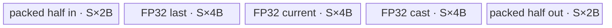
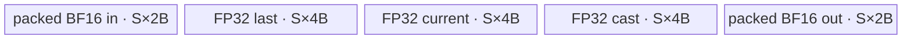

# ExpSegsum A2/A3 ACLNN 算子知识

## 算子速览

| 项目 | 内容 |
|---|---|
| 实际入口 | 公开两段式 ACLNN：`aclnnExpSegsumGetWorkspaceSize` + `aclnnExpSegsum`；后端 OpType 为 `Segsum`。 |
| 计算语义 | 对最后一维长度为 `N` 的输入，输出每个前缀 batch 的 `N×N` 下三角半可分矩阵：`y[..., i, j] = exp(sum(x[..., j+1:i+1]))`（`j<i`），对角线为 `1`，`j>i` 为 `0`。 |
| 输入输出 | `self`: 3D/4D ND，FP16/FP32/BF16；`out`: 4D/5D ND、同 dtype，shape 为 `self.shape + [N]`。支持空 Tensor 和非连续输入。 |
| 执行类型 | 算子自有核心节点为单 Kernel `AIV_VECTOR`；`Contiguous` 与 `ViewCopy` 是 ACLNN executor 的框架边界。无可达 Cube/AIC 或 `MIX_CV` 节点。 |
| Kernel 路线 | R-001/R-002/R-003：key `1000`，大尾轴分块，分别为 FP32/FP16/BF16；R-004/R-005/R-006：key `1001`，完整尾轴并批，分别为 FP32/FP16/BF16。 |
| 核心资源 | 输入/输出 GM；AIV UB 中 `inQueue`、`outQueue`、FP32 `lastQueue/currentQueue`，16 位 dtype 另有 FP32 `castQueue`；后端声明 32 MiB workspace。 |
| 来源闭包 | `source_closed`：公开 ACLNN→executor 前处理→`Segsum` Host/Tiling/POD→key router→`SegsumND<T, MODE>` body→A2/A3 binary/build 接线均已闭合。 |
| 验证状态 | 已完成源码闭包检查；本次知识提取未执行编译、真机、数值或性能测试。 |

## 接口与语义

### 计算语义

令输入最后一维长度为 `N`，前面各维展平为 batch 下标 `b`。输出逻辑 shape 为 `[B, N, N]`，行下标为 `i`、列下标为 `j`：

```text
y[b, i, j] = exp(sum_{k=j+1..i} x[b, k]),  0 <= j < i < N
y[b, i, i] = 1
y[b, i, j] = 0,                           0 <= i < j < N
```

源码以 FP32 `lastRow/currentRow` 保存跨输出行的前缀状态。每进入下一行 `i`，把 `x[b,i]` 加到前 `i` 个列位置，随后将第 `i` 个对角位置保留为零并把上三角置为 `-inf`，最后逐元素 `Exp`。因此输入位置 `x[...,0]` 不参与严格下三角的区间和。

### 输入、输出与属性

| 参数 | shape/layout | dtype | 约束、默认值与语义 |
|---|---|---|---|
| `self` | 3D 或 4D，storage format 为 ND | FP16、FP32、BF16 | 支持非连续 Tensor；非空时先 `Contiguous`；最后一维为 `N`。 |
| `out` | rank=`self.rank+1`，前 `self.rank` 维与 `self` 相同，末维也等于 `N`；ND | 与 `self` 相同 | 由调用者提供；后端先写 executor 分配的同 shape 临时 Tensor，再 `ViewCopy` 到该 view。 |
| `workspaceSize` | 标量输出 | `uint64_t` | 第一段返回整个 executor 所需 Device workspace；`Segsum` Tiling 自身声明固定 32 MiB。 |
| `executor` | Host 对象 | `aclOpExecutor*` | 持有 `Contiguous`、`Segsum`、`ViewCopy` 的执行计划与临时 Tensor 生命周期。 |
| `workspace` | Device 地址 | `void*` | 第二段由调用者提供，大小必须采用第一段返回值。 |
| `stream` | AscendCL stream | `aclrtStream` | executor 中节点在该 stream 上提交。 |

无算子属性。公开文档说明默认确定性实现；不同 block 处理互不重叠的 batch，不使用 atomic 或跨核归约。

### 入口与版本

固定 commit 中只有无版本后缀的公开 `aclnnExpSegsumGetWorkspaceSize`/`aclnnExpSegsum`。第一段创建 executor，非空输入经过 `l0op::Contiguous`、`l0op::Segsum`、`l0op::ViewCopy`；第二段直接调用 `CommonOpExecutorRun`。A2/A3 的公开支持由 API 文档产品表给出，`Segsum` OpDef、`ascend910b`/`ascend910_93` binary config 与全局 AscendC config 共同闭合实现接线。

## Host/Launcher 执行流程

### 参数校验与前处理

非空路径按以下顺序执行：

1. `OP_CHECK_COMM_INPUT(workspaceSize, executor)` 检查第一段公共输出参数。
2. 创建 `uniqueExecutor`；失败返回 `ACLNN_ERR_INNER_CREATE_EXECUTOR`。
3. 源码先调用 `self->IsEmpty()`。空输入直接令 `workspaceSize=0`、释放 executor 并成功返回，不添加核心 Kernel。
4. `CheckParams` 对非空输入依次检查 `self/out` 非空、输入 dtype 属于 FP16/FP32/BF16、输出 dtype 相同、输入 rank 为 3/4、输出 rank 多 1、输出前缀 shape 与输入一致、输出末维等于输入末维、输入输出 storage format 相同且为 ND。
5. `l0op::Contiguous(self, executor)` 物化连续输入；失败返回内部空指针错误。
6. `l0op::Segsum` 以连续输入和用户输出的 view shape 分配中间 `out`，并添加一个 `Segsum` AICore launcher；失败返回内部空指针错误。
7. `l0op::ViewCopy(result, out, executor)` 把中间结果提交到用户输出 view。

注意：`self->IsEmpty()` 位于 `CheckNotNull` 之前；传入空 `self` 指针时，固定实现会在显式空指针检查前解引用。这是源码顺序边界，不应把文档错误码说明理解为这里已先执行检查。

### 参数、Workspace 与生命周期

Tiling 将后端节点 workspace slice 固定设置为 `32*1024*1024` 字节。Kernel 调用 `GetUserWorkspace(workspace)`，为空则直接返回；得到的 `userWS` 仅传入 `SegsumND::Init`，该实现没有读写 workspace，核心数值数据只在输入/输出 GM 与各核 UB 之间流动。

第一段返回的 `uniqueExecutor->GetWorkspaceSize()` 是整个 executor 的聚合值，可能还包含 `Contiguous`、中间输出与 `ViewCopy` 的框架分配；这些框架内部公式在该算子固定源码中不可见。workspace 与 executor 均由调用者维持到第二段完成提交，stream 完成前不得释放或覆盖 Device workspace、输入和输出。

### 启动图与失败传播

```text
aclnnExpSegsumGetWorkspaceSize
  -> [仅非连续输入时有实际数据动作] framework Contiguous(self -> selfContiguous)
  -> Segsum launcher(selfContiguous -> executor 临时 result)
       Tiling4Segsum / TilingPrepare4Segsum
       -> segsum<<<blockDim=needCoreNum, stream>>>(x, result, workspace, tiling)
  -> framework ViewCopy(result -> 用户 out view)

aclnnExpSegsum(workspace, workspaceSize, executor, stream)
  -> CommonOpExecutorRun：按 executor 顺序提交上述节点
```

算子自有 launch graph 只有一个 Device 节点。其 `blockDim=needCoreNum`、POD 为 `SegsumTilingData`、输入为连续 `self`、输出为 executor 临时 `result`、workspace slice 为固定 32 MiB。`Contiguous`/`ViewCopy` 的内部 Kernel、workspace offset 与同步细节属于框架生成边界；executor 保证同一 stream 中的生产者先于消费者提交。任一 Host 节点返回空指针或第二段 `CommonOpExecutorRun` 失败时，状态码向 ACLNN 调用者传播，后续依赖节点不能得到有效输入。

## Route 与参数设计

### 分核与资源计算

令：

```text
B = product(inputShape[0 : rank-1])                 # batch 数，元素计数
N = inputShape[rank-1]                              # 尾轴元素数
C = compileInfo.coreNum = AIV core 数
U = compileInfo.ubSize                              # 字节
A = ceil(B / C)
needCoreNum = ceil(B / A)
batchStart[c] = c * A
batchEnd[c] = min((c + 1) * A, B)

eachTensorSize = floor((U - 320) / 4)               # 字节
maxSlideUnalign = floor(eachTensorSize / 4)         # 元素；成员 dataTypeSize 固定为 4
M = 8 * floor(maxSlideUnalign / 8)                  # maxSlideSize，元素
L(T) = 32 / sizeof(T)                               # 一个 32B block 的元素数
Nalign(T) = ceil(N / L(T)) * L(T)
S = min(batchEnd[0] * Nalign(T), M)                 # slideSize，元素
```

`TilingPrepare4Segsum` 从平台取 AIV 核数与 UB 大小，任一为 0 则失败。每核得到连续且互斥的 batch 区间，没有 former/tail 数据量字段；最后一核通过 `batchEnd` 自然截短。Tiling 固定预留 320 字节，并按四个等份、每份按 4 字节元素估算，使所有 dtype 的实际 UB 总账都为 `16*S` 字节。`S` 同时是所有 Queue/TBuf 的元素容量。

### Route 选择

| 顺序 | Route | Key/模板 | 精确选择条件与优先级 | 不适用去向 |
|---:|---|---|---|---|
| 1 | R-001 大尾轴 FP32 | `1000` / `SegsumND<float,0>` | dtype=FP32 且 `N > M` | dtype 分支或 key `1001` 路线 |
| 2 | R-002 大尾轴 FP16 | `1000` / `SegsumND<half,0>` | dtype=FP16 且 `N > M` | dtype 分支或 key `1001` 路线 |
| 3 | R-003 大尾轴 BF16 | `1000` / `SegsumND<bfloat16_t,0>` | dtype=BF16 且 `N > M`，且 A2/A3 binary 支持 BF16 | dtype 分支或 key `1001` 路线 |
| 4 | R-004 小尾轴 FP32 | `1001` / `SegsumND<float,1>` | dtype=FP32 且 `N <= M` | dtype 分支；未知 key 返回 |
| 5 | R-005 小尾轴 FP16 | `1001` / `SegsumND<half,1>` | dtype=FP16 且 `N <= M` | dtype 分支；未知 key 返回 |
| 6 | R-006 小尾轴 BF16 | `1001` / `SegsumND<bfloat16_t,1>` | dtype=BF16 且 `N <= M`，且 A2/A3 binary 支持 BF16 | 未知 dtype/key 返回 |

```text
if N <= M:
    key = 1001
    MODE = 1
else:
    key = 1000
    MODE = 0

if DTYPE_X == half:       instantiate SegsumND<half, MODE>
elif DTYPE_X == float:    instantiate SegsumND<float, MODE>
elif DTYPE_X == bfloat16: instantiate SegsumND<bfloat16_t, MODE>
else:                     no body
```

### 模板/实现执行矩阵

| Route | key/selector | dtype/shape/platform 完整命中条件 | 执行拓扑与 Kernel 节点 | 实际模板/body | 内存与同步特征 | tail/fallback |
|---|---|---|---|---|---|---|
| R-001 大尾轴 FP32 | 1000 | FP32，`N>M`，A2/A3 | 单 AIV Kernel | `SegsumND<float,0>::ComputeBase/Compute` | 4 个 `S*4B` buffer；按 row/col tile；Queue + `PIPE_V/ALL` | col/row 末 tile 用 `Min`；未知 key 返回 |
| R-002 大尾轴 FP16 | 1000 | FP16，`N>M`，A2/A3 | 单 AIV Kernel | `SegsumND<half,0>::ComputeBase/Compute` | 输入输出各 `S*2B`，3 个 FP32 `S*4B` buffer；FP32 累积后 cast | 同 R-001，16 位 32B block 为 16 元素 |
| R-003 大尾轴 BF16 | 1000 | BF16，`N>M`，A2/A3 | 单 AIV Kernel | `SegsumND<bfloat16_t,0>::ComputeBase/Compute` | 同 R-002；输入标量显式 `ToFloat` | 同 R-002；BF16 binary 必须存在 |
| R-004 小尾轴 FP32 | 1001 | FP32，`N<=M`，A2/A3 | 单 AIV Kernel | `SegsumND<float,1>::ComputeBatches` | 完整 N 轴，多 batch 按 32B padded block 并入 UB；4 个 `S*4B` buffer | 最后一批 `batchesEachCopy` 截短 |
| R-005 小尾轴 FP16 | 1001 | FP16，`N<=M`，A2/A3 | 单 AIV Kernel | `SegsumND<half,1>::ComputeBatches` | 完整 N 轴并批；16 位 GM/UB + 3 个 FP32 buffer | 同 R-004；cast 输出 |
| R-006 小尾轴 BF16 | 1001 | BF16，`N<=M`，A2/A3 | 单 AIV Kernel | `SegsumND<bfloat16_t,1>::ComputeBatches` | 同 R-005；输入标量 `ToFloat` | 同 R-005 |

### 隐藏性能 Guard

| Guard | Host/Tiling 条件 | Device/资源原因 | 影响 Route | 不满足时去向 | 源码符号 |
|---|---|---|---|---|---|
| 空 Tensor 短路 | `self->IsEmpty()` | 避免 `B=0` 时分核除法，并无需生成输出元素 | 全部 | `workspaceSize=0`，不启动核心 Kernel | `aclnnExpSegsumGetWorkspaceSize` |
| 平台资源有效 | `coreNum>0 && ubSize>0` | 分核需要除以核数；UB 容量决定 `M/S` | 全部 | Tiling 返回 `GRAPH_FAILED` | `TilingPrepare4Segsum` |
| 大小 key | `N<=M` 选 1001，否则 1000 | 完整尾轴能驻留时可跨 batch 并行；否则必须二维分块 | 全部 | 另一 MODE | `SegsumTiling::GetTilingKey` |
| AIV 执行 | 非 Kirin 编译分支中 `ASCEND_IS_AIV` | body 只使用 Vector/UB primitive | 全部 A2/A3 | 非 AIV 核不执行 body | `SegsumND::Process` |
| block 对齐 | Host `M` 向下对齐 8 元素；Kernel `blockSize=32/sizeof(T)` | `DataCopy` 与每批 UB 行按 32B block 对齐 | 全部 | 无独立 fallback；由当前 key/body处理 | `GetTilingKey`、`ParseTilingData` |
| MODE1 至少一批 | `S / (ceil(N/L(T))*L(T)) >= 1` | `ComputeBatches` 以 `batchNum` 作为循环步长 | R-004~R-006 | 固定源码无显式检查；若 16 位 `N<=M<align16(N)`，会得到 `batchNum=0`，且没有 fallback | `GetTilingKey`、`ComputeBatches` |
| 每核表容量 | `batchStart/batchEnd` 固定 50 项 | POD 只为 50 个 block 保存区间 | 全部 | 固定源码没有 `coreNum<=50` 显式检查 | `MAX_CORE_CONT`、`GetNeedCoreNum` |
| batch 索引窄化 | `batchStart/end` 从 `int64_t` 写入 `int32_t` | Device 依赖 32 位数组恢复每核 batch 区间 | 全部 | 固定源码无溢出检查 | `SegsumTiling::GetNeedCoreNum` |
| DMA blockCount | `batchesEachCopy` 转 `uint16_t` | `DataCopyExtParams.blockCount` 为 16 位 | R-004~R-006 | 固定源码无显式上界检查；实际值受 `S/Nalign` 限制 | `CopyInBatch/CopyOutBatch` |
| 输出 stride 窄化 | `(N-1)*N*sizeof(T)` 转 `uint32_t` | 小尾轴路线跨 batch 写同一输出行 | R-004~R-006 | 固定源码无溢出检查 | `CopyOutBatch` |
| dtype binary | `ascend910b/ascend910_93` 各有 FP16/FP32/BF16 条目 | 选择对应 `DTYPE_X` 编译实例 | 全部 | 无对应 binary 时不可达 | `segsum_binary.json`、`segsum` entry |

### POD/ABI

`BEGIN_TILING_DATA_DEF` 的生成实现来自仓外 CANN 头 `register/tilingdata_base.h`，因此固定仓能确认字段顺序、元素类型、数组长度和 producer/consumer，但不能从本仓独立证明生成对象的 `sizeof/alignof/offsetof`；下表据实标记为不可见，不把普通 C++ 手工布局当成已验证 ABI。

| 结构 | 字段 | 类型/位宽 | ABI 布局 | 单位 | Host/launcher producer | Device consumer | 边界 |
|---|---|---|---|---|---|---|---|
| `SegsumTilingData` | `dataType` | `int64_t`/64 | 生成 ABI 的 offset/总大小固定仓不可见 | 枚举值 1/2/3 | `set_dataType(GetDataTypeVal())` | body 未读取 | 非活动字段；未知 dtype 写 0 |
| `SegsumTilingData` | `needCoreNum` | `int64_t`/64 | 同上 | core | `set_needCoreNum(needCoreNum)` | `ParseTilingData`，`Process` block guard | Host 同时设置相同 `blockDim` |
| `SegsumTilingData` | `batches` | `int64_t`/64 | 同上 | batch | `set_batches(batches)` | body 未读取 | 非活动字段 |
| `SegsumTilingData` | `tailDimSize` | `int64_t`/64 | 同上 | 元素 | `set_tailDimSize(tailDimSize)` | `ParseTilingData`，循环边界 | 来自输入 origin shape 末维 |
| `SegsumTilingData` | `slideSize` | `int64_t`/64 | 同上 | 元素 | `set_slideSize(slideSize)` | `InitBuffer`、tile/并批循环 | 必须满足实际 UB 容量 |
| `SegsumTilingData` | `batchStart[50]` | `int32_t[50]` | 同上 | batch 下标 | `set_batchStart(batchStart)` | `[blockIdx]` 读取本核起点 | Host 从 int64 运算窄化 |
| `SegsumTilingData` | `batchEnd[50]` | `int32_t[50]` | 同上 | batch 下标（开区间） | `set_batchEnd(batchEnd)` | `[blockIdx]` 读取本核终点 | 仅前 `needCoreNum` 项活动 |

### Route 源码闭包

| Route | Key/selector | Host/Tiling producer | POD/参数 | Kernel entry/router 节点 | Kernel body/直接依赖 | 构建接线 |
|---|---|---|---|---|---|---|
| R-001 | FP32/1000 | `segsum_tiling.cpp::GetTilingKey/FillTilingData` | `SegsumTilingData` | `segsum.cpp::segsum -> SegsumND<float,0>` | `segsum.h::ComputeBase/Compute/processY/CopyInBatch/CopyOutBatch` | A2/A3 FP32 binary + AscendC config |
| R-002 | FP16/1000 | 同上 | 同上 | `SegsumND<half,0>` | 同上，含 `castQueue/Cast` | A2/A3 FP16 binary + AscendC config |
| R-003 | BF16/1000 | 同上 | 同上 | `SegsumND<bfloat16_t,0>` | 同上，含 `ToFloat/castQueue/Cast` | A2/A3 BF16 binary + AscendC config |
| R-004 | FP32/1001 | 同上 | 同上 | `SegsumND<float,1>` | `ComputeBatches/processCurrent/processY/CopyInBatch/CopyOutBatch` | A2/A3 FP32 binary + AscendC config |
| R-005 | FP16/1001 | 同上 | 同上 | `SegsumND<half,1>` | 同上，含 `castQueue/Cast` | A2/A3 FP16 binary + AscendC config |
| R-006 | BF16/1001 | 同上 | 同上 | `SegsumND<bfloat16_t,1>` | 同上，含 `ToFloat/castQueue/Cast` | A2/A3 BF16 binary + AscendC config |

## Kernel 实现

### 公共执行流程

`segsum` entry 读取 `SegsumTilingData`，通过 `GetUserWorkspace` 检查 workspace 基址，按编译期 `DTYPE_X` 与运行时 key 实例化六个模板之一。每个实例用 `GetBlockIdx()` 选取 `batchStart/end`，初始化输入/输出 Queue 与 FP32 状态 TBuf；A2/A3 路径只在 `ASCEND_IS_AIV` 上调用 MODE 对应 body。每核拥有互斥 batch，整个核心图无 workspace 交接边、跨核通信、atomic 或 Cube 计算。

所有路线共享递推：`lastRow` 保存上一输出行的未指数化 FP32 累积；`currentRow` 先构造当前行，随后严格下三角有效列被复制到输出暂存，其余位置以 `-inf` 填充，`Exp` 后提交 `outQueue`。FP16/BF16 仅 GM/Queue 为 16 位，递推和指数输入均为 FP32，最后 `CAST_ROUND`。

### Route R-001：大尾轴 FP32 分块

#### 适用条件

##### 选择证据

| 层级 | 文件 | 符号 | 源码谓词/参数 | 结果/下一跳 |
|---|---|---|---|---|
| API | `op_api/aclnn_segsum.cpp` | `aclnnExpSegsumGetWorkspaceSize` | 非空、FP32、shape/format 合法 | 添加 `Segsum` launcher |
| Tiling | `segsum_tiling.cpp` | `GetTilingKey` | `N > M` | key=1000，`S=M` |
| Router | `op_kernel/segsum.cpp` | `segsum` | `DTYPE_X=float && TILING_KEY_IS(1000)` | `SegsumND<float,0>` |

#### Device 数据流

##### 函数级调用链

```text
Segsum launcher -> segsum(x, result, workspace, tiling)
  -> SegsumND<float,0>::Init
  -> SegsumND<float,0>::Process
    -> ComputeBase -> Compute(batchIdx, colIdx)
      -> CopyInBatch -> Duplicate/Add -> processY(Exp) -> CopyOutBatch
```

##### 源码等价伪码

```text
for b in [batchStart, batchEnd):
  for col in range(0, N, S):
    last[0:S] = 0
    cal = min(S, N-col)
    for row0 in range(0, N, S):
      load x[b, row0:row0+cal] into inQueue
      for i in [row0, min(row0+S,N)):
        按 row0 与 col 的相对位置得到 currentProcessed
        若 currentProcessed>=0: current=0
        若 currentProcessed>0: current[0:currentProcessed]=x[b,i]+last[0:currentProcessed]
        outValid = getProcessedNum(row0,col,i,1)
        yUB[0:cal]=-inf; yUB[0:outValid]=current[0:outValid]; yUB=exp(yUB)
        store y[b,i,col:col+cal]
        last[0:align32(cal)] = current[0:align32(cal)]
```

#### 内存与数据搬运

##### 资源与搬运表

| 层级/缓冲区 | offset/地址公式 | extent/容量公式 | dtype/layout | producer | consumer | owner/lifetime | 对齐/复用 |
|---|---|---|---|---|---|---|---|
| 输入 GM | `b*N+row0` | 每次 `cal*4B` | FP32/ND | caller | `CopyInBatch` | caller/stream 完成前 | `blockCount=1`，stride 0，`DataCopyPad` |
| `inQueue` | UB queue base | `S*4B`，depth=1 | FP32 | `CopyInBatch` | `Compute` 标量读取 | `AllocTensor` 至 `FreeTensor` | 每 row tile 复用 |
| `lastQueue` | 独立 TBuf | `S*4B` | FP32 | `Duplicate/DataCopy` | 下一输出行 `Add` | Kernel 全程 | 原地覆盖上一行状态 |
| `currentQueue` | 独立 TBuf | `S*4B` | FP32 | `Duplicate/Add` | `processY`、`DataCopy(last)` | 当前输出行 | 下一行覆盖 |
| `outQueue` | UB queue base | `S*4B`，depth=1 | FP32 | `processY` | `CopyOutBatch` | `AllocTensor` 至 `FreeTensor` | Exp 原地写 yTensor |
| 输出 GM | `b*N*N+i*N+col` | 每次 `cal*4B` | FP32/ND | `CopyOutBatch` | framework `ViewCopy` | executor 临时 result | 单 block、stride 0 |
| workspace | executor slice | 后端声明 32 MiB | bytes | caller/executor | entry 仅判空 | 单次执行 | body 不读写 |

##### 分层内存布局


##### 字节账与复用顺序

```text
UB_total = S*4 + S*4 + S*4 + S*4 = 16*S bytes
16*S <= U-320 < U
dynamic_ub = N/A（AIV 静态 UB）
workspace_total = 32*1024*1024 bytes（Segsum Tiling 声明；数值 body 不使用）
```

| 复用子区 | 写入者 | 读取者/消费点 | 下一次覆盖 | 同步或释放依据 | 安全条件 |
|---|---|---|---|---|---|
| `lastQueue` | `Duplicate` 或行末 `DataCopy` | 下一行 `Add` | 下一行末 | Vector pipe 顺序与 barrier | 同一 col tile 内严格串行 |
| `currentQueue` | `Duplicate/Add` | `processY` 与 `DataCopy(last)` | 下一行 | `PIPE_V/ALL` barrier | 消费完成后才覆盖 |
| `outQueue` | `processY` | `CopyOutBatch` | `FreeTensor` 后 | TQue EnQue/DeQue/Free | depth=1，逐行提交 |

#### 同步、精度与尾块

##### 同步与数值边界表

| 阶段 | primitive/机制 | producer | consumer/等待点 | 保护对象 | 精度/尾块 |
|---|---|---|---|---|---|
| GM→UB | TQue + `DataCopyPad` | MTE2 | `DeQue` | `inQueue` | `cal=min(S,N-col)` |
| 递推 | `PIPE_V` barrier | `Duplicate/Add` | 后续 Add/复制 | `current/last` | 全 FP32；`blockNumData=ceil(cal/8)*8` |
| 掩码与指数 | `Duplicate/Adds/Exp` | Vector | EnQue | `outQueue` | 有效前缀长度由 `getProcessedNum` 给出；其余 `exp(-inf)=0` |
| UB→GM | TQue + `DataCopyPad` | Vector EnQue | MTE3/Free | 输出 tile | 只写 `cal` 个有效元素 |

#### 关键实现

##### 符号证据表

| 阶段 | 文件 | 符号/模板实例 | 实现事实 |
|---|---|---|---|
| Host/Tiling producer | `op_host/segsum_tiling.cpp` | `GetTilingKey/FillTilingData` | 生成 key1000、S、blockDim 与 POD |
| Kernel entry/router | `op_kernel/segsum.cpp` | `segsum` / `SegsumND<float,0>` | FP32+1000 映射到 MODE0 |
| Device body/helper | `op_kernel/segsum.h` | `ComputeBase/Compute/processY` | 二维分块、FP32 递推、下三角 mask 与 Exp |

### Route R-002：大尾轴 FP16 分块

#### 适用条件

##### 选择证据

| 层级 | 文件 | 符号 | 源码谓词/参数 | 结果/下一跳 |
|---|---|---|---|---|
| API | `op_api/aclnn_segsum.cpp` | `CheckDtypeValid` | FP16 合法且非空 | 添加 launcher |
| Tiling | `segsum_tiling.cpp` | `GetTilingKey` | `N>M` | key=1000，S=M |
| Router | `op_kernel/segsum.cpp` | `segsum` | `DTYPE_X=half && key=1000` | `SegsumND<half,0>` |

#### Device 数据流

##### 函数级调用链

```text
segsum -> SegsumND<half,0>::Init -> Process -> ComputeBase -> Compute
  -> CopyInBatch<half> -> FP32 Duplicate/Add -> processY<half>
  -> Exp(FP32) -> Cast<half, CAST_ROUND> -> CopyOutBatch<half>
```

##### 源码等价伪码

```text
按 b/col/row0/i 四层循环分块；每次载入 half 输入 tile。
读取 x[b,i] 后转为 float，更新 current[0:currentProcessed] = float(x)+last。
构造 FP32 castRow：有效下三角取 current，其余 -inf；FP32 Exp；
以 CAST_ROUND 降为 half，写 y[b,i,col:col+cal]；last 保持 FP32。
```

#### 内存与数据搬运

##### 资源与搬运表

| 层级/缓冲区 | offset/地址公式 | extent/容量公式 | dtype/layout | producer | consumer | owner/lifetime | 对齐/复用 |
|---|---|---|---|---|---|---|---|
| 输入/输出 GM | 同 R-001，字节乘 2 | 每 tile `cal*2B` | FP16/ND | caller/body | body/ViewCopy | stream | DataCopyPad |
| `inQueue/outQueue` | UB queue | 各 `S*2B`，depth=1 | FP16 | CopyIn/processY | Compute/CopyOut | 每 tile/行 | Queue 生命周期 |
| `last/current` | 独立 TBuf | 各 `S*4B` | FP32 | Vector | Vector | Kernel | FP32 状态 |
| `castQueue` | 独立 TBuf | `S*4B` | FP32 | `Duplicate/Adds/Exp` | `Cast` | 当前输出行 | Exp 原地复用 |
| workspace | executor slice | 32 MiB | bytes | caller | 仅判空 | 执行期 | body 不读写 |

##### 分层内存布局


##### 字节账与复用顺序

```text
UB_total = 2*S + 2*S + 4*S + 4*S + 4*S = 16*S bytes <= U-320
dynamic_ub = N/A
workspace_total = 32 MiB
```

| 复用子区 | 写入者 | 读取者/消费点 | 下一次覆盖 | 同步或释放依据 | 安全条件 |
|---|---|---|---|---|---|
| `castQueue` | mask 构造与 Exp | Cast | 下一输出行 | `PIPE_ALL/PIPE_V` barrier | Cast 完成后覆盖 |
| `last/current` | 同 R-001 | 同 R-001 | 下一行 | barrier | FP32 状态不可提前降精度 |
| `outQueue` | Cast | CopyOut | Free 后 | Queue | depth=1 |

#### 同步、精度与尾块

##### 同步与数值边界表

| 阶段 | primitive/机制 | producer | consumer/等待点 | 保护对象 | 精度/尾块 |
|---|---|---|---|---|---|
| 输入 | Queue/DataCopyPad | GM | scalar read | half tile | `cal` 有效元素 |
| 递推 | Duplicate/Add + barrier | FP32 current | last/processY | FP32 TBuf | half 先转 FP32；32B block=16 元素 |
| 输出 | Exp→Cast | FP32 castRow | half outQueue | cast/out | `CAST_ROUND`，只搬 `cal` 元素 |

#### 关键实现

##### 符号证据表

| 阶段 | 文件 | 符号/模板实例 | 实现事实 |
|---|---|---|---|
| Host/Tiling producer | `op_host/segsum_tiling.cpp` | `GetDataTypeSize/GetTilingKey` | FP16 对齐长度和 key |
| Kernel entry/router | `op_kernel/segsum.cpp` | `SegsumND<half,0>` | FP16 MODE0 实例 |
| Device body/helper | `op_kernel/segsum.h` | `Compute/processY<half>` | FP32 累积、Exp、CAST_ROUND |

### Route R-003：大尾轴 BF16 分块

#### 适用条件

##### 选择证据

| 层级 | 文件 | 符号 | 源码谓词/参数 | 结果/下一跳 |
|---|---|---|---|---|
| API/平台 | `aclnn_segsum.cpp`、A2/A3 binary config | dtype list / BF16 entry | BF16 且平台有 binary | launcher 可达 |
| Tiling | `segsum_tiling.cpp` | `GetTilingKey` | `N>M` | key=1000 |
| Router | `op_kernel/segsum.cpp` | `segsum` | `DTYPE_X=bfloat16_t && key=1000` | `SegsumND<bfloat16_t,0>` |

#### Device 数据流

##### 函数级调用链

```text
segsum -> SegsumND<bfloat16_t,0>::Init -> ComputeBase -> Compute
  -> CopyInBatch -> ToFloat(input scalar) -> FP32 Add
  -> processY -> FP32 Exp -> Cast<BF16, CAST_ROUND> -> CopyOutBatch
```

##### 源码等价伪码

```text
循环、地址与 tile tail 同 R-001；区别是每个 BF16 x 标量以 ToFloat 转换，
last/current/castRow 始终为 FP32，Exp 后才 CAST_ROUND 为 BF16 并写 GM。
```

#### 内存与数据搬运

##### 资源与搬运表

| 层级/缓冲区 | offset/地址公式 | extent/容量公式 | dtype/layout | producer | consumer | owner/lifetime | 对齐/复用 |
|---|---|---|---|---|---|---|---|
| 输入/输出 GM | 同 R-002 | 每 tile `cal*2B` | BF16/ND | caller/body | body/ViewCopy | stream | DataCopyPad |
| `inQueue/outQueue` | UB | 各 `S*2B` | BF16 | DMA/Cast | scalar read/DMA | tile/row | depth=1 |
| `last/current/cast` | UB TBuf | 各 `S*4B` | FP32 | Vector | Vector/Cast | Kernel/row | 同 R-002 |
| workspace | executor slice | 32 MiB | bytes | caller | 仅判空 | 执行期 | 不读写 |

##### 分层内存布局


##### 字节账与复用顺序

```text
UB_total = 16*S bytes <= U-320
dynamic_ub = N/A
workspace_total = 32 MiB
```

| 复用子区 | 写入者 | 读取者/消费点 | 下一次覆盖 | 同步或释放依据 | 安全条件 |
|---|---|---|---|---|---|
| `castQueue` | FP32 mask/Exp | BF16 Cast | 下一行 | barrier | Cast 后覆盖 |
| `lastQueue` | row state | 下一 row Add | 行末 | barrier | col tile 内顺序递推 |

#### 同步、精度与尾块

##### 同步与数值边界表

| 阶段 | primitive/机制 | producer | consumer/等待点 | 保护对象 | 精度/尾块 |
|---|---|---|---|---|---|
| BF16 输入 | `ToFloat` | scalar load | Duplicate | current | 明确升为 FP32 |
| 递推/Exp | Vector barriers | current/last | Cast | FP32 buffers | 尾块 `cal`，block 对齐 16 元素 |
| 输出 | `CAST_ROUND` | FP32 Exp | BF16 DMA | outQueue | 仅最终降精度 |

#### 关键实现

##### 符号证据表

| 阶段 | 文件 | 符号/模板实例 | 实现事实 |
|---|---|---|---|
| Host/Tiling producer | `op_host/segsum_tiling.cpp` | `GetDataTypeVal/GetDataTypeSize` | BF16 枚举=3、2B block 对齐 |
| Kernel entry/router | `op_kernel/segsum.cpp` | BF16 compile branch | A2/A3 BF16+1000 实例 |
| Device body/helper | `op_kernel/segsum.h` | `Compute/processY<bfloat16_t>` | ToFloat、FP32 Exp、BF16 Cast |

### Route R-004：小尾轴 FP32 并批

#### 适用条件

##### 选择证据

| 层级 | 文件 | 符号 | 源码谓词/参数 | 结果/下一跳 |
|---|---|---|---|---|
| Tiling | `segsum_tiling.cpp` | `GetTilingKey` | FP32 且 `N<=M` | key=1001，`S=min(batchEnd[0]*align8(N),M)` |
| Router | `op_kernel/segsum.cpp` | `segsum` | FP32+1001 | `SegsumND<float,1>` |
| Body | `op_kernel/segsum.h` | `Process` | `MODE==1` | `ComputeBatches` |

#### Device 数据流

##### 函数级调用链

```text
segsum -> SegsumND<float,1>::Init -> Process -> ComputeBatches
  -> CopyInBatch(multiple batches)
  -> processCurrent -> Add -> processY(Exp)
  -> CopyOutBatch(strided across output matrices)
```

##### 源码等价伪码

```text
P = align8(N); batchNum=floor(S/P); total=P*batchNum
for b0 in range(batchStart,batchEnd,batchNum):
  active=min(batchEnd-b0,batchNum)
  load active contiguous input rows; each UB row occupies P elements
  last[0:total]=0
  for i in [0,N):
    current[0:P*active]=0
    if i>0: for q in [0,active): current[q*P:q*P+i]=x[b0+q,i]
    current[0:total]+=last[0:total]
    yUB[0:total]=-inf; for q: yUB[q*P:q*P+i+1]=current[...] ; yUB=exp(yUB)
    strided store each active row to y[b0+q,i,0:N]
    last[0:total]=current[0:total]
```

#### 内存与数据搬运

##### 资源与搬运表

| 层级/缓冲区 | offset/地址公式 | extent/容量公式 | dtype/layout | producer | consumer | owner/lifetime | 对齐/复用 |
|---|---|---|---|---|---|---|---|
| 输入 GM | `b0*N` | `active` blocks × `N*4B` | FP32/连续 batch rows | caller | CopyIn | stream | blockCount=active，src/dst stride 0 |
| `inQueue` | packed rows `q*P` | `S*4B` | FP32/padded rows | DataCopyPad | processCurrent | batch chunk | depth=1 |
| `last/current` | packed rows `q*P` | 各 `S*4B` | FP32 | Vector | Vector/processY | chunk | total≤S |
| `outQueue` | packed rows `q*P` | `S*4B` | FP32 | processY | CopyOut | output row | depth=1 |
| 输出 GM | `b0*N*N+i*N` | active blocks × `N*4B` | FP32/[batch,N,N] | CopyOut | ViewCopy | executor | dstStride=`(N-1)*N*4B` |
| workspace | executor slice | 32 MiB | bytes | caller | 仅判空 | 执行期 | body 不读写 |

##### 分层内存布局


##### 字节账与复用顺序

```text
UB_total = 16*S bytes <= U-320
P=align8(N), batchNum=floor(S/P), total=P*batchNum<=S
dynamic_ub = N/A
workspace_total = 32 MiB
```

| 复用子区 | 写入者 | 读取者/消费点 | 下一次覆盖 | 同步或释放依据 | 安全条件 |
|---|---|---|---|---|---|
| packed `last` rows | row i DataCopy | row i+1 Add | 下一 i | `PIPE_ALL` | 所有 packed batch 同步推进一行 |
| packed `outQueue` | processY | strided CopyOut | Free 后 | Queue | 只提交 active batch；非活动 pack 不写 GM |

#### 同步、精度与尾块

##### 同步与数值边界表

| 阶段 | primitive/机制 | producer | consumer/等待点 | 保护对象 | 精度/尾块 |
|---|---|---|---|---|---|
| 并批加载 | DataCopyPad/TQue | GM | DeQue | packed input | 最后一组 `active<batchNum` |
| packed 递推 | `PIPE_ALL/PIPE_V` | Duplicate/processCurrent/Add | processY | total elements | 非活动 pack 可计算但不输出 |
| strided 输出 | DataCopyPad | outQueue | GM | 每 batch 的第 i 行 | blockLen=N*4B，GM 跳过余下 N-1 行 |

#### 关键实现

##### 符号证据表

| 阶段 | 文件 | 符号/模板实例 | 实现事实 |
|---|---|---|---|
| Host/Tiling producer | `op_host/segsum_tiling.cpp` | `GetTilingKey` | key1001 与并批 S |
| Kernel entry/router | `op_kernel/segsum.cpp` | `SegsumND<float,1>` | FP32 MODE1 |
| Device body/helper | `op_kernel/segsum.h` | `ComputeBatches/processCurrent/CopyOutBatch` | UB 并批和 GM 跨矩阵 stride |

### Route R-005：小尾轴 FP16 并批

#### 适用条件

##### 选择证据

| 层级 | 文件 | 符号 | 源码谓词/参数 | 结果/下一跳 |
|---|---|---|---|---|
| Tiling | `segsum_tiling.cpp` | `GetTilingKey` | FP16 且 `N<=M` | key=1001，`S=min(batchEnd[0]*align16(N),M)` |
| Router | `op_kernel/segsum.cpp` | `segsum` | half+1001 | `SegsumND<half,1>` |
| Body | `op_kernel/segsum.h` | `ComputeBatches` | MODE1 | 并批 FP32 递推后 cast |

#### Device 数据流

##### 函数级调用链

```text
segsum -> SegsumND<half,1>::ComputeBatches
  -> CopyInBatch<half> -> processCurrent(float conversion) -> FP32 Add
  -> processY(FP32 mask/Exp -> half Cast) -> strided CopyOutBatch
```

##### 源码等价伪码

```text
P=align16(N)，按 q*P 布置 packed batch；循环 i=0..N-1。
每个 half x[bq,i] 转 FP32 后广播到当前行前 i 列，与 FP32 last 相加；
前 i+1 列参与 FP32 Exp，其余为 -inf；CAST_ROUND 为 half；
只把每个 active batch 的 N 个 half 写入对应输出矩阵第 i 行。
```

#### 内存与数据搬运

##### 资源与搬运表

| 层级/缓冲区 | offset/地址公式 | extent/容量公式 | dtype/layout | producer | consumer | owner/lifetime | 对齐/复用 |
|---|---|---|---|---|---|---|---|
| GM input/output | 同 R-004，字节乘 2 | active×`N*2B` | FP16 | caller/body | body/ViewCopy | stream | output dstStride=`(N-1)N*2B` |
| `in/outQueue` | packed `q*P` | 各 `S*2B` | FP16 | DMA/Cast | scalar read/DMA | chunk/row | depth=1 |
| `last/current/cast` | packed `q*P` | 各 `S*4B` | FP32 | Vector | Vector/Cast | chunk/row | total≤S |
| workspace | executor slice | 32 MiB | bytes | caller | 仅判空 | 执行期 | 不读写 |

##### 分层内存布局



##### 字节账与复用顺序

```text
UB_total = 16*S bytes <= U-320
P=align16(N), batchNum=floor(S/P), total=P*batchNum<=S
dynamic_ub=N/A; workspace_total=32 MiB
```

| 复用子区 | 写入者 | 读取者/消费点 | 下一次覆盖 | 同步或释放依据 | 安全条件 |
|---|---|---|---|---|---|
| packed `cast` | mask/Exp | Cast | 下一 i | PIPE_ALL/PIPE_V | Cast 完成后覆盖 |
| packed `last/current` | 递推 | 下一 i/processY | 行末 | barrier | FP32 状态保持 |

#### 同步、精度与尾块

##### 同步与数值边界表

| 阶段 | primitive/机制 | producer | consumer/等待点 | 保护对象 | 精度/尾块 |
|---|---|---|---|---|---|
| 输入并批 | DataCopyPad | half GM | processCurrent | inQueue | P 为 16 元素对齐 |
| 递推/Exp | Vector barriers | FP32 current/last | Cast | FP32 packed rows | 最后一组 active 截短 |
| 输出 | CAST_ROUND + strided DMA | castRow | half GM | outQueue | 仅 active×N 元素有效 |

#### 关键实现

##### 符号证据表

| 阶段 | 文件 | 符号/模板实例 | 实现事实 |
|---|---|---|---|
| Host/Tiling producer | `op_host/segsum_tiling.cpp` | `GetDataTypeSize/GetTilingKey` | FP16 Nalign=16 元素倍数 |
| Kernel entry/router | `op_kernel/segsum.cpp` | `SegsumND<half,1>` | FP16 MODE1 |
| Device body/helper | `op_kernel/segsum.h` | `ComputeBatches/processY` | 并批 FP32 Exp 与 half Cast |

### Route R-006：小尾轴 BF16 并批

#### 适用条件

##### 选择证据

| 层级 | 文件 | 符号 | 源码谓词/参数 | 结果/下一跳 |
|---|---|---|---|---|
| 平台 | A2/A3 `segsum_binary.json` | BF16 条目 | 两平台均存在 | BF16 body 可达 |
| Tiling | `segsum_tiling.cpp` | `GetTilingKey` | BF16 且 `N<=M` | key=1001，align16(N) |
| Router | `op_kernel/segsum.cpp` | `segsum` | bfloat16_t+1001 | `SegsumND<bfloat16_t,1>` |

#### Device 数据流

##### 函数级调用链

```text
segsum -> SegsumND<bfloat16_t,1>::ComputeBatches
  -> CopyInBatch -> processCurrent(ToFloat) -> FP32 Add
  -> processY(FP32 Exp -> BF16 Cast) -> strided CopyOutBatch
```

##### 源码等价伪码

```text
并批、输出 stride 与 R-005 相同；每个 BF16 x 标量通过 ToFloat 进入 FP32 current，
递推及 Exp 全部在 FP32 packed buffer 中完成，最终 CAST_ROUND 为 BF16。
```

#### 内存与数据搬运

##### 资源与搬运表

| 层级/缓冲区 | offset/地址公式 | extent/容量公式 | dtype/layout | producer | consumer | owner/lifetime | 对齐/复用 |
|---|---|---|---|---|---|---|---|
| GM input/output | `b0*N` / `b0*N*N+i*N` | active×`N*2B` | BF16 | caller/body | body/ViewCopy | stream | input contiguous，output strided |
| `in/outQueue` | packed rows | 各 `S*2B` | BF16 | DMA/Cast | ToFloat/DMA | chunk/row | depth=1 |
| `last/current/cast` | packed rows | 各 `S*4B` | FP32 | Vector | Vector/Cast | chunk/row | P=align16(N) |
| workspace | executor slice | 32 MiB | bytes | caller | 仅判空 | 执行期 | 不读写 |

##### 分层内存布局



##### 字节账与复用顺序

```text
UB_total=16*S bytes<=U-320
batchNum=floor(S/align16(N)); total<=S
dynamic_ub=N/A; workspace_total=32 MiB
```

| 复用子区 | 写入者 | 读取者/消费点 | 下一次覆盖 | 同步或释放依据 | 安全条件 |
|---|---|---|---|---|---|
| packed state | processCurrent/Add | processY/下一行 | 行末 | barrier | active batch 输出互不重叠 |
| outQueue | BF16 Cast | strided CopyOut | Free 后 | Queue | 只写 active batch |

#### 同步、精度与尾块

##### 同步与数值边界表

| 阶段 | primitive/机制 | producer | consumer/等待点 | 保护对象 | 精度/尾块 |
|---|---|---|---|---|---|
| BF16→FP32 | `ToFloat` | scalar read | Duplicate | current | 每 batch 单标量广播 |
| FP32 递推/Exp | Vector barrier | state | Cast | packed FP32 | active tail 不写 GM |
| FP32→BF16 | `CAST_ROUND` | Exp | DMA | outQueue | N 个有效元素/批 |

#### 关键实现

##### 符号证据表

| 阶段 | 文件 | 符号/模板实例 | 实现事实 |
|---|---|---|---|
| Host/Tiling producer | `op_host/segsum_tiling.cpp` | BF16 dtype helpers | 2B dtype 与 key1001 |
| Kernel entry/router | `op_kernel/segsum.cpp` | `SegsumND<bfloat16_t,1>` | BF16 MODE1 |
| Device body/helper | `op_kernel/segsum.h` | `processCurrent/processY/CopyOutBatch` | ToFloat、FP32 Exp、BF16 strided 输出 |

## 算子特定优化

### Trick T-001：尾轴可驻留时在 UB 中并行推进多个 batch

#### 触发与源码依据

- 适用 Route：R-004、R-005、R-006。
- 触发条件：`tailDimSize <= maxSlideSize`，Host 选择 key `1001`；`batchNum = slideSize / align32B(N)` 至少为 1。
- Golden 来源：[`math/segsum/op_host/segsum_tiling.cpp:95-109`](../../../../../../../cann-ops-raw/ascendc/ops-math/165d41f02a43a62324b434cb6bda7c533b14da3e/math/segsum/op_host/segsum_tiling.cpp#L95-L109)

**官方源码（固定 Commit 连续逐字摘录）**：

```cpp
if (tailDimSize <= maxSlideSize) {
    tilingKey = SMALL_SIZE_TILING_KEY;
} else {
    tilingKey = COMMON_TILING_KEY;
}
int32_t blockSizeReal = BLOCK / GetDataTypeSize();
int64_t tailDimSizeAlign = CeilA2B(tailDimSize, blockSizeReal) * blockSizeReal;
slideSize = std::min(batchEnd[0] * tailDimSizeAlign, maxSlideSize);
```

#### 机制与设计原因

MODE1 不再沿列轴切 tile，而把每个 batch 的完整 N 元素行按 32B 对齐后连续排入 UB。一次 `DataCopyPad` 以 `blockCount=batchesEachCopy` 载入多批输入；Vector `Duplicate/Add/Exp` 对 `totalBlockNumData` 个 packed 元素统一执行；`CopyOutBatch` 再用 GM `dstStride=(N-1)*N*sizeof(T)` 把 packed 结果散回每个 batch 的同一输出行。这减少了大尾轴 MODE0 的 col/row tile 控制与逐 batch 启动内循环，并扩大一次 Vector 操作覆盖的独立 batch 数；固定源码未给出性能百分比。

#### 迁移边界

- 适用：每个样本最后一维完整状态能进入 UB、各 batch 无数据依赖的下三角递推。
- 前提：按 dtype 的 32B padded 行容量、`uint16_t blockCount` 与 `uint32_t dstStride` 均可表示；输出 batch 矩阵为连续 ND。
- 失效：`N>M` 时必须切换 MODE0 的 R-001/R-002/R-003，沿尾轴分块。
- 未验证：本次知识提取未执行编译、真机、数值或性能测试。

#### 错误做法

不能在不保留 `P=align32B(N)` 的情况下直接按 `q*N` 索引 packed UB；`DataCopyPad` 后每批的 UB 起点由 32B block 间距决定。固定仓提供的正确实现以 `blockNumData` 作为 `processCurrent/processY` 的 batch stride。

### Trick T-002：16 位 I/O 全程使用 FP32 状态并只在最终输出降精度

#### 触发与源码依据

- 适用 Route：R-002、R-003、R-005、R-006。
- 触发条件：模板 `T` 为 `half` 或 `bfloat16_t`。
- Golden 来源：[`math/segsum/op_kernel/segsum.h:198-213`](../../../../../../../cann-ops-raw/ascendc/ops-math/165d41f02a43a62324b434cb6bda7c533b14da3e/math/segsum/op_kernel/segsum.h#L198-L213)

**官方源码（固定 Commit 连续逐字摘录）**：

```cpp
if constexpr (std::is_same<T, bfloat16_t>::value || std::is_same<T, half>::value) {
    LocalTensor<T> yTensor = outQueue.AllocTensor<T>();
    LocalTensor<float> castRow = castQueue.Get<float>();
    Duplicate(castRow, INF_FLOAT, calCount);
    PipeBarrier<PIPE_ALL>();
    if (outProcessedNum > 0) {
        for (int64_t i = 0; i < batchesEachCopy; i++) {
            Adds(castRow[i * blockNumData], currentRow[i * blockNumData], static_cast<float>(0), outProcessedNum);
            PipeBarrier<PIPE_ALL>();
        }
    }
    Exp(castRow, castRow, calCount);
    PipeBarrier<PIPE_ALL>();
    Cast(yTensor, castRow, RoundMode::CAST_ROUND, calCount);
    PipeBarrier<PIPE_V>();
    outQueue.EnQue(yTensor);
```

#### 机制与设计原因

`lastQueue/currentQueue/castQueue` 都按 FP32 分配。输入标量先升为 FP32，区间和递推、`-inf` 掩码与 `Exp` 均在 FP32 中执行；只有写 `outQueue` 前调用 `Cast(..., CAST_ROUND)`。这样避免每个输出行递推后把状态降回 16 位，保留跨行累积的 FP32 数值顺序。`Exp` 原地覆盖 `castRow`，没有额外指数结果 buffer。

#### 迁移边界

- 适用：16 位输入输出、跨步骤递推状态对舍入敏感、最终结果允许一次受控降精度的 Vector 算法。
- 前提：UB 能容纳三份 `S*4B` FP32 TBuf 与两份 16 位 Queue；输出 cast 采用源码相同 round mode。
- 失效：FP32 路线不分配 `castQueue`，直接在 FP32 `outQueue` 中 mask/Exp；不能机械保留多余 buffer。
- 未验证：本次知识提取未执行编译、真机、数值或性能测试。

#### 错误做法

若每行递推后立即降为 FP16/BF16 再作为下一行 `lastRow`，会改变固定实现的累积与舍入顺序；若在 Exp 前先降精度，也不再等价于源码的 FP32 指数输入。

## 模板与实现对比

| 对比维度 | R-001~R-003 大尾轴 MODE0 | R-004~R-006 小尾轴 MODE1 | 设计选择依据 |
|---|---|---|---|
| 命中条件/优先级 | `N>M`，key1000 | `N<=M`，key1001 | 完整尾轴能否进入每份 UB 容量 |
| 模板与 dtype | `SegsumND<T,0>`；FP32/FP16/BF16 分 binary | `SegsumND<T,1>`；同三 dtype | dtype 决定 Queue 宽度、cast buffer 与转换方式 |
| 循环与分核 | 每核 batch→col tile→row tile→row element | 每核 batch chunk→row element，同时推进 packed batches | MODE0 处理任意大 N；MODE1 利用剩余 UB 扩大 batch 并行 |
| Queue/TBuf/寄存器/dynamic UB/通信 window | `in/out`+`last/current`，16 位另有 cast；无 dynamic UB/通信 | 同类 buffer，但按 padded batch rows 布局 | 两模式 UB 总账均 16S |
| 内存总占用与复用 | `16S`；last/current 逐输出行复用 | `16S`；packed last/current/cast 按行复用 | Host 统一按 4 个 4B 等份估算 |
| 搬运/Vector/SIMT/NDDMA/通信 API | 单 block tile DataCopyPad；Duplicate/Add/Adds/Exp/Cast | 多 block DataCopyPad 与 strided CopyOut；同 Vector API | 无 SIMT/NDDMA/通信/Cube |
| 同步、精度与 tail | Queue + PIPE barrier；col/row `Min` 尾块；FP32 状态 | Queue + PIPE barrier；最后 active batch 截短；FP32 状态 | 输出有效区由 cal/active 限制 |
| fallback/失败边界 | 不满足转 MODE1；未知 key 返回 | 不满足转 MODE0；未知 key 返回 | 无第三个 Device fallback |

FP32 与 16 位路线的关键差异：FP32 总共四份 `S*4B`；FP16/BF16 为两份 `S*2B` 加三份 `S*4B`，总量仍相同。BF16 输入标量用 `ToFloat`，FP16 使用 `static_cast<float>`；两者输出都使用 `CAST_ROUND`。

## 平台差异

| 项目 | A2 | A3 | 950 |
|---|---|---|---|
| 支持状态 | 支持；公开 API 文档与 `ascend910b` OpDef/binary config 闭合 | 支持；公开 API 文档与 `ascend910_93` OpDef/binary config 闭合 | 公开 API 文档明确不支持；未发布 `_950` 卡 |
| Host/Launcher | 共用 `SegsumTiling`，从平台读取 AIV 核数与 UB | 同 A2 | 无 `ascend950` OpDef/config 接线 |
| Kernel/资源 | 共用 `segsum` 与六个模板实例；三 dtype binary | 同 A2 | 固定仓中本逻辑算子无 950 Kernel binary 配置 |

## 限制与失败边界

- 公开 API 仅接受 3D/4D `self` 与 4D/5D `out`，ND、同 dtype；shape 必须精确满足 `out=self.shape+[N]`。输出元素数是输入的 N 倍，文档明确提醒尾轴过大会导致很大的输出内存。
- 空 Tensor 在 shape/dtype/format 检查前短路；空 `self` 指针也会在 `CheckNotNull` 前被 `self->IsEmpty()` 解引用，这是固定实现的调用顺序边界。
- `batchStart/end` 只有 50 项且写入 `int32_t`，固定源码没有显式 `coreNum<=50` 或 batch 下标溢出检查。
- 小尾轴输出 DMA 的 `(N-1)*N*sizeof(T)` 窄化为 `uint32_t`，`batchesEachCopy` 窄化为 `uint16_t`；固定源码没有独立溢出检查。
- MODE1 计算 `batchNum=slideSize/align32B(N)` 并把它作为 `batchIdx` 的循环步长。Host 只以 `N<=M` 选 key1001；对于 16 位 dtype，若出现 `N<=M<align16(N)`，则 `S=M`、`batchNum=0`，固定源码没有 fallback。复用实现必须显式保证至少能容纳一条 32B 对齐行。
- Host 的 `maxSlideSize` 固定按 4 字节元素并向下对齐 8 元素，而 16 位 Kernel 的 32B block 是 16 元素；固定仓未展开 AscendC `InitBuffer/DataCopyPad` 的内部对齐语义，迁移时必须保留官方 API 的对齐行为，不能把逻辑 `S` 当作任意裸字节数组容量。
- `Segsum` Tiling 固定声明 32 MiB workspace，但数值 body 只检查 workspace 非空而不读写；第一段返回值还包含 executor 框架节点的聚合需求，不能自行硬编码为 32 MiB。
- TilingData 生成宏的精确 ABI 布局来自仓外 CANN 头，固定仓不可见；复用时必须使用同一官方生成机制，不能手写猜测 offset。
- 本次知识提取未执行编译、真机、数值或性能测试。

## 源码索引

### 链路索引

| 链路阶段 | 文件 | 关键符号 | 支撑内容 |
|---|---|---|---|
| 入口声明/约束 | `math/segsum/docs/aclnnExpSegsum.md` | `aclnnExpSegsum*` 文档 | 公开性、平台、shape/dtype、空 Tensor、确定性 |
| 入口声明/约束 | `math/segsum/op_host/op_api/aclnn_segsum.h` | 两段式声明 | 固定 C ABI 符号与参数 |
| 入口实现 | `math/segsum/op_host/op_api/aclnn_segsum.cpp` | `CheckParams`、两段式实现 | 校验、Contiguous/Segsum/ViewCopy、executor |
| 入口实现 | `math/segsum/op_host/op_api/segsum.cpp` | `l0op::Segsum` | 临时输出与 AICore launcher |
| Host 注册 | `math/segsum/op_host/segsum_def.cpp` | `ops::Segsum` | dtype/format 与 A2/A3 config |
| Host/Tiling/Launcher | `math/segsum/op_host/segsum_tiling.h` | `SegsumTilingData` | POD 字段与数组容量 |
| Host/Tiling/Launcher | `math/segsum/op_host/segsum_tiling.cpp` | `SegsumTiling` | 分核、UB、key、workspace、POD producer |
| Kernel entry/body | `math/segsum/op_kernel/segsum.cpp` | `segsum` | dtype/key router 与 workspace null guard |
| Kernel entry/body | `math/segsum/op_kernel/segsum.h` | `SegsumND<T,MODE>` | UB、循环、搬运、Vector、精度、tail |
| 构建接线 | `math/segsum/op_host/CMakeLists.txt` | `add_modules_sources` | Host/API/Tiling/OpDef 纳入模块 |
| 构建接线 | `math/segsum/op_host/config/ascend910b/segsum_binary.json` | `Segsum` 三 dtype binary | A2 binary 配置 |
| 构建接线 | `math/segsum/op_host/config/ascend910_93/segsum_binary.json` | `Segsum` 三 dtype binary | A3 binary 配置 |
| 构建接线 | `scripts/kernel/binary_config/ascendc_config.json` | `Segsum` compute_units | A2/A3/Kirin 构建选择且无 950 |

### 实现复用检查

| 检查项 | 可复用事实 | 不得改变的约束 | 源码符号 |
|---|---|---|---|
| ABI/POD | B/N/S、blockDim 和每核 batch 区间生产关系 | 字段顺序、64/32 位宽、50 项数组、inactive 字段 | `SegsumTilingData`、`FillTilingData` |
| 调用顺序 | Contiguous→Segsum 临时输出→ViewCopy | executor 依赖与失败传播 | `aclnnExpSegsumGetWorkspaceSize`、`l0op::Segsum` |
| workspace/内存 | 16S UB 总账；后端声明 32 MiB workspace | buffer dtype/depth、S 公式、workspace 由第一段返回 | `Init`、`GetTilingKey`、`RunBigKernelTiling` |
| 同步 | Queue 生命周期和 Vector pipe barrier | last/current/cast 不得提前覆盖 | `Compute/ComputeBatches/processY` |
| 精度与尾块 | FP32 状态/Exp，最终 16 位 cast；MODE0 cal tail、MODE1 active tail | ToFloat/CAST_ROUND 顺序、32B padded batch stride | `processCurrent/processY/CopyOutBatch` |
| 失败边界 | 空 Tensor bypass、资源检查、unknown key return | 平台公开支持、数组/窄化边界、workspace null guard | ACLNN 入口、TilingPrepare、`segsum` router |