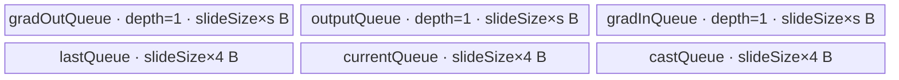
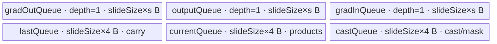

# ExpSegsumBackward A2/A3 ACLNN 算子知识

## 算子速览

| 项目 | 内容 |
|---|---|
| 实际入口 | `aclnnExpSegsumBackwardGetWorkspaceSize` + `aclnnExpSegsumBackward`，公开两段式 ACLNN，无更高版本入口。 |
| 计算语义 | 对每个前缀 batch 的 `L×L` 矩阵，计算严格下三角上的反向累积：`gradInput[b,r] = Σ_{k=r}^{L-1} Σ_{c=0}^{r-1} gradOutput[b,k,c] * gradSelf[b,k,c]`。 |
| 输入输出 | `gradOutput, gradSelf: [prefix..., L, L]`，4D/5D、ND、FP16/BF16/FP32；`gradInput: [prefix..., L]`，3D/4D、同 dtype、ND。 |
| 执行类型 | 算子自有节点为单 Kernel `AIV_VECTOR`；非连续输入的 `Contiguous` 与输出 `ViewCopy` 是 ACLNN 框架边界。无 Cube/AIC、MIX_CV、SIMT 或 NDDMA 节点。 |
| Kernel 路线 | R-001 `TILING_KEY=0`：列分片、GM 保存跨行累计；R-002 `TILING_KEY=1`：多行驻 UB、批量归约。 |
| 核心资源 | 两路 VECIN Queue、一路 VECOUT Queue、三个 VECCALC TBuf；R-001 使用 workspace 中每核一条 FP32 累计行并执行 `SyncAll`，R-002 的累计行驻 UB。 |
| 来源闭包 | `source_closed`：公开 API、L0 launcher、Tiling/POD、两个 key 的 entry/body、A2/A3 OpDef/config 与 binary 接线均闭合；框架 `Contiguous/ViewCopy/CommonOpExecutorRun` 的内部实现和 tilingdata 宏展开按允许边界标明不可见。 |
| 验证状态 | 已完成源码闭包检查；本次知识提取未执行编译、真机、数值或性能测试。 |

## 接口与语义

### 计算语义

令输入最后两维边长为 `L`，前导维乘积为 `B`，展平后每个 batch 的两路输入为 `G[b,r,c]` 与 `S[b,r,c]`。公开目标语义与单个 batch 从零 carry 开始时的 Device 递推为

```text
carry[c] = Σ(k=r..L-1) G[b,k,c] * S[b,k,c]
gradInput[b,r] = Σ(c=0..r-1) carry[c]
```

因此对角线 `c=r` 与上三角 `c>r` 均不进入输出；`r=0` 的结果恒为零。这个等价式与公开文档的“乘法→上三角含对角线清零→倒序 cumsum→再次清零→最后一维求和”一致，目标语义要求各 batch 独立。R-002 每个 batch 都清零 UB carry；R-001 只在进入 `ComputeBase` 前清零每核 GM carry 一次，若一个核分到多个 batch，后续 batch 会继承前一 batch 的 carry，这是固定源码中的实现边界而不是公开语义，详见限制。

### 输入、输出与属性

| 参数 | shape/layout | dtype | 约束、默认值与语义 |
|---|---|---|---|
| `gradOutput` | 4D/5D `ND`，`[prefix...,L,L]` | FP16、BF16、FP32 | 两个末维相等；支持非连续 tensor，ACLNN 先调用 `Contiguous`。公开文档称支持空 tensor。 |
| `gradSelf` | 与 `gradOutput` 同 shape、`ND` | 公开约束要求与 `gradOutput` 同 dtype | 正向 `aclnnExpSegsum` 的输出；支持非连续 tensor并先连续化。实际 `CheckParams` 只检查它属于支持集合，没有显式比较两输入 dtype，见限制。 |
| `gradInput` | 3D/4D `ND`，等于输入去掉最后一维 | 与 `gradOutput` 同 dtype | 用户提供输出；L0 先分配同 shape/dtype/format 的连续临时 `out`，Kernel 写 `out`，随后 `ViewCopy(out, gradInput)`。 |
| `workspaceSize` | 标量输出 | `uint64_t` | 由 executor 汇总；自有 Kernel tiling 固定申请 32 MiB，非连续转换与临时输出的额外空间由外部 executor 决定。 |
| `executor` | Host 对象 | `aclOpExecutor*` | 第一段构造并移交；第二段交给 `CommonOpExecutorRun`。 |
| `stream` | Device stream | `aclrtStream` | 第二段在该 stream 上执行 executor 中已登记的节点。 |

无算子属性。任一输入或输出 `IsEmpty()` 时第一段在参数校验前返回 `workspaceSize=0` 和空计算 executor；因此空 tensor 路径不会执行 shape、dtype、format 校验，也不会启动 Kernel。

### 入口与版本

固定 Commit 只公开 `aclnnExpSegsumBackwardGetWorkspaceSize` 与 `aclnnExpSegsumBackward` 这一版本族。README 和 ACLNN 文档明确支持 Atlas A2、A3，OpDef 的 `AICore().AddConfig` 分别接入 `ascend910b`、`ascend910_93`，两平台 binary config 均覆盖 FP16/FP32/BF16。文档明确 Ascend 950PR/950DT 不支持；虽然全局 `ascendc_config.json` 把 `ExpSegsumGrad` 列入 `ascend950`，公开支持与实现信号冲突，故本卡不把 950 纳入平台，也不发布 `_950` 卡。

## Host/Launcher 执行流程

### 参数校验与前处理

第一段的实际顺序如下：

1. `OP_CHECK_COMM_INPUT(workspaceSize, executor)` 检查两个公共输出指针，随后创建 `uniqueExecutor`。
2. 直接读取 `gradOutput/gradSelf/gradInput->IsEmpty()`；任一为空 tensor 就返回空 executor。注意这发生在 `CheckNotNull` 之前。
3. `CheckParams` 依次检查三 tensor 非空指针、两输入 dtype 位于 `{FP16,FP32,BF16}`、`gradInput.dtype == gradOutput.dtype`、输入为 4D/5D 且 shape 关系成立、三者 storage format 均为 ND。
4. 依次登记/复用 `Contiguous(gradOutput)`、`Contiguous(gradSelf)`；两者任一返回空指针即终止。
5. `l0op::ExpSegsumGrad` 按 `gradInput` 的 view shape/dtype/storage format 分配连续临时 `out`，登记单个 `ExpSegsumGrad` AICore launcher。
6. 登记 `ViewCopy(out, gradInput)`；随后读取 executor 汇总 workspace 并移交 executor。
7. 第二段 `CommonOpExecutorRun(workspace, workspaceSize, executor, stream)` 执行已登记图；其内部 task/event 细节不在固定仓中。

### 参数、Workspace 与生命周期

Tiling 从输入 0 的 origin shape 产生 `B=Π shape[0..rank-3]` 和 `L=shape[rank-1]`，从平台读取 `AIV coreNum` 与 `UB bytes`。算子 Kernel workspace slice 固定为 `32*1024*1024` bytes；R-001 实际访问前 `L*needCoreNum` 个 FP32 元素，逻辑所需字节为 `4*L*needCoreNum`，源码未检查它不超过 32 MiB。R-002 不读取该累计区，但 entry 仍要求 `GetUserWorkspace(workspace) != nullptr`。

ACLNN 返回的总 `workspaceSize=uniqueExecutor->GetWorkspaceSize()` 还可能含两次 `Contiguous`、临时 `out` 和 `ViewCopy` 所需空间；固定仓只公开这些函数声明，没有 executor 的切片 offset、额外 extent 和复用策略。workspace 与临时 tensor 都由 executor 管理，从第一段成功返回后有效，到第二段 stream 上所有任务完成后才能由调用者释放或复用。

### 启动图与失败传播

```text
aclnnExpSegsumBackwardGetWorkspaceSize
  -> [条件节点 F-1] l0op::Contiguous(gradOutput)
  -> [条件节点 F-2] l0op::Contiguous(gradSelf)
  -> [自有节点 K-1] ExpSegsumGrad / exp_segsum_grad
  -> [条件节点 F-3] l0op::ViewCopy(tempOut, gradInput)
aclnnExpSegsumBackward
  -> CommonOpExecutorRun(..., stream)
```

| 节点 | Host 添加函数 / entry | 执行族与启动参数 | 输入→输出 / workspace | ordering、owner 与失败传播 |
|---|---|---|---|---|
| F-1/F-2 | `l0op::Contiguous` | ACLNN 框架边界；连续输入可能不物化节点 | 用户 view→连续 tensor；内部 workspace 固定仓不可见 | 按 executor 登记顺序先于 K-1；返回 `nullptr` 立即阻断后续。 |
| K-1 | `ADD_TO_LAUNCHER_LIST_AICORE(ExpSegsumGrad,...)` → `exp_segsum_grad` | 单 `AIV_VECTOR` Kernel；`blockDim=needCoreNum`；key 0 或 1；POD 为 `ExpSegsumGradTilingData` | 两路连续输入→临时 `out`；自有 workspace slice 32 MiB，R-001 用偏移 0 起的 `needCoreNum×L` FP32 累计区 | 由同一 executor/stream 排在输入连续化后、ViewCopy 前；launcher 或执行失败由 `CommonOpExecutorRun` 返回。 |
| F-3 | `l0op::ViewCopy` | ACLNN 框架边界 | 临时连续 `out`→用户 `gradInput` view | 只有 K-1 成功登记后才加入；内部 stream/event 与切片生命周期固定仓不可见。 |

K-1 内部只有一个 Device 节点，不存在跨 Kernel workspace 边。R-001 的核间边是“每核清零自己 workspace 行→`SyncAll`→同核读写该行”；`SetScheduleMode(1)` 为该 key 配套启用 batchmode。R-002 没有跨核数据共享。

## Route 与参数设计

### 分核与资源计算

记 `C=平台 AIV 核数`、`B=前导 batch 数`、`L=末维`、`s=sizeof(T)∈{2,4}`、`U=平台 UB bytes`、`R=20 KiB`。

```text
averageBatches = ceil(B / C)
needCoreNum    = ceil(B / averageBatches)
batchStart[i]  = i * averageBatches
batchEnd[i]    = min((i+1)*averageBatches, B)

M0 = align_down(floor((U-R)/6/4), 8)
A  = ceil(L / (32/s)) * (32/s)
if L <= M0: reduction query shape = [floor(M0/A), L]
else:       reduction query shape = [1, M0]
if ReduceSum.minTmp > R:
    delta = align_up(ceil((minTmp-R)/6), 32) bytes
    M = M0 - delta/s
else:
    M = M0
slideSize = min(L*A, M)
```

初始 `M0` 故意使用成员 `dataTypeSize=4` 和 `blockSize=8`，该成员在源码中没有按输入 dtype 改写；后续 `A` 和超额 reduction tmp 修正才调用 `GetDataTypeSize()`。这使 FP16/BF16 的初始容量按 4-byte 单元保守计算。实际显式 UB 分配为 `3*slideSize*s + 3*slideSize*4 = 3*slideSize*(s+4)` bytes，另有 `ReduceSum` 临时资源；Tiling 用 `GetReduceSumMaxMinTmpSize` 的 `minValue` 与 20 KiB 预留调小 `M`，但该外部 API 的临时区映射固定仓不可见。

### Route 选择

| 顺序 | Route | Key/模板 | 精确选择条件与优先级 | 不适用去向 |
|---:|---|---|---|---|
| 1 | R-002 多行驻 UB | key 1 / `ExpSegsumGradND<DTYPE_GRAD_OUTPUT,1>` | 在 reduction tmp 修正后的 `M` 上判断 `L <= M` | 条件假进入 R-001。 |
| 2 | R-001 列分片 GM carry | key 0 / `ExpSegsumGradND<DTYPE_GRAD_OUTPUT,0>` | `L > M` | 无下一 Route；router 未知 key 直接返回。 |

```text
读取 U、dtype、L
  -> 计算 M0 与 ReduceSum minTmp
  -> 必要时得到修正后的 M
  -> if L <= M: key=1, scheduleMode 保持默认
     else:      key=0, scheduleMode=1
  -> slideSize=min(L*align_up(L,32/s), M)
```

### 模板/实现执行矩阵

| Route | key/selector | dtype/shape/platform 完整命中条件 | 执行拓扑与 Kernel 节点 | 实际模板/body | 内存与同步特征 | tail/fallback |
|---|---|---|---|---|---|---|
| R-001 列分片 GM carry | 0 | A2/A3；FP16/BF16/FP32；非空合法 4D/5D；`L>M` | 单 K-1 `AIV_VECTOR` | `ExpSegsumGradND<T,0>::Process→ClearGM→ComputeBase` | 六个 UB buffer；workspace 每核 FP32 carry；清零后 `SyncAll`；MTE/V 显式 event | 每行按 `slideSize` 分列；`num1`/`num2` 控制最后列片与对角线；未知 key 返回。 |
| R-002 多行驻 UB | 1 | A2/A3；同上；`L<=M` | 单 K-1 `AIV_VECTOR` | `ExpSegsumGradND<T,1>::Process→ComputeBatches` | 同样六个 UB buffer；carry 驻 `lastQueue`；无核间同步 | `row=min(rowIdx+1,rowNum)` 处理首个不足组；DataCopyPad 补齐每行；未知 key 返回。 |

### 隐藏性能 Guard

| Guard | Host/Tiling 条件 | Device/资源原因 | 影响 Route | 不满足时去向 | 源码符号 |
|---|---|---|---|---|---|
| 公开平台 | 文档 A2/A3 为 `√`，950 为 `×`；OpDef 仅加 `ascend910b/ascend910_93` | 避免把单独的全局 950 编译信号当作公开支持 | 全部 | 950 不发布正式卡 | `README.md::产品支持情况`；`ExpSegsumGrad::ExpSegsumGrad` |
| UB/reduction 上界 | `M` 按 `U`、20 KiB、六等分和 `ReduceSum.minTmp` 计算 | 保证六个显式 buffer 与 reduction 临时需求可落入 UB | R-001/R-002 分界 | `L>M` 转 R-001，不是错误 | `ExpSegsumGradTiling::GetTilingKey` |
| 32-byte 行对齐 | `A=ceil(L/(32/s))*(32/s)` | R-002 的多行 `DataCopyPad` 及每行 UB 起点按 32 bytes 对齐 | R-002 | 通过 padding，不另设 fallback | `GetTilingKey`；`ComputeBatches` |
| 核间同步调度 | `key==0` 时 `SetScheduleMode(1)` | R-001 在 GM 清零后调用 `SyncAll` | R-001 | key 1 不设置 schedule mode | `FillTilingData`；`Process` |
| core POD 容量 | `needCoreNum` 应不超过 `MAX_CORE_CONT=50` | `batchStart/batchEnd` ABI 各只有 50 项 | 全部 | 源码无检查或 fallback | `ExpSegsumGradTilingData`；`GetNeedCoreNum` |
| workspace 逻辑容量 | R-001 需 `4*L*needCoreNum <= 32 MiB` | 每核 GM carry 行含 L 个 FP32 | R-001 | 源码无检查或 fallback | `RunBigKernelTiling`；`Init`；`ClearGM` |
| R-001 batch 隔离 | 公开语义要求 `batchEnd[i]-batchStart[i]=1`，等价于当前分核下 `B<=C` | `ClearGM` 只在 batch 循环外执行一次；GM carry 会跨同核 batch 保留 | R-001 | Host 未检查，也没有逐 batch 清零 fallback | `GetNeedCoreNum`；`Process`；`ComputeBase` |
| batch 索引窄化 | `batchStart/end` 从 int64 计算后写入 int32 | Device 地址以这些 int32 值恢复为 int64 | 全部 | 源码无溢出检查 | `GetNeedCoreNum`；`ParseTilingData` |
| 空 tensor | 任一 tensor `IsEmpty()` | 跳过参数检查、tiling 与所有节点 | 全部 | workspace 0，成功返回 | `aclnnExpSegsumBackwardGetWorkspaceSize` |

### POD/ABI

`TILING_DATA_FIELD_DEF` 的展开头 `register/tilingdata_base.h` 不在固定仓，故 `sizeof/alignof/offsetof` 无法从该 Commit 直接确认；下表保留源码声明顺序、字段位宽以及 Host/Device 两端的真实读写。数组长度常量为 50。

| 结构 | 字段 | 类型/位宽 | ABI 布局 | 单位 | Host/launcher producer | Device consumer | 边界 |
|---|---|---|---|---|---|---|---|
| `ExpSegsumGradTilingData` | `needCoreNum` | `int64_t`/64 | 声明序 1；具体 offset/结构总大小固定仓不可见 | AIV core | `FillTilingData: set_needCoreNum(needCoreNum)` | `ParseTilingData`；核保护、workspace offset | 来源值为 uint32；必须 `1..50`，源码仅由平台核数间接限制。 |
| `ExpSegsumGradTilingData` | `batches` | `int64_t`/64 | 声明序 2；具体 offset 固定仓不可见 | batch | `set_batches(Π prefix dims)` | Device body 不读取 | 全 Route inactive 字段；乘法溢出未检查。 |
| `ExpSegsumGradTilingData` | `tailDimLength` | `int64_t`/64 | 声明序 3；具体 offset 固定仓不可见 | element/row length | `set_tailDimLength(L)` | `ParseTilingData`；所有循环与 GM 地址 | 非空路线预期 `L>0`；无显式范围检查。 |
| `ExpSegsumGradTilingData` | `slideSize` | `int64_t`/64 | 声明序 4；具体 offset 固定仓不可见 | element | `set_slideSize(min(L*A,M))` | `InitBuffer`、R-001 列步长、R-002 `rowNum` | 需为正且满足 UB；源码不单独检查。 |
| `ExpSegsumGradTilingData` | `batchStart[50]` | `int32_t[50]`/每项 32 | 声明序 5；具体 offset 固定仓不可见 | batch index | `set_batchStart(batchStart)`；前 `needCoreNum` 项赋值 | `batchStart[GetBlockIdx()]` | int64→int32 窄化；非活动项为初始化零且不读。 |
| `ExpSegsumGradTilingData` | `batchEnd[50]` | `int32_t[50]`/每项 32 | 声明序 6；具体 offset 固定仓不可见 | exclusive batch index | `set_batchEnd(batchEnd)` | `batchEnd[GetBlockIdx()]` | 同上；Device 遍历 `[start,end)`。 |

### Route 源码闭包

| Route | Key/selector | Host/Tiling producer | POD/参数 | Kernel entry/router 节点 | Kernel body/直接依赖 | 构建接线 |
|---|---|---|---|---|---|---|
| R-001 列分片 GM carry | key 0，`L>M` | `exp_segsum_grad_tiling.cpp::GetTilingKey/FillTilingData` | `ExpSegsumGradTilingData` 全字段；workspace 32 MiB；schedule 1 | `exp_segsum_grad.cpp::exp_segsum_grad` → `ExpSegsumGradND<T,0>` | `exp_segsum_grad.h::ClearGM/ComputeBase/ComputeMul/ComputeSum/getLastRow/setLastRow/CopyInBatch/CopyOutBatch` | `exp_segsum_grad_def.cpp`；A2/A3 binary JSON；`ascendc_config.json` |
| R-002 多行驻 UB | key 1，`L<=M` | 同上 | 同一 POD；schedule 默认 | entry → `ExpSegsumGradND<T,1>` | `ComputeBatches/ComputeMulBatches/CopyInBatch/CopyOutBatch` | 同上 |

## Kernel 实现

### 公共执行流程

entry 参数顺序为 `(grad_output, grad_self, grad_input, workspace, tiling)`。`GET_TILING_DATA` 解析 POD；随后 `GetUserWorkspace(workspace)` 只用于空指针 gate，两个模板的 `Init` 实际收到原始 `workspace`。router 仅接受 key 0/1，其他 key 无输出返回。两 Route 都按 `GetBlockIdx()` 读取自己的 `[batchStart, batchEnd)`，绑定两路连续 GM 输入、临时 GM 输出，并分配：

```text
grad_output GM ─┐
                ├─ DataCopyPad → VECIN queues → FP32/FP32-equivalent Mul
grad_self GM ───┘                              → descending-row carry
                                               → strict-lower mask
                                               → ReduceSum
                                               → VECOUT queue → grad_input GM
```

FP16/BF16 都先 `Cast(..., CAST_NONE)` 到 FP32 再乘、累加、归约，最后转换回 T；FP32 直接乘和归约。所有 Queue depth 均为 1。算子自有图为单 Kernel；ACLNN 的条件 `Contiguous` 与 `ViewCopy` 在同一 executor/stream 前后衔接，内部 Kernel 路由固定仓不可见。

### Route R-001：列分片 GM carry

#### 适用条件

##### 选择证据

| 层级 | 文件 | 符号 | 源码谓词/参数 | 结果/下一跳 |
|---|---|---|---|---|
| API | `op_host/op_api/aclnn_exp_segsum_backward.cpp` | `aclnnExpSegsumBackwardGetWorkspaceSize` | 非空、校验通过，连续化成功 | 登记 `ExpSegsumGrad`。 |
| Tiling | `op_host/exp_segsum_grad_tiling.cpp` | `GetTilingKey` | reduction 修正后 `tailDimLength > maxSlideSize` | key 0，`slideSize=M`。 |
| Tiling | 同上 | `FillTilingData` | `tilingKey==COMMON_TILING_KEY` | `blockDim=needCoreNum`，`scheduleMode=1`。 |
| Router | `op_kernel/exp_segsum_grad.cpp` | `exp_segsum_grad` | `TILING_KEY_IS(0)` 且 user workspace 非空 | 实例化 `ExpSegsumGradND<T,0>`；否则尝试 key 1/返回。 |

#### Device 数据流

##### 函数级调用链

```text
l0op::ExpSegsumGrad -> ADD_TO_LAUNCHER_LIST_AICORE(ExpSegsumGrad)
  -> exp_segsum_grad(..., key=0)
    -> ExpSegsumGradND<T,0>::Init
      -> ParseTilingData + 3×TQue/3×TBuf InitBuffer + GM bindings
    -> Process
      -> ClearGM -> SyncAll
      -> ComputeBase
        -> CopyInBatch -> ComputeMul
        -> getLastRow -> Add -> setLastRow
        -> ReduceSum(chunk) -> ComputeSum(chunks)
        -> CopyOutBatch
```

##### 源码等价伪码

```text
# 源码等价伪码；b 属本核 [batchStart,batchEnd)
workspaceCarry[core, 0:L] = 0, 分 slideSize 片写 GM
SyncAll()
for b in assigned batches:
  for r = L-1 downto 0:
    yScratch[0 : 8*ceil(L/slideSize)] = 0
    for c = 0; c < L; c += slideSize:
      if r < c: break
      n1 = min(r-c+1, slideSize)               # 保留到对角线
      off = b*L*L + r*L + c
      go[0:n1], gs[0:n1] = GM[off:off+n1]
      current[0:n1] = fp32(go) * fp32(gs)
      last[0:n1] = workspaceCarry[core,c:c+n1]
      current[0:n1] += last[0:n1]
      last[0:slideSize] = current[0:slideSize]
      workspaceCarry[core,c:c+n1] = last[0:n1]
      n2 = min(r-c, slideSize)                 # 排除对角线
      if n2 == 0: break
      chunkScalar[c/slideSize*8] = ReduceSum(current[0:n2])
    result = ReduceSum(chunkScalar[0 : 8*ceil(L/slideSize)])
    gradInput[b*L+r] = cast_T(result)
# 注意：源码没有在切换到下一个 b 时重置 workspaceCarry
```

地址中的 `b*L*L+r*L+c` 对应输入 ND 连续布局；workspace 地址为 `core*L+c` 个 FP32 元素。`yOffset=(c/slideSize)*8` 把每个列片的标量落到一个 32-byte 间隔，未写槽位由先前 `Duplicate` 清零。

#### 内存与数据搬运

##### 资源与搬运表

| 层级/缓冲区 | offset/地址公式 | extent/容量公式 | dtype/layout | producer | consumer | owner/lifetime | 对齐/复用 |
|---|---|---|---|---|---|---|---|
| `gradOutTensorsGM` | `b*L*L+r*L+c` | 本次 `n1` elements | T/ND | 用户输入 | `CopyInBatch` | 调用者；整个执行期 | `DataCopyPad`, blockCount=1, blockLen=`n1*s` bytes；tail 自动 pad。 |
| `outputTensorsGM` | 同上 | `n1` | T/ND | 用户输入 `gradSelf` | `CopyInBatch` | 调用者 | 同上。 |
| `gradOutQueue` | UB queue base | `slideSize*s` bytes，depth 1 | T | `CopyInBatch` | `ComputeMul` | `Alloc→EnQue→DeQue→Free` 每列片 | tail 有效 `n1`，容量不缩。 |
| `outputQueue` | UB queue base | `slideSize*s` bytes，depth 1 | T | `CopyInBatch` | `ComputeMul` | 同上 | 同上。 |
| `currentQueue` | UB TBuf base | `slideSize*4` bytes | FP32 | Cast/Mul/Add/Reduce staging | carry 更新、ReduceSum | Kernel 全期 | 原地 `Mul/Add`；跨列片覆盖。 |
| `castQueue` | UB TBuf base | `slideSize*4` bytes | FP32 | `gradSelf` Cast；chunk ReduceSum；ComputeSum staging | Mul、最终 ReduceSum/Cast | Kernel 全期 | 同一物理区分阶段复用，以 `PipeBarrier<PIPE_V>` 隔开。 |
| `lastQueue` | UB TBuf base | `slideSize*4` bytes | FP32 | `ClearGM` 零行；workspace CopyIn；current copy | Add、workspace CopyOut | Kernel 全期 | 同一 buffer 在清零、读 carry、写 carry间复用；MTE/V events保护。 |
| `lastTensorsGM` | `core*L+c` | 逻辑 `needCoreNum*L*4` bytes；绑定 extent 实参为 `L*needCoreNum*sizeof(float)` | FP32/每核一行 | `ClearGM`、`setLastRow` | `getLastRow` | executor workspace；R-001 Kernel 全期 | 核间不别名，但同核多个 batch 复用且不重置；固定 slice 32 MiB，源码无逻辑容量检查。 |
| `gradInQueue` | UB queue base | `slideSize*s` bytes，depth 1 | T | chunk/final ReduceSum | `CopyOutBatch` | 每输出行 Alloc→Free | 只写 1 element；其余为 chunk scratch/零。 |
| `gradInTensorsGM` | `b*L+r` | 1 element | T/ND | `CopyOutBatch` | 后继 ViewCopy | executor 临时 out | blockCount=1, blockLen=`s` bytes。 |

##### 分层内存布局



##### 字节账与复用顺序

```text
UB_total_explicit
  = 1*slideSize*s + 1*slideSize*s + 1*slideSize*s
  + slideSize*4 + slideSize*4 + slideSize*4
  = 3*slideSize*(s+4) bytes
ReduceSum reserve/query = 20 KiB baseline，超出部分通过 GetReduceSumMaxMinTmpSize 修正 M
dynamic_ub = N/A（AIV TPipe 静态 InitBuffer）
workspace_kernel_slice = 32 MiB
workspace_logically_touched = 4*L*needCoreNum bytes
=> slideSize=M，且安全复用还要求逻辑触达不越过 32 MiB；后者 Host 未校验
```

| 复用子区 | 写入者 | 读取者/消费点 | 下一次覆盖 | 同步或释放依据 | 安全条件 |
|---|---|---|---|---|---|
| `currentQueue[0:n1]` | Cast/Mul，再原地 Add | workspace write 与 chunk ReduceSum | 下一列片 Mul | `PipeBarrier<PIPE_V>`；输入 Queue Free 在 Mul 后 | ReduceSum/GM copy完成前不得覆盖。 |
| `castQueue` | `gradSelf` Cast | Mul | chunk scalar ReduceSum，再被最终 ReduceSum staging复用 | 每阶段后 `PipeBarrier<PIPE_V>` | FP16/BF16 的 Mul 已消费第二输入后才写 scalar。 |
| `lastQueue` | GM→UB carry | Add | current→last，再 UB→GM | `V_MTE2/MTE2_V` 与 `V_MTE3/MTE3_V` event | 同一列片写回完成后才处理下一访问。 |
| `gradInQueue` | 每行开头 `Duplicate`，各列片写稀疏 scalar，最终写结果 | `ComputeSum`、CopyOut | `FreeTensor` 后下一行 Alloc | Queue `EnQue/DeQue/FreeTensor` | `8*colLoopTimes` 必须落入 queue 容量；源码未单设 guard。 |

#### 同步、精度与尾块

##### 同步与数值边界表

| 阶段 | primitive/机制 | producer | consumer/等待点 | 保护对象 | 精度/尾块 |
|---|---|---|---|---|---|
| workspace 初始化 | `SyncAll` + schedule mode 1 | 每核在 batch 循环外执行一次 `ClearGM` | 所有核 `ComputeBase` | `needCoreNum×L` carry 区 | 每片 `length=min(L-i*slide,slide)`；同核后续 batch 不再清零。 |
| 输入搬运 | TQue EnQue/DeQue | `CopyInBatch` | `ComputeMul` | 两路 VECIN queue | `n1=min(r-c+1,slide)`；DataCopyPad处理非32-byte尾。 |
| 低精度乘法 | `Cast(CAST_NONE)` + `Mul` | 输入 queue | current FP32 | current/cast TBuf | FP16/BF16 先升 FP32；FP32 直接 Mul。 |
| carry 读写 | `V_MTE2`、`MTE2_V`、`V_MTE3`、`MTE3_V` events | GM/Vector pipeline | Add/下一覆盖 | lastQueue 与 GM carry | 只搬 `n1*4` bytes；列尾不参与。 |
| 严格下三角 | `n2=min(r-c,slide)` | current carry | chunk ReduceSum | 对角线/上三角 lane | `n2=0` 立即结束；无效 lane不归约。 |
| 两级归约 | `ReduceSum<FP32,AR,false>` | 每列片有效前缀 | chunk scratch→最终 scalar | 稀疏 chunk scalar | FP16/BF16 最终 `CAST_ROUND`；FP32无降精度。 |
| 输出 | VECOUT Queue + `DataCopyPad` | final scalar | GM temp out | 1 element | blockLen=`sizeof(T)`；只提交有效标量。 |

#### 关键实现

##### 符号证据表

| 阶段 | 文件 | 符号/模板实例 | 实现事实 |
|---|---|---|---|
| Host/Tiling producer | `op_host/exp_segsum_grad_tiling.cpp` | `GetTilingKey/GetNeedCoreNum/FillTilingData` | 产生 key 0、slide、core ranges、32 MiB workspace 与 schedule 1。 |
| Kernel entry/router | `op_kernel/exp_segsum_grad.cpp` | `exp_segsum_grad` / `ExpSegsumGradND<T,0>` | user workspace gate，key 0 到 MODE 0；未知 key 返回。 |
| Device body/helper | `op_kernel/exp_segsum_grad.h` | `ClearGM/ComputeBase/ComputeMul/ComputeSum/getLastRow/setLastRow` | 列分片、GM carry、FP32 累积、两级 ReduceSum 与显式 event。 |

### Route R-002：多行驻 UB

#### 适用条件

##### 选择证据

| 层级 | 文件 | 符号 | 源码谓词/参数 | 结果/下一跳 |
|---|---|---|---|---|
| API | `op_host/op_api/aclnn_exp_segsum_backward.cpp` | `aclnnExpSegsumBackwardGetWorkspaceSize` | 同 R-001 的非空合法路径 | 登记相同算子节点。 |
| Tiling | `op_host/exp_segsum_grad_tiling.cpp` | `GetTilingKey` | reduction 修正后 `tailDimLength <= maxSlideSize` | key 1；`slideSize=min(L*A,M)`。 |
| Router | `op_kernel/exp_segsum_grad.cpp` | `exp_segsum_grad` | `TILING_KEY_IS(1)` 且 user workspace 非空 | `ExpSegsumGradND<T,1>`；不调用 `SyncAll`。 |

#### Device 数据流

##### 函数级调用链

```text
l0op::ExpSegsumGrad -> ADD_TO_LAUNCHER_LIST_AICORE(ExpSegsumGrad)
  -> exp_segsum_grad(..., key=1)
    -> ExpSegsumGradND<T,1>::Init
      -> ParseTilingData + 3×TQue/3×TBuf InitBuffer + GM bindings
    -> Process
      -> ComputeBatches
        -> CopyInBatch(multiple rows)
        -> ComputeMulBatches
        -> Add + DataCopy(lastRow carry) for each row, descending
        -> Adds(strict-lower prefix) -> ReduceSum(rows)
        -> CopyOutBatch(multiple scalars)
```

##### 源码等价伪码

```text
# 源码等价伪码
A = align_up(L, 32/s)
rowNum = floor(slideSize/A)
for b in assigned batches:
  last[0:slideSize] = 0
  for rowIdx = L-1; rowIdx >= 0; rowIdx -= rowNum:
    row = min(rowIdx+1, rowNum)
    first = rowIdx-row+1
    DataCopyPad row blocks GM[b, first:first+row, 0:L] -> queues，UB row pitch=A
    current = 0
    for i in 0..row-1:
      globalRow = first+i
      current[i*A : i*A+globalRow+1] = fp32(GO)*fp32(GS)
    for i in 0..row-1 in descending global-row order:
      off=(row-i-1)*A
      current[off:off+A] += last[0:A]
      last[0:A] = current[off:off+A]
    cast = 0
    for i in 0..row-1:
      globalRow=first+i
      cast[i*A : i*A+globalRow] = current[i*A : i*A+globalRow]  # 排除对角线
    result[0:row] = ReduceSum(cast, shape=[row,A])
    if T is FP16/BF16: result = Cast(..., CAST_RINT)
    GMout[b, first:first+row] = result
```

输入多行一次搬入；`DataCopyPad` 把每行从 L 个有效元素扩展到 `A` 的 UB pitch。组内从较大行号向较小行号更新 `last`，组间保留 `lastQueue`，因此整个 batch 的累计状态从不落 GM。

#### 内存与数据搬运

##### 资源与搬运表

| 层级/缓冲区 | offset/地址公式 | extent/容量公式 | dtype/layout | producer | consumer | owner/lifetime | 对齐/复用 |
|---|---|---|---|---|---|---|---|
| 两路输入 GM | `b*L*L+first*L` | `row` blocks × `L*s` bytes | T/ND | 用户 | `CopyInBatch` | 调用者 | blockCount=`row`→uint16；UB 每行由 DataCopyPad 对齐到 A。 |
| `gradOutQueue/outputQueue` | UB row `i*A` | 各 `slideSize*s` bytes，depth 1 | T/row-padded | CopyIn | `ComputeMulBatches` | 每行组 Alloc→Free | 每行有效乘法长度 `globalRow+1`，上三角 padding不读。 |
| `currentQueue` | `i*A` | `slideSize*4` bytes | FP32/row-padded | Cast/Mul；累积 Add | last 更新 | Kernel 全期 | 每组先全量 Duplicate 0；原地 Add。 |
| `castQueue` | `i*A` | `slideSize*4` bytes | FP32/row-padded | 第二输入 Cast，后整区清零并拷严格下三角 | Mul、ReduceSum | Kernel 全期 | Mul 完成后复用；`PipeBarrier` 防止提前覆盖。 |
| `lastQueue` | `[0:A)` 有效 | `slideSize*4` bytes | FP32 | batch 开头清零；每行 current copy | 下一行 Add | 一个 batch 生命周期 | 跨行组保留；切换 batch 时覆盖为零。 |
| `gradInQueue` | `[0:row)` result | `slideSize*s` bytes，depth 1 | T | ReduceSum/Cast | CopyOut | 每组 Alloc→Free | 输出 row 个连续 scalar。 |
| 输出 GM | `b*L+first` | `row*s` bytes | T/ND | CopyOut | ViewCopy | executor temp out | 单 block，blockLen=`row*s`；尾组 row 保护。 |
| Kernel workspace | slice 起点 | 32 MiB allocated，0 bytes由 R-002 body读取 | N/A | executor | 仅 entry 非空 gate | Kernel执行期 | 不承载算法状态；`lastTensorsGM` 虽绑定但未访问。 |

##### 分层内存布局



##### 字节账与复用顺序

```text
UB_total_explicit = 3*slideSize*(s+4) bytes
row_pitch_elements = A = align_up(L,32/s)
rows_per_group = floor(slideSize/A) >= 1（由 key 1 的 L<=M 与 slide 公式保证）
ReduceSum query shape = [floor(M0/A), L]，实际 body shape=[row,A]
dynamic_ub = N/A（AIV TPipe）
workspace_kernel_slice = 32 MiB；algorithm workspace touched = 0 bytes
```

| 复用子区 | 写入者 | 读取者/消费点 | 下一次覆盖 | 同步或释放依据 | 安全条件 |
|---|---|---|---|---|---|
| `currentQueue[i*A]` | `ComputeMulBatches` | descending Add、strict-lower copy | 下一组 Duplicate | `PipeBarrier<PIPE_V>` | 当前组 ReduceSum 消费完成。 |
| `castQueue` | input 1 Cast | Mul | 全区 Duplicate 后由 `Adds` 写 mask 后数据 | Mul 后 barrier | 第二输入已完成消费。 |
| `lastQueue[0:A]` | batch Duplicate / 每行 current copy | 下一行 Add | 下一行/下一 batch | 每次 Add 与 DataCopy 间 barrier | 行必须按源码从大到小处理。 |
| 两个 VECIN Queue | multi-row CopyIn | `ComputeMulBatches` | Free 后下一组 Alloc | Queue EnQue/DeQue/Free | `row` cast 到 uint16 可表示；源码无显式检查。 |

#### 同步、精度与尾块

##### 同步与数值边界表

| 阶段 | primitive/机制 | producer | consumer/等待点 | 保护对象 | 精度/尾块 |
|---|---|---|---|---|---|
| 多行搬运 | Queue + `DataCopyPad` | GM inputs | `ComputeMulBatches` DeQue | 两路 row-padded queue | `blockCount=row`，每 block `L*s` bytes；行尾 pad不参与有效乘法。 |
| 乘法 | Cast/Mul + barrier | queue | current | FP32 products | 每行只算 `globalRow+1`，直接忽略上三角。 |
| 跨行累计 | `Add` + `DataCopy` + barrier | current/last | 下一更小行 | `lastQueue[0:A]` | 累计为 FP32；padding lane初始为零。 |
| 严格下三角 | `Adds(...,0,count=globalRow)` | current | cast | 对角线与右侧 lane | count 不含对角线；cast 预先全零。 |
| 行归约 | `ReduceSum<FP32,AR,false>` | cast shape `[row,A]` | output queue | 每行独立 result | FP16/BF16 用 `CAST_RINT` 降精度；FP32直接写。 |
| 尾行组 | `row=min(rowIdx+1,rowNum)` | outer loop | CopyIn/Reduce/CopyOut | batch 顶部不足组 | GM offset=`rowIdx-row+1`，只输出 row 个 scalar。 |

#### 关键实现

##### 符号证据表

| 阶段 | 文件 | 符号/模板实例 | 实现事实 |
|---|---|---|---|
| Host/Tiling producer | `op_host/exp_segsum_grad_tiling.cpp` | `GetTilingKey/FillTilingData` | key 1 条件、row packing 容量、POD 与 blockDim。 |
| Kernel entry/router | `op_kernel/exp_segsum_grad.cpp` | `exp_segsum_grad` / `ExpSegsumGradND<T,1>` | key 1 到 MODE 1，仍执行 workspace 非空 gate。 |
| Device body/helper | `op_kernel/exp_segsum_grad.h` | `ComputeBatches/ComputeMulBatches/CopyInBatch/CopyOutBatch` | 多行 padded DMA、UB carry、FP32 row reduce、尾组。 |

## 算子特定优化

### Trick T-001：按 UB 容量切换 GM carry 与多行驻 UB

#### 触发与源码依据

- 适用 Route：R-001、R-002。
- 触发条件：先按平台 UB 与 `ReduceSum` 最小临时空间修正 `maxSlideSize`，再比较 `L<=maxSlideSize`。
- Golden 来源：[`op_host/exp_segsum_grad_tiling.cpp:111-132`](../../../../../../../cann-ops-raw/ascendc/ops-math/165d41f02a43a62324b434cb6bda7c533b14da3e/math/exp_segsum_grad/op_host/exp_segsum_grad_tiling.cpp#L111-L132)

**官方源码（固定 Commit 连续逐字摘录）**：

```cpp
if (minValue > REDUCE_SUM_SIZE) {
    int64_t size = CeilA2B(CeilA2B(minValue - REDUCE_SUM_SIZE, TENSOR_NUM), BLOCK) * BLOCK;
    maxSlideSize = maxSlideSize - size / GetDataTypeSize();
}
if (tailDimLength <= maxSlideSize) {
    tilingKey = SMALL_SIZE_TILING_KEY;
} else {
    tilingKey = COMMON_TILING_KEY;
}
```

#### 机制与设计原因

当一行能落入修正后的 `M` 时，key 1 把 `floor(slideSize/A)` 行同时搬进 UB，carry 留在 `lastQueue`，消除 key 0 每个 `(row,column-chunk)` 对 workspace 的读写和对应 MTE event。行过大时 key 0 保留固定 UB 上界，只把列切成 `slideSize` 片，并用每核 GM 行维持跨行状态，从而不要求整行驻 UB。`GetReduceSumMaxMinTmpSize` 的 shape、dtype=FP32、AR pattern 与 20 KiB 预留共同修正 selector，避免只按六个显式 buffer 决策。

#### 迁移边界

- 适用：逐行反向扫描、存在可分片列归约且 carry 可按核私有化的算法。
- 前提：A2/A3 AIV；FP16/BF16/FP32；ND；能提供 key 0 的全局同步调度和每核 GM carry，且迁移实现需在每个 batch 前建立零 carry（固定源码只在 Kernel 开头清一次），或满足 key 1 的 UB/ReduceSum 临时空间。
- 失效：`L>M` 必须使用 R-001；不能提供 `SyncAll`/schedule mode 或 workspace 时不能直接迁移该 fallback。
- 未验证：本次知识提取未执行编译、真机、数值或性能测试。

#### 错误做法

不能只用 `L*s<=UB` 选择多行 Route：源码还扣除 20 KiB、六等分容量并查询 `ReduceSum` 最小临时空间。固定仓未提供性能对比或可验证反例数据。

### Trick T-002：用 mask 长度融合两次三角清零

#### 触发与源码依据

- 适用 Route：R-001、R-002。
- 触发条件：任意非空合法输入；每个输出行只需严格下三角列 `c<r`。
- Golden 来源：[`op_kernel/exp_segsum_grad.h:159-188`](../../../../../../../cann-ops-raw/ascendc/ops-math/165d41f02a43a62324b434cb6bda7c533b14da3e/math/exp_segsum_grad/op_kernel/exp_segsum_grad.h#L159-L188)

**官方源码（固定 Commit 连续逐字摘录）**：

```cpp
if (rowIdx < colIdx) {
    break;
}
int64_t num1 = Min(rowIdx - colIdx + 1, slideSize); //第一次masked_fill
int64_t num2 = Min(rowIdx - colIdx, slideSize); //第二次masked_fill
if (num2 == 0) {
    break;
}
```

#### 机制与设计原因

源码不物化公开公式中的两个 `L×L` bool 三角矩阵，也不执行整矩阵 flip。R-001 用 `num1` 仅乘到对角线、用 `num2` 仅归约对角线左侧；R-002 用每行乘法 count=`globalRow+1`，随后只复制 count=`globalRow` 到已清零的归约区。地址从底行向顶行遍历本身等价于倒序 cumsum。这样从源码层面消除了 mask 矩阵、flip 张量及上三角输入的搬运/计算。

#### 迁移边界

- 适用：mask 边界可由行号直接计算、且扫描方向能表达 flip+cumsum 的三角递推。
- 前提：严格保持 `num1` 含对角线用于 carry、`num2` 不含对角线用于输出；列片与多行组 tail 均需用全局 row index 计算长度。
- 失效：mask 不是单调三角边界或每行有效区不连续时，不能用单一 count/break 替代显式 mask。
- 未验证：本次知识提取未执行编译、真机、数值或性能测试。

#### 错误做法

若把 `num2` 写成 `num1`，会把对角线加入输出；若在 `rowIdx<colIdx` 后继续搬运，会处理公开语义必然被清零的上三角。源码没有独立测试数据证明性能收益。

## 模板与实现对比

| 对比维度 | R-001 列分片 GM carry | R-002 多行驻 UB | 设计选择依据 |
|---|---|---|---|
| 命中条件/优先级 | `L>M`，key 0 | `L<=M`，key 1 | `M` 已含 UB 六等分和 ReduceSum tmp 修正。 |
| 模板与 dtype | `ExpSegsumGradND<T,0>`；T 为 FP16/BF16/FP32 | `ExpSegsumGradND<T,1>`；同 dtype | binary config 为每个同 dtype 输入/输出组合生成 binary，key 在同 entry 内路由。 |
| 循环与分核 | core→batch→单 row→column chunk | core→batch→row group→group 内 row | 两者 core ranges 完全相同；只改变行/列驻留粒度。 |
| Queue/TBuf/寄存器/dynamic UB/通信 window | 3 个 depth-1 Queue + 3 个 TBuf；无 dynamic UB/通信 | 相同 | `Init` 不按 MODE 条件分配，显式 UB 账相同。寄存器字节固定仓不可见。 |
| 内存总占用与复用 | `3*slide*(s+4)` + ReduceSum tmp；另触达 `4*L*N` workspace | 同 UB 公式；算法 workspace 0 | 大行用 GM carry，能容一行时让 carry 驻 UB。 |
| 搬运/Vector/SIMT/NDDMA/通信 API | 单行 `DataCopyPad`、Cast/Mul/Add、GM carry events、两级 ReduceSum | 多行 `DataCopyPad`、Cast/Mul/Add/Adds、二维 ReduceSum | 均为 AIV Vector；没有 SIMT/NDDMA/通信。 |
| 同步、精度与 tail | `SyncAll`；FP32 carry；FP16/BF16 `CAST_ROUND`；列 tail=`n1/n2` | 无核间同步；FP32 carry；FP16/BF16 `CAST_RINT`；行组 tail=`row` | workspace 初始化需要 key 0 schedule；两 Route 的最终 round mode 不同，不能合并。 |
| fallback/失败边界 | workspace 非空、容量与 core 数无显式 guard | workspace 虽不读仍必须非空；row count窄化无 guard | router 未知 key直接返回，无第三 Route。 |

## 平台差异

| 项目 | A2 | A3 | 950 |
|---|---|---|---|
| 支持状态 | 支持；公开文档 `√`，OpDef `ascend910b`，有三 dtype binary config | 支持；公开文档 `√`，OpDef `ascend910_93`，有三 dtype binary config | 公开文档 `×`、OpDef/本地 binary config缺失，但全局 `ascendc_config.json` 含 `ascend950`；发布证据冲突，不建卡。 |
| Host/Launcher | 共用同一 ACLNN、Tiling、POD；平台提供各自 AIV coreNum/UB size | 同左 | 不作为公开入口发布。 |
| Kernel/资源 | 共用 `exp_segsum_grad` 与 key 0/1；binary JSON 与 A3 内容同构 | 共用同一源码 | 固定仓没有 950 OpDef config 或本地 binary JSON，不能闭合公开 950 Route。 |

## 限制与失败边界

- 空 tensor fast path 位于 `CheckParams` 之前；非空指针、shape、dtype、format 约束对空 tensor 不执行。更严重地，源码在 `CheckNotNull` 前调用三个 tensor 的 `IsEmpty()`；固定仓无法证明空指针输入会按文档稳定返回 `ACLNN_ERR_PARAM_NULLPTR`。
- 公开文档要求 `gradSelf.dtype == gradOutput.dtype`，但 `CheckParams` 只分别检查支持集合，未显式比较两输入 dtype；A2/A3 binary JSON 仅列同 dtype 组合。混合 dtype 的最终 launcher 失败点/状态码固定仓不可见，复用时必须主动保持两输入同 dtype。
- R-001 固定申请 32 MiB，却没有检查 `4*L*needCoreNum <= 32 MiB`；超出时源码没有 fallback。`GlobalTensor::SetGlobalBuffer` 第二参数的框架精确定义也不在固定仓。
- R-001 的 `ClearGM()` 位于 `ComputeBase()` 的 batch 循环外；当 `B>C` 导致某核的 `[batchStart,batchEnd)` 含多个 batch 时，GM carry 不会按 batch 清零，后续 batch 的结果会混入前一 batch 的累计状态。Host 没有 `B<=C` guard 或逐 batch fallback；复用时必须修复清零位置或限制分配。
- `batchStart/end` 只有 50 项且为 int32，`B` 的乘积、int64→int32 窄化、`needCoreNum<=50` 均无显式溢出/范围 guard；`CopyInBatch` 还把 R-002 的 `row` 转为 uint16 blockCount。
- Tiling 的 `ParseInputAttrs()` 返回值没有在 `RunBigKernelTiling()` 中检查；输入 shape/desc、compileInfo 与 workspace 数组指针也没有在该函数内逐项判空。公开 ACLNN 正常非空路线提供受约束输入，但 direct Host 复用不能跳过这些前提。
- `TILING_DATA_FIELD_DEF`、`GET_TILING_DATA`、`GetReduceSumMaxMinTmpSize`、`CommonOpExecutorRun`、`Contiguous/ViewCopy` 的实现来自固定仓外框架；因此 POD 具体 offset、reduction 临时区物理布局、executor 总 workspace 切片与 stream/event 原语固定仓不可见。
- 950 公开文档与全局编译配置冲突，按公开文档优先不发布；本次也未执行编译、真机、数值或性能测试。

## 源码索引

### 链路索引

| 链路阶段 | 文件 | 关键符号 | 支撑内容 |
|---|---|---|---|
| 入口声明/约束 | `math/exp_segsum_grad/docs/aclnnExpSegsumBackward.md` | 产品支持表、函数原型、参数表 | A2/A3 支持、950 不支持、公开语义/shape/dtype/空 tensor/确定性。 |
| 入口声明/约束 | `math/exp_segsum_grad/op_host/op_api/aclnn_exp_segsum_backward.h` | 两个 `ACLNN_API` 声明 | 两段式 ABI 和公开公式。 |
| 入口实现 | `math/exp_segsum_grad/op_host/op_api/aclnn_exp_segsum_backward.cpp` | `CheckParams`、两段 ACLNN 实现 | 校验顺序、空路径、Contiguous→L0→ViewCopy、executor。 |
| 入口实现 | `math/exp_segsum_grad/op_host/op_api/exp_segsum_grad.cpp` | `l0op::ExpSegsumGrad` | 临时输出分配和自有单 Kernel launcher。 |
| 框架边界 | `common/inc/external/aclnn_kernels/contiguous.h` | `Contiguous`、`ViewCopy` | 非连续输入/输出处理的公开声明与不可见边界。 |
| Host/Tiling/Launcher | `math/exp_segsum_grad/op_host/exp_segsum_grad_def.cpp` | `ExpSegsumGrad::ExpSegsumGrad` | 三 dtype/ND 与 A2/A3 OpDef 接线。 |
| Host/Tiling/Launcher | `math/exp_segsum_grad/op_host/exp_segsum_grad_tiling.h` | `ExpSegsumGradTilingData` | POD 字段、数组上限、compileInfo。 |
| Host/Tiling/Launcher | `math/exp_segsum_grad/op_host/exp_segsum_grad_tiling.cpp` | `ExpSegsumGradTiling` 全方法 | core/UB/workspace、key/slide、POD producer 与 schedule。 |
| Kernel entry/body | `math/exp_segsum_grad/op_kernel/exp_segsum_grad.cpp` | `exp_segsum_grad` | entry 参数、workspace gate、key router。 |
| Kernel entry/body | `math/exp_segsum_grad/op_kernel/exp_segsum_grad.h` | `ExpSegsumGradND<T,MODE>` | 全部 UB、循环、搬运、Vector、同步、精度和 tail。 |
| 构建接线 | `math/exp_segsum_grad/op_host/config/ascend910b/exp_segsum_grad_binary.json` | `ExpSegsumGrad.op_list` | A2 三个同 dtype binary 组合。 |
| 构建接线 | `math/exp_segsum_grad/op_host/config/ascend910_93/exp_segsum_grad_binary.json` | `ExpSegsumGrad.op_list` | A3 三个同 dtype binary 组合。 |
| 构建接线 | `scripts/kernel/binary_config/ascendc_config.json` | `ExpSegsumGrad` 条目 | AscendC 编译单元与 950 冲突信号、`auto_sync=false`。 |

每行只写一个文件，并确保该文件存在于 Frontmatter `sources`。

### 实现复用检查

| 检查项 | 可复用事实 | 不得改变的约束 | 源码符号 |
|---|---|---|---|
| ABI/POD | 六字段 producer/consumer、两数组各 50 项 | 字段声明顺序、int64/int32 位宽、元素单位、inactive `batches` 不得臆改；具体 offset需由真实框架宏确认 | `ExpSegsumGradTilingData`；`FillTilingData/ParseTilingData` |
| 调用顺序 | 输入连续化→ExpSegsumGrad→输出 ViewCopy；Kernel 从末行向首行 | 不能在 carry 更新前归约下一行，不能把 ViewCopy 提前；R-001 复用必须补上逐 batch 零 carry | `aclnnExpSegsumBackwardGetWorkspaceSize`；`ComputeBase/ComputeBatches` |
| workspace/内存 | key 0 每核 FP32 carry；key 1 carry驻 UB；六 buffer 字节账 | 32 MiB slice、`core*L+c` 地址、32-byte row pitch、Queue depth=1 | `RunBigKernelTiling`；`InitBuffer`；`getLastRow/setLastRow` |
| 同步 | key 0 `scheduleMode=1 + ClearGM + SyncAll`；MTE/V events；Queue lifecycle | 不得去掉 GM carry 的 event 或在 Mul消费前覆盖复用 TBuf | `FillTilingData`；`Process`；`getLastRow/setLastRow` |
| 精度与尾块 | 低精度先升 FP32；严格下三角 count；R-001 `CAST_ROUND`、R-002 `CAST_RINT` | `num1` 含对角线、`num2` 排除对角线；不能合并两个 round mode | `ComputeMul/ComputeSum/ComputeMulBatches/ComputeBatches` |
| 失败边界 | 空 tensor fast path、unknown key返回、workspace空返回 | 保留 A2/A3 公共约束；混合 dtype、>50 cores、workspace越界没有可依赖 fallback | ACLNN first stage；`exp_segsum_grad`；`GetNeedCoreNum` |