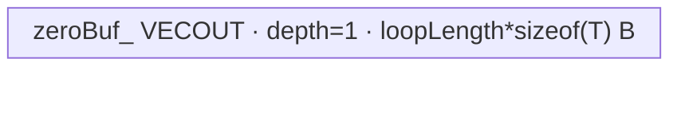

# Eye 950 ACLNN 算子知识

## 算子速览

| 项目 | 内容 |
|---|---|
| 实际入口 | `aclnnEyeGetWorkspaceSize` + `aclnnEye`，CANN 9.1.0 公开 ACLNN 两段式接口 |
| 计算语义 | 对 `0 <= i < n, 0 <= j < m`，`out[i,j] = 1` 当且仅当 `i == j`，否则为 `0` |
| 输入输出 | Host 标量 `n,m:int64_t`；二维 ND 输出 `(n,m)`；950 支持 FP32/FP16/BF16/INT32/INT16/INT8/UINT8/INT64/BOOL |
| 执行类型 | R-001~R-003 为单 Kernel `AIV_VECTOR` MicroAPI scatter；R-004~R-005 为单 Kernel 内 `AIV_VECTOR + SIMT` Hybrid，无 Cube/AIC/MIX_CV |
| Kernel 路线 | R-001 小面积/U16 索引；R-002 小面积/U32 索引；R-003 小面积/U64 索引；R-004 大面积/U32 SIMT；R-005 大面积/I64 SIMT |
| 核心资源 | Eye 节点使用 GM、depth=1 `VECOUT` Queue；小面积路线额外使用 256 B `VECCALC` TBuf 和 MicroAPI 寄存器；大面积路线使用 512 SIMT threads/block；Eye 系统 workspace 固定 16 MiB |
| 来源闭包 | `source_closed`：公开 ACLNN→`l0op::Eye`→Eye Host/Tiling/POD→`eye`→Vector/SIMT body 与 ascend950 构建接线已闭合；`ViewCopy` 作为允许的框架边界明确标注 |
| 验证状态 | 已完成源码闭包检查；本次知识提取未执行编译、真机、数值或性能测试。 |

## 接口与语义

### 计算语义

`aclnnEye` 无 Device 输入，仅按 Host 维度属性生成二维单位矩形：`out[i,j] = (i == j ? 1 : 0)`。对角线有效元素数为 `diag = min(n,m)`。`n==0 || m==0` 时第一段 API 直接返回 `workspaceSize=0` 和空执行流程，不进入内部 Eye Tiling；因此内部 `num_rows>0` 校验与公开 API 允许零维不冲突。

### 输入、输出与属性

| 参数 | shape/layout | dtype | 约束、默认值与语义 |
|---|---|---|---|
| `n` | Host 标量 | `int64_t` | `n >= 0`，输出第 0 维 |
| `m` | Host 标量 | `int64_t` | `m >= 0`，输出第 1 维；公开 ACLNN 没有内部 OpDef 的 `num_columns=0` 默认语义 |
| `out` | 二维 ND，view shape 必须为 `(n,m)` | FP32/FP16/BF16/INT32/INT16/INT8/UINT8/INT64/BOOL | 可为非连续 Tensor；Eye 先生成连续结果，再由框架 `l0op::ViewCopy` 写入目标 view |
| `workspaceSize` | Host 输出 | `uint64_t*` | 由 executor 聚合 Eye、中间 Tensor/ViewCopy 需求后返回 |
| `executor` | Host 输出/第二段输入 | `aclOpExecutor*` | 持有任务序列及中间对象生命周期 |
| `workspace`,`stream` | Device 指针/ACL stream | `void*`,`aclrtStream` | 第二段交给 `CommonOpExecutorRun` 按 executor 顺序提交 |

### 入口与版本

本卡只覆盖 CANN 9.1.0 公开 `aclnnEyeGetWorkspaceSize/aclnnEye`。公开文档明确列出 Ascend 950PR/950DT；`Eye` OpDef 仅 `AddConfig("ascend950", ...)`，`math/eye/CMakeLists.txt` 仅编译 `ascend950` + `arch35`，binary config 列出 9 种输出 dtype，三层证据一致。本仓没有同入口的更新版本符号。

## Host/Launcher 执行流程

### 参数校验与前处理

`aclnnEyeGetWorkspaceSize` 按顺序检查 `workspaceSize/executor` 公共输出指针、创建 executor、检查 `out!=nullptr`、按 SoC 选 dtype 白名单、检查 `out` 为二维、`n,m>=0` 且 view shape 等于 `(n,m)`。950 落入包含 BF16 的白名单。零维直接释放 executor 所有权并返回；非空时调用 `l0op::Eye`。

`l0op::Eye` 读取 NPU arch；`IsRegBase(npuArch)` 成立时按 `out` view shape/dtype 分配连续 `eyeOut`，将 Eye 节点输出到它，否则直接使用 `out`。`IsRegBase` 对具体 arch 的映射实现在固定仓框架头中不可见；本卡保留源码谓词，不外推映射表。随后 `ViewCopy(eyeResult,out)` 处理目标 stride/view。

### 参数、Workspace 与生命周期

Eye launcher 通过 `ADD_TO_LAUNCHER_LIST_AICORE(Eye, OP_OUTPUT(out), OP_ATTR(n,m,nullptr,out.dtype))` 生产 Host Op 属性：`num_rows=n`、`num_columns=m`、`batch_shape=nullptr`、`dtype=out.dtype`。公开 ACLNN 因此固定 `batch=1`。

`EyeTiling::GetWorkspaceSize` 对 Eye 节点设置 `16,777,216` B；Kernel entry 要求 `workspace` 及 `GetUserWorkspace(workspace)` 均非空，但 Eye body 不读写 user workspace。API 返回的总 `workspaceSize` 来自 `executor->GetWorkspaceSize()`，其中 Eye 系统 workspace、RegBase 中间 Tensor 与 `ViewCopy` 的具体聚合/offset 属于固定仓不可见的 executor 框架边界。executor 在第一段构造后转交给调用者，第二段与调用者提供的 workspace/stream 绑定执行。

### 启动图与失败传播

| 顺序 | Host 节点 | entry/执行族 | block/grid | POD/参数 | 输入→输出 | workspace/ordering/失败 |
|---:|---|---|---|---|---|---|
| 1 | `l0op::EyeAiCore` 添加 `Eye` | `eye`；R-001~003 AIV_VECTOR，R-004~005 AIV_VECTOR+SIMT | `blockDim=usedCoreNum`；大面积内嵌 SIMT `threadsPerBlock=512` | `EyeForAscendCTilingData` | 无 Device 输入→连续 `eyeResult` | Eye slice=16 MiB；entry 的 workspace/userWS 空指针直接 return；Host add 失败阻断后续 |
| 2 | `l0op::ViewCopy` | 框架 ViewCopy 边界 | 固定仓不可见 | framework-owned | `eyeResult`→用户 `out` view | executor 保持同一 stream 任务顺序；返回空指针则第一段失败 |

Eye→ViewCopy 边的介质为 executor 持有的 `eyeResult` GM Tensor，shape `(n,m)`、dtype 同 `out`、连续 ND；producer 是 Eye，consumer 是 ViewCopy。具体 workspace offset、extent 与释放点由 executor 实现，固定仓不可见。`CommonOpExecutorRun` 失败直接作为 `aclnnEye` 返回值；空输出路径无 Device 节点。

## Route 与参数设计

### 分核与资源计算

Tiling 从 950 platform 取 `totalCoreNum=GetCoreNumAiv()` 和 `rawUb=GetCoreMemSize(UB)`，令 `usableUb=rawUb-8192` B。设 `E=n*m`、`S=sizeof(out.dtype)`、公开 ACLNN 的 `batch=1`。

- 大面积：`E*S > 32796`，`loopLength=min(usableUb,65536)/S`（元素），`normBlockData=ceil(E/totalCoreNum)`，`usedCoreNum=ceil(E/normBlockData)`，`tailBlockData=E-(usedCoreNum-1)*normBlockData`，并设 `scheduleMode=1`。这些 block data 的单位是输出元素。
- 小面积：`E*S <= 32796`，先得 `ubCandidate=min(min(usableUb-256,65536)/S,65536)` 元素，`loopLength=floor(ubCandidate/E)` 个 batch；再以 `normBlockData=ceil(batch/totalCoreNum)`、`loopLength=min(loopLength,normBlockData)`、`usedCoreNum=ceil(batch/normBlockData)` 分 batch。对 ACLNN 非空输入，`batch=1`，因而实际 `normBlockData=usedCoreNum=tailBlockData=loopLength=1`。

`PostTiling` 写回 key、`blockDim=usedCoreNum`、POD 及 16 MiB workspace。所有整除是 Host `int64_t`；源码对 `E=n*m`、`batch*E` 未做有符号溢出检查。

### Route 选择

| 顺序 | Route | Key/模板 | 精确选择条件与优先级 | 不适用去向 |
|---:|---|---|---|---|
| 1 | R-001 SIMD-U16 | 1001/1002/1003/1005/1006/1008；`EyeKernelSimd<T,uint16_t>` | `E*S <= 32796` 且 dtype 为 FP16/UINT8/INT8/INT16/BOOL/BF16 | dtype 为 FP32/INT32 去 R-002；INT64 去 R-003；面积大去 R-004/005 |
| 2 | R-002 SIMD-U32 | 1000/1004；`EyeKernelSimd<T,uint32_t>` | `E*S <= 32796` 且 dtype 为 FP32/INT32 | INT64 去 R-003；面积大去 R-004/005 |
| 3 | R-003 SIMD-U64 | 1007；`EyeKernelSimd<int64_t,uint64_t>` | `E*8 <= 32796` 且 dtype 为 INT64 | 面积大去 R-004/005 |
| 4 | R-004 Large-SIMT-U32 | 2000~2008；`EyeKernel<T,uint32_t>` | `E*S > 32796 && E <= 4294967295`，key 低位按 dtype map `0..8` | `E > UINT32_MAX` 去 R-005 |
| 5 | R-005 Large-SIMT-I64 | 2100~2108；`EyeKernel<T,int64_t>` | `E*S > 32796 && E > 4294967295`，key 低位按 dtype map `0..8` | 无其它 Kernel fallback；unknown key 无 body |

```text
if n == 0 || m == 0: API 空执行流程
else if n*m*sizeof(T) <= 32796:
    key = 1000 + dtype_id
    U = uint16_t for {FP16,U8,I8,I16,BOOL,BF16}; uint32_t for {FP32,I32}; uint64_t for I64
else if n*m <= UINT32_MAX:
    key = 2000 + dtype_id; U = uint32_t
else:
    key = 2100 + dtype_id; U = int64_t
```

### 模板/实现执行矩阵

| Route | key/selector | dtype/shape/platform 完整命中条件 | 执行拓扑与 Kernel 节点 | 实际模板/body | 内存与同步特征 | tail/fallback |
|---|---|---|---|---|---|---|
| R-001 SIMD-U16 | 1001/2/3/5/6/8 | 950，小面积，六种 U16 索引 dtype | 单 `eye` AIV Kernel | `EyeKernelSimd<T,uint16_t>::EyeCompute` | zero Queue + 256 B index TBuf，128-lane 索引寄存器 | scatter mask 处理 diag/tail；unknown key 无输出 |
| R-002 SIMD-U32 | 1000/1004 | 950，小面积，FP32/I32 | 单 `eye` AIV Kernel | `EyeKernelSimd<T,uint32_t>::EyeCompute` | 同上，64-lane 索引寄存器 | 同上 |
| R-003 SIMD-U64 | 1007 | 950，小面积，I64 | 单 `eye` AIV Kernel | `EyeKernelSimd<int64_t,uint64_t>::EyeCompute` | 同上，32-lane 索引寄存器 | 同上 |
| R-004 Large-SIMT-U32 | 2000~2008 | 950，大面积，`E<=UINT32_MAX` | 单 `eye` Kernel：AIV 清零→`SyncAll`→SIMT 写对角 | `EyeKernel<T,uint32_t>` + `EyeSimt<T,uint32_t>` | zero Queue；512 threads/block；32-bit magic divide | GM 清零 tail DMA + SIMT grid-stride guard |
| R-005 Large-SIMT-I64 | 2100~2108 | 950，大面积，`E>UINT32_MAX` | 同 R-004 | `EyeKernel<T,int64_t>` + `EyeSimt<T,int64_t>` | zero Queue；512 threads/block；64-bit `/` | 同 R-004 |

### 隐藏性能 Guard

| Guard | Host/Tiling 条件 | Device/资源原因 | 影响 Route | 不满足时去向 | 源码符号 |
|---|---|---|---|---|---|
| 32 KiB 分界 | `E*S > 32796` | 小面积法物化整个 batch 并 scatter；大面积法改为分核清零+SIMT 稀疏写 1 | 全部 | 两实现族互切 | `EyeTiling::DoOpTiling/GetTilingKey` |
| U32 地址域 | 大面积且 `E <= 4294967295` | SIMT 索引/地址乘法在 `U` 中进行 | R-004/005 | 改用 I64 模板 | `EyeTiling::GetTilingKey` |
| UB 保留 | `usableUb=rawUb-8192` | 为系统/框架保留 8 KiB | 全部 | 无显式失败；需要 platform 提供正 UB | `EyeTiling::GetPlatformInfo` |
| SIMD index TBuf | `ubCandidate` 先减 256 B | `indexBuf_` 固定 256 B | R-001~003 | 无额外 fallback | `EyeTiling::DoOpTiling`; `EyeKernelSimd::Init` |
| 64 KiB 处理上限 | `min(...,65536)` 且元素数上限 65536 | 限制单 Queue 物理容量和 DMA `blockLen` | 全部 | 通过 loop/tail 多次拷贝 | `EyeTiling::DoOpTiling` |
| 空域 | `n==0 \|\| m==0` | 避免内部 `num_rows>0`、除数为 0 及空 Kernel | 全部 | API 直接成功，无 Kernel | `aclnnEyeGetWorkspaceSize` |
| entry workspace | `workspace!=nullptr && GetUserWorkspace(workspace)!=nullptr` | `SetSysWorkspace` 需要框架 workspace 布局 | 全部 | entry 静默 return | `eye` |

### POD/ABI

| 结构 | 字段 | 类型/位宽 | ABI 布局 | 单位 | Host/launcher producer | Device consumer | 边界 |
|---|---|---|---|---|---|---|---|
| `EyeForAscendCTilingData` | `usedCoreNum` | `int64_t`/64 | 宏生成；`sizeof/alignof/offsetof` 在固定仓不可见 | core | `set_usedCoreNum(usedCoreNum_)` | 两 body 的 core guard/末核选择 | `>0`；非活跃 core 不处理 |
| `EyeForAscendCTilingData` | `normBlockData` | `int64_t`/64 | 同上 | 小路线为 batch/core，大路线为 element/core | `set_normBlockData(normBlockData_)` | GM offset、`curCoreData_` | 最后一核不用它作有效长度 |
| `EyeForAscendCTilingData` | `tailBlockData` | `int64_t`/64 | 同上 | batch 或 element | `set_tailBlockData(tailBlockData_)` | 末核 `curCoreData_` | 仅末核消费 |
| `EyeForAscendCTilingData` | `loopLength` | `int64_t`/64 | 同上 | 小路线=batch/模板，大路线=element/模板 | `set_loopLength(loopLength_)` | Queue 容量、loop/tail、DMA | 必须 `>0`，源码无独立 guard |
| `EyeForAscendCTilingData` | `numRows` | `int64_t`/64 | 同上 | element | `set_numRows(numRows_)` | 索引生成、SIMT 地址 | 内部 Tiling 要求 `>0` |
| `EyeForAscendCTilingData` | `numColumns` | `int64_t`/64 | 同上 | element | `set_numColumns(numColumns_)` | 索引生成、SIMT 地址 | `<=0` 时内部 Op 改为 `numRows`；ACLNN 非空路径传正 `m` |
| `EyeForAscendCTilingData` | `batch` | `int64_t`/64 | 同上 | batch | `set_batch(batch_)` | SIMD 模板数、SIMT `allAxis_` | ACLNN 固定为 1 |

### Route 源码闭包

| Route | Key/selector | Host/Tiling producer | POD/参数 | Kernel entry/router 节点 | Kernel body/直接依赖 | 构建接线 |
|---|---|---|---|---|---|---|
| R-001 SIMD-U16 | 1001/2/3/5/6/8 | `eye_tiling_arch35.cpp::EyeTiling` | `EyeForAscendCTilingData` | `eye_apt.cpp::eye` 六个 `EyeKernelSimd<T,uint16_t>` 分支 | `eye_simd.h::Init/GenScatterIndex/GenEyeBuf/EyeCompute/Process` | `eye_def.cpp` + `CMakeLists.txt` + `ascend950/eye_binary.json` |
| R-002 SIMD-U32 | 1000/1004 | 同上 | 同上 | `EyeKernelSimd<float,uint32_t>`/`<int32_t,uint32_t>` | 同上 | 同上 |
| R-003 SIMD-U64 | 1007 | 同上 | 同上 | `EyeKernelSimd<int64_t,uint64_t>` | 同上 | 同上 |
| R-004 Large-SIMT-U32 | 2000~2008 | 同上 | 同上 | `eye_apt.cpp::eye`→`EyeKernel<T,uint32_t>` | `eye.h::Init/DumpGmZero/Process/EyeSimt` | 同上 |
| R-005 Large-SIMT-I64 | 2100~2108 | 同上 | 同上 | `eye_apt.cpp::eye`→`EyeKernel<T,int64_t>` | 同上 | 同上 |

## Kernel 实现

### 公共执行流程

`eye(y,workspace,tiling)` 先校验 workspace，绑定 system workspace，解析 POD，创建单个 `TPipe`，并将 task type 设为 `KERNEL_TYPE_MIX_AIV_1_0`（这是 AIV task 配置，不是 `MIX_CV`）。router 按 27 个显式 key 实例化 body；未知 key 落到函数末尾而不写输出。所有 Route 都是单个 Eye Kernel launch；R-004/005 的 SIMT 是同一 entry 内经 `asc_vf_call` 调用的第二阶段，不是第二个 Kernel 节点。

### Route R-001：SIMD-U16

#### 适用条件

##### 选择证据

| 层级 | 文件 | 符号 | 源码谓词/参数 | 结果/下一跳 |
|---|---|---|---|---|
| API | `math/eye/op_api/aclnn_eye.cpp` | `CheckParams` | 非空、2-D、shape=`(n,m)`、950 dtype 白名单、`n,m>=0` | 非空继续到 `l0op::Eye` |
| Tiling | `math/eye/op_host/arch35/eye_tiling_arch35.cpp` | `DoOpTiling/GetTilingKey` | `E*S <= 32796`，dtype id 为 1/2/3/5/6/8 | key 1001/2/3/5/6/8 |
| Router | `math/eye/op_kernel/eye_apt.cpp` | `eye` | `TILING_KEY_IS(key)` | `EyeKernelSimd<T,uint16_t>` |

#### Device 数据流

##### 函数级调用链

```text
EyeAiCore -> eye(y, workspace, tiling)
  -> EyeKernelSimd<T,uint16_t>::Init
  -> Process -> EyeCompute
    -> GenScatterIndex<int16_t>
    -> GenEyeBuf -> Duplicate(0) -> MicroAPI::DataCopyScatter(1)
    -> zeroBuf.DeQue -> DataCopyPad -> y
```

##### 源码等价伪码

```text
ubElems = loopLength*n*m; vfLen = 256/2 = 128
index[lane] = (lane/diag)*(n*m) + (lane%diag)*(m+1), lane < vfLen
tmp[0:ubElems] = 0
if diag < vfLen:
  batchesPerReg=floor(vfLen/diag); 按 batchesPerReg 个 batch 散写 1，用 p1 遮罩尾 batch
else:
  每 batch 按 vfLen 个对角元素散写 1，用 p1 遮罩 diag%vfLen
for full loop: DataCopyPad(tmp -> y[coreOffset + loop*ubElems], ubElems*sizeof(T))
if tailBatch>0: 只拷贝 tailBatch*n*m*sizeof(T)
```

#### 内存与数据搬运

##### 资源与搬运表

| 层级/缓冲区 | offset/地址公式 | extent/容量公式 | dtype/layout | producer | consumer | owner/lifetime | 对齐/复用 |
|---|---|---|---|---|---|---|---|
| GM `y` | `blockIdx*normBlockData*n*m + loop*ubElems` | 总 `(n*m)` 元素（ACLNN batch=1） | T/ND | `DataCopyPad` | API/ViewCopy | executor/整个 launch | tail 以 byte `blockLen` 精确提交 |
| `zeroBuf_` VECOUT Queue | Queue 子区 0 | `1*loopLength*n*m*sizeof(T)` B | T/UB | `Duplicate`+scatter | `DataCopyPad` | `TPipe`，Alloc→EnQue→DeQue→Free | depth=1，原地由 0 更新对角为 1 |
| `indexBuf_` VECCALC TBuf | 独立子区 | 256 B | U16 索引 | `GenScatterIndex` | `GenEyeBuf` | `TPipe`，Process 内一次生成/读取 | 不与 Queue alias |
| MicroAPI RegTensor | 寄存器 | 固定仓不可见 | U16/T | MicroAPI | scatter | `__VEC_SCOPE__` | p0/p1 mask 限制有效 lane |

##### 分层内存布局


##### 字节账与复用顺序

```text
UB_total = loopLength*n*m*sizeof(T) + 256
UB_total <= min(rawUb-8192, 65536) + 256，且 Host 先从 usableUb 中扣除 256 B
dynamic_ub = N/A
workspace_total(Eye node) = 16,777,216 B
```

| 复用子区 | 写入者 | 读取者/消费点 | 下一次覆盖 | 同步或释放依据 | 安全条件 |
|---|---|---|---|---|---|
| `zeroBuf_` | `Duplicate` 后 `DataCopyScatter` 原地写 1 | `DataCopyPad` 可重复读同一模板 | Process 结束后 | EnQue/DeQue，所有 DMA 后 `FreeTensor` | 在最后一次 DataCopyPad 前不 Free |

#### 同步、精度与尾块

##### 同步与数值边界表

| 阶段 | primitive/机制 | producer | consumer/等待点 | 保护对象 | 精度/尾块 |
|---|---|---|---|---|---|
| 模板生成 | Queue EnQue/DeQue | scatter | DMA | `zeroBuf_` | `static_cast<T>(0/1)`，无累加/降精度 |
| scatter | `UpdateMask<U>` | index math | `DataCopyScatter` | 有效对角 lane | p0 覆盖整块，p1 覆盖不足 register 的 tail |
| CopyOut | `DataCopyPad` | UB | GM | 末 batch/末核 | `blockLen` 以 byte 改为 `tailBatch*n*m*sizeof(T)` |

#### 关键实现

##### 符号证据表

| 阶段 | 文件 | 符号/模板实例 | 实现事实 |
|---|---|---|---|
| Host/Tiling producer | `math/eye/op_host/arch35/eye_tiling_arch35.cpp` | `EyeTiling::DoOpTiling/GetTilingKey/PostTiling` | 32 KiB 分界、UB 公式、key/blockDim/POD |
| Kernel entry/router | `math/eye/op_kernel/eye_apt.cpp` | `eye`，keys 1001/2/3/5/6/8 | dtype 到 `T,uint16_t` 实例映射 |
| Device body/helper | `math/eye/op_kernel/arch35/eye_simd.h` | `GenScatterIndex/GenEyeBuf/EyeCompute` | U16 索引生成、遮罩 scatter、Queue 搬运 |

### Route R-002：SIMD-U32

#### 适用条件

##### 选择证据

| 层级 | 文件 | 符号 | 源码谓词/参数 | 结果/下一跳 |
|---|---|---|---|---|
| API | `math/eye/op_api/aclnn_eye.cpp` | `CheckParams` | 非空且 FP32/I32 | `l0op::Eye` |
| Tiling | `math/eye/op_host/arch35/eye_tiling_arch35.cpp` | `GetTilingKey` | `E*4 <= 32796`，dtype id 0/4 | key 1000/1004 |
| Router | `math/eye/op_kernel/eye_apt.cpp` | `eye` | key 1000/1004 | `EyeKernelSimd<float,uint32_t>` / `<int32_t,uint32_t>` |

#### Device 数据流

##### 函数级调用链

```text
eye -> EyeKernelSimd<T,uint32_t>::Init -> Process -> EyeCompute
  -> GenScatterIndex<int32_t> -> GenEyeBuf -> zeroBuf.DeQue -> DataCopyPad(y)
```

##### 源码等价伪码

```text
vfLen=256/4=64; index[lane]=(lane/diag)*E+(lane%diag)*(m+1)
Duplicate T[loopLength*E] = 0
diag<64: 每寄存器合并 floor(64/diag) 个 batch 的 scatter
diag>=64: 每 batch 循环 floor(diag/64) 个满寄存器和一个 mask tail
将同一 UB 模板按 full loop/tail 写到 GM
```

#### 内存与数据搬运

##### 资源与搬运表

| 层级/缓冲区 | offset/地址公式 | extent/容量公式 | dtype/layout | producer | consumer | owner/lifetime | 对齐/复用 |
|---|---|---|---|---|---|---|---|
| GM `y` | `blockIdx*normBlockData*E + loop*loopLength*E` | `E` 元素 | FP32/I32 ND | CopyOut | ViewCopy | executor | byte tail |
| `zeroBuf_` | Queue 子区 | `loopLength*E*4` B | FP32/I32 | Duplicate/scatter | DataCopyPad | Alloc→Free | depth=1，原地 scatter |
| `indexBuf_` | 独立 TBuf | 256 B | U32 | `GenScatterIndex<int32_t>` | scatter | Process | 64 lane |

##### 分层内存布局


##### 字节账与复用顺序

```text
UB_total = loopLength*E*4 + 256
dynamic_ub = N/A
workspace_total(Eye node) = 16,777,216 B
```

| 复用子区 | 写入者 | 读取者/消费点 | 下一次覆盖 | 同步或释放依据 | 安全条件 |
|---|---|---|---|---|---|
| `zeroBuf_` | Duplicate/scatter | 全部 full/tail DMA | Process 后 | EnQue/DeQue/FreeTensor | 所有 DMA 完成后 Free |

#### 同步、精度与尾块

##### 同步与数值边界表

| 阶段 | primitive/机制 | producer | consumer/等待点 | 保护对象 | 精度/尾块 |
|---|---|---|---|---|---|
| local 管线 | Queue | scatter | DataCopyPad | UB | 整数索引；T 只取精确 0/1 |
| register tail | p0/p1 | index | scatter | lane | `diag%64` 或 batch group tail |
| GM tail | `blockLen` | UB | GM | 末 batch | 只写有效 byte |

#### 关键实现

##### 符号证据表

| 阶段 | 文件 | 符号/模板实例 | 实现事实 |
|---|---|---|---|
| Host/Tiling producer | `math/eye/op_host/arch35/eye_tiling_arch35.cpp` | `EyeTiling` | 小面积参数与 dtype id |
| Kernel entry/router | `math/eye/op_kernel/eye_apt.cpp` | keys 1000/1004 | U32 实例 |
| Device body/helper | `math/eye/op_kernel/arch35/eye_simd.h` | `GenScatterIndex<int32_t>/GenEyeBuf` | 64-lane 索引与尾 mask |

### Route R-003：SIMD-U64

#### 适用条件

##### 选择证据

| 层级 | 文件 | 符号 | 源码谓词/参数 | 结果/下一跳 |
|---|---|---|---|---|
| API | `math/eye/op_api/aclnn_eye.cpp` | `CheckParams` | 非空 INT64 | `l0op::Eye` |
| Tiling | `math/eye/op_host/arch35/eye_tiling_arch35.cpp` | `GetTilingKey` | `E*8 <= 32796`，dtype id 7 | key 1007 |
| Router | `math/eye/op_kernel/eye_apt.cpp` | `eye` | key 1007 | `EyeKernelSimd<int64_t,uint64_t>` |

#### Device 数据流

##### 函数级调用链

```text
eye -> EyeKernelSimd<int64_t,uint64_t>::Init -> Process -> EyeCompute
  -> GenScatterIndex<int64_t> -> GenEyeBuf -> DataCopyPad(y)
```

##### 源码等价伪码

```text
vfLen=256/8=32; 以 U64 生成 (batch,row)->GM linear index
先 Duplicate int64 零模板，再按 diag<32/否分支散写 int64(1)
重复搬运满 batch group，末 group 改写 DataCopyPad.blockLen
```

#### 内存与数据搬运

##### 资源与搬运表

| 层级/缓冲区 | offset/地址公式 | extent/容量公式 | dtype/layout | producer | consumer | owner/lifetime | 对齐/复用 |
|---|---|---|---|---|---|---|---|
| GM `y` | core/batch linear offset | `E*8` B | I64 ND | DMA | ViewCopy | executor | byte tail |
| `zeroBuf_` | Queue | `loopLength*E*8` B | I64 | Duplicate/scatter | DMA | `TPipe` | depth=1 |
| `indexBuf_` | TBuf | 256 B | U64 | `GenScatterIndex<int64_t>` | scatter | `TPipe` | 32 lane |

##### 分层内存布局


##### 字节账与复用顺序

```text
UB_total = loopLength*E*8 + 256
dynamic_ub = N/A
workspace_total(Eye node) = 16,777,216 B
```

| 复用子区 | 写入者 | 读取者/消费点 | 下一次覆盖 | 同步或释放依据 | 安全条件 |
|---|---|---|---|---|---|
| `zeroBuf_` | Duplicate/scatter | GM DMA | Process 后 | Queue + FreeTensor | DMA 消费完毕 |

#### 同步、精度与尾块

##### 同步与数值边界表

| 阶段 | primitive/机制 | producer | consumer/等待点 | 保护对象 | 精度/尾块 |
|---|---|---|---|---|---|
| local | EnQue/DeQue | scatter | DMA | UB | I64 精确 0/1 |
| scatter tail | p1 | U64 index | scatter | 最后 <=31 lane | mask 阻止无效 lane |
| CopyOut | byte `blockLen` | UB | GM | 末 group | 精确有效长度 |

#### 关键实现

##### 符号证据表

| 阶段 | 文件 | 符号/模板实例 | 实现事实 |
|---|---|---|---|
| Host/Tiling producer | `math/eye/op_host/arch35/eye_tiling_arch35.cpp` | `GetTilingKey` | 小面积+dtype 7 生成 1007 |
| Kernel entry/router | `math/eye/op_kernel/eye_apt.cpp` | key 1007 | `<int64_t,uint64_t>` |
| Device body/helper | `math/eye/op_kernel/arch35/eye_simd.h` | `GenScatterIndex<int64_t>` | U64 除/乘/散写索引 |

### Route R-004：Large-SIMT-U32

#### 适用条件

##### 选择证据

| 层级 | 文件 | 符号 | 源码谓词/参数 | 结果/下一跳 |
|---|---|---|---|---|
| Tiling | `math/eye/op_host/arch35/eye_tiling_arch35.cpp` | `DoOpTiling/GetTilingKey` | `E*S>32796 && E<=UINT32_MAX` | key 2000+dtype_id，`scheduleMode=1` |
| Router | `math/eye/op_kernel/eye_apt.cpp` | `eye` | keys 2000~2008 | `EyeKernel<T,uint32_t>` |
| Body | `math/eye/op_kernel/arch35/eye.h` | `Process` | 活跃 core 先清零，全核 `SyncAll` | `asc_vf_call<EyeSimt<T,uint32_t>>(dim3(512),...)` |

#### Device 数据流

##### 函数级调用链

```text
eye -> EyeKernel<T,uint32_t>::Init
  -> Process -> DumpGmZero: Duplicate -> Queue -> DataCopyPad(y partition)
  -> SyncAll
  -> asc_vf_call<EyeSimt<T,uint32_t>>(512 threads)
       -> grid-stride loop -> y[batch*n*m + row*m + row] = 1
```

##### 源码等价伪码

```text
coreData = blockIdx != usedCoreNum-1 ? normBlockData : tailBlockData
zero[0:loopLength]=0
for i in fullLoops: DMA zero -> y[blockIdx*normBlockData+i*loopLength]
if tail>0: DMA tail*sizeof(T)
SyncAll()  # 所有 GM 清零完成后才写 1
diag=min(n,m); diagCount=batch*diag
for i=blockIdx.x*512+threadIdx.x; i<diagCount; i+=gridDim.x*512:
  batchIdx=((umulhi(i,magic)+i)>>shift); row=i-batchIdx*diag
  y[batchIdx*n*m + row*m + row]=T(1)
```

#### 内存与数据搬运

##### 资源与搬运表

| 层级/缓冲区 | offset/地址公式 | extent/容量公式 | dtype/layout | producer | consumer | owner/lifetime | 对齐/复用 |
|---|---|---|---|---|---|---|---|
| GM `y` zero partition | `blockIdx*normBlockData` | `curCoreData` elements | T/linear ND | AIV DMA | SIMT + ViewCopy | executor | core 分区不重叠，tail byte 拷贝 |
| GM `y` diagonal | `batchIdx*n*m+row*m+row` | `diagCount` 个稀疏元素 | T/ND | SIMT thread | ViewCopy | executor | 每 `(batch,row)` 唯一，无 atomic |
| `zeroBuf_` VECOUT | Queue | `loopLength*sizeof(T)` B | T/UB | Duplicate | DMA | `TPipe` | depth=1，被多次 DMA 读 |
| SIMT thread state | block=`usedCoreNum`, thread=512 | 寄存器，dynamic UB=N/A | U32/T | `asc_vf_call` | `EyeSimt` | SIMT scope | grid-stride 尾部 `i<diagCount` |

##### 分层内存布局



SIMT 阶段无 dynamic UB/shared 分配，仅使用线程寄存器与 GM `y`。

##### 字节账与复用顺序

```text
UB_total = loopLength*sizeof(T) <= min(rawUb-8192, 65536)
dynamic_ub = N/A
workspace_total(Eye node) = 16,777,216 B
```

| 复用子区 | 写入者 | 读取者/消费点 | 下一次覆盖 | 同步或释放依据 | 安全条件 |
|---|---|---|---|---|---|
| `zeroBuf_` | 一次 `Duplicate` | 本 core 全部 full/tail DMA | Process 后 | EnQue/DeQue/FreeTensor | SIMT 不读 UB，只在 DMA 后启动 |
| GM `y` | AIV 清零 | SIMT 原地将对角改 1 | ViewCopy 读取 | `SyncAll` | 所有 core 必须参与 barrier |

#### 同步、精度与尾块

##### 同步与数值边界表

| 阶段 | primitive/机制 | producer | consumer/等待点 | 保护对象 | 精度/尾块 |
|---|---|---|---|---|---|
| AIV 清零 | Queue + DMA | Duplicate | GM | core partition | 末块 `blockLen=tail*sizeof(T)` |
| 跨 core 阶段 | `SyncAll` | 全部 AIV 清零 | 所有 SIMT 写 1 | 整个 GM `y` | 防止迟到的清零覆盖对角 1 |
| SIMT | grid-stride + U32 magic divide | thread | GM | 唯一对角地址 | `T(1)`；`i<diagCount` 尾保护；无 atomic |

#### 关键实现

##### 符号证据表

| 阶段 | 文件 | 符号/模板实例 | 实现事实 |
|---|---|---|---|
| Host/Tiling producer | `math/eye/op_host/arch35/eye_tiling_arch35.cpp` | `DoOpTiling/GetTilingKey` | element 分核、U32 guard、schedule mode |
| Kernel entry/router | `math/eye/op_kernel/eye_apt.cpp` | keys 2000~2008 | 九 dtype 到 `<T,uint32_t>` |
| Device body/helper | `math/eye/op_kernel/arch35/eye.h` | `DumpGmZero/Process/EyeSimt<T,uint32_t>` | GM 清零、barrier、512-thread SIMT、magic divide |

### Route R-005：Large-SIMT-I64

#### 适用条件

##### 选择证据

| 层级 | 文件 | 符号 | 源码谓词/参数 | 结果/下一跳 |
|---|---|---|---|---|
| Tiling | `math/eye/op_host/arch35/eye_tiling_arch35.cpp` | `GetTilingKey` | `E*S>32796 && E>UINT32_MAX` | key 2100+dtype_id |
| Router | `math/eye/op_kernel/eye_apt.cpp` | `eye` | keys 2100~2108 | `EyeKernel<T,int64_t>` |
| Body | `math/eye/op_kernel/arch35/eye.h` | `EyeSimt<T,int64_t>` | `sizeof(U)!=4` | 使用 `i/perBatchAxis` |

#### Device 数据流

##### 函数级调用链

```text
eye -> EyeKernel<T,int64_t>::Init -> Process
  -> DumpGmZero -> SyncAll
  -> asc_vf_call<EyeSimt<T,int64_t>>(512)
       -> 64-bit grid-stride loop -> direct division -> diagonal GM store
```

##### 源码等价伪码

```text
按 int64 POD 元素分核清零整个 y，尾块仅拷 tail*sizeof(T)
SyncAll()
for int64 i=blockIdx.x*512+threadIdx.x; i<batch*min(n,m); i+=gridDim.x*512:
  batchIdx=i/min(n,m); row=i-batchIdx*min(n,m)
  y[batchIdx*n*m+row*m+row]=T(1)
```

#### 内存与数据搬运

##### 资源与搬运表

| 层级/缓冲区 | offset/地址公式 | extent/容量公式 | dtype/layout | producer | consumer | owner/lifetime | 对齐/复用 |
|---|---|---|---|---|---|---|---|
| GM `y` | 64-bit linear formula | `E*S` B | T/ND | AIV + SIMT | ViewCopy | executor | 分区清零、稀疏改 1 |
| `zeroBuf_` | Queue | `loopLength*S` B | T | Duplicate | DMA | `TPipe` | depth=1 |
| SIMT state | block=`usedCoreNum`, thread=512 | register，dynamic UB=N/A | I64/T | launch | thread | SIMT scope | grid-stride tail |

##### 分层内存布局


##### 字节账与复用顺序

```text
UB_total = loopLength*sizeof(T) <= min(rawUb-8192,65536)
dynamic_ub = N/A
workspace_total(Eye node) = 16,777,216 B
```

| 复用子区 | 写入者 | 读取者/消费点 | 下一次覆盖 | 同步或释放依据 | 安全条件 |
|---|---|---|---|---|---|
| `zeroBuf_` | Duplicate | 全部 DMA | Process 后 | Queue/FreeTensor | DMA 完成 |
| GM `y` | AIV 清零 | SIMT 写 1 | ViewCopy | `SyncAll` | barrier 之前所有 core 已写零 |

#### 同步、精度与尾块

##### 同步与数值边界表

| 阶段 | primitive/机制 | producer | consumer/等待点 | 保护对象 | 精度/尾块 |
|---|---|---|---|---|---|
| 清零 | Queue/DMA | AIV | GM | core partition | byte tail |
| 阶段切换 | `SyncAll` | AIV | SIMT | GM `y` | 防覆盖 |
| SIMT | I64 `/` + grid stride | thread | GM | diag | 精确 64-bit 索引、`i<diagCount`、无 atomic |

#### 关键实现

##### 符号证据表

| 阶段 | 文件 | 符号/模板实例 | 实现事实 |
|---|---|---|---|
| Host/Tiling producer | `math/eye/op_host/arch35/eye_tiling_arch35.cpp` | `GetTilingKey` | `E>UINT32_MAX` 加 100 |
| Kernel entry/router | `math/eye/op_kernel/eye_apt.cpp` | keys 2100~2108 | 九 dtype 到 `<T,int64_t>` |
| Device body/helper | `math/eye/op_kernel/arch35/eye.h` | `EyeSimt<T,int64_t>` | 64-bit division/地址、barrier、tail |

## 算子特定优化

### Trick T-001：按面积切换“整块物化”与“清零+稀疏 SIMT”

#### 触发与源码依据

- 适用 Route：R-001~R-005
- 触发条件：`numRows*numColumns*typeSize` 与 32796 B 比较
- Golden 来源：[`math/eye/op_host/arch35/eye_tiling_arch35.cpp:163-178`](../../../../../../../cann-ops-raw/ascendc/ops-math/165d41f02a43a62324b434cb6bda7c533b14da3e/math/eye/op_host/arch35/eye_tiling_arch35.cpp#L163-L178)

**官方源码（固定 Commit 连续逐字摘录）**：

```cpp
if (numPerBatch * typeSize_ > TMP_SIMD_CONDITION) {
    allAxis_ = batch_ * numRows_ * numColumns_;
    loopLength_ = std::min(ubSize_, USE_UB_MAX_SIZE) / typeSize_;
    normBlockData_ = Ops::Base::CeilDiv(allAxis_, totalCoreNum_);
    usedCoreNum_ = Ops::Base::CeilDiv(allAxis_, normBlockData_);
    tailBlockData_ = allAxis_ - (usedCoreNum_ - 1) * normBlockData_;
    context_->SetScheduleMode(1);
} else {
    int64_t vRegSize = V_REG_SIZE;
    int64_t ubProNum = std::min(std::min(ubSize_ - vRegSize, USE_UB_MAX_SIZE) / typeSize_, UB_PROCESS_MAX_NUM);
    loopLength_ = ubProNum / numPerBatch;
    normBlockData_ = Ops::Base::CeilDiv(batch_, totalCoreNum_);
    loopLength_ = std::min(loopLength_, normBlockData_);
    usedCoreNum_ = Ops::Base::CeilDiv(batch_, normBlockData_);
    tailBlockData_ = batch_ - (usedCoreNum_ - 1) * normBlockData_;
}
```

#### 机制与设计原因

小面积路线在 UB 中一次 `Duplicate(0)`，用 MicroAPI scatter 写对角 1，得到可重复 DMA 的整 batch 模板；大面积路线不再要求整 batch 进 UB，而是分 core 线性清零 GM，barrier 后只对 `min(n,m)` 个位置做 SIMT 写 1。这一选择直接改变 UB 物化量、GM 搬运分核和对角写的并行方式；32796 是 Host 唯一分界，不应在 Device 自行重新选路。

#### 迁移边界

- 适用：“密集默认值+少量特殊位置”的无输入生成类算子。
- 前提：950 AIV+SIMT，对角位置互异，UB 容量和 barrier 协议与本实现等价。
- 失效：特殊位置存在冲突时需 atomic/归并；无跨 core barrier 时不能在清零完成前写 1。
- 未验证：本次知识提取未执行编译、真机、数值或性能测试。

#### 错误做法

固定仓未提供可验证反例。

### Trick T-002：U32 SIMT 用 magic multiply-high 代替逐线程整除

#### 触发与源码依据

- 适用 Route：R-004
- 触发条件：大面积且 Host 证明 `E<=UINT32_MAX`，使用 `EyeKernel<T,uint32_t>`
- Golden 来源：[`math/eye/op_kernel/arch35/eye.h:84-97`](../../../../../../../cann-ops-raw/ascendc/ops-math/165d41f02a43a62324b434cb6bda7c533b14da3e/math/eye/op_kernel/arch35/eye.h#L84-L97)

**官方源码（固定 Commit 连续逐字摘录）**：

```cpp
for (U i = blockIdx.x * blockDim.x + threadIdx.x; i < allAxis; i += gridDim.x * blockDim.x) {
    if constexpr (sizeof(U) == sizeof(uint32_t)) {
        uint32_t t1 = __umulhi(i, magic);
        t1 = t1 + i;
        uint32_t batchIdx = t1 >> shift;
        uint32_t rowIdx = i - batchIdx * perBatchAxis;
        y[batchIdx * static_cast<U>(numRows) * static_cast<U>(numColumns) +
           rowIdx * static_cast<U>(numColumns) + rowIdx] = static_cast<T>(1);
    } else {
        U batchIdx = i / perBatchAxis;
        U rowIdx = i - batchIdx * perBatchAxis;
        y[batchIdx * static_cast<U>(numRows) * static_cast<U>(numColumns) +
           rowIdx * static_cast<U>(numColumns) + rowIdx] = static_cast<T>(1);
```

#### 机制与设计原因

`Init` 在 U32 实例中以 `perBatchAxis=min(n,m)` 调用 `GetUintDivMagicAndShift`，生产 `magic,shift`。SIMT 线程将 `i/perBatchAxis` 改写为 `(__umulhi(i,magic)+i)>>shift`，再以余量得 `rowIdx`；这避免每个 U32 线程执行通用整除。R-005 的 64-bit 索引不满足此模板 guard，明确使用 `/`。

#### 迁移边界

- 适用：除数在 launch 期间不变、索引可证明落在 U32 的 SIMT 分组。
- 前提：`magic/shift` 必须与 `perBatchAxis` 同源，且保留 multiply-high、加法和 shift 的精确顺序。
- 失效：索引超过 U32 时切到 R-005 的 I64 除法路线，不得继续用 U32 magic。
- 未验证：本次知识提取未执行编译、真机、数值或性能测试。

#### 错误做法

固定仓未提供可验证反例。

## 模板与实现对比

| 对比维度 | R-001 SIMD-U16 | R-002 SIMD-U32 | R-003 SIMD-U64 | R-004 Large-U32 | R-005 Large-I64 | 设计选择依据 |
|---|---|---|---|---|---|---|
| 命中条件/优先级 | 小面积+六 dtype | 小面积+FP32/I32 | 小面积+I64 | 大面积+`E<=U32_MAX` | 大面积+`E>U32_MAX` | 先按 byte 面积，再按 dtype/索引域 |
| 模板与 dtype | `T,U16` | `T,U32` | `I64,U64` | `T,U32` | `T,I64` | 小路线 U 决定寄存器 lane；大路线 U 决定地址域 |
| 循环与分核 | ACLNN 单 batch/单 core | 同上 | 同上 | element/core + 512-thread grid stride | 同上 | 整 batch 能否入 UB |
| Queue/TBuf/寄存器/dynamic UB/通信 window | Queue+256 B TBuf+128 lane | Queue+256 B+64 lane | Queue+256 B+32 lane | Queue+SIMT regs，dynUB N/A | 同上 | U 宽度决定 lane |
| 内存总占用与复用 | `loopLength*E*S+256` | 同公式 | 同公式 | `loopLength*S` | 同上 | 大路线不物化整 batch |
| 搬运/Vector/SIMT/NDDMA/通信 API | Duplicate+MicroAPI scatter+DMA | 同上 | 同上 | Duplicate+DMA+SIMT magic | Duplicate+DMA+SIMT `/` | 无 NDDMA/通信 |
| 同步、精度与 tail | Queue + mask + DMA byte tail | 同上 | 同上 | `SyncAll`，T(0/1)，grid tail | 同上 | 大路线须保证清零先行 |
| fallback/失败边界 | 大面积切 R-004/5 | 同上 | 同上 | 超 U32 切 R-005 | unknown key 无输出 | 无通用 Device fallback |

## 平台差异

| 项目 | A2 | A3 | 950 |
|---|---|---|---|
| 支持状态 | 公开文档标支持，但固定 Commit 无 A2 Host/Tiling/Kernel/构建接线，本次不发卡 | 公开文档标支持，但固定 Commit 无 A3 Host/Tiling/Kernel/构建接线，本次不发卡 | 公开文档、OpDef、binary config、CMake 一致支持 |
| Host/Launcher | 固定仓不可见 | 固定仓不可见 | `arch35/EyeTiling`，`ascend950` 注册 |
| Kernel/资源 | 固定仓不可见 | 固定仓不可见 | `eye_apt` AIV MicroAPI/SIMT，最多 64 KiB 算子 UB + 8 KiB 保留 |

## 限制与失败边界

- 公开 API 仅接受二维 `(n,m)`、ND 和九种 dtype；空指针、dtype、rank、负维或 shape 不等均在第一段返回错误。
- Host 对 `n*m`、`batch*n*m`、乘 `typeSize` 的 `int64_t` 中间值没有显式溢出检查；超大 shape 的失败语义不得外推。
- `EyeTiling` 假定扣除 8 KiB 后 UB 及 AIV core 数为正；prepare 仅显式检查原始 UB/core 数 `>0`，没有 `usableUb>256` 的独立 guard。
- Kernel entry 在 workspace/userWS 为空时静默返回，unknown key 也无显式错误分支；这些路径可留下未写输出。
- executor 内 Eye 与 ViewCopy 的总 workspace offset/聚合公式、`IsRegBase` 平台映射、`CommonOpExecutorRun` 的 stream 内部实现、Tiling 宏的 `sizeof/alignof/offsetof` 为固定仓不可见的框架边界。
- 本次知识提取未执行编译、单元测试、真机、数值或性能测试。

## 源码索引

### 链路索引

| 链路阶段 | 文件 | 关键符号 | 支撑内容 |
|---|---|---|---|
| 入口约束 | `math/eye/docs/aclnnEye.md` | `aclnnEyeGetWorkspaceSize/aclnnEye` | 950 公开性、参数、dtype、两段式语义 |
| 入口声明 | `math/eye/op_api/aclnn_eye.h` | 两个 `ACLNN_API` 符号 | C ABI 参数顺序 |
| 入口实现 | `math/eye/op_api/aclnn_eye.cpp` | `CheckParams/aclnnEyeGetWorkspaceSize/aclnnEye` | API 校验、空域、Eye→ViewCopy、executor |
| L0 launcher | `math/eye/op_api/eye.cpp` | `EyeAiCore/l0op::Eye` | Op 属性生产、RegBase 中间 Tensor |
| OpDef/平台 | `math/eye/op_host/eye_def.cpp` | `ops::Eye` | dtype、ND、`ascend950`、`eye_apt` |
| POD | `math/eye/op_host/arch35/eye_tiling_arch35.h` | `EyeForAscendCTilingData/EyeTiling` | 七字段、compile info |
| Host/Tiling | `math/eye/op_host/arch35/eye_tiling_arch35.cpp` | `EyeTiling::*` | 校验、分核、UB、key、workspace |
| Kernel router | `math/eye/op_kernel/eye_apt.cpp` | `eye` | 27 key 到模板实例 |
| SIMD body | `math/eye/op_kernel/arch35/eye_simd.h` | `EyeKernelSimd` | MicroAPI 索引/scatter、Queue、DMA tail |
| Hybrid body | `math/eye/op_kernel/arch35/eye.h` | `EyeKernel/EyeSimt` | AIV 清零、`SyncAll`、SIMT 写 1 |
| binary config | `math/eye/op_host/config/ascend950/eye_binary.json` | `op_list` | ascend950 九 dtype binary 实例 |
| 构建接线 | `math/eye/CMakeLists.txt` | `SUPPORT_COMPUTE_UNIT/SUPPORT_TILING_DIR` | 仅 ascend950 + arch35 |

### 实现复用检查

| 检查项 | 可复用事实 | 不得改变的约束 | 源码符号 |
|---|---|---|---|
| ABI/POD | 七个 int64 参数传递分核、tile 和 shape | 字段顺序、位宽、小/大 Route 的单位差异 | `EyeForAscendCTilingData` |
| 调用顺序 | API 校验→Eye→ViewCopy；大路线清零→barrier→SIMT | 不得将 SIMT 提前到 `SyncAll` 前 | `aclnnEyeGetWorkspaceSize`; `EyeKernel::Process` |
| workspace/内存 | Eye 固定 16 MiB；UB 小路线整 batch，大路线线性 tile | workspace 非空协议、8 KiB 保留、256 B index TBuf | `GetWorkspaceSize/GetPlatformInfo/Init` |
| 同步 | Queue 管理 UB；`SyncAll` 保护 GM 阶段切换 | 清零 DMA 未完成前不能写对角 1 | `GenEyeBuf/EyeCompute/EyeKernel::Process` |
| 精度与尾块 | 所有 dtype 仅精确 cast 0/1；mask/DMA/grid guard 各管一层 tail | bool 使用 `int8_t` body；U32/U64 索引域不得互换 | router + `GenEyeBuf/EyeSimt` |
| 失败边界 | API/Host 失败阻断 launch | 不得把 workspace 空或 unknown key 静默 return 当成成功计算 | `CheckParams/EyeAiCore/eye` |
