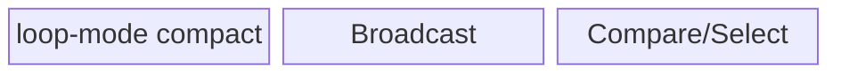
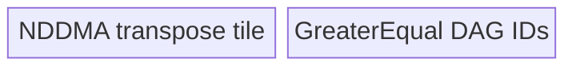

# GeTensor 950 ACLNN 算子知识

## 算子速览

| 项目 | 内容 |
|---|---|
| 实际入口 | `aclnnGeTensorGetWorkspaceSize` + `aclnnGeTensor`，公开 ACLNN 两段式接口，无版本后缀 |
| 计算语义 | 广播后逐元素计算 `out[i] = self[i] >= other[i]`；核心结果为 BOOL，接口允许再 Cast 到调用者指定的可转换输出 dtype |
| 输入输出 | `self/other/out` 为 ND、0～8 维；输入按 950 类型提升规则得到公共 dtype，shape 满足 broadcast，`out.shape` 等于广播结果 |
| 执行类型 | 空域无 Device 节点；核心比较可为 AIV_VECTOR（广播搬入可含 NDDMA）或 AICPU；可选 Cast 为 no-op、AIV 或 AICPU；无 Cube/AIC/MIX_CV |
| Kernel 路线 | R-001 mode202；R-002/R-003 mode1/2；R-004 mode101～104/109；R-005～R-009 mode301～305；R-010/R-011 AICPU fast/general broadcast |
| 核心资源 | AIV 使用 GM、ATVOSS local tensor pool、编译期 buffer ID、Vector/MicroAPI 与可选 NDDMA；AICPU 直接访问 tensor data 并可 `ParallelFor`；广播核心声明 16 MiB workspace |
| 来源闭包 | `source_closed`：公开 ACLNN→校验/提升/可选 Contiguous/Cast→GreaterEqual AIV/AICPU selector→950 Tiling/POD→全部 scheduler/body→可选 Cast/ViewCopy→构建接线闭合 |
| 验证状态 | 已完成源码闭包检查；本次知识提取未执行编译、真机、数值或性能测试。 |

## 接口与语义

### 计算语义

令 `B = broadcast(self.shape, other.shape)`。对每个输出坐标 `i∈B`，按输入 view stride 与广播轴映射取得 `s_i/o_i`，先按 `BinaryOpTypePromote` 得到公共计算类型 `P`；BOOL+BOOL 被显式改成 INT8。核心节点产生一字节 BOOL：`g_i = (cast_P(s_i) >= cast_P(o_i)) ? 1 : 0`。若 `out.dtype != BOOL`，再按 Cast 规则把 `g_i` 转为 `out.dtype`，最后写入 `out` 的 view/storage。

### 输入、输出与属性

| 参数 | shape/layout | dtype | 约束、默认值与语义 |
|---|---|---|---|
| `self` | ND，0～8 维，可非连续 | DOUBLE/F16/F32/I16/I32/I64/U16/U32/U64/I8/U8/BOOL/BF16 | 非空指针；与 `other` 可类型提升且可广播 |
| `other` | ND，0～8 维，可非连续 | 同 `self` 公布集合 | 与 `self` 满足类型推导；不足维从左补 1 后广播 |
| `out` | ND，0～8 维，可非连续 | DOUBLE/BF16/F16/F32/I32/U32/I64/U64/I16/U16/I8/U8/BOOL/COMPLEX64/COMPLEX128 | shape 必须精确等于广播 shape；BOOL 核心结果必须可 Cast 到该 dtype |
| `workspaceSize` | 标量 Host 输出 | `uint64_t` | executor 所有临时 tensor、launcher task 与核心声明 workspace 的总量 |
| `executor` | Host 对象 | `aclOpExecutor*` | 第一段创建，第二段在调用者 stream 上执行 |

### 入口与版本

固定仓只公开无后缀的 `aclnnGeTensor` 两段式版本；本卡不合并同文件中的 `aclnnInplaceGeTensor`，也不合并 Scalar 入口。公开文档明确支持 Ascend 950PR/950DT。`GreaterEqual` OpDef 仅把当前 `greater_equal_apt` AICore 实现接到 `ascend950` 与 `ascend910_55`，`greater_equal_binary.json` 给出 950 的 F16/F32/I32/I64/I8/U8/U64/BOOL/BF16 二进制组合。A3 虽在公开文档中标为支持，但固定仓指定目录没有 `arch32` Host/Tiling/Kernel，故未生成无后缀卡。

## Host/Launcher 执行流程

### 参数校验与前处理

`aclnnGeTensorCommon` 按以下顺序执行：创建 executor；检查 `workspaceSize` 与三个 tensor 非空；校验输出 dtype；在 950 上调用 `BinaryOpTypePromote`，BOOL 结果改为 INT8，并检查输入到 `P`、BOOL 到输出 dtype 的 Cast 能力；检查三者维数不超过 8，计算广播 shape 并要求等于 `out.viewShape`。任一失败立即返回对应 ACLNN 错误。

空 tensor 在校验完成后成功短路，写 `workspaceSize=0` 并释放 executor，不创建 Device 节点。非空时，每个输入独立处理：若 `input.dtype==P` 且 950 `IsGreaterEqualSupportNonContiguous` 为真，则 `CreateView` 保留 storage/view shape、stride、offset；否则先走框架 `Contiguous`，再 `Cast(...,P)`。随后调用 `l0op::GreaterEqual`，对 BOOL 临时结果执行一次可能为 no-op 的 `Cast(...,out.dtype)`，最后以框架 `ViewCopy` 提交到用户输出。

### 参数、Workspace 与生命周期

第一段的 `uniqueExecutor` 拥有所有 Contiguous/Cast 临时 tensor、核心 BOOL 临时输出、后置 Cast 结果和 launcher 描述；`ReleaseTo(executor)` 后所有权转给调用者。`GetWorkspaceSize()` 返回整条图所需字节。AIV Broadcast Tiling 固定令 `workspaces[0]=16*1024*1024`；`greater_equal` entry 接受 `workspace` 但不寻址它。整图各节点 workspace slice 的精确 offset/别名由 executor 框架生成，固定算子源码不可见。第二段 `CommonOpExecutorRun` 在给定 stream 上按 executor 顺序执行，前驱失败阻断后继。

### 启动图与失败传播

```text
aclnnGeTensorGetWorkspaceSize
  -> [self: CreateView OR Contiguous -> Cast?]
  -> [other: CreateView OR Contiguous -> Cast?]
  -> GreaterEqual(P,P)
       -> AIV greater_equal<schMode>          # P∈{F16,BF16,F32,I8,U8,I32,I64,U64}
       OR AICPU GreaterEqualCpuKernel         # P∈{DOUBLE,I16,U16,U32}
  -> Cast(BOOL -> out.dtype)?
  -> ViewCopy/address rebind
aclnnGeTensor(workspace, executor, stream)
```

所有节点共享 executor stream 顺序；中间边是 executor 分配的 GM/workspace tensor，shape 均为广播输出 shape。输入预处理失败、launcher 添加失败、Tiling 失败、核心失败、后置 Cast 或 ViewCopy 失败均使第一段返回错误或第二段停止后续节点。`Contiguous/ViewCopy` 的内部子图按指定 Skill 作为明确框架边界；Cast 的 950 AIV/AICPU selector与实现为直接依赖并已追踪。

## Route 与参数设计

### 分核与资源计算

连续/非连续广播先把输入补维至输出 rank，并在相邻轴广播模式一致且 stride 连续时合轴；广播轴输入 stride 写 0。设 DAG 对当前 dtype 的 `M=MaxDtypeBytes`，实际调度的编译期 buffer 数为 `B_n=GetBufferNum<true,true>()`（NDDMA）或 `B_u=GetBufferNum<false,true>()`（UB Broadcast）。Host 用 `maxElem=floor_align(((UB-extra)*8)/(B*M*8), 256*8/minDtypeBits)`；从尾轴连乘，首个超过 `maxElem` 的轴成为 `ubSplitAxis`，得到 `ubFormer/ubOuter/ubTail`。外部 tile 总数 `F=ubOuter*Π(outputDims[0:ubSplitAxis])`，`blockFormer=ceil(F/coreNum)`、`blockNum=ceil(F/blockFormer)`、`blockTail=F-(blockNum-1)*blockFormer`。

合轴 rank 为 1 且输入连续时，本 DAG 满足 `InputSize+OutputSize=3<=4` 且 `VarSize=0`，固定进入 advance mode202：`tileNum=floor((UB/B)/512B)*512B/M`，再按 `coreNum*tileNum` 与总元素数收缩；若每核仅一个 tile，则把 `blockFormer` 改为 2 以降低核启动数并形成 ping/pong。所有非空 AIV 路线的 `blockDim` 等于对应 POD 的 `blockNum`。

### Route 选择

| 顺序 | Route | Key/模板 | 精确选择条件与优先级 | 不适用去向 |
|---:|---|---|---|---|
| 1 | R-010/R-011 AICPU | `GreaterEqualCpuKernel` | `P` 不在 950 AICore表，即公开可达 `DOUBLE/I16/U16/U32`；再按同形或单元素区分 fast/general | dtype不支持时报错 |
| 2 | R-001 一维 advance | mode202 | AIV dtype；合轴 rank=1；两输入均连续 | rank>1→3；非连续→6 |
| 3 | R-002 连续 NDDMA | mode1 | rank>1、连续、`IsUbBroadcast=false`、运行 rank≤5 | 运行 rank>5→R-003 |
| 4 | R-003 连续 NDDMA loop-cache | mode2 | 同上但运行 rank>5 | 无 |
| 5 | R-004 连续 UB Broadcast | mode101～104/109 | rank>1、连续、`IsUbBroadcast=true`；运行 rank 1～4 对应101～104，>4 对应109 | 无 |
| 6 | R-007 LastTranspose | mode303 | 非连续支持模板；任一输入是≤3维“仅最后两轴转置” | 无 |
| 7 | R-005/R-006 NLast | mode301/302 | 非连续支持模板、非 LastTranspose、尾轴连续；尾轴广播强制301，否则 `IsUbBroadcast` 决定301/302 | 不支持→8 |
| 8 | R-008/R-009 非连续兜底 | mode304/305 | 隐式 broadcast-to、rank>4、尾轴跳读或专用模板 guard 失败；运行 rank≤5/ >5 | Tiling失败 |

```text
if P not in REGBASE_AICORE_DTYPE_SUPPORT_LIST:
    AiCPU -> fast if same_shape or x_num==1 or y_num==1 else general
else if collapsed_rank == 1 and all_contiguous:
    mode202
else if all_contiguous:
    if IsUbBroadcast(): mode(100 + min(running_rank, 9))
    else: mode1 if running_rank<=5 else mode2
else if specialized_noncontiguous_supported:
    if last_two_axes_transpose: mode303
    else: mode302 if !last_axis_broadcast && IsUbBroadcast() else mode301
else:
    mode304 if running_rank<=5 else mode305
```

### 模板/实现执行矩阵

| Route | key/selector | dtype/shape/platform 完整命中条件 | 执行拓扑与 Kernel 节点 | 实际模板/body | 内存与同步特征 | tail/fallback |
|---|---|---|---|---|---|---|
| R-001 | 202 | 950 AIV dtype、连续、一维合轴 | 单 AIV | `BroadcastOneDimAdvanceSch<OpDag>` | 静态 tensor pool、ping/pong buffer ID | 最后核/最后 tile 用 `ubTailNum` |
| R-002 | 1 | 连续多维、NDDMA、运行 rank≤5 | 单 AIV+NDDMA | `BroadcastNddmaSch<OpDag,false>` | `B_n*elemNum*M` TBuf | `ubTail` |
| R-003 | 2 | 连续多维、NDDMA、运行 rank>5 | 单 AIV+NDDMA | `BroadcastNddmaSch<OpDag,true>` | 外层显式循环+NDDMA五维窗口，广播块缓存 | `ubTail` |
| R-004 | 101～104/109 | 连续且 UB broadcast | 单 AIV | `BroadcastUbSch<OpDag,R>` | 普通 CopyIn 后 `Broadcast<T,R>`，`B_u` tensor pool | 109运行时rank；其它编译期rank |
| R-005 | 301 | 非连续 NLast、NDDMA | 单 AIV+NDDMA | `BroadcastNlastTransposeNddmaSch` | stride-aware NDDMA | 尾轴连续 guard |
| R-006 | 302 | 非连续 NLast、UB BRC且尾轴非广播 | 单 AIV | `BroadcastNlastTransposeUbBrcSch<...,4>` | loop-mode DataCopyPad+UB broadcast | ≤4维 |
| R-007 | 303 | ≤3维最后两轴转置 | 单 AIV+NDDMA | `BroadcastLastTransposeSch` | 双层 UB/last-axis loop | transpose专用tail |
| R-008 | 304 | 非连续兜底、运行 rank≤5 | 单 AIV+NDDMA | `BroadcastNonContiguousNddmaSch<...,false>` | stride-aware NDDMA | 通用fallback |
| R-009 | 305 | 同上、运行 rank>5 | 单 AIV+NDDMA | `BroadcastNonContiguousNddmaSch<...,true>` | 外层循环+五维NDDMA | 通用fallback |
| R-010 | fast selector | `P∈{DOUBLE,I16,U16,U32}` 且同shape或任一输入单元素 | 单 AICPU | `NoBcastCompute<T>`/`SpecialCompute` | 直接GM；≥32768元素分片 | 三种线性索引 |
| R-011 | general selector | 同 AICPU dtype且一般广播 | 单 AICPU | `BcastCompute<T>` | `Bcast`索引；≥8192元素分片 | 非法广播报错 |

### 隐藏性能 Guard

| Guard | Host/Tiling 条件 | Device/资源原因 | 影响 Route | 不满足时去向 | 源码符号 |
|---|---|---|---|---|---|
| 950 AICore dtype | `P∈{F32,I32,F16,I8,U8,BF16,I64,U64,BOOL}`；ACLNN BOOL已转I8 | 950 binary/body只覆盖这些比较类型 | R-001～009 | AICPU R-010/011 | `greater_equal.cpp::IsAiCoreSupport` |
| 1D advance | collapsed rank=1、连续、3个GM参数、无Var | advance调度省去通用POD与运行时轴循环 | R-001 | 通用广播 | `BroadcastBaseTiling::DoTiling` |
| UB capacity | `maxElem>0` 且 `UB>=extra` | tensor pool必须容纳编译期存活buffer | R-001～009 | Tiling失败 | `BroadcastGetMaxElemNum/DoBrodcastTiling` |
| UB broadcast | 显式kernelType优先；纯elewise→false；大NLast或8/16bit尾轴32B对齐→true | 在UB展开比NDDMA重复搬入更合适 | R-002～006 | NDDMA或UB另一route | `BroadcastBaseTiling::IsUbBroadcast` |
| 非连续专用模板 | 非隐式broadcast-to、rank≤4、尾轴连续或满足128B/小包/小shape条件 | 专用transpose DMA只覆盖这些stride形态 | R-005～007 | R-008/009 | `isBroadcastTemplateNonContiguousSupport` |
| AICPU并行阈值 | fast `N>=32768`；general `N>=8192` | 小任务避免ParallelFor开销 | R-010/011 | 单线程循环 | `NoBcastCompute/BcastCompute` |
| 空域 | 任一输入 empty（广播校验已通过） | 无有效输出元素 | 全部 | 成功、0 workspace | `aclnnGeTensorCommon` |

### POD/ABI

| 结构 | 字段 | 类型/位宽 | ABI 布局 | 单位 | Host/launcher producer | Device consumer | 边界 |
|---|---|---|---|---|---|---|---|
| `BroadcastOneDimTilingDataAdvance` | `dimLen` | int64/64 | offset 0；struct 16B/alignment 8 | 元素 | `DoOneDimFormerTilingAdvance` | advance `Init/Process` | >0 |
| 同上 | `tileNum` | int32/32 | offset 8 | 元素/tile | UB按512B向下对齐后写入 | `blockEleLen/blockLen` | >0 |
| 同上 | `blockNum` | int16/16 | offset 12 | AIV核 | `ceil(ubOuter/blockFormer)`窄化 | entry blockDim、最后核判断 | 必须适合int16 |
| 同上 | `scalarFlag` | int16/16 | offset 14 | bitmask | 输入维等于1时置对应bit | advance CopyIn选择Duplicate/GM | 两输入使用bit0/bit1 |
| `BroadcastBaseTilingData<OpDag>` | `scheMode` | int32/32 | 字段序0 | key | 公共模板保留字段；key另由模板参数传入 | scheduler结构兼容 | 核心body不按它二次分发 |
| 同上 | `shapeLen` | int32/32 | 字段序1 | 轴 | 合轴结果 | 所有多维scheduler | 1～8 |
| 同上 | `ubSplitAxis` | int32/32 | 字段序2 | 轴 | `GetBlockSplitFactor` | 地址/轴循环 | `<shapeLen` |
| 同上 | `ubFormer` | int32/32 | 字段序3 | 切分轴元素 | `maxElem/innerProduct` | former tile | >0 |
| 同上 | `ubTail` | int32/32 | 字段序4 | 切分轴元素 | 轴长减前序tile | 尾tile | 1～ubFormer |
| 同上 | `ubOuter` | int64/64 | 字段序5 | tile | `ceil(axis/ubFormer)` | 广播缓存与realIdx | >0 |
| 同上 | `blockFormer` | int64/64 | 字段序6 | tile/核 | `ceil(F/coreNum)` | 非尾核loop | >0 |
| 同上 | `blockTail` | int64/64 | 字段序7 | tile | `F-(blockNum-1)*blockFormer` | 尾核loop | >0 |
| 同上 | `dimProductBeforeUbInner` | int64/64 | 字段序8 | tile | `F` | 初始坐标反解 | >0 |
| 同上 | `elemNum` | int64/64 | 字段序9 | 最大dtype元素 | `maxElem` | tensor pool子区容量 | >0 |
| 同上 | `blockNum` | int64/64 | 字段序10 | AIV核 | `ceil(F/blockFormer)` | blockDim/尾核 | ≤平台AIV核数 |
| 同上 | `outputDims[8]` | int64[8] | 字段序11 | 元素/轴 | 合轴输出 | 坐标更新、NDDMA/Broadcast | shapeLen内有效 |
| 同上 | `outputStrides[8]` | int64[8] | 字段序12 | 元素 | 连续输出stride | GM offset | shapeLen内有效 |
| 同上 | `inputDims[2][2]` | int64[2][2] | 字段序13 | 元素 | `SetInputParams` former/tail | 普通CopyIn长度 | CopyInBrc输入不读 |
| 同上 | `inputBrcDims[2][8]` | int64[2][8] | 字段序14 | 元素/轴 | 两个CopyInBrc节点 | UB Broadcast shape | shapeLen内有效 |
| 同上 | `inputVecBrcDims[0][8]` | 零节点数组 | 编译器扩展布局未单独导出 | N/A | 本DAG无VecBrc | 不读 | inactive |
| 同上 | `inputStrides[2][8]` | int64[2][8] | 后续字段 | 元素 | 合轴/原view stride | 普通/非连续CopyIn | 广播轴可0 |
| 同上 | `inputBrcStrides[2][8]` | int64[2][8] | 后续字段 | 元素 | `SetInputNddmaParams` | NDDMA/UB BRC | 广播轴0 |
| 同上 | `inputVecBrcStrides[0]` | 零节点数组 | 编译器扩展布局未单独导出 | N/A | 本DAG无VecBrc | 不读 | inactive |
| 同上 | `scalarData[16]` | char[16] | 末字段 | bytes | 本算子未SetScalar | scheduler SetScalar读取0 | 全0 |
| `BroadcastLastTransposeTilingData`/`BroadcastNlastTransposeTilingData` | 公共字段与shape/stride数组 | int32/int64数组 | 精确字段顺序见`broadcast_base_struct.h`；零长度VecBrc数组的最终sizeof固定源码未导出 | 轴/元素 | 专用noncontiguous tiling | modes301～303 | 最多4维 |
| AICPU Tensor ABI | shape/dtype/data指针 | runtime对象 | AICPU runtime ABI固定算子仓未展开 | 元素 | launcher | `CpuKernelContext` | 输入dtype相同，输出BOOL |

### Route 源码闭包

| Route | Key/selector | Host/Tiling producer | POD/参数 | Kernel entry/router 节点 | Kernel body/直接依赖 | 构建接线 |
|---|---|---|---|---|---|---|
| R-001 | 202 | `GreaterEqualTiling::DoOpTiling`→`BroadcastBaseTiling` | OneDimAdvance | `greater_equal<202>` | `BroadcastOneDimAdvanceSch`+Ge DAG | 950 binary/CMake |
| R-002/003 | 1/2 | 同上 | BroadcastBase | `greater_equal<1/2>` | `BroadcastNddmaSch<false/true>` | 同上 |
| R-004 | 101～104/109 | 同上 | BroadcastBase | `greater_equal<key>` | `BroadcastUbSch<R>` | 同上 |
| R-005/006/007 | 301/302/303 | noncontiguous selector | NLast/LastTranspose POD | `greater_equal<key>` | 对应NLast/Last scheduler | 同上 |
| R-008/009 | 304/305 | noncontiguous fallback | BroadcastBase | `greater_equal<304/305>` | `BroadcastNonContiguousNddmaSch` | 同上 |
| R-010/011 | L0 AICPU selector | `l0op::GreaterEqual` | CpuKernelContext | `ADD_TO_LAUNCHER_LIST_AICPU` | `GreaterEqualCpuKernel` | AICPU OpDef/CMake |

## Kernel 实现

### 公共执行流程

AIV entry 对 ACLNN 可达 dtype 实例化 `GreaterEqualCompute<DTYPE_X1>::OpDag`，构造 `BroadcastSch<schMode,OpDag>` 并依次 `Init/Process`；任务类型固定 `KERNEL_TYPE_AIV_ONLY`。DAG 顺序是两路 `CopyInBrc<T>`→`Compare<uint8_t,T,4>`→分别 Duplicate 0/1→`Select<uint8_t,uint8_t,2>`→`CopyOut<uint8_t>`。`Compare` 产生选择mask，`Select` 把它物化为规范BOOL字节0或1。所有 AIV route 共享此计算 DAG，只改变搬入、坐标与tile调度。AICPU路线以同一类型的C++ `>=` 直接写 `bool*`。

### Route R-001：一维 advance

#### 适用条件

##### 选择证据

| 层级 | 文件 | 符号 | 源码谓词/参数 | 结果/下一跳 |
|---|---|---|---|---|
| Tiling | `broadcast_tiling.h` | `DoTiling` | collapsed rank=1、all contiguous、3 GM args、VarSize=0 | mode202 |
| Router | `broadcast_sch.h` | `BroadcastSch::Process` | `schMode==202` | `BroadcastOneDimAdvanceSch` |

#### Device 数据流

##### 函数级调用链

```text
greater_equal<202> -> BroadcastOneDimAdvanceSch::Init/Process
  -> Run: CopyInBrc(x1), CopyInBrc(x2)
  -> Compare(mode=4) -> Duplicate(0/1) -> Select(mode=2)
  -> CopyOut(uint8)
```

##### 源码等价伪码

```text
core_base = blockFormer * tileNum * blockIdx
for local_tile in [0, blockLoopNum):
    len = last_core_last_tile ? ubTailNum : tileNum
    for each input:
        if scalarFlag bit: first iterations Duplicate(input[0], len)
        else DataCopyPad(input[core_base + local_offset], len)
    mask = Compare(x1, x2, mode=4, len)
    y = Select(mask, Duplicate(1), Duplicate(0), mode=2, len)
    DataCopyPad(out[core_base + local_offset], y, len)
```

#### 内存与数据搬运

##### 资源与搬运表

| 层级/缓冲区 | offset/地址公式 | extent/容量公式 | dtype/layout | producer | consumer | owner/lifetime | 对齐/复用 |
|---|---|---|---|---|---|---|---|
| input GM | scalar 0或`core_base+offset` | `len` | P/linear | caller | CopyIn/Duplicate | caller | scalar缓存 |
| tensor pool子区 | `bufId*tileNum*M` | `tileNum*M` | mixed local | buffer allocator | DAG nodes | kernel | ping/pong IDs含复用 |
| output GM | `core_base+offset` | `len` bytes | uint8 | CopyOut | downstream Cast/ViewCopy | executor | tail只写有效len |

##### 分层内存布局


##### 字节账与复用顺序

```text
UB_total = B_n * tileNum * M
tileNum = floor((UB/B_n)/512B) * 512B / M
dynamic_ub = N/A
workspace_total(core) = 16 MiB declared, entry未读
```

| 复用子区 | 写入者 | 读取者/消费点 | 下一次覆盖 | 同步或释放依据 | 安全条件 |
|---|---|---|---|---|---|
| buffer ID | CopyIn/Compare/Duplicate/Select | 后继DAG节点 | 生命周期结束或下个ping/pong | `GetTensor/ReleaseTensor` | 编译期DAG依赖不提前覆盖 |

#### 同步、精度与尾块

##### 同步与数值边界表

| 阶段 | primitive/机制 | producer | consumer/等待点 | 保护对象 | 精度/尾块 |
|---|---|---|---|---|---|
| CopyIn→V→CopyOut | tensor mutex | MTE2 | Vector/MTE3 | buffer ID | `len`为实际尾长 |
| compare | `Compare`+`Select` | P输入 | uint8输出 | 全有效lane | 不升精度；按P比较；输出0/1 |

#### 关键实现

##### 符号证据表

| 阶段 | 文件 | 符号/模板实例 | 实现事实 |
|---|---|---|---|
| Host/Tiling producer | `opbase/.../broadcast_tiling.h` | `DoOneDimOpTilingAdvance` | 512B tile、减核与blockNum |
| Kernel entry/router | `greater_equal_apt.cpp`/`broadcast_sch.h` | `greater_equal<202>` | AIV-only到advance scheduler |
| Device body/helper | `broadcast_sch_one_dim_advance.h` | `Init/Process/Run` | 地址、ping/pong、scalar与tail |

### Route R-002：连续 NDDMA

#### 适用条件

##### 选择证据

| 层级 | 文件 | 符号 | 源码谓词/参数 | 结果/下一跳 |
|---|---|---|---|---|
| Tiling | `broadcast_tiling.h` | `SetSchMode` | 多维连续、`IsUbBroadcast=false`、runningRank≤5 | mode1 |

#### Device 数据流

##### 函数级调用链

```text
greater_equal<1> -> BroadcastNddmaSch<OpDag,false>::Init/Process
  -> NDDMA CopyInBrc x1/x2 -> shared GreaterEqual DAG -> CopyOut
```

##### 源码等价伪码

```text
axes = decode(blockFormer*blockIdx)
for tile in core_tiles:
    size = tail_axis ? ubTail : ubFormer
    NDDMA_without_loop(x1/x2, shape, broadcast_stride, axes, size)
    run Compare -> Duplicate -> Select for size*outputStride[splitAxis]
    CopyOut(valid bytes)
```

#### 内存与数据搬运

##### 资源与搬运表

| 层级/缓冲区 | offset/地址公式 | extent/容量公式 | dtype/layout | producer | consumer | owner/lifetime | 对齐/复用 |
|---|---|---|---|---|---|---|---|
| NDDMA input | `BroadcastGetGmOffset(axes,inputBrcStride,...)` | multi-dim tile | P/broadcast | NDDMA | DAG | caller/kernel | stride0重复广播 |
| TBuf pool | `bufId*elemNum*M` | `B_n*elemNum*M` | local | NDDMA/Vector | DAG | TPipe | 编译期复用 |
| output GM | output stride offset | valid tile | uint8 | MTE3 | downstream | executor | DataCopyPad tail |

##### 分层内存布局


##### 字节账与复用顺序

```text
UB_total = B_n * elemNum * M <= platform UB
workspace_total(core) = 16 MiB declared
```

| 复用子区 | 写入者 | 读取者/消费点 | 下一次覆盖 | 同步或释放依据 | 安全条件 |
|---|---|---|---|---|---|
| NDDMA cached ID | CopyInBrc | Compare | 下一tile | tensor mutex | 当前tile已完成 |

#### 同步、精度与尾块

##### 同步与数值边界表

| 阶段 | primitive/机制 | producer | consumer/等待点 | 保护对象 | 精度/尾块 |
|---|---|---|---|---|---|
| NDDMA→Vector | `GetTensor/ReleaseTensor` | NDDMA | Compare | input IDs | MultiCopy参数含广播stride |
| Vector→MTE3 | buffer mutex | Select | CopyOut | uint8 result | 只搬有效tile |

#### 关键实现

##### 符号证据表

| 阶段 | 文件 | 符号/模板实例 | 实现事实 |
|---|---|---|---|
| Host/Tiling producer | `broadcast_tiling.h` | `SetSchMode` | rank≤5选1 |
| Kernel entry/router | `broadcast_sch.h` | mode1 | NDDMA without loop |
| Device body/helper | `broadcast_sch_nddma.h` | `CopyInBrc/Run` | NDDMA参数、GM offset、tail |

### Route R-003：连续 NDDMA loop-cache

#### 适用条件

##### 选择证据

| 层级 | 文件 | 符号 | 源码谓词/参数 | 结果/下一跳 |
|---|---|---|---|---|
| Tiling | `broadcast_tiling.h` | `SetSchMode` | R-002条件且runningRank>5 | mode2 |

#### Device 数据流

##### 函数级调用链

```text
greater_equal<2> -> BroadcastNddmaSch<OpDag,true>
  -> explicit outer-axis loop + five-dim NDDMA -> GreaterEqual DAG
```

##### 源码等价伪码

```text
for outer coordinates not covered by 5D NDDMA:
    if broadcasted split input still valid in cache: reuse
    else NDDMA_with_loop CopyInBrc
    Compare -> Select -> CopyOut
```

#### 内存与数据搬运

##### 资源与搬运表

| 层级/缓冲区 | offset/地址公式 | extent/容量公式 | dtype/layout | producer | consumer | owner/lifetime | 对齐/复用 |
|---|---|---|---|---|---|---|---|
| outer-loop GM | axes + loop offset | five-dim window | P | NDDMA | DAG | caller | >5维显式展开 |
| cached broadcast ID | same `bufId` | one expanded tile | P/local | first relevant CopyInBrc | repeated Compare | kernel | stride0且realIdx未回绕时复用 |

##### 分层内存布局


##### 字节账与复用顺序

```text
UB_total = B_n * elemNum * M
workspace_total(core) = 16 MiB declared
```

| 复用子区 | 写入者 | 读取者/消费点 | 下一次覆盖 | 同步或释放依据 | 安全条件 |
|---|---|---|---|---|---|
| broadcast cache | CopyInBrc | multiple tile Compare | broadcast coordinate改变 | scheduler condition | input split stride=0 |

#### 同步、精度与尾块

##### 同步与数值边界表

| 阶段 | primitive/机制 | producer | consumer/等待点 | 保护对象 | 精度/尾块 |
|---|---|---|---|---|---|
| cache reuse | scheduler guard+mutex | first NDDMA | later Vector | cached ID | coordinate回绕时重载 |

#### 关键实现

##### 符号证据表

| 阶段 | 文件 | 符号/模板实例 | 实现事实 |
|---|---|---|---|
| Host/Tiling producer | `broadcast_tiling.h` | `SetSchMode` | >5轴选2 |
| Kernel entry/router | `broadcast_sch.h` | mode2 | withLoop=true |
| Device body/helper | `broadcast_sch_nddma.h` | `CopyInBrc` | loop与缓存条件 |

### Route R-004：连续 UB Broadcast

#### 适用条件

##### 选择证据

| 层级 | 文件 | 符号 | 源码谓词/参数 | 结果/下一跳 |
|---|---|---|---|---|
| Tiling | `broadcast_tiling.h` | `IsUbBroadcast/SetSchMode` | 连续多维且UB broadcast条件成立 | 101～104/109 |

#### Device 数据流

##### 函数级调用链

```text
greater_equal<101..104/109> -> BroadcastUbSch<OpDag,R>
  -> CopyIn compact input -> Broadcast<T,R> in UB -> GreaterEqual DAG -> CopyOut
```

##### 源码等价伪码

```text
inputLength = broadcast_axis ? cached former/tail length : size*inputStride
DataCopyPad compact input
Broadcast<T,R>(expanded, compact, dstShape, srcShape, runningTiling)
Compare(expanded_x1, expanded_x2) -> Select(1,0) -> CopyOut
```

#### 内存与数据搬运

##### 资源与搬运表

| 层级/缓冲区 | offset/地址公式 | extent/容量公式 | dtype/layout | producer | consumer | owner/lifetime | 对齐/复用 |
|---|---|---|---|---|---|---|---|
| compact input ID | `intList[1]*blockLen` | source tile | P | DataCopyPad | Broadcast | kernel | 可跨ubLoop缓存 |
| expanded ID | `intList[0]*blockLen` | output tile | P | Broadcast | Compare | kernel | 后继释放后复用 |
| tensor pool | buffer IDs | `B_u*elemNum*M` | mixed local | all DAG nodes | all DAG nodes | TPipe | LEVEL_2 |

##### 分层内存布局


##### 字节账与复用顺序

```text
UB_total = B_u * elemNum * M <= platform UB
workspace_total(core) = 16 MiB declared
```

| 复用子区 | 写入者 | 读取者/消费点 | 下一次覆盖 | 同步或释放依据 | 安全条件 |
|---|---|---|---|---|---|
| compact buffer | CopyIn | Broadcast | new source coordinate | scheduler cache guard | broadcast split stride=0 |

#### 同步、精度与尾块

##### 同步与数值边界表

| 阶段 | primitive/机制 | producer | consumer/等待点 | 保护对象 | 精度/尾块 |
|---|---|---|---|---|---|
| CopyIn→Broadcast | tensor mutex | MTE2 | Vector Broadcast | compact ID | former/tail shape分别重算 |
| Broadcast→Compare | tensor mutex | Broadcast | Compare | expanded ID | R=1..4或runtime rank |

#### 关键实现

##### 符号证据表

| 阶段 | 文件 | 符号/模板实例 | 实现事实 |
|---|---|---|---|
| Host/Tiling producer | `broadcast_tiling.h` | `IsUbBroadcast` | UB/NDDMA选择 |
| Kernel entry/router | `broadcast_sch.h` | modes101～104/109 | rank实例 |
| Device body/helper | `broadcast_sch_ub_broadcast.h` | `CopyInAndVecBrc/CvecBrc` | compact搬入、UB展开 |

### Route R-005：非连续 NLast NDDMA

#### 适用条件

##### 选择证据

| 层级 | 文件 | 符号 | 源码谓词/参数 | 结果/下一跳 |
|---|---|---|---|---|
| Tiling | `broadcast_tiling.h` | `DoBroadcastOpTilingNLastTranspose` | 专用非连续支持、非LastTranspose，尾轴广播或UB条件false | 301 |

#### Device 数据流

##### 函数级调用链

```text
greater_equal<301> -> BroadcastNlastTransposeNddmaSch<OpDag,false>
  -> stride-aware NDDMA -> GreaterEqual DAG -> stride-aware CopyOut
```

##### 源码等价伪码

```text
decode axes with padded output strides
NDDMA copies non-last transpose input into contiguous UB tile
run common Compare/Select
DataCopyPad valid uint8 output
```

#### 内存与数据搬运

##### 资源与搬运表

| 层级/缓冲区 | offset/地址公式 | extent/容量公式 | dtype/layout | producer | consumer | owner/lifetime | 对齐/复用 |
|---|---|---|---|---|---|---|---|
| strided input GM | `BroadcastGetGmOffsetNDDMA` | ≤4D folded tile | P/view stride | NDDMA | DAG | caller | tail轴连续 |
| pool | buffer IDs | `B_n*elemNum*M` | contiguous UB | NDDMA | Vector | TPipe | cached IDs |

##### 分层内存布局


##### 字节账与复用顺序

```text
UB_total = B_n * elemNum * M
workspace_total(core) = 16 MiB declared
```

| 复用子区 | 写入者 | 读取者/消费点 | 下一次覆盖 | 同步或释放依据 | 安全条件 |
|---|---|---|---|---|---|
| NLast input ID | NDDMA | Compare | next tile | mutex | stride guard成立 |

#### 同步、精度与尾块

##### 同步与数值边界表

| 阶段 | primitive/机制 | producer | consumer/等待点 | 保护对象 | 精度/尾块 |
|---|---|---|---|---|---|
| NDDMA | MultiCopy | GM | Vector | contiguous UB tile | padded stride与ubTail |

#### 关键实现

##### 符号证据表

| 阶段 | 文件 | 符号/模板实例 | 实现事实 |
|---|---|---|---|
| Host/Tiling producer | `broadcast_tiling.h` | NLast selector | 301条件 |
| Kernel entry/router | `broadcast_sch.h` | mode301 | NLast NDDMA |
| Device body/helper | `broadcast_sch_nlast_transpose_nddma.h` | `Process/CopyInBrc` | stride-aware copy |

### Route R-006：非连续 NLast UB Broadcast

#### 适用条件

##### 选择证据

| 层级 | 文件 | 符号 | 源码谓词/参数 | 结果/下一跳 |
|---|---|---|---|---|
| Tiling | `broadcast_tiling.h` | NLast selector | 专用支持、尾轴非广播、`IsUbBroadcast=true` | 302 |

#### Device 数据流

##### 函数级调用链

```text
greater_equal<302> -> BroadcastNlastTransposeUbBrcSch<OpDag,4>
  -> loop-mode DataCopyPad -> UB Broadcast -> GreaterEqual DAG -> loop-mode CopyOut
```

##### 源码等价伪码

```text
build blockCount/blockLen/srcStride/dstStride from padded strides
SetLoopModePara(OUT_TO_UB); DataCopyPad compact input; reset
Broadcast<T,4>; Compare/Select
SetLoopModePara(UB_TO_OUT); DataCopyPad output; reset
```

#### 内存与数据搬运

##### 资源与搬运表

| 层级/缓冲区 | offset/地址公式 | extent/容量公式 | dtype/layout | producer | consumer | owner/lifetime | 对齐/复用 |
|---|---|---|---|---|---|---|---|
| loop-mode compact ID | stride-derived | padded blockCount×blockLen | P | MTE2 | Broadcast | kernel | blockLen按32B元素对齐 |
| expanded/result IDs | buffer IDs | `elemNum*M` each | local | Broadcast/Vector | downstream | TPipe | 编译期复用 |

##### 分层内存布局



##### 字节账与复用顺序

```text
UB_total = B_u * elemNum * M
workspace_total(core) = 16 MiB declared
```

| 复用子区 | 写入者 | 读取者/消费点 | 下一次覆盖 | 同步或释放依据 | 安全条件 |
|---|---|---|---|---|---|
| loop-mode buffer | DataCopyPad | Broadcast | next coordinate | ResetLoopModePara+mutex | 尾轴非broadcast |

#### 同步、精度与尾块

##### 同步与数值边界表

| 阶段 | primitive/机制 | producer | consumer/等待点 | 保护对象 | 精度/尾块 |
|---|---|---|---|---|---|
| loop mode | Set/ResetLoopModePara | MTE2/MTE3 | next stage | DMA state | blockLen/stride tail |

#### 关键实现

##### 符号证据表

| 阶段 | 文件 | 符号/模板实例 | 实现事实 |
|---|---|---|---|
| Host/Tiling producer | `broadcast_tiling.h` | NLast selector | 302条件 |
| Kernel entry/router | `broadcast_sch.h` | mode302 | UB route |
| Device body/helper | `broadcast_sch_nlast_transpose_ub_broadcast.h` | CopyIn/CopyOut | loop-mode参数 |

### Route R-007：非连续 LastTranspose

#### 适用条件

##### 选择证据

| 层级 | 文件 | 符号 | 源码谓词/参数 | 结果/下一跳 |
|---|---|---|---|---|
| Tiling | `broadcast_tiling.h` | `isOnlyLastTwoAxesTransposed` | rank2/3且最后两轴stride互换，外轴连续 | 303 |

#### Device 数据流

##### 函数级调用链

```text
greater_equal<303> -> BroadcastLastTransposeSch
  -> outer tile loop -> last-axis subloop -> NDDMA transpose CopyIn -> DAG -> loop-mode CopyOut
```

##### 源码等价伪码

```text
for ub tile:
  for lastAxisLoop in ubOuterLastAxis:
    NDDMA CopyIn with transposed strides and padded last axis
    Compare -> Select
    CopyOut only ubFormerLastAxis/ubTailLastAxis valid region
```

#### 内存与数据搬运

##### 资源与搬运表

| 层级/缓冲区 | offset/地址公式 | extent/容量公式 | dtype/layout | producer | consumer | owner/lifetime | 对齐/复用 |
|---|---|---|---|---|---|---|---|
| transposed GM | `BroadcastGetGmOffsetLastTranspose` | outer×last-axis tile | P/view | NDDMA | DAG | caller | padded last axis |
| pool | buffer IDs | `B_n*elemNum*M` | contiguous UB | NDDMA/Vector | MTE3 | TPipe | ping/pong |

##### 分层内存布局



##### 字节账与复用顺序

```text
UB_total = B_n * elemNum * M
workspace_total(core) = 16 MiB declared
```

| 复用子区 | 写入者 | 读取者/消费点 | 下一次覆盖 | 同步或释放依据 | 安全条件 |
|---|---|---|---|---|---|
| transpose ID | NDDMA | Compare | next lastAxisLoop | mutex | valid last-axis length已提交 |

#### 同步、精度与尾块

##### 同步与数值边界表

| 阶段 | primitive/机制 | producer | consumer/等待点 | 保护对象 | 精度/尾块 |
|---|---|---|---|---|---|
| transpose DMA | MultiCopy/loop mode | GM | Vector | padded UB | 双层tail字段 |

#### 关键实现

##### 符号证据表

| 阶段 | 文件 | 符号/模板实例 | 实现事实 |
|---|---|---|---|
| Host/Tiling producer | `broadcast_tiling.h` | `DoBroadcastOpTilingLastTranspose` | 303与专用POD |
| Kernel entry/router | `broadcast_sch.h` | mode303 | LastTranspose scheduler |
| Device body/helper | `broadcast_sch_last_transpose.h` | `Process/CopyInBrc` | 双层循环、NDDMA |

### Route R-008：非连续通用 NDDMA

#### 适用条件

##### 选择证据

| 层级 | 文件 | 符号 | 源码谓词/参数 | 结果/下一跳 |
|---|---|---|---|---|
| Tiling | `broadcast_tiling.h` | `DoBroadcastOpTilingNonContiguousBase` | 专用guard失败且runningRank≤5 | 304 |

#### Device 数据流

##### 函数级调用链

```text
greater_equal<304> -> BroadcastNonContiguousNddmaSch<OpDag,false>
  -> stride-aware NDDMA -> GreaterEqual DAG -> CopyOut
```

##### 源码等价伪码

```text
for tile:
  build MultiCopyParams from outputDims/outputStrides/inputStrides
  NDDMA noncontiguous_without_loop x1/x2
  Compare -> Select -> CopyOut
```

#### 内存与数据搬运

##### 资源与搬运表

| 层级/缓冲区 | offset/地址公式 | extent/容量公式 | dtype/layout | producer | consumer | owner/lifetime | 对齐/复用 |
|---|---|---|---|---|---|---|---|
| arbitrary-stride GM | stride dot axes | ≤5D tile | P/view | NDDMA | DAG | caller | broadcast stride0 |
| pool | buffer IDs | `B_n*elemNum*M` | local | NDDMA/Vector | MTE3 | TPipe | fallback共享 |

##### 分层内存布局


##### 字节账与复用顺序

```text
UB_total = B_n * elemNum * M
workspace_total(core) = 16 MiB declared
```

| 复用子区 | 写入者 | 读取者/消费点 | 下一次覆盖 | 同步或释放依据 | 安全条件 |
|---|---|---|---|---|---|
| input ID | NDDMA | Compare | next tile | mutex | 参数合法 |

#### 同步、精度与尾块

##### 同步与数值边界表

| 阶段 | primitive/机制 | producer | consumer/等待点 | 保护对象 | 精度/尾块 |
|---|---|---|---|---|---|
| generic NDDMA | MultiCopy | GM | Vector | input tile | stride/tail由POD |

#### 关键实现

##### 符号证据表

| 阶段 | 文件 | 符号/模板实例 | 实现事实 |
|---|---|---|---|
| Host/Tiling producer | `broadcast_tiling.h` | noncontiguous fallback | 304条件 |
| Kernel entry/router | `broadcast_sch.h` | mode304 | withoutLoop |
| Device body/helper | `broadcast_sch_nddma_transpose.h` | `CopyInBrc` | 任意stride NDDMA |

### Route R-009：非连续通用 NDDMA loop

#### 适用条件

##### 选择证据

| 层级 | 文件 | 符号 | 源码谓词/参数 | 结果/下一跳 |
|---|---|---|---|---|
| Tiling | `broadcast_tiling.h` | noncontiguous fallback | R-008条件且runningRank>5 | 305 |

#### Device 数据流

##### 函数级调用链

```text
greater_equal<305> -> BroadcastNonContiguousNddmaSch<OpDag,true>
  -> explicit outer loop + 5D stride NDDMA -> GreaterEqual DAG
```

##### 源码等价伪码

```text
for folded outer coordinate:
  update NDDMA axes and GM/UB offsets
  issue 5D MultiCopy for x1/x2
  Compare -> Select -> CopyOut valid tail
```

#### 内存与数据搬运

##### 资源与搬运表

| 层级/缓冲区 | offset/地址公式 | extent/容量公式 | dtype/layout | producer | consumer | owner/lifetime | 对齐/复用 |
|---|---|---|---|---|---|---|---|
| folded GM | outer offset + NDDMA offset | 5D window | P/view | NDDMA | DAG | caller | >5D loop |
| pool | buffer IDs | `B_n*elemNum*M` | local | NDDMA/Vector | MTE3 | TPipe | ping/pong |

##### 分层内存布局


##### 字节账与复用顺序

```text
UB_total = B_n * elemNum * M
workspace_total(core) = 16 MiB declared
```

| 复用子区 | 写入者 | 读取者/消费点 | 下一次覆盖 | 同步或释放依据 | 安全条件 |
|---|---|---|---|---|---|
| 5D window ID | NDDMA | Compare | next outer coordinate | mutex | offset更新后覆盖 |

#### 同步、精度与尾块

##### 同步与数值边界表

| 阶段 | primitive/机制 | producer | consumer/等待点 | 保护对象 | 精度/尾块 |
|---|---|---|---|---|---|
| outer loop | explicit loop+MultiCopy | GM | Vector | each window | 最终ubTail有效 |

#### 关键实现

##### 符号证据表

| 阶段 | 文件 | 符号/模板实例 | 实现事实 |
|---|---|---|---|
| Host/Tiling producer | `broadcast_tiling.h` | noncontiguous fallback | 305条件 |
| Kernel entry/router | `broadcast_sch.h` | mode305 | withLoop |
| Device body/helper | `broadcast_sch_nddma_transpose.h` | `CopyInBrc` | >5D显式循环 |

### Route R-010：AICPU 同形/单元素 fast path

#### 适用条件

##### 选择证据

| 层级 | 文件 | 符号 | 源码谓词/参数 | 结果/下一跳 |
|---|---|---|---|---|
| L0 | `greater_equal.cpp` | `IsAiCoreSupport` | 950 `P∈{DOUBLE,I16,U16,U32}` | AICPU |
| AICPU | `greater_equal_aicpu.cpp` | `GreaterEqualCompute` | shapes相同或任一输入NumElements=1 | `NoBcastCompute` |

#### Device 数据流

##### 函数级调用链

```text
ADD_TO_LAUNCHER_LIST_AICPU(GreaterEqual)
  -> GreaterEqualCpuKernel::Compute
  -> GreaterEqualCompute<T> -> NoBcastCompute<T> -> SpecialCompute<T>
```

##### 源码等价伪码

```text
type = SAME_SHAPE / X_ONE_ELEMENT / Y_ONE_ELEMENT
parallel if N>=32768 else serial
for i in shard:
  out[i] = (type==SAME ? x[i]>=y[i] : scalar_side[0]>=vector_side[i])
```

#### 内存与数据搬运

##### 资源与搬运表

| 层级/缓冲区 | offset/地址公式 | extent/容量公式 | dtype/layout | producer | consumer | owner/lifetime | 对齐/复用 |
|---|---|---|---|---|---|---|---|
| input/output data | `i`或0 | N | T/T/bool | caller | AICPU loop | executor | 无AIV UB |
| shard | `[start,end)` | `N/min(N,maxCore)` | index range | ParallelFor | SpecialCompute | AICPU runtime | 阈值32768 |

##### 分层内存布局

N/A：该 route 使用 AICPU 地址空间与运行时分片，不使用 AIV UB、dynamic UB 或 NDDMA buffer。

##### 字节账与复用顺序

```text
UB_total = N/A
workspace_total = AicpuTaskSpace("GreaterEqual")，精确字节固定算子源码未导出
```

| 复用子区 | 写入者 | 读取者/消费点 | 下一次覆盖 | 同步或释放依据 | 安全条件 |
|---|---|---|---|---|---|
| output shard | AICPU worker | downstream node | 节点完成后 | ParallelFor join/executor顺序 | shard不重叠 |

#### 同步、精度与尾块

##### 同步与数值边界表

| 阶段 | primitive/机制 | producer | consumer/等待点 | 保护对象 | 精度/尾块 |
|---|---|---|---|---|---|
| shard | `ParallelFor` | workers | node completion | output ranges | C++同dtype `>=`，无cast |

#### 关键实现

##### 符号证据表

| 阶段 | 文件 | 符号/模板实例 | 实现事实 |
|---|---|---|---|
| Host/Tiling producer | `greater_equal.cpp` | `GreaterEqual` | AICore/AICPU选择 |
| Kernel entry/router | `greater_equal_aicpu.cpp` | `Compute` | dtype switch |
| Device body/helper | 同上 | `NoBcastCompute/SpecialCompute` | fast索引和阈值 |

### Route R-011：AICPU 一般 Broadcast

#### 适用条件

##### 选择证据

| 层级 | 文件 | 符号 | 源码谓词/参数 | 结果/下一跳 |
|---|---|---|---|---|
| L0 | `greater_equal.cpp` | `IsAiCoreSupport` | 950非AICore公共dtype | AICPU |
| AICPU | `GreaterEqualCompute` | `is_need_call_bcast` | 非同shape且两输入均非单元素 | `BcastCompute` |

#### Device 数据流

##### 函数级调用链

```text
GreaterEqualCpuKernel::Compute
  -> GreaterEqualCompute<T> -> Bcast(inputShape0,inputShape1)
  -> BcastCompute<T> -> GetBroadcastXIndex/GetBroadcastYIndex
```

##### 源码等价伪码

```text
validate Bcast(shape0,shape1)
parallel if N>=8192 else serial
for i in shard:
  out[i] = x[bcast.XIndex(i)] >= y[bcast.YIndex(i)]
```

#### 内存与数据搬运

##### 资源与搬运表

| 层级/缓冲区 | offset/地址公式 | extent/容量公式 | dtype/layout | producer | consumer | owner/lifetime | 对齐/复用 |
|---|---|---|---|---|---|---|---|
| input GM | `Bcast::*Index(i)` | broadcast domain | T | caller | AICPU loop | executor | runtime多维索引 |
| output GM | `i` | N bool | bool | AICPU | downstream | executor | shard不重叠 |

##### 分层内存布局

N/A：AICPU 使用 tensor data 与 `Bcast` 元数据，不使用 AIV UB。

##### 字节账与复用顺序

```text
UB_total = N/A
workspace_total = AicpuTaskSpace("GreaterEqual")，固定源码未导出字节数
```

| 复用子区 | 写入者 | 读取者/消费点 | 下一次覆盖 | 同步或释放依据 | 安全条件 |
|---|---|---|---|---|---|
| output shard | worker | next executor node | task完成后 | ParallelFor join | `[start,end)`不重叠 |

#### 同步、精度与尾块

##### 同步与数值边界表

| 阶段 | primitive/机制 | producer | consumer/等待点 | 保护对象 | 精度/尾块 |
|---|---|---|---|---|---|
| index loop | Bcast runtime | shape metadata | compare | element mapping | 每个i都有合法映射；非法Bcast报错 |

#### 关键实现

##### 符号证据表

| 阶段 | 文件 | 符号/模板实例 | 实现事实 |
|---|---|---|---|
| Host/Tiling producer | `greater_equal.cpp` | `GreaterEqual` | AICPU launcher |
| Kernel entry/router | `greater_equal_aicpu.cpp` | `Compute` | dtype switch |
| Device body/helper | 同上 | `BcastCompute` | 一般广播与8192阈值 |

## 算子特定优化

### Trick T-001：950 保留非连续 View，直接交给广播模板

#### 触发与源码依据

- 适用 Route：R-005～R-009；输入 dtype 已等于 `P` 且 950 GreaterEqual AICore支持。
- 触发条件：`promoteType == input.dtype && IsRegBase() && IsAiCoreSupport(input)`。
- Golden 来源：[`math/greater_equal/op_api/aclnn_ge_tensor.cpp:192-213`](../../../../../../../cann-ops-raw/ascendc/ops-math/165d41f02a43a62324b434cb6bda7c533b14da3e/math/greater_equal/op_api/aclnn_ge_tensor.cpp#L192-L213)

**官方源码（固定 Commit 连续逐字摘录）**：

```cpp
if (promoteType == self->GetDataType() && l0op::IsGreaterEqualSupportNonContiguous(self)) {
    selfProcessed = uniqueExecutor.get()->CreateView(
        self, self->GetViewShape(), self->GetStorageShape(), self->GetViewStrides(), self->GetViewOffset());
} else {
    auto selfContiguous = l0op::Contiguous(self, uniqueExecutor.get());
    selfProcessed = l0op::Cast(selfContiguous, promoteType, uniqueExecutor.get());
}
```

#### 机制与设计原因

满足条件时不物化连续副本，而把原 view shape/stride/offset带入 `GreaterEqual` Tiling；公共模板据真实stride选择301～305，以NDDMA或loop-mode DataCopy完成搬入。这样源码可证明省去一个独立 Contiguous节点和对应GM临时tensor；dtype需转换或核心只能AICPU时仍回到Contiguous/Cast路径。

#### 迁移边界

- 适用：950、同计算dtype、广播模板支持的非连续view。
- 前提：核心AICore dtype白名单命中，shape/stride通过非连续Tiling校验。
- 失效：dtype提升、AICPU核心或Tiling guard失败时必须先Contiguous或进入通用304/305。
- 未验证：本次知识提取未执行编译、真机、数值或性能测试。

#### 错误做法

不得仅凭“非连续”强制Contiguous，也不得绕过Tiling guard直接选301～303；固定源码在专用guard失败时明确回304/305。

### Trick T-002：NDDMA 对广播块做跨 tile 缓存

#### 触发与源码依据

- 适用 Route：R-002/R-003及非连续NDDMA路线。
- 触发条件：`inputBrcStride[ubSplitAxis]==0` 且当前广播坐标未回绕。
- Golden 来源：[`pkg_inc/op_common/atvoss/broadcast/broadcast_sch_nddma.h:137-171`](https://gitcode.com/cann/opbase/blob/d574f5571391390f8b619c6a134b65c819842318/pkg_inc/op_common/atvoss/broadcast/broadcast_sch_nddma.h#L137-L171)

**官方源码（固定 Commit 连续逐字摘录）**：

```cpp
if ((tilingData->inputBrcStrides[copyInBrcCount][tilingData->ubSplitAxis] != 0) || (ubLoopIdx <= 1 ||
    (AscendC::GetBlockIdx() * tilingData->blockFormer + ubLoopIdx) % tilingData->ubOuter <= 1)) {
    GetTensor<TPosition::VECIN>(bufId);
    // NDDMA copy
    ReleaseTensor<TPosition::VECIN>(bufId);
}
```

#### 机制与设计原因

广播轴stride为0时，同一输入块会服务多个输出tile；调度只在首轮或坐标回绕时重新NDDMA搬入，其余循环保留buffer内容。该机制直接减少重复GM→UB搬运；`GetBufferIds<true,true>`为CopyInBrc保留缓存生命周期，Compare只读该子区。

#### 迁移边界

- 适用：CopyInBrc节点、广播split轴stride为0。
- 前提：buffer ID按cache模式生成，坐标推进与`ubOuter`一致。
- 失效：非广播stride或坐标回绕必须重载；不能把缓存跨核共享。
- 未验证：本次知识提取未执行编译、真机、数值或性能测试。

#### 错误做法

若每tile无条件重载会失去源码中的搬运复用；若stride非0仍复用会读取错误坐标。

### Trick T-003：一维标量输入只读一次并 Duplicate

#### 触发与源码依据

- 适用 Route：R-001。
- 触发条件：合轴后一维输入长度为1，对应`scalarFlag` bit置位。
- Golden 来源：[`pkg_inc/op_common/atvoss/broadcast/broadcast_sch_one_dim_advance.h:201-224`](https://gitcode.com/cann/opbase/blob/d574f5571391390f8b619c6a134b65c819842318/pkg_inc/op_common/atvoss/broadcast/broadcast_sch_one_dim_advance.h#L201-L224)

**官方源码（固定 Commit 连续逐字摘录）**：

```cpp
if (isScalar) {
    if (isFirstScalarTime) {
        inputType scalar = globalTensor.GetValue(0);
        Vec::Duplicate(inTensor, scalar, tileLength);
    }
} else {
    Vec::CopyIn<inputType>(inTensor, globalTensor, tileLength);
}
```

#### 机制与设计原因

标量广播不按输出长度从GM重复取数；第一次取一个标量后在UB Duplicate，并通过buffer缓存供后续tile读取。普通向量输入仍按当前tile搬入。DOUBLE不走该AIV route；模板中的bitwise Duplicate特例不改变本接口可达路径。

#### 迁移边界

- 适用：一维、输入元素数1、同核后续tile复用。
- 前提：scalarFlag与输入位置bit一致，缓存buffer在复用期间不覆盖。
- 失效：向量输入或跨核不能复用同一local buffer。
- 未验证：本次知识提取未执行编译、真机、数值或性能测试。

#### 错误做法

固定仓未提供可验证反例；从生命周期可确定不得在后续tile消费前覆盖标量buffer。

## 模板与实现对比

| 对比维度 | R-001 一维 | R-002～004 连续多维 | R-005～009 非连续 | R-010/011 AICPU | 设计选择依据 |
|---|---|---|---|---|---|
| 命中条件/优先级 | rank1连续最高 | rank>1连续 | 保留950 view | 非AICore计算dtype | shape/stride/dtype selector |
| 模板与 dtype | advance；AIV P | NDDMA/UB；AIV P | NDDMA/loop mode；AIV P | C++模板T | 公共语义相同 |
| 循环与分核 | block tile+ping/pong | core tile/axes | stride-aware axes/transpose | serial/ParallelFor | 数据布局决定 |
| Queue/TBuf/寄存器/dynamic UB/通信 window | 静态tensor pool | 单TBuf tensor pool | 单TBuf tensor pool | AICPU栈/线程 | 无通信/dynamic UB |
| 内存总占用与复用 | `B_n*tileNum*M` | `B*elemNum*M` | `B*elemNum*M` | 无AIV UB | Host按B反推tile |
| 搬运/Vector/SIMT/NDDMA/通信 API | DataCopyPad | MultiCopy或Broadcast | stride NDDMA/loop DataCopy | 直接load/store | 无SIMT/通信 |
| 同步、精度与 tail | mutex、实际len | mutex、ubTail | mutex、stride/pad tail | shard join | 比较不升精度 |
| fallback/失败边界 | rank变化 | UB/NDDMA互选 | 专用失败到304/305 | dtype/广播失败 | 无Cube fallback |

## 平台差异

| 项目 | A2 | A3 | 950 |
|---|---|---|---|
| 支持状态 | 公开文档支持；固定AscendC闭包不可见 | 公开文档支持；固定AscendC闭包不可见 | 公开支持且本卡闭合 |
| Host/Launcher | 固定仓CMake指向缺失arch32，AICPU可达但非完整AscendC链 | 同左 | RegBase可保留非连续view，AIV/AICPU按P选择 |
| Kernel/资源 | arch32 Host/Tiling/Kernel缺失 | arch32 Host/Tiling/Kernel缺失 | arch35 ATVOSS AIV/NDDMA + AICPU；核心声明16MiB workspace |

## 限制与失败边界

- 输入/输出非空指针，rank≤8；输入必须可提升，shape可广播，输出shape精确匹配。
- BOOL+BOOL在API层改为INT8计算；不得把binary config中的BOOL kernel实例误写成该公开路径的独立BOOL计算route。
- 950 AICPU核心仅由公共dtype `DOUBLE/I16/U16/U32` 可达；BF16/BOOL分别由AIV BF16/INT8承接。AICPU body不支持BF16/BOOL，但公开选择器不会把这些类型送入它。
- Broadcast POD含0长度VecBrc数组；字段顺序可见，但编译器扩展下最终`sizeof/offsetof`固定源码未单独导出，复用ABI时应使用同一头文件而非手写序列化。
- `blockNum`在OneDimAdvance POD窄化为int16；源码未提供额外溢出guard。
- executor总workspace的节点切片offset、框架Contiguous/ViewCopy内部事件与AICPU task-space精确字节固定算子源码不可见。
- A3对应arch32闭包缺失，因此未生成`ge_tensor.md`；不得以950 arch35实现推测补齐。
- 本次知识提取未执行编译、单元测试、真机、数值或性能测试。

## 源码索引

### 链路索引

| 链路阶段 | 文件 | 关键符号 | 支撑内容 |
|---|---|---|---|
| 入口声明/约束 | `math/greater_equal/docs/aclnnGeTensor&aclnnInplaceGeTensor.md` | `aclnnGeTensor*` | 平台、dtype、shape、错误语义 |
| 入口实现 | `math/greater_equal/op_api/aclnn_ge_tensor.cpp` | `aclnnGeTensorCommon` | 校验、提升、空域、launch graph |
| Launcher | `math/greater_equal/op_api/greater_equal.cpp` | `IsAiCoreSupport/GreaterEqual` | AIV/AICPU选择与非连续能力 |
| Host/Tiling | `math/greater_equal/op_host/arch35/greater_equal_tiling_arch35.cpp` | `GreaterEqualTiling::DoOpTiling` | dtype→DAG→key |
| OpDef | `math/greater_equal/op_host/greater_equal_def.cpp` | `GreaterEqual` | 950 dtype与AICore接线 |
| Kernel entry/body | `math/greater_equal/op_kernel/greater_equal_apt.cpp` | `greater_equal<schMode>` | AIV-only entry |
| Kernel DAG | `math/greater_equal/op_kernel/arch35/greater_equal_dag.h` | `GreaterEqualCompute<T>` | Compare/Select语义 |
| AICPU Kernel | `math/greater_equal/op_kernel_aicpu/greater_equal_aicpu.cpp` | `GreaterEqualCpuKernel` | fast/general broadcast |
| AICPU 注册 | `math/greater_equal/op_kernel_aicpu/greater_equal_aicpu_def.cpp` | `REGISTER_CPU_KERNEL` | GreaterEqual AICPU接线 |
| Binary config | `math/greater_equal/op_host/config/ascend950/greater_equal_binary.json` | `op_list` | 950 binary dtype |
| 构建接线 | `math/greater_equal/CMakeLists.txt` | `SUPPORT_COMPUTE_UNIT` | ascend950→arch35 |
| Host公共依赖 | `opbase/pkg_inc/op_common/atvoss/broadcast/broadcast_tiling.h` | `BroadcastBaseTiling` | selector、POD、UB与block |
| POD公共依赖 | `opbase/pkg_inc/op_common/atvoss/broadcast/broadcast_base_struct.h` | `Broadcast*TilingData` | POD字段、位宽与数组布局 |
| Router公共依赖 | `opbase/pkg_inc/op_common/atvoss/broadcast/broadcast_sch.h` | `BroadcastSch` | mode→scheduler |
| NDDMA body | `opbase/pkg_inc/op_common/atvoss/broadcast/broadcast_sch_nddma.h` | `BroadcastNddmaSch` | NDDMA与缓存 |
| UB Broadcast body | `opbase/pkg_inc/op_common/atvoss/broadcast/broadcast_sch_ub_broadcast.h` | `BroadcastUbSch` | UB展开 |
| 1D body | `opbase/pkg_inc/op_common/atvoss/broadcast/broadcast_sch_one_dim_advance.h` | `BroadcastOneDimAdvanceSch` | 一维循环、scalar、tail |
| NLast NDDMA body | `opbase/pkg_inc/op_common/atvoss/broadcast/noncontiguous/nlast_transpose/broadcast_sch_nlast_transpose_nddma.h` | `BroadcastNlastTransposeNddmaSch` | mode301 stride-aware搬入 |
| NLast UB body | `opbase/pkg_inc/op_common/atvoss/broadcast/noncontiguous/nlast_transpose/broadcast_sch_nlast_transpose_ub_broadcast.h` | `BroadcastNlastTransposeUbBrcSch` | mode302 loop-mode UB广播 |
| LastTranspose body | `opbase/pkg_inc/op_common/atvoss/broadcast/noncontiguous/last_transpose/broadcast_sch_last_transpose.h` | `BroadcastLastTransposeSch` | mode303双尾轴转置调度 |
| 通用非连续 body | `opbase/pkg_inc/op_common/atvoss/broadcast/noncontiguous/transpose/broadcast_sch_nddma_transpose.h` | `BroadcastNonContiguousNddmaSch` | mode304/305 stride-aware NDDMA |
| Cast直接依赖 | `math/cast/op_api/cast.cpp` | `Cast` | 前后置Cast的AIV/AICPU选择 |

### 实现复用检查

| 检查项 | 可复用事实 | 不得改变的约束 | 源码符号 |
|---|---|---|---|
| ABI/POD | 复用Broadcast公共POD与schMode | 字段顺序、位宽、数组维度、OneDim int16不变 | `broadcast_base_struct.h` |
| 调用顺序 | 可选预Cast→核心→可选后Cast→ViewCopy | executor stream顺序及失败阻断不变 | `aclnnGeTensorCommon` |
| workspace/内存 | 核心16MiB声明；UB由B与M反推 | 不得把逻辑有效len当buffer容量 | `DoTiling/Broadcast*Sch::Init` |
| 同步 | tensor mutex与loop mode可复用 | `Get/ReleaseTensor`、Set/ResetLoopMode配对 | scheduler headers |
| 精度与尾块 | 按公共P比较，Select物化0/1 | 不得升/降精度或读padding lane；尾长来自POD | `GreaterEqualCompute/Process` |
| 失败边界 | 专用非连续失败回304/305；非AICore dtype走AICPU | 不得用950 body补A3或把Scalar/原地入口并入 | selectors/OpDef/CMake |