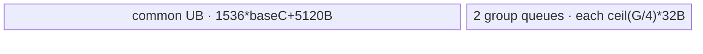

# GroupedBiasAddGrad A2/A3 ACLNN 算子知识

## 算子速览

| 项目 | 内容 |
|---|---|
| 实际入口 | 最新公开版本族入口 `aclnnGroupedBiasAddGradV2GetWorkspaceSize` / `aclnnGroupedBiasAddGradV2`；旧版 `aclnnGroupedBiasAddGrad*` 固定令 `groupIdxType=0` 后复用同一实现。 |
| 计算语义 | 对每组的 `gradY` 行沿 C/GB 方向求和，输出 `[G,H]`；有 `groupIdxOptional` 时按结束位置或组长切分，无该输入时每个 G 的 C 固定。 |
| 输入输出 | `gradY`: FP16/BF16/FP32 ND，带 group index 时 `[GB,H]`，否则 `[G,C,H]`；`groupIdxOptional`: INT32/INT64 `[G]`；`out`: 与 `gradY` 同 dtype 的 `[G,H]`。 |
| 执行类型 | 核心节点 `grouped_bias_add_grad` 为单 Kernel `AIV_VECTOR`；ACLNN executor 还可插入框架 `Contiguous` 与 `ViewCopy` 节点。没有可达 Cube/AIC 或 MIX_CV body。 |
| Kernel 路线 | R-001～R-010：EqualC、UnequalC、UnequalCPerf 分别组合 `USE_UB/USE_WS`，变长路线再区分 INT32/INT64 group index。每条 Route 内含 FP16/FP32/BF16 三个 key。 |
| 核心资源 | GM 输入/输出；AIV UB 中双缓冲 `inQue_`、`gradBiasQue_`，`castBuf_`、`sumBuf_`，变长路线的 group queues，Perf 路线的 sort buffers；声明 workspace 为 32 MiB 系统区加逐核 FP32 partial 区。 |
| 来源闭包 | `source_closed`：公开 V2 ACLNN→参数校验/连续化→L0 launcher→A2/A3 arch32 Tiling/POD→key router→EqualC/UnequalC/Perf body→CMake/OpDef/config 已闭合。 |
| 验证状态 | 已完成源码闭包检查；本次知识提取未执行编译、真机、数值或性能测试。 |

## 接口与语义

### 计算语义

令输出组为 `g`，H 坐标为 `h`。没有 `groupIdxOptional` 时，`gradY` 是 `[G,C,H]`，有

```text
out[g,h] = sum_{c=0}^{C-1} gradY[g,c,h].
```

有 `groupIdxOptional` 时，`gradY` 是 `[GB,H]`。`groupIdxType=0` 令 `end[g]=groupIdxOptional[g]`；`groupIdxType=1` 令 `end[g]=sum_{j=0}^{g} groupIdxOptional[j]`。两种情况都令 `begin[0]=0`、`begin[g]=end[g-1]`，实际 Kernel 处理半开区间：

```text
out[g,h] = sum_{r=begin[g]}^{end[g]-1} gradY[r,h].
```

源码以 `cValue=end-begin` 和 `cPreValue=begin` 定义范围，因此公开文档公式中看似闭区间的上标不能移植成多取一行。每个 tile 先把输入转为 FP32，再做 C 方向树形归约；FP16/BF16 最后用 `CAST_ROUND` 降回输出 dtype。

### 输入、输出与属性

| 参数 | shape/layout | dtype | 约束、默认值与语义 |
|---|---|---|---|
| `gradY` | 有 group index: `[GB,H]`；无: `[G,C,H]`；ND | FP16/BF16/FP32 | 必填；API 接受非连续 Tensor 并通过 `Contiguous` 物化；`out` dtype 必须相同。 |
| `groupIdxOptional` | `[G]`，ND | INT32/INT64 | 可空；最多 2048 项。值须非负且不超过 INT32_MAX。type 0 时递增且末值等于 GB；type 1 时总和等于 GB；值域约束由文档交给调用者，API/Host 只校验 shape/dtype/组数。 |
| `groupIdxType` | 标量属性 | API `int64_t`，POD `int32_t` | V2 允许 0/1；Host 校验后窄化。旧 V1 固定为 0。无 group index 时该字段仍写入，但 EqualC 不读取。 |
| `out` | `[G,H]`，ND | 同 `gradY` | V2 文档标为不支持非连续输出；实现仍统一构造连续中间结果并调用框架 `ViewCopy(gradBias,out)`。 |

### 入口与版本

固定 Commit 同时公开 V1 与 V2。V2 新增 `groupIdxType`，是同语义版本族的最新公开接口；`aclnnGroupedBiasAddGradGetWorkspaceSize` 仅调用 `ExecGroupedBiasAddGradGetWorkspaceSize(...,0,...)`，V1/V2 第二段均进入 `CommonOpExecutorRun`，因此本卡按 A2/A3 的 V2 提取，V1 作为 `groupIdxType=0` 兼容子集。两份 API 文档均明确支持 Atlas A2 与 A3，OpDef 注册 `ascend910b`/`ascend910_93`，CMake 将两者映射到 `arch32`，两份 binary config 内容一致。

## Host/Launcher 执行流程

### 参数校验与前处理

`ExecGroupedBiasAddGradGetWorkspaceSize` 的严格顺序是：

1. `CheckNotNull` 要求 `gradY`、`out` 非空；`groupIdxOptional` 可以为空。
2. `CheckDtypeValid` 要求 grad/output 在 FP16/BF16/FP32 集合且相同；存在 group index 时其 dtype 只能 INT32/INT64。
3. `CheckShapeValid`：无 group index 要求 grad 为 3D，并令输出 `[gradY[0],gradY[2]]`；有时要求 grad 为 2D、index 为 1D、`G<=2048`，输出 `[G,gradY[1]]`。
4. `checkAttrValid` 要求 `groupIdxType` 为 0 或 1；即使 group index 为空也执行。
5. 对 FRACTAL_NZ 仅告警，不立即失败。
6. 创建 executor。若 `gradY->IsEmpty()`，直接返回当前 executor workspace，不添加核心 Kernel，也不调用 `ViewCopy`。特别地 `[G,0,H]` 可使 grad 为空而 `[G,H]` 非空，固定源码没有补零节点，调用方不能假设该分支写出零值。
7. 对 grad 和非空 group index 分别调用框架 `Contiguous`，添加 L0 `GroupedBiasAddGrad`，再调用 `ViewCopy` 交付到用户 `out`；任一步返回空指针均中止。

### 参数、Workspace 与生命周期

L0 根据连续输入 shape 用 executor 分配连续 `gradBias`，随后 `ADD_TO_LAUNCHER_LIST_AICORE(GroupedBiasAddGrad, ...)` 添加核心节点。中间 Tensor、连续化副本、ViewCopy 任务和总 workspace 都由 `aclOpExecutor` 持有，第一段把 executor 转交调用者；第二段要求原 executor、其返回的 `workspaceSize` 和同一执行 stream。

核心 Tiling 的 workspace 声明为：

```text
kernel_workspace = 32*1024*1024 + wsUnitNum * 512 * usedCoreNum bytes
user_partial     = wsUnitNum * baseH(128) * usedCoreNum * sizeof(float)
```

Device 先 `SetSysWorkspace(workspace)`，再以 `GetUserWorkspace(workspace)` 取得系统区之后的用户区；即使 key 为 `USE_UB`，入口仍要求 `workspace` 与 `userWS` 非空。ACLNN 返回的总 workspace 还可能包含 `Contiguous`/`ViewCopy` 的框架 workspace，其合并 offset 固定仓不可见。

### 启动图与失败传播

```text
aclnnGroupedBiasAddGradV2GetWorkspaceSize
  -> [可选] framework Contiguous(gradY)
  -> [可选] framework Contiguous(groupIdxOptional)
  -> L0 GroupedBiasAddGrad
       -> AIV_VECTOR grouped_bias_add_grad<<<usedCoreNum, stream>>>
  -> framework ViewCopy(continuous gradBias -> out)
aclnnGroupedBiasAddGradV2
  -> CommonOpExecutorRun(workspace, workspaceSize, executor, stream)
```

| 节点/边 | entry、参数与介质 | ordering 与 owner/lifetime | 失败传播 |
|---|---|---|---|
| 连续化节点 | 非连续 grad/index → executor 临时连续 Tensor | executor 按同一任务序列持有；内部 Kernel/offset 固定仓不可见 | 返回空则不添加后续核心节点。 |
| 核心节点 | `grouped_bias_add_grad(grad_y,group_idx,grad_bias,workspace,tiling_data)`；`blockDim=usedCoreNum` | executor 在同一 stream 上提交；连续输入在核心节点完成前有效；核心输出由 executor 持有到 ViewCopy 消费 | Tiling 失败阻断 launch；Device 的 null workspace 或未知 key 仅提前返回，entry 没有 Device 状态回传。 |
| 核心内部 WS 边 | 每核 slice `[blockIdx*wsUnitNum*128, (blockIdx+1)*wsUnitNum*128)` FP32 | 同一 AIV 内先 MTE3 写 partial，`MTE3_MTE2` event 后再 MTE2 读；Kernel 结束后可覆盖 | 只存在单 Kernel 内部生产/消费，不跨 Kernel。 |
| ViewCopy 边 | 连续 `gradBias [G,H]` → 用户 `out` | 在核心节点后由 executor 排序；owner 为 executor/用户输出 | ViewCopy 创建失败使第一段返回内部空指针错误；执行期传播由框架边界负责。 |

## Route 与参数设计

### 分核与资源计算

平台 producer 读取 AIV 核数 `V=GetCoreNumAiv()` 和 UB 字节数 `Uraw`，保留 8192 B 后得到 `U=Uraw-8192`。公共 `baseH=512/sizeof(float)=128` 元素。初始资源方程为：

```text
available = U - 2*512 - 8*512
baseC     = floor(available / (3 * sizeof(float) * 128))
N         = ceil(H/128) * G
usedCoreNum = min(N,V)
normalCoreProcessNum = ceil(N/usedCoreNum)
tailCoreProcessNum   = normalCoreProcessNum - 1
normalCoreNum = usedCoreNum - (normalCoreProcessNum*usedCoreNum-N)
```

无 group index：`loopCNum=ceil(C/baseC)`、`wsUnitNum=loopCNum`。普通变长路线还减去两个 group queue：`2*align_up(G*sizeof(GType),32)`，重算 `baseC`，然后 `wsUnitNum=ceil(GB/baseC)`。Perf 路线的初步谓词为 `G>=200 && usedCoreNum>=V && G%2==0 && floor(H/128)>=floor(usedCoreNum/2)`，另要求 `GB<INT32_MAX`；它再减去两个 group queue 和 `2 * align_up(G,32)*2*sizeof(int32)` 的排序区，重算 `baseC`，并将前/后半核各分配重排后交错的组。

### Route 选择

| 顺序 | Route | Key/模板 | 精确选择条件与优先级 | 不适用去向 |
|---:|---|---|---|---|
| 1 | R-001 EqualC-UB | `100010{0,1,2}` | `groupIdx==null && ceil(C/baseC)<=8` | R-002 |
| 2 | R-002 EqualC-WS | `100000{0,1,2}` | `groupIdx==null && ceil(C/baseC)>8` | 失败（无其它 EqualC） |
| 3 | R-003 UnequalC-I32-UB | `100011{0,1,2}` | group index INT32，Perf 谓词假，`ceil(GB/baseC)<=8` | R-004 |
| 4 | R-004 UnequalC-I32-WS | `100001{0,1,2}` | group index INT32，Perf 谓词假，`ceil(GB/baseC)>8` | 失败 |
| 5 | R-005 UnequalC-I64-UB | `101011{0,1,2}` | group index INT64，Perf 谓词假，`ceil(GB/baseC)<=8` | R-006 |
| 6 | R-006 UnequalC-I64-WS | `101001{0,1,2}` | group index INT64，Perf 谓词假，`ceil(GB/baseC)>8` | 失败 |
| 7 | R-007 Perf-I32-UB | `100111{0,1,2}` | group index INT32，Perf 谓词真且 `GB<INT32_MAX`，重算后 `ceil(GB/baseC)<=8` | R-008 |
| 8 | R-008 Perf-I32-WS | `100101{0,1,2}` | 同上且 `ceil(GB/baseC)>8` | 失败 |
| 9 | R-009 Perf-I64-UB | `101111{0,1,2}` | group index INT64，Perf 谓词真且 `GB<INT32_MAX`，重算后 `ceil(GB/baseC)<=8` | R-010 |
| 10 | R-010 Perf-I64-WS | `101101{0,1,2}` | 同上且 `ceil(GB/baseC)>8` | 失败 |

```text
dtypeDigit = FP16:0, FP32:1, BF16:2
if no groupIdx:
  route = (ceil(C/baseC) <= 8) ? R-001 : R-002
else:
  perf = G>=200 && usedCoreNum>=V && G even && floor(H/128)>=floor(usedCoreNum/2) && GB<INT32_MAX
  recompute baseC after group/sort buffers; useUB = ceil(GB/baseC)<=8
  route = select(perf, groupIdx dtype, useUB)  # R-003..R-010
key = 1000000 + groupIdx64*10000 + perf*1000 + useUB*100 + hasGroupIdx*10 + dtypeDigit
```

### 模板/实现执行矩阵

| Route | key/selector | dtype/shape/platform 完整命中条件 | 执行拓扑与 Kernel 节点 | 实际模板/body | 内存与同步特征 | tail/fallback |
|---|---|---|---|---|---|---|
| R-001 | `1000100/101/102` | A2/A3；3D；FP16/FP32/BF16；`loopC<=8` | 单 AIV Kernel | `GroupedBiasAddGradEqualC<T,USE_UB>` | partial 常驻 `sumBuf_` | C/H tail；C=0 置零（仅 Device 可达时） |
| R-002 | `1000000/001/002` | 同上，`loopC>8` | 单 AIV Kernel | `GroupedBiasAddGradEqualC<T,USE_WS>` | 每 loop 写 workspace，event 后读回 | H/C tail；未知 key 静默返回 |
| R-003/R-004 | `100011x/100001x` | 2D + INT32 index；非 Perf；按 `wsUnit<=8` 分流 | 单 AIV Kernel | `GroupedBiasAddGradUnequalC<T,int32_t,USE_UB/WS>` | group queues；WS key 仍按当前组 `loopC<=8` 回落 UB | 零长组置零；最后 H/C tail |
| R-005/R-006 | `101011x/101001x` | 同上但 INT64 index | 单 AIV Kernel | `GroupedBiasAddGradUnequalC<T,int64_t,USE_UB/WS>` | INT64 搬入后 Cast INT32；其余同普通路线 | 值必须适合 INT32 |
| R-007/R-008 | `100111x/100101x` | 2D + INT32；Perf 谓词真 | 单 AIV Kernel | `GroupedBiasAddGradUnequalCPerf<T,int32_t,USE_UB/WS>` | 增加 `Sort/Extract` 与两个 sort TBuf | 重排索引交错给两半核 |
| R-009/R-010 | `101111x/101101x` | 同上但 INT64 index | 单 AIV Kernel | `GroupedBiasAddGradUnequalCPerf<T,int64_t,USE_UB/WS>` | INT64→INT32 后排序；其余同 Perf | `GB<INT32_MAX`；index 值 INT32 域 |

### 隐藏性能 Guard

| Guard | Host/Tiling 条件 | Device/资源原因 | 影响 Route | 不满足时去向 | 源码符号 |
|---|---|---|---|---|---|
| UB 预留 | `Uraw>0` 后无条件 `Uraw-8192` | 为非算子 UB 使用保留 8 KiB；源码未显式防止无符号下溢 | 全部 | 后续 `baseC` 可能非法，固定仓无二次 guard | `GetPlatformInfo` |
| 二级归约驻 UB | `wsUnitNum<=8` | `sumBuf_` 固定 `8*128*4=4096 B` | 奇数 Route | WS Route | `GetTilingKey` |
| 普通 WS 的逐组回落 | key 为 `USE_WS` 但当前 `loopCNum_<=8` | 全局 GB 上界大，但短组仍可避免 GM partial | R-004/R-006/R-008/R-010 | 当前组 `ComputePerG`; 非 Route fallback | `UnequalC::Process`, `UnequalCPerf::Process` |
| Perf | `G>=200 && usedCoreNum>=V && G%2==0 && H/baseH>=usedCoreNum/2 && GB<INT32_MAX` | 组长排序后两半核交错取组，增加 sort UB 来改善长短组分配 | R-007～R-010 | 普通 UnequalC | `DoTiling::perfTemp` |
| H 尾对齐 | FP32 `align_up(processH,8)`；FP16/BF16 `align_up(processH,16)` | GM↔UB 32B block 与 FP32 归约行宽 | 全部 | 无 fallback，DataCopyPad 补 0 | `ComputeBasePara` |
| group 数 | `G<=2048` | queue/sort buffer 与 API 契约 | 变长 Route | Host 失败 | `CheckShapeValid`, `GetInputInfo` |
| workspace 必须非空 | entry 检查 `workspace` 和 `GetUserWorkspace` | `SetSysWorkspace` 协议；即使 UB 路线也检查 | 全部 | Device 直接返回，无状态码 | `grouped_bias_add_grad` |
| key 完整性 | 仅 30 个宏分支 | router 没有默认错误分支 | 全部 | 未知 key 不写输出 | `grouped_bias_add_grad` |

### POD/ABI

`GroupedBiasAddGradTilingData` 由外部 `register/tilingdata_base.h` 宏展开；固定仓能证明字段顺序、源类型和 Host/Device 同名访问，但宏定义、最终 `sizeof/alignof/offsetof` 不在固定仓，故 ABI 数值明确标为不可见。

| 结构 | 字段 | 类型/位宽 | ABI 布局 | 单位 | Host/launcher producer | Device consumer | 边界 |
|---|---|---|---|---|---|---|---|
| `GroupedBiasAddGradTilingData` | `usedCoreNum` | `uint32_t/32` | 第1字段；offset/总 size 固定仓不可见 | core | `SaveToTilingData <- splitCoreOp_.usedCoreNum` | `InitBaseParams`; entry blockDim 同值 | `>0`，且 `<=AIV core num` |
| 同上 | `normalCoreNum` | `uint32_t/32` | 第2字段；offset 不可见 | core | `usedCoreNum-(normalProcess*usedCoreNum-N)`；Perf 改为 `usedCoreNum/2` | `blockIdx<normalCoreNum` 决定工作量 | Perf 需偶数核分半，源码未单独断言 |
| 同上 | `normalCoreProcessNum` | `uint32_t/32` | 第3字段；offset 不可见 | GH tile 或 Perf group 数 | 普通 `ceil(N/used)`；Perf `(G+1)/2` | `processGHByCore_` | 从 `int64_t` 窄化，未溢出检查 |
| 同上 | `tailCoreProcessNum` | `uint32_t/32` | 第4字段；offset 不可见 | GH tile 或 Perf group 数 | 普通 `normal-1`；Perf `G/2` | `processGHByCore_` | 同上 |
| 同上 | `wsUnitNum` | `int64_t/64` | 第5字段；offset 不可见 | 每核 128-float slot 数 | Equal `ceil(C/baseC)`；Unequal `ceil(GB/baseC)` | workspace base、Host key；Device per-core slice | 即使 USE_UB 也计入声明 workspace |
| 同上 | `dimG` | `int64_t/64` | 第6字段；offset 不可见 | group | shape `[0]` 或 index 长度 | G/H 映射、group queue、循环 | index 路线 `<=2048` |
| 同上 | `dimC` | `int64_t/64` | 第7字段；offset 不可见 | row/group | 3D `gradY[1]`；2D 默认 0 | EqualC 保存为 `dimC_` | Unequal inactive |
| 同上 | `dimH` | `int64_t/64` | 第8字段；offset 不可见 | element | grad 最后一维 | 地址、H tile/tail | 大 shape 到 DMA uint32 stride 有窄化边界 |
| 同上 | `dimGB` | `int64_t/64` | 第9字段；offset 不可见 | row | 2D `gradY[0]`；3D 默认 0 | 不由 arch32 Device 直接读取，只影响 Host baseC/wsUnit/perf | Equal inactive |
| 同上 | `baseH` | `uint32_t/32` | 第10字段；offset 不可见 | element | 常量 `512/4=128` | UB 容量、H tile、workspace stride | 固定为 128 |
| 同上 | `baseC` | `uint32_t/32` | 第11字段；offset 不可见 | row/tile | UB 方程所得 `int64_t` 后写入 | UB 容量、C tile、二级分批 | 未检查 `<=UINT32_MAX` 或非零 |
| 同上 | `loopCNum` | `uint32_t/32` | 第12字段；offset 不可见 | loop | Equal `ceil(C/baseC)`；Unequal保留默认 0 | Equal 初值；Unequal 每组覆盖 | 从 `int64_t` 窄化 |
| 同上 | `groupIdxType` | `int32_t/32` | 第13字段；offset/总 size 不可见 | enum 0/1 | API `int64_t` 校验后 Host `static_cast<int32_t>` | `CalcGroupInterval` | Equal inactive；仅 0/1 |

### Route 源码闭包

| Route | Key/selector | Host/Tiling producer | POD/参数 | Kernel entry/router 节点 | Kernel body/直接依赖 | 构建接线 |
|---|---|---|---|---|---|---|
| R-001/R-002 | `10001xx/10000xx` | `arch32/...tiling.cpp::DoTiling/GetTilingKey` | `GroupedBiasAddGradTilingData` | `grouped_bias_add_grad.cpp::InvokeTemplateGroupedEqualC` | `equal_c.h::Process` + `base.h` | CMake: 910b/910_93→arch32；两平台 binary config |
| R-003/R-004 | `100011x/100001x` | 同上，普通 INT32 | 同上 + runtime group index | router `UnequalC<T,int32_t,...>` | `unequal_c.h` + `base.h` | 同上 |
| R-005/R-006 | `101011x/101001x` | 同上，普通 INT64 | 同上 | router `UnequalC<T,int64_t,...>` | `unequal_c.h` INT64 overload + `base.h` | 同上 |
| R-007/R-008 | `100111x/100101x` | `perfTemp`, INT32 | 同上 | router `UnequalCPerf<T,int32_t,...>` | `unequal_c_perf.h::SortGroupIndex/Process` + base | 同上 |
| R-009/R-010 | `101111x/101101x` | `perfTemp`, INT64 | 同上 | router `UnequalCPerf<T,int64_t,...>` | INT64 interval path + sort + base | 同上 |

## Kernel 实现

### 公共执行流程

核心 entry 是一个 AIV_VECTOR Kernel。它先取得用户 workspace 和 POD，再由 key 实例化 `T∈{half,float,bfloat16_t}`、`G∈{int32_t,int64_t}`、`USE_TYPE∈{USE_UB,USE_WS}`。每核处理循环交织的 `(g,hTile)`；Perf 改为先按组长重排 group id，再让两半核从相邻位置取组并在 H tile 上跨步。共同归约管线为：GM 多行 `DataCopyPad`→必要时 Cast FP32→`CustomTensorReduce` 二分折叠行→在 UB 或每核 workspace 保存每个 C tile 的 partial→再次二分归约 partial→FP32 直出或 `CAST_ROUND`→GM 有效 H 区间。

公共 UB 基账（不含变长附加区）：

```text
inQue_       = 2 * baseC * 128 * 4
gradBiasQue_ = 2 * 128 * 4
castBuf_     =     baseC * 128 * 4
sumBuf_      = 8 * 128 * 4
UB_base      = 3*baseC*128*4 + 10*128*4
             = 1536*baseC + 5120 bytes
UB_base <= Uraw - 8192
```

`inQue_` 的物理容量按 FP32 分配，因此 FP16/BF16 输入阶段只使用其前部但换取统一 cast/partial 空间。`gradBiasQue_` 同一物理队列先承载 FP32 tile partial，最终又承载 T 类型输出；前一 Tensor 已 Free 后才复用。

### Route R-001：EqualC-UB

#### 适用条件

##### 选择证据

| 层级 | 文件 | 符号 | 源码谓词/参数 | 结果/下一跳 |
|---|---|---|---|---|
| API | `op_api/aclnn_grouped_bias_add_grad.cpp` | `ExecGroupedBiasAddGradGetWorkspaceSize` | `groupIdxOptional==nullptr`，grad 为 3D | L0 EqualC 语义 |
| Tiling | `op_host/arch32/grouped_bias_add_grad_tiling.cpp` | `DoTiling/GetTilingKey` | `loopCNum=ceil(C/baseC)` 且 `wsUnitNum<=8` | key `1000100/101/102` |
| Router | `op_kernel/grouped_bias_add_grad.cpp` | `InvokeTemplateGroupedEqualC` | dtype digit 0/1/2 | `EqualC<T,USE_UB>` |

#### Device 数据流

##### 函数级调用链

```text
GroupedBiasAddGrad L0 -> grouped_bias_add_grad
  -> InvokeTemplateGroupedEqualC<T,USE_UB>
    -> EqualC::Init -> Base::InitBaseParams
    -> EqualC::Process -> Base::ComputePerGUb
      -> ComputePerLoopUb -> CopyInGradY -> CustomTensorReduce
      -> CalBetweenGroupSumUb -> CastAndCopyOut -> CopyOut
```

##### 源码等价伪码

```text
for i in [0, processGHByCore):
  linear = blockIdx + usedCoreNum*i
  g = linear / ceil(H/128); hTile = linear % ceil(H/128)
  if C==0: InitOutput(out[g,hTile*128], validH, 0); continue
  processH = min(128,H-hTile*128); alignedH = align32B_T(processH)
  for cTile in [0,ceil(C/baseC)):
    rows=min(baseC,C-cTile*baseC)
    DataCopyPad gradY[g,cTile*baseC,hTile*128] -> inQue, pad H with 0
    Cast/Muls -> FP32 castBuf; binary_reduce(rows,alignedH) -> sumBuf[cTile*128]
  binary_reduce(loopCNum,128) -> castBuf
  CastRound/Muls validH -> gradBiasQue -> out[g,hTile*128]
```

#### 内存与数据搬运

##### 资源与搬运表

| 层级/缓冲区 | offset/地址公式 | extent/容量公式 | dtype/layout | producer | consumer | owner/lifetime | 对齐/复用 |
|---|---|---|---|---|---|---|---|
| gradY GM | `(g*C+cTile*baseC)*H+hTile*128` | `rows*processH` 有效 | T, row-major | caller | `CopyInGradY` | caller/executor，Kernel 期间 | 行尾 `srcStride=(H-processH)*sizeof(T)`；右补 0 |
| `inQue_` | queue slot | depth 2，每 slot `baseC*128*4` B | 输入 T，物理 FP32 容量 | MTE2 | Cast/Muls | `Alloc→EnQue→DeQue→Free` | 双缓冲 |
| `castBuf_` | 0 | `baseC*128*4` B | FP32 | Cast/Muls；后复用为总和 | reduce/CopyOut | TBuf，阶段间 pipe barrier | 原地树形累加 source |
| `sumBuf_` | `cTile*128` | `8*128*4` B | FP32 | 每 C tile reduce | 二级 reduce | 整个 group | 仅 `loopC<=8` |
| out GM | `g*H+hTile*128` | `processH` T 元素 | T `[G,H]` | `CopyOut` | ViewCopy/user | executor→user | 不写 padding |

##### 分层内存布局


##### 字节账与复用顺序

```text
UB_total = 1536*baseC + 5120
dynamic_ub = N/A（AIV 静态 TPipe）
workspace_total = 32MiB + loopCNum*512*usedCoreNum（该 Route 不消费 user partial，但 entry 仍要求它）
```

| 复用子区 | 写入者 | 读取者/消费点 | 下一次覆盖 | 同步或释放依据 | 安全条件 |
|---|---|---|---|---|---|
| `castBuf_` | input Cast/Muls | 一级 reduce | 二级 reduce/output | `PipeBarrier<PIPE_V>` 且 input queue Free | 一级最后读取已完成 |
| `gradBiasQue_` | 一级 FP32 partial（公共 WS 路径用途）/最终 T 输出 | MTE3 | 下一 tile | queue `DeQue/FreeTensor` | 同一时刻只存一种元素解释 |

#### 同步、精度与尾块

##### 同步与数值边界表

| 阶段 | primitive/机制 | producer | consumer/等待点 | 保护对象 | 精度/尾块 |
|---|---|---|---|---|---|
| GM→UB | TQue | MTE2 | `DeQue` | `inQue_` slot | H 右侧 pad 0，C 尾为 `tailC` |
| Cast→reduce | `PipeBarrier<PIPE_V>` | Cast/Muls | `CustomTensorReduce` | `castBuf_` | FP16/BF16 先升 FP32；FP32 用乘 1 搬移 |
| 树形归约 | Vector Add + barrier | 当前层前半/后半 | 下一层 | `castBuf_`/`sumBuf_` | 奇数行由未配对前半保留；最终只复制 `processH` |
| 输出 | queue | CastRound/Muls | MTE3 `CopyOut` | `gradBiasQue_` | FP16/BF16 `CAST_ROUND`；FP32 Muls 1 |

#### 关键实现

##### 符号证据表

| 阶段 | 文件 | 符号/模板实例 | 实现事实 |
|---|---|---|---|
| Host/Tiling producer | `op_host/arch32/grouped_bias_add_grad_tiling.cpp` | `DoTiling`, `GetTilingKey` | baseC、loopC、useUB 与 key |
| Kernel entry/router | `op_kernel/grouped_bias_add_grad.cpp` | `InvokeTemplateGroupedEqualC<T,USE_UB>` | 三 dtype key 到 EqualC |
| Device body/helper | `op_kernel/arch32/grouped_bias_add_grad_equal_c.h`, `...base.h` | `Process`, `ComputePerGUb`, `CustomTensorReduce` | GH 映射、UB 两级归约、tail/cast |

### Route R-002：EqualC-WS

#### 适用条件

##### 选择证据

| 层级 | 文件 | 符号 | 源码谓词/参数 | 结果/下一跳 |
|---|---|---|---|---|
| Tiling | `op_host/arch32/grouped_bias_add_grad_tiling.cpp` | `DoTiling/GetTilingKey` | `groupIdx==null && loopCNum>8` | `1000000/001/002` |
| Router | `op_kernel/grouped_bias_add_grad.cpp` | `InvokeTemplateGroupedEqualC` | `USE_TYPE=USE_WS` | `EqualC<T,USE_WS>` |

#### Device 数据流

##### 函数级调用链

```text
grouped_bias_add_grad -> EqualC<T,USE_WS>::Process
  -> ComputePerG -> [每 C tile] ComputePerLoop
    -> CopyInGradY -> CalIntraGroupSum -> CopyOutWorkspace
  -> MTE3_MTE2 event -> CalBetweenGroupSum
    -> [每 baseC 个 partial] CopyInGroupSum -> CustomTensorReduce(append)
    -> CastAndCopyOut -> CopyOut
```

##### 源码等价伪码

```text
for each assigned (g,hTile):
  for cTile: FP32 binary_reduce(rows,alignedH) ->
    userWS[blockIdx*wsUnitNum*128 + cTile*alignedH]
  wait MTE3_MTE2
  acc=0
  for chunk of at most baseC partial rows:
    DataCopyPad contiguous partials -> inQue
    binary_reduce(chunkRows,alignedH,append=chunk>0) -> castBuf
  cast/copy validH -> out[g,hTile]
```

#### 内存与数据搬运

##### 资源与搬运表

| 层级/缓冲区 | offset/地址公式 | extent/容量公式 | dtype/layout | producer | consumer | owner/lifetime | 对齐/复用 |
|---|---|---|---|---|---|---|---|
| 公共 UB 四区 | 同 R-001 | `1536*baseC+5120` B | T/FP32 | Copy/Cast/reduce | reduce/output | 单核 TPipe | `sumBuf_` 已分配但 WS 路径不用于 partial |
| userWS 每核 | `blockIdx*wsUnitNum*128 + cTile*processHAlign` | 保留 `wsUnitNum*128` FP32/核 | FP32 partial rows | `CopyOutWorkspace` | `CopyInGroupSum` | Kernel 内，当前 `(g,hTile)` 后覆盖 | 每核独占；H tile按32B对齐 |
| WS read chunk | `blockBase + chunk*baseC*processHAlign` | `min(baseC,remaining)*processHAlign` FP32 | 连续 partial matrix | MTE2 | 二级 reduce | `inQue_` slot | `dstStride` 源码赋 `cNum*processHAlign-processHAlign`，blockCount=1 时不生效 |

##### 分层内存布局


##### 字节账与复用顺序

```text
UB_total = 1536*baseC + 5120
workspace_total = 32MiB + usedCoreNum*wsUnitNum*512
per_core_slice = wsUnitNum*512 bytes
```

| 复用子区 | 写入者 | 读取者/消费点 | 下一次覆盖 | 同步或释放依据 | 安全条件 |
|---|---|---|---|---|---|
| per-core userWS | `CopyOutWorkspace` | `CopyInGroupSum` | 下一 `(g,hTile)` | explicit `MTE3_MTE2` event | core 独占且 read 完成后覆盖 |
| `castBuf_` | 一级 Cast | 一级 reduce；后作二级 acc | 下一 C tile/组 | PIPE_V barrier | 各阶段串行 |

#### 同步、精度与尾块

##### 同步与数值边界表

| 阶段 | primitive/机制 | producer | consumer/等待点 | 保护对象 | 精度/尾块 |
|---|---|---|---|---|---|
| partial 交接 | `SetFlag/WaitFlag<MTE3_MTE2>` | 全部 WS 写 | 首次 WS 读 | 本核 userWS | partial 全为 FP32、宽 `processHAlign` |
| chunk 累加 | `append=true` + PIPE_V | 前一 chunk acc | 下一 chunk reduce | `castBuf_` | 保留 FP32 到最后；C/H tail 同 R-001 |

#### 关键实现

##### 符号证据表

| 阶段 | 文件 | 符号/模板实例 | 实现事实 |
|---|---|---|---|
| Host/Tiling producer | `op_host/arch32/grouped_bias_add_grad_tiling.cpp` | `PostTiling`, `GetTilingKey` | workspace 公式与 WS key |
| Kernel entry/router | `op_kernel/grouped_bias_add_grad.cpp` | `EqualC<T,USE_WS>` | dtype 路由 |
| Device body/helper | `op_kernel/arch32/grouped_bias_add_grad_base.h` | `ComputePerG`, `CopyOutWorkspace`, `CalBetweenGroupSum` | 单 Kernel 内 GM partial 边和 event |

### Route R-003：UnequalC-I32-UB

#### 适用条件

##### 选择证据

| 层级 | 文件 | 符号 | 源码谓词/参数 | 结果/下一跳 |
|---|---|---|---|---|
| Tiling | `op_host/arch32/grouped_bias_add_grad_tiling.cpp` | `DoTiling/GetTilingKey` | group exists，INT32，Perf 假，`wsUnit<=8` | `1000110/111/112` |
| Router | `op_kernel/grouped_bias_add_grad.cpp` | `InvokeTemplateGroupedUnequalC<T,int32_t,USE_UB>` | key 命中 | 普通变长 UB |

#### Device 数据流

##### 函数级调用链

```text
grouped_bias_add_grad -> UnequalC<T,int32_t,USE_UB>::Init/Process
  -> CopyInGroupIdAndCalcInterval<int32_t> -> Base::CalcGroupInterval
  -> V_S event -> scalar cValue/begin load
  -> Base::ComputePerGUb -> common FP32 two-level UB reduction -> CopyOut
```

##### 源码等价伪码

```text
copy end-or-length[G] to interval, right-pad 0
if type0: copy shifted ends with left-pad 0; interval -= begin
if type1: begin[0]=0; begin[g]=begin[g-1]+interval[g-1]
wait V_S
for assigned (g,hTile):
  rows=interval[g]; beginRow=begin[g]
  if rows==0: zero validH
  else: UB reduce ceil(rows/baseC) C tiles exactly as R-001, input base=beginRow*H
```

#### 内存与数据搬运

##### 资源与搬运表

| 层级/缓冲区 | offset/地址公式 | extent/容量公式 | dtype/layout | producer | consumer | owner/lifetime | 对齐/复用 |
|---|---|---|---|---|---|---|---|
| group index GM | byte 0 | `G*4` B | INT32 | caller | MTE2 | caller | DataCopyPad |
| `groupIntervalInQue_` | queue slot | `ceil(G/4)*4*4` B 请求值 | INT32 | copy/sub | scalar `cValue` | 全 Process | Host 按更保守 `align_up(G*4,32)` 计账 |
| `groupIdxInQue_` | queue slot | 同上 | INT32 begin | shifted copy/prefix | scalar `cPreValue` | 全 Process | `V_S` 后读 |
| 公共 UB | 同 R-001 | `1536*baseC+5120` B | T/FP32 | 公共 pipeline | 公共 pipeline | 每 tile | `loopC<=wsUnit<=8` |

##### 分层内存布局


##### 字节账与复用顺序

```text
UB_total(requested) = 1536*baseC + 5120 + 2*ceil(G/4)*16
Host selector reserves 1536*baseC + 5120 + 2*align_up(G*4,32) <= Uraw-8192
workspace_total = 32MiB + wsUnitNum*512*usedCoreNum（不消费 partial）
```

| 复用子区 | 写入者 | 读取者/消费点 | 下一次覆盖 | 同步或释放依据 | 安全条件 |
|---|---|---|---|---|---|
| group queues | Copy/Vector interval construction | scalar loop | Process 结束 | `V_S` event；末尾 FreeTensor | 所有组处理完成前不可覆盖 |

#### 同步、精度与尾块

##### 同步与数值边界表

| 阶段 | primitive/机制 | producer | consumer/等待点 | 保护对象 | 精度/尾块 |
|---|---|---|---|---|---|
| shifted index | `MTE2_V` | shifted DataCopy | `Sub` | group queues | type0 半开区间 |
| scalar index use | `V_S` | Sub/prefix | scalar `operator()` | interval/begin | INT32；零组显式 `InitOutput(0)` |
| numeric reduction | 同 R-001 | Cast/FP32 add | output | data queues | H/C tail 同 R-001 |

#### 关键实现

##### 符号证据表

| 阶段 | 文件 | 符号/模板实例 | 实现事实 |
|---|---|---|---|
| Host/Tiling producer | `op_host/arch32/grouped_bias_add_grad_tiling.cpp` | `DoTiling/GetTilingKey` | group UB 扣减、INT32 digit |
| Kernel entry/router | `op_kernel/grouped_bias_add_grad.cpp` | `UnequalC<T,int32_t,USE_UB>` | 三 dtype keys |
| Device body/helper | `op_kernel/arch32/grouped_bias_add_grad_unequal_c.h`, `...base.h` | `CopyInGroupIdAndCalcInterval`, `CalcGroupInterval`, `Process` | group interval、同步和 UB 归约 |

### Route R-004：UnequalC-I32-WS

#### 适用条件

##### 选择证据

| 层级 | 文件 | 符号 | 源码谓词/参数 | 结果/下一跳 |
|---|---|---|---|---|
| Tiling | `arch32/grouped_bias_add_grad_tiling.cpp` | `GetTilingKey` | INT32、非 Perf、全局 `wsUnit>8` | `1000010/011/012` |
| Device | `arch32/grouped_bias_add_grad_unequal_c.h` | `Process` | 当前组 `loopC<=8` 时仍用 UB，否则 WS | 组级动态分流 |

#### Device 数据流

##### 函数级调用链

```text
UnequalC<T,int32_t,USE_WS>::Process
  -> group interval pipeline (同 R-003)
  -> per group: loopC<=8 ? ComputePerGUb : ComputePerG
  -> UB path 同 R-003；WS path 同 R-002
```

##### 源码等价伪码

```text
build interval/begin; wait V_S
for each assigned group/H tile:
  loopC=ceil(interval[g]/baseC)
  if interval[g]==0: zero
  else if loopC<=8: UB two-level reduce
  else: write per-core WS partials; MTE3_MTE2; read/chunk-reduce; output
```

#### 内存与数据搬运

##### 资源与搬运表

| 层级/缓冲区 | offset/地址公式 | extent/容量公式 | dtype/layout | producer | consumer | owner/lifetime | 对齐/复用 |
|---|---|---|---|---|---|---|---|
| group queues + common UB | 同 R-003 | Host 资源方程 | INT32/T/FP32 | group setup/data pipeline | scalar/reduce | Kernel 内 | queue/event 同 R-003 |
| userWS | `blockIdx*wsUnit*128 + loop*processHAlign` | `wsUnit*128` FP32/核 | FP32 | long group partial | long group second reduce | per core | short group不写该区 |

##### 分层内存布局


##### 字节账与复用顺序

```text
UB_total(requested) = 1536*baseC+5120+2*ceil(G/4)*16
workspace_total = 32MiB+usedCoreNum*wsUnitNum*512
```

| 复用子区 | 写入者 | 读取者/消费点 | 下一次覆盖 | 同步或释放依据 | 安全条件 |
|---|---|---|---|---|---|
| userWS core slice | long group `CopyOutWorkspace` | same group `CopyInGroupSum` | next long group | `MTE3_MTE2` + core isolation | `loopC<=wsUnit` |
| `sumBuf_` | short group | short group second reduce | next short group | Vector barriers | only loopC<=8 |

#### 同步、精度与尾块

##### 同步与数值边界表

| 阶段 | primitive/机制 | producer | consumer/等待点 | 保护对象 | 精度/尾块 |
|---|---|---|---|---|---|
| group setup | `MTE2_V`/`V_S` | 同 R-003 | scalar | group queues | INT32 boundaries |
| WS group | `MTE3_MTE2` | partial write | partial read | per-core WS | FP32 partial；H/C tail |
| UB group | PIPE_V | tile reduce | second reduce | `sumBuf_` | loopC<=8 |

#### 关键实现

##### 符号证据表

| 阶段 | 文件 | 符号/模板实例 | 实现事实 |
|---|---|---|---|
| Host/Tiling producer | `op_host/arch32/grouped_bias_add_grad_tiling.cpp` | `GetTilingKey/PostTiling` | WS key/capacity |
| Kernel entry/router | `op_kernel/grouped_bias_add_grad.cpp` | `UnequalC<T,int32_t,USE_WS>` | three dtype keys |
| Device body/helper | `op_kernel/arch32/grouped_bias_add_grad_unequal_c.h`, `...base.h` | `Process`, `ComputePerG/Ub` | per-group fallback 与两种归约 |

### Route R-005：UnequalC-I64-UB

#### 适用条件

##### 选择证据

| 层级 | 文件 | 符号 | 源码谓词/参数 | 结果/下一跳 |
|---|---|---|---|---|
| Tiling | `arch32/grouped_bias_add_grad_tiling.cpp` | `GetTilingKey` | INT64、非 Perf、`wsUnit<=8` | `1010110/111/112` |
| Router | `grouped_bias_add_grad.cpp` | `UnequalC<T,int64_t,USE_UB>` | group dtype digit 1 | INT64 overload |

#### Device 数据流

##### 函数级调用链

```text
UnequalC<T,int64_t,USE_UB>::Process
  -> DataCopy bytes into reinterpreted INT32 local
  -> CalcGroupInterval<int64_t>: Cast interval/begin INT64->INT32
  -> V_S -> common UB reduction
```

##### 源码等价伪码

```text
copy G*8 bytes; reinterpret local storage as int64
type0: shifted copy -> Cast both interval/end and begin to int32 -> Sub
type1: Cast lengths to int32 -> scalar exclusive prefix
then same zero/group/UB logic as R-003
```

#### 内存与数据搬运

##### 资源与搬运表

| 层级/缓冲区 | offset/地址公式 | extent/容量公式 | dtype/layout | producer | consumer | owner/lifetime | 对齐/复用 |
|---|---|---|---|---|---|---|---|
| group GM | byte 0 | `G*8` B | INT64 | caller | DataCopyPad via int32 GM view | caller | byte count preserves INT64 payload |
| each group queue | queue slot | `ceil(G/4)*4*8` B | initially INT64, then INT32 reinterpret | MTE2/Cast | scalar loop | Process | 32B aligned by 4 INT64 |
| common UB | 同 R-001 | `1536*baseC+5120` | T/FP32 | common | common | tile | UB only |

##### 分层内存布局



##### 字节账与复用顺序

```text
UB_total = 1536*baseC+5120+2*ceil(G/4)*32
Host reserves 2*align_up(G*8,32), equal to Device request
workspace_total = 32MiB+usedCoreNum*wsUnit*512（unused partial）
```

| 复用子区 | 写入者 | 读取者/消费点 | 下一次覆盖 | 同步或释放依据 | 安全条件 |
|---|---|---|---|---|---|
| group local physical bytes | INT64 MTE2 | INT64→INT32 Cast，之后 scalar INT32 | Process end | PIPE_V + V_S | 文档保证每值不超 INT32_MAX |

#### 同步、精度与尾块

##### 同步与数值边界表

| 阶段 | primitive/机制 | producer | consumer/等待点 | 保护对象 | 精度/尾块 |
|---|---|---|---|---|---|
| INT64 conversion | `MTE2_V`, Cast `CAST_NONE`, PIPE_V, V_S | copy | Sub/scalar | group queues | 强制缩到 INT32；负值/超界不由 Device 检查 |
| data reduction | 同 R-003 | common | common | common UB | FP32 accumulation |

#### 关键实现

##### 符号证据表

| 阶段 | 文件 | 符号/模板实例 | 实现事实 |
|---|---|---|---|
| Host/Tiling producer | `op_host/arch32/grouped_bias_add_grad_tiling.cpp` | `unitLength/GetTilingKey` | INT64 buffer/key |
| Kernel entry/router | `op_kernel/grouped_bias_add_grad.cpp` | `UnequalC<T,int64_t,USE_UB>` | key→template |
| Device body/helper | `op_kernel/arch32/grouped_bias_add_grad_unequal_c.h`, `...base.h` | INT64 overloads | byte copy、cast、interval |

### Route R-006：UnequalC-I64-WS

#### 适用条件

##### 选择证据

| 层级 | 文件 | 符号 | 源码谓词/参数 | 结果/下一跳 |
|---|---|---|---|---|
| Tiling | `arch32/grouped_bias_add_grad_tiling.cpp` | `GetTilingKey` | INT64、非 Perf、`wsUnit>8` | `1010010/011/012` |
| Device | `unequal_c.h` | `Process` | per-group `loopC<=8` fallback | UB or WS within Route |

#### Device 数据流

##### 函数级调用链

```text
UnequalC<T,int64_t,USE_WS>::Process
  -> INT64 copy/cast/interval (R-005)
  -> short group ComputePerGUb / long group ComputePerG (R-004)
```

##### 源码等价伪码

```text
build INT32 interval/begin from INT64 input
for group/H tile: zero if empty; else choose UB when ceil(rows/baseC)<=8, WS otherwise
```

#### 内存与数据搬运

##### 资源与搬运表

| 层级/缓冲区 | offset/地址公式 | extent/容量公式 | dtype/layout | producer | consumer | owner/lifetime | 对齐/复用 |
|---|---|---|---|---|---|---|---|
| group queues | 同 R-005 | `2*ceil(G/4)*32` B | INT64→INT32 | group setup | scalar | Process | no overwrite |
| common UB + WS | 同 R-004 | UB base；WS `cores*wsUnit*512` | T/FP32 | reduction | reduction | per core/tile | short groups skip WS |

##### 分层内存布局


##### 字节账与复用顺序

```text
UB_total = 1536*baseC+5120+2*ceil(G/4)*32
workspace_total = 32MiB+usedCoreNum*wsUnit*512
```

| 复用子区 | 写入者 | 读取者/消费点 | 下一次覆盖 | 同步或释放依据 | 安全条件 |
|---|---|---|---|---|---|
| userWS slice | long group | same long group | next long group | MTE3_MTE2 | core isolation |
| `sumBuf_` | short group | second reduce | next short group | PIPE_V | loopC<=8 |

#### 同步、精度与尾块

##### 同步与数值边界表

| 阶段 | primitive/机制 | producer | consumer/等待点 | 保护对象 | 精度/尾块 |
|---|---|---|---|---|---|
| group conversion | MTE2_V/PIPE_V/V_S | INT64 copy/Cast | scalar | queues | INT32 effective domain |
| data path | UB or MTE3_MTE2 WS | tile partial | final reduce | sumBuf/userWS | FP32 intermediate, valid H only |

#### 关键实现

##### 符号证据表

| 阶段 | 文件 | 符号/模板实例 | 实现事实 |
|---|---|---|---|
| Host/Tiling producer | `op_host/arch32/grouped_bias_add_grad_tiling.cpp` | `DoTiling/PostTiling` | resource and WS size |
| Kernel entry/router | `op_kernel/grouped_bias_add_grad.cpp` | `UnequalC<T,int64_t,USE_WS>` | keys |
| Device body/helper | `unequal_c.h`, `grouped_bias_add_grad_base.h` | `Process`, `ComputePerG/Ub` | INT64 group + hybrid partial route |

### Route R-007：Perf-I32-UB

#### 适用条件

##### 选择证据

| 层级 | 文件 | 符号 | 源码谓词/参数 | 结果/下一跳 |
|---|---|---|---|---|
| Tiling | `op_host/arch32/grouped_bias_add_grad_tiling.cpp` | `DoTiling::perfTemp` | `G>=200 && usedCoreNum>=V && G%2==0 && H/128>=usedCoreNum/2 && GB<INT32_MAX` | `performance=1` |
| Tiling | 同上 | `GetTilingKey` | INT32 且重算后 `wsUnit<=8` | `1001110/111/112` |
| Router | `op_kernel/grouped_bias_add_grad.cpp` | `UnequalCPerf<T,int32_t,USE_UB>` | key 命中 | Perf UB |

#### Device 数据流

##### 函数级调用链

```text
grouped_bias_add_grad -> UnequalCPerf<T,int32_t,USE_UB>::Init/Process
  -> CopyInGroupIdAndCalcInterval -> CalcGroupInterval
  -> SortGroupIndex: CreateVecIndex -> Cast length to FP32 -> Sort -> Extract
  -> V_S -> indexLocal[2*i + blockIdx/(usedCoreNum/2)]
  -> H tile mapping -> ComputePerGUb -> CopyOut
```

##### 源码等价伪码

```text
build interval[g], begin[g]
index=0..G-1; Cast interval to float; Sort<float,true>(interval,index); Extract values/index
coreNumber=usedCoreNum/2; half=blockIdx/coreNumber
for i in [0,processGHByCore):
  g=index[2*i+half]
  for hStep in [0,ceil(hNum/coreNumber)):
    hTile=(blockIdx%coreNumber + coreNumber*hStep)%hNum
    zero empty group, otherwise common UB reduction
```

`Sort<float,true>` 的 `true` 模式精确升/降序语义属于外部 AscendC primitive，固定仓不可见；源码可证明的是按照排序结果的相邻索引把组交错分给两半核。

#### 内存与数据搬运

##### 资源与搬运表

| 层级/缓冲区 | offset/地址公式 | extent/容量公式 | dtype/layout | producer | consumer | owner/lifetime | 对齐/复用 |
|---|---|---|---|---|---|---|---|
| group queues | 同 R-003 | Device 请求各 `ceil(G/4)*16` B | INT32 | copy/interval | Sort/scalar | Process | Host按32B对齐更保守 |
| `groupIndex_` | 0 | `align_up(G,32)*4*2` B | index + sort result storage | `CreateVecIndex/Sort` | `Extract`/scalar g lookup | Process | TBuf |
| `sortedTemp_` | 0 | `align_up(G,32)*4*2` B | FP32 sort temp | `Sort` | `Sort` | sort 阶段 | 后续不读 |
| `inQue_` 临时 | queue slot | 已有 `baseC*128*4` B | FP32 group length | Cast/Sort input | `Sort` | `Alloc→Free` within `SortGroupIndex` | 与数据 copy queue 同物理 pool，排序完成后复用 |
| common UB | 同 R-001 | base | T/FP32 | common | common | tile | UB partial |

##### 分层内存布局


##### 字节账与复用顺序

```text
sortAlign = ceil(G/32)*32
UB_total(requested) = 1536*baseC+5120 + 2*ceil(G/4)*16 + 2*sortAlign*8
Host reserves group queues at 2*align_up(G*4,32) plus sortAlign*16
workspace_total = 32MiB+usedCoreNum*wsUnit*512（partial unused）
```

| 复用子区 | 写入者 | 读取者/消费点 | 下一次覆盖 | 同步或释放依据 | 安全条件 |
|---|---|---|---|---|---|
| `inQue_` sort Tensor | Cast length | Sort | first gradY tile | explicit `FreeTensor(groupIdxCast)` | Sort/Extract complete before data loop |
| sort buffers | Sort/Extract | scalar index lookup | Kernel end | `V_S` before loop | g mapping全程保留 |

#### 同步、精度与尾块

##### 同步与数值边界表

| 阶段 | primitive/机制 | producer | consumer/等待点 | 保护对象 | 精度/尾块 |
|---|---|---|---|---|---|
| sort pipeline | PIPE_V barriers | CreateIndex/Cast/Sort | Extract | index/value/temp | INT32 length Cast FP32；`GB<INT32_MAX` 只限制总行数，超 2^24 后 FP32 排序键可能失去整数区分，源码无额外 guard |
| vector→scalar | `V_S` | Extract | scalar g lookup | `groupIndex_` | sorted index int32 |
| H 分配 | modulo mapping | scalar | data path | output tile | 循环上界可能产生重复 modulo；每个 core 的 `ceil(hNum/coreNumber)` 与 `%hNum` 在 `hNum` 非 coreNumber 整除时可重复覆盖，固定源码未给排除 guard |
| reduction | 同 R-001 | common | common | common UB | FP32 accumulate/H tail |

#### 关键实现

##### 符号证据表

| 阶段 | 文件 | 符号/模板实例 | 实现事实 |
|---|---|---|---|
| Host/Tiling producer | `op_host/arch32/grouped_bias_add_grad_tiling.cpp` | `perfTemp`, Perf resource branch | 谓词、分半核参数、sort UB |
| Kernel entry/router | `op_kernel/grouped_bias_add_grad.cpp` | `UnequalCPerf<T,int32_t,USE_UB>` | key mapping |
| Device body/helper | `op_kernel/arch32/grouped_bias_add_grad_unequal_c_perf.h` | `SortGroupIndex`, `Process` | sort、交错 group、H mapping |

### Route R-008：Perf-I32-WS

#### 适用条件

##### 选择证据

| 层级 | 文件 | 符号 | 源码谓词/参数 | 结果/下一跳 |
|---|---|---|---|---|
| Tiling | `arch32/grouped_bias_add_grad_tiling.cpp` | Perf branch/GetTilingKey | R-007 Perf 条件且重算 `wsUnit>8` | `1001010/011/012` |
| Device | `unequal_c_perf.h` | `Process` | per group `loopC<=8` uses UB else WS | hybrid Perf |

#### Device 数据流

##### 函数级调用链

```text
UnequalCPerf<T,int32_t,USE_WS>::Process
  -> interval + Sort/Extract + two-half-core mapping (R-007)
  -> per group ComputePerGUb or ComputePerG (R-004/R-002)
```

##### 源码等价伪码

```text
sort groups and select g=index[2*i+half]
for mapped H tile:
  loopC=ceil(interval[g]/baseC)
  if zero -> zero; else if loopC<=8 -> UB; else -> WS partial + event + second reduce
```

#### 内存与数据搬运

##### 资源与搬运表

| 层级/缓冲区 | offset/地址公式 | extent/容量公式 | dtype/layout | producer | consumer | owner/lifetime | 对齐/复用 |
|---|---|---|---|---|---|---|---|
| Perf UB | 同 R-007 | base + group + sort | mixed | setup/data | setup/data | Kernel | inQue sort→data reuse |
| userWS | `blockIdx*wsUnit*128 + loop*alignedH` | `wsUnit*128` FP32/核 | FP32 | long-group reduce | same core second reduce | until group output | MTE3_MTE2 |

##### 分层内存布局


##### 字节账与复用顺序

```text
UB_total = 1536*baseC+5120+2*ceil(G/4)*16+2*align_up(G,32)*8
workspace_total = 32MiB+usedCoreNum*wsUnit*512
```

| 复用子区 | 写入者 | 读取者/消费点 | 下一次覆盖 | 同步或释放依据 | 安全条件 |
|---|---|---|---|---|---|
| `inQue_` | Sort input | Sort | grad data | FreeTensor | sort stage completed |
| userWS | long group partial | same group | next long group | MTE3_MTE2 | per-core slice |

#### 同步、精度与尾块

##### 同步与数值边界表

| 阶段 | primitive/机制 | producer | consumer/等待点 | 保护对象 | 精度/尾块 |
|---|---|---|---|---|---|
| sort | PIPE_V + V_S | 同 R-007 | scalar mapping | sort buffers | FP32 sort key boundary同 R-007 |
| WS | MTE3_MTE2 | long group | second reduce | userWS | FP32 partial |
| UB | PIPE_V | short group | output | sumBuf | `loopC<=8` |

#### 关键实现

##### 符号证据表

| 阶段 | 文件 | 符号/模板实例 | 实现事实 |
|---|---|---|---|
| Host/Tiling producer | `op_host/arch32/grouped_bias_add_grad_tiling.cpp` | Perf branch/PostTiling | route and memory |
| Kernel entry/router | `op_kernel/grouped_bias_add_grad.cpp` | `UnequalCPerf<T,int32_t,USE_WS>` | keys |
| Device body/helper | `unequal_c_perf.h`, `grouped_bias_add_grad_base.h` | `Process`, `ComputePerG/Ub` | sorted hybrid reduction |

### Route R-009：Perf-I64-UB

#### 适用条件

##### 选择证据

| 层级 | 文件 | 符号 | 源码谓词/参数 | 结果/下一跳 |
|---|---|---|---|---|
| Tiling | `arch32/grouped_bias_add_grad_tiling.cpp` | Perf branch/GetTilingKey | Perf 真、INT64、`wsUnit<=8` | `1011110/111/112` |
| Router | `grouped_bias_add_grad.cpp` | `UnequalCPerf<T,int64_t,USE_UB>` | key | INT64 Perf UB |

#### Device 数据流

##### 函数级调用链

```text
UnequalCPerf<T,int64_t,USE_UB>::Process
  -> INT64 DataCopy/Cast to INT32 interval/begin (R-005)
  -> SortGroupIndex (R-007) -> two-half-core mapping -> ComputePerGUb
```

##### 源码等价伪码

```text
copy INT64 index, Cast lengths/begins to INT32
Cast interval INT32 to FP32 sort key; sort/extract indices
map g and h tile as R-007; UB-reduce rows as R-001
```

#### 内存与数据搬运

##### 资源与搬运表

| 层级/缓冲区 | offset/地址公式 | extent/容量公式 | dtype/layout | producer | consumer | owner/lifetime | 对齐/复用 |
|---|---|---|---|---|---|---|---|
| group queues | 0 | each `ceil(G/4)*32` B | INT64→INT32 | copy/Cast | Sort/scalar | Process | 32B aligned |
| sort TBufs | 0 | each `align_up(G,32)*8` B | float/index temp | Sort | Extract/scalar | Process | same as R-007 |
| common UB | common | base | T/FP32 | reduce | reduce | tile | partial in UB |

##### 分层内存布局


##### 字节账与复用顺序

```text
UB_total = 1536*baseC+5120+2*ceil(G/4)*32+2*align_up(G,32)*8
workspace_total = 32MiB+usedCoreNum*wsUnit*512（partial unused）
```

| 复用子区 | 写入者 | 读取者/消费点 | 下一次覆盖 | 同步或释放依据 | 安全条件 |
|---|---|---|---|---|---|
| INT64 local | MTE2 | INT64→INT32 Cast | no overwrite | PIPE_V/V_S | values in INT32 range |
| `inQue_` sort slot | sort setup | Sort | grad CopyIn | FreeTensor | ordering same R-007 |

#### 同步、精度与尾块

##### 同步与数值边界表

| 阶段 | primitive/机制 | producer | consumer/等待点 | 保护对象 | 精度/尾块 |
|---|---|---|---|---|---|
| index conversion | MTE2_V/PIPE_V | INT64 | INT32 | group queues | public INT32-value contract |
| sort/scalar | PIPE_V/V_S | Sort/Extract | g lookup | TBufs | FP32 key precision boundary |
| reduce | common | Cast/add | output | UB | FP32 accumulation |

#### 关键实现

##### 符号证据表

| 阶段 | 文件 | 符号/模板实例 | 实现事实 |
|---|---|---|---|
| Host/Tiling producer | `op_host/arch32/grouped_bias_add_grad_tiling.cpp` | Perf resource branch | INT64 group memory and UB key |
| Kernel entry/router | `op_kernel/grouped_bias_add_grad.cpp` | `UnequalCPerf<T,int64_t,USE_UB>` | keys |
| Device body/helper | `unequal_c_perf.h`, `grouped_bias_add_grad_base.h` | INT64 overload, `SortGroupIndex`, `ComputePerGUb` | full path |

### Route R-010：Perf-I64-WS

#### 适用条件

##### 选择证据

| 层级 | 文件 | 符号 | 源码谓词/参数 | 结果/下一跳 |
|---|---|---|---|---|
| Tiling | `arch32/grouped_bias_add_grad_tiling.cpp` | Perf branch/GetTilingKey | Perf 真、INT64、`wsUnit>8` | `1011010/011/012` |
| Device | `unequal_c_perf.h` | `Process` | current `loopC<=8` chooses UB else WS | hybrid |

#### Device 数据流

##### 函数级调用链

```text
UnequalCPerf<T,int64_t,USE_WS>::Process
  -> INT64→INT32 interval -> Sort/Extract -> half-core mapping
  -> short ComputePerGUb / long ComputePerG -> CopyOut
```

##### 源码等价伪码

```text
same group conversion/sort/mapping as R-009
for each mapped group/H tile: zero, UB-short, or WS-long path exactly by current loopC
```

#### 内存与数据搬运

##### 资源与搬运表

| 层级/缓冲区 | offset/地址公式 | extent/容量公式 | dtype/layout | producer | consumer | owner/lifetime | 对齐/复用 |
|---|---|---|---|---|---|---|---|
| Perf INT64 UB | same R-009 | UB total below | mixed | group/sort/reduce | scalar/reduce | Kernel | stage reuse |
| userWS | `blockIdx*wsUnit*128+loop*alignedH` | `wsUnit*128` FP32/core | FP32 partial | long group | same long group | group lifetime | per-core + event |

##### 分层内存布局


##### 字节账与复用顺序

```text
UB_total = 1536*baseC+5120+2*ceil(G/4)*32+2*align_up(G,32)*8
workspace_total = 32MiB+usedCoreNum*wsUnit*512
```

| 复用子区 | 写入者 | 读取者/消费点 | 下一次覆盖 | 同步或释放依据 | 安全条件 |
|---|---|---|---|---|---|
| userWS | long group partials | long group second reduce | next long group | MTE3_MTE2 | per-core slice |
| `sumBuf_` | short group | UB second reduce | next short group | PIPE_V | loopC<=8 |

#### 同步、精度与尾块

##### 同步与数值边界表

| 阶段 | primitive/机制 | producer | consumer/等待点 | 保护对象 | 精度/尾块 |
|---|---|---|---|---|---|
| group/sort | MTE2_V/PIPE_V/V_S | conversion/sort | scalar map | queues/TBuf | INT32 effective values、FP32 sort key |
| WS/UB data | MTE3_MTE2 or PIPE_V | tile partial | final reduce | WS/sumBuf | FP32 intermediate；C/H tails |

#### 关键实现

##### 符号证据表

| 阶段 | 文件 | 符号/模板实例 | 实现事实 |
|---|---|---|---|
| Host/Tiling producer | `op_host/arch32/grouped_bias_add_grad_tiling.cpp` | Perf/GetTilingKey/PostTiling | complete selector/resources |
| Kernel entry/router | `op_kernel/grouped_bias_add_grad.cpp` | `UnequalCPerf<T,int64_t,USE_WS>` | keys |
| Device body/helper | `unequal_c_perf.h`, `grouped_bias_add_grad_base.h` | `Process`, `ComputePerG/Ub` | full sorted hybrid path |

## 算子特定优化

### Trick T-001：8 个 C tile 以内的二级归约常驻 UB

#### 触发与源码依据

- 适用 Route：R-001/R-003/R-005/R-007/R-009；WS key 的短组也动态使用。
- 触发条件：Host `wsUnitNum<=8` 选择 UB key；变长 WS 模板内部当前组 `loopCNum_<=8` 时同样走 `ComputePerGUb`。
- Golden 来源：[`op_host/arch32/grouped_bias_add_grad_tiling.cpp:252-273`](../../../../../../../cann-ops-raw/ascendc/ops-math/165d41f02a43a62324b434cb6bda7c533b14da3e/math/grouped_bias_add_grad/op_host/arch32/grouped_bias_add_grad_tiling.cpp#L252-L273)

**官方源码（固定 Commit 连续逐字摘录）**：

```cpp
uint32_t useUBSum = 0;
if (splitCoreOp_.wsUnitNum <= UB_GROUP_SUM_NUM) {
    useUBSum = 1;
}

uint32_t groupIdxDtype = baseInfoOp_.groupIdxInputDtype == ge::DT_INT32 ? 0 : 1;
auto tilingKey = ComputeTiling(
    {static_cast<uint32_t>(groupIdxDtype), baseInfoOp_.performance, useUBSum, baseInfoOp_.existGroupIdx,
     static_cast<uint32_t>(inDtype)});
```

#### 机制与设计原因

`sumBuf_` 固定容纳 `8*baseH` 个 FP32 partial。`ComputePerLoopUb` 把每个 C tile 的一级树形归约直接写入 `sumBuf_[loop*baseH]`，最后对这些行再次树形归约，省去 userWS 的 MTE3 写、MTE2 读及相应 event。对不等长输入，即使全局 GB 令 Host 选择 WS key，短组也按实际 `loopCNum_` 使用同一机制，因此 specialization 同时存在 Host 粗粒度与 Device 组级细化。

#### 迁移边界

- 适用：每输出 tile 需要汇总少量 tile partial 的 Vector reduction。
- 前提：partial 数不超过 8、每个 partial 宽不超过 `baseH=128` FP32，UB 已计入 4096 B `sumBuf_`。
- 失效：超过 8 必须使用 R-002 或对应 WS/hybrid Route，不能越界写 `sumBuf_`。
- 未验证：本次知识提取未执行编译、真机、数值或性能测试。

#### 错误做法

把 `wsUnitNum>8` 的长组强制交给 UB 路径会让 `groupSumLocal[loop*baseH]` 超过固定 8 行容量；源码的 WS fallback 是可验证反例边界。

### Trick T-002：原地二分折叠保持 FP32 中间精度

#### 触发与源码依据

- 适用 Route：全部。
- 触发条件：每次一级/二级 C 方向归约。
- Golden 来源：[`op_kernel/arch32/grouped_bias_add_grad_base.h:213-232`](../../../../../../../cann-ops-raw/ascendc/ops-math/165d41f02a43a62324b434cb6bda7c533b14da3e/math/grouped_bias_add_grad/op_kernel/arch32/grouped_bias_add_grad_base.h#L213-L232)

**官方源码（固定 Commit 连续逐字摘录）**：

```cpp
while (curRows > 1) {
    halfRows = (curRows + 1) / TWO_NUM;
    Add(src[0], src[0], src[halfRows * cols], (curRows - halfRows) * cols);
    PipeBarrier<PIPE_V>();
    curRows = halfRows;
}
PipeBarrier<PIPE_V>();
Add(dst[0], dst[0], src[0], cols);
```

#### 机制与设计原因

每轮把后半行原地加到前半行，使活动行数变成向上取半；奇数行未配对的前半元素自然保留到下一轮。它无需额外完整 reduction ping-pong buffer，且 FP16/BF16 输入在进入此 helper 前已经 Cast 到 FP32。`append=false` 先清零 dst，`append=true` 用于跨 workspace chunk 继续累加，最终只在输出时降精度。

#### 迁移边界

- 适用：连续 row-major `[rows,cols]`、允许破坏 src、每行 stride 等于 `cols` 的归约。
- 前提：每轮 Vector Add 完成后有 `PIPE_V` barrier，调用者不再需要原始 src。
- 失效：src 必须保留、行 stride 含洞或跨核归约时需要不同实现。
- 未验证：本次知识提取未执行编译、真机、数值或性能测试。

#### 错误做法

删除轮间 `PipeBarrier<PIPE_V>` 会允许下一轮读取尚未完成的前半原地写；源码中的逐轮 barrier 是直接反例。

### Trick T-003：按组长重排后交错分给两半核

#### 触发与源码依据

- 适用 Route：R-007～R-010。
- 触发条件：`G>=200`、用满 AIV、G 偶数、H tile 数足以覆盖半数核且 `GB<INT32_MAX`。
- Golden 来源：[`op_kernel/arch32/grouped_bias_add_grad_unequal_c_perf.h:159-179`](../../../../../../../cann-ops-raw/ascendc/ops-math/165d41f02a43a62324b434cb6bda7c533b14da3e/math/grouped_bias_add_grad/op_kernel/arch32/grouped_bias_add_grad_unequal_c_perf.h#L159-L179)

**官方源码（固定 Commit 连续逐字摘录）**：

```cpp
SortGroupIndex(cValueLocal);
LocalTensor<int32_t> indexLocal = groupIndex_.Get<int32_t>();
int32_t coreNumber = this->usedCoreNum_ / TWO_NUM;
int32_t offset = this->blockIdx_ / coreNumber;

for (int64_t i = 0; i < this->processGHByCore_; i++) {
    this->gIdx_ = indexLocal(TWO_NUM * i + offset);
```

#### 机制与设计原因

Kernel 先为每组构造长度和原 group id，排序后用 `2*i+offset` 将相邻排序项分别交给前、后半核；每半核再以 `blockIdx%coreNumber` 映射 H tile。这样改变的是调度顺序而不是数学顺序：单个输出仍只由一个核完成，避免跨核 atomic。代价是两个 `align_up(G,32)*8` B TBuf 及一次 Sort/Extract。

#### 迁移边界

- 适用：不同组行数差异大、组间输出独立且可以重排执行次序。
- 前提：满足 Host 完整 Perf 谓词；group id/长度进入 INT32 域；必须保留输出按原 g 定位。
- 失效：G 小/奇数、未用满核、H tile 不足或 `GB>=INT32_MAX` 时回普通 UnequalC。
- 未验证：本次知识提取未执行编译、真机、数值或性能测试。

#### 错误做法

若排序后直接按排序位置写输出，会改变 `[G,H]` 的逻辑顺序；官方实现始终从 `indexLocal` 恢复原 `gIdx_`。

## 模板与实现对比

| 对比维度 | R-001/R-002 EqualC | R-003～R-006 UnequalC | R-007～R-010 Perf | 设计选择依据 |
|---|---|---|---|---|
| 命中条件/优先级 | 无 group index；按固定 C 的 loop 数分 UB/WS | 有 index 且 Perf 假；按 dtype/useUB | 完整 Perf 谓词真；按 dtype/useUB | shape 先分 Equal/Unequal，Perf 再覆盖普通变长 |
| 模板与 dtype | `EqualC<T,USE>` | `UnequalC<T,G,USE>` | `UnequalCPerf<T,G,USE>` | T digit 0/1/2；G digit 0/1 |
| 循环与分核 | round-robin `(g,hTile)` | 同左，C 每组动态 | 排序 g，前后半核交错，核内 H stride | 固定组长无需 index；变长需按组；Perf 做负载重排 |
| Queue/TBuf/寄存器/dynamic UB/通信 window | base UB | base + 2 group queues | base + group queues + 2 sort TBuf | 全为 AIV TPipe；无 dynamic UB/通信 window |
| 内存总占用与复用 | `1536*baseC+5120` | 再加 group queues | 再加 `2*align32(G)*8` | Host 先扣附加区再求 baseC |
| 搬运/Vector/SIMT/NDDMA/通信 API | DataCopyPad/Cast/Add | 再加 Sub/标量 prefix | 再加 CreateVecIndex/Sort/Extract | 无 SIMT/NDDMA/通信 |
| 同步、精度与 tail | Queue/PIPE_V；FP32 reduction；H/C tail | 再加 MTE2_V/V_S；零长组 | 再加 sort PIPE_V/V_S | WS 使用 MTE3_MTE2；输出只写 valid H |
| fallback/失败边界 | UB↔WS，无其他算法 | WS key 对短组回落 UB | Perf 谓词假回普通路线 | unknown key/null WS 静默无输出 |

## 平台差异

| 项目 | A2 | A3 | 950 |
|---|---|---|---|
| 支持状态 | 公开 API 文档支持；OpDef/config/CMake `ascend910b` 支持 | 公开 API 文档支持；OpDef/config/CMake `ascend910_93` 支持 | API 文档写支持，但同目录 README 明确写不支持，发布证据冲突，未生成 950 卡 |
| Host/Launcher | `arch32` Tiling | 同一 `arch32` Tiling | 实现接线指向 `arch35`/`grouped_bias_add_grad_apt`，因公开冲突不纳入本卡 |
| Kernel/资源 | 同一 arch32 AIV body；实际 AIV 核数/UB 从平台读取 | 同左 | 固定仓存在不同 body，但本卡不跨平台引用 |

## 限制与失败边界

- API 只校验 shape/dtype/组数和属性，不读取 group index 值；递增、非负、最后结束位置/长度总和、INT32 值域都由调用者保证。INT64 Route 会把值 Cast 到 INT32。
- `gradY->IsEmpty()` 时第一段不添加核心或 ViewCopy 节点；对于 `[G,0,H]` 但输出 `[G,H]` 非空的情形，固定源码没有写零，不能把 Device `dimC==0` 的置零分支视为 ACLNN 必然可达。
- `baseC` 公式没有显式检查扣除保留区/附加区后仍为正，也没有对 `int64_t→uint32_t` POD 写入、DMA `uint16_t/uint32_t` 参数、shape 乘法做完整溢出检查；超大 shape 不在源码可证明安全域。
- `GroupedBiasAddGradTilingData` 宏定义来自固定仓外部依赖，精确 `sizeof/alignof/offsetof` 固定仓不可见；字段顺序、类型和 producer/consumer 可见。
- Perf 的 `Sort<float,true>` 顺序模式定义、Vector primitive 的硬件级 mask/repeat 展开及 executor 对 Contiguous/ViewCopy workspace 的 slice offset 固定仓不可见。
- Device router 对 null workspace/userWS 或未知 key 直接返回，未写输出也无 Device 状态传播；调用侧必须使用 Host 生成的 POD/key/workspace。
- V2 文档不支持非连续 `out`，不应因实现内部始终调用 `ViewCopy` 而扩大公开契约；FRACTAL_NZ 仅在 API 层告警可能精度失败。
- 本次知识提取未执行编译、真机、数值或性能测试。

## 源码索引

### 链路索引

| 链路阶段 | 文件 | 关键符号 | 支撑内容 |
|---|---|---|---|
| 入口声明/约束 | `docs/aclnnGroupedBiasAddGradV2.md` | V2 产品表、函数原型、约束 | 最新版本、A2/A3 公开支持、接口契约 |
| 入口声明/约束 | `op_api/aclnn_grouped_bias_add_grad.h` | `aclnnGroupedBiasAddGradV2*` | C ABI 与 V1/V2 声明 |
| 入口实现 | `op_api/aclnn_grouped_bias_add_grad.cpp` | `CheckParams`, `ExecGroupedBiasAddGradGetWorkspaceSize` | 校验、空域、Contiguous/L0/ViewCopy、executor |
| 入口实现 | `op_api/grouped_bias_add_grad.cpp` | `l0op::GroupedBiasAddGrad` | 输出分配与 AICORE launcher |
| Host 注册 | `op_host/grouped_bias_add_grad_def.cpp` | `GroupedBiasAddGrad::GroupedBiasAddGrad` | dtype/layout、A2/A3 config |
| Host/Tiling | `op_host/arch32/grouped_bias_add_grad_tiling_def.h` | `GroupedBiasAddGradTilingData` | POD 字段顺序/类型 |
| Host/Tiling | `op_host/arch32/grouped_bias_add_grad_tiling.cpp` | `Run...`, `DoTiling`, `GetTilingKey`, `PostTiling` | selector、资源、workspace、blockDim |
| Kernel entry/body | `op_kernel/grouped_bias_add_grad.cpp` | `grouped_bias_add_grad`, invoke helpers | 30 keys 到模板 |
| Kernel entry/body | `op_kernel/arch32/grouped_bias_add_grad_base.h` | `InitBaseParams`, `ComputePerG*`, `CustomTensorReduce` | 公共 UB/WS、同步、精度/tail |
| Kernel entry/body | `op_kernel/arch32/grouped_bias_add_grad_equal_c.h` | `EqualC::Process` | 固定 C GH 映射 |
| Kernel entry/body | `op_kernel/arch32/grouped_bias_add_grad_unequal_c.h` | `UnequalC::Process`, group copy overloads | 普通变长、INT32/INT64 |
| Kernel entry/body | `op_kernel/arch32/grouped_bias_add_grad_unequal_c_perf.h` | `SortGroupIndex`, `Process` | Perf 排序/分核 |
| 构建接线 | `op_host/config/ascend910b/grouped_bias_add_grad_binary.json` | `op_list` | 6 个 dtype 组合 binary；910_93 文件逐字相同 |
| 构建接线 | `CMakeLists.txt` | `SUPPORT_COMPUTE_UNIT`, `SUPPORT_TILING_DIR` | 910b/910_93→arch32 |

### 实现复用检查

| 检查项 | 可复用事实 | 不得改变的约束 | 源码符号 |
|---|---|---|---|
| ABI/POD | 13 字段 producer/consumer、key 十进制编码 | 字段顺序/位宽；`groupIdxType` 窄为 int32；宏 ABI 数值不可臆测 | `GroupedBiasAddGradTilingData`, `SaveToTilingData`, `InitBaseParams` |
| 调用顺序 | 校验→Contiguous→L0→ViewCopy→executor run | empty 早退、同一 executor/stream、失败必须阻断后续添加 | `ExecGroupedBiasAddGradGetWorkspaceSize` |
| workspace/内存 | 32MiB + per-core partial；UB 资源方程 | userWS per-core offset、128 FP32 slot、附加 group/sort 区、USE_UB 也须非空 WS | `PostTiling`, `InitBaseParams`, `ComputePerLoop` |
| 同步 | Queue、PIPE_V、MTE2_V、V_S、MTE3_MTE2 | 原地树形每轮 barrier；WS 写读 event；scalar 读取前 V_S | `CustomTensorReduce`, `CalcGroupInterval`, `ComputePerG` |
| 精度与尾块 | FP16/BF16→FP32 两级归约→CAST_ROUND | 32B H 对齐/pad 0、只写 processH、C tail、零组 | `ComputeBasePara`, `CopyInGradY`, `CastAndCopyOut` |
| 失败边界 | Host shape/dtype/group/attr 校验；Device null/key 终点 | 不补验 group value；不扩大 V2 non-contiguous out；未知 key 不得 fallback | `CheckParams`, `grouped_bias_add_grad` |
