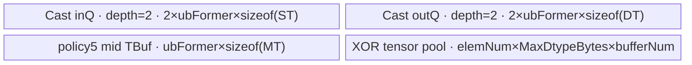

# InplaceBitwiseXorTensor 950 ACLNN 算子知识

## 算子速览

| 项目 | 内容 |
|---|---|
| 实际入口 | `aclnnInplaceBitwiseXorTensorGetWorkspaceSize` + `aclnnInplaceBitwiseXorTensor`，公开 ACLNN 原地 Tensor 版本 |
| 计算语义 | 将 `selfRef` 与 `other` 广播到共同 shape；BOOL 用不等比较实现 XOR，整数逐 bit XOR；结果按 `selfRef` dtype 写回同一逻辑张量 |
| 输入输出 | 两输入 ND，rank≤8，允许非连续；950 dtype 为 BOOL、INT8/16/32/64、UINT8/16/32/64；`selfRef.shape` 必须等于广播结果 |
| 执行类型 | 核心节点均 `AIV_VECTOR`；广播搬入可为 `NDDMA` 或 UB Broadcast，entry 均声明 `KERNEL_TYPE_AIV_ONLY`；无可达 Cube/AIC/MIX_CV |
| Kernel 路线 | R-001 BOOL `NotEqual`；R-002 整数 `BitwiseXor`，前后可插入 AIV `Cast` 节点 |
| 核心资源 | Executor 管理 GM 临时张量与 workspace；广播节点用单个 `VECCALC` tensor pool、MicroAPI 寄存器和可选 NDDMA；Cast 用双缓冲 TQue、可选中间 TBuf/寄存器 |
| 来源闭包 | source_closed：公开 API→参数提升→Contiguous 框架边界→可选 Cast→NotEqual/BitwiseXor→ViewCopy 框架边界，所有可达核心 Device 节点、Tiling、POD 与构建均闭合 |
| 验证状态 | 已完成源码闭包检查；本次知识提取未执行编译、真机、数值或性能测试。 |

## 接口与语义

### 计算语义

设 `S=selfRef`、`O=other`，广播结果 shape 为 `B=broadcast(shape(S), shape(O))`。接口先要求 `shape(S)=B`，因此写回不会扩大 `selfRef`。对 BOOL，`S[i] xor O[i]` 等价为 `S[i] != O[i]`；对整数，在提升类型 `P=PromoteType(dtype(S), dtype(O))` 上逐 bit 计算 `P(S[i]) XOR P(O[i])`，再转换为 `dtype(S)` 并通过 `ViewCopy` 写回 `S`。这是原地语义；非原地 `aclnnBitwiseXorTensor` 与 Scalar 入口不属于本卡。

### 输入、输出与属性

| 参数 | shape/layout | dtype | 约束、默认值与语义 |
|---|---|---|---|
| `selfRef` | ND，rank≤8；ND format；可非连续 | BOOL、INT8、INT16、INT32、INT64、UINT8、UINT16、UINT32、UINT64 | 非空指针；同时是输入和写回目标；其 shape 必须等于两输入广播结果；提升结果必须能 Cast 回本 dtype |
| `other` | ND，rank≤8；ND format；可非连续；可广播到 `selfRef` | 同上 | 非空指针；与 `selfRef` 的 dtype 组合必须在 `PromoteType` 表中有定义 |
| `workspaceSize` | 标量 Host 输出 | `uint64_t` | 空输入路径置 0；非空时由 executor 汇总所有节点需求 |
| `executor` | Host 句柄输出 | `aclOpExecutor **` | GetWorkspaceSize 阶段创建并释放所有权给调用者；执行阶段消费 |
| `workspace`/`stream` | Device workspace 与运行流 | `void *`/`aclrtStream` | `CommonOpExecutorRun` 在指定 stream 上按 executor 图执行；框架壳内部布局为明确外部边界 |

### 入口与版本

固定 `ops-math` Commit `165d41f02a43a62324b434cb6bda7c533b14da3e` 的公开文档声明 950、A3、A2 产品支持；本卡只发布 950 arch35 的实际最新实现。`aclnnInplaceBitwiseXorTensorGetWorkspaceSize` 以 `(selfRef, other, selfRef)` 复用 `GetWorkspaceSizeCommon`，执行入口复用 `CommonOpExecutorRun`。A3/A2 在该固定仓缺少对应 BitwiseXor/NotEqual AICore Kernel/Tiling 构建闭包，故不据文档支持推测实现，也不生成无后缀卡。

## Host/Launcher 执行流程

### 参数校验与前处理

`CheckParams` 顺序为：检查 `self/other/out` 非空；按当前架构选择 950 dtype 白名单；`PromoteType(self,other)` 不得为 `DT_UNDEFINED`；`CanCast(promoteType,out dtype)` 必须成立；检查广播 shape 可生成且等于输出 shape。`CanCast` 明确禁止非 BOOL 转 BOOL，所以 `selfRef=BOOL` 仅 `other=BOOL` 有效。`UINT16/UINT32/UINT64` 在提升表中除同 dtype 外与本接口其他 dtype 的组合为 undefined，同 dtype Cast 又由 `l0op::Cast` 直接返回输入；因此这些类型不会触发 AICPU Cast。

任一输入空时立即返回 workspace 0，不建立 Device 节点。非空时先对两输入调用框架 `Contiguous`；这使核心广播 Tiling 的 `inputAllContiguous=true`，非连续输入的真实拷贝由框架边界承担。若提升类型为 BOOL，建立 NotEqual；否则依次建立两个可能 no-op 的 Cast、BitwiseXor 和一个可能 no-op 的输出 Cast，最后 `ViewCopy(castOut,selfRef)` 处理连续或非连续原地目标。

### 参数、Workspace 与生命周期

`CREATE_EXECUTOR` 产生唯一 owner；临时连续张量、Cast 输出和核心算子输出均由 executor 分配，在执行图结束前存活。每个 BroadcastBaseTiling 节点向上下文声明 `DEFAULT_TILING_WORKSPACE_SIZE=16 MiB`；Cast Tiling 同样声明 `MINIMAL_WORKSPACE=16 MiB`，但这些 AIV entries 不读取 `workspace` 参数。最终 `uniqueExecutor->GetWorkspaceSize()` 决定调用者需分配的总 workspace，固定源码未公开 executor 对多节点 workspace 的切片 offset/复用算法，故不得把各节点 16 MiB 简单相加。空路径显式为 0。

### 启动图与失败传播

非空 R-001：`Contiguous(S)`、`Contiguous(O)`（框架）→ Host `l0op::NotEqual`→ `not_equal<schMode>`，blockDim 来自 Broadcast Tiling，POD 为 one-dim 或 base broadcast data → no-op Cast → `ViewCopy`（框架）。

非空 R-002：两个 Contiguous（框架）→ 0～2 个 `CastAiCore` 节点 → `bitwise_xor<schMode>` → 0～1 个 `CastAiCore` 节点 → ViewCopy（框架）。每个 Cast blockDim 为 `CastTilingData.blockNum`、key 为 0，核心节点 blockDim 为 Broadcast Tiling 的 `blockNum`。中间边均是 executor owner 的 GM Tensor，shape 为广播前输入 shape（Cast）或广播结果 shape（核心/输出 Cast），dtype 依次为原 dtype→提升 dtype→`selfRef` dtype；同一 stream 上的 executor 顺序是框架壳边界。任一空指针、校验失败、launcher 添加失败或中间返回 nullptr 都立即阻断后续节点；执行阶段直接返回 `CommonOpExecutorRun` 状态。

## Route 与参数设计

### 分核与资源计算

广播节点先合并可折叠维。合并后 rank=1 且输入连续时使用 mode 202：`tileNum=floor((UB/aliveNum)/512B)*512B/MaxDtypeBytes`，`ubOuter=ceil(dimLen/tileNum)`；若每核初始仅一 tile，则令 `blockFormer=2` 开启核内 ping-pong，再以 `blockNum=ceil(ubOuter/blockFormer)` 启动。多维时由公共 Broadcast Tiling 计算 `elemNum`、`ubSplitAxis/ubFormer/ubTail/ubOuter`；`blockFormer=ceil(fusedProduct/coreNum)`，`blockNum=ceil(fusedProduct/blockFormer)`，最后一核用 `blockTail`。UB 上限以 `bufferNum=OpDag::GetBufferNum<isNddma,true>()` 与 `MaxDtypeBytes` 反推，保留公共模板的 256/512B 对齐。

Cast 节点令 `coreNum=min(platform AIV cores,ceil(shapeSize*srcBits/(4 KiB*8)))`，`blockFormer` 先均分再向 8 元素对齐，最后计算 `blockNum/blockTail`。`ubFormer` 按策略用平台 UB、输入/输出/中间位宽与预留字节计算并对输入 VL 对齐；随后产生整核/尾核的 UB loop 与寄存器 loop。所有计数在 Host 为 int64，one-dim `tileNum`/`blockNum` 写入 int32/int16 前由 Tiling 结果约束。

### Route 选择

| 顺序 | Route | Key/模板 | 精确选择条件与优先级 | 不适用去向 |
|---:|---|---|---|---|
| 1 | R-001 BOOL NotEqual | Broadcast mode 202、1、2、101～104、109；`NotEqualCompute<int8_t>` | `promoteType==BOOL`；由提升表可知两输入均 BOOL；Tiling 将原 BOOL映射为 int8 DAG | 非 BOOL→R-002 |
| 2 | R-002 整数 BitwiseXor | Broadcast mode 202、1、2、101～104、109；`BitwiseXorCompute<T>`，T 为 8 种整数 | `promoteType!=BOOL` 且校验成功；可选 Cast 只命中策略 1/3/5/6 | dtype/提升/回写 Cast 不合法→ACLNN 参数失败 |

```text
input empty? ─yes→ workspace=0，无 Kernel
  └no→ CheckParams + Contiguous(x2)
       ├─ promoteType == BOOL → R-001 NotEqual<int8_t>
       └─ otherwise → Cast/no-op(x2) → R-002 BitwiseXor<T> → Cast/no-op
       → ViewCopy(selfRef)

每个 Broadcast 核心节点：
  collapsed_rank == 1 → mode 202
  otherwise → IsUbBroadcast?
      false → running_rank<=5 ? mode 1 : mode 2
      true  → running_rank=1..4 ? mode 101..104 : mode 109
```

### 模板/实现执行矩阵

| Route | key/selector | dtype/shape/platform 完整命中条件 | 执行拓扑与 Kernel 节点 | 实际模板/body | 内存与同步特征 | tail/fallback |
|---|---|---|---|---|---|---|
| R-001 BOOL NotEqual | 202 | 950，BOOL×BOOL，合轴后 rank=1 | 单核心 Kernel；前后框架节点 | `BroadcastOneDimAdvanceSch<NotEqualCompute<int8_t>::OpDag>`；Compare(mode5)+Select(mode2) | UB slot tensor pool，ping-pong；masked Vector | 最后核/最后 tile 用 `ubTailNum`；失败终止 |
| R-001 BOOL NotEqual | 1/2 | 同上，多维且 IsUbBroadcast=false；running rank≤5/>5 | 单核心 Kernel | `BroadcastNddmaSch<...,false/true>` | NDDMA CopyInBrc+VECCALC pool | `ubTail`、`blockTail`；无其他 fallback |
| R-001 BOOL NotEqual | 101～104/109 | 同上，多维且 IsUbBroadcast=true；running rank 1～4/>4 | 单核心 Kernel | `BroadcastUbSch<...,R>` | GM→UB Copy+Vector Broadcast；VECCALC pool | 同上 |
| R-002 Integer XOR | 202 | 950，提升类型为 8 种整数，合轴后 rank=1 | 可选 Cast→核心 XOR→可选 Cast | `BroadcastOneDimAdvanceSch<BitwiseXorCompute<T>::OpDag>`；`XorCompute<T>` | slot tensor pool+MicroAPI RegTensor | mask 保护不足一个 VL 的尾部 |
| R-002 Integer XOR | 1/2 | 同上，多维且 NDDMA selector | 同上 | `BroadcastNddmaSch<...,false/true>` | NDDMA 广播搬入、AIV Xor、GM 搬出 | `ubTail/blockTail` |
| R-002 Integer XOR | 101～104/109 | 同上，多维且 UB Broadcast selector | 同上 | `BroadcastUbSch<...,R>` | UB Broadcast 后 AIV Xor | `ubTail/blockTail` |
| R-002 可选 Cast 节点 | key 0；policy 1/3/5/6 | 仅提升表可达的 BOOL/INT8/UINT8/INT16/INT32/INT64 转换；同 dtype无节点 | 每次为独立 AIV Kernel | `CastDirect`/`CastThrough`/`CastTwo`/`CastMicro<MIRCRO_INOUT>` | 双缓冲队列；Two 有 mid TBuf；Micro 用寄存器分布 load/store | 每核最后 UB loop 使用对应 tail；不命中 AICore 表才会 AICPU，但本入口合法 950 路线不可达 |

### 隐藏性能 Guard

| Guard | Host/Tiling 条件 | Device/资源原因 | 影响 Route | 不满足时去向 | 源码符号 |
|---|---|---|---|---|---|
| 一维 advance | 合轴 rank=1、全部输入连续、`InputSize+OutputSize<=4`、`VarSize<=0` | 省去通用多维索引，512B 对齐 tile 并启用 ping-pong | R-001/R-002 mode202 | 通用多维 selector | `BroadcastBaseTiling::DoTiling` |
| 纯 elementwise | 无输入 stride=0 的广播轴 | 无需 UB Broadcast，NDDMA/连续搬入更直接 | mode1/2 | 继续检查 big-NLast/尾轴对齐 | `BroadcastBaseTiling::IsUbBroadcast` |
| 大非尾轴广播 | `IsBigNLastBrc()` | 避免大广播维 NDDMA 配置成本 | mode101～109 | 检查尾轴条件 | 同上 |
| 小 dtype 尾轴对齐 | 广播输入 dtype 属 8/16-bit 集合且 `lastDim % (32B/dtypeSize)==0` | UB Broadcast 的 block 对齐成立 | mode101～109 | mode1/2 | 同上 |
| Vector tail mask | `count` 非 `VL_T` 整倍数 | UpdateMask 限制最后一次 Xor/Compare/Store 的有效 lane | 两 Route | 无 fallback，mask 收尾 | `XorCompute::XorCompute`、公共 Compare/Select |
| Cast UB guard | 按 policy 扣除 128～192B 预留后 `ubFormer>0`，并对输入 VL 对齐 | 双缓冲、mid buffer 或寄存器分布搬运必须同时容纳 | R-002 Cast | Tiling 失败 | `CastTiling::GetUbFormer` |

### POD/ABI

| 结构 | 字段 | 类型/位宽 | ABI 布局 | 单位 | Host/launcher producer | Device consumer | 边界 |
|---|---|---|---|---|---|---|---|
| `BroadcastOneDimTilingDataAdvance` | `dimLen` | int64/64 | 声明顺序第1字段；自然对齐 | element | `DoOneDimFormerTilingAdvance` | `BroadcastOneDimAdvanceSch::Init` | >0 |
| 同上 | `tileNum` | int32/32 | 第2字段 | element/tile | `GetOneDimUBFormerAdvance` | `Init/Process` | 512B 对齐后换算，非0 |
| 同上 | `blockNum` | int16/16 | 第3字段 | core | `DoOneDimFormerTilingAdvance` | entry blockDim、最后核判断 | 必须容纳计算核数 |
| 同上 | `scalarFlag` | int16/16 | 第4字段 | bit mask | `GetOneDimScalarFlagAdvance` | `CopyIn` | bit i 指输入 i 为 scalar |
| `BroadcastBaseTilingData<OpDag>` | `scheMode,shapeLen,ubSplitAxis,ubFormer,ubTail` | int32×5 | 声明顺序起始 | mode/axis/element | `SetSchMode`、`AdaptBroadcastBaseTilingData` | router/scheduler | `shapeLen≤8` |
| 同上 | `ubOuter,blockFormer,blockTail,dimProductBeforeUbInner,elemNum,blockNum` | int64×6 | 紧随上组，编译器自然对齐 | loop/element/core | `AdaptBroadcastBaseTilingData` | NDDMA/UB scheduler | former/tail 正值 |
| 同上 | `outputDims,outputStrides` | int64[8]×2 | 固定最大8维 | element stride | 同上 | GM offset/索引更新 | 未用维不读 |
| 同上 | `inputDims` | int64[2][2] | `InputSize=2` | element | `SetInputParams` | CopyInBrc | 整块/尾块 |
| 同上 | `inputBrcDims,inputStrides,inputBrcStrides` | int64[2][8]、int64[2][8]、int64[2][8] | `CopyBrcSize=2` | dim/stride | Broadcast Tiling | NDDMA/UB Broadcast | 合轴后有效维 |
| 同上 | `inputVecBrcDims,inputVecBrcStrides` | 零长模板数组 | `VecBrcSize=0`；具体编译器 `sizeof/offsetof` 固定仓未显式给出 | N/A | inactive | inactive | 不得假设占字节 |
| 同上 | `scalarData` | char[16] | 末尾 | byte | `AdaptBroadcastBaseTilingData` | 本 DAG 不消费 | 保留 ABI |
| `CastTilingData` | `blockNum,ubFormer,blockFormer` | int64×3 | tiling 宏声明顺序1～3 | core/element | `CastTiling::DoOpTiling` | Cast bodies `Init/Process` | 正值 |
| 同上 | `ubLoopOfFormerBlock,ubLoopOfTailBlock,ubTailOfFormerBlock,ubTailOfTailBlock` | int64×4 | 顺序4～7 | loop/element | 同上 | 所有 Cast body | 尾核选择 |
| 同上 | `regCopyInStep,regCopyOutStep,ubFormerRegLoop,ubTailOfFormerRegLoop,ubTailOfTailRegLoop` | int64×5 | 顺序8～12 | element/loop | `GetUbCopyStep`、`DoOpTiling` | `CastMicro` | 非 Micro字段可为0 |

`BroadcastBaseTilingData` 含依赖模板大小的零长数组，`CastTilingData` 由 tiling 宏生成；固定仓未给出生成后 `sizeof/alignof/offsetof` 常量，且任务不执行编译，故仅保留源码可证的字段顺序、位宽与数组长度，不伪造 ABI 数值。

### Route 源码闭包

| Route | Key/selector | Host/Tiling producer | POD/参数 | Kernel entry/router 节点 | Kernel body/直接依赖 | 构建接线 |
|---|---|---|---|---|---|---|
| R-001 | BOOL + 202/1/2/101～104/109 | `not_equal.cpp::NotEqual`；`NotEqualTiling::DoOpTiling`；公共 `BroadcastBaseTiling` | one-dim/base broadcast POD | `not_equal_apt.cpp::not_equal`→`BroadcastSch` | `NotEqualCompute<int8_t>` + 公共 scheduler/Vec helpers | `not_equal_def.cpp` + `not_equal/CMakeLists.txt`，ascend950→`not_equal_apt` |
| R-002 | integer + 202/1/2/101～104/109 | `bitwise_xor.cpp::BitwiseXor`；`BitwiseXorTiling::DoOpTiling` | 同上 | `bitwise_xor_apt.cpp::bitwise_xor`→`BroadcastSch` | `XorCompute<T>` + 公共 scheduler/Vec helpers | `bitwise_xor_def.cpp` + `bitwise_xor/CMakeLists.txt`，ascend950→`bitwise_xor_apt` |
| R-002 Cast节点 | key0，policy1/3/5/6 | `cast.cpp::Cast/CastAiCore`；`CastTiling` | `CastTilingData` | `cast_apt.cpp::cast<id>` | `CastDirect/Through/Two/Micro` | `cast_def.cpp` + `cast/CMakeLists.txt`，ascend950→`cast_apt` |

## Kernel 实现

### 公共执行流程

NotEqual 与 BitwiseXor entries 都接收两输入、一输出、workspace、tiling；workspace 参数不在 body 中读取。entry 以模板 `schMode` 构造公共 `BroadcastSch`，所有分支设置 `KERNEL_TYPE_AIV_ONLY`。mode202 使用直接 UB slot tensor pool；mode1/2 用 NDDMA 生成广播搬入；mode101～104/109 先 GM→UB，再用 Vector Broadcast。各 scheduler 以合轴索引计算两输入 GM offset，在同一 tile 内按 DAG 顺序完成 CopyInBrc→计算→CopyOut，并按 `ubLoopIdx&1` 交替 buffer id。

可选 Cast 是独立 AIV 节点：同 dtype由 Host no-op；policy1直接 AscendC `Cast`，policy3等位宽 Copy，policy5经中间类型两次 Cast，policy6用 MicroAPI 分布 load/store做整数窄化。Executor GM 边和 stream 顺序属于允许的框架壳边界；节点拥有的 selector、POD 与 Device body 均已闭合。

### Route R-001：BOOL NotEqual

#### 适用条件

##### 选择证据

| 层级 | 文件 | 符号 | 源码谓词/参数 | 结果/下一跳 |
|---|---|---|---|---|
| API | `math/bitwise_xor/op_api/aclnn_bitwise_xor_tensor.cpp` | `GetWorkspaceSizeCommon` | `promoteType==DT_BOOL` | `l0op::NotEqual` |
| Host | `math/not_equal/op_api/not_equal.cpp` | `NotEqual` | RegBase AICore表支持 BOOL，输入 dtype相同 | `NotEqualAiCore` |
| Tiling | `math/not_equal/op_host/arch35/not_equal_tiling_arch35.cpp` | `NotEqualTiling::DoOpTiling` | BOOL 映射 `NotEqualCompute<int8_t>` | Broadcast key |
| Router | `opbase/.../broadcast_sch.h` | `BroadcastSch::Process` | schMode 202、1/2、101～104/109 | one-dim/NDDMA/UB Broadcast body |

#### Device 数据流

##### 函数级调用链

```text
NotEqualAiCore ADD_TO_LAUNCHER_LIST_AICORE(NotEqual, x1, x2, y)
  -> not_equal<schMode>(x1, x2, y, workspace, tiling)
    -> BroadcastSch<schMode, NotEqualCompute<int8_t>::OpDag>::Process
      -> scheduler::CopyInBrc(x1), scheduler::CopyInBrc(x2)
      -> Duplicate<uint8_t>(1), Duplicate<uint8_t>(0)
      -> Compare<uint8_t,int8_t,5>(x1,x2)
      -> Select<uint8_t,uint8_t,2>(mask,one,zero)
      -> CopyOut<uint8_t>(y)
  -> executor-owned GM y -> framework ViewCopy -> selfRef
```

##### 源码等价伪码

```text
# 源码等价伪码
for each core:
  loop_num = last_core ? blockTail : blockFormer
  axes = decode(core * blockFormer)
  for tile in [0, loop_num):
    n = last_ub_slice ? ubTail : ubFormer
    a = CopyInBrc<int8>(x1, axes, n, pingpong)
    b = CopyInBrc<int8>(x2, axes, n, pingpong)
    one = Duplicate<uint8>(1, n); zero = Duplicate<uint8>(0, n)
    mask = Compare<NE>(a, b, n)
    out = Select(mask, one, zero, n)
    CopyOut<uint8>(y, out, n)
    update axes; pingpong ^= 1
```

#### 内存与数据搬运

##### 资源与搬运表

| 层级/缓冲区 | offset/地址公式 | extent/容量公式 | dtype/layout | producer | consumer | owner/lifetime | 对齐/复用 |
|---|---|---|---|---|---|---|---|
| GM x1/x2 | Broadcast stride计算；广播轴 stride=0 | 输入 storage | BOOL按int8读取 | Contiguous边界 | CopyInBrc | executor/节点期间 | shape合轴 |
| VECCALC tensor pool | `bufId*blockLen` | `elemNum*MaxDtypeBytes*bufferNum`；mode202 为 `tileNum*MaxDtypeBytes*aliveNum` | int8/uint8 slots | scheduler Init/slot producer | DAG下一节点 | Kernel/core | LEVEL_2 liveness；ping-pong id |
| Reg/Mask | MicroAPI/Vec helper内部 | 固定仓未给寄存器字节数 | int8、uint8、predicate | Compare/Duplicate | Select | 单 Vector 调用 | tail由count/mask |
| GM y | broadcast output offset | `prod(selfRef.shape)` bytes | uint8/BOOL | CopyOut | ViewCopy | executor至写回完成 | 非连续目标在框架边界处理 |
| workspace | executor分配 slice，offset固定仓不可见 | 节点声明16 MiB；body不读 | byte | executor | 无 Device读者 | ACLNN执行期间 | 可否跨节点复用由框架决定 |

##### 分层内存布局


公共 DAG 元编程按 LEVEL_2 liveness 计算实际 `bufferNum/bufId`；源码以单个 tensor pool 分区，而不是独立 TQue。零长/复用 slot 的编译期具体编号不应手写固定值。

##### 字节账与复用顺序

```text
UB_total_common = elemNum * MaxDtypeBytes * GetBufferNum<isNddma,true>()
UB_total_mode202 = tileNum * MaxDtypeBytes * aliveNum
UB_total <= platform_ub - extraSize
workspace_request = 16 MiB; workspace_device_read = 0
```

| 复用子区 | 写入者 | 读取者/消费点 | 下一次覆盖 | 同步或释放依据 | 安全条件 |
|---|---|---|---|---|---|
| x1/x2 slots | CopyInBrc | Compare | 下一 ping/pong循环 | 公共 DAG buffer liveness与 MTE2/V 同步 helper | Compare已消费 |
| compare/select slot | Compare/Select | Select/CopyOut | 下一 tile | bufId依赖图、PIPE_V/MTE3 ordering | CopyOut读取完成 |
| ping/pong组 | tile i | DAG全部阶段 | tile i+2 | `ubLoopIdx&1` | 两组交替且 loop ordering成立 |

#### 同步、精度与尾块

##### 同步与数值边界表

| 阶段 | primitive/机制 | producer | consumer/等待点 | 保护对象 | 精度/尾块 |
|---|---|---|---|---|---|
| GM→UB→Vector | 公共 sync helper 的 MTE2/V pipe lock/unlock | CopyInBrc | Compare | 输入 slot | BOOL按int8 0/1语义比较 |
| Vector→GM | V/MTE3 ordering | Select | CopyOut | 输出 slot | 输出uint8 0或1 |
| 尾 tile | scheduler `ubTail`/`ubTailNum` | Tiling | DAG count | 最后有效元素 | 不提交 padding lane |
| 跨节点 | executor stream顺序 | NotEqual | ViewCopy | GM y | 框架生成细节固定仓不可见 |

#### 关键实现

##### 符号证据表

| 阶段 | 文件 | 符号/模板实例 | 实现事实 |
|---|---|---|---|
| Host/Tiling producer | `math/not_equal/op_api/not_equal.cpp` | `NotEqual` | RegBase BOOL命中 AICore launcher |
| Host/Tiling producer | `math/not_equal/op_host/arch35/not_equal_tiling_arch35.cpp` | `NotEqualTiling::DoOpTiling` | BOOL选择 `NotEqualCompute<int8_t>` 并生成 Broadcast key |
| Kernel entry/router | `math/not_equal/op_kernel/not_equal_apt.cpp` | `not_equal<schMode>` | 原 BOOL以int8 DAG运行，交给 BroadcastSch |
| Device body/helper | `math/not_equal/op_kernel/arch35/not_equal_dag.h` | `NotEqualCompute<int8_t>` | CopyInBrc×2→Compare NE→Select 1/0→CopyOut |

### Route R-002：整数 BitwiseXor

#### 适用条件

##### 选择证据

| 层级 | 文件 | 符号 | 源码谓词/参数 | 结果/下一跳 |
|---|---|---|---|---|
| API | `math/bitwise_xor/op_api/aclnn_bitwise_xor_tensor.cpp` | `GetWorkspaceSizeCommon` | `promoteType!=BOOL` | Cast输入→BitwiseXor→Cast输出 |
| Host | `math/bitwise_xor/op_api/bitwise_xor.cpp` | `BitwiseXor` | RegBase表覆盖8种整数 | `BitwiseXorAiCore` |
| Tiling | `math/bitwise_xor/op_host/arch35/bitwise_xor_tiling.cpp` | `BitwiseXorTiling::DoOpTiling` | 三个 dtype相等且为8种整数之一 | 对应 `BitwiseXorCompute<T>` Broadcast key |
| Cast | `math/cast/op_api/cast.cpp` | `Cast` | 同 dtype返回原张量；合法异 dtype 在 RegBase AICore list | 0～3 个 CastAiCore节点 |
| Router | `opbase/.../broadcast_sch.h` | `BroadcastSch::Process` | schMode 202、1/2、101～104/109 | 对应 scheduler |

#### Device 数据流

##### 函数级调用链

```text
[optional] CastAiCore(input -> promoteType) -> cast<0> -> CastDirect/Through/Two/Micro::Process
BitwiseXorAiCore ADD_TO_LAUNCHER_LIST_AICORE(BitwiseXor, castSelf, castOther, out)
  -> bitwise_xor<schMode>
    -> BroadcastSch<schMode, BitwiseXorCompute<T>::OpDag>::Process
      -> CopyInBrc<T>(x1), CopyInBrc<T>(x2)
      -> XorCompute<T>::XorCompute
      -> CopyOut<T>(y)
[optional] CastAiCore(y -> selfRef dtype) -> cast<0>
framework ViewCopy(result, selfRef)
```

##### 源码等价伪码

```text
# 源码等价伪码
P = PromoteType(dtype(selfRef), dtype(other))
a = same_dtype ? contiguousSelf : CastAIV(contiguousSelf, P)
b = same_dtype ? contiguousOther : CastAIV(contiguousOther, P)
for each core/tile selected by Broadcast schMode:
  n = full tile or ubTail
  ua = NDDMA_or_UBBroadcast_CopyIn(a, broadcast_offset_a, n)
  ub = NDDMA_or_UBBroadcast_CopyIn(b, broadcast_offset_b, n)
  for j in [0, ceil(n/(VRegBytes/sizeof(P)))):
    mask = UpdateMask<P>(remaining)
    va = load(ua + j*VL); vb = load(ub + j*VL)
    vr = Xor(va, vb, mask)
    store(mask, result + j*VL, vr)
  CopyOut(result, GM y, n)
result = same_output_dtype ? y : CastAIV(y, dtype(selfRef))
ViewCopy(result, selfRef)
```

#### 内存与数据搬运

##### 资源与搬运表

| 层级/缓冲区 | offset/地址公式 | extent/容量公式 | dtype/layout | producer | consumer | owner/lifetime | 对齐/复用 |
|---|---|---|---|---|---|---|---|
| Cast GM边 | 0；每核 `blockIdx*blockFormer` | 原shape元素数×目标dtype bytes | 连续 ND | Cast CopyOut | 下一Cast/BitwiseXor | executor到最后消费者 | 同 dtype alias原张量 |
| Cast input/output TQue | UB内由 TPipe分配 | 各 `2*ubFormer*sizeof(ST/DT)` | ST/DT | DataCopyPad/Cast | Cast/DataCopyPad | Cast Kernel | depth=2 |
| Cast mid TBuf | TPipe分配 | policy5: `ubFormer*sizeof(MT)` | int32等中间类型 | 第一次 Cast | 第二次 Cast | 单 UB loop | policy1/3/6无该buf |
| Broadcast tensor pool | `bufId*blockLen` | `elemNum*MaxDtypeBytes*bufferNum` 或 mode202对应公式 | 提升整数 T | CopyInBrc/Xor | Xor/CopyOut | 核心 Kernel | LEVEL_2+ping-pong |
| XOR RegTensor | 每 VL 从 LocalTensor地址取 | 3个数据寄存器+1 predicate，字节固定仓不可见 | T | MicroAPI load | Xor/store | 单寄存器循环 | mask tail |
| workspace | executor slice offset不可见 | 各非空 Cast/核心节点声明16 MiB，body不读 | byte | executor | 无Device读者 | ACLNN执行期间 | 框架可复用规则不可见 |

##### 分层内存布局



##### 字节账与复用顺序

```text
Cast policy1/3/6 UB = 2*ubFormer*sizeof(ST) + 2*ubFormer*sizeof(DT)
Cast policy5 UB = 上式 + ubFormer*sizeof(MT)
Broadcast UB = elemNum*MaxDtypeBytes*GetBufferNum<isNddma,true>()
mode202 UB = tileNum*MaxDtypeBytes*aliveNum
workspace aggregate = executor.GetWorkspaceSize(); 固定仓不可将节点请求直接求和
```

| 复用子区 | 写入者 | 读取者/消费点 | 下一次覆盖 | 同步或释放依据 | 安全条件 |
|---|---|---|---|---|---|
| Cast inQ/outQ slot | CopyIn/Compute | Compute/CopyOut | TQue再次Alloc | DeQue/FreeTensor/EnQue | 消费后释放 |
| Cast mid TBuf | Cast stage1 | Cast stage2 | 下一 UB loop | 同一 Compute函数顺序 | stage2完成 |
| XOR pool input/result slot | CopyInBrc/Xor | Xor/CopyOut | 下一 ping或复用节点 | DAG liveness+pipe sync | consumer完成 |
| executor GM临时Tensor | 前置节点 | 后置节点 | executor销毁 | stream图顺序 | 最后消费者完成 |

#### 同步、精度与尾块

##### 同步与数值边界表

| 阶段 | primitive/机制 | producer | consumer/等待点 | 保护对象 | 精度/尾块 |
|---|---|---|---|---|---|
| Cast pipeline | TQue EnQue/DeQue/FreeTensor | CopyIn/Compute | Compute/CopyOut | 双缓冲 slot | 整数 Cast `CAST_NONE`；窄化保留目标低位语义由 AscendC Cast/分布 store定义 |
| Broadcast CopyIn | NDDMA或DataCopyPad+Vector Broadcast | GM | Xor | 输入 pool | 广播 stride由POD决定 |
| Xor | `UpdateMask<T>` | masked loads | masked store | 最后 VL | 纯整数逐 bit，无浮点精度问题 |
| CopyOut | pipe V/MTE3 ordering | Xor | GM输出 | result slot | `ubTail`限制有效元素 |
| 跨Kernel | executor同stream图 | Cast/core节点 | 下一节点 | GM临时Tensor | 失败阻断后续；框架内部event不可见 |

#### 关键实现

##### 符号证据表

| 阶段 | 文件 | 符号/模板实例 | 实现事实 |
|---|---|---|---|
| Host/Tiling producer | `math/bitwise_xor/op_api/bitwise_xor.cpp` | `BitwiseXor/BitwiseXorAiCore` | 950 8整数类型全部加入AICore launcher |
| Host/Tiling producer | `math/bitwise_xor/op_host/arch35/bitwise_xor_tiling.cpp` | `BitwiseXorTiling::DoOpTiling` | dtype相等校验与8个 DAG实例 |
| Kernel entry/router | `math/bitwise_xor/op_kernel/bitwise_xor_apt.cpp` | `bitwise_xor<schMode>` | `BroadcastSch<schMode,OpDag>` |
| Device body/helper | `math/bitwise_xor/op_kernel/arch35/bitwise_xor_dag.h` | `XorCompute<T>` | VL分段、UpdateMask、双load、Xor、masked store |
| 直接依赖 | `math/cast/op_kernel/arch35/cast_impl.h` | `CastDirect/Through/Two/Micro` | 闭合所有本入口可达异dtype Cast策略 |

## 算子特定优化

### Trick T-001：以谓词掩码闭合任意 dtype 的尾 VL

#### 触发与源码依据

- 适用 Route：R-002
- 触发条件：每个 tile 的 `count` 不是 `VL_T=GetVRegSize()/sizeof(T)` 的整数倍时，最后一次寄存器循环仅开启剩余 lane。
- Golden 来源：[`math/bitwise_xor/op_kernel/arch35/bitwise_xor_dag.h:36-58`](../../../../../../../cann-ops-raw/ascendc/ops-math/165d41f02a43a62324b434cb6bda7c533b14da3e/math/bitwise_xor/op_kernel/arch35/bitwise_xor_dag.h#L36-L58)

**官方源码（固定 Commit 连续逐字摘录）**：

```cpp
constexpr uint32_t VECTOR_LENGTH = GetVRegSize();
constexpr uint32_t VL_T = VECTOR_LENGTH / sizeof(T);
__local_mem__ T* inputX1Addr = (__local_mem__ T*)inputX1.GetPhyAddr();
__local_mem__ T* inputX2Addr = (__local_mem__ T*)inputX2.GetPhyAddr();
__local_mem__ T* dstAddr = (__local_mem__ T*)dst.GetPhyAddr();
uint16_t loopTimes = CeilDiv(count, VL_T);

__VEC_SCOPE__
{
    MicroAPI::RegTensor<T> src1Value;
    MicroAPI::RegTensor<T> src2Value;
    MicroAPI::RegTensor<T> resValue;
    MicroAPI::MaskReg preg;
    uint32_t sregMask = count;

    for (uint16_t j = 0; j < loopTimes; j++) {
        preg = MicroAPI::UpdateMask<T>(sregMask);
        MicroAPI::DataCopy<T, MicroAPI::LoadDist::DIST_NORM>(src1Value, inputX1Addr + VL_T * j);
        MicroAPI::DataCopy<T, MicroAPI::LoadDist::DIST_NORM>(src2Value, inputX2Addr + VL_T * j);

        MicroAPI::Xor(resValue, src1Value, src2Value, preg);

        MicroAPI::DataCopy<T, MicroAPI::StoreDist::DIST_NORM>(dstAddr + VL_T * j, resValue, preg);
    }
}
```

#### 机制与设计原因

VL 以运行平台寄存器字节数除以模板 dtype 字节数得到，因此同一 body 覆盖 int8 到 uint64。`CeilDiv` 保留最后不足一 VL 的迭代，`UpdateMask<T>(sregMask)` 同时约束 XOR 与 store；无需单独 scalar tail，也不会把 UB padding 写入结果。该机制与上层 `ubTail` 互补：scheduler 决定 tile 的真实 `count`，body 决定最后寄存器批次的有效 lane。

#### 迁移边界

- 适用：950 AIV 上的整数逐元素二元运算，输入已在连续 LocalTensor 中。
- 前提：Vector primitive 支持目标 dtype，`count` 可由 `uint32_t` 表示，地址按 `VL_T*j` 前进，谓词同时传给计算和 store。
- 失效：若计算 primitive 不接受 mask、单 tile 元素数超过 count 位宽或输出有不同 packed layout，必须重新设计尾块。
- 未验证：本次知识提取未执行编译、真机、数值或性能测试。

#### 错误做法

省略 store 的 `preg` 会在最后一 VL 提交越界/填充 lane；源码对 Xor 与 DataCopy 同时传入同一谓词，不能只 mask 计算而无条件写回。

## 模板与实现对比

| 对比维度 | R-001 BOOL NotEqual | R-002 整数 BitwiseXor | 设计选择依据 |
|---|---|---|---|
| 命中条件/优先级 | promote BOOL | promote 非BOOL且合法 | API先按提升类型二分 |
| 模板与 dtype | `NotEqualCompute<int8_t>`，输出uint8/BOOL | `BitwiseXorCompute<T>`，8整数模板；可选Cast策略1/3/5/6 | BOOL缺少整数Xor路径，使用逻辑不等价 |
| 循环与分核 | 共用 Broadcast 202/1/2/101～104/109 | 同左，另有Cast独立分核 | shape scheduler复用，语义DAG不同 |
| Queue/TBuf/寄存器/dynamic UB/通信 window | VECCALC pool，Compare/Select mask | pool+Xor RegTensor；Cast双TQue/可选mid TBuf | 整数混合dtype需转换 |
| 内存总占用与复用 | `elemNum*MaxBytes*bufferNum` | 同公式；Cast按策略增加队列/mid | Tiling以DAG alive buffers反推tile |
| 搬运/Vector/SIMT/NDDMA/通信 API | NDDMA或UB Broadcast；Compare/Select | NDDMA或UB Broadcast；MicroAPI Xor；Cast | 均AIV_ONLY，无SIMT/Cube |
| 同步、精度与 tail | pipe+DAG liveness；输出0/1 | pipe/TQue；整数Cast；UpdateMask tail | 语义和dtype决定数值边界 |
| fallback/失败边界 | 非BOOL去R-002 | 无合法提升/回写即失败 | 950合法路线无AICPU fallback |

## 平台差异

| 项目 | A2 | A3 | 950 |
|---|---|---|---|
| 支持状态 | 公开文档声明支持，但固定仓未闭合 | 公开文档声明支持，但固定仓未闭合 | 支持并 source_closed |
| Host/Launcher | ACLNN公共入口可见；AICore Device实现缺失 | 同左 | RegBase selector闭合；8整数+BOOL |
| Kernel/资源 | `bitwise_xor/CMakeLists.txt` 未接 A2，AICPU/Xor body亦不可见 | 未接 A3，旧AICore body不可见 | ascend950 arch35，AIV Broadcast/NDDMA+MicroAPI |

## 限制与失败边界

- 任一指针为空、rank>8、广播失败、`selfRef.shape` 不等于广播结果、dtype不在950白名单、提升结果 undefined 或不能 Cast 回 `selfRef`，GetWorkspaceSize 返回错误。
- `selfRef=BOOL` 与非BOOL无效，因为非BOOL提升结果不能 Cast回BOOL；`UINT16/UINT32/UINT64` 在当前提升表中只接受同 dtype 配对。
- 空输入直接 workspace=0且无Kernel；非空核心节点声明16 MiB workspace但body不读，executor聚合/复用 offset固定仓不可见。
- 非连续输入/原地输出由框架 `Contiguous/ViewCopy` 边界处理；其生成 Kernel、event与内部ABI固定仓不可见，不外推。
- A2/A3的公开文档与固定仓构建源码不形成 source_closed：缺少对应AICore Kernel/Tiling构建，部分dtype还会落到源码不可见的AICPU实现，因此未生成无后缀卡。
- 本次未执行编译、真机、单元、数值或性能测试；生成宏后的精确 `sizeof/alignof/offsetof` 未测量。

## 源码索引

### 链路索引

| 链路阶段 | 文件 | 关键符号 | 支撑内容 |
|---|---|---|---|
| 入口声明/约束 | `math/bitwise_xor/docs/aclnnBitwiseXorTensor&aclnnInplaceBitwiseXorTensor.md` | Inplace接口章节 | 平台、dtype、shape、广播、非连续与错误约束 |
| 入口实现 | `math/bitwise_xor/op_api/aclnn_bitwise_xor_tensor.cpp` | `GetWorkspaceSizeCommon`、两个 Inplace入口 | 校验、空域、launch graph、executor |
| 入口实现 | `math/bitwise_xor/op_api/bitwise_xor.cpp` | `BitwiseXor` | 950 AICore/AICPU selector与launcher |
| Host/Tiling/Launcher | `math/bitwise_xor/op_host/arch35/bitwise_xor_tiling.cpp` | `BitwiseXorTiling::DoOpTiling` | 8 dtype DAG与key |
| Kernel entry/body | `math/bitwise_xor/op_kernel/bitwise_xor_apt.cpp` | `bitwise_xor` | entry与 BroadcastSch |
| Kernel entry/body | `math/bitwise_xor/op_kernel/arch35/bitwise_xor_dag.h` | `XorCompute`、`BitwiseXorCompute` | DAG、Xor Vector body、mask tail |
| 构建接线 | `math/bitwise_xor/op_host/bitwise_xor_def.cpp` | `BitwiseXorOpDef` | ascend950 dtype与opFile |
| 构建接线 | `math/bitwise_xor/CMakeLists.txt` | `SUPPORT_COMPUTE_UNIT` | 仅ascend950 arch35 |
| 入口实现 | `math/not_equal/op_api/not_equal.cpp` | `NotEqual` | BOOL 950 selector |
| Host/Tiling/Launcher | `math/not_equal/op_host/arch35/not_equal_tiling_arch35.cpp` | `NotEqualTiling::DoOpTiling` | BOOL→int8 DAG Tiling |
| Kernel entry/body | `math/not_equal/op_kernel/not_equal_apt.cpp` | `not_equal` | entry/router |
| Kernel entry/body | `math/not_equal/op_kernel/arch35/not_equal_dag.h` | `NotEqualCompute` | Compare/Select DAG |
| 入口实现 | `math/cast/op_api/cast.cpp` | `Cast`、`IsAiCoreSupport` | no-op/AICore/AICPU边界 |
| Host/Tiling/Launcher | `math/cast/op_host/arch35/cast_tiling.h` | `CastTilingData` | POD声明 |
| Host/Tiling/Launcher | `math/cast/op_host/arch35/cast_tiling.cpp` | `CastTiling` | policy、core/tile/UB/workspace |
| Kernel entry/body | `math/cast/op_kernel/arch35/cast_struct.h` | `castMap/GetCastPolicy` | dtype→policy映射 |
| Kernel entry/body | `math/cast/op_kernel/arch35/cast_impl.h` | `CastDirect/Through/Two/Micro` | 可达Cast bodies |
| Kernel entry/body | `math/cast/op_kernel/cast_apt.cpp` | `cast` | AIV entry/router |
| 构建接线 | `math/cast/CMakeLists.txt` | `SUPPORT_COMPUTE_UNIT` | ascend950 Cast构建 |
| Host/Tiling/Launcher | `include/nnopbase/opdev/data_type_utils.h` | `PromoteType/CanCast` | 提升矩阵与回写合法性 |
| Host/Tiling/Launcher | `pkg_inc/op_common/atvoss/broadcast/broadcast_tiling.h` | `BroadcastBaseTiling` | 合轴、selector、POD、workspace |
| Host/Tiling/Launcher | `pkg_inc/op_common/atvoss/broadcast/broadcast_base_struct.h` | Broadcast POD structs | ABI字段 |
| Kernel entry/body | `pkg_inc/op_common/atvoss/broadcast/broadcast_sch.h` | `BroadcastSch` | key→scheduler |
| Kernel entry/body | `pkg_inc/op_common/atvoss/broadcast/broadcast_sch_nddma.h` | `BroadcastNddmaSch` | NDDMA route |
| Kernel entry/body | `pkg_inc/op_common/atvoss/broadcast/broadcast_sch_ub_broadcast.h` | `BroadcastUbSch` | UB Broadcast route |
| Kernel entry/body | `pkg_inc/op_common/atvoss/broadcast/broadcast_sch_one_dim_advance.h` | `BroadcastOneDimAdvanceSch` | mode202 route |

每行只写一个文件，并确保该文件存在于 Frontmatter `sources`。

### 实现复用检查

| 检查项 | 可复用事实 | 不得改变的约束 | 源码符号 |
|---|---|---|---|
| ABI/POD | Broadcast one-dim/base结构与CastTilingData可直接作为Host/Device契约 | 字段顺序、位宽、数组模板长度、inactive字段；精确生成宏布局未测量 | `BroadcastOneDimTilingDataAdvance`、`BroadcastBaseTilingData`、`CastTilingData` |
| 调用顺序 | Contiguous×2→可选Cast→NotEqual/Xor→可选Cast→ViewCopy | 原地目标必须作为out传入公共函数；任一失败阻断后续 | `GetWorkspaceSizeCommon` |
| workspace/内存 | 各AIV节点声明16 MiB；广播tensor pool和Cast队列公式可复用 | 不得把声明workspace直接相加；executor slice/复用不可见；pool按DAG liveness分区 | `BroadcastBaseTiling::DoTiling`、`CastTiling::GetWorkspaceSize` |
| 同步 | 节点内用pipe/DAG liveness或TQue；跨节点由executor stream | Host书写顺序不能替代框架运行保证；不得假设额外并行 | `BroadcastSch`、`Cast*::Process`、`CommonOpExecutorRun` |
| 精度与尾块 | BOOL用NE+Select，整数用Xor mask，Cast仅策略1/3/5/6 | `selfRef=BOOL`不能接整数；UpdateMask必须用于Xor与store；窄化按Cast实现 | `NotEqualCompute`、`XorCompute`、`castMap` |
| 失败边界 | 提升矩阵可提前排除AICPU不可闭合组合 | UINT16/32/64只同dtype；A2/A3不因文档支持而推测实现 | `PromoteType`、`CanCast`、`IsAiCoreSupport` |
