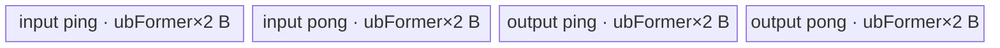
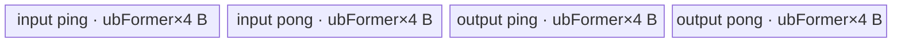

# InplaceCeil 950 ACLNN 算子知识

## 算子速览

| 项目 | 内容 |
|---|---|
| 实际入口 | `aclnnInplaceCeilGetWorkspaceSize` + `aclnnInplaceCeil`，无版本后缀的最新公开 ACLNN 两段式接口 |
| 计算语义 | 对 `selfRef` 的每个逻辑元素执行向正无穷取整，并把结果写回同一用户 Tensor 的逻辑视图 |
| 输入输出 | 单个输入/输出别名 `selfRef`；ND、维数不超过 8，可为空、可非连续；950 支持 FLOAT16、BFLOAT16、FLOAT、DOUBLE |
| 执行类型 | R-001～R-003 的核心 Ceil 节点是单 AIV_VECTOR Kernel；R-004 是单 AICPU 节点；Contiguous/ViewCopy 是框架边界 |
| Kernel 路线 | R-001 FLOAT16、R-002 BFLOAT16、R-003 FLOAT32 的 AIV MicroAPI；R-004 DOUBLE AICPU fallback |
| 核心资源 | AIV 路线使用 GM、一个 `TBuf<VEC_CALC>` 的 4 分片 ping/pong pool、MicroAPI 寄存器与 16 MiB 节点 workspace；AICPU 路线使用 GM 与 CPU `ParallelFor` |
| 来源闭包 | `source_closed`：公开 Inplace 入口、950 dtype 分发、Host/Tiling/POD、AIV entry/body、DOUBLE AICPU body、直接 atvoss 依赖及构建接线闭合；Contiguous/ViewCopy 与 AscendC primitive 内部按框架边界标注 |
| 验证状态 | 已完成源码闭包检查；本次知识提取未执行编译、真机、数值或性能测试。 |

## 接口与语义

### 计算语义

令 `N` 为 `selfRef` 逻辑 shape 的元素数。对每个逻辑索引 `i∈[0,N)`，接口执行 `selfRef[i] = ceil(selfRef[i])`。公开文档把 `selfRef` 同时定义为输入和输出；实现先取得连续输入、分配内部 Ceil 结果，再由 `ViewCopy` 提交回原用户视图，因此“原地”首先是用户可见 Tensor 对象与存储视图语义。连续 950 场景中，`ViewCopy` 可通过 tensor relation 把 workspace 结果重定向到用户存储，此时核心 Kernel 可以直接写回 `selfRef`；非连续场景仍可能有前后转换节点。

AIV body 使用 `Truncate<..., RoundMode::CAST_CEIL, ZEROING>` 做取整，再把输入符号位 OR 回输出位型。该步骤保留负零符号，并保持负值结果的符号位；NaN、Inf 和异常细节最终受固定版本 MicroAPI primitive 语义约束。公开文档声明默认确定性实现。

### 输入、输出与属性

| 参数 | shape/layout | dtype | 约束、默认值与语义 |
|---|---|---|---|
| `selfRef` | ND；逻辑维数不超过 8；可为空、可非连续 | FLOAT16、BFLOAT16、FLOAT、DOUBLE | 非空指针；同时作为输入与输出。950 由 `GetDtypeSupportListV2` 选择 RegBase 列表。 |
| `workspaceSize` | Host 标量输出 | `uint64_t*` | 第一段由 executor 汇总；空 Tensor 固定为 0。AIV Ceil 节点的 Tiling 单独请求 16 MiB，不能把该值等同于所有布局下 ACLNN 总 workspace。 |
| `executor` | Host 输出句柄 | `aclOpExecutor**` | 第一段创建并移交，持有任务序列、内部 Tensor 关系与 workspace 生命周期。 |
| `workspace` | Device 字节缓冲区 | `void*` | 第二段使用；地址与大小必须对应第一段返回的 executor。 |
| `stream` | ACL runtime stream | `aclrtStream` | `CommonOpExecutorRun` 在该 stream 上执行已排任务。 |

### 入口与版本

固定仓公开声明与文档均提供无版本后缀的 `aclnnInplaceCeilGetWorkspaceSize/aclnnInplaceCeil`，没有同语义更高版本。Inplace 第一段把同一个 `selfRef` 同时作为 `ExecCeilGetWorkspaceSize` 的 `self` 与 `out`，复用底层 Ceil 计算，但本卡不合并需独立输出对象的非原地 `aclnnCeil`。

950 支持由公开文档的 Ascend 950PR/950DT 支持表、`Ceil` OpDef 的 `ascend950` AICore config、`ceil_binary.json` 的 FLOAT16/BFLOAT16/FLOAT32 实例以及 `CMakeLists.txt` 的 `SUPPORT_COMPUTE_UNIT "ascend950"` 共同支撑。DOUBLE 不在 950 AscendC binary 中，但公开 API 允许它，`l0op::Ceil` 明确落到固定仓内的 AICPU 实现。

## Host/Launcher 执行流程

### 参数校验与前处理

调用顺序如下：

1. `aclnnInplaceCeilGetWorkspaceSize` 记录 Inplace DFX，把 `selfRef` 同时作为输入和输出调用 `ExecCeilGetWorkspaceSize`。
2. `CHECK_NOT_NULL` 检查 Tensor 指针；`CheckDtypeValid` 因输入输出为同一 Tensor而天然同 dtype，并在 950 选择 `{DOUBLE,FLOAT,FLOAT16,BFLOAT16}`；`CheckSameShape1In1Out` 检查同 shape 和最大 8 维。
3. 空 Tensor 在任何 `Contiguous/Ceil/ViewCopy` 入队前成功返回 `workspaceSize=0`，executor 仍移交调用者。
4. 非空输入调用 `l0op::Contiguous`。连续输入只创建/复用 view；非连续输入按 stride 特征选择 Slice/StridedSlice/Transpose/BroadcastTo 组合，无法优化时走 AsStrided 框架路径。
5. `l0op::Ceil` 分配同 view shape、同 dtype 的内部结果；FLOAT16/BFLOAT16/FLOAT 入队 AICore `Ceil`，DOUBLE 入队 AICPU `Ceil`。
6. `l0op::ViewCopy` 把内部结果提交回 `selfRef`。950 连续输出可通过 storage 地址重定向和 `AddTensorRelation` 消除额外搬运；非连续输出进入 ViewCopy/Transpose 等框架路线。
7. 第一段返回 `uniqueExecutor->GetWorkspaceSize()` 并移交 executor；第二段调用 `CommonOpExecutorRun(workspace, workspaceSize, executor, stream)`。

### 参数、Workspace 与生命周期

用户持有 `selfRef` 存储。`CREATE_EXECUTOR` 持有连续化结果、Ceil 内部输出、ViewCopy 参数 Tensor 与任务；`ReleaseTo(executor)` 后生命周期转交给返回句柄。AIV Ceil 的 `SetTilingData` 固定写 `workspace[0]=16777216` 字节，Kernel entry 接收但不读取 `workspace`；该 16 MiB 属核心节点的 runtime workspace 契约，不能删除。DOUBLE AICPU 路线不经过 Ceil AIV Tiling。

ACLNN 总 workspace 是 executor 汇总值：连续 950 路线中 ViewCopy 可把内部 workspace Tensor 地址重定向到用户存储，但 Ceil AIV 节点仍声明 16 MiB；非连续 Contiguous/ViewCopy 还可增加内部 Tensor 或节点 workspace。固定算子源码未给出只依赖 `N` 和 stride 的统一闭式总量。

### 启动图与失败传播

```text
aclnnInplaceCeilGetWorkspaceSize(selfRef)
  -> [N == 0] workspaceSize=0；无 Device 节点
  -> Contiguous(selfRef)                            # 框架边界；连续时仅 view
  -> l0op::Ceil(selfContiguous)
       -> R-001/R-002/R-003: ADD_TO_LAUNCHER_LIST_AICORE(Ceil)
          -> ceil(input_x, output_y, workspace, tiling)  # 单 AIV Kernel
       -> R-004: ADD_TO_LAUNCHER_LIST_AICPU(Ceil)
          -> CeilCpuKernel::Compute                      # 单 AICPU 节点
  -> ViewCopy(ceilResult, selfRef)                  # 地址重定向或框架 copy
  -> executor.GetWorkspaceSize()

aclnnInplaceCeil(workspace, executor, stream)
  -> CommonOpExecutorRun(..., stream)
```

核心 Ceil 节点只有一个 GM 输入→结果边；结果随后被 ViewCopy 消费。交接对象的逻辑 shape/dtype 与 `selfRef` 相同，owner 是 executor，直至第二段执行结束。任务由同一 executor 按 stream 排序；任一 Contiguous、Ceil launcher 或 ViewCopy 构造失败会立即返回错误，不移交完整执行图。固定 Skill 允许把自动生成 executor 壳及 Contiguous/ViewCopy 的内部多实现网络视为框架边界；其节点数、slice offset 与 workspace 取决于实际 stride，不伪造固定值。

## Route 与参数设计

### 分核与资源计算

对 R-001～R-003，`ElewiseBaseTiling` 从输出 storage shape 合轴得到 `N=∏dim`；任一维为 0 会失败，但 ACLNN 已在此前处理空 Tensor。令 `C=GetCoreNumAiv()`、`U=GetCoreMemSize(UB)` 字节。Ceil DAG 是 `CopyIn<T>→CeilCustom<T>→CopyOut<T>`，`MemLevel::LEVEL_2` 给出 2 个 MTE2 ping/pong 分片和 2 个 MTE3 ping/pong 分片，总 buffer 数 `B=4`：

- FLOAT16/BFLOAT16：`minBits=maxBits=16`，`coreNum=min(ceil(N×16/32768),C)=min(ceil(N/2048),C)`；`ubFormer=align_down(floor(U/8),128)` 元素。
- FLOAT32：`minBits=maxBits=32`，`coreNum=min(ceil(N×32/32768),C)=min(ceil(N/1024),C)`；`ubFormer=align_down(floor(U/16),64)` 元素。
- 公共分核：`blockFormer=align_up(ceil(N/coreNum),512)` 元素，`blockNum=ceil(N/blockFormer)`，`blockTail=N-(blockNum-1)×blockFormer`。
- former/tail core 分别计算 `ubLoop=ceil(blockElements/ubFormer)` 与 `ubTail=blockElements-(ubLoop-1)×ubFormer`；Host 设置 `blockDim=blockNum`。

`coreNum` 是对平台 AIV 数的初步限幅，真正 launch 数是 512 元素对齐后得到的 `blockNum`。R-004 不使用这些字段：AICPU 直接以 `data_size/sizeof(double)` 作为元素数，`ParallelFor(..., grain=1, shard)` 决定 CPU 分片。

### Route 选择

| 顺序 | Route | Key/模板 | 精确选择条件与优先级 | 不适用去向 |
|---:|---|---|---|---|
| 1 | R-001 FLOAT16 AIV | `GET_TPL_TILING_KEY(1,TPL_FP16)`；`ElementwiseSch<1,CeilDAG<half>::OpDag>` | 950、非空、`selfRef.dtype==DT_FLOAT16`；API 支持且 `IsAiCoreSupport` 在 RegBase 返回真 | BF16→R-002；FLOAT→R-003；DOUBLE→R-004；其他 dtype 参数失败 |
| 2 | R-002 BFLOAT16 AIV | `GET_TPL_TILING_KEY(1,TPL_BF16)`；`ElementwiseSch<1,CeilDAG<bfloat16_t>::OpDag>` | 950、非空、`selfRef.dtype==DT_BF16` | FLOAT→R-003；DOUBLE→R-004；其他 dtype 参数失败 |
| 3 | R-003 FLOAT32 AIV | `GET_TPL_TILING_KEY(1,TPL_FP32)`；`ElementwiseSch<1,CeilDAG<float>::OpDag>` | 950、非空、`selfRef.dtype==DT_FLOAT` | DOUBLE→R-004；其他 dtype 参数失败 |
| 4 | R-004 DOUBLE AICPU | `CeilCpuKernel::ComputeCeil<double>`；无 TilingKey | 950、非空、`selfRef.dtype==DT_DOUBLE`；API 允许但 `IsAiCoreSupport` 返回假 | 无下一 Route；AICPU dispatch/执行失败即任务失败 |

```text
if selfRef == nullptr or dtype not in {FLOAT16, BFLOAT16, FLOAT, DOUBLE} or rank > 8:
    fail ACLNN parameter check
if N == 0:
    return workspaceSize = 0
selfContiguous = Contiguous(selfRef)
if dtype == FLOAT16: enqueue AIV CeilDAG<half>          # R-001
else if dtype == BFLOAT16: enqueue AIV CeilDAG<bf16>   # R-002
else if dtype == FLOAT: enqueue AIV CeilDAG<float>     # R-003
else: enqueue AICPU ComputeCeil<double>                 # R-004
ViewCopy(result, selfRef)
```

### 模板/实现执行矩阵

| Route | key/selector | dtype/shape/platform 完整命中条件 | 执行拓扑与 Kernel 节点 | 实际模板/body | 内存与同步特征 | tail/fallback |
|---|---|---|---|---|---|---|
| R-001 FLOAT16 AIV | `(scheMode=1,dType=TPL_FP16)` | 950 RegBase；非空；FLOAT16；输入输出同 shape | 单 AIV `ceil` | `ElementwiseSch<1,CeilDAG<half>::OpDag>`→`CeilCustom<half>` | 4×`ubFormer×2` B TBuf pool；MTE2/V/MTE3 Mutex；16 MiB workspace | former/tail block 与 MicroAPI mask；Tiling 失败无 AiCore fallback |
| R-002 BFLOAT16 AIV | `(1,TPL_BF16)` | 950 RegBase；非空；BFLOAT16；输入输出同 shape | 单 AIV `ceil` | `ElementwiseSch<1,CeilDAG<bfloat16_t>::OpDag>`→`CeilCustom<bfloat16_t>` | 与 R-001 同字节布局；16 位寄存器位操作 | 同上 |
| R-003 FLOAT32 AIV | `(1,TPL_FP32)` | 950 RegBase；非空；FLOAT32；输入输出同 shape | 单 AIV `ceil` | `ElementwiseSch<1,CeilDAG<float>::OpDag>`→`CeilCustom<float>` | 4×`ubFormer×4` B；32 位寄存器位操作 | 同上 |
| R-004 DOUBLE AICPU | Host dtype selector | 950；非空；DOUBLE；AiCore support 谓词为假 | 单 AICPU Ceil 节点 | `CeilCpuKernel::Compute`→`ComputeCeil<double>` | 无 AIV UB/POD；CPU worker 读写 GM map | `ParallelFor` 覆盖 `[0,N)`；无 fallback |

### 隐藏性能 Guard

| Guard | Host/Tiling 条件 | Device/资源原因 | 影响 Route | 不满足时去向 | 源码符号 |
|---|---|---|---|---|---|
| 空域提前返回 | `self->IsEmpty()` | 通用 Elewise Tiling拒绝 0 维并假定至少一次 tail loop | 全部 | 成功返回 0 workspace、无 Device 节点 | `math/ceil/op_api/aclnn_ceil.cpp::ExecCeilGetWorkspaceSize` |
| API dtype | 950 `GetDtypeSupportListV2` 返回 `{DOUBLE,FLOAT,FLOAT16,BFLOAT16}` | 限定公开可达实现集 | 全部 | `ACLNN_ERR_PARAM_INVALID` | `common/inc/op_api/level2_base.h::GetDtypeSupportListV2`；`CheckDtypeValid` |
| AiCore/AICPU 分发 | RegBase 且 dtype∈{FLOAT,FLOAT16,BFLOAT16} | 950 binary 与 entry 仅实例化三种 dtype | R-001～R-004 | DOUBLE 进入 AICPU；其他 dtype 已被 API 阻断 | `math/ceil/op_api/ceil.cpp::IsAiCoreSupport/Ceil` |
| AIV core 数 | `C!=0` | `coreNum` 是后续除数和 launch 上界 | R-001～R-003 | `ElewiseTiling` 失败 | `opbase:src/op_common/atvoss/elewise/elewise_tiling.cpp::ElewiseTiling` |
| UB tile | `ubFormer=align_down(floor(U/(4×sizeof(T))),256/sizeof(T))>0` | 4 个等长 pool 分片且 tile 对齐到一个 256 B repeat | R-001～R-003 | `ElewiseTiling` 失败 | `GetMaxElemNum`；`DAGSch::BufferNum` |
| 512 元素分核对齐 | `blockFormer=align_up(ceil(N/coreNum),512)` | 通用 scheduler 的 block 起点与 former/tail字段按此生成 | R-001～R-003 | 无替代 Route | `ElewiseTiling` |
| MicroAPI mask | `loopNum=ceil(count/(VECTOR_REG_WIDTH/sizeof(T)))`；逐轮 `UpdateMask(count)` | 防止尾向量无效 lane 被写回 GM | R-001～R-003 | 不满足需改写 body；固定实现无 fallback | `CeilDag1::CeilCustom` |
| AICPU dtype | `switch(data_type)` 仅 F16/F32/DOUBLE；本 Route 为 DOUBLE | BF16 不可落到 AICPU | R-004 | 未知 dtype 返回参数错误 | `CeilCpuKernel::Compute` |

### POD/ABI

`CeilTilingData` 只包装自然布局的 `EleBaseTilingData baseTiling`，因此 `sizeof=80`、`alignof=8`；offset 由字段声明顺序和标准自然对齐确定。R-004 不消费此 POD。

| 结构 | 字段 | 类型/位宽 | ABI 布局 | 单位 | Host/launcher producer | Device consumer | 边界 |
|---|---|---|---|---|---|---|---|
| `CeilTilingData.baseTiling` | `dim0` | `int64_t`/64 | offset 0，size 8 | 元素 | `ElewiseTiling`: storage shape 各维乘积 | 当前 scheduler 未读取 | 0 维失败；乘法溢出检查固定仓不可见 |
| 同上 | `coreNum` | `int32_t`/32 | offset 8，size 4 | AIV core | `AdaptEleBaseTilingData`: `static_cast<int32_t>(coreNum)` | 当前 scheduler 未读取 | 真正 blockDim 是独立的 `blockNum` |
| 同上 | `ubFormer` | `int32_t`/32 | offset 12，size 4 | 元素/tile | `AdaptEleBaseTilingData`: `maxElemNum` 窄化 | `Init/Process`: pool、`blockLen`、整 tile count | 必须非 0；int64→int32 上界检查固定仓不可见 |
| 同上 | `blockFormer` | `int64_t`/64 | offset 16，size 8 | 元素/core block | `align_up(ceil(N/coreNum),512)` | `CalcBlockOffset`: `blockFormer×blockIdx×sizeof(T)` | 最后一核有效数可更小 |
| 同上 | `blockNum` | `int64_t`/64 | offset 24，size 8 | AIV block | `ceil(N/blockFormer)`；`SetBlockDim` 取同值 | `Process` 判断最后 block | launch blockDim 必须一致 |
| 同上 | `ubLoopOfFormerBlock` | `int64_t`/64 | offset 32，size 8 | tile loop | `ceil(blockFormer/ubFormer)` | 非末 block 的 `loopNum` | 至少 1 |
| 同上 | `ubLoopOfTailBlock` | `int64_t`/64 | offset 40，size 8 | tile loop | `ceil(blockTail/ubFormer)` | 末 block 的 `loopNum` | 至少 1 |
| 同上 | `ubTailOfFormerBlock` | `int64_t`/64 | offset 48，size 8 | 有效元素 | `blockFormer-(loops-1)×ubFormer` | 非末 block 最后一轮 `tileLength` | `1..ubFormer` |
| 同上 | `ubTailOfTailBlock` | `int64_t`/64 | offset 56，size 8 | 有效元素 | `blockTail-(loops-1)×ubFormer` | 末 block 最后一轮 `tileLength` | `1..ubFormer` |
| 同上 | `elemNum` | `int64_t`/64 | offset 64，size 8 | 元素 | `maxElemNum` | 当前 scheduler 未读取 | 等于 producer 侧 `ubFormer` 的 int64 值 |
| 同上 | `scheMode` | `uint64_t`/64 | offset 72，size 8 | 调度枚举 | `GetScheMode()` 固定返回 1 | `SetTilingData` 生成编译期 key；scheduler runtime 未读 | 模板声明的 mode 0 不可由当前 Host 到达 |

### Route 源码闭包

| Route | Key/selector | Host/Tiling producer | POD/参数 | Kernel entry/router 节点 | Kernel body/直接依赖 | 构建接线 |
|---|---|---|---|---|---|---|
| R-001 FLOAT16 AIV | API/AiCore dtype selector；`GET_TPL_TILING_KEY(1,1)` | `aclnn_ceil.cpp::ExecCeilGetWorkspaceSize`；`ceil.cpp::Ceil`；`CeilTiling::RunTiling` | `CeilTilingData`/`EleBaseTilingData` | `ceil_apt.cpp::ceil<1,TPL_FP16>` | `CeilDAG<half>`；`ElementwiseSch`；`CeilCustom<half>` | `ceil_def.cpp`；`ceil_binary.json`；`math/ceil/CMakeLists.txt` |
| R-002 BFLOAT16 AIV | 同上；`GET_TPL_TILING_KEY(1,2)` | 同上；Tiling 选择 `CeilDAG<bfloat16_t>` | 同一 POD | `ceil<1,TPL_BF16>` | `CeilDAG<bfloat16_t>`；通用 scheduler | 同上 |
| R-003 FLOAT32 AIV | 同上；`GET_TPL_TILING_KEY(1,3)` | 同上；Tiling 选择 `CeilDAG<float>` | 同一 POD | `ceil<1,TPL_FP32>` | `CeilDAG<float>`；通用 scheduler | 同上 |
| R-004 DOUBLE AICPU | `IsAiCoreSupport(DOUBLE)==false` | `ceil.cpp::Ceil/CeilAiCpu` | AICPU task context；无 Tiling POD | `ADD_TO_LAUNCHER_LIST_AICPU(Ceil)`→`CeilCpuKernel::Compute` | `ComputeCeil<double>`；Eigen map；`CpuKernelUtils::ParallelFor` | `ceil_aicpu_def.cpp`；`func.cmake::add_all_modules_sources` |

## Kernel 实现

### 公共执行流程

非空 Route 共享 `Contiguous→Ceil→ViewCopy`。R-001～R-003 的 entry 解析同一 POD，声明 `KERNEL_TYPE_AIV_ONLY`，构造 `TPipe` 与对应 dtype 的 `ElementwiseSch`；每个 AIV block 绑定 `blockFormer×blockIdx` 的 GM 基址，以 `ubFormer` 为整 tile，最后一轮只处理 POD 指定的有效 tail。DAG 调用顺序固定为 `CopyIn→CeilCustom→CopyOut`。R-004 不启动 AIV，而在 AICPU 上把输入、输出映射为一维 Eigen row vector，并由 `ParallelFor` 分片执行 `array().ceil()`。

Contiguous/ViewCopy 的内部节点由 stride 与 workspace relation 决定，属于框架边界；它们和核心 Ceil 节点由同一个 executor/stream 排序。

### Route R-001：FLOAT16 AIV

#### 适用条件

##### 选择证据

| 层级 | 文件 | 符号 | 源码谓词/参数 | 结果/下一跳 |
|---|---|---|---|---|
| API | `math/ceil/op_api/aclnn_ceil.cpp` | `CheckDtypeValid` | 950 dtype list 包含 FLOAT16 | 通过 Inplace 复用校验 |
| Host selector | `math/ceil/op_api/ceil.cpp` | `IsAiCoreSupport/Ceil` | `IsRegBase(curArch)` 且 FLOAT16 在 AiCore list | `CeilAiCore` |
| Tiling | `math/ceil/op_host/arch35/ceil_tiling_arch35.cpp` | `CeilTiling::RunTiling` | `outputDtype==DT_FLOAT16` | `dType=TPL_FP16`；`DoTiling<CeilDAG<half>::OpDag>` |
| Router | `math/ceil/op_kernel/ceil_apt.cpp` | `ceil<schMode,dType>` | `dType==TPL_FP16`，Host `schMode=1` | `ElementwiseSch<1,CeilDAG<half>::OpDag>` |

#### Device 数据流

##### 函数级调用链

```text
ADD_TO_LAUNCHER_LIST_AICORE(Ceil, selfContiguous, ceilResult)
  -> Tiling4Ceil -> CeilTiling::RunTiling
     -> ElewiseBaseTiling::DoTiling<CeilDAG<half>::OpDag>
  -> ceil<1,TPL_FP16>(input_x, output_y, workspace, tiling)
     -> ElementwiseSch::Init(input_x, output_y)
     -> ElementwiseSch::Process
        -> Vec::CopyIn<half> -> DataCopyPad(GM, UB, count*2 B)
        -> CeilCustom<half>(dstUB, srcUB, count)
           -> MicroAPI DataCopy -> Truncate<CAST_CEIL,ZEROING>
           -> Duplicate(0x8000) -> And(input sign) -> Or(output)
           -> MicroAPI DataCopy(dstUB, mask)
        -> Vec::CopyOut<half> -> DataCopyPad(UB, GM, count*2 B)
  -> ViewCopy(ceilResult, selfRef)
```

##### 源码等价伪码

```text
# 源码等价伪码
coreBase = blockFormer * blockIdx
loopNum = isLastBlock ? ubLoopOfTailBlock : ubLoopOfFormerBlock
tailNum = isLastBlock ? ubTailOfTailBlock : ubTailOfFormerBlock
for tile in [0, loopNum):
    count = (tile == loopNum-1) ? tailNum : ubFormer
    offset = tile * ubFormer
    inputBuf[pingpong] = GM_input[coreBase + offset : +count]
    vl = VECTOR_REG_WIDTH / 2
    for regLoop in [0, ceil(count/vl)):
        mask = UpdateMask<half>(remaining count)
        vin = load inputBuf[regLoop*vl]
        rounded = truncate_ceil_zeroing(vin, mask)
        bits = bits(rounded) | (bits(vin) & 0x8000)
        store outputBuf[regLoop*vl] = bits, masked
    GM_output[coreBase + offset : +count] = outputBuf[pingpong]
```

#### 内存与数据搬运

##### 资源与搬运表

| 层级/缓冲区 | offset/地址公式 | extent/容量公式 | dtype/layout | producer | consumer | owner/lifetime | 对齐/复用 |
|---|---|---|---|---|---|---|---|
| GM input | `(blockFormer×blockIdx+tile×ubFormer)×2` B | `count×2` B | FLOAT16/ND linear | Contiguous/user storage | `Vec::CopyIn` | caller/executor；Kernel 全程 | 每 core 域不重叠 |
| TBuf input ping/pong | `bufId×blockLen` | 每片 `ubFormer×2` B | half | MTE2 `DataCopyPad` | `CeilCustom` V pipe | `TPipe`；按 tile 交替 | 2 片；256 B tile 对齐 |
| MicroAPI registers | register-local | `vl=VECTOR_REG_WIDTH/2` lanes | half + uint16 mask/bits | UB load/Truncate | bitwise + UB store | 单次 regLoop | 尾 mask；固定仓不公开物理寄存器字节 |
| TBuf output ping/pong | `bufId×blockLen` | 每片 `ubFormer×2` B | half | `CeilCustom` | MTE3 `DataCopyPad` | `TPipe`；写出后复用 | 2 片；仅写有效 mask |
| GM output | 同 core/tile 元素 offset | `count×2` B | FLOAT16/ND linear | CopyOut | ViewCopy/user | executor/user | 连续 Inplace 可与 GM input 同地址 |
| Ceil workspace | runtime 分配 | 16777216 B | opaque bytes | Host Tiling | entry 参数未读取 | executor；节点执行期 | 固定 16 MiB，不得当 UB |

##### 分层内存布局



##### 字节账与复用顺序

```text
blockLen = ubFormer * 2 B
UB_total = 4 * blockLen = 8 * ubFormer B
ubFormer = align_down(floor(U / 8), 128 elements)
UB_total <= U
dynamic_ub = N/A
workspace_total(core Ceil node) = 16777216 B
=> ubFormer > 0；整 tile 按 256 B repeat 对齐
```

| 复用子区 | 写入者 | 读取者/消费点 | 下一次覆盖 | 同步或释放依据 | 安全条件 |
|---|---|---|---|---|---|
| input ping/pong | MTE2 CopyIn | V `CeilCustom` | 同 parity 的下下个 tile | `GetTensor/ReleaseTensor<VECIN>` 与 `VECCALC` Mutex | V 消费完才允许 MTE2 重写 |
| output ping/pong | V `CeilCustom` | MTE3 CopyOut | 同 parity 的下下个 tile | `VECCALC` 与 `VECOUT` Mutex | MTE3 搬出完才允许 V 重写 |
| 连续用户存储 | CopyOut | 后续 tile/调用者 | 当前 tile 输入已搬入后可覆盖 | DAG 顺序 CopyIn→Compute→CopyOut | core/tile 域不重叠且每 tile 先读后写 |

#### 同步、精度与尾块

##### 同步与数值边界表

| 阶段 | primitive/机制 | producer | consumer/等待点 | 保护对象 | 精度/尾块 |
|---|---|---|---|---|---|
| GM→UB | MTE2 Mutex + `DataCopyPad` | GM | V 获取 input buf | input ping/pong | `blockCount=1`、`blockLen=count×2` B，无 padding |
| 取整 | V Mutex + MicroAPI mask | CopyIn | CopyOut 获取 output buf | input/output buf | half 原 dtype `CAST_CEIL`；最后寄存器仅有效 mask |
| 符号恢复 | `And/Or` 位操作 | 输入位型、取整位型 | masked store | 16 位结果 | 输入符号位 `0x8000` 被保留，尤其保留 `-0` |
| UB→GM | MTE3 Mutex + `DataCopyPad` | V output | GM/ViewCopy | output ping/pong | 仅 `count×2` B；末 tile 使用 POD tail |

#### 关键实现

##### 符号证据表

| 阶段 | 文件 | 符号/模板实例 | 实现事实 |
|---|---|---|---|
| Host/Tiling producer | `math/ceil/op_host/arch35/ceil_tiling_arch35.cpp` | `CeilTiling::RunTiling/SetTilingData` | 选择 half DAG，生成 key/blockDim/16 MiB workspace |
| Kernel entry/router | `math/ceil/op_kernel/ceil_apt.cpp` | `ceil<1,TPL_FP16>` | AIV-only，解析 POD 并实例化 scheduler |
| Device body/helper | `math/ceil/op_kernel/arch35/ceil_dag.h` | `CeilDAG<half>/CeilCustom<half>` | `CAST_CEIL`、符号位恢复、masked store |
| Scheduler/helper | `opbase:pkg_inc/op_common/atvoss/elewise/elewise_sch.h`；`pkg_inc/op_common/atvoss/util/vec.h`；`pkg_inc/op_common/atvoss/util/sync.h` | `ElementwiseSch`；`Vec::CopyIn/CopyOut` | core/tile offset、4 分片 pool、DMA 与 Mutex 生命周期 |

### Route R-002：BFLOAT16 AIV

#### 适用条件

##### 选择证据

| 层级 | 文件 | 符号 | 源码谓词/参数 | 结果/下一跳 |
|---|---|---|---|---|
| API | `math/ceil/op_api/aclnn_ceil.cpp` | `CheckDtypeValid` | RegBase dtype list 包含 BFLOAT16 | 通过校验 |
| Host selector | `math/ceil/op_api/ceil.cpp` | `IsAiCoreSupport/Ceil` | RegBase 且 BF16 在 AiCore list | `CeilAiCore` |
| Tiling | `math/ceil/op_host/arch35/ceil_tiling_arch35.cpp` | `CeilTiling::RunTiling` | `outputDtype==DT_BF16` | `dType=TPL_BF16`；`DoTiling<CeilDAG<bfloat16_t>::OpDag>` |
| Router | `math/ceil/op_kernel/ceil_apt.cpp` | `ceil<schMode,dType>` | `dType==TPL_BF16`，Host `schMode=1` | `ElementwiseSch<1,CeilDAG<bfloat16_t>::OpDag>` |

#### Device 数据流

##### 函数级调用链

```text
ADD_TO_LAUNCHER_LIST_AICORE(Ceil, selfContiguous, ceilResult)
  -> CeilTiling::RunTiling
     -> ElewiseBaseTiling::DoTiling<CeilDAG<bfloat16_t>::OpDag>
  -> ceil<1,TPL_BF16>(input_x, output_y, workspace, tiling)
     -> ElementwiseSch::Init/Process
        -> Vec::CopyIn<bfloat16_t>
        -> CeilCustom<bfloat16_t>
           -> DataCopy(vregInput) -> Truncate<CAST_CEIL,ZEROING>
           -> Duplicate<uint16_t>(0x8000) -> And(input) -> Or(rounded)
           -> DataCopy(dstUB, bits, mask)
        -> Vec::CopyOut<bfloat16_t>
  -> ViewCopy(ceilResult, selfRef)
```

##### 源码等价伪码

```text
# 源码等价伪码
coreBase = blockFormer * blockIdx
loopNum, tailNum = select former/tail fields by (blockIdx == blockNum-1)
for tile in [0, loopNum):
    count = lastTile ? tailNum : ubFormer
    offset = tile * ubFormer
    copy count BF16 elements from GM[coreBase+offset] to inputBuf[tile&1]
    vl = VECTOR_REG_WIDTH / 2
    for regLoop in [0, ceil(count/vl)):
        mask = UpdateMask<bfloat16_t>(remaining count)
        vin = masked UB load
        rounded = Truncate<BF16, CAST_CEIL, ZEROING>(vin, mask)
        resultBits = bits(rounded) | (bits(vin) & 0x8000)
        masked store resultBits to outputBuf[tile&1]
    copy count BF16 elements to GM_output[coreBase+offset]
```

#### 内存与数据搬运

##### 资源与搬运表

| 层级/缓冲区 | offset/地址公式 | extent/容量公式 | dtype/layout | producer | consumer | owner/lifetime | 对齐/复用 |
|---|---|---|---|---|---|---|---|
| GM input | `(blockFormer×blockIdx+tile×ubFormer)×2` B | `count×2` B | BF16/ND linear | Contiguous/user | CopyIn | caller/executor | core 域不重叠 |
| input pool ping/pong | `bufId×(ubFormer×2)` | 每片 `ubFormer×2` B | bfloat16_t | MTE2 | `CeilCustom` | TPipe/tile | 2 片，256 B 粒度 |
| registers | register-local | `VECTOR_REG_WIDTH/2` lanes | BF16 + uint16 | UB load/Truncate | bitwise/store | regLoop | masked tail；物理字节固定仓不可见 |
| output pool ping/pong | 对应 MTE3 bufId | 每片 `ubFormer×2` B | bfloat16_t | `CeilCustom` | CopyOut | TPipe/tile | 2 片，写出后复用 |
| GM output | 同元素 offset | `count×2` B | BF16/ND linear | CopyOut | ViewCopy/user | executor/user | 连续 Inplace 可与 input 别名 |
| Ceil workspace | runtime 地址 | 16777216 B | opaque | Tiling | entry 未读 | executor | 与 UB 分离 |

##### 分层内存布局


##### 字节账与复用顺序

```text
blockLen = ubFormer * 2 B
UB_total = 4 * blockLen = 8 * ubFormer B
ubFormer = align_down(floor(U / 8), 128 elements)
UB_total <= U
dynamic_ub = N/A
workspace_total(core node) = 16777216 B
```

| 复用子区 | 写入者 | 读取者/消费点 | 下一次覆盖 | 同步或释放依据 | 安全条件 |
|---|---|---|---|---|---|
| input ping/pong | MTE2 | V | 下下个 tile | VECIN/VECCALC Mutex | 当前 V 消费完成 |
| output ping/pong | V | MTE3 | 下下个 tile | VECCALC/VECOUT Mutex | 当前搬出完成 |
| 用户 GM（可能别名） | MTE3 | 调用者 | Kernel 后续 | 当前 tile CopyIn 先于 CopyOut | tile/core 写域互斥 |

#### 同步、精度与尾块

##### 同步与数值边界表

| 阶段 | primitive/机制 | producer | consumer/等待点 | 保护对象 | 精度/尾块 |
|---|---|---|---|---|---|
| 搬入 | `DataCopyPad` + MTE2 Mutex | GM | V | input slice | 单段 `count×2` B |
| 计算 | BF16 `CAST_CEIL` + V Mutex | input slice | output slice | register/UB | 不升精度；mask 控制尾 lane |
| 符号位 | uint16 `And/Or` | 原输入与 rounded | masked UB store | BF16 bit pattern | OR 回 bit15，保留负零 |
| 搬出 | `DataCopyPad` + MTE3 Mutex | output slice | GM | output slice | 仅 tail 有效元素 |

#### 关键实现

##### 符号证据表

| 阶段 | 文件 | 符号/模板实例 | 实现事实 |
|---|---|---|---|
| Host/Tiling producer | `math/ceil/op_host/arch35/ceil_tiling_arch35.cpp` | `CeilTiling::RunTiling` | BF16 分支、POD、key、blockDim |
| Kernel entry/router | `math/ceil/op_kernel/ceil_apt.cpp` | `ceil<1,TPL_BF16>` | AIV-only BF16 scheduler |
| Device body/helper | `math/ceil/op_kernel/arch35/ceil_dag.h` | `CeilCustom<bfloat16_t>` | 16 位 MicroAPI 与符号恢复 |
| Scheduler/helper | `opbase:pkg_inc/op_common/atvoss/elewise/elewise_sch.h`；`pkg_inc/op_common/atvoss/util/vec.h`；`pkg_inc/op_common/atvoss/util/sync.h` | `ElementwiseSch` | tile、DMA、buffer id 与 pipe 锁 |

### Route R-003：FLOAT32 AIV

#### 适用条件

##### 选择证据

| 层级 | 文件 | 符号 | 源码谓词/参数 | 结果/下一跳 |
|---|---|---|---|---|
| API | `math/ceil/op_api/aclnn_ceil.cpp` | `CheckDtypeValid` | 950 dtype list 包含 FLOAT | 通过校验 |
| Host selector | `math/ceil/op_api/ceil.cpp` | `IsAiCoreSupport/Ceil` | RegBase 且 FLOAT 在 AiCore list | `CeilAiCore` |
| Tiling | `math/ceil/op_host/arch35/ceil_tiling_arch35.cpp` | `CeilTiling::RunTiling` | `outputDtype==DT_FLOAT` | `dType=TPL_FP32`；`DoTiling<CeilDAG<float>::OpDag>` |
| Router | `math/ceil/op_kernel/ceil_apt.cpp` | `ceil<schMode,dType>` | `dType==TPL_FP32`，Host `schMode=1` | `ElementwiseSch<1,CeilDAG<float>::OpDag>` |

#### Device 数据流

##### 函数级调用链

```text
ADD_TO_LAUNCHER_LIST_AICORE(Ceil, selfContiguous, ceilResult)
  -> CeilTiling::RunTiling
     -> ElewiseBaseTiling::DoTiling<CeilDAG<float>::OpDag>
  -> ceil<1,TPL_FP32>(input_x, output_y, workspace, tiling)
     -> ElementwiseSch::Init/Process
        -> Vec::CopyIn<float>
        -> CeilCustom<float>
           -> DataCopy(vregInput) -> Truncate<CAST_CEIL,ZEROING>
           -> Duplicate<uint32_t>(0x80000000) -> And(input) -> Or(rounded)
           -> DataCopy(dstUB, bits, mask)
        -> Vec::CopyOut<float>
  -> ViewCopy(ceilResult, selfRef)
```

##### 源码等价伪码

```text
# 源码等价伪码
coreBase = blockFormer * blockIdx
loopNum, tailNum = former/tail POD fields
for tile in [0, loopNum):
    count = lastTile ? tailNum : ubFormer
    offset = tile * ubFormer
    copy count FP32 values into inputBuf[tile&1]
    vl = VECTOR_REG_WIDTH / 4
    for regLoop in [0, ceil(count/vl)):
        mask = UpdateMask<float>(remaining count)
        vin = masked UB load
        rounded = Truncate<float, CAST_CEIL, ZEROING>(vin, mask)
        resultBits = bits(rounded) | (bits(vin) & 0x80000000)
        masked store resultBits to outputBuf[tile&1]
    copy count FP32 values to GM_output[coreBase+offset]
```

#### 内存与数据搬运

##### 资源与搬运表

| 层级/缓冲区 | offset/地址公式 | extent/容量公式 | dtype/layout | producer | consumer | owner/lifetime | 对齐/复用 |
|---|---|---|---|---|---|---|---|
| GM input | `(blockFormer×blockIdx+tile×ubFormer)×4` B | `count×4` B | FP32/ND linear | Contiguous/user | CopyIn | caller/executor | core 域不重叠 |
| input pool ping/pong | `bufId×(ubFormer×4)` | 每片 `ubFormer×4` B | float | MTE2 | `CeilCustom` | TPipe/tile | 2 片，256 B 粒度 |
| registers | register-local | `VECTOR_REG_WIDTH/4` lanes | float + uint32 | UB load/Truncate | bitwise/store | regLoop | tail mask；物理容量固定仓不可见 |
| output pool ping/pong | MTE3 bufId | 每片 `ubFormer×4` B | float | `CeilCustom` | CopyOut | TPipe/tile | 2 片，写出后复用 |
| GM output | 同元素 offset | `count×4` B | FP32/ND linear | CopyOut | ViewCopy/user | executor/user | 连续 Inplace 可别名 input |
| Ceil workspace | runtime 地址 | 16777216 B | opaque | Tiling | entry 未读 | executor | 固定契约 |

##### 分层内存布局



##### 字节账与复用顺序

```text
blockLen = ubFormer * 4 B
UB_total = 4 * blockLen = 16 * ubFormer B
ubFormer = align_down(floor(U / 16), 64 elements)
UB_total <= U
dynamic_ub = N/A
workspace_total(core node) = 16777216 B
```

| 复用子区 | 写入者 | 读取者/消费点 | 下一次覆盖 | 同步或释放依据 | 安全条件 |
|---|---|---|---|---|---|
| input ping/pong | MTE2 | V | 下下个 tile | VECIN/VECCALC Mutex | V 已消费 |
| output ping/pong | V | MTE3 | 下下个 tile | VECCALC/VECOUT Mutex | MTE3 已搬出 |
| 用户 GM（可能别名） | MTE3 | 调用者 | Kernel 后续 | tile 内先 CopyIn 后 CopyOut | core/tile 域不重叠 |

#### 同步、精度与尾块

##### 同步与数值边界表

| 阶段 | primitive/机制 | producer | consumer/等待点 | 保护对象 | 精度/尾块 |
|---|---|---|---|---|---|
| 搬入 | MTE2 Mutex + `DataCopyPad` | GM | V | input slice | `count×4` B |
| 计算 | FP32 `CAST_CEIL` + V Mutex | input | output | register/UB | 原 FP32 精度；masked tail |
| 符号位 | uint32 `And/Or` | input/rounded | store | FP32 bit pattern | OR 回 bit31，保留负零 |
| 搬出 | MTE3 Mutex + `DataCopyPad` | output | GM | output slice | POD tail 控制有效字节 |

#### 关键实现

##### 符号证据表

| 阶段 | 文件 | 符号/模板实例 | 实现事实 |
|---|---|---|---|
| Host/Tiling producer | `math/ceil/op_host/arch35/ceil_tiling_arch35.cpp` | `CeilTiling::RunTiling` | FLOAT 分支、资源公式与 key |
| Kernel entry/router | `math/ceil/op_kernel/ceil_apt.cpp` | `ceil<1,TPL_FP32>` | AIV-only FP32 scheduler |
| Device body/helper | `math/ceil/op_kernel/arch35/ceil_dag.h` | `CeilCustom<float>` | 32 位 MicroAPI 取整和符号恢复 |
| Scheduler/helper | `opbase:pkg_inc/op_common/atvoss/elewise/elewise_sch.h`；`pkg_inc/op_common/atvoss/util/vec.h`；`pkg_inc/op_common/atvoss/util/sync.h` | `ElementwiseSch` | 地址、ping/pong、DMA、Mutex |

### Route R-004：DOUBLE AICPU

#### 适用条件

##### 选择证据

| 层级 | 文件 | 符号 | 源码谓词/参数 | 结果/下一跳 |
|---|---|---|---|---|
| API | `math/ceil/op_api/aclnn_ceil.cpp` | `CheckDtypeValid` | 950 RegBase list 包含 DOUBLE | 通过公开接口校验 |
| Host selector | `math/ceil/op_api/ceil.cpp` | `IsAiCoreSupport` | DOUBLE 不在 `{FLOAT,FLOAT16,BFLOAT16}` | 返回 false |
| Launcher | `math/ceil/op_api/ceil.cpp` | `Ceil/CeilAiCpu` | `IsAiCoreSupport(self)==false` | `ADD_TO_LAUNCHER_LIST_AICPU(Ceil)` |
| AICPU router | `math/ceil/op_kernel_aicpu/ceil_aicpu.cpp` | `CeilCpuKernel::Compute` | `data_type==DT_DOUBLE` | `ComputeCeil<double>` |

#### Device 数据流

##### 函数级调用链

```text
ADD_TO_LAUNCHER_LIST_AICPU(Ceil, selfContiguous, ceilResult)
  -> CeilCpuKernel::Compute(ctx)
     -> check one input / one output and non-null Tensor pointers
     -> data_size = x->GetDataSize()
     -> switch(DT_DOUBLE)
        -> ComputeCeil<double>(x, y, data_size, ctx)
           -> map_x = Eigen::Map<Matrix<double,1,Dynamic>>(x_addr, N)
           -> map_y = Eigen::Map<Matrix<double,1,Dynamic>>(y_addr, N)
           -> CpuKernelUtils::ParallelFor(ctx, N, 1, shard)
              -> map_y[start:end] = ceil(map_x[start:end])
  -> ViewCopy(ceilResult, selfRef)
```

##### 源码等价伪码

```text
# 源码等价伪码
require inputs == 1 and outputs == 1
x = ctx.Input(0); y = ctx.Output(0)
require x != null and y != null
require x.dtype == DOUBLE
N = x.GetDataSize() / sizeof(double)
shard(start, end):
    for i in [start, end):
        y[i] = ceil(x[i])
ret = ParallelFor(ctx, N, grain=1, shard)
if ret != OK: return INNER_ERROR
return OK
```

#### 内存与数据搬运

##### 资源与搬运表

| 层级/缓冲区 | offset/地址公式 | extent/容量公式 | dtype/layout | producer | consumer | owner/lifetime | 对齐/复用 |
|---|---|---|---|---|---|---|---|
| AICPU input GM | `x_addr + start×8` B | `(end-start)×8` B | DOUBLE linear map | Contiguous/user | Eigen shard | caller/executor；task 期间 | shard 区间不重叠 |
| AICPU output GM | `y_addr + start×8` B | `(end-start)×8` B | DOUBLE linear map | Eigen `ceil` | ViewCopy/user | executor/user | 连续 Inplace 可与 input 同址；逐元素读后写 |
| CPU shard state | Host/AICPU runtime | `[start,end)` indices | integer metadata | `ParallelFor` | lambda | task-local | grain 参数为 1；实际 worker 数固定仓不可见 |
| AIV UB/TBuf | N/A | N/A | N/A | N/A | N/A | N/A | 本 Route 不启动 AIV |
| Ceil node workspace | N/A | 固定 AICPU 路线没有 Ceil Tiling/POD 声明 | N/A | AICPU launcher | AICPU runtime | executor | ACLNN 框架前后处理仍可有 workspace |

##### 分层内存布局

N/A：该 Route 不使用 AIV UB、dynamic UB 或 NDDMA buffer；真实替代路径是 AICPU 对输入/输出 GM 的不重叠 `[start,end)` CPU 分片。

##### 字节账与复用顺序

```text
UB_total = N/A
dynamic_ub = N/A
core_Ceil_workspace = N/A; fixed AICPU route has no Ceil Tiling workspace declaration
ACLNN workspace_total = executor aggregation for Contiguous/result/ViewCopy; fixed source has no closed formula
N = data_size / 8 elements
```

| 复用子区 | 写入者 | 读取者/消费点 | 下一次覆盖 | 同步或释放依据 | 安全条件 |
|---|---|---|---|---|---|
| `[start,end)` output | shard lambda | ViewCopy/用户 | task 完成后 | `ParallelFor` 返回后 `ComputeCeil` 返回 | 各 shard 区间不重叠 |
| 同址 input/output（连续 Inplace） | lambda element store | 同一 shard 后续元素 | 当前元素写回 | 表达式先读 `map_x` 再赋 `map_y` | 操作为逐元素、无跨元素依赖 |

#### 同步、精度与尾块

##### 同步与数值边界表

| 阶段 | primitive/机制 | producer | consumer/等待点 | 保护对象 | 精度/尾块 |
|---|---|---|---|---|---|
| AICPU 分片 | `CpuKernelUtils::ParallelFor` | runtime shard scheduler | `ParallelFor` 返回 | 输出区间 | grain=1；最后 shard 自然覆盖余数 |
| DOUBLE 取整 | Eigen `array().ceil()` | `map_x[start:end]` | `map_y` assignment | 当前 shard | 保持 DOUBLE；无 cast |
| 节点间排序 | executor/stream | AICPU Ceil | ViewCopy/调用完成 | GM 结果 | 具体 runtime event 为框架边界 |
| 错误传播 | status return | `ParallelFor` | `Compute` | 整个节点 | 非 OK 转 `KERNEL_STATUS_INNER_ERROR` |

#### 关键实现

##### 符号证据表

| 阶段 | 文件 | 符号/模板实例 | 实现事实 |
|---|---|---|---|
| Host/Launcher producer | `math/ceil/op_api/ceil.cpp` | `IsAiCoreSupport/CeilAiCpu` | DOUBLE 选择 AICPU task |
| Kernel entry/router | `math/ceil/op_kernel_aicpu/ceil_aicpu.cpp` | `CeilCpuKernel::Compute` | 一入一出校验与 dtype switch |
| Device body/helper | 同上 | `ComputeCeil<double>` | Eigen DOUBLE ceil 与 `ParallelFor(grain=1)` |
| 构建/注册 | `math/ceil/op_kernel_aicpu/ceil_aicpu_def.cpp`；`cmake/func.cmake` | `OP_ADD(Ceil)`；AICPU source glob | FLOAT/F16/DOUBLE AICPU 注册与条件构建接线 |

## 算子特定优化

### Trick T-001：取整后恢复输入符号位

#### 触发与源码依据

- 适用 Route：R-001、R-002、R-003。
- 触发条件：950 AIV dtype 分支进入 `CeilCustom<T>`；FLOAT 使用 32 位掩码，FLOAT16/BFLOAT16 使用 16 位掩码。
- Golden 来源：[`math/ceil/op_kernel/arch35/ceil_dag.h:53-61`](../../../../../../../cann-ops-raw/ascendc/ops-math/165d41f02a43a62324b434cb6bda7c533b14da3e/math/ceil/op_kernel/arch35/ceil_dag.h#L53-L61)

**官方源码（固定 Commit 连续逐字摘录）**：

```cpp
MicroAPI::Truncate<T, RoundMode::CAST_CEIL, MicroAPI::MaskMergeMode::ZEROING>(
    vregOutput, vregInput, mask);
MicroAPI::Duplicate(vregOutInt, UINT32_SIGN, mask);
MicroAPI::And(vregOutInt, vregOutInt, (MicroAPI::RegTensor<uint32_t>&)vregInput, mask);
MicroAPI::Or(vregOutInt, vregOutInt, (MicroAPI::RegTensor<uint32_t>&)vregOutput, mask);
```

#### 机制与设计原因

`Truncate` 直接在原 dtype 寄存器上按 `CAST_CEIL` 取整；随后构造纯符号位常量，与输入位型 AND 得到原输入 sign bit，再与取整结果 OR。该机制不增加 GM/UB 中间 Tensor，只用寄存器位操作修复符号语义，尤其避免 `ceil(-0)` 丢失负零。16 位路线使用 `0x8000`/`RegTensor<uint16_t>`，32 位路线使用 `0x80000000`/`RegTensor<uint32_t>`；mask 与当前剩余 `count` 同步，未激活 lane 不写回。

#### 迁移边界

- 适用：需要保持 IEEE 浮点符号位、且取整 primitive 可能规范化零符号的逐元素算子。
- 前提：FLOAT16/BFLOAT16/FLOAT 位型分别可按 uint16/uint32 重解释；输出 dtype 与输入相同；mask 覆盖真实有效元素。
- 失效：DOUBLE 路线使用 AICPU Eigen，不应用此位技巧；改变 dtype 或位宽时必须换对应 sign mask。
- 未验证：本次知识提取未执行编译、真机、数值或性能测试。

#### 错误做法

固定仓未提供可验证反例；但源码明确把符号恢复放在 `CAST_CEIL` 后、masked store 前，迁移时不得省略或把固定 16/32 位常量跨 dtype 混用。

### Trick T-002：连续 Inplace 输出通过 tensor relation 重定向

#### 触发与源码依据

- 适用 Route：R-001～R-004 的连续 `selfRef`。
- 触发条件：Ceil 内部结果 `x` 与用户输出 `y` 均连续，`x->IsFromWorkspace()` 为真，且 950 `SupportMoveAlign()` 为真。
- Golden 来源：[`conversion/contiguous/op_host/op_api/contiguous.cpp:693-701`](../../../../../../../cann-ops-raw/ascendc/ops-math/165d41f02a43a62324b434cb6bda7c533b14da3e/conversion/contiguous/op_host/op_api/contiguous.cpp#L693-L701)

**官方源码（固定 Commit 连续逐字摘录）**：

```cpp
auto viewOut = const_cast<aclTensor*>(x);
viewOut->SetFromWorkspace(y->IsFromWorkspace());
viewOut->SetStorageAddr(y->GetStorageAddr());
executor->AddTensorRelation(y, viewOut);
return y;
```

#### 机制与设计原因

`l0op::Ceil` 先分配内部结果以形成统一函数签名；在连续 Inplace 场景，ViewCopy 不再入队一遍 TensorMove，而是把内部结果的 storage 地址重定向到 `selfRef`，并登记 tensor relation。这样核心 Ceil 的 CopyOut/AICPU store 可直接落到用户存储，减少一次完整 GM 复制与结果物化。AIV 的 tile 内执行顺序是先 CopyIn、后 Compute、再 CopyOut，且 core/tile 域互不重叠，所以输入/输出地址相同仍满足数据依赖。

#### 迁移边界

- 适用：内部结果来自 executor workspace、输入输出逻辑 shape/dtype 一致、目标连续的逐元素 Inplace 接口。
- 前提：目标不是 workspace Tensor；平台满足 move-align 路径；Kernel 对每个写域先完成所有输入读取且无跨元素依赖。
- 失效：非连续目标、格式/shape 不匹配或旧平台 move-align 限制会进入 TensorMove、CopyNpuToNpu、Transpose 或 ViewCopy 路线。
- 未验证：本次知识提取未执行编译、真机、数值或性能测试。

#### 错误做法

固定仓的真实失败边界是 `CheckViewCopyParams` 拒绝 workspace 输出、dtype/shape 不一致；这些条件下强行地址重定向会破坏 owner 或布局语义，必须走实际 copy/view 路线。

## 模板与实现对比

| 对比维度 | R-001 FLOAT16 | R-002 BFLOAT16 | R-003 FLOAT32 | R-004 DOUBLE | 设计选择依据 |
|---|---|---|---|---|---|
| 命中条件/优先级 | 950 F16 | 950 BF16 | 950 FLOAT | 950 DOUBLE 且 AiCore 不支持 | API dtype 后由 `IsAiCoreSupport` 二分 |
| 模板与 dtype | `CeilDAG<half>` | `CeilDAG<bfloat16_t>` | `CeilDAG<float>` | `ComputeCeil<double>` | 三种 950 binary + AICPU fallback |
| 循环与分核 | AIV core/tile；约 2048 元素/核下限 | 同 R-001 | AIV；约 1024 元素/核下限 | CPU `ParallelFor` | `minDtypeBits` 或 AICPU runtime |
| Queue/TBuf/寄存器/dynamic UB/通信 window | 4×F16 TBuf pool；16 位寄存器 | 4×BF16 pool；16 位寄存器 | 4×FP32 pool；32 位寄存器 | 无 AIV UB；Eigen map | 所有 AIV DAG 都是 LEVEL_2 三节点链 |
| 内存总占用与复用 | `8×ubFormer` B，ping/pong | `8×ubFormer` B | `16×ubFormer` B | GM shard，无显式 local buffer | dtype 字节数决定 tile |
| 搬运/Vector/SIMT/NDDMA/通信 API | DataCopyPad + MicroAPI | 同左 | 同左，32 位位操作 | Eigen ceil | AIV-only 与 AICPU 两类实现 |
| 同步、精度与 tail | MTE2/V/MTE3 Mutex；F16 原精度；mask | BF16 原精度；mask | FP32 原精度；mask | ParallelFor；DOUBLE | 无 cast；按原 dtype 取整 |
| fallback/失败边界 | Tiling 失败无 fallback | 同左 | 同左 | 执行失败无 fallback | fallback 仅由 Host dtype 预先选择 |

## 平台差异

| 项目 | A2 | A3 | 950 |
|---|---|---|---|
| 支持状态 | 公开文档标记支持；本固定 commit 缺少 A2 Host/Tiling/Kernel 与活动构建接线，未生成正式卡 | 公开文档标记支持；本固定 commit 缺少 A3 Host/Tiling/Kernel 与活动构建接线，未生成正式卡 | 公开支持；FLOAT16/BFLOAT16/FLOAT AIV 与 DOUBLE AICPU 链路闭合 |
| Host/Launcher | ACLNN 公共入口可见，平台实际实现固定仓不可见 | ACLNN 公共入口可见，平台实际实现固定仓不可见 | RegBase dtype list；AiCore/AICPU selector 完整 |
| Kernel/资源 | 固定仓不可见 | 固定仓不可见 | arch35 AIV 4 分片 UB pool、16 MiB workspace；DOUBLE AICPU |

## 限制与失败边界

- `selfRef` 必须非空、dtype 属于 950 公开集合、逻辑维数不超过 8；空 Tensor 是成功终点且不启动 Device 节点。
- 非连续输入/输出的 Contiguous/ViewCopy 节点数、workspace slice 和具体 kernel 由 stride 决定，属于框架边界；本卡不把某一连续路径推广为全部布局。
- AIV Host 对 `N=∏dim`、`ubFormer` 到 `int32_t`、`blockNum` 到 `SetBlockDim` 的溢出/窄化没有显式上界检查；固定仓不可见，工程复用必须另行验证极大 shape。
- AIV entry 只对三个已实例化 `dType` 有 constexpr body；未知模板 key 不执行计算。当前 Host 仅生成 `(scheMode=1,dType∈{1,2,3})`，`scheMode=0` 是声明存在但 Host 不可达的 dormant 组合。
- Ceil AIV workspace 固定声明 16 MiB，但 entry 不读取；仍属于 ABI/runtime 契约，不得据 body 观察擅自设为 0。
- MicroAPI `Truncate/UpdateMask/DataCopy` 的 NaN、Inf、subnormal 与异常标志底层细节属于 AscendC primitive 固定仓外边界；卡中只声明源码可见的调用顺序、round mode 与位操作。
- AICPU body没有单独比较 input/output shape 或 output data size；公开 ACLNN 的同对象输入输出与前置校验提供本 Route 的约束。脱离 ACLNN 复用 AICPU body 时必须补齐调用方契约。
- 本次知识提取未执行编译、真机、数值或性能测试，也未调用 validator。

## 源码索引

### 链路索引

| 链路阶段 | 文件 | 关键符号 | 支撑内容 |
|---|---|---|---|
| 入口声明/约束 | `math/ceil/docs/aclnnCeil&aclnnInplaceCeil.md` | `aclnnInplaceCeil*` | 产品、原地语义、dtype、rank、确定性 |
| 入口声明/约束 | `math/ceil/op_api/aclnn_ceil.h` | 两段式原型 | C ABI 与参数 |
| 入口实现 | `math/ceil/op_api/aclnn_ceil.cpp` | `ExecCeilGetWorkspaceSize`；Inplace 两段入口 | 校验、空域、Contiguous/Ceil/ViewCopy、executor |
| Host selector | `math/ceil/op_api/ceil.cpp` | `IsAiCoreSupport/CeilAiCore/CeilAiCpu/Ceil` | AIV 与 AICPU dtype 分发 |
| API helper | `common/inc/op_api/level2_base.h` | `CheckSameShape1In1Out/GetDtypeSupportListV2` | rank、shape 与 950 dtype list |
| 框架前后处理 | `conversion/contiguous/op_host/op_api/contiguous.cpp` | `Contiguous/ViewCopy` | 连续化、地址重定向、非连续 fallback |
| 框架前后处理 | `conversion/view_copy/op_api/view_copy.cpp` | `ViewCopyAiCore/ViewCopyAiCpu` | 非连续低层 ViewCopy selector |
| OpDef | `math/ceil/op_host/ceil_def.cpp` | `ops::Ceil` | 950 dtype/format 与 `ascend950` config |
| Host/Tiling | `math/ceil/op_host/arch35/ceil_tiling_arch35.cpp` | `CeilTiling::RunTiling/SetTilingData` | dtype DAG、key、blockDim、workspace |
| POD | `math/ceil/op_kernel/arch35/ceil_tiling_struct.h` | `CeilTilingData` | Device POD wrapper |
| 模板配置 | `math/ceil/op_kernel/arch35/ceil_struct.h` | `ASCENDC_TPL_ARGS_DECL/SEL` | schMode/dType 实例集合 |
| Device body | `math/ceil/op_kernel/arch35/ceil_dag.h` | `CeilCustom/CeilDAG` | MicroAPI、符号位、DAG |
| Kernel entry | `math/ceil/op_kernel/ceil_apt.cpp` | `ceil` | AIV-only entry/router |
| AICPU body | `math/ceil/op_kernel_aicpu/ceil_aicpu.cpp` | `CeilCpuKernel::Compute/ComputeCeil` | DOUBLE fallback 与 ParallelFor |
| AICPU OpDef | `math/ceil/op_kernel_aicpu/ceil_aicpu_def.cpp` | `ops::Ceil` | AICPU dtype 与注册 |
| Binary config | `math/ceil/op_host/config/ascend950/ceil_binary.json` | `op_list` | 950 F16/BF16/F32 binaries |
| 构建接线 | `math/ceil/CMakeLists.txt` | `SUPPORT_COMPUTE_UNIT/add_all_modules_sources` | ascend950/arch35 接线 |
| 构建接线 | `cmake/func.cmake` | `add_all_modules_sources/add_opbase_modules` | API/Tiling/AICPU glob 与 opbase link |
| 公共 POD | `opbase:pkg_inc/op_common/atvoss/elewise/elewise_base_struct.h` | `EleBaseTilingData` | 字段类型、顺序与 ABI |
| 公共 Tiling | `opbase:pkg_inc/op_common/atvoss/elewise/elewise_tiling.h` | `ElewiseBaseTiling::DoTiling` | DAG buffer 参数与平台读取 |
| 公共 Tiling | `opbase:src/op_common/atvoss/elewise/elewise_tiling.cpp` | `ElewiseTiling/GetMaxElemNum` | 分核、tile、tail、Guard |
| 公共 scheduler | `opbase:pkg_inc/op_common/atvoss/elewise/elewise_sch.h` | `ElementwiseSch` | GM offset、TBuf、循环、调用顺序 |
| DAG 元数据 | `opbase:pkg_inc/op_common/atvoss/util/dag.h` | `DAGSch` | BufferNum/MaxDtype/BufferIds |
| DAG buffer | `opbase:pkg_inc/op_common/atvoss/util/buffer.h` | `MemLevel/BUF_PING_PONG` | LEVEL_2 与 ping/pong buffer 类型 |
| DAG 资源 | `opbase:pkg_inc/op_common/atvoss/util/node.h` | `DagNodeInfo::GetBufferNumLevel2` | 4 分片字节账 |
| 搬运 helper | `opbase:pkg_inc/op_common/atvoss/util/vec.h` | `Vec::CopyIn/CopyOut` | DataCopyPad 参数 |
| 同步 helper | `opbase:pkg_inc/op_common/atvoss/util/sync.h` | `GetTensor/ReleaseTensor` | MTE2/V/MTE3 Mutex 协议 |

### 实现复用检查

| 检查项 | 可复用事实 | 不得改变的约束 | 源码符号 |
|---|---|---|---|
| ABI/POD | 80 B `CeilTilingData` 与逐字段 producer/consumer | 字段顺序、位宽、单位；Host key 与 blockDim 一致 | `CeilTilingData`；`EleBaseTilingData` |
| 调用顺序 | `Contiguous→Ceil→ViewCopy`；AIV `CopyIn→CeilCustom→CopyOut` | Inplace 地址别名时必须先完整搬入当前 tile | `ExecCeilGetWorkspaceSize`；`ElementwiseSch::Run` |
| workspace/内存 | AIV 4×blockLen pool、16 MiB node workspace | depth=2 的输入/输出分片都计入；workspace 不因 body 未读而删除 | `ElementwiseSch::Init`；`CeilTiling::SetTilingData` |
| 同步 | MTE2/V/MTE3 按 bufId Lock/Unlock；AICPU ParallelFor 完成后返回 | 同 parity buffer 未释放不得覆盖；stream 保持节点顺序 | `GetTensor/ReleaseTensor`；`ComputeCeil` |
| 精度与尾块 | 原 dtype `CAST_CEIL`、输入 sign bit OR 回、mask tail；DOUBLE Eigen ceil | 16/32 位 sign mask 不可混用；CopyOut 只写 `count` | `CeilCustom<T>`；`ElementwiseSch::Process` |
| 失败边界 | 空 Tensor成功；非法 dtype/rank、Tiling、launcher、ParallelFor 失败各自终止 | 不把 AIV Tiling 失败改成 AICPU fallback；只由 Host dtype selector 选择 | `ExecCeilGetWorkspaceSize`；`RunTiling`；`CeilCpuKernel::Compute` |