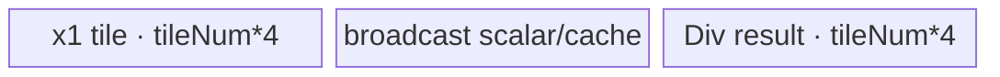

# InplaceDivs 950 ACLNN 算子知识

## 算子速览

| 项目 | 内容 |
|---|---|
| 实际入口 | `aclnnInplaceDivsGetWorkspaceSize` + `aclnnInplaceDivs`，公开 ACLNN 两段式接口；无独立版本后缀，固定仓中的最新实现直接复用 `aclnnDivsGetWorkspaceSize`。 |
| 计算语义 | 对 `selfRef` 的每个逻辑元素执行 `selfRef[i] = selfRef[i] / other`；结果最终写回 `selfRef` 的原 storage/view。 |
| 输入输出 | `selfRef`：ND、rank≤8、支持非连续；950 公开支持 FLOAT/FLOAT16/DOUBLE/COMPLEX128/COMPLEX64/BFLOAT16，不公开支持整数与 BOOL。`other` 为 `aclScalar`。 |
| 执行类型 | 空域无 Device 节点；倒数乘与实数除为 AIV_VECTOR，广播搬入的非连续路线含 NDDMA；DOUBLE/COMPLEX 为 AICPU；框架 `Contiguous/ViewCopy` 可能插入 AIV/NDDMA 搬运节点。所有可达源码均无 Cube/AIC/MIX_CV。 |
| Kernel 路线 | R-001 空域；R-002 FP32 倒数乘；R-003 FP16/BF16 升精度倒数乘；R-004 连续实数除；R-005 非连续 NLast-NDDMA；R-006 非连续 Last-Transpose；R-007/R-008 非连续 NDDMA fallback；R-009 DOUBLE/COMPLEX AICPU。 |
| 核心资源 | Executor workspace 中的中间 Tensor；AIV 节点使用 GM、UB/TQue/TBuf 或 ATVOSS tensor pool；非连续广播使用 NDDMA；AICPU 使用 CPU shard；每个 Cast/Muls 节点声明 16 MiB 保留 workspace，RealDiv 广播模板声明公共默认 workspace。 |
| 来源闭包 | `source_closed`：公开 API→复用入口→dtype/shape/空域/倒数乘 selector→Cast/Muls 或 RealDiv AIV/AICPU→原地提交已闭合；`Contiguous/ViewCopy` 按指定 Skill 作为显式框架边界。 |
| 验证状态 | 已完成源码闭包检查；本次知识提取未执行编译、真机、数值或性能测试。 |

## 接口与语义

### 计算语义

设 `N = selfRef.numel()`，标量为 `b`。有效输出域为 `0 <= i < N`，语义为 `selfRef[i] <- selfRef[i] / b`。接口不是非原地 `Divs`：`aclnnInplaceDivsGetWorkspaceSize` 将同一个 `selfRef` 同时传给 `aclnnDivsGetWorkspaceSize(self, other, out, ...)` 的 `self` 与 `out`，最终 `ViewCopy`/地址关系把中间结果提交回该对象。

950 对 FP16/BF16 主路线先把计算 dtype 提升到 FP32；当标量 dtype 允许时，以 Host 端 DOUBLE 精度求 `1 / other`，一次舍入为 FP32，再调用 `Muls`。其余实数标量调用 `RealDiv`；DOUBLE/COMPLEX 由 AICPU 执行。复数分母模为零时仍用通用复数公式，不做 CPU/GPU 风格的额外特殊处理。

### 输入、输出与属性

| 参数 | shape/layout | dtype | 约束、默认值与语义 |
|---|---|---|---|
| `selfRef` | ND；任意 shape，rank≤8；可非连续 | 950 公开：FLOAT、FLOAT16、DOUBLE、COMPLEX128、COMPLEX64、BFLOAT16 | 输入兼输出；不能为空指针；公开文档明确 950 不支持 INT/BOOL。空 Tensor 成功返回且不排入 Kernel。 |
| `other` | 标量，无 Tensor layout | FLOAT、FLOAT16、DOUBLE、INT32、INT64、INT16、INT8、UINT8、BOOL、COMPLEX128、COMPLEX64、BFLOAT16 | 不能为空；与 `selfRef` 先做 `InferDivsModeDtype`/`PromoteType`；Muls 路线只接收浮点标量族。 |
| `workspaceSize` | 字节 | `uint64_t*` | 第一段返回 Executor 所有中间 Tensor、任务描述和各节点保留 workspace 的总需求。 |
| `executor` | Host 对象 | `aclOpExecutor**` | 第一段构造，第二段消费；包含按同一 stream 顺序排入的全部节点。 |
| `workspace` | Device 字节区 | opaque | 由调用者按 `workspaceSize` 分配，生命周期覆盖第二段执行。 |
| `stream` | Device stream | `aclrtStream` | `CommonOpExecutorRun` 在该 stream 上提交 Executor；前序失败阻断后续节点。 |

### 入口与版本

公开声明和文档均给出 `aclnnInplaceDivsGetWorkspaceSize/aclnnInplaceDivs`。固定实现没有 `V2` 等更新入口；原地入口只做别名接线，不得误并为 `aclnnDivs` 卡。公开产品表明确支持 Ascend 950PR/950DT。`math/div/CMakeLists.txt` 将 `ascend950` 接到 `arch35`，而 RealDiv/Muls/Cast 的 OpDef、binary config 与 `*_apt.cpp` 也均注册 950，因此 950 无公开性冲突。

## Host/Launcher 执行流程

### 参数校验与前处理

1. `aclnnInplaceDivsGetWorkspaceSize` 令 `out = const_cast<aclTensor*>(selfRef)`，调用 `aclnnDivsGetWorkspaceSize(selfRef, other, out, ...)`。
2. 创建唯一 Executor；失败返回 `ACLNN_ERR_INNER_CREATE_EXECUTOR`。
3. `CheckParamsScalar` 依次执行空指针、非私有 format、支持 dtype、`selfRef.shape == out.shape` 且 rank≤8、推导 dtype 可回写到 `selfRef.dtype` 的检查。
4. `selfRef->IsEmpty()` 时令 workspace 为 0，释放 Executor 给调用者，不排入 Device 节点。
5. 950 上 `isDivsMixDtypeSupport` 恒为 false（该捷径仅 910B/910_93）。Host 计算 `promoteType`，再对 FP16/BF16 调用 `PromoteLowPrecToFloat`。
6. `CanUseMuls` 仅在 RegBase、`selfRef` 为 FP16/BF16/FP32、`other` 为 FP16/BF16/FP32/DOUBLE 时为真；非连续 `selfRef` 配 DOUBLE 标量被显式排除。
7. Muls 分支：`Contiguous(selfRef)`→可选 `Cast(..., FP32)`→Host 计算 FP32 倒数→`Muls`。否则构造 scalar Tensor，调用 `RealDiv`；AIV 不支持的 DOUBLE/COMPLEX 进入 AICPU。
8. `Cast(divOpOut, selfRef.dtype)` 在 dtype 相同时是零节点返回；否则加入 Cast AIV/AICPU。
9. `ViewCopy(castOut, selfRef)` 提交原地结果。950 且源、目的均连续、源来自 workspace 时，框架直接把中间 Tensor 的 storage 改绑到 `selfRef`，不启动搬运 Kernel；非连续目的才使用 ViewCopy/Transpose 框架节点。

### 参数、Workspace 与生命周期

`uniqueExecutor` 拥有 `Contiguous` 结果、Cast 中间、标量 Tensor、Muls/RealDiv 输出及节点描述。每个 producer 成功后其结果存活至唯一 consumer；最后提交后由 Executor 管理释放。固定源码能看到的单节点 workspace 为：Muls `16777216` 字节，Cast `16777216` 字节，ATVOSS Broadcast 为 `DEFAULT_TILING_WORKSPACE_SIZE`；Executor 对这些保留区的复用、对齐和最终 `GetWorkspaceSize()` 合并算法属于框架边界，固定算子源码未暴露最终 offset。

### 启动图与失败传播

```text
aclnnInplaceDivsGetWorkspaceSize
  -> aclnnDivsGetWorkspaceSize(selfRef, other, selfRef)
    -> [empty] no node
    -> [Muls] Contiguous? -> Cast? -> Muls -> Cast? -> ViewCopy/address-rebind
    -> [RealDiv] Contiguous/CreateView -> Cast? -> ConvertToTensor(other)
                  -> RealDiv(AIV or AICPU) -> Cast? -> ViewCopy/address-rebind
aclnnInplaceDivs
  -> CommonOpExecutorRun(workspace, workspaceSize, executor, stream)
```

所有实际节点由同一 Executor 按依赖顺序提交到调用者 stream。任一 `Contiguous/Cast/ConvertToTensor/RealDiv/Muls/ViewCopy` 返回空指针时第一段立即失败，后续节点不再构建；第二段返回 `CommonOpExecutorRun` 的状态。节点间介质是 Executor 分配的 GM/workspace Tensor；源 Tensor 生命周期延续到 consumer 完成。地址改绑路线没有计算结果复制边：RealDiv/Muls 输出 Tensor 的 storage 在执行前关联到 `selfRef`。

## Route 与参数设计

### 分核与资源计算

Muls 将输出 shape 合轴为 `dim0=N`，AIV 核数 `C=min(C_aiv, ceil(N*min_dtype_bits/32768))`；`blockFormer=ceil(ceil(N/C)/512)*512` 元素，`blockNum=ceil(N/blockFormer)`，尾核长度为 `N-(blockNum-1)*blockFormer`。`ubFormer=floor(((UB*8)/((BufferNum)*max_dtype_bits))/alignFactor)*alignFactor`，`alignFactor=256*8/min_dtype_bits`。

Cast 对输入输出位宽 `Bi/Bo` 使用 `C=min(C_aiv, ceil(N*Bi/32768))`，`blockFormer=ceil(ceil(N/C)/8)*8`；DirectCast 的 `ubFormer=floor((((UB-128)*4)/(Bi+Bo))/VL_elems)*VL_elems`，其中 `VL_elems=vlBitSize/Bi`。两个深度 2 Queue 的实际字节账为 `2*ubFormer*sizeof(src)+2*ubFormer*sizeof(dst)`。

连续 Tensor÷scalar 在 Broadcast 合轴后命中 key 202：`tileNum=floor((UB/aliveNum)/512)*512/maxDtypeBytes`，小域按 512-byte cache line 缩小；`ubOuter=ceil(N/tileNum)`，若初始每核仅一 tile，则 `blockFormer` 改为 2 以开启核内 double buffer，`blockNum=ceil(ubOuter/blockFormer)`。

FP32 非连续 view 直接交给 RealDiv。公共非连续 tiler先化简 shape/stride，再按 Last/NLast 转置可行性选 301 或 303；不满足转置模板时选 304/305，区别为 `shapeLen-ubSplitAxis` 是否超过 NDDMA 最大 5 维。各路线均把 `blockNum` 写成 launch blockDim。

### Route 选择

| 顺序 | Route | Key/模板 | 精确选择条件与优先级 | 不适用去向 |
|---:|---|---|---|---|
| 1 | R-001 空域 | 无 Kernel | `selfRef->IsEmpty()` | 非空进入 2 |
| 2 | R-002 FP32 倒数乘 | Muls `ElementwiseSch<0, MulsOp<float,...>>` | `selfRef.dtype=FP32`；`other`∈{FP16,BF16,FP32,DOUBLE}；若 other=DOUBLE 则 selfRef 必须连续 | 进入 3 |
| 3 | R-003 低精度倒数乘 | CastDirect→Muls FP32→CastDirect | `selfRef.dtype`∈{FP16,BF16}；标量浮点族；DOUBLE+非连续除外 | 进入 4 |
| 4 | R-004 连续 RealDiv AIV | Broadcast key 202 | Muls 条件失败；promote 后为 FP32；`Contiguous` 后输入均连续，合轴 rank=1 | AIV 非连续进入 5；AICPU 进入 9 |
| 5 | R-005 非连续 NLast-NDDMA | key 301 | FP32 `selfRef` 保留 view；NLast 模板支持且尾轴广播/需 NDDMA | Last 转置或 fallback |
| 6 | R-006 非连续 Last-Transpose | key 303 | 非连续模板支持且 `isLastTranspose=true` | fallback |
| 7 | R-007 非连续 NDDMA 无循环 cache | key 304 | 非连续模板不支持且 `shapeLen-ubSplitAxis<=5` | key 305 |
| 8 | R-008 非连续 NDDMA 循环 cache | key 305 | 非连续模板不支持且 `shapeLen-ubSplitAxis>5` | Tiling 失败 |
| 9 | R-009 DOUBLE/COMPLEX AICPU | `RealDivKernel` | promoteType 为 DOUBLE/COMPLEX64/COMPLEX128，`RealDiv::IsAiCoreSupport=false` | dtype/广播不合法时报错 |

```text
if empty: R-001
else if CanUseMuls:
  if self.dtype == FP32: R-002
  else: R-003
else if promoteType in {FP32}:
  if RealDiv input contiguous after preprocessing: R-004(key 202)
  else if NLast supported: R-005(key 301)
  else if LastTranspose supported: R-006(key 303)
  else if remaining NDDMA rank <= 5: R-007(key 304)
  else: R-008(key 305)
else: R-009
```

### 模板/实现执行矩阵

| Route | key/selector | dtype/shape/platform 完整命中条件 | 执行拓扑与 Kernel 节点 | 实际模板/body | 内存与同步特征 | tail/fallback |
|---|---|---|---|---|---|---|
| R-001 | empty | 950，`N=0` | 无 Kernel | Host early return | workspace=0 | 无写入 |
| R-002 | Muls key 0 | FP32+浮点标量，CanUseMuls | Muls→commit | `MulsOp<float,NONE,RINT>`；float cast节点由 DAG 优化 | 单 TBuf tensor pool；workspace reserve 16 MiB | tail 字段控制最后 tile |
| R-003 | Cast key0 + Muls key0 + Cast key0 | FP16/BF16+浮点标量 | Cast→Muls→Cast→commit | 两个 `CastDirect` + FP32 Muls | Cast 各双 Queue；Muls tensor pool；stream 顺序 | 每节点独立 former/tail |
| R-004 | 202 | promote FP32，连续 Tensor÷scalar | 可选 Cast→RealDiv→可选 Cast→commit | `RealDivFloatWithoutCast<float>` + `BroadcastOneDimAdvanceSch` | AIV；scalarFlag 标记 x2 广播；DB | mask/tileNum 保护尾部 |
| R-005 | 301 | FP32 非连续，NLast+last-axis brc | RealDiv→commit | `BroadcastNlastTransposeNddmaSch` | NDDMA搬入+Vector DivHighPrecision | NDDMA pad/tail |
| R-006 | 303 | FP32 非连续，Last transpose | RealDiv→commit | `BroadcastLastTransposeSch` | transpose NDDMA/UB + Vector | 最后轴和 UB 尾块 |
| R-007 | 304 | FP32 非连续 fallback，剩余≤5维 | RealDiv→commit | `BroadcastNonContiguousNddmaSch<...,false>` | 单次 NDDMA 参数组 | 对齐与尾块由 tiling POD |
| R-008 | 305 | FP32 非连续 fallback，剩余>5维 | RealDiv→commit | `BroadcastNonContiguousNddmaSch<...,true>` | 循环 NDDMA，cache broadcast | 大维循环尾块 |
| R-009 | AICPU selector | DOUBLE/COMPLEX promote | Cast AICPU?→RealDiv AICPU→Cast AICPU?→commit | `RealDivKernel::RealDivCompute<T>` | CPU shard；无 AIV UB | 小域串行，大域 ParallelFor |

### 隐藏性能 Guard

| Guard | Host/Tiling 条件 | Device/资源原因 | 影响 Route | 不满足时去向 | 源码符号 |
|---|---|---|---|---|---|
| 倒数乘平台 | `IsRegBase(npuArch)` | 950 才启用 Host reciprocal+Muls specialization | R-002/003 | RealDiv |
| DOUBLE 非连续排除 | `!IsContiguous(self) && other.dtype==DOUBLE` | 固定 selector 禁止该 Muls 组合 | R-002/003 | R-004/005... |
| FP16/BF16 升精度 | `PromoteLowPrecToFloat` | 避免标量提前降精 | R-003/004 | FP32 无 Cast |
| RealDiv AIV dtype | `{FP32,FP16,BF16,BOOL,INT32,INT64}` | binary/entry只有这些 AIV 实例 | R-004..008 | DOUBLE/COMPLEX→R-009 |
| 一维 advance | collapsed rank=1、全连续、`InputSize+OutputSize<=MAX`、`VarSize<=0` | 使用寄存器化一维 scheduler POD | R-004 key202 | 普通/非连续 Broadcast |
| NDDMA 维数 | `shapeLen-ubSplitAxis<=5` | `MultiCopyParams<T,5>` 最大维数 | R-007 | R-008 循环 cache |
| Cast UB | `UB>128` 且计算出的 `ubFormer>0` | 深度2输入/输出 Queue 与对齐预留 | R-003/004 | Tiling失败 |
| Muls UB | `ubSize>=extraSize` 且 `ubFormer>0` | tensor pool 必须容纳 `BufferNum` 个 tile | R-002/003 | Tiling失败 |
| AICPU 分片阈值 | no-bcast `N>=7168`；general `N>=2048` | 小域避免 ParallelFor 启动成本 | R-009 | 单线程 loop |

### POD/ABI

| 结构 | 字段 | 类型/位宽 | ABI 布局 | 单位 | Host/launcher producer | Device consumer | 边界 |
|---|---|---|---|---|---|---|---|
| `MulsTilingData` | `baseTiling.dim0` | int64/64 | nested offset 0 | 元素 | ElewiseTiling `N` | scheduler 总域 | >0 |
| `MulsTilingData` | `baseTiling.coreNum` | int32/32 | nested，固定仓宏后 offset 可由 C++ ABI 推导 | 核 | `min(C_aiv,ceil(...))` | 调试/元数据 | ≥1 |
| `MulsTilingData` | `baseTiling.ubFormer` | int32/32 | nested | 元素/tile | `GetMaxElemNum` | InitBuffer、循环 | >0 |
| `MulsTilingData` | `baseTiling.blockFormer` | int64/64 | nested | 元素/整核 | 512 元素对齐公式 | GM base | ≥tail |
| `MulsTilingData` | `baseTiling.blockNum` | int64/64 | nested | 核 | `ceil(N/blockFormer)` | last-core 判断 | blockDim 同值 |
| `MulsTilingData` | `baseTiling.ubLoopOfFormerBlock` | int64/64 | nested | loop | ceil | former core 循环 | ≥1 |
| `MulsTilingData` | `baseTiling.ubLoopOfTailBlock` | int64/64 | nested | loop | ceil | tail core 循环 | ≥1 |
| `MulsTilingData` | `baseTiling.ubTailOfFormerBlock` | int64/64 | nested | 元素 | 余数公式 | former 最后 tile | 1..ubFormer |
| `MulsTilingData` | `baseTiling.ubTailOfTailBlock` | int64/64 | nested | 元素 | 余数公式 | tail 最后 tile | 1..ubFormer |
| `MulsTilingData` | `baseTiling.elemNum` | int64/64 | nested | 元素 | maxElemNum | 资源上界 | =ubFormer |
| `MulsTilingData` | `baseTiling.scheMode` | uint64/64 | nested | key | 固定1 | scheduler | 当前 entry 固定模板0 |
| `MulsTilingData` | `value` | float/32 | `EleBaseTilingData` 后 | 数值 | runtime attr，缺省1；本算子写入 `float(1/other)` | `SetVar<float,0>` | Host 已单次 FP32 舍入 |
| `CastTilingData` | `blockNum` | int64/64 | 0 | 核 | CastTiling | entry launch/last核 | ≥1 |
| `CastTilingData` | `ubFormer` | int64/64 | 8 | 元素 | `GetUbFormer` | Queue容量/tile | >0 |
| `CastTilingData` | `blockFormer` | int64/64 | 16 | 元素/核 | 8元素对齐 | GM base | ≥tail |
| `CastTilingData` | `ubLoopOfFormerBlock` | int64/64 | 24 | loop | ceil | Process | ≥1 |
| `CastTilingData` | `ubLoopOfTailBlock` | int64/64 | 32 | loop | ceil | Process | ≥1 |
| `CastTilingData` | `ubTailOfFormerBlock` | int64/64 | 40 | 元素 | remainder | final tile | 1..ubFormer |
| `CastTilingData` | `ubTailOfTailBlock` | int64/64 | 48 | 元素 | remainder | tail final tile | 1..ubFormer |
| `CastTilingData` | `regCopyInStep` | int64/64 | 56 | 元素 | policy load dist | Micro路线；DirectCast inactive | 0 for DirectCast |
| `CastTilingData` | `regCopyOutStep` | int64/64 | 64 | 元素 | policy store dist | Micro路线；DirectCast inactive | 0 for DirectCast |
| `CastTilingData` | `ubFormerRegLoop` | int64/64 | 72 | loop | policy | Micro路线；DirectCast inactive | 0 |
| `CastTilingData` | `ubTailOfFormerRegLoop` | int64/64 | 80 | loop | policy | Micro路线；DirectCast inactive | 0 |
| `CastTilingData` | `ubTailOfTailRegLoop` | int64/64 | 88 | loop | policy | Micro路线；DirectCast inactive | 0；sizeof=96, alignof=8 |
| `BroadcastOneDimTilingDataAdvance` | `dimLen` | int64/64 | 0 | 元素 | collapsed output N | OneDimAdvance Process | >0 |
| `BroadcastOneDimTilingDataAdvance` | `tileNum` | int32/32 | 8 | 元素 | UB/aliveNum 公式 | 每 tile | >0 |
| `BroadcastOneDimTilingDataAdvance` | `blockNum` | int16/16 | 12 | 核 | `ceil(ubOuter/blockFormer)` 后窄化 | block mapping | 必须容入 int16 |
| `BroadcastOneDimTilingDataAdvance` | `scalarFlag` | int16/16 | 14 | bitset | input dim==1；x2 标量置位 | scalar/broadcast load | 本逻辑 x2 广播 |
| `BroadcastBaseTilingData<OpDag>` | `scheMode` | int32/32 | 0 | key | 304/305 selector | router/scheduler | 非连续 fallback |
| `BroadcastBaseTilingData<OpDag>` | `shapeLen` | int32/32 | 4 | 轴 | dimension collapse | NDDMA loops | 1..8 |
| `BroadcastBaseTilingData<OpDag>` | `ubSplitAxis` | int32/32 | 8 | 轴 | broadcast tiler | split/305 guard | <shapeLen |
| `BroadcastBaseTilingData<OpDag>` | `ubFormer/ubTail` | int32/32 each | 12/16 | 元素 | UB tiler | former/tail tile | >0 |
| `BroadcastBaseTilingData<OpDag>` | `ubOuter` | int64/64 | ABI含4字节 padding后 | loop | ceil | tile loop | ≥1 |
| `BroadcastBaseTilingData<OpDag>` | `blockFormer/blockTail/blockNum` | int64/64 each | 顺序ABI | tile/核 | split tiler | core/tail | >0 |
| `BroadcastBaseTilingData<OpDag>` | `dimProductBeforeUbInner/elemNum` | int64/64 each | 顺序ABI | 元素 | shape products | offset/tail | 乘法溢出由 tiler成功前提约束 |
| `BroadcastBaseTilingData<OpDag>` | `outputDims/outputStrides` | int64数组[8] | 顺序ABI | 元素/stride | collapsed output | output offset | inactive槽不读 |
| `BroadcastBaseTilingData<OpDag>` | `inputDims/inputBrcDims/inputStrides/inputBrcStrides` | int64数组 | 模板大小依 DAG | 元素/stride | collapsed inputs | CopyInBrc/NDDMA | x2标量 stride为0 |
| `BroadcastBaseTilingData<OpDag>` | `scalarData` | char[16] | 尾部 | bytes | 默认0 | 当前 RealDiv 无 Var，不读 | inactive |

### Route 源码闭包

| Route | Key/selector | Host/Tiling producer | POD/参数 | Kernel entry/router 节点 | Kernel body/直接依赖 | 构建接线 |
|---|---|---|---|---|---|---|
| R-001 | empty | `aclnn_div.cpp::aclnnDivsGetWorkspaceSize` | workspace=0 | 无 | 无 | 公开文档/入口 |
| R-002/003 | CanUseMuls | `muls_tiling_arch35.cpp::RunTiling` | MulsTilingData | `muls_apt.cpp::muls` | MulsDag + ElementwiseSch | `muls_binary.json` |
| R-004 | 202 | `RealDivTiling::DoOpTiling`→BroadcastBaseTiling | OneDimAdvance POD | `real_div_apt.cpp::real_div<202>` | RealDiv DAG + OneDimAdvanceSch | `real_div_binary.json` |
| R-005 | 301 | common noncontig selector | NLast POD | `real_div<301>` | NlastTransposeNddmaSch | RealDiv 950 config |
| R-006 | 303 | common noncontig selector | LastTranspose POD | `real_div<303>` | LastTransposeSch | RealDiv 950 config |
| R-007/008 | 304/305 | common fallback selector | BroadcastBase POD | `real_div<304/305>` | NonContiguousNddmaSch false/true | RealDiv 950 config |
| R-009 | IsAiCoreSupport=false | `realdiv.cpp::RealDivKernel` | CpuKernelContext ABI | AICPU task `RealDiv` | `RealDivKernel::RealDivCompute<T>` | `real_div_aicpu_def.cpp` |

## Kernel 实现

### 公共执行流程

所有非空路线先生成一个连续或带原 view stride 的逻辑输入，核心计算输出到 Executor Tensor。AIV 节点都明确设置 `KERNEL_TYPE_AIV_ONLY`；RealDiv 的 schMode router只实例化 Vector/NDDMA Broadcast scheduler。核心计算后，可选 Cast 把 FP32/complex promoteType 恢复为 `selfRef.dtype`。最后连续 950 快路用地址关系提交；非连续 `selfRef` 由框架 `ViewCopy/Transpose` 将连续结果散写回原 view。没有跨核 Atomic；节点间可见性由同一 Executor/stream 顺序保证。

### Route R-001：空域

#### 适用条件

##### 选择证据

| 层级 | 文件 | 符号 | 源码谓词/参数 | 结果/下一跳 |
|---|---|---|---|---|
| API | `math/div/op_api/aclnn_div.cpp` | `aclnnDivsGetWorkspaceSize` | `self->IsEmpty()` | workspace=0并返回 |

#### Device 数据流

##### 函数级调用链

```text
aclnnInplaceDivsGetWorkspaceSize -> aclnnDivsGetWorkspaceSize -> early return
```

##### 源码等价伪码

```text
if selfRef.IsEmpty(): workspaceSize=0; release executor; success
```

#### 内存与数据搬运

##### 资源与搬运表

| 层级/缓冲区 | offset/地址公式 | extent/容量公式 | dtype/layout | producer | consumer | owner/lifetime | 对齐/复用 |
|---|---|---|---|---|---|---|---|
| workspace | N/A | 0 | bytes | Host | 无 | caller | N/A |

##### 分层内存布局

N/A：无 AIV UB、dynamic UB、NDDMA buffer 或 AICPU shard。

##### 字节账与复用顺序

```text
UB_total=0; dynamic_ub=N/A; workspace_total=0
```

| 复用子区 | 写入者 | 读取者/消费点 | 下一次覆盖 | 同步或释放依据 | 安全条件 |
|---|---|---|---|---|---|
| N/A | N/A | N/A | N/A | N/A | N=0 |

#### 同步、精度与尾块

##### 同步与数值边界表

| 阶段 | primitive/机制 | producer | consumer/等待点 | 保护对象 | 精度/尾块 |
|---|---|---|---|---|---|
| early return | Host branch | API | caller | selfRef不写 | 空域 |

#### 关键实现

##### 符号证据表

| 阶段 | 文件 | 符号/模板实例 | 实现事实 |
|---|---|---|---|
| Host/Tiling producer | `math/div/op_api/aclnn_div.cpp` | `aclnnDivsGetWorkspaceSize` | 空 Tensor 不建任务 |
| Kernel entry/router | N/A | N/A | 无 Kernel |
| Device body/helper | N/A | N/A | 无 Device 访问 |

### Route R-002：FP32 倒数乘

#### 适用条件

##### 选择证据

| 层级 | 文件 | 符号 | 源码谓词/参数 | 结果/下一跳 |
|---|---|---|---|---|
| API | `math/div/op_api/aclnn_div.cpp` | `CanUseMuls` | RegBase、FP32 self、浮点标量；DOUBLE要求self连续 | Muls |
| Host | same | `aclnnDivsGetWorkspaceSize` | `invB=float(1.0/other.ToDouble())` | Muls alpha |

#### Device 数据流

##### 函数级调用链

```text
Muls -> muls<float> -> ElementwiseSch::Init/Process
  -> CopyIn<float> -> Muls<float>(alpha) -> CopyOut<float>
-> ViewCopy address-rebind or framework scatter
```

##### 源码等价伪码

```text
alpha = float(1.0 / other_as_double)
for core b, tile t:
  len = former_or_tail
  xLocal = GM[selfBase + b*blockFormer + t*ubFormer : +len]
  yLocal = xLocal * alpha
  GM[tmp + same_offset : +len] = yLocal
commit tmp to selfRef
```

#### 内存与数据搬运

##### 资源与搬运表

| 层级/缓冲区 | offset/地址公式 | extent/容量公式 | dtype/layout | producer | consumer | owner/lifetime | 对齐/复用 |
|---|---|---|---|---|---|---|---|
| input GM | `b*blockFormer+t*ubFormer` | len | FP32/ND | caller/Contiguous | CopyIn | caller/framework | tail valid only |
| tensorPool | `bufId*blockLen` | `BufferNum*ubFormer*4` | bytes | InitBuffer | DAG nodes | Muls kernel | DAG LEVEL_2 reuse |
| output GM | same logical offset | len | FP32/ND | CopyOut | commit | Executor→selfRef | 950 may rebind |

##### 分层内存布局


##### 字节账与复用顺序

```text
UB_total = ubFormer * 4 * MulsOp<float>::OpDag::BufferNum
UB_total <= platform UB
dynamic_ub=N/A
workspace node reserve=16 MiB; executor total/offset由框架合并
```

| 复用子区 | 写入者 | 读取者/消费点 | 下一次覆盖 | 同步或释放依据 | 安全条件 |
|---|---|---|---|---|---|
| DAG slot | CopyIn | Muls | 下一 ping/pong tile | GetTensor/ReleaseTensor | consumer已释放 |
| result slot | Muls | CopyOut | 下一 tile | VECCALC→VECOUT token | 写回完成 |

#### 同步、精度与尾块

##### 同步与数值边界表

| 阶段 | primitive/机制 | producer | consumer/等待点 | 保护对象 | 精度/尾块 |
|---|---|---|---|---|---|
| CopyIn→Muls | tensor position token | MTE2 | VECCALC | input slot | FP32 |
| Muls→CopyOut | tensor position token | VECCALC | MTE3 | result slot | `count=len` masks tail |

#### 关键实现

##### 符号证据表

| 阶段 | 文件 | 符号/模板实例 | 实现事实 |
|---|---|---|---|
| Host/Tiling producer | `math/muls/op_host/arch35/muls_tiling_arch35.cpp` | `MulsTiling::RunTiling` | alpha、blockDim、POD |
| Kernel entry/router | `math/muls/op_kernel/muls_apt.cpp` | `muls<float>` | AIV-only，选择 MulsOp |
| Device body/helper | opbase `elewise_sch.h`, `vec.h` | `ElementwiseSch`, `Vec::Muls` | GM/UB loop与Vector Muls |

### Route R-003：FP16/BF16 升精度倒数乘

#### 适用条件

##### 选择证据

| 层级 | 文件 | 符号 | 源码谓词/参数 | 结果/下一跳 |
|---|---|---|---|---|
| API | `aclnn_div.cpp` | `PromoteLowPrecToFloat`/`CanUseMuls` | lowprec self+浮点标量 | FP32计算 |
| Cast | `cast_struct.h` | FP16/BF16↔FP32 policy | DirectCast NONE/RINT | 两个Cast AIV |

#### Device 数据流

##### 函数级调用链

```text
CastDirect<half|bf16,float> -> Muls<float> -> CastDirect<float,half|bf16> -> commit
```

##### 源码等价伪码

```text
tmp32 = cast_NONE(contiguous(selfRef))
tmp32 = tmp32 * float(1.0 / other_as_double)
tmpLow = cast_RINT(tmp32)
commit tmpLow to selfRef
```

#### 内存与数据搬运

##### 资源与搬运表

| 层级/缓冲区 | offset/地址公式 | extent/容量公式 | dtype/layout | producer | consumer | owner/lifetime | 对齐/复用 |
|---|---|---|---|---|---|---|---|
| Cast inQ | core/tile offset | `2*ubFormer*sizeof(src)` | lowprec/FP32 | DataCopyPad | Cast | Cast node | depth2 |
| Cast outQ | same | `2*ubFormer*sizeof(dst)` | FP32/lowprec | Cast | DataCopyPad | Cast node | depth2 |
| inter-node GM | 0 | `N*4` then `N*2` | contiguous | Cast/Muls | next node | Executor | stream ordered |

##### 分层内存布局


##### 字节账与复用顺序

```text
Cast UB_total=2*ubFormer*sizeof(src)+2*ubFormer*sizeof(dst)
Muls UB_total=ubFormer*4*OpDag::BufferNum
workspace_total=framework merge(Cast 16MiB, Muls 16MiB, Cast 16MiB, tensors)
```

| 复用子区 | 写入者 | 读取者/消费点 | 下一次覆盖 | 同步或释放依据 | 安全条件 |
|---|---|---|---|---|---|
| Cast inQ slot | CopyIn | Compute | next DB tile | DeQue/FreeTensor | Free后复用 |
| Cast outQ slot | Compute | CopyOut | next DB tile | DeQue/FreeTensor | MTE3完成 |

#### 同步、精度与尾块

##### 同步与数值边界表

| 阶段 | primitive/机制 | producer | consumer/等待点 | 保护对象 | 精度/尾块 |
|---|---|---|---|---|---|
| low→FP32 | Queue | MTE2 | Vector Cast | tile | CAST_NONE |
| FP32 Muls | DAG token | CopyIn | CopyOut | FP32 tile | scalar一次FP32舍入 |
| FP32→low | Queue | Cast | MTE3 | output tile | CAST_RINT，tail len |

#### 关键实现

##### 符号证据表

| 阶段 | 文件 | 符号/模板实例 | 实现事实 |
|---|---|---|---|
| Host/Tiling producer | `math/div/op_api/aclnn_div.cpp` | `aclnnDivsGetWorkspaceSize` | 升精度与倒数 |
| Kernel entry/router | `math/cast/op_kernel/cast_apt.cpp` | `cast<0>` | AIV-only DirectCast |
| Device body/helper | `cast_impl.h::CastDirect` | `CopyIn/Compute/CopyOut` | depth2 Queue、round与tail |

### Route R-004：连续 RealDiv AIV

#### 适用条件

##### 选择证据

| 层级 | 文件 | 符号 | 源码谓词/参数 | 结果/下一跳 |
|---|---|---|---|---|
| API | `aclnn_div.cpp` | `!canUseMuls` | promote FP32 | RealDiv |
| Tiling | opbase `broadcast_tiling.h` | `DoTiling` | collapsed rank=1且全连续 | key202 |

#### Device 数据流

##### 函数级调用链

```text
Cast? -> real_div<202>
  -> BroadcastOneDimAdvanceSch<RealDivFloatWithoutCast<float>>
  -> CopyInBrc(x1,x2 scalar) -> DivHighPrecision<float> -> CopyOut<float>
-> Cast? -> commit
```

##### 源码等价伪码

```text
for block b, local tile t assigned by dimLen/tileNum:
  a = load x1[offset:offset+len]
  breg = broadcast(load x2[0])
  y = Div<float, DIFF_COMPENSATION>(a,breg,len)
  store y[offset:offset+len]
```

#### 内存与数据搬运

##### 资源与搬运表

| 层级/缓冲区 | offset/地址公式 | extent/容量公式 | dtype/layout | producer | consumer | owner/lifetime | 对齐/复用 |
|---|---|---|---|---|---|---|---|
| x1 GM | scheduler block/tile offset | len | FP32 | Cast/Contiguous | CopyInBrc | Executor/caller | 512B tile policy |
| x2 GM | 0 | 1 | FP32 scalar Tensor | ConvertToTensor | broadcast | Executor | repeated scalar |
| ATVOSS UB | compile-time slots | `aliveNum*tileNum*4` | FP32 | scheduler | DAG | RealDiv node | DB |
| y GM | output offset | len | FP32 | DivHighPrecision | commit/Cast | Executor | tail valid |

##### 分层内存布局



##### 字节账与复用顺序

```text
UB_total=aliveNum*tileNum*4 <= platform UB
dynamic_ub=N/A
workspace node=DEFAULT_TILING_WORKSPACE_SIZE
```

| 复用子区 | 写入者 | 读取者/消费点 | 下一次覆盖 | 同步或释放依据 | 安全条件 |
|---|---|---|---|---|---|
| x1 slot | CopyIn | Div | next DB tile | scheduler token | Div完成 |
| result slot | Div | CopyOut | next tile | MTE3 token | store完成 |

#### 同步、精度与尾块

##### 同步与数值边界表

| 阶段 | primitive/机制 | producer | consumer/等待点 | 保护对象 | 精度/尾块 |
|---|---|---|---|---|---|
| MTE2→Vector | ATVOSS token | CopyInBrc | Div | UB inputs | FP32 |
| Vector→MTE3 | ATVOSS token | Div | CopyOut | UB output | DIFF_COMPENSATION，len mask |

#### 关键实现

##### 符号证据表

| 阶段 | 文件 | 符号/模板实例 | 实现事实 |
|---|---|---|---|
| Host/Tiling producer | `real_div_tiling_arch35.cpp` | `RealDivTiling::DoOpTiling` | FP32 DAG与key |
| Kernel entry/router | `real_div_apt.cpp` | `real_div<202>` | AIV Broadcast router |
| Device body/helper | `real_div_dag.h` + opbase scheduler | `RealDivFloatWithoutCast` | high precision Div pipeline |

### Route R-005：非连续 NLast-NDDMA

#### 适用条件

##### 选择证据

| 层级 | 文件 | 符号 | 源码谓词/参数 | 结果/下一跳 |
|---|---|---|---|---|
| Host | `aclnn_div.cpp` | CreateView condition | FP32==promote且950支持非连续且非Muls | 保留stride |
| Tiling | `broadcast_tiling.h` | `DoBroadcastOpTilingNLastTranspose` | NLast支持，标量导致last-axis brc | key301 |

#### Device 数据流

##### 函数级调用链

```text
real_div<301> -> BroadcastNlastTransposeNddmaSch -> NDDMA CopyInBrc -> DivHighPrecision -> CopyOut
```

##### 源码等价伪码

```text
for collapsed outer coordinates and UB tile:
  NDDMA-load strided x1 and scalar-broadcast x2 into logical contiguous UB
  vector_div_high_precision(valid lanes)
  store contiguous logical output
```

#### 内存与数据搬运

##### 资源与搬运表

| 层级/缓冲区 | offset/地址公式 | extent/容量公式 | dtype/layout | producer | consumer | owner/lifetime | 对齐/复用 |
|---|---|---|---|---|---|---|---|
| x1 GM | Σcoord[d]*inputStride[d] | POD dims | FP32 strided | caller | NDDMA | caller | max 4 collapsed transpose dims |
| NDDMA UB | scheduler slot | tiler bufferNum*tile bytes | FP32 logical ND | MultiCopy | Div | kernel | padding/tail |
| y GM | logical contiguous offset | valid elements | FP32 | CopyOut | commit | Executor | stream ordered |

##### 分层内存布局

NDDMA布局：`input/cache slots + Div result slot`，每槽按 NLast POD 的 UB split 容量；具体 offset 由 DAG bufferIds 编译期生成。

##### 字节账与复用顺序

```text
UB_total=(GetBufferNum(false)+extraBufferNum)*maxTileElements*4 <= UB
workspace=DEFAULT_TILING_WORKSPACE_SIZE
```

| 复用子区 | 写入者 | 读取者/消费点 | 下一次覆盖 | 同步或释放依据 | 安全条件 |
|---|---|---|---|---|---|
| NDDMA slot | MultiCopy | Div | next tile | scheduler event | MultiCopy完成且Div已读 |

#### 同步、精度与尾块

##### 同步与数值边界表

| 阶段 | primitive/机制 | producer | consumer/等待点 | 保护对象 | 精度/尾块 |
|---|---|---|---|---|---|
| NDDMA→Vector | scheduler event | NDDMA | Div | reordered UB | FP32、POD valid extent |
| Vector→store | event | Div | MTE3 | result | DIFF_COMPENSATION |

#### 关键实现

##### 符号证据表

| 阶段 | 文件 | 符号/模板实例 | 实现事实 |
|---|---|---|---|
| Host/Tiling producer | opbase `broadcast_tiling.h` | `DoBroadcastOpTilingNLastTranspose` | 301选择与POD |
| Kernel entry/router | opbase `broadcast_sch.h` | `schMode==301` | NLast NDDMA实例 |
| Device body/helper | `broadcast_sch_nlast_transpose_nddma.h` | `CopyInBrc/Process` | stride/NDDMA/循环 |

### Route R-006：非连续 Last-Transpose

#### 适用条件

##### 选择证据

| 层级 | 文件 | 符号 | 源码谓词/参数 | 结果/下一跳 |
|---|---|---|---|---|
| Tiling | opbase `broadcast_tiling.h` | `isBroadcastTemplateNonContiguousSupport` | `isSupport && isLastTranspose` | key303 |

#### Device 数据流

##### 函数级调用链

```text
real_div<303> -> BroadcastLastTransposeSch -> strided transpose load -> DivHighPrecision -> CopyOut
```

##### 源码等价伪码

```text
map collapsed last-axis coordinates -> padded UB transpose tile
load/broadcast operands; div(valid lanes); store logical output
```

#### 内存与数据搬运

##### 资源与搬运表

| 层级/缓冲区 | offset/地址公式 | extent/容量公式 | dtype/layout | producer | consumer | owner/lifetime | 对齐/复用 |
|---|---|---|---|---|---|---|---|
| transpose UB | outputStridesWithPad mapping | former/tail axes | FP32 padded | LastTranspose loader | Div | kernel | 32B/NDDMA alignment |

##### 分层内存布局

NDDMA/transpose真实布局由 `BroadcastLastTransposeTilingData` 的 padded strides、former/tail axis 字段描述；不使用 AIV `TQue` 固定布局。

##### 字节账与复用顺序

```text
UB_total=bufferNum*selectedTileElements*4 <= UB
workspace=DEFAULT_TILING_WORKSPACE_SIZE
```

| 复用子区 | 写入者 | 读取者/消费点 | 下一次覆盖 | 同步或释放依据 | 安全条件 |
|---|---|---|---|---|---|
| transpose slot | loader | Div | next tile | scheduler event | valid padded strides |

#### 同步、精度与尾块

##### 同步与数值边界表

| 阶段 | primitive/机制 | producer | consumer/等待点 | 保护对象 | 精度/尾块 |
|---|---|---|---|---|---|
| transpose→Div | event | NDDMA/transpose | Vector | UB tile | padded lanes不提交 |

#### 关键实现

##### 符号证据表

| 阶段 | 文件 | 符号/模板实例 | 实现事实 |
|---|---|---|---|
| Host/Tiling producer | opbase `broadcast_tiling.h` | `DoBroadcastOpTilingLastTranspose` | key303 |
| Kernel entry/router | opbase `broadcast_sch.h` | `schMode==303` | LastTransposeSch |
| Device body/helper | `broadcast_sch_last_transpose.h` | `Process/CopyInBrc` | transpose数据网络 |

### Route R-007：非连续 NDDMA 无循环 cache

#### 适用条件

##### 选择证据

| 层级 | 文件 | 符号 | 源码谓词/参数 | 结果/下一跳 |
|---|---|---|---|---|
| Tiling | opbase `broadcast_tiling.h` | `DoBroadcastOpTilingNonContiguousBase` | fallback且剩余维≤5 | key304 |

#### Device 数据流

##### 函数级调用链

```text
real_div<304> -> BroadcastNonContiguousNddmaSch<false> -> MultiCopy -> DivHighPrecision -> CopyOut
```

##### 源码等价伪码

```text
build one <=5D MultiCopy from POD strides; load tile once; div; store valid tail
```

#### 内存与数据搬运

##### 资源与搬运表

| 层级/缓冲区 | offset/地址公式 | extent/容量公式 | dtype/layout | producer | consumer | owner/lifetime | 对齐/复用 |
|---|---|---|---|---|---|---|---|
| MultiCopy slot | POD dims/strides | ≤5D tile | FP32 | NDDMA | Div | kernel | unaligned tail handled by params |

##### 分层内存布局

NDDMA buffer按 `BroadcastBaseTilingData` 的 `ubFormer/ubTail` 和 DAG bufferIds 分区。

##### 字节账与复用顺序

```text
UB_total=bufferNum*ubFormer*4 <= UB
```

| 复用子区 | 写入者 | 读取者/消费点 | 下一次覆盖 | 同步或释放依据 | 安全条件 |
|---|---|---|---|---|---|
| NDDMA slot | MultiCopy | Div | next tile | event | ≤5D描述完备 |

#### 同步、精度与尾块

##### 同步与数值边界表

| 阶段 | primitive/机制 | producer | consumer/等待点 | 保护对象 | 精度/尾块 |
|---|---|---|---|---|---|
| load/div/store | scheduler event | NDDMA | Vector/MTE3 | tile | FP32, ubTail |

#### 关键实现

##### 符号证据表

| 阶段 | 文件 | 符号/模板实例 | 实现事实 |
|---|---|---|---|
| Host/Tiling producer | opbase `broadcast_tiling.h` | `DoBroadcastOpTilingNonContiguousBase` | ≤5维→304 |
| Kernel entry/router | opbase `broadcast_sch.h` | `schMode==304` | false specialization |
| Device body/helper | `broadcast_sch_nddma_transpose.h` | NDDMA helper | dims/stride/tail |

### Route R-008：非连续 NDDMA 循环 cache

#### 适用条件

##### 选择证据

| 层级 | 文件 | 符号 | 源码谓词/参数 | 结果/下一跳 |
|---|---|---|---|---|
| Tiling | opbase `broadcast_tiling.h` | `DoBroadcastOpTilingNonContiguousBase` | fallback且剩余维>5 | key305 |

#### Device 数据流

##### 函数级调用链

```text
real_div<305> -> BroadcastNonContiguousNddmaSch<true> -> looped MultiCopy/cache -> Div -> CopyOut
```

##### 源码等价伪码

```text
for high-dim outer slice:
  materialize <=5D NDDMA params; reuse broadcast cache; div; store; advance carry
```

#### 内存与数据搬运

##### 资源与搬运表

| 层级/缓冲区 | offset/地址公式 | extent/容量公式 | dtype/layout | producer | consumer | owner/lifetime | 对齐/复用 |
|---|---|---|---|---|---|---|---|
| cache-broadcast slot | outer slice mapping | cached scalar/broadcast tile | FP32 | first loop load | repeated Div | kernel | loop lifetime |
| NDDMA working slot | inner≤5D | ubFormer | FP32 | each MultiCopy | Div | kernel | per-loop reuse |

##### 分层内存布局

NDDMA working区与 loop cache 分区由 `GetBufferNum(isUbBroadcast)`/DAG bufferIds 决定；cache 生命周期覆盖同一 outer slice。

##### 字节账与复用顺序

```text
UB_total=(working buffers + cached CopyInBrc buffers)*ubFormer*4 <= UB
```

| 复用子区 | 写入者 | 读取者/消费点 | 下一次覆盖 | 同步或释放依据 | 安全条件 |
|---|---|---|---|---|---|
| cache | first outer load | all inner Div | next outer slice | scheduler event | outer coordinate不变 |

#### 同步、精度与尾块

##### 同步与数值边界表

| 阶段 | primitive/机制 | producer | consumer/等待点 | 保护对象 | 精度/尾块 |
|---|---|---|---|---|---|
| cache loop | event/carry | NDDMA | repeated Div | cached scalar/broadcast | FP32，outer/inner tail |

#### 关键实现

##### 符号证据表

| 阶段 | 文件 | 符号/模板实例 | 实现事实 |
|---|---|---|---|
| Host/Tiling producer | opbase `broadcast_tiling.h` | 305 guard | >5维循环 cache |
| Kernel entry/router | opbase `broadcast_sch.h` | `schMode==305` | true specialization |
| Device body/helper | common noncontig scheduler | `Process` | outer carry、cache、NDDMA |

### Route R-009：DOUBLE/COMPLEX AICPU

#### 适用条件

##### 选择证据

| 层级 | 文件 | 符号 | 源码谓词/参数 | 结果/下一跳 |
|---|---|---|---|---|
| API | `realdiv.cpp` | `IsAiCoreSupport` | 950 AIV列表不含 DOUBLE/COMPLEX | RealDivAiCpu |
| AICPU | `real_div_aicpu.cpp` | `RealDivSameTypeCompute` | DOUBLE/COMPLEX64/128 | templated CPU division |

#### Device 数据流

##### 函数级调用链

```text
Contiguous -> CastAiCpu? -> RealDivAiCpu
  -> RealDivKernel::Compute -> RealDivCompute<T>
    -> NoBcastComputeImpl<T> (scalar fast path)
-> CastAiCpu? -> ViewCopy/address-rebind
```

##### 源码等价伪码

```text
type = SAME_SHAPE | X_ONE_ELEMENT | Y_ONE_ELEMENT  # 本算子通常Y_ONE_ELEMENT
if N >= 7168:
  cores = cpu_count-2; if N<=35840 cores=min(cores,4)
  ParallelFor shards: out[i]=in0[i]/in1[0]
else:
  for i in [0,N): out[i]=in0[i]/in1[0]
```

#### 内存与数据搬运

##### 资源与搬运表

| 层级/缓冲区 | offset/地址公式 | extent/容量公式 | dtype/layout | producer | consumer | owner/lifetime | 对齐/复用 |
|---|---|---|---|---|---|---|---|
| input0 | i | N | DOUBLE/COMPLEX contiguous | Contiguous/Cast | CPU shard | Executor | read-only |
| input1 | 0 | 1 | promoted scalar | ConvertToTensor | every shard | Executor | hoisted scalar |
| output | i | N | promoteType | CPU loop | Cast/commit | Executor | disjoint shards |

##### 分层内存布局

N/A：该节点不使用 AIV UB；实际替代路径是 AICPU address space 与 `CpuKernelUtils::ParallelFor` 分片。

##### 字节账与复用顺序

```text
UB_total=N/A
dynamic_ub=N/A
workspace_total=Executor中间Tensor + AICPU task space；固定算子源码未暴露task-space字节公式
```

| 复用子区 | 写入者 | 读取者/消费点 | 下一次覆盖 | 同步或释放依据 | 安全条件 |
|---|---|---|---|---|---|
| output shard `[start,end)` | CPU worker | next Host node | task完成 | ParallelFor join | shards不重叠 |

#### 同步、精度与尾块

##### 同步与数值边界表

| 阶段 | primitive/机制 | producer | consumer/等待点 | 保护对象 | 精度/尾块 |
|---|---|---|---|---|---|
| CPU shards | ParallelFor join | workers | task completion | output | native DOUBLE/complex `/`；end边界 |
| node edge | executor stream | AICPU task | Cast/commit | GM output | task成功才继续 |

#### 关键实现

##### 符号证据表

| 阶段 | 文件 | 符号/模板实例 | 实现事实 |
|---|---|---|---|
| Host/Tiling producer | `math/real_div/op_api/realdiv.cpp` | `RealDivKernel` | AIV/AICPU selector |
| Kernel entry/router | `real_div_aicpu.cpp` | `Compute/RealDivSameTypeCompute` | dtype dispatch |
| Device body/helper | same | `NoBcastComputeImpl/SpecialComputeImpl` | scalar fast path与分片 |

## 算子特定优化

### Trick T-001：Host DOUBLE 倒数加 FP32 Muls 专门化

#### 触发与源码依据

- 适用 Route：R-002、R-003
- 触发条件：950 RegBase；self∈{FP16,BF16,FP32}；other∈{FP16,BF16,FP32,DOUBLE}；DOUBLE+非连续除外。
- Golden 来源：[`math/div/op_api/aclnn_div.cpp:729-751`](../../../../../../../cann-ops-raw/ascendc/ops-math/165d41f02a43a62324b434cb6bda7c533b14da3e/math/div/op_api/aclnn_div.cpp#L729-L751)

**官方源码（固定 Commit 连续逐字摘录）**：

```cpp
// fp16/bf16 在 float 下计算,避免标量被提前降精
promoteType = PromoteLowPrecToFloat(promoteType);
bool canUseMuls = CanUseMuls(self, other);
// ...
float invB = static_cast<float>(1.0 / other->ToDouble());
aclScalar* invBPtr = uniqueExecutor.get()->AllocScalar(invB);
divOpOut = l0op::Muls(selfCasted, invBPtr->ToFloat(), uniqueExecutor.get());
```

#### 机制与设计原因

标量倒数只计算一次，省去每个元素装载/广播分母及 Vector Div；先用 DOUBLE 求倒数再一次舍入至 FP32，使 FP16/BF16 输入也在 FP32 做乘法。该机制改变计算与搬运，不是封装优化。

#### 迁移边界

- 适用：Tensor÷不变浮点标量，允许“预求倒数后乘”。
- 前提：950、公开 `InplaceDivs` 语义、上述 dtype、倒数乘的数值约定可接受。
- 失效：DOUBLE 标量配非连续 self，或整数/复数标量，转 RealDiv。
- 未验证：本次知识提取未执行编译、真机、数值或性能测试。

#### 错误做法

不要先把 `other` 降为 FP16/BF16 再求倒数；源码明确先 `ToDouble()`。固定仓未提供可验证性能反例。

### Trick T-002：950 连续输出地址改绑，消除原地回写搬运

#### 触发与源码依据

- 适用 Route：R-002、R-003、R-004、R-009 的连续输出情形
- 触发条件：计算结果来自 workspace；源、目的连续；950 `SupportMoveAlign()==true`。
- Golden 来源：[`conversion/contiguous/op_host/op_api/contiguous.cpp:693-701`](../../../../../../../cann-ops-raw/ascendc/ops-math/165d41f02a43a62324b434cb6bda7c533b14da3e/conversion/contiguous/op_host/op_api/contiguous.cpp#L693-L701)

**官方源码（固定 Commit 连续逐字摘录）**：

```cpp
if (SupportMoveAlign() ||
    y->GetStorageShape().GetShapeSize() == (y->GetViewShape().GetShapeSize() + y->GetViewOffset())) {
    auto viewOut = const_cast<aclTensor*>(x);
    viewOut->SetFromWorkspace(y->IsFromWorkspace());
    viewOut->SetStorageAddr(y->GetStorageAddr());
    viewOut->SetStorageOffset(y->GetViewOffset() + y->GetStorageOffset());
    executor->AddTensorRelation(y, viewOut);
    return y;
}
```

#### 机制与设计原因

框架在执行前把中间结果 Tensor 的物理 storage 指向 `selfRef`，核心 Kernel 直接写最终地址，因此省掉一次 GM→GM copy。`AddTensorRelation` 维持对象/地址生命周期；这也是原地语义真正落地的位置。

#### 迁移边界

- 适用：workspace 中间输出与用户连续目标 shape/dtype一致。
- 前提：目标不是 workspace、950支持 move-align、别名关系由 Executor 管理。
- 失效：非连续目标转 ViewCopy/Transpose；源不是 workspace时可能 TensorMove。
- 未验证：本次知识提取未执行编译、真机、数值或性能测试。

#### 错误做法

不能只改裸指针而不登记 Tensor relation，否则 Executor 生命周期和依赖不可证明；源码使用 `AddTensorRelation`。

### Trick T-003：AICPU 标量 fast path 与阈值分片

#### 触发与源码依据

- 适用 Route：R-009
- 触发条件：DOUBLE/COMPLEX，第二输入为单元素 scalar Tensor。
- Golden 来源：[`math/real_div/op_kernel_aicpu/real_div_aicpu.cpp:187-207`](../../../../../../../cann-ops-raw/ascendc/ops-math/165d41f02a43a62324b434cb6bda7c533b14da3e/math/real_div/op_kernel_aicpu/real_div_aicpu.cpp#L187-L207)

**官方源码（固定 Commit 连续逐字摘录）**：

```cpp
BcastShapeType type = (in0_num == in1_num) ? BcastShapeType::SAME_SHAPE :
                      (in0_num == 1)       ? BcastShapeType::X_ONE_ELEMENT :
                                             BcastShapeType::Y_ONE_ELEMENT;
if (data_num >= kParallelDataNumSameShape) {
    // ... ParallelFor ...
} else {
    SpecialComputeImpl<T>(type, 0, data_num, in0, in1, out);
}
```

#### 机制与设计原因

scalar 输入绕过通用多维广播索引，循环直接复用 `in1[0]`；只有 `N>=7168` 才分片，中等规模最多4核，降低小任务调度开销。

#### 迁移边界

- 适用：AICPU 同 dtype Tensor÷scalar。
- 前提：输出元素独立、CPU shard不重叠。
- 失效：真正的多维双 Tensor broadcast 使用 stride/carry通用路线。
- 未验证：本次知识提取未执行编译、真机、数值或性能测试。

#### 错误做法

固定仓的真实反例是对单元素分母仍走逐元素多维索引；源码专门以 `Y_ONE_ELEMENT` 避免该开销。

## 模板与实现对比

| 对比维度 | R-001 空域 | R-002/003 Muls | R-004 RealDiv连续 | R-005..008 RealDiv非连续 | R-009 AICPU | 设计选择依据 |
|---|---|---|---|---|---|---|
| 命中条件/优先级 | N=0最高 | 浮点标量优先 | 其余FP32连续 | FP32 view | DOUBLE/COMPLEX | Host selector顺序 |
| 模板与 dtype | 无 | FP32 Muls；lowprec外置Cast | FP32 DivHighPrecision | 同DAG+不同NDDMA scheduler | native T | 精度与AIV支持表 |
| 循环与分核 | 无 | AIV core/tile | key202 block/tile | collapsed axes/NDDMA | CPU shard | 数据布局 |
| Queue/TBuf/寄存器/dynamic UB/通信 window | 无 | Cast Queue、Muls TBuf | ATVOSS slots | NDDMA/cache slots | CPU内存 | 无通信/Cube |
| 内存总占用与复用 | 0 | DAG/Queue DB | aliveNum*tile | bufferNum*tile | Executor tensors | UB/CPU资源 |
| 搬运/Vector/SIMT/NDDMA/通信 API | 无 | DataCopyPad+Muls | CopyInBrc+Div | MultiCopy+Div | C++ `/` | shape/stride |
| 同步、精度与 tail | N/A | Queue token、FP32 reciprocal | DIFF_COMPENSATION | event+padded tail | ParallelFor join | 各执行族协议 |
| fallback/失败边界 | success | 条件失败→RealDiv | 非连续→301/303/304/305 | tiling失败 | dtype/broadcast失败 | 无隐式猜测 |

## 平台差异

| 项目 | A2 | A3 | 950 |
|---|---|---|---|
| 支持状态 | 公开文档支持，但固定 `ops-math` 缺失活动 `arch32` Host/Kernel，未建无后缀卡 | 同左 | 公开支持且 source_closed |
| Host/Launcher | `CMakeLists` 指向缺失 arch32；无法闭合 | `ascend910b/910_93` 指向缺失 arch32；无法闭合 | RegBase启用 reciprocal Muls、非连续 RealDiv与地址改绑 |
| Kernel/资源 | 固定仓不可见 | 固定仓不可见 | AIV_VECTOR/NDDMA+AICPU；无Cube/AIC/MIX_CV |

## 限制与失败边界

- 950 公开 `selfRef` 不支持整数/BOOL，即使内部 RealDiv binary含相应实例也不得扩大公开接口。
- rank>8、私有 format、空指针、dtype推导或回写转换失败时第一段报错。
- Cast/Muls/Broadcast Tiling 的元素数乘法使用 int64；固定源码没有在每个乘法点单独做溢出检查，极端 shape 必须视为失败边界。
- key202 的 `blockNum` 写入 int16 POD；固定源码在赋值前未展示显式窄化检查。
- `Contiguous/ViewCopy` 的所有内部子路线、Executor最终 workspace offset/复用算法、stream调度实现按 Skill 允许的框架边界处理；其算子拥有的入口判断与地址关系已闭合。
- AICPU task-space字节数由 `AicpuTaskSpace` 框架产生，固定算子源码不可见。
- 本次知识提取未执行编译、真机、数值或性能测试。

## 源码索引

### 链路索引

| 链路阶段 | 文件 | 关键符号 | 支撑内容 |
|---|---|---|---|
| 入口声明/约束 | `math/div/docs/aclnnDivs&aclnnInplaceDivs.md` | 产品表/原型 | 950公开支持、dtype、原地语义 |
| 入口实现 | `math/div/op_api/aclnn_div.cpp` | `aclnnInplaceDivsGetWorkspaceSize`, `aclnnDivsGetWorkspaceSize` | 校验、selector、launch graph |
| Host/Tiling/Launcher | `math/muls/op_host/arch35/muls_tiling_arch35.cpp` | `MulsTiling::RunTiling` | Muls POD/workspace/blockDim |
| Host/Tiling/Launcher | `math/real_div/op_host/arch35/real_div_tiling_arch35.cpp` | `RealDivTiling::DoOpTiling` | dtype DAG与broadcast key |
| Host/Tiling/Launcher | `math/cast/op_host/arch35/cast_tiling.cpp` | `CastTiling` | Cast POD/UB/Workspace |
| Host/Tiling/Launcher | opbase `broadcast_tiling.h` | `BroadcastBaseTiling` | 202/301/303/304/305 selector |
| Kernel entry/body | `math/muls/op_kernel/muls_apt.cpp` | `muls` | AIV Muls entry |
| Kernel entry/body | `math/muls/op_kernel/arch35/muls_dag.h` | `MulsOp` | FP32 DAG |
| Kernel entry/body | `math/real_div/op_kernel/real_div_apt.cpp` | `real_div<schMode>` | Broadcast router |
| Kernel entry/body | `math/real_div/op_kernel/arch35/real_div_dag.h` | `RealDivFloatWithoutCast` | DivHighPrecision DAG |
| Kernel entry/body | `math/real_div/op_kernel_aicpu/real_div_aicpu.cpp` | `RealDivKernel` | DOUBLE/COMPLEX CPU路线 |
| Kernel entry/body | `math/cast/op_kernel/cast_apt.cpp` | `cast<0>` | AIV-only router |
| Kernel entry/body | `math/cast/op_kernel/arch35/cast_impl.h` | `CastDirect` | Queue、DMA、round、tail |
| Kernel entry/body | opbase `broadcast_sch.h` | `BroadcastSch` | schMode到NDDMA/Vector body |
| Kernel entry/body | opbase `elewise_sch.h` | `ElementwiseSch` | Muls GM/UB循环和同步 |
| 原地提交 | `conversion/contiguous/op_host/op_api/contiguous.cpp` | `ViewCopy` | 地址改绑/非连续框架边界 |
| 构建接线 | `math/real_div/op_host/config/ascend950/real_div_binary.json` | RealDiv binaries | 950 dtype实例 |
| 构建接线 | `math/muls/op_host/config/ascend950/muls_binary.json` | Muls binaries | 950 Muls实例 |

### 实现复用检查

| 检查项 | 可复用事实 | 不得改变的约束 | 源码符号 |
|---|---|---|---|
| ABI/POD | Muls/Cast/RealDiv common POD公式 | 字段顺序、位宽、key对应结构；key202 blockNum为int16 | 各 tiling struct |
| 调用顺序 | preprocess→compute→cast-back→commit | 任一 producer失败必须阻断consumer | `aclnnDivsGetWorkspaceSize` |
| workspace/内存 | 节点中间Tensor可由Executor管理 | 不得假定各16MiB简单相加；offset/reuse属框架 | `GetWorkspaceSize` |
| 同步 | 节点内Queue/event，节点间同stream | NDDMA完成前不能Vector读；提交前核心输出完成 | schedulers/Executor |
| 精度与尾块 | reciprocal DOUBLE→FP32；FP16/BF16计算FP32；Div DIFF_COMPENSATION | Cast-back必须RINT，Vector count必须是valid tail | `CanUseMuls`, DAG, CastDirect |
| 失败边界 | AIV不支持DOUBLE/COMPLEX时AICPU | 不得把内部INT/BOOL binary扩成950公开支持 | docs + selectors |
