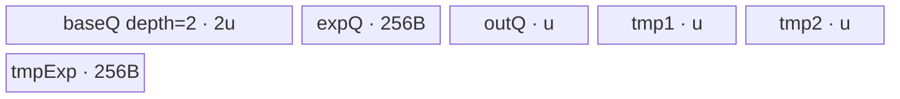

# InplaceExp2 950 ACLNN 算子知识

## 算子速览

| 项目 | 内容 |
|---|---|
| 实际入口 | `aclnnInplaceExp2GetWorkspaceSize` + `aclnnInplaceExp2`，公开 ACLNN 两段式接口；不合并 `aclnnExp2`、Pow API 或其它幂算子。 |
| 计算语义 | 对 `selfRef` 每个逻辑元素计算 `2^x`，最后写回同一个用户 Tensor 视图。 |
| 输入输出 | 单一输入/输出别名 `selfRef`；ND、rank≤8、可非连续；950 支持 FLOAT、FLOAT16、BFLOAT16、DOUBLE；空 Tensor 由 Host 短路。 |
| 执行类型 | FLOAT/FLOAT16：核心为 `AIV_VECTOR` 或 `NDDMA + AIV_VECTOR`；BFLOAT16：前后各一个 AIV Cast，中间 FP32 Pow；DOUBLE：AICPU；ViewCopy/Contiguous 是框架边界。所有已闭合节点均无 Cube/AIC/MIX_CV。 |
| Kernel 路线 | R-001 FP16/FP32 单元素；R-002 BF16 单元素三节点；R-003 FP16/FP32 多元素 NDDMA；R-004 BF16 多元素四节点；R-005/R-006 DOUBLE AICPU 串行/并行。 |
| 核心资源 | Pow AIV：GM、TQue/TBuf、MicroAPI/Power、NDDMA、16 MiB节点 workspace；Cast AIV：双缓冲输入/输出队列、16 MiB节点 workspace；AICPU：GM/CPU worker、100 B配置 workspace。 |
| 来源闭包 | `source_closed`：公开 Inplace API、Host 建图、Pow/Cast selector、950 Tiling/POD、AIV/NDDMA/AICPU body 与构建接线闭合；executor、Contiguous/ViewCopy 与 AscendC primitive 内部为明确框架边界。 |
| 验证状态 | 已完成源码闭包检查；本次知识提取未执行编译、真机、数值或性能测试。 |

## 接口与语义

### 计算语义

令 `N=product(selfRef.shape)`。非空时真实建图为：

```text
x = Contiguous(selfRef)
if dtype(x)==BF16:
  xf = Cast(x,FLOAT)
  p  = Pow(Tensor(2.0f),xf)
  y  = Cast(p,BF16,round=RINT)
else:
  p  = Pow(Tensor(2,dtype(x)),x)
  y  = p                         # 同 dtype Cast 在 Host 消除
ViewCopy(y,selfRef)
```

因此用户可见结果是 `selfRef[i] <- 2^(old selfRef[i])`。原地语义只保证最终写回同一用户对象；核心 Pow 的输入、临时输出与用户存储不要求物理别名。BF16 明确升为 FP32 计算再 RINT 降回 BF16；FLOAT16 保持 FLOAT16 Pow primitive 的固定实现；DOUBLE 使用 `std::pow(double,double)` AICPU 路线。

### 输入、输出与属性

| 参数 | shape/layout | dtype | 约束、默认值与语义 |
|---|---|---|---|
| `selfRef` | ND，rank≤8，可非连续，可为空 | FLOAT、FLOAT16、BFLOAT16、DOUBLE | 同一对象同时作为输入与输出；950/RegBase 开放 BF16。 |
| `workspaceSize` | Host 标量输出 | `uint64_t*` | 第一段返回完整 executor 汇总的 Device workspace；空 Tensor 固定返回 0。 |
| `executor` | Host 输出句柄 | `aclOpExecutor**` | 拥有任务图、中间 Tensor 与节点生命周期；由第一段移交。 |
| `workspace` | Device 字节缓冲区 | `void*` | 第二段输入，容量必须对应同一 executor 的返回值。 |
| `stream` | runtime stream | `aclrtStream` | `CommonOpExecutorRun` 在该 stream 上提交整个图。 |

底数不是公开属性；`BASE_FOR_EXP2=2`，由 executor 分配 `aclScalar` 并按核心 dtype转换成单元素 Tensor。

### 入口与版本

固定版本只有无后缀的 `aclnnInplaceExp2GetWorkspaceSize/aclnnInplaceExp2`，是 950 实际支持的最新公开版本。公开文档明确列出 Ascend 950PR/950DT；`Pow` OpDef 对 `ascend950` 注册 `pow_apt`，950 binary 覆盖 FP16/BF16/FP32，CMake 把 `ascend950` 接到 `arch35`。本卡不把同文件的非原地 `aclnnExp2` 或底层 `Pow` 当成同一逻辑算子。

公开文档也声明 A2/A3 支持，但固定提交的 Pow 活动 CMake/binary/OpDef 没有 `ascend910b/ascend910_93` 全链；`mc62` 名称不能证明 A2/A3 实现身份，故不生成无后缀卡。

## Host/Launcher 执行流程

### 参数校验与前处理

1. `CREATE_EXECUTOR`，失败返回 `ACLNN_ERR_INNER_CREATE_EXECUTOR`。
2. `CheckInplaceParams(selfRef,selfRef)` 先检查非空，再按 `IsRegBase()` 选择 `{FLOAT,FLOAT16,DOUBLE,BF16}` 白名单，最后检查同 shape 且 rank≤8；同一对象使输出转换关系天然成立，但公共检查仍执行。
3. 空 Tensor 写 `workspaceSize=0`、移交 executor 并成功返回，不入队任何 Device 节点。
4. `l0op::Contiguous(selfRef)`：已连续时只返回 reshape/view；非连续时由框架优化组合或 `AsStridedToContiguous` 生成连续结果。
5. BF16 执行 `l0op::Cast(...,FLOAT)`；其余 dtype 令 `selfAfterCast=contiguousSelf`。
6. 将 Host 标量 2 转成与 `selfAfterCast` 相同 dtype 的单元素 Tensor，调用 `l0op::Pow(baseTensor,selfAfterCast)`。
7. `l0op::Cast(exp2Out,selfRef.dtype)`：FLOAT/FLOAT16/DOUBLE 因同 dtype直接返回 `exp2Out`；BF16 入队 FLOAT→BF16 AIV Cast。
8. `l0op::ViewCopy(castOut,selfRef)` 将连续临时结果提交回用户 view；任一节点返回 null 即 `ACLNN_ERR_INNER_NULLPTR`。
9. 返回 `uniqueExecutor->GetWorkspaceSize()` 并 `ReleaseTo(executor)`；第二段只执行 `CommonOpExecutorRun`。

### 参数、Workspace 与生命周期

Pow AIV Tiling 固定请求 16,777,216 B；entry 要求 system workspace 和 `GetUserWorkspace` 均非空，body不读 user slice。Cast 的 `GetWorkspaceSize` 同样为 16 MiB。Pow AICPU JSON配置为 100 B。完整 ACLNN workspace 还包括非连续处理、ViewCopy、临时 Tensor 与框架对齐，固定算子源码没有公开各 slice 的最终 offset/复用策略，所以不能把任一节点值当作 ACLNN 总返回值。

用户拥有 `selfRef`；executor 持有连续输入、BF16 两个 Cast 中间、Pow 输出、底数 Tensor以及 ViewCopy 元数据，至少存活至各自最后一个 consumer。所有节点由同一个 executor在第二段指定 stream 上按数据依赖执行。

### 启动图与失败传播

```text
empty -> success(workspace=0), no node

FP16/FP32:
  Contiguous -> Pow(AIV scalar or NDDMA) -> Cast(same dtype, Host no-op) -> ViewCopy(AIV boundary)

BF16:
  Contiguous -> Cast BF16->F32(AIV) -> Pow F32(AIV scalar or NDDMA)
             -> Cast F32->BF16(AIV) -> ViewCopy(AIV boundary)

DOUBLE:
  Contiguous -> Pow AICPU -> Cast(same dtype, Host no-op) -> ViewCopy(AICPU boundary)
```

| 节点/边 | entry/介质 | extent、dtype/layout | ordering 与 owner/lifetime | 失败传播 |
|---|---|---|---|---|
| Contiguous→Cast/Pow | executor Tensor | `N` 元素，输入 dtype，连续 ND | executor 持有到下一节点读完 | null停止构图 |
| BF16 Cast→Pow | `cast(x,y,workspace,tiling)` | `N` 个 FP32 | 同 stream producer→consumer | Cast失败阻断Pow |
| base→Pow | executor单元素 Tensor | 常量2，dtype=Pow dtype | 只读，存活至Pow结束 | 转 Tensor失败停止 |
| Pow→后Cast/ViewCopy | Pow临时 GM | `N` 个 Pow dtype | Pow完成后消费；executor owner | Tiling/launch失败阻断后续 |
| 后Cast→ViewCopy | BF16临时 GM | `N` 个 BF16 | 后Cast完成后写用户 view | 失败不提交结果 |

## Route 与参数设计

### 分核与资源计算

Pow 模板按 priority升序：priority 0 的 `PowTensorScalarTiling` 要求指数 Tensor 元素数为1；本入口的指数正是 `selfRef`，故只在 `N=1` 命中。`N>1` 进入 priority 1 的 `PowTensorTensorTiling`。底数始终为单元素，指数/输出均为连续同 shape；Broadcast dimension collapse把底数各轴 stride置0，并将该单一广播模式的相邻轴全部合并，所以 `shapeLen=1`、`shapeLen-ubSplitAxis<=5`，只可达 without-loop NDDMA key，不可达 with-loop key。

单元素 Pow 的 `baseSize=1`，通用公式仍为：

```text
reserve = 8 KiB + 256 B + 256 B + powsApiTmpBuffer
nodes = 5 + powsApiNode
u = align_down((platformUB-reserve)/nodes, 512 B或blockSize)
ubFactor = min(u/computeDtypeSize, max(ceil(1/coreNum),4096/baseDtypeSize))
ubOuter=ceil(1/ubFactor)=1; ubTail=1; blockFactor=1; blockNum=1
```

多元素 Pow 令 `s=sizeof(T)`，先从 UB扣 `powApiTmpBuffer`，再把 `powApiNode*s*8` 加到两项 `bufferDivisor`。BroadcastTiling求对齐后的 `E=elemNum`，沿唯一合并轴切为 `ubFormer/ubTail`，`fusedProduct=ubOuter`，再计算 `blockFormer=ceil(fusedProduct/coreNum)`、`blockNum=ceil(fusedProduct/blockFormer)` 与 `blockTail`；`preferMultiCore=true` 时可每次减128元素重新切分，最低止于512。

BF16 Cast 节点令输入/输出位宽分别16/32或32/16：

```text
castUbFormer = align_down(((UB-128)*4)/(srcBits+dstBits), vectorBits/srcBits)
castCore = min(ceil(N*srcBits/(4 KiB*8)), platformAivCores)
blockFormer = align_up(ceil(N/castCore),8 elements)
blockNum = ceil(N/blockFormer)
```

### Route 选择

| 顺序 | Route | Key/模板 | 精确选择条件与优先级 | 不适用去向 |
|---:|---|---|---|---|
| 1 | R-001 FP16/FP32 singleton | 1001/3001；`PowTensorScalarFloat<half\|float,same>` | 非空，dtype FP16/FP32，`N=1`，Pow AiCore，priority 0 | N>1→R-003 |
| 2 | R-002 BF16 singleton | Cast direct + Pow key3001 + Cast direct | 非空，dtype BF16，`N=1`；先升FP32 | N>1→R-004 |
| 3 | R-003 FP16/FP32 NDDMA | 100000001000100/300000001000100 | dtype FP16/FP32，`N>1`，priority 1，合并后内轴数1≤5 | Tiling失败 |
| 4 | R-004 BF16 NDDMA | 两Cast + 300000001000100 | dtype BF16，`N>1`；Pow实际dtype FP32 | Tiling失败 |
| 5 | R-005 DOUBLE AICPU串行 | `PowCompute<double,double,double>` | dtype DOUBLE，`N<30*1024`；Pow AiCore不支持 | R-006 |
| 6 | R-006 DOUBLE AICPU并行 | 同上 + `ParallelFor` | dtype DOUBLE，`N>=30*1024` | 无 |

```text
invalid/null/rank>8 -> ACLNN error
N==0 -> success without Device node
dtype==DOUBLE -> N>=30720 ? R-006 : R-005
dtype==BF16 -> N==1 ? R-002 : R-004
dtype in {FP16,FP32} -> N==1 ? R-001 : R-003
```

### 模板/实现执行矩阵

| Route | key/selector | dtype/shape/platform 完整命中条件 | 执行拓扑与 Kernel 节点 | 实际模板/body | 内存与同步特征 | tail/fallback |
|---|---|---|---|---|---|---|
| R-001 | 1001/3001 | 950，N=1，FP16/FP32 | 单Pow AIV + ViewCopy边界 | `PowTensorScalarFloat<T,T>` | 3 Que+3 TBuf，Power/MicroAPI | 单tile；指数值分支 |
| R-002 | Cast/3001/Cast | 950，N=1，BF16 | 三个AIV计算节点 + ViewCopy | `CastDirect<bf16,f32>`→`PowTensorScalarFloat<float,float>`→`CastDirect<f32,bf16>` | 跨节点GM临时；同stream依赖 | Cast RINT降精度 |
| R-003 | F16/F32 without-loop | 950，N>1，FP16/FP32 | 单Pow `NDDMA+AIV_VECTOR` + ViewCopy | `PowF16/F32NddmaWithoutLoops` | 三路depth2队列；底数广播缓存 | `ubTail/blockTail` |
| R-004 | Cast/F32 without/Cast | 950，N>1，BF16 | Cast→NDDMA Pow→Cast→ViewCopy | 两个CastDirect + F32 NDDMA body | 节点内queue，节点间GM | 同上，最终RINT |
| R-005/R-006 | AICPU selector | 950，DOUBLE | 单Pow AICPU + ViewCopy AICPU边界 | `NoBcastCompute/X_ONE_ELEMENT` | 无AIV UB；R-006分片并行 | `i<N`边界 |

### 隐藏性能 Guard

| Guard | Host/Tiling 条件 | Device/资源原因 | 影响 Route | 不满足时去向 | 源码符号 |
|---|---|---|---|---|---|
| Pow dtype | 950 list含F16/BF16/F32但不含DOUBLE | 950 entry/binary无DOUBLE实例 | R-001..R-004 | AICPU R-005/R-006 | `pow.cpp::IsAiCoreSupport` |
| Inplace BF16升精度 | `dstDataType==DT_BF16` | 本API固定用FP32核心计算 | R-002/R-004 | 其它dtype不建Cast | `aclnn_exp2.cpp::aclnnInplaceExp2GetWorkspaceSize` |
| singleton | `prod(expShape)==1`即N=1 | 指数只读一次并标量化 | R-001/R-002 | priority 1 | `PowTensorScalarTiling::IsCapable` |
| NDDMA rank | 合轴后内轴1≤5 | 5D MultiCopy可一次表达 | R-003/R-004 | 本入口不产生with-loop route | `DimensionCollapse`; `BroadcastGetScheduleKey` |
| base缓存 | `input0Stride[splitAxis]==0` 且非刷新周期 | 常量2的广播tile可跨loop复用 | R-003/R-004 | 重新NDDMA加载 | `Pow*WithoutLoops::CopyIn0` |
| Cast UB | `UB>128` 且 `castUbFormer>0` | 两路depth2 queue需同时容纳 | R-002/R-004 | Tiling失败 | `CastTiling::GetUbFormer` |
| AICPU并行 | `N>=30*1024` | 大数据切CPU worker区间 | R-005/R-006 | 小数据串行 | `PowCpuKernel::NoBcastCompute` |
| Pow workspace | 两级workspace指针非空 | entry在设置system workspace后才运行 | R-001..R-004 | 直接return | `pow_apt.cpp::pow` |

### POD/ABI

`TILING_DATA_FIELD_DEF` 最终宏展开不在固定 ops-math 源码内；可证明声明顺序、类型、producer/consumer，不能臆造最终 `sizeof/alignof/offsetof`。

| 结构 | 字段 | 类型/位宽 | ABI 布局 | 单位 | Host/launcher producer | Device consumer | 边界 |
|---|---|---|---|---|---|---|---|
| `PowTensorScalarTilingData` | `blockNum` | int64/64 | 声明序0；精确offset不可见 | block | `ceil(ubOuter/blockFactor)` | 设置blockDim | 本入口=1 |
| 同上 | `blockFactor` | int64/64 | 声明序1 | tile/core | `ceil(ubOuter/coreNum)` | `Process` begin/end | 本入口=1 |
| 同上 | `blockTail` | int64/64 | 声明序2 | tile | 余数0改blockFactor | body未读 | inactive |
| 同上 | `ubOuter` | int64/64 | 声明序3 | tile | `ceil(total/ubFactor)` | end/tail判断 | 本入口=1 |
| 同上 | `ubFactor` | int64/64 | 声明序4 | element | `GetUbFactor` | GM offset/正常长度 | ≥1 |
| 同上 | `ubTail` | int64/64 | 声明序5 | element | 余数0改ubFactor | 尾长度 | 本入口=1 |
| 同上 | `totalSize` | int64/64 | 声明序6 | element | `prod(baseShape)` | body未读 | 本入口=1 |
| 同上 | `ubSize` | int64/64 | 声明序7 | byte/buffer | 对齐后的u | 六项InitBuffer | `5u+512`显式UB |
| `PowTensorTensorTilingData` | `blockFormer` | int64/64 | 声明序0；offset不可见 | loop/core | BroadcastTiling | 每核loop数/初坐标 | 非末核 |
| 同上 | `ubFormer` | int64/64 | 声明序1 | element/split轴 | `GetBlockSplitFactor` | NDDMA长度/offset | 正常tile |
| 同上 | `ubOuter` | int64/64 | 声明序2 | tile | `ceil(axis/ubFormer)` | 坐标/缓存周期 | >0 |
| 同上 | `ubTail` | int64/64 | 声明序3 | element | axis尾数 | 尾tile | 1..ubFormer |
| 同上 | `blockTail` | int64/64 | 声明序4 | loop/core | fused尾数 | 末核loop | 1..blockFormer |
| 同上 | `shapeLen` | int64/64 | 声明序5 | collapsed axis | `dims.back().size()` | NDDMA参数 | 本入口=1 |
| 同上 | `ubSplitAxis` | int64/64 | 声明序6 | axis | UB切分 | 全部地址helper | 本入口=0 |
| 同上 | `dimProductBeforeUbInner` | int64/64 | 声明序7 | tile product | fusedProduct | 坐标展开 | >0 |
| 同上 | `elemNum` | int64/64 | 声明序8 | element/buffer | 对齐maxElemNum | 三个queue容量 | >0 |
| 同上 | `input0Dims[8]` | int64×8 | 声明序9 | element/axis | collapsed base dims | body未读 | 有效首项1 |
| 同上 | `input1Dims[8]` | int64×8 | 声明序10 | element/axis | collapsed x dims | body未读 | 有效首项N |
| 同上 | `outputDims[8]` | int64×8 | 声明序11 | element/axis | collapsed output | NDDMA loop | 有效首项N |
| 同上 | `input0Strides[8]` | int64×8 | 声明序12 | element stride | base广播stride | base NDDMA offset | 首项0 |
| 同上 | `input1Strides[8]` | int64×8 | 声明序13 | element stride | x contiguous stride | exponent NDDMA | 首项1 |
| 同上 | `outputStrides[8]` | int64×8 | 声明序14 | element stride | output stride | 长度/offset | 首项1 |
| `CastTilingData` | `blockNum` | int64/64 | 声明序0；offset不可见 | block | Cast Tiling | block tail判断 | >0 |
| 同上 | `ubFormer` | int64/64 | 声明序1 | element | UB位宽公式 | queue容量/loop | >0 |
| 同上 | `blockFormer` | int64/64 | 声明序2 | element/core | 8元素对齐 | GM基址 | >0 |
| 同上 | `ubLoopOfFormerBlock` | int64/64 | 声明序3 | loop | ceil(blockFormer/ubFormer) | 非末核loop | ≥1 |
| 同上 | `ubLoopOfTailBlock` | int64/64 | 声明序4 | loop | ceil(blockTail/ubFormer) | 末核loop | ≥1 |
| 同上 | `ubTailOfFormerBlock` | int64/64 | 声明序5 | element | former尾数 | 非末核尾DMA | 1..ubFormer |
| 同上 | `ubTailOfTailBlock` | int64/64 | 声明序6 | element | tail尾数 | 末核尾DMA | 1..ubFormer |
| 同上 | `regCopyInStep` | int64/64 | 声明序7 | element | policy copy mode | DirectCast未读 | inactive |
| 同上 | `regCopyOutStep` | int64/64 | 声明序8 | element | policy copy mode | DirectCast未读 | inactive |
| 同上 | `ubFormerRegLoop` | int64/64 | 声明序9 | reg loop | policy计算 | DirectCast未读 | inactive |
| 同上 | `ubTailOfFormerRegLoop` | int64/64 | 声明序10 | reg loop | policy计算 | DirectCast未读 | inactive |
| 同上 | `ubTailOfTailRegLoop` | int64/64 | 声明序11 | reg loop | policy计算 | DirectCast未读 | inactive |
| AICPU context | tensor desc/data | 框架ABI | 无算子自有POD | shape/dtype/address | launcher | `PowCpuKernel` | runner布局不可见 |

### Route 源码闭包

| Route | Key/selector | Host/Tiling producer | POD/参数 | Kernel entry/router 节点 | Kernel body/直接依赖 | 构建接线 |
|---|---|---|---|---|---|---|
| R-001 | 1001/3001 | scalar tiling | Pow scalar POD | `pow_apt.cpp::pow` | `PowTensorScalarFloat` | Pow OpDef/binary/CMake |
| R-002 | Cast/3001/Cast | Cast Tiling + scalar tiling | Cast POD + Pow scalar POD | `cast`→`pow`→`cast` | `CastDirect` + scalar float | Cast/Pow 950接线 |
| R-003 | F16/F32 without key | tensor tiling + opbase BroadcastTiling | Pow tensor POD | `pow_apt.cpp::pow` | F16/F32 without-loop + broadcast helper | Pow 950接线 |
| R-004 | Cast/F32 without/Cast | Cast Tiling + tensor tiling | Cast POD + Pow tensor POD | `cast`→`pow`→`cast` | CastDirect + F32 without-loop | Cast/Pow 950接线 |
| R-005/R-006 | `IsAiCoreSupport=false` | `pow.cpp::Pow` | tensor context | `RunCpuKernel`→`Compute` | `NoBcastCompute/SpecialCompute/PowImpl` | `pow.json` |

## Kernel 实现

### 公共执行流程

Pow AIV entry参数为 `(base,exponent,y,workspace,tiling)`，先做workspace两级非空检查、`SetSysWorkspace`，再声明 `KERNEL_TYPE_AIV_ONLY`。scalar key解析 `PowTensorScalarTilingData`；NDDMA key解析 `PowTensorTensorTilingData`。未知key没有fallback，直接结束无输出。

Cast entry同样声明 `KERNEL_TYPE_AIV_ONLY`，BF16↔FP32的 policy 都是 `CAST_TEMPLATE_DIRECT_CAST`：BF16→FP32用 `CAST_NONE`，FP32→BF16用 `CAST_RINT`。DOUBLE Pow由AICPU dtype三层map定位 `PowCompute<double,double,double>`；底数numel=1使其恒走 `NoBcastCompute/X_ONE_ELEMENT`。

### Route R-001：FP16/FP32 singleton AIV

#### 适用条件

##### 选择证据

| 层级 | 文件 | 符号 | 源码谓词/参数 | 结果/下一跳 |
|---|---|---|---|---|
| API | `aclnn_exp2.cpp` | Inplace GetWorkspace | dtype F16/F32，N=1 | base Tensor同dtype |
| L0 | `pow.cpp` | `IsAiCoreSupport` | RegBase list命中 | PowAiCore |
| Tiling | scalar tiling | `IsCapable` | expSize=1 | key1001/3001 |
| Router | `pow_apt.cpp` | key branches | POD有效 | `PowTensorScalarFloat<T,T>` |

#### Device 数据流

##### 函数级调用链

```text
Pow launch -> pow -> PowTensorScalarFloat<T,T>::Init
  -> bind GM; InitBuffer; read exponent[0]
  -> Process -> CopyBase -> specialized helper/Power -> CopyPow
```

##### 源码等价伪码

```text
exp=float(exponentGM[0]); len=1; base=2
if exp==0: output=1
else if exp in {1,0.5,-0.5,2,3,-1,-2}: use Copy/Sqrt/Rsqrt/Mul/Div helper
else: f32直接Power；f16先Cast到f32、Power(DOUBLE_FLOAT_TECH)、再Cast回f16
DMA一个有效元素到Pow输出
```

#### 内存与数据搬运

##### 资源与搬运表

| 层级/缓冲区 | offset/地址公式 | extent/容量公式 | dtype/layout | producer | consumer | owner/lifetime | 对齐/复用 |
|---|---|---|---|---|---|---|---|
| base/exponent/output GM | 0 | 1 element | T/ND | executor/compute | Init/compute/ViewCopy | executor | DataCopyPad有效字节 |
| `vecBaseQue` | UB | `2u` | T | CopyBase | compute | TPipe | depth2 |
| `vecExpQue` | UB | 256 B | T | scalar DMA(BF16模板才用) | scalar cast | TPipe | 本Route实际不搬 |
| `vecPowQue` | UB | `u` | T | compute | CopyPow | TPipe | depth1 |
| `tmp1/tmp2` | UB | 各u | f32 view | Cast/Power | Power/Cast | TPipe | F16 generic分支 |
| `tmpExp` | UB | 256 B | f32 | BF16模板 | scalar | TPipe | 本Routeinactive |

##### 分层内存布局



##### 字节账与复用顺序

```text
explicit_UB = 5u + 512 B
reserved_bound = (5+powsApiNode)*u + 8 KiB + 512 B + powsApiTmpBuffer <= platformUB
dynamic_ub=N/A; Pow workspace=16 MiB
```

| 复用子区 | 写入者 | 读取者/消费点 | 下一次覆盖 | 同步或释放依据 | 安全条件 |
|---|---|---|---|---|---|
| base queue slot | CopyBase | helper/Power | 无下一tile | EnQue→DeQue→FreeTensor | 消费后释放 |
| output queue | compute | CopyPow | 无 | queue生命周期 | GM copy后释放 |
| tmp1/tmp2 | Cast/Power | Power/Cast | Kernel结束 | 程序顺序 | 仅F16 generic分支 |

#### 同步、精度与尾块

##### 同步与数值边界表

| 阶段 | primitive/机制 | producer | consumer/等待点 | 保护对象 | 精度/尾块 |
|---|---|---|---|---|---|
| scalar→vector | S_V event | scalar读取 | Process | expValue | 单元素 |
| tile pipeline | TQue | DMA/compute | compute/DMA | queue slot | len=1 |
| generic F16 | Cast→Power→Cast | F16 input | F16 output | tmp buffers | FP32中间 |
| `ComputeCube` | 两次MicroAPI Mul | base | output | Vector寄存器 | 名称指立方，不是Cube/AIC |

#### 关键实现

##### 符号证据表

| 阶段 | 文件 | 符号/模板实例 | 实现事实 |
|---|---|---|---|
| Host/Tiling producer | scalar tiling cpp | `DoOpTiling/GetTilingKey` | 单元素key、UB/core |
| Kernel entry/router | `pow_apt.cpp` | 1001/3001 | AIV-only映射 |
| Device body/helper | `pow_tensor_scalar_float.h` | `Init/Process/Compute*` | 标量分支、精度、queue |

### Route R-002：BF16 singleton 三 AIV 节点

#### 适用条件

##### 选择证据

| 层级 | 文件 | 符号 | 源码谓词/参数 | 结果/下一跳 |
|---|---|---|---|---|
| API | `aclnn_exp2.cpp` | BF16 branch | dtype BF16 | 前Cast到F32，后Cast回BF16 |
| Cast selector | `cast.cpp` | `IsAiCoreSupport` | RegBase支持两方向 | CastAiCore |
| Pow Tiling | scalar tiling | expSize=1、base dtype F32 | key3001 | F32 scalar body |

#### Device 数据流

##### 函数级调用链

```text
cast BF16->F32 -> CastDirect<bf16,f32>::Process
  -> Pow key3001 -> PowTensorScalarFloat<float,float>::Process
  -> cast F32->BF16 -> CastDirect<float,bf16>::Process
```

##### 源码等价伪码

```text
xf[0]=CastNone(bf16 x[0] -> f32)
p[0]=Power/specialized(2.0f,xf[0])
y[0]=CastRint(f32 p[0] -> bf16)
ViewCopy(y,selfRef)
```

#### 内存与数据搬运

##### 资源与搬运表

| 层级/缓冲区 | offset/地址公式 | extent/容量公式 | dtype/layout | producer | consumer | owner/lifetime | 对齐/复用 |
|---|---|---|---|---|---|---|---|
| preCast queues | core/tile offset | each `2*castUbFormer*sizeof(src/dst)` | BF16/F32 | DMA/Cast | Cast/DMA | Cast TPipe | depth2 |
| `xf` GM edge | 0 | 1 F32 | contiguous | preCast | Pow | executor | node间临时 |
| Pow UB | 同R-001 F32 | `5u+512` | F32 | Pow | postCast | Pow TPipe | key3001 |
| `p` GM edge | 0 | 1 F32 | contiguous | Pow | postCast | executor | node间临时 |
| postCast queues | 0 | depth2 F32/BF16 | F32/BF16 | DMA/Cast | Cast/DMA | Cast TPipe | RINT |

##### 分层内存布局


##### 字节账与复用顺序

```text
each Cast UB = 2*C*sizeof(src)+2*C*sizeof(dst)
Pow UB = 5u+512 B
nodes execute sequentially; UB is per-kernel and not simultaneous
workspace_total = executor-owned; each AIV node requests 16 MiB
```

| 复用子区 | 写入者 | 读取者/消费点 | 下一次覆盖 | 同步或释放依据 | 安全条件 |
|---|---|---|---|---|---|
| Cast queue slot | CopyIn/Compute | Compute/CopyOut | next tile | FreeTensor | consumer完成 |
| xf/p GM temp | producer node | next node | executor回收后 | stream依赖 | consumer结束前有效 |

#### 同步、精度与尾块

##### 同步与数值边界表

| 阶段 | primitive/机制 | producer | consumer/等待点 | 保护对象 | 精度/尾块 |
|---|---|---|---|---|---|
| preCast | TQue + CastNone | BF16 DMA | F32 store | xf | 逐值精确展开 |
| Pow | TQue/Power | xf | p | Pow temp | FP32 |
| postCast | TQue + CastRint | p | BF16 store | y | RINT降精度 |
| 跨节点 | executor stream依赖 | 前节点 | 后节点 | GM edge | N=1 |

#### 关键实现

##### 符号证据表

| 阶段 | 文件 | 符号/模板实例 | 实现事实 |
|---|---|---|---|
| Host/Tiling producer | API + Cast/Pow tiling | BF16 branch/DoOpTiling | 三节点与参数 |
| Kernel entry/router | `cast_apt.cpp`; `pow_apt.cpp` | DirectCast/key3001 | 均AIV-only |
| Device body/helper | `cast_impl.h`; scalar float header | `CastDirect`; Pow F32 | queue、round、Power |

### Route R-003：FP16/FP32 NDDMA without loops

#### 适用条件

##### 选择证据

| 层级 | 文件 | 符号 | 源码谓词/参数 | 结果/下一跳 |
|---|---|---|---|---|
| Registry | math registry | priority loop | singleton不适用 | priority1 |
| Tiling | tensor tiling | F16/F32 tuple；shapeLen=1 | without key | NDDMA body |
| Router | `pow_apt.cpp` | two without branches | key匹配 | F16/F32 class |

#### Device 数据流

##### 函数级调用链

```text
pow -> PowF16/F32NddmaWithoutLoops::Process
  -> CopyIn0 -> BroadcastNddmaWithoutLoop(base scalar)
  -> CopyIn1 -> DataCopyPad(contiguous exponent)
  -> Compute2 -> Power<T,false,DOUBLE_FLOAT_TECH>
  -> CopyOut3 -> DataCopyPad
```

##### 源码等价伪码

```text
loops = lastCore ? blockTail : blockFormer
for j in loops:
  len = lastUBTile ? ubTail : ubFormer
  if first/refill-period: NDDMA broadcast base[0]==2 over len elements
  DMA exponent contiguous slice of len elements
  outUB = Power(baseUB,expUB,len)
  DMA len valid elements to output GM
```

#### 内存与数据搬运

##### 资源与搬运表

| 层级/缓冲区 | offset/地址公式 | extent/容量公式 | dtype/layout | producer | consumer | owner/lifetime | 对齐/复用 |
|---|---|---|---|---|---|---|---|
| base GM | offset0 | 1 element | T | executor | NDDMA | executor | stride0广播 |
| exponent/output GM | `tile*ubFormer`/tail | len | T/contiguous | input/Power | Power/ViewCopy | executor | DataCopyPad |
| `queIn0` | UB | `2Es` | T | NDDMA | Power | TPipe | depth2/cache |
| `queIn1` | UB | `2Es` | T | DMA | Power | TPipe | depth2 |
| `queOut0` | UB | `2Es` | T | Power | CopyOut | TPipe | depth2 |
| NDDMA config | call-local | 5 loop axes(填充轴为1) | element stride | helper | DataCopy<T,5> | registers | config false/0/0/false |

##### 分层内存布局


##### 字节账与复用顺序

```text
E=elemNum; s=sizeof(T)
explicit_UB=6Es
Power-aware bound=(6+powApiNode)*E*s+powApiTmpBuffer <= platformUB
dynamic_ub=N/A; Pow workspace=16 MiB
```

| 复用子区 | 写入者 | 读取者/消费点 | 下一次覆盖 | 同步或释放依据 | 安全条件 |
|---|---|---|---|---|---|
| base broadcast slot | NDDMA | Power | refill周期 | queue顺序+skip条件 | input0 split stride=0 |
| exponent slot | DMA | Power | next loop | EnQue/DeQue/Free | 消费后释放 |
| output slot | Power | CopyOut | next loop | queue生命周期 | GM copy后释放 |

#### 同步、精度与尾块

##### 同步与数值边界表

| 阶段 | primitive/机制 | producer | consumer/等待点 | 保护对象 | 精度/尾块 |
|---|---|---|---|---|---|
| CopyIn→Power | TQue | NDDMA/DMA | DeQue | input slots | len=ubFormer/ubTail |
| Power→CopyOut | TQue | Power | DeQue | output slot | 只写有效len |
| base广播 | 5D MultiCopy | base[0] | baseUB | scalar复用 | stride0 |
| compute | DOUBLE_FLOAT_TECH | two queues | output | valid elements | F16/F32固定primitive |

#### 关键实现

##### 符号证据表

| 阶段 | 文件 | 符号/模板实例 | 实现事实 |
|---|---|---|---|
| Host/Tiling producer | tensor tiling + opbase | `DoOpTiling/BroadcastTiling` | key、合轴、tile/core |
| Kernel entry/router | `pow_apt.cpp` | F16/F32 without keys | key→body |
| Device body/helper | F16/F32 without headers + broadcast utils | `Process/BroadcastNddmaWithoutLoop` | 地址、NDDMA、Power、tail |

### Route R-004：BF16 Cast→FP32 NDDMA Pow→Cast

#### 适用条件

##### 选择证据

| 层级 | 文件 | 符号 | 源码谓词/参数 | 结果/下一跳 |
|---|---|---|---|---|
| API | `aclnn_exp2.cpp` | BF16 branch | BF16且N>1 | 两Cast与F32 Pow |
| Pow Tiling | tensor tiling | dtype triple F32；shapeLen1 | key300000001000100 | F32 without-loop |
| Cast policy | `cast_struct.h` | BF16/F32两条policy | DirectCast | None/RINT |

#### Device 数据流

##### 函数级调用链

```text
CastDirect<bf16,f32>::Process
  -> PowF32NddmaWithoutLoops::Process
  -> CastDirect<f32,bf16>::Process
  -> ViewCopy
```

##### 源码等价伪码

```text
for Cast tiles: xf=CastNone(x)
for Pow tiles: broadcast 2.0f; p=Power<float>(2,xf)
for Cast tiles: y=CastRint(p)
ViewCopy(y,selfRef)
```

#### 内存与数据搬运

##### 资源与搬运表

| 层级/缓冲区 | offset/地址公式 | extent/容量公式 | dtype/layout | producer | consumer | owner/lifetime | 对齐/复用 |
|---|---|---|---|---|---|---|---|
| pre/post Cast UB | per Cast tile | `2Cs+2Cd` bytes | BF16/F32 | DMA/Cast | Cast/DMA | per-node TPipe | depth2 |
| xf/p GM edges | logical linear offset | N F32 | contiguous | preCast/Pow | Pow/postCast | executor | consumer结束前有效 |
| Pow queues | same R-003 | `6E*4` | F32 | NDDMA/Power | Power/DMA | Pow TPipe | base cache |
| final BF16 GM | linear temp | N BF16 | contiguous | postCast | ViewCopy | executor | RINT |

##### 分层内存布局


##### 字节账与复用顺序

```text
preCast UB=2*Cpre*2 + 2*Cpre*4
Pow UB=6*E*4
postCast UB=2*Cpost*4 + 2*Cpost*2
per-node UB不同时驻留；executor workspace_total固定仓不可见
```

| 复用子区 | 写入者 | 读取者/消费点 | 下一次覆盖 | 同步或释放依据 | 安全条件 |
|---|---|---|---|---|---|
| each Cast queue | DMA/Cast | Cast/DMA | next tile | FreeTensor | 完成后覆盖 |
| Pow base cache | NDDMA | Power | refill | queue+stride0 guard | 常量底数 |
| xf/p edges | producer node | consumer node | executor回收 | stream ordering | 后节点成功读取 |

#### 同步、精度与尾块

##### 同步与数值边界表

| 阶段 | primitive/机制 | producer | consumer/等待点 | 保护对象 | 精度/尾块 |
|---|---|---|---|---|---|
| preCast | CastNone | BF16 | FP32 | xf | Cast自身tail字段 |
| Pow | TQue/NDDMA/Power | xf/base | p | Pow tiles | ubTail/blockTail |
| postCast | CastRint | p | BF16 y | final temp | Cast tail字段 |
| cross-node | executor stream | each producer | next consumer | GM temp | producer失败阻断 |

#### 关键实现

##### 符号证据表

| 阶段 | 文件 | 符号/模板实例 | 实现事实 |
|---|---|---|---|
| Host/Tiling producer | API、Cast Tiling、Pow tensor tiling | BF16 branch/DoOpTiling | 多节点参数 |
| Kernel entry/router | Cast/Pow apt | DirectCast/F32 without | AIV-only映射 |
| Device body/helper | CastDirect + F32 without + broadcast helper | Process/Power/NDDMA | 搬运、精度、缓存、tail |

### Route R-005：DOUBLE AICPU串行

#### 适用条件

##### 选择证据

| 层级 | 文件 | 符号 | 源码谓词/参数 | 结果/下一跳 |
|---|---|---|---|---|
| L0 | `pow.cpp` | `IsAiCoreSupport` | DOUBLE不在list | PowAiCpu |
| AICPU router | `pow_aicpu.cpp` | `kcalls` | double/double/double | PowCompute |
| Body | 同上 | `NoBcastCompute` | base numel1；N<30720 | serial SpecialCompute |

#### Device 数据流

##### 函数级调用链

```text
RunCpuKernel -> PowCpuKernel::Compute -> PowCompute<double,double,double>
  -> NoBcastCompute(X_ONE_ELEMENT) -> SpecialCompute -> std::pow
```

##### 源码等价伪码

```text
for i in [0,N): output[i]=std::pow(base[0],exponent[i])
```

#### 内存与数据搬运

##### 资源与搬运表

| 层级/缓冲区 | offset/地址公式 | extent/容量公式 | dtype/layout | producer | consumer | owner/lifetime | 对齐/复用 |
|---|---|---|---|---|---|---|---|
| base GM | 0 | 1 double | scalar | executor | every iteration | executor | read-only |
| exponent/output GM | i | N double | contiguous | input/std::pow | std::pow/ViewCopy | task | direct pointer |
| AIV UB | N/A | N/A | N/A | N/A | N/A | AICPU替代 | N/A |
| workspace | opaque | 100 B配置 | AICPU | runtime | runner | task | body不显式读取 |

##### 分层内存布局

N/A：AICPU直接访问 Tensor data，无 AIV UB、dynamic UB或算子自有中间buffer。

##### 字节账与复用顺序

```text
UB_total=N/A; dynamic_ub=N/A; AICPU configured workspace=100 B
```

| 复用子区 | 写入者 | 读取者/消费点 | 下一次覆盖 | 同步或释放依据 | 安全条件 |
|---|---|---|---|---|---|
| output[i] | PowImpl | ViewCopy | 无 | 串行任务返回 | 每i只写一次 |

#### 同步、精度与尾块

##### 同步与数值边界表

| 阶段 | primitive/机制 | producer | consumer/等待点 | 保护对象 | 精度/尾块 |
|---|---|---|---|---|---|
| loop | program order | loads | store | output[i] | double std::pow；i<N |
| node→ViewCopy | task completion | Pow AICPU | ViewCopy AICPU | output temp | 同dtype无Cast |

#### 关键实现

##### 符号证据表

| 阶段 | 文件 | 符号/模板实例 | 实现事实 |
|---|---|---|---|
| Host/Tiling producer | `pow.cpp` | Pow/PowAiCpu | fallback launch |
| Kernel entry/router | `pow_aicpu.cpp` | Compute/kcalls | double dispatch |
| Device body/helper | 同上 | NoBcastCompute/SpecialCompute/PowImpl | scalar base与std::pow |

### Route R-006：DOUBLE AICPU并行

#### 适用条件

##### 选择证据

| 层级 | 文件 | 符号 | 源码谓词/参数 | 结果/下一跳 |
|---|---|---|---|---|
| AICPU | `pow_aicpu.cpp` | `NoBcastCompute` | N≥30*1024 | ParallelFor |

#### Device 数据流

##### 函数级调用链

```text
NoBcastCompute -> workers=max(1,GetCPUNum(ctx))
  -> ParallelFor -> SpecialCompute(X_ONE_ELEMENT,start,end) -> std::pow
```

##### 源码等价伪码

```text
chunk=CeilMultiple(N,workers)
parallel each [start,end): output[i]=std::pow(base[0],exponent[i])
```

#### 内存与数据搬运

##### 资源与搬运表

| 层级/缓冲区 | offset/地址公式 | extent/容量公式 | dtype/layout | producer | consumer | owner/lifetime | 对齐/复用 |
|---|---|---|---|---|---|---|---|
| worker range | `[start,end)` | framework chunk | double | ParallelFor | SpecialCompute | task | disjoint output |
| shared base/exponent | 0/i | read-only | double | executor | workers | task | concurrent reads |

##### 分层内存布局

N/A：AICPU worker路线，无 AIV UB。

##### 字节账与复用顺序

```text
UB_total=N/A; dynamic_ub=N/A; configured workspace=100 B
```

| 复用子区 | 写入者 | 读取者/消费点 | 下一次覆盖 | 同步或释放依据 | 安全条件 |
|---|---|---|---|---|---|
| output chunk | each worker | ViewCopy | 无 | ParallelFor完成 | chunks不重叠 |

#### 同步、精度与尾块

##### 同步与数值边界表

| 阶段 | primitive/机制 | producer | consumer/等待点 | 保护对象 | 精度/尾块 |
|---|---|---|---|---|---|
| workers | ParallelFor | worker stores | task return | output可见性 | end界限保护末chunk |

#### 关键实现

##### 符号证据表

| 阶段 | 文件 | 符号/模板实例 | 实现事实 |
|---|---|---|---|
| Host/Tiling producer | `pow_aicpu.cpp` | threshold constant | 30720 guard |
| Kernel entry/router | 同上 | NoBcastCompute | worker/chunk参数 |
| Device body/helper | 同上 | worker lambda/SpecialCompute | 不重叠区间与std::pow |

## 算子特定优化

### Trick T-001：BF16 固定升 FP32 后再 RINT 回写

#### 触发与源码依据

- 适用 Route：R-002、R-004
- 触发条件：`selfRef.dtype==DT_BF16`
- Golden 来源：[`math/pow/op_api/aclnn_exp2.cpp:227-247`](../../../../../../../cann-ops-raw/ascendc/ops-math/165d41f02a43a62324b434cb6bda7c533b14da3e/math/pow/op_api/aclnn_exp2.cpp)

**官方源码（固定 Commit 连续逐字摘录）**：

```cpp
aclScalar* baseValue = uniqueExecutor.get()->AllocScalar(BASE_FOR_EXP2);
auto dstDataType = contiguousSelf->GetDataType();
auto selfAfterCast = contiguousSelf;

// 只有在Ascend910B才支持BF16，同时l0 Cast在Ascend910B时也支持BF16Cast成FLOAT
// BOOL类型也需要转换成FLOAT类型处理
if (dstDataType == DataType::DT_BF16 || IsIntegralType(dstDataType, true)) {
    dstDataType = DataType::DT_FLOAT;
    selfAfterCast = l0op::Cast(contiguousSelf, DataType::DT_FLOAT, uniqueExecutor.get());
    CHECK_RET(selfAfterCast != nullptr, ACLNN_ERR_INNER_NULLPTR);
}

auto baseValueTensor = uniqueExecutor.get()->ConvertToTensor(baseValue, dstDataType);
CHECK_RET(baseValueTensor != nullptr, ACLNN_ERR_INNER_NULLPTR);

auto exp2Out = l0op::Pow(baseValueTensor, selfAfterCast, uniqueExecutor.get());
CHECK_RET(exp2Out != nullptr, ACLNN_ERR_INNER_NULLPTR);

// 固定写法，将计算结果转换成输出out的数据类型
auto castOut = l0op::Cast(exp2Out, selfRef->GetDataType(), uniqueExecutor.get());
```

#### 机制与设计原因

BF16输入先在独立 AIV Cast 节点展开到FP32，底数Tensor也按FP32建立，因此 Pow selector只看到F32并选择F32 scalar/NDDMA body；结果通过 DirectCast 的 `CAST_RINT` 回到BF16。这改变了精度顺序，也避免在Pow内部直接以BF16存储每一步中间结果。源码能证明顺序与round模式，不能据此声称实测误差或性能提升。

#### 迁移边界

- 适用：需要保留BF16接口、但核心高阶数学运算以FP32执行的逐元素算子。
- 前提：950 RegBase同时支持BF16↔FP32 Cast，executor能持有两个中间GM Tensor。
- 失效：非BF16不应增加两次Cast；缺少任一Cast route时不能复用。
- 未验证：本次知识提取未执行编译、真机、数值或性能测试。

#### 错误做法

固定仓未提供可验证反例；不能把后Cast省略后直接把FP32 Pow输出写入BF16用户存储。

### Trick T-002：常量底数广播块跨 UB loop 缓存

#### 触发与源码依据

- 适用 Route：R-003、R-004
- 触发条件：底数2合轴后在split轴 `input0Stride==0`，且当前loop不在前两次/新 `ubOuter` 周期刷新点
- Golden 来源：[`math/pow/op_kernel/arch35/pow_f32_nddma_without_loops.h:74-86`](../../../../../../../cann-ops-raw/ascendc/ops-math/165d41f02a43a62324b434cb6bda7c533b14da3e/math/pow/op_kernel/arch35/pow_f32_nddma_without_loops.h)

**官方源码（固定 Commit 连续逐字摘录）**：

```cpp
bufferIn0_ = queIn0_.AllocTensor<float>();
if ((tilingDataPtr_->input0Strides[tilingDataPtr_->ubSplitAxis] != 0) ||
    (ubLoopIdx <= 1 ||
     (AscendC::GetBlockIdx() * tilingDataPtr_->blockFormer + ubLoopIdx) % tilingDataPtr_->ubOuter <= 1)) {
    BroadcastNddmaWithoutLoop(inputGmInputX_, bufferIn0_, tilingDataPtr_->outputDims,
                              tilingDataPtr_->outputStrides, tilingDataPtr_->input0Strides, axesIndices,
                              tilingDataPtr_->ubSplitAxis, tilingDataPtr_->shapeLen, ubSplitSize,
                              tilingDataPtr_->ubFormer);
}
queIn0_.EnQue<float>(bufferIn0_);
```

#### 机制与设计原因

常量底数是broadcast stride 0；刷新点之外跳过 NDDMA，使队列双缓冲中已有的2.0扩展块继续供Power读取，减少重复GM标量装载和广播构造。`ubOuter` 周期边界与最初两次仍强制刷新，保证双缓冲slot拥有正确内容。

#### 迁移边界

- 适用：split轴为stride0、相邻tile需要相同广播内容的NDDMA逐元素计算。
- 前提：depth2 queue轮转规律、刷新条件和Power消费顺序保持一致。
- 失效：stride非0或切分/queue深度改变时必须每tile重新搬入。
- 未验证：本次知识提取未执行编译、真机、数值或性能测试。

#### 错误做法

固定仓的真实不适用分支是 `input0Strides[splitAxis] != 0`：此时跳过搬入会复用错误tile。

## 模板与实现对比

| 对比维度 | R-001 | R-002 | R-003 | R-004 | R-005/R-006 | 设计选择依据 |
|---|---|---|---|---|---|---|
| 命中条件/优先级 | FP16/F32,N=1 | BF16,N=1 | FP16/F32,N>1 | BF16,N>1 | DOUBLE | dtype、singleton、AiCore list |
| 模板与 dtype | scalar F16/F32 | Cast/F32 scalar/Cast | F16/F32 without | Cast/F32 without/Cast | double AICPU | BF16固定升精度 |
| 循环与分核 | 1核1tile | 三节点各自分核 | core×UB loop | 四节点各自分核 | CPU serial/parallel | N与资源阈值 |
| Queue/TBuf | Pow `5u+512` | Cast queues + Pow | Pow `6Es` | Cast queues + Pow | N/A | 每节点独立UB |
| 内存总占用与复用 | 单tile | GM边交接 | base广播缓存 | GM边+base缓存 | worker直接GM | 生命周期不同 |
| 搬运/计算 | DMA+Power/MicroAPI | Cast+Power+Cast | NDDMA+Power | Cast+NDDMA+Power+Cast | std::pow | shape/dtype决定 |
| 同步、精度与tail | queue，F16可FP32中间 | RINT回BF16 | ub/block tail | Cast tail+Pow tail | range end | 源码顺序 |
| fallback/失败 | unknown key无输出 | 任节点失败阻断 | Tiling失败 | 任节点失败 | dispatch/ParallelFor错误 | 无静默替代 |

## 平台差异

| 项目 | A2 | A3 | 950 |
|---|---|---|---|
| 支持状态 | 公开文档支持，但固定实现闭包缺失 | 公开文档支持，但固定实现闭包缺失 | 公开支持且source_closed |
| Host/Launcher | API wrapper可见，Pow代际接线不可见 | 同左 | BF16升FP32；Pow AIV/AICPU selector闭合 |
| Kernel/资源 | 不从950 arch35外推 | `mc62`不能单独证明A3 | AIV-only Pow/Cast、NDDMA、AICPU fallback |

## 限制与失败边界

- `selfRef` 为空指针、dtype不在950 Inplace白名单、rank>8时第一段失败；空Tensor则成功且无Device节点。
- Pow AIV entry对workspace两级非空检查失败时直接return；unknown tiling key也无fallback输出。
- `Power` primitive内部算法、executor最终workspace slice、Contiguous/ViewCopy内部全部路线属于固定边界；本卡不推测其内部实现。
- DOUBLE Pow走AICPU，ViewCopy在RegBase因DOUBLE不在AICore list也走AICPU；这不是Cube/AIC路线。
- `ComputeCube` 的“Cube”是三次幂函数名；源码实现为MicroAPI `Mul`，且entry明确 `KERNEL_TYPE_AIV_ONLY`。
- A2/A3公开性与当前固定提交的Pow实现接线不闭合，因此未创建无后缀卡。

## 源码索引

### 链路索引

| 链路阶段 | 文件 | 关键符号 | 支撑内容 |
|---|---|---|---|
| 入口声明/约束 | `math/pow/docs/aclnnExp2&aclnnInplaceExp2.md` | 产品表/Inplace章节 | 平台、dtype、语义、错误 |
| 入口声明 | `math/pow/op_api/aclnn_exp2.h` | 两段式函数 | 公开签名 |
| 入口实现 | `math/pow/op_api/aclnn_exp2.cpp` | Inplace两函数 | 校验、建图、BF16升精度 |
| L0 Pow | `math/pow/op_api/pow.cpp` | `Pow/IsAiCoreSupport` | AiCore/AICPU selector |
| L0 Cast | `math/cast/op_api/cast.cpp` | `Cast` | 同dtype消除与AIV selector |
| framework | `conversion/contiguous/op_host/op_api/contiguous.cpp` | `Contiguous` | 连续化边界 |
| framework | `conversion/view_copy/op_api/view_copy.cpp` | `ViewCopy` | 950 AIV/AICPU提交边界 |
| Pow Tiling | `math/pow/op_host/arch35/pow_tiling.cpp` | prepare/registry | 平台资源入口 |
| Pow POD | `math/pow/op_host/arch35/pow_tiling_arch35.h` | 两个TilingData | ABI字段 |
| Pow base Tiling | `math/pow/op_host/arch35/pow_tiling_arch35.cpp` | base methods | shape/dtype/workspace |
| Pow scalar Tiling | `math/pow/op_host/arch35/pow_tensor_scalar_tiling_arch35.cpp` | scalar class | singleton公式/key |
| Pow tensor Tiling | `math/pow/op_host/arch35/pow_tensor_tensor_tiling_arch35.cpp` | tensor class | broadcast公式/key |
| Pow entry | `math/pow/op_kernel/pow_apt.cpp` | `pow` | AIV-only router |
| Pow scalar body | `math/pow/op_kernel/arch35/pow_tensor_scalar_float.h` | scalar float class | Queue、Power、MicroAPI |
| Pow F16 NDDMA | `math/pow/op_kernel/arch35/pow_f16_nddma_without_loops.h` | F16 class | NDDMA pipeline |
| Pow F32 NDDMA | `math/pow/op_kernel/arch35/pow_f32_nddma_without_loops.h` | F32 class | NDDMA pipeline/cache |
| Pow AICPU | `math/pow/op_kernel_aicpu/pow_aicpu.cpp` | `Compute/PowCompute` | double route |
| Pow AICPU config | `math/pow/op_kernel_aicpu/pow.json` | Pow opInfo | runner/workspace |
| Cast Tiling | `math/cast/op_host/arch35/cast_tiling.cpp` | `CastTiling` | core/UB/tail/workspace |
| Cast policy | `math/cast/op_kernel/arch35/cast_struct.h` | BF16/F32 policies | DirectCast与round |
| Cast body | `math/cast/op_kernel/arch35/cast_impl.h` | `CastDirect` | queue/DMA/Cast |
| Cast entry | `math/cast/op_kernel/cast_apt.cpp` | `cast` | AIV-only router |
| Cast平台注册 | `math/cast/op_host/cast_def.cpp` | `Cast` | ascend950 AIV OpDef |
| Cast binary | `math/cast/op_host/config/ascend950/cast_binary.json` | Cast实例 | 950 BF16/F32 binary |
| Cast构建接线 | `math/cast/CMakeLists.txt` | compute unit/tiling dir | ascend950→arch35 |
| Pow平台注册 | `math/pow/op_host/pow_def.cpp` | `Pow` | ascend950 OpDef |
| Pow binary | `math/pow/op_host/config/ascend950/pow_binary.json` | Pow实例 | 950 dtype binary |
| Pow构建接线 | `math/pow/CMakeLists.txt` | compute unit/tiling dir | ascend950→arch35 |
| NDDMA helper | opbase `broadcast_utils.h` | `BroadcastNddmaWithoutLoop` | 5D参数/offset |
| Broadcast Tiling | opbase `broadcast_tiling.cpp` | `BroadcastTiling` | 合轴、tile/core |
| Broadcast key | opbase `broadcast_tiling_base.cpp` | schedule/maxElem | ≤5轴key与UB公式 |

每行文件均已列入 Frontmatter `sources`。

### 实现复用检查

| 检查项 | 可复用事实 | 不得改变的约束 | 源码符号 |
|---|---|---|---|
| ABI/POD | Pow scalar/tensor与Cast POD生产消费 | 字段顺序、int64位宽、数组8项、inactive字段 | 三个TilingData |
| 调用顺序 | Contiguous→可选Cast→Pow→Cast→ViewCopy | BF16两Cast不得交换/省略 | Inplace GetWorkspace |
| workspace/内存 | Pow/Cast节点各16MiB，AICPU配置100B | 不等同ACLNN总workspace；executor owner | GetWorkspaceSize/json |
| 同步 | queue生命周期与executor stream依赖 | producer结束前consumer不得读/覆盖 | Process/CommonOpExecutorRun |
| 精度与尾块 | BF16 FP32计算+RINT；Pow ub/block tail；Cast own tail | dtype与round、有效长度不可改 | Cast policy/Pow Process |
| 失败边界 | null、dtype/rank、Tiling、unknown key、AICPU dispatch | 不得将失败外推为fallback | Check/entry/Compute |
