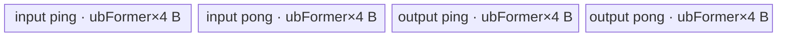

# InplaceExpm1 950 ACLNN 算子知识

## 算子速览

| 项目 | 内容 |
|---|---|
| 实际入口 | `aclnnInplaceExpm1GetWorkspaceSize` + `aclnnInplaceExpm1`，公开 ACLNN 默认版本 |
| 计算语义 | 对 `selfRef` 逐元素计算 `exp(x)-1`，再把结果写回同一张量对象所描述的存储 |
| 输入输出 | 一个输入/输出别名 `selfRef`；ND；950 支持 FP16、BF16、FP32；允许非连续 Tensor |
| 执行类型 | 算子自有节点为单个 `KERNEL_TYPE_AIV_ONLY` Kernel；搬入、Cast、搬出走 AIV Vector/MTE，核心标量数学在 AIV Kernel 内由 `asc_vf_call` 启动 1024-thread SIMT body；不含 Cube/AIC/MIX_CV |
| Kernel 路线 | R-001 FP32 原生 SIMT；R-002 FP16/BF16 升至 FP32 后 SIMT |
| 核心资源 | GM 输入/输出、单个 `TBuf<VECCALC>` tensor pool、Mutex 管理的 ping/pong 子区；Expm1 节点声明 16 MiB workspace，但 Kernel 参数 `workspace` 不读取 |
| 来源闭包 | `source_closed`：公开 ACLNN、L0 launcher、950 Tiling/POD、模板 key、单 Kernel entry、DAG/SIMT body、固定版本 opbase 调度依赖与 ascend950 构建接线闭合 |
| 验证状态 | 已完成源码闭包检查；本次知识提取未执行编译、真机、数值或性能测试。 |

## 接口与语义

### 计算语义

对逻辑位置 `i`，写回值为 `selfRef_i = exp(old(selfRef_i)) - 1`。公开接口强调小输入相较于分别执行 `exp` 和减一具有更高精度。原地语义发生在 ACLNN 图的末端：`Contiguous(selfRef)` 产生连续视图或临时量，`l0op::Expm1` 产生独立连续结果，最终 `ViewCopy(..., selfRef)` 才覆盖调用者的目标存储，因此 Kernel 自身的 `x`、`y` 不是同一指针这一事实不能被误解为非原地 API。

SIMT body 对每个 FP32 元素先保留库函数 `expm1f(x)` 结果。`|x| <= 2` 时使用源码中的 ln2 约化、五阶系数组合及 `exp2f` 重建；`|x| > 2` 时选回 `expm1f`。重建分支显式处理 `k==128`、`k>128`、`k<-25` 和 `x==0`，其中零值返回 `x+x`，保留零的符号行为。

### 输入、输出与属性

| 参数 | shape/layout | dtype | 约束、默认值与语义 |
|---|---|---|---|
| `selfRef` | 任意公开文档允许的 shape，ND；可非连续 | FP16、BF16、FP32 | 必须非空指针；既是输入也是输出。API 对空 Tensor 直接成功返回、workspace 为 0，不添加计算节点。950 文档与 RegBase 路线支持 BF16。Host Tiling 要求内部 Expm1 节点输入输出 shape、dtype 完全相同。 |
| `workspaceSize` | 标量 Host 指针 | `uint64_t*` | 第一段接口输出整个 executor 图所需 Device workspace 字节数。空 Tensor 为 0；非空图的精确总和由 executor 框架计算。 |
| `executor` | Host 对象 | `aclOpExecutor**` | 第一段接口创建并移交；保存 Contiguous、Expm1、Cast、ViewCopy 的执行序。 |
| `workspace` | Device 地址 | `void*` | 第二段接口传入；容量必须等于或不小于第一段返回值。 |
| `stream` | ACL stream | `aclrtStream` | 第二段把 executor 提交到该 stream。 |

### 入口与版本

固定 Commit 只公开无版本后缀的 `aclnnInplaceExpm1GetWorkspaceSize`/`aclnnInplaceExpm1`，没有更新的同语义版本。文档的产品表明确支持 Ascend 950PR/950DT。第一段先执行 `CheckInplaceParamsExpm1`，随后以 `(selfRef,selfRef)` 调用共享的 `aclnnExpm1Common`；这只是代码复用，不把本卡合并为非原地 Expm1。第二段由 `CommonOpExecutorRun` 执行第一段固化的图。

## Host/Launcher 执行流程

### 参数校验与前处理

执行顺序如下：

1. `aclnnInplaceExpm1GetWorkspaceSize` 的 DFX 将 `selfRef` 同时登记为输入和输出。
2. `CheckInplaceParamsExpm1` 拒绝空指针，并以平台 dtype 支持表拒绝非 FP16/BF16/FP32。随后共享函数再次检查 `(selfRef,selfRef)` 非空、同 shape 及结果可 Cast。
3. 若 `selfRef->IsEmpty()`，写 `workspaceSize=0`，移交空执行器并返回；不会进入 Tiling 的“维度不得为 0”失败分支。
4. 非 ND storage format 只记录 warning；随后 `l0op::Contiguous` 形成连续输入。其内部实现属于 ACLNN 框架边界。
5. 原地支持列表全为浮点，因此共享函数中的“整型输入 Cast 到 FP32”分支对本入口不可达。
6. `l0op::Expm1` 按 view shape 和 dtype 分配连续临时输出，经 `IsAiCoreSupport` 后用 `ADD_TO_LAUNCHER_LIST_AICORE(Expm1, ...)` 添加算子自有节点。
7. 结果按 `selfRef` dtype 调用框架 `l0op::Cast`；本入口输入输出 dtype 相同，但固定仓未展开 Cast 的同 dtype 消除策略。
8. `l0op::ViewCopy` 将连续结果写回 `selfRef` 的 view/storage；任一步返回空指针都阻断后续建图。

### 参数、Workspace 与生命周期

`Expm1Tiling::SetTilingData` 为自有 Expm1 节点声明 `16,777,216` 字节 workspace。Kernel entry 虽接收 `workspace`，正文没有解引用，故该 16 MiB 是 Host 声明的节点级保留量，而不是可供本 Kernel 内部 tensor pool 使用的 UB。ACLNN 用户可见 `workspaceSize` 来自 `uniqueExecutor->GetWorkspaceSize()`，还可能覆盖 Contiguous、临时输出、Cast 和 ViewCopy 的框架需求；固定仓没有公开 executor 的 slice offset 计算，不能把用户总 workspace 武断写成 16 MiB。

调用者拥有 `selfRef` 和用户 workspace；executor 拥有临时 tensor 描述与节点顺序。连续临时量从第一段建图后保持到第二段执行完成；最终 ViewCopy 消费 Expm1/Cast 结果并覆盖 `selfRef`。stream 上的可见性由 `CommonOpExecutorRun` 的框架顺序保证，固定仓没有展开其 event 实现。

### 启动图与失败传播

```text
aclnnInplaceExpm1GetWorkspaceSize(selfRef)
  -> [framework] Contiguous(selfRef)                         # 条件性物化
  -> Expm1AiCore: expm1<schMode=1,dType>(x_contig, y_tmp)   # 单个自有 Device 节点
  -> [framework] Cast(y_tmp, dtype(selfRef))                 # 同 dtype，是否消除固定仓不可见
  -> [framework] ViewCopy(result, selfRef)                   # 原地提交
aclnnInplaceExpm1(workspace, executor, stream)
  -> CommonOpExecutorRun                                     # 按 executor 顺序提交
```

自有节点的 Host 添加函数为 `Expm1AiCore`，entry 为 `AscendC::expm1<schMode,dType>`，`blockDim=tiling.blockNum`，POD 为 `EleBaseTilingDataV2`，输入和输出均为连续 ND。Tiling 为该节点登记一个 16 MiB workspace slice，但 entry 不消费它。框架节点间交接张量的具体 workspace offset、extent 和 allocator owner 固定仓不可见；producer 失败时对应 `CHECK_RET`/空指针检查阻断后续节点，第二段的 Device launch 失败由 `CommonOpExecutorRun` 返回。

## Route 与参数设计

### 分核与资源计算

令 `N=product(storage_shape)`，`U` 为 950 每个 AIV 的物理 UB 字节数，`C` 为 AIV 核数。空 Tensor 已在 ACLNN 层返回，Tiling 对任一维为 0 报错。固定 opbase 依赖按下式生产参数：

```text
minBits = 32 (FP32)；16 (FP16/BF16)
coreNum = min(C, ceil(N * minBits / 32768))
blockFormer = ceil(ceil(N / coreNum) / 512) * 512 elements
blockNum = ceil(N / blockFormer)                   # 实际 blockDim
blockTail = N - (blockNum - 1) * blockFormer

extraSize = ASCEND_API_BUFFER + DCACHE_SIZE = 122880 + 32768 = 155648 bytes
BufferNum = 4 (FP32)；6 (FP16/BF16)
maxElemRaw = floor((U - extraSize) * 8 / (BufferNum * 32))
alignFactor = 2048 / minBits = 64 (FP32)；128 (FP16/BF16) elements
ubFormer = floor(maxElemRaw / alignFactor) * alignFactor

ubLoopFormer = ceil(blockFormer / ubFormer)
ubLoopTail = ceil(blockTail / ubFormer)
ubTailFormer = blockFormer - (ubLoopFormer - 1) * ubFormer
ubTailTail = blockTail - (ubLoopTail - 1) * ubFormer
```

FP32 DAG 的同类型 Cast 被 `IsCastNoOp` 在编译期消除，LEVEL_2 tensor pool 为 input/output 各两个 ping/pong 子区，共 4 个。FP16/BF16 另需同时存活的两个 FP32临时子区，故 6 个。`ubFormer==0`、平台信息为空、core 数为 0、UB 小于 `extraSize` 或 shape/dtype 检查失败均以 `GRAPH_FAILED` 结束。`SetLocalMemorySize` 另向 runtime 声明 `U-32768`，避免 DCache 侵入 local-memory 配额。

### Route 选择

| 顺序 | Route | Key/模板 | 精确选择条件与优先级 | 不适用去向 |
|---:|---|---|---|---|
| 1 | R-001 FP32 原生 | `GET_TPL_TILING_KEY(1,TPL_FP32)`；`Expm1DAG<float>` | output dtype 为 `DT_FLOAT`；输入 dtype 已验证相同；950/RegBase AICore 可用 | 非 FP32 继续 R-002 |
| 2 | R-002 FP16/BF16 升精度 | `GET_TPL_TILING_KEY(1,TPL_FP16)` 或 `(1,TPL_BF16)`；对应 `Expm1DAG<half/bfloat16_t>` | output dtype 依次匹配 `DT_FLOAT16` 或 `DT_BF16`；输入 dtype 相同 | 其它 dtype 失败 |

```text
if outputDtype == FLOAT:
    dType=TPL_FP32; DoTiling<Expm1DAG<float>>; key=(scheMode=1,dType)
else if outputDtype == FLOAT16:
    dType=TPL_FP16; DoTiling<Expm1DAG<half>>; key=(1,dType)
else if outputDtype == BF16:
    dType=TPL_BF16; DoTiling<Expm1DAG<bfloat16_t>>; key=(1,dType)
else:
    GRAPH_FAILED
```

### 模板/实现执行矩阵

| Route | key/selector | dtype/shape/platform 完整命中条件 | 执行拓扑与 Kernel 节点 | 实际模板/body | 内存与同步特征 | tail/fallback |
|---|---|---|---|---|---|---|
| R-001 FP32 原生 | `(schMode=1,dType=TPL_FP32)` | 950；输入输出 FP32、shape 相同、非空；UB 公式产生非零 `ubFormer` | 单 `expm1<1,TPL_FP32>`；AIV MTE + 内嵌 SIMT | `ElementwiseSch<1,Expm1DAG<float>::OpDag>`；CastNoOp 后为 CopyIn→`Expm1Custom<float>`→CopyOut | 4 个等长子区；MTE2/V/MTE3 Mutex；ping/pong 按 tile 奇偶切换 | 最后一核/最后 tile 由 `tailNum` 精确限长；失败无 fallback |
| R-002 FP16/BF16 升精度 | `(1,TPL_FP16)`、`(1,TPL_BF16)` | 950；输入输出为同一种 FP16 或 BF16、shape 相同、非空；UB guard 通过 | 单 `expm1<1,dType>`；AIV Cast + 内嵌 SIMT | `ElementwiseSch<1,Expm1DAG<U>::OpDag>`：CopyIn U→Cast FP32→Custom FP32→Cast RINT U→CopyOut | 6 个 4-byte-width 子区；两项 FP32 temp；同一 Mutex/ping-pong 协议 | tail 精确限长；不满足 dtype/UB/shape 直接失败 |

### 隐藏性能 Guard

| Guard | Host/Tiling 条件 | Device/资源原因 | 影响 Route | 不满足时去向 | 源码符号 |
|---|---|---|---|---|---|
| 950 构建可达 | `SUPPORT_COMPUTE_UNIT="ascend950"` 且 OpDef `AddConfig("ascend950")` | 只有该平台 binary/arch35 Host 与 Kernel 被本目录接线 | 全部 | 无 950 binary | `math/expm1/CMakeLists.txt`、`Expm1::Expm1` |
| 非空域 | ACLNN `selfRef->IsEmpty()` 先返回；Tiling 任一维 0 失败 | `Process` 无 `loopNum==0` 分支，最后总会调用一次 `Run` | 全部 | ACLNN 空图成功；绕过 ACLNN 则 Tiling 失败 | `aclnnExpm1Common`、`ElewiseTiling` |
| UB 预留 | `U >= 155648` 且对齐后的 `ubFormer>0` | 预留 120 KiB API buffer 和 32 KiB DCache；tensor pool 必须容纳所有子区 | 全部 | `GRAPH_FAILED` | `Expm1Tiling::RunTiling`、`GetMaxElemNum` |
| tile 对齐 | FP32 对齐 64 元素；FP16/BF16 对齐 128 元素 | 对齐到 256-byte Vector repeat；tail 由 DataCopyPad 和 count 保护 | 全部 | 缩小至前一对齐倍数，变成 0 则失败 | `GetMaxElemNum` |
| POD 窄化 | `ElewiseTilingData.ubFormer(int64)` 隐式赋给 POD `int32`，无显式范围检查 | Device 用该值计算 TBuf 大小和循环 | 全部 | 固定源码无 fallback；平台 UB 的实际上界使常规值远小于 `INT32_MAX`，但这不是源码校验 | `AdaptEleBaseTilingData` |
| 内嵌 SIMT 线程数 | 恒为 `THREAD_NUM=1024` | `i=threadIdx.x; i<count; i+=blockDim.x` 覆盖 tile | 全部 | 无其它线程配置 | `Expm1SimtCompute`、`Expm1Custom` |
| 大幅值快速分支 | `fabs(x)>2` | 直接选择已有 `expm1f`，避免用小区间重建结果 | 全部 | `\|x\|<=2` 走约化多项式 | `Expm1SimtCompute` |

### POD/ABI

`EleBaseTilingDataV2` 是 `EleBaseTilingData` 的别名。按固定字段顺序，其 `sizeof=80`、`alignof=8`；表中 offset 由固定宽度类型及自然对齐确定。

| 结构 | 字段 | 类型/位宽 | ABI 布局 | 单位 | Host/launcher producer | Device consumer | 边界 |
|---|---|---|---|---|---|---|---|
| `EleBaseTilingData` | `dim0` | `int64_t`/64 | offset 0 | elements | `AdaptEleBaseTilingData = elewiseTilingData.dim0` | 当前 `ElementwiseSch` 不读取 | shape 乘法无显式溢出检查 |
| `EleBaseTilingData` | `coreNum` | `int32_t`/32 | offset 8 | AIV cores | `static_cast<int32_t>(elewiseTilingData.coreNum)` | 当前 Device body 不读取；Host 已据 `blockNum` 设 blockDim | 平台 core 数必须非零 |
| `EleBaseTilingData` | `ubFormer` | `int32_t`/32 | offset 12 | elements/tile | `elewiseTilingData.ubFormer` 隐式窄化 | `Init` 的 pool/blockLen；`Process` 的完整 tile | 必须大于 0 |
| `EleBaseTilingData` | `blockFormer` | `int64_t`/64 | offset 16 | elements/block | 同名中间字段 | `CalcBlockOffset`、每核 GM base | 末核实际长度可更小 |
| `EleBaseTilingData` | `blockNum` | `int64_t`/64 | offset 24 | blocks | 同名中间字段；Host 同时 `SetBlockDim` | `Process` 判断末 block | 至少 1 |
| `EleBaseTilingData` | `ubLoopOfFormerBlock` | `int64_t`/64 | offset 32 | tile loops | `ceil(blockFormer/ubFormer)` | 非末 block 的 `loopNum` | 至少 1 |
| `EleBaseTilingData` | `ubLoopOfTailBlock` | `int64_t`/64 | offset 40 | tile loops | `ceil(blockTail/ubFormer)` | 末 block 的 `loopNum` | 至少 1 |
| `EleBaseTilingData` | `ubTailOfFormerBlock` | `int64_t`/64 | offset 48 | elements | `blockFormer-(loops-1)*ubFormer` | 非末 block 最后一次 `Run` 的 count | `(0,ubFormer]` |
| `EleBaseTilingData` | `ubTailOfTailBlock` | `int64_t`/64 | offset 56 | elements | `blockTail-(loops-1)*ubFormer` | 末 block 最后一次 `Run` 的 count | `(0,ubFormer]` |
| `EleBaseTilingData` | `elemNum` | `int64_t`/64 | offset 64 | elements | `maxElemNum` | 当前 Device body 不读取 | 等于 `ubFormer` |
| `EleBaseTilingData` | `scheMode` | `uint64_t`/64 | offset 72 | enum/key component | `GetScheMode()=1` | Host 用于构造 TilingKey；Device 调度由模板参数 `schMode` 决定，POD 字段不再读取 | 模板声明也列出 0，但 Host 当前不可达 |

### Route 源码闭包

| Route | Key/selector | Host/Tiling producer | POD/参数 | Kernel entry/router 节点 | Kernel body/直接依赖 | 构建接线 |
|---|---|---|---|---|---|---|
| R-001 FP32 原生 | `(1,TPL_FP32)` | `expm1_tiling_arch35.cpp::RunTiling/SetTilingData` + opbase `ElewiseBaseTiling/ElewiseTiling` | `EleBaseTilingDataV2`，4-buffer DAG | `expm1_apt.cpp::expm1<schMode,dType>` 的 FP32 constexpr 分支 | `Expm1DAG<float>`、`Expm1SimtCompute<float>`、`ElementwiseSch`、`Vec::CopyIn/CopyOut` | `CMakeLists.txt` ascend950；`expm1_binary.json` float32 entry |
| R-002 FP16/BF16 升精度 | `(1,TPL_FP16/BF16)` | 同上，dtype 分支分别写 `TPL_FP16/TPL_BF16` | 同一 POD，6-buffer DAG | entry 的 half/bfloat16 constexpr 分支 | `Expm1DAG<U>`、两次 `Vec::Cast`、FP32 `Expm1SimtCompute`、公共 scheduler | 同一 CMake；binary config 的 float16/bfloat16 entry |

## Kernel 实现

### 公共执行流程

entry 解析 `EleBaseTilingDataV2`，声明 `KERNEL_TYPE_AIV_ONLY`，在栈上创建 `TPipe`，再按编译期 `dType` 实例化 scheduler。`Init(x,y)` 把 GM 指针偏移到本 block 的 `blockFormer*blockIdx*sizeof(U)`，并一次性分配 `ubFormer*4*BufferNum` 字节 TBuf。`Process` 选择 former/tail block 的 loop 与 tail count；完整 tile 和最后 tile 都调用同一 DAG，tile 奇偶作为 ping/pong id。

每次 DAG 顺序为 CopyIn，可能的 U→FP32 Cast，SIMT `Expm1Custom<float>`，可能的 FP32→U RINT Cast，CopyOut。`GetTensor/ReleaseTensor` 分别把子区锁到 MTE2、V、MTE3 pipeline；DAG buffer planner 保证相邻操作共享前先完成 producer，奇偶子区允许相邻 tile 的不同 pipeline 阶段重叠。单 Kernel 没有 GM/workspace 中间边。

### Route R-001：FP32 原生 SIMT

#### 适用条件

##### 选择证据

| 层级 | 文件 | 符号 | 源码谓词/参数 | 结果/下一跳 |
|---|---|---|---|---|
| API | `math/expm1/op_api/aclnn_expm1.cpp` | `CheckInplaceDtypeValid` | 950/RegBase 支持表包含 FP32 | 进入共享 ACLNN 图 |
| L0 | `math/expm1/op_api/expm1.cpp` | `IsAiCoreSupport` | `IsRegBase()` 且 dtype 在 FP32/FP16/BF16 表 | 添加 Expm1 AICore 节点 |
| Tiling | `math/expm1/op_host/arch35/expm1_tiling_arch35.cpp` | `Expm1Tiling::RunTiling` | `outputDtype==DT_FLOAT` | `dType=TPL_FP32`，实例化 FP32 DAG |
| Router | `math/expm1/op_kernel/expm1_apt.cpp` | `expm1<schMode,dType>` | `if constexpr(dType==TPL_FP32)` | `ElementwiseSch<schMode,Expm1DAG<float>::OpDag>` |

#### Device 数据流

##### 函数级调用链

```text
Expm1AiCore -> expm1<1,TPL_FP32>(x,y,workspace,tiling)
  -> ElementwiseSch<1,Expm1DAG<float>::OpDag>::Init(x,y)
  -> ElementwiseSch::Process
    -> CopyIn<float> / DataCopyPad GM->UB
    -> Expm1Custom<float>
      -> asc_vf_call<Expm1SimtCompute<float>>(dim3(1024), src, dst, count)
    -> CopyOut<float> / DataCopyPad UB->GM
```

##### 源码等价伪码

```text
# 源码等价伪码
gmBase = blockIdx * blockFormer
loops, tail = (blockIdx == blockNum-1) ? tailBlockFields : formerBlockFields
for tile in [0, loops):
    count = (tile == loops-1) ? tail : ubFormer
    pp = tile & 1
    ubIn = pool[inputBufId(pp)]
    DataCopyPad(ubIn, x + gmBase + tile*ubFormer, 1 block, count*4 bytes, stride=0, no pad)
    for tid in [0,1024) parallel:
        for i = tid; i < count; i += 1024:
            ubOut[i] = expm1_piecewise_fp32(ubIn[i])
    DataCopyPad(y + gmBase + tile*ubFormer, ubOut, 1 block, count*4 bytes, stride=0)
```

#### 内存与数据搬运

##### 资源与搬运表

| 层级/缓冲区 | offset/地址公式 | extent/容量公式 | dtype/layout | producer | consumer | owner/lifetime | 对齐/复用 |
|---|---|---|---|---|---|---|---|
| GM x | `(blockIdx*blockFormer + tileOffset)*4` | `count*4` bytes | FP32 ND flat | ACLNN contiguous result | CopyIn | executor/caller；Kernel 只读 | tail 精确字节数 |
| tensor pool input ping/pong | `bufId*blockLen` | 每子区 `ubFormer*4` | FP32 | MTE2 CopyIn | SIMT body | `TPipe`/本 Kernel | 两个 id 随 `tile&1` 切换 |
| tensor pool output ping/pong | `bufId*blockLen` | 每子区 `ubFormer*4` | FP32 | SIMT body | MTE3 CopyOut | `TPipe`/本 Kernel | 直连 output buffer，无额外物化 |
| GM y | 同 GM x 的元素 offset | `count*4` bytes | FP32 ND flat | CopyOut | 后续 Cast/ViewCopy | executor 临时 tensor | x/y 独立临时量 |
| workspace | entry 参数未读取 | Host 声明 16 MiB | opaque | Host | 无 Device consumer | executor | 不得当 UB 使用 |

##### 分层内存布局



##### 字节账与复用顺序

```text
UB_total = 4 * ubFormer * 4 = 16 * ubFormer bytes
UB_total <= U - 155648
dynamic_ub = N/A；SIMT 直接使用 scheduler 已分配的 LocalTensor
workspace_total(self Expm1 node) = 16777216 bytes（Kernel 不读取）
=> ubFormer 按 64 元素对齐向下取整
```

| 复用子区 | 写入者 | 读取者/消费点 | 下一次覆盖 | 同步或释放依据 | 安全条件 |
|---|---|---|---|---|---|
| input ping/pong | `CopyIn` MTE2 | `Expm1Custom` V/SIMT | 同奇偶的下下个 tile | `Lock/Unlock<PIPE_MTE2>` 与 `Lock/Unlock<PIPE_V>` | consumer 完成后才可被同 id 的 MTE2 重写 |
| output ping/pong | `Expm1Custom` V/SIMT | `CopyOut` MTE3 | 同奇偶的下下个 tile | V 与 MTE3 对同 bufId 的 Mutex 协议 | MTE3 完成后才可被 V 重写 |

#### 同步、精度与尾块

##### 同步与数值边界表

| 阶段 | primitive/机制 | producer | consumer/等待点 | 保护对象 | 精度/尾块 |
|---|---|---|---|---|---|
| GM→UB | `Get/ReleaseTensor<VECIN>`→`Mutex PIPE_MTE2` | CopyIn | VECCALC 获取同 id | input 子区 | `blockLen=count*4`，无 padding 写入 |
| UB 计算 | `Get/ReleaseTensor<VECCALC>`→`Mutex PIPE_V` | CopyIn | SIMT/后续 MTE3 | 输入和输出子区 | 全 FP32；每线程 stride 1024；`i<count` 防越界 |
| UB→GM | `Get/ReleaseTensor<VECOUT>`→`Mutex PIPE_MTE3` | SIMT | 下一次 V 复用 | output 子区 | 仅搬 `count` 个元素 |
| 数值分支 | FP32 `fmaf/expm1f/exp2f/roundf` | 当前 lane | 当前 lane 写回 | 寄存器值 | `\|x\|>2` 用 `expm1f`；溢出/下溢/零显式选择 |

#### 关键实现

##### 符号证据表

| 阶段 | 文件 | 符号/模板实例 | 实现事实 |
|---|---|---|---|
| Host/Tiling producer | `math/expm1/op_host/arch35/expm1_tiling_arch35.cpp` | `RunTiling`、`SetTilingData` | FP32 key、blockDim、local memory 和 16 MiB workspace |
| Kernel entry/router | `math/expm1/op_kernel/expm1_apt.cpp` | `expm1<schMode,TPL_FP32>` | AIV-only entry 到 FP32 DAG |
| Device body/helper | `math/expm1/op_kernel/arch35/expm1_dag.h` | `Expm1DAG<float>`、`Expm1SimtCompute<float>` | CastNoOp、1024-thread SIMT、分段 FP32 数学 |
| Device scheduler | `opbase/.../elewise_sch.h` | `ElementwiseSch::Init/Process/Run` | pool、block/tile 地址、ping-pong、tail 和逐 DAG 节点执行 |

### Route R-002：FP16/BF16 升精度 SIMT

#### 适用条件

##### 选择证据

| 层级 | 文件 | 符号 | 源码谓词/参数 | 结果/下一跳 |
|---|---|---|---|---|
| API | `math/expm1/op_api/aclnn_expm1.cpp` | `CheckInplaceDtypeValid` | 950/RegBase 列表包含 FP16、BF16 | 进入共享 ACLNN 图 |
| Tiling | `math/expm1/op_host/arch35/expm1_tiling_arch35.cpp` | `RunTiling` | dtype 依次为 FP16/BF16 | `TPL_FP16`/`TPL_BF16` 与相应 DAG |
| Router | `math/expm1/op_kernel/expm1_apt.cpp` | `expm1` | constexpr `dType` 分支 | half 或 bfloat16 scheduler |
| DAG | `math/expm1/op_kernel/arch35/expm1_dag.h` | `Expm1DAG<U,float>` | `U!=float`，Cast 不是 NoOp | 保留两次 Cast，SIMT 类型恒为 float |

#### Device 数据流

##### 函数级调用链

```text
Expm1AiCore -> expm1<1,TPL_FP16/BF16>
  -> ElementwiseSch<1,Expm1DAG<U>::OpDag>::Process
    -> Vec::CopyIn<U>
    -> Vec::Cast<float,U,CAST_MODE_NONE>
    -> Expm1Custom<float> -> asc_vf_call<Expm1SimtCompute<float>>(1024 threads)
    -> Vec::Cast<U,float,CAST_MODE_RINT>
    -> Vec::CopyOut<U>
```

##### 源码等价伪码

```text
# 源码等价伪码；U=half 或 bfloat16_t
for each block and tile using the same former/tail formulas:
    count = ubFormer or exact tail
    DataCopyPad(inU, gmX + elementOffset, count*sizeof(U))
    Cast(tmpF0, inU, RoundMode(CAST_MODE_NONE), count)
    parallel 1024 threads: tmpF1[i] = expm1_piecewise_fp32(tmpF0[i])
    Cast(outU, tmpF1, RoundMode(CAST_MODE_RINT), count)
    DataCopyPad(gmY + elementOffset, outU, count*sizeof(U))
```

#### 内存与数据搬运

##### 资源与搬运表

| 层级/缓冲区 | offset/地址公式 | extent/容量公式 | dtype/layout | producer | consumer | owner/lifetime | 对齐/复用 |
|---|---|---|---|---|---|---|---|
| GM x/y | `(blockIdx*blockFormer+tileOffset)*2` | `count*2` bytes | FP16/BF16 flat ND | framework/CopyOut | CopyIn/framework | executor | DataCopyPad 精确 tail |
| input ping/pong | `bufId*blockLen` | 物理子区 `ubFormer*4`，有效 `count*2` | U | CopyIn | Cast up | tensor pool | scheduler 以 MaxDtypeBytes=4 统一步幅 |
| FP32 temp 0 | planner bufId | `ubFormer*4` | FP32 | Cast up | SIMT | tile 内 | 与相邻 temp 并存 |
| FP32 temp 1 | planner bufId | `ubFormer*4` | FP32 | SIMT | Cast down | tile 内 | SIMT 直接写此子区 |
| output ping/pong | planner bufId | `ubFormer*4`，有效 `count*2` | U | Cast down | CopyOut | tensor pool | MTE3 后释放 |
| workspace | entry 不读取 | 16 MiB 节点声明 | opaque | Host | 无 | executor | 非 UB |

##### 分层内存布局


##### 字节账与复用顺序

```text
UB_total = 6 * ubFormer * 4 = 24 * ubFormer bytes
UB_total <= U - 155648
dynamic_ub = N/A；SIMT 使用两个 FP32 LocalTensor 子区
workspace_total(self Expm1 node) = 16777216 bytes（Kernel 不读取）
=> ubFormer 按 128 元素对齐向下取整
```

| 复用子区 | 写入者 | 读取者/消费点 | 下一次覆盖 | 同步或释放依据 | 安全条件 |
|---|---|---|---|---|---|
| U input ping/pong | MTE2 | Cast up | 同奇偶下下个 tile | MTE2/V Mutex | Cast 完成后释放 |
| FP32 temp 0 | Cast up | SIMT | 下一 tile 的 Cast up | VECCALC Get/Release 与 DAG 生命周期 | SIMT 已读完 |
| FP32 temp 1 | SIMT | Cast down | 下一 tile SIMT | VECCALC 协议 | Cast down 已读完 |
| U output ping/pong | Cast down | MTE3 | 同奇偶下下个 tile | V/MTE3 Mutex | CopyOut 完成 |

#### 同步、精度与尾块

##### 同步与数值边界表

| 阶段 | primitive/机制 | producer | consumer/等待点 | 保护对象 | 精度/尾块 |
|---|---|---|---|---|---|
| 搬入 | DataCopyPad + PIPE_MTE2 Mutex | GM | Cast up | U input | `count*2` 有效字节，无 pad |
| 升精度 | `Cast<float,U,0>` | U input | SIMT | FP32 temp 0 | 数学前转 FP32 |
| 数学 | 1024-thread `asc_vf_call` | temp 0 | Cast down | FP32 temp 1 | 全部常量、FMA、exp2/expm1 为 FP32 |
| 降精度 | `Cast<U,float,1>` | temp 1 | CopyOut | U output | `CAST_MODE_RINT`；只处理 count |
| 搬出 | DataCopyPad + PIPE_MTE3 Mutex | U output | GM | output 子区 | 精确 tail，不写逻辑范围外元素 |

#### 关键实现

##### 符号证据表

| 阶段 | 文件 | 符号/模板实例 | 实现事实 |
|---|---|---|---|
| Host/Tiling producer | `math/expm1/op_host/arch35/expm1_tiling_arch35.cpp` | FP16/BF16 分支 | dtype key、DAG、tile 和资源预留 |
| Kernel entry/router | `math/expm1/op_kernel/expm1_apt.cpp` | half/bfloat16 constexpr 分支 | 选中对应 scheduler |
| Device body/helper | `math/expm1/op_kernel/arch35/expm1_dag.h` | `Expm1DAG<U,float>` | Cast up→FP32 SIMT→RINT Cast down |
| 通用 Vector | `opbase/.../util/vec.h` | `Vec::Cast/CopyIn/CopyOut` | RoundMode 和 DataCopyPad 的实际参数 |

## 算子特定优化

### Trick T-001：小区间 FP32 约化重建并保留极值终点

#### 触发与源码依据

- 适用 Route：R-001、R-002
- 触发条件：每个 SIMT lane；`|x|<=2` 采用约化重建，源码随后处理指数边界和零；`|x|>2` 选择预先计算的 `expm1f(x)`。
- Golden 来源：[`math/expm1/op_kernel/arch35/expm1_dag.h:81-94`](../../../../../../../cann-ops-raw/ascendc/ops-math/165d41f02a43a62324b434cb6bda7c533b14da3e/math/expm1/op_kernel/arch35/expm1_dag.h#L81-L94)

**官方源码（固定 Commit 连续逐字摘录）**：

```cpp
float f24 = exp2f(f12);
float f25 = f24 + FLOAT_NEG_ONE;
float f26 = fmaf(f23, f24, f25);
float f27 = f26 + f26;
float f28 = p2 ? f27 : f26;
bool p3 = f12 > FLOAT_128;
float f29 = p3 ? FLOAT_INF : f28;
bool p4 = f12 < FLOAT_NEG_25;
float f30 = p4 ? FLOAT_NEG_ONE : f29;
bool p5 = f1 == 0.0f;
float f31 = f1 + f1;
float f32 = p5 ? f31 : f30;
y[i] = fabsf(x[i]) > FLOAT_2 ? f0 : f32;
```

#### 机制与设计原因

先把 `x` 约化为靠近零的余项，用 FMA 多项式计算 `expm1(r)`，再用 `2^k` 重建，避免小 `x` 直接执行 `exp(x)-1` 的相消。`k==128` 通过先减一并最终翻倍处理边界；`k>128` 和 `k<-25` 固定到 `+inf/-1`；`x==0` 用 `x+x` 保留零符号。大于 2 的区间不强行套用该近似，而使用 `expm1f`。

#### 迁移边界

- 适用：需要 FP32 中间精度的逐元素 `expm1`。
- 前提：常量、FMA 顺序、阈值、FP32 `roundf/exp2f/expm1f` 语义完全保持。
- 失效：更换 dtype、系数、比较顺序或 fast-math 规则时必须重新证明数值边界；源码没有其它 Device fallback。
- 未验证：本次知识提取未执行编译、真机、数值或性能测试。

#### 错误做法

固定仓提供的真实规避对象是对所有输入简单执行 `exp(x)-1`；该做法在小输入会产生相消。固定仓未提供可验证的性能反例。

### Trick T-002：低精度 I/O 与 FP32 数学分离

#### 触发与源码依据

- 适用 Route：R-002
- 触发条件：`U` 为 `half` 或 `bfloat16_t`，使两次 Cast 都不是编译期 NoOp。
- Golden 来源：[`math/expm1/op_kernel/arch35/expm1_dag.h:110-120`](../../../../../../../cann-ops-raw/ascendc/ops-math/165d41f02a43a62324b434cb6bda7c533b14da3e/math/expm1/op_kernel/arch35/expm1_dag.h#L110-L120)

**官方源码（固定 Commit 连续逐字摘录）**：

```cpp
template <typename U, typename T = float>
struct Expm1DAG {
    using OpCopyIn0 = Bind<Vec::CopyIn<U>, Placeholder::In0<U>>;
    using OpCopyIn0Cast = Bind<Vec::Cast<T, U, CAST_MODE_NONE>, OpCopyIn0>;
    using OpResult1 = Bind<Expm1Custom<T>, OpCopyIn0Cast>;
    using OpResultCast = Bind<Vec::Cast<U, T, CAST_MODE_RINT>, OpResult1>;
    using OpCopyOut = Bind<Vec::CopyOut<U>, Placeholder::Out0<U>, OpResultCast>;

    using Outputs = Elems<OpCopyOut>;
    using MemCfg = MemOptCfg<MemLevel::LEVEL_2>;
    using OpDag = DAGSch<Outputs, void, MemCfg>;
```

#### 机制与设计原因

GM 仍按 2-byte dtype 搬运，数学阶段提升到 FP32，只在最终用 `CAST_MODE_RINT` 降回目标 dtype。这样把精度策略与 I/O 带宽分离；代价由 Host 的 `BufferNum=6` 进入 tile 上界，避免为 FP32 临时量透支 UB。FP32 Route 中相同类型 Cast 会被通用 DAG 的 `IsCastNoOp` 消除，回到 4-buffer 路线。

#### 迁移边界

- 适用：FP16/BF16 输入输出且核心公式需要 FP32 中间值的逐元素算子。
- 前提：Host 的 `MaxDtypeBytes=4`、BufferNum 与 Device DAG 必须来自同一模板实例。
- 失效：若直接以低精度执行 SIMT，或删减两个 FP32 temp，数值和 buffer lifetime 均不再等价。
- 未验证：本次知识提取未执行编译、真机、数值或性能测试。

#### 错误做法

不能按 GM dtype 的 2 字节为整个 tensor pool 定步幅；scheduler 明确按最大 dtype 4 字节分区，否则 FP32 temp 会越界。固定仓未提供可验证的性能反例。

## 模板与实现对比

| 对比维度 | R-001 FP32 原生 | R-002 FP16/BF16 升精度 | 设计选择依据 |
|---|---|---|---|
| 命中条件/优先级 | dtype FP32 | dtype FP16 或 BF16 | Host dtype `if/else` |
| 模板与 dtype | `Expm1DAG<float>`，两 Cast NoOp | `Expm1DAG<U,float>`，保留两 Cast | `IsCastNoOp` 的类型相等判断 |
| 循环与分核 | `minBits=32`，每核最小粒度约 1024 元素 | `minBits=16`，每核最小粒度约 2048 元素 | 4 KiB/core 位数公式 |
| Queue/TBuf/寄存器/dynamic UB/通信 window | 一个 TBuf、4 子区；SIMT 寄存器 `f0..f32`；无 dynamic UB/通信 | 一个 TBuf、6 子区，含两 FP32 temp；同样寄存器 | LEVEL_2 DAG planner |
| 内存总占用与复用 | `16*ubFormer` bytes | `24*ubFormer` bytes | BufferNum×最大 dtype 字节数 |
| 搬运/Vector/SIMT/NDDMA/通信 API | DataCopyPad→SIMT→DataCopyPad | DataCopyPad→Cast→SIMT→Cast→DataCopyPad | 低精度路线显式升降精度；无 NDDMA/通信 |
| 同步、精度与 tail | MTE2/V/MTE3 Mutex；全 FP32；count tail | 同步相同；FP32 数学、RINT 降精度；count tail | 同一 scheduler |
| fallback/失败边界 | 无 Device fallback | 无 Device fallback | Host dtype/UB/shape 失败终止 |

## 平台差异

| 项目 | A2 | A3 | 950 |
|---|---|---|---|
| 支持状态 | 公开 ACLNN 文档写支持，但固定 Commit 的当前算子 CMake/OpDef/binary 未提供 A2 接线；200I/500 A2 明确不支持 | 公开 ACLNN 文档写支持，但固定 Commit 未提供 A3 Host/Tiling/Kernel/构建闭包 | 文档支持，且 ascend950 全链路接线闭合 |
| Host/Launcher | 固定仓不可见 | 固定仓不可见 | arch35 Tiling + 公共 ACLNN/L0 launcher |
| Kernel/资源 | 固定仓不可见 | 固定仓不可见 | AIV-only entry，内嵌 1024-thread SIMT，4/6-buffer LEVEL_2 DAG |

## 限制与失败边界

- 非空 `selfRef` 只支持 FP16、BF16、FP32；空指针返回 `ACLNN_ERR_PARAM_NULLPTR`，dtype 不支持返回 `ACLNN_ERR_PARAM_INVALID`。内部 Expm1 节点还要求输入输出 shape、dtype 相同。
- API 允许非连续 Tensor，但 Contiguous、同 dtype Cast 消除、ViewCopy 的具体 Kernel、workspace slice offset 和事件实现属于固定仓外 ACLNN 框架边界；不能据此假设没有额外 Device 节点或额外 workspace。
- 950 自有 Kernel 不读取 `workspace`，但 Host 固定声明 16 MiB；不得删除该声明或把它当成本地 UB。
- shape 元素数、`blockFormer` 等使用 `int64_t` 乘加，固定源码没有显式溢出检查；`ubFormer` 写入 `int32_t` 也没有显式范围检查。
- Tiling template 声明 `schMode` 0/1，但 `GetScheMode()` 恒返回 1；mode 0 是 Device 编译候选而非当前 Host 可达 Route。生成式 key router 与未知 key 的运行时错误码固定仓不可见。
- A2/A3 只有公开支持声明，没有本固定 Commit 对应的源码级 Host/Tiling/Kernel/构建闭包，因此本卡不外推其实现。
- 本次知识提取未执行编译、真机、数值或性能测试。

## 源码索引

### 链路索引

| 链路阶段 | 文件 | 关键符号 | 支撑内容 |
|---|---|---|---|
| 入口声明/约束 | `math/expm1/docs/aclnnExpm1&aclnnInplaceExpm1.md` | 产品表、Inplace 两段式 API | 950 公开支持、原地语义、dtype/非连续约束 |
| 入口声明/约束 | `math/expm1/op_api/aclnn_expm1.h` | `aclnnInplaceExpm1*` | C ABI 与计算图 |
| 入口实现 | `math/expm1/op_api/aclnn_expm1.cpp` | `CheckInplaceParamsExpm1`、`aclnnExpm1Common` | 校验、空 Tensor、Contiguous/Expm1/Cast/ViewCopy、workspace |
| 入口实现 | `math/expm1/op_api/expm1.cpp` | `l0op::Expm1`、`Expm1AiCore` | 950 dtype 可达性、临时输出与 launcher |
| Host/Tiling/Launcher | `math/expm1/op_host/arch35/expm1_tiling_arch35.cpp` | `Expm1Tiling` | dtype route、workspace、key、blockDim、local memory |
| Host/Tiling/Launcher | `math/expm1/op_kernel/arch35/expm1_struct.h` | `ASCENDC_TPL_ARGS_DECL(Expm1,...)` | schMode/dtype 模板域 |
| Kernel entry/body | `math/expm1/op_kernel/expm1_apt.cpp` | `expm1<schMode,dType>` | entry、AIV-only task、dtype router |
| Kernel entry/body | `math/expm1/op_kernel/arch35/expm1_dag.h` | `Expm1DAG`、`Expm1SimtCompute` | DAG、1024-thread SIMT、数值管线 |
| 构建接线 | `math/expm1/op_host/config/ascend950/expm1_binary.json` | 三个 dtype binary entry | 950 FP16/BF16/FP32 binary |
| 构建接线 | `math/expm1/CMakeLists.txt` | `SUPPORT_COMPUTE_UNIT` | 仅 ascend950 + arch35 tiling |
| 构建接线 | `cmake/third_party/opbase.cmake` | `OPBASE_TAG_ID` | 固定公共依赖 Commit |
| Host/Tiling/Launcher | `opbase: pkg_inc/op_common/atvoss/elewise/elewise_base_struct.h` | `EleBaseTilingDataV2` | POD 字段与类型 |
| Host/Tiling/Launcher | `opbase: pkg_inc/op_common/atvoss/elewise/elewise_tiling.h` | `ElewiseBaseTiling::DoTiling` | DAG 资源参数生产 |
| Host/Tiling/Launcher | `opbase: src/op_common/atvoss/elewise/elewise_tiling.cpp` | `ElewiseTiling` | core/tile/tail/UB 公式和 POD producer |
| Kernel entry/body | `opbase: pkg_inc/op_common/atvoss/elewise/elewise_sch.h` | `ElementwiseSch` | block offset、tensor pool、循环、DAG dispatch |
| Kernel entry/body | `opbase: pkg_inc/op_common/atvoss/util/dag.h` | `DAGSch` | CastNoOp、BufferNum 与 buffer id |
| Kernel entry/body | `opbase: pkg_inc/op_common/atvoss/util/node.h` | `DagNodeInfo::GetBufferNumLevel2` | 4/6-buffer 字节账 |
| Kernel entry/body | `opbase: pkg_inc/op_common/atvoss/util/vec.h` | `Vec::Cast/CopyIn/CopyOut` | RoundMode、DataCopyPad 参数 |
| Kernel entry/body | `opbase: pkg_inc/op_common/atvoss/util/sync.h` | `GetTensor/ReleaseTensor` | MTE2/V/MTE3 Mutex 协议 |

每行只写一个文件，并确保该文件存在于 Frontmatter `sources`。

### 实现复用检查

| 检查项 | 可复用事实 | 不得改变的约束 | 源码符号 |
|---|---|---|---|
| ABI/POD | 80-byte `EleBaseTilingDataV2` 可直接复用 | 字段顺序、宽度、offset、元素单位及 `ubFormer` 的 int32 位宽 | `EleBaseTilingData`、`AdaptEleBaseTilingData` |
| 调用顺序 | Contiguous→Expm1→Cast→ViewCopy；Kernel 内 CopyIn→Cast up→SIMT→Cast down→CopyOut | 原地提交必须最后发生；不能让 x/y 临时量提前别名 | `aclnnExpm1Common`、`Expm1DAG` |
| workspace/内存 | 16 MiB 节点 workspace 声明；4/6 个 `ubFormer*4` 子区 | workspace 不等于 UB；pool 按 MaxDtypeBytes=4 分区；保留 155648-byte UB 预算 | `SetTilingData`、`ElementwiseSch::Init` |
| 同步 | bufId 上的 PIPE_MTE2/PIPE_V/PIPE_MTE3 Mutex 与 tile 奇偶切换 | producer 解锁、consumer 上锁和同 id 的覆盖次序不可删 | `GetTensor/ReleaseTensor`、`GetBufId` |
| 精度与尾块 | FP32 数学、低精度 RINT 降精度、`i<count` 和 DataCopyPad 精确字节 | 系数、FMA 顺序、阈值、1024 stride、former/tail 字段不可擅改 | `Expm1SimtCompute`、`Vec::Cast`、`Process` |
| 失败边界 | 空 Tensor 在 ACLNN 成功短路；非法 dtype/shape/UB 在对应层失败 | 不得让零维进入 `Process`，不得为未知 dtype/key猜测 fallback | `aclnnExpm1Common`、`RunTiling`、`ElewiseTiling` |

- [Expm1f](../../../../apis/simt_api/math_functions/float_math_functions/expm1f.md)
