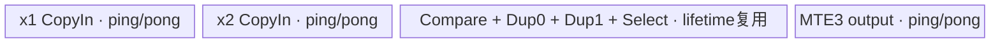
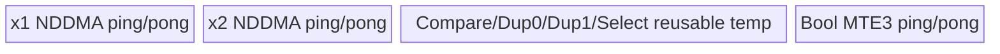
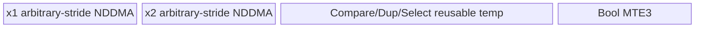

# InplaceGeTensor 950 ACLNN 算子知识

## 算子速览

| 项目 | 内容 |
|---|---|
| 实际入口 | `aclnnInplaceGeTensorGetWorkspaceSize` + `aclnnInplaceGeTensor`，公开两段式 ACLNN；只覆盖 Tensor 原地入口。 |
| 计算语义 | 广播后逐元素比较 `selfRef_i >= other_i`，Bool 结果经 Cast 写回 `selfRef.dtype`；要求广播结果 shape 等于 `selfRef.shape`。 |
| 输入输出 | `selfRef/other` 为 ND、0–8 维，可非连续，支持 DOUBLE/FLOAT16/FLOAT32/INT8/16/32/64/UINT8/16/32/64/BOOL/BFLOAT16；`selfRef` 同时是输出。 |
| 执行类型 | 条件 Cast 为 AIV_VECTOR 或 AiCPU；核心 Route 为 AIV_VECTOR、NDDMA+AIV_VECTOR，或 AiCPU。950 非连续专用 Route 仍是 NDDMA/Vector，不含 Cube/AIC/MIX_CV。 |
| Kernel 路线 | R-001 连续一维 advance；R-002 连续多维 NDDMA；R-003 连续多维 UB Broadcast；R-004 非连续专用 301/302/303；R-005 非连续 NDDMA 兜底 304/305；R-006 核心 AiCPU。 |
| 核心资源 | AICore 核心使用 GM、单个 TBuf tensor pool、Mutex、NDDMA/UB Broadcast；核心 Tiling 声明 16 MiB workspace。Cast 使用双缓冲 Queue/TBuf 或 AiCPU tensor；executor 管理中间 tensor 与最终 ViewCopy。 |
| 来源闭包 | source_closed：公开 Inplace API→校验/Promote/条件 Contiguous/Cast→GreaterEqual AICore/AiCPU→结果 Cast→ViewCopy→950 Host/Tiling/POD/全部 scheduler/body→构建接线已闭合；Contiguous/ViewCopy 与 executor 为明确框架边界。 |
| 验证状态 | 已完成源码闭包检查；本次知识提取未执行编译、真机、数值或性能测试。 |

## 接口与语义

### 计算语义

令 `P=BinaryOpTypePromote(selfRef.dtype, other.dtype)`；950 使用 regbase 推导函数，若 `P=BOOL`，API 显式把核心计算类型改为 `INT8`。对 `B=broadcast(selfRef,other)` 中每个位置 `i`，核心生成 `b_i = (cast_P(selfRef_i) >= cast_P(other_i)) ? 1 : 0`。随后把 Bool `b` 转为 `selfRef.dtype` 并经 `ViewCopy` 写回原张量，因此非 Bool `selfRef` 最终保存数值 0/1，而不是改变其 dtype。原地约束要求 `B.shape == selfRef.shape`；本卡不合并非原地 `aclnnGeTensor` 或 Scalar 入口。

### 输入、输出与属性

| 参数 | shape/layout | dtype | 约束、默认值与语义 |
|---|---|---|---|
| `selfRef` | ND，0–8 维，可非连续 | DOUBLE、FLOAT16、FLOAT32、INT8/16/32/64、UINT8/16/32/64、BOOL、BFLOAT16 | 必选、输入输出；必须可与 `other` Promote，广播结果 shape 必须保持自身 shape。 |
| `other` | ND，0–8 维，可非连续 | 同 `selfRef` | 必选输入；shape 必须可向 `selfRef.shape` 广播。 |
| `workspaceSize` | Host 标量输出 | `uint64_t*` | 返回 executor 所需 Device workspace；空 Tensor 返回 0。 |
| `executor` | Host 对象 | `aclOpExecutor**` | 保存条件前处理、核心、结果 Cast 与 ViewCopy 节点；第二段执行结束前保持有效。 |
| `workspace`/`stream` | Device 地址/ACL stream | `void*`/`aclrtStream` | 第二段按第一段返回大小运行同一 executor。 |

### 入口与版本

固定仓只有这一公开 Inplace Tensor 版本。公开文档明确支持 Ascend 950PR/950DT；`GreaterEqual` OpDef 将 `greater_equal_apt` 接到 `ascend950`，binary config 覆盖八种 AICore 实际 dtype，CMake 也列出 `ascend950` 并选择 `arch35`，三层证据一致。公开文档同时支持 A2/A3，但固定 Commit 的 CMake 为这些平台选择 `arch32`，目录中没有相应 Host/Tiling/Kernel 源码，因此本任务不生成无后缀卡。

## Host/Launcher 执行流程

### 参数校验与前处理

`aclnnInplaceGeTensorGetWorkspaceSize` 把 `selfRef` 同时作为 `self` 和 `out` 传入 `aclnnGeTensorCommon`。校验顺序为：创建 executor；`workspaceSize` 非空；`selfRef/other/out` 非空；输出 dtype 在白名单；计算 `P`（Bool 改 INT8）、验证输入可转 `P` 且 Bool 结果可转 `selfRef.dtype`；三者 rank≤8；广播成功且广播 shape 等于 `selfRef.viewShape`。任一步失败立即返回对应 ACLNN 错误。

任一输入为空时写 `workspaceSize=0` 并成功返回，不添加 Device 节点。非空时，对每个输入：仅当 `dtype==P`、当前为 950 regbase 且 `P` 属 GreaterEqual AICore 集合时，直接 `CreateView` 保留非连续 shape/stride/offset；否则先 `Contiguous`，再 `Cast(...,P)`。然后提交 `l0op::GreaterEqual`，把 Bool 结果 Cast 到 `selfRef.dtype`，最后 `ViewCopy(result,selfRef)` 完成原地回写。

### 参数、Workspace 与生命周期

核心 Broadcast Tiling 对每个 AICore `GreaterEqual` 节点写 `workspace[0]=16*1024*1024` 字节；entry 保留 `workspace` 参数但不读取。AIV Cast Tiling 同样声明 16 MiB 最小 workspace；AiCPU GreaterEqual/Cast 的任务空间由框架封装。ACLNN 返回值是 `uniqueExecutor->GetWorkspaceSize()` 汇总后的总量，其跨节点 offset/对齐公式固定仓不可见。

`selfProcessed`、`otherProcessed`、Bool 核心输出和结果 Cast 输出均归 executor 所有；前一节点输出至少存活到下一消费者完成。用户拥有 `selfRef` 与第一段返回的 workspace；第二段把二者和 executor 交给 `CommonOpExecutorRun`，同一 stream 上按 executor 顺序执行，ViewCopy 完成前不得覆盖临时结果或释放 executor/workspace。

### 启动图与失败传播

```text
empty(selfRef) || empty(other)
  -> success(workspaceSize=0), no Device node
otherwise
  selfRef -> [CreateView | Contiguous -> Cast(selfRef,P)]
  other   -> [CreateView | Contiguous -> Cast(other,P)]
  -> GreaterEqual [AICore R-001..R-005 | AiCPU R-006]
  -> Cast(bool,selfRef.dtype) [no-op | AIV | AiCPU]
  -> ViewCopy(result,selfRef) [framework boundary]
```

所有节点在同一 executor 中有序提交。`Contiguous`、Cast、GreaterEqual 或 ViewCopy 返回空指针时，当前 `CHECK_RET` 立即停止构图，后续节点不会加入；第二段由 `CommonOpExecutorRun` 传播运行错误。AICore 核心节点的输入可能直接引用用户的非连续 storage（R-004/R-005），输出是连续 Bool 临时 tensor；AiCPU R-006 的输入因 `IsGreaterEqualSupportNonContiguous` 为 false，必先经过 Contiguous。

## Route 与参数设计

### 分核与资源计算

核心 Tiling 先取 AIV 核数和 UB 字节数，再读取 storage/view shape 与 stride。连续输入按广播 flag 合并相邻轴；非连续输入只有在所有张量对应轴也物理连续时才合轴，广播轴 stride 置 0。scalar shape 规范为 `{1}`。AICore dtype 分支实例化同一 GreaterEqual DAG：两路 `CopyInBrc<T>`→`Compare<uint8_t,T,4>`→分别 `Duplicate<uint8_t>(0/1)`→`Select<uint8_t,uint8_t,2>`→`CopyOut<uint8_t>`。

一维 advance 中 `aliveNum=GetBufferNum<true,true>()=10`，`tileNum=floor(((ubSize/aliveNum)/512))*512/maxDtypeBytes`。若 `dimLen < coreNum*(512/minDtypeBytes)`，tile 固定一个输入 cache line；否则在不足 `coreNum*tileNum` 时按核均分并向下对齐到 512B。`ubOuter=ceil(dimLen/tileNum)`，`blockFormer=ceil(ubOuter/coreNum)`；若为 1 改为 2，`blockNum=ceil(ubOuter/blockFormer)`。

多维路线先令 `bufferDivisor=bufferNum*maxDtypeBits`；NDDMA/advance `bufferNum=10`，UB Broadcast `bufferNum=12`。`maxElemNum` 由 UB、bufferDivisor 与 256B repeat 对齐共同限制；从末轴向前累计，产生 `ubSplitAxis/ubFormer/ubOuter/ubTail`。`fusedProduct=ubOuter*Π(outputDims[0:ubSplitAxis])`，`blockFormer=ceil(fusedProduct/coreNum)`、`blockNum=ceil(fusedProduct/blockFormer)`、`blockTail=fusedProduct-(blockNum-1)*blockFormer`。非连续 transpose 路线另外按 32B dtype alignment 生成 padded stride。

### Route 选择

| 顺序 | Route | Key/模板 | 精确选择条件与优先级 | 不适用去向 |
|---:|---|---|---|---|
| 1 | R-006 AiCPU core | 无 AICore key | `P` 不在 950 core 集 `{FLOAT,FLOAT16,BFLOAT16,INT32,INT8,UINT8,INT64,UINT64}`；实际公开可达为 DOUBLE/INT16/UINT16/UINT32 | P 在集合→继续 AICore shape selector |
| 2 | R-001 1D advance | `schMode=202` | AICore P；两输入经合轴后 rank=1 且全部连续；输入2+输出1≤4、DAG无 Var | rank>1→R-002/R-003；非连续→R-004/R-005 |
| 3 | R-002 contiguous NDDMA | `1/2` | 全部连续、rank>1；无广播，或 UB Broadcast 谓词为假；runningRank≤5→1，否则2 | UB 谓词真→R-003 |
| 4 | R-003 contiguous UB Broadcast | `101/102/103/104/109` | 全部连续、rank>1；big NLast，或广播输入为 B8/B16 且输出尾轴按32B对齐；runningRank 1..4→101..104，>4→109 | 谓词假→R-002 |
| 5 | R-004 noncontiguous specialized | `301/302/303` | 至少一输入非连续，专用支持检查通过；最后两轴转置且rank≤3→303；否则 NLast，尾轴广播强制301，非尾轴广播再按 UB 谓词选301/302 | 专用检查失败→R-005 |
| 6 | R-005 noncontiguous fallback | `304/305` | 隐式 broadcast view、合轴rank>4、不受支持的尾轴跳读或未满足大包/小包/小 shape条件；runningRank≤5→304，否则305 | Tiling/UB资源失败 |

```text
P = BinaryOpTypePromote(selfRef.dtype, other.dtype); if P==BOOL: P=INT8
if P not in REGBASE_AICORE_DTYPE_SUPPORT_LIST:
    GreaterEqual AiCPU                                      # R-006
else if all core inputs contiguous:
    if collapsedRank == 1: schMode=202                     # R-001
    else if IsUbBroadcast(): schMode=100+min(runningRank,9) # R-003
    else schMode=(runningRank>5 ? 2 : 1)                    # R-002
else if specializedNonContiguousSupported:
    if onlyLastTwoAxesTransposed: schMode=303
    else schMode=(lastAxisBroadcast ? 301 :
                  (IsUbBroadcast() ? 302 : 301))            # R-004
else:
    schMode=(runningRank>5 ? 305 : 304)                     # R-005
```

### 模板/实现执行矩阵

| Route | key/selector | dtype/shape/platform 完整命中条件 | 执行拓扑与 Kernel 节点 | 实际模板/body | 内存与同步特征 | tail/fallback |
|---|---|---|---|---|---|---|
| R-001 1D advance | 202 | 950 core P、连续、合轴rank1 | 条件 Cast→单 `greater_equal`→结果 Cast→ViewCopy | `BroadcastOneDimAdvanceSch<GreaterEqualCompute<T>::OpDag>` | 10 个 tile 子区，MTE2/V/MTE3 Mutex，`i&1` ping/pong | 最后一核重算 `blockTail`，最后 tile 用 `ubTail` |
| R-002 contiguous NDDMA | 1/2 | core P、连续、多维、UB selector假 | 同上，核心单 Kernel | `BroadcastNddmaSch<OpDag,false/true>` | 10×`elemNum*maxDtypeBytes` tensor pool；5D NDDMA | mode2 对 runningRank>5 加外循环；尾 split 用ubTail |
| R-003 contiguous UB | 101–104/109 | core P、连续、多维、UB selector真 | 同上，核心单 Kernel | `BroadcastUbSch<OpDag,1..4/-1>` | 12 slices；compact CopyIn + Vector Broadcast；广播源可缓存 | 109 动态 rank；tail shape改为ubTail |
| R-004 noncontiguous specialized | 301/302/303 | core P、非连续，专用 NLast/Last transpose谓词成立 | 同上，核心单 Kernel | `BroadcastNlastTransposeNddmaSch` / `...UbBrcSch<4>` / `BroadcastLastTransposeSch` | 10 slices(301/303)或12(302)；padded stride、loop-mode DMA | 32B对齐补 pad；有效区按原stride写连续Bool输出 |
| R-005 noncontiguous fallback | 304/305 | core P、非连续且专用谓词失败 | 同上，核心单 Kernel | `BroadcastNonContiguousNddmaSch<false/true>` | 10 slices；真实输入stride进入5D NDDMA | 高rank mode305外循环；资源失败即Tiling失败 |
| R-006 AiCPU | L0 selector | 950且P为DOUBLE/INT16/UINT16/UINT32 | 条件 Cast→单 AiCPU GreaterEqual→结果 Cast→ViewCopy | `GreaterEqualCpuKernel::{NoBcastCompute,BcastCompute}` | 直接读连续 tensor；32K/8K阈值决定 ParallelFor | Bcast对象无效或dtype不支持返回错误 |

### 隐藏性能 Guard

| Guard | Host/Tiling 条件 | Device/资源原因 | 影响 Route | 不满足时去向 | 源码符号 |
|---|---|---|---|---|---|
| 950 core dtype | `IsRegBase && CheckType(P,REGBASE_DTYPE_SUPPORT_LIST)` | arch35 GreaterEqual binary仅覆盖八种实际 P | R-001..R-005 | R-006 AiCPU | `l0op::IsAiCoreSupport` |
| 非连续直通 | `dtype==P && IsRegBase && IsAiCoreSupport` | 只有 arch35 broadcast POD/entry消费 view stride | R-004/R-005 | Contiguous 后落R-001..R-003/R-006 | `IsGreaterEqualSupportNonContiguous`,`aclnnGeTensorCommon` |
| 一维 512B | `floor((ubSize/10)/512)>0` | advance pool与寄存器/搬运步长按cache line切分 | R-001 | Tiling失败 | `GetOneDimUBFormerAdvance` |
| NDDMA rank | `runningRank<=5` | `MultiCopyParams` 固定5维 | R-002/R-005 | mode2/305外循环，不失败 | `SetSchMode`,`DoBroadcastOpTilingNonContiguousBase` |
| UB selector | big NLast，或 dtype∈B8/B16且`lastDim%(32/dtypeBytes)==0` | 决定紧凑搬入后Vector Broadcast是否使用 | R-002/R-003/R-004 | NDDMA Route | `IsBigNLastBrc`,`IsUbBroadcast` |
| 非连续专用rank | collapsed shapeLen≤4；Last transpose≤3 | specialized POD数组和padded stride只保留4轴 | R-004 | R-005 | `isBroadcastTemplateNonContiguousSupport` |
| UB容量 | `ubSize>extraSize`、`bufferNum>0`、`maxElemNum>0` | pool总字节不得超过平台UB | R-001..R-005 | Tiling失败 | `BroadcastGetMaxElemNum`,`DoBrodcastTiling*` |
| AiCPU并行阈值 | same/scalar shape `data_num>=32768`；通用broadcast `>=8192` | 小任务串行，较大任务按CPU核数分片 | R-006 | 同Route串行 | `NoBcastCompute`,`BcastCompute` |
| 条件 Cast selector | dtype相同无节点；pair在REGBASE表→AIV；否则两端在AiCPU表→AiCPU | 确保Promote与Bool回写有实现体 | 所有Route前后边 | 不支持返回nullptr | `l0op::Cast`,`IsAiCoreSupport`,`IsAiCpuSupport` |

### POD/ABI

| 结构 | 字段 | 类型/位宽 | ABI 布局 | 单位 | Host/launcher producer | Device consumer | 边界 |
|---|---|---|---|---|---|---|---|
| `BroadcastOneDimTilingDataAdvance` | `dimLen` | int64/64 | sizeof=16, alignof=8, offset=0 | 元素 | 合轴输出长度 | `Init`算ubOuter/tail | >0 |
| 同上 | `tileNum` | int32/32 | offset=8 | 元素/tile | 512B对齐UB公式 | `blockLen`、循环步长 | >0 |
| 同上 | `blockNum` | int16/16 | offset=12 | AIV核 | `ceil(ubOuter/blockFormer)`后窄化 | 最后一核判断 | 固定仓无显式int16溢出检查 |
| 同上 | `scalarFlag` | int16/16 | offset=14 | bitset | input dim==1置bit0/bit1 | scalar CopyIn只读GM[0]并Duplicate | 两输入各一bit |
| `BroadcastBaseTilingData<OpDag>` | `scheMode` | int32/32 | sizeof=632, alignof=8, offset=0 | key镜像 | 本算子 Adapt 未赋值 | scheduler不读 | inactive |
| 同上 | `shapeLen` | int32/32 | offset=4 | 轴 | 合轴rank | axes与NDDMA/Broadcast | 2..8 |
| 同上 | `ubSplitAxis` | int32/32 | offset=8 | 轴索引 | UB容量扫描 | 地址/shape构造 | `[0,shapeLen)` |
| 同上 | `ubFormer` | int32/32 | offset=12 | 元素/切分轴 | `maxElemNum/innerProduct` | 整tile长度 | >0，存在int32窄化 |
| 同上 | `ubTail` | int32/32 | offset=16 | 元素/切分轴 | split remainder | 尾tile | 1..ubFormer |
| 同上 | `ubOuter` | int64/64 | offset=24 | tile/轴 | `ceil(axisDim/ubFormer)` | realIdx/cache条件 | >0 |
| 同上 | `blockFormer` | int64/64 | offset=32 | tile/核 | `ceil(fused/coreNum)` | 核循环与起点 | >0 |
| 同上 | `blockTail` | int64/64 | offset=40 | tile | fused remainder | 尾核循环 | 1..blockFormer |
| 同上 | `dimProductBeforeUbInner` | int64/64 | offset=48 | tile乘积 | fusedProduct | 初始axes解码 | >0 |
| 同上 | `elemNum` | int64/64 | offset=56 | 元素/子区 | UB公式 | tensor pool slice | repeat对齐 |
| 同上 | `blockNum` | int64/64 | offset=64 | AIV核 | 分核公式 | GetBlockNum/尾核 | ≤平台AIV核数 |
| 同上 | `outputDims[8]` | int64[8] | offset=72 | 元素/轴 | 合轴输出dims | axes/shape | 前shapeLen活跃 |
| 同上 | `outputStrides[8]` | int64[8] | offset=136 | 元素stride | 连续输出stride | GM offset/tileLength | 前shapeLen活跃 |
| 同上 | `inputDims[2][2]` | int64[4] | offset=200 | 元素 | 普通CopyIn former/tail | 本DAG均CopyInBrc | inactive |
| 同上 | `inputBrcDims[2][8]` | int64[16] | offset=232 | 元素/轴 | 两输入合轴dims | UB Broadcast shape | 前shapeLen活跃 |
| 同上 | `inputStrides[2][8]` | int64[16] | offset=360 | 元素stride | 普通CopyIn | 本DAG不读 | inactive |
| 同上 | `inputBrcStrides[2][8]` | int64[16] | offset=488 | 元素stride | 两输入真实/广播stride | NDDMA/UB CopyInBrc | broadcast轴为0 |
| 同上 | `scalarData[16]` | char[16] | offset=616 | 原始字节 | 默认全0 | 本DAG无Var | inactive |
| `BroadcastNlastTransposeTilingData<OpDag>` | 公共标量字段 | 5×int32+7×int64+int32 | sizeof=448, alignof=8；offset 0..72 | 轴/元素/核 | NLast tiling/pad公式 | 301/302 scheduler | `minDtypeBlockAlignSize`在offset72 |
| 同上 | dims/strides数组与`scalarData` | int64 arrays/char[16] | offset80..447 | 元素/stride | `AdaptBroadcastNLastTransposeTilingData` | NLast NDDMA/UB body | 数组仅4轴；未用项inactive |
| `BroadcastLastTransposeTilingData<OpDag>` | 公共标量字段 | 8×int32+7×int64 | sizeof=456, alignof=8；offset0..87 | 轴/元素/核 | Last transpose tiling | mode303 body | 含两轴UB切分与min align |
| 同上 | dims/strides数组与`scalarData` | int64 arrays/char[16] | offset88..455 | 元素/stride | padded stride producer | mode303 NDDMA/CopyOut | 数组仅4轴 |
| `CastTilingData` | `blockNum` | int64/64 | sizeof=96, alignof=8, offset=0 | AIV核 | Cast分核公式 | Cast body尾核 | AiCPU Cast不读 |
| 同上 | `ubFormer` | int64/64 | offset=8 | 元素/tile | Cast UB公式 | Queue/TBuf容量 | >0 |
| 同上 | `blockFormer` | int64/64 | offset=16 | 元素/核 | 8元素对齐均分 | GM block offset | >0 |
| 同上 | `ubLoopOfFormerBlock` | int64/64 | offset=24 | loop | ceil(former/ubFormer) | 非尾核Process | >0 |
| 同上 | `ubLoopOfTailBlock` | int64/64 | offset=32 | loop | ceil(tail/ubFormer) | 尾核Process | >0 |
| 同上 | `ubTailOfFormerBlock` | int64/64 | offset=40 | 元素 | former remainder | 非尾核末tile | >0 |
| 同上 | `ubTailOfTailBlock` | int64/64 | offset=48 | 元素 | tail remainder | 尾核末tile | >0 |
| 同上 | `regCopyInStep` | int64/64 | offset=56 | 元素/reg搬入 | Cast policy+VL | MicroAPI load | 非Micro可为0 |
| 同上 | `regCopyOutStep` | int64/64 | offset=64 | 元素/reg搬出 | Cast policy+VL | MicroAPI store | 非Micro可为0 |
| 同上 | `ubFormerRegLoop` | int64/64 | offset=72 | reg loop | tile bit数/单次load bit数 | CastMicro | 非Micro为0 |
| 同上 | `ubTailOfFormerRegLoop` | int64/64 | offset=80 | reg loop | former tail公式 | CastMicro | 非Micro为0 |
| 同上 | `ubTailOfTailRegLoop` | int64/64 | offset=88 | reg loop | tail tail公式 | CastMicro | 非Micro为0 |
| AiCPU task descriptor | 输入shape/dtype/地址 | 框架对象 | 固定仓未暴露序列化ABI | N/A | `ADD_TO_LAUNCHER_LIST_AICPU` | `CpuKernelContext` | 不伪造POD offset |

### Route 源码闭包

| Route | Key/selector | Host/Tiling producer | POD/参数 | Kernel entry/router 节点 | Kernel body/直接依赖 | 构建接线 |
|---|---|---|---|---|---|---|
| R-001 | 202 | `greater_equal_tiling_arch35.cpp::DoOpTiling`→`BroadcastBaseTiling::DoOneDimOpTilingAdvance` | `BroadcastOneDimTilingDataAdvance` | `greater_equal<202>`→`BroadcastSch<202>` | `BroadcastOneDimAdvanceSch`+GreaterEqual DAG+Vec primitives | GreaterEqual CMake/OpDef/binary |
| R-002 | 1/2 | `DoBroadcastOpTiling/SetSchMode` | `BroadcastBaseTilingData<OpDag>` | `BroadcastSch<1/2>` | `BroadcastNddmaSch`+5D helpers+Compare/Select | 同上 |
| R-003 | 101..109 | `IsUbBroadcast/SetSchMode` | 同上 | `BroadcastSch<101..109>` | `BroadcastUbSch`+Broadcast+Compare/Select | 同上 |
| R-004 | 301/302/303 | `DoNonContiguousBroadcastOpTiling` | NLast/Last transpose POD | `BroadcastSch<301/302/303>` | 三个 noncontiguous specialized scheduler | 同上 |
| R-005 | 304/305 | `DoBroadcastOpTilingNonContiguousBase` | `BroadcastBaseTilingData<OpDag>` | `BroadcastSch<304/305>` | `BroadcastNonContiguousNddmaSch` | 同上 |
| R-006 | AiCPU selector | `greater_equal.cpp::GreaterEqual` | CpuKernelContext | `ADD_TO_LAUNCHER_LIST_AICPU(GreaterEqual)` | `GreaterEqualCpuKernel`全部模板body | AiCPU OpDef+GreaterEqual module |

## Kernel 实现

### 公共执行流程

AICore R-001～R-005 共享单核心 Kernel entry：`greater_equal(x1,x2,y,workspace,tiling)`；Bool specialization虽存在，但公开 API 已把 Bool P 改为 INT8，故正式 Route 均走 `GreaterEqualCompute<DTYPE_X1>`。router 按 `schMode` 解析对应 POD，并显式设置 `KERNEL_TYPE_AIV_ONLY`。每个 scheduler 最终按源码 DAG 顺序执行两路搬入、GE Compare、0/1 Duplicate、Select、Bool字节搬出。AICore Cast entry同样显式 AIV_ONLY；AiCPU GreaterEqual与Cast在CPU worker上执行。跨节点以 executor 临时GM tensor交接，不共享UB。

### Route R-001：连续一维 advance

#### 适用条件

##### 选择证据

| 层级 | 文件 | 符号 | 源码谓词/参数 | 结果/下一跳 |
|---|---|---|---|---|
| API/L0 | `aclnn_ge_tensor.cpp`,`greater_equal.cpp` | `aclnnGeTensorCommon`,`IsAiCoreSupport` | P在950 core集，输入可转连续/直接view | AICore GreaterEqual |
| Tiling | `broadcast_tiling.h` | `DoTiling` | collapsed rank==1、全部连续、参数数≤4、VarSize=0 | mode202 |
| Router | `broadcast_sch.h` | `BroadcastSch::Process` | `schMode==202` | `BroadcastOneDimAdvanceSch` |

#### Device 数据流

##### 函数级调用链

```text
GreaterEqual Host launch -> greater_equal<T,202>(x1,x2,y,workspace,tiling)
  -> BroadcastSch<202,GreaterEqualCompute<T>::OpDag>::Process
    -> BroadcastOneDimAdvanceSch::Init
    -> Process -> Run<0..6>
      -> CopyInBrc(x1) / CopyInBrc(x2)
      -> Vec::Compare<uint8,T,4>
      -> Vec::Duplicate<uint8>(0) / Duplicate<uint8>(1)
      -> Vec::Select<uint8,uint8,2>
      -> Vec::CopyOut<uint8>
  -> result Cast node -> ViewCopy(selfRef)
```

##### 源码等价伪码

```text
tile = tiling.tileNum
ubOuter = ceil(dimLen/tile)
blockFormer = ceil(ubOuter/blockNum)
blockTail = ubOuter - (blockNum-1)*blockFormer
loops = lastBlock ? blockTail : blockFormer
tail = lastBlock ? dimLen-(ubOuter-1)*tile : tile
base = blockIdx*blockFormer*tile
for i in [0,loops):
  n = (i==loops-1 ? tail : tile)
  for each input k:
    if scalarFlag bit k: first needed iteration Duplicate(inputGM[0],n)
    else DataCopyPad(inputGM[base+i*tile :], n*sizeof(T))
  mask = Compare(x1UB,x2UB,CMPMODE=4,n)
  z = Duplicate<uint8>(0,n); o = Duplicate<uint8>(1,n)
  outUB = Select(mask,o,z,SELMODE=2,n)
  DataCopyPad(yGM[base+i*tile :],outUB,n bytes)
  pingPong = i & 1
```

#### 内存与数据搬运

##### 资源与搬运表

| 层级/缓冲区 | offset/地址公式 | extent/容量公式 | dtype/layout | producer | consumer | owner/lifetime | 对齐/复用 |
|---|---|---|---|---|---|---|---|
| x1/x2 GM | scalar为0；否则 `blockIdx*blockFormer*tile+i*tile` | n元素 | T/linear | 前置节点 | CopyIn | executor/user | scalar仅读一个值 |
| input pool | `bufId*tile*maxBytes` | 每子区`tile*maxBytes` | T | MTE2/Duplicate | Compare | scheduler Kernel期 | ping/pong Mutex |
| Compare/Duplicate/Select pool | compile-time buffer id | 每子区`tile*maxBytes`，uint8仅用前n字节 | mixed T/uint8 | V | 后续V/MTE3 | scheduler | 死节点子区复用 |
| y GM | 同线性offset | n bytes | BOOL/ND | CopyOut | 结果Cast | executor | 只写有效n |

##### 分层内存布局



##### 字节账与复用顺序

```text
pool_slice = tileNum * MaxDtypeBytes
UB_total = GetBufferNum<true,true>() * pool_slice = 10 * tileNum * MaxDtypeBytes
UB_total <= platform ubSize
dynamic_ub = N/A
workspace_total(core node) = 16 MiB
```

| 复用子区 | 写入者 | 读取者/消费点 | 下一次覆盖 | 同步或释放依据 | 安全条件 |
|---|---|---|---|---|---|
| input ping/pong | CopyIn/Duplicate | Compare | 下个同奇偶tile | MTE2/V `GetTensor/ReleaseTensor` | Compare消费后才复用 |
| Compare/Dup/Select临时区 | 各Vector节点 | DAG后继 | 依赖终止后的后继节点/下tile | 编译期liveness+PIPE_V Mutex | 保持DAG顺序 |
| Select输出 | Select | CopyOut | 下个同奇偶tile | V/MTE3 Mutex | CopyOut完成后覆盖 |

#### 同步、精度与尾块

##### 同步与数值边界表

| 阶段 | primitive/机制 | producer | consumer/等待点 | 保护对象 | 精度/尾块 |
|---|---|---|---|---|---|
| GM→UB | `GetTensor<VECIN>` Mutex | MTE2 | Compare的PIPE_V lock | input slice | DataCopyPad只搬n元素 |
| Compare→Select | PIPE_V Mutex/liveness | Compare、Duplicate | Select | mask与0/1 tensor | T域直接比较，无cast；n限制有效lane |
| UB→GM | `GetTensor<VECOUT>` Mutex | Select | MTE3 CopyOut | Bool output slice | 尾tile使用ubTailNum |

#### 关键实现

##### 符号证据表

| 阶段 | 文件 | 符号/模板实例 | 实现事实 |
|---|---|---|---|
| Host/Tiling producer | `opbase/.../broadcast_tiling.h` | `DoOneDimFormerTilingAdvance` | 512B tile、blockFormer=1改2 |
| Kernel entry/router | `greater_equal_apt.cpp`,`broadcast_sch.h` | `greater_equal<202>`,`BroadcastSch<202>` | AIV entry到advance |
| Device body/helper | `broadcast_sch_one_dim_advance.h`,`greater_equal_dag.h`,`vec.h` | `Run`,`Compare`,`Select` | 地址、双缓冲、0/1输出与tail |

### Route R-002：连续多维 NDDMA

#### 适用条件

##### 选择证据

| 层级 | 文件 | 符号 | 源码谓词/参数 | 结果/下一跳 |
|---|---|---|---|---|
| Tiling | `broadcast_tiling.h` | `IsUbBroadcast` | 无broadcast，或bigNLast/B8B16对齐条件均假 | NDDMA |
| Tiling | 同上 | `SetSchMode` | runningRank≤5 / >5 | 1 / 2 |
| Router | `broadcast_sch.h` | `Process` | key1/2 | `BroadcastNddmaSch<false/true>` |

#### Device 数据流

##### 函数级调用链

```text
greater_equal<T,1|2>
  -> BroadcastNddmaSch::Init/Process
    -> CopyInBrc(x1): BroadcastNddmaWithoutLoop | WithLoop
    -> CopyInBrc(x2): same
    -> BroadcastBaseSch::RunNormalOp Compare/Duplicate/Select
    -> CopyOut<bool>
```

##### 源码等价伪码

```text
axes = decode(blockIdx*blockFormer, outputDims, splitAxis, fusedProduct)
for tileIdx in coreLoops:
  split = axes[splitAxis]==ubOuter-1 ? ubTail : ubFormer
  for input k:
    gmOffset = sum(axes[j]*inputBrcStride[k][j])
    construct up-to-5D loopSize/srcStride/dstStride
    mode1: issue one MultiCopy
    mode2: loop rank prefix, issue one 5D MultiCopy per prefix position
  n = split * outputStride[splitAxis]
  mask=Compare(x1UB,x2UB,4,n)
  Select(mask,Duplicate(1),Duplicate(0),2,n)
  CopyOut(y, outputOffset, n)
  update axes; pingPong=tileIdx&1
```

#### 内存与数据搬运

##### 资源与搬运表

| 层级/缓冲区 | offset/地址公式 | extent/容量公式 | dtype/layout | producer | consumer | owner/lifetime | 对齐/复用 |
|---|---|---|---|---|---|---|---|
| input GM slice | `BroadcastGetGmOffset` | 5D loop product | T/stride0 broadcast | NDDMA | Compare | input owner | broadcast轴重复同源地址 |
| tensor pool | `bufId*elemNum*maxBytes` | `10*elemNum*maxBytes` | mixed | MTE2/V | V/MTE3 | TPipe | liveness/pingpong |
| y GM | output stride offset | `split*outputStride[axis]` bytes | uint8/ND | CopyOut | Cast | executor | tail精确 |

##### 分层内存布局



##### 字节账与复用顺序

```text
UB_total = 10 * elemNum * MaxDtypeBytes
elemNum = BroadcastGetMaxElemNum(ubSize, bufferDivisor=10*MaxDtypeBits)
dynamic_ub = N/A
workspace_total(core node) = 16 MiB
```

| 复用子区 | 写入者 | 读取者/消费点 | 下一次覆盖 | 同步或释放依据 | 安全条件 |
|---|---|---|---|---|---|
| NDDMA input | MultiCopy | Compare | 下个同奇偶tile | MTE2/V Mutex | 5D copy完成后V读取 |
| calc/output | Compare/Duplicate/Select | 后继/CopyOut | liveness终止/下tile | PIPE_V/MTE3 Mutex | Select输入均存活到调用完成 |

#### 同步、精度与尾块

##### 同步与数值边界表

| 阶段 | primitive/机制 | producer | consumer/等待点 | 保护对象 | 精度/尾块 |
|---|---|---|---|---|---|
| NDDMA→V | MTE2/V Mutex | 5D DataCopy | Compare | broadcasted input | mode2高rank外循环有序填满同一tile |
| V pipeline | PIPE_V liveness | Compare/Dup | Select | mask、常量tensor | 无精度转换 |
| V→GM | V/MTE3 Mutex | Select | CopyOut | Bool tile | split最后一次改ubTail |

#### 关键实现

##### 符号证据表

| 阶段 | 文件 | 符号/模板实例 | 实现事实 |
|---|---|---|---|
| Host/Tiling producer | `broadcast_tiling.h`,`broadcast_tiling.cpp` | `IsUbBroadcast`,`DoBrodcastTiling` | Route与UB/核公式 |
| Kernel entry/router | `broadcast_sch.h` | `BroadcastSch<1/2>` | mode映射 |
| Device body/helper | `broadcast_sch_nddma.h` | `CopyInBrc`,`Run` | 5D NDDMA、高rank外循环、tail |

### Route R-003：连续多维 UB Broadcast

#### 适用条件

##### 选择证据

| 层级 | 文件 | 符号 | 源码谓词/参数 | 结果/下一跳 |
|---|---|---|---|---|
| Tiling | `broadcast_tiling.h` | `IsBigNLastBrc`,`IsUbBroadcast` | bigNLast，或B8/B16且尾轴32B对齐 | UB Broadcast |
| Tiling | 同上 | `SetSchMode` | runningRank1..4 / >4 | 101..104 / 109 |
| Router | `broadcast_sch.h` | `Process` | 对应key | `BroadcastUbSch<R>` |

#### Device 数据流

##### 函数级调用链

```text
greater_equal<T,101..104|109>
  -> BroadcastUbSch::Init/Process
    -> CopyInAndVecBrc(x1)
    -> CopyInAndVecBrc(x2)
    -> Compare -> Duplicate(0/1) -> Select
    -> CopyOut
```

##### 源码等价伪码

```text
for tile:
  for CopyInBrc input k:
    if split-axis stride==0 and same broadcast source remains cached: skip re-copy/re-broadcast
    else:
      compactLen = strideOnSplit!=0 ? split*strideOnSplit : formerOrTailCompactLen
      DataCopyPad(compactUB, inputGM+BroadcastGetGmOffset, compactLen*sizeof(T))
      Broadcast<T,R or dynamic>(expandedUB, compactUB, dstTileShape, srcTileShape)
  n=split*outputStride[splitAxis]
  Select(Compare(expandedX1,expandedX2,GE,n), ones, zeros, n)
  CopyOut(n bytes)
```

#### 内存与数据搬运

##### 资源与搬运表

| 层级/缓冲区 | offset/地址公式 | extent/容量公式 | dtype/layout | producer | consumer | owner/lifetime | 对齐/复用 |
|---|---|---|---|---|---|---|---|
| compact input | broadcast GM offset | compactLen | T/compact | DataCopyPad | Broadcast | tile/cache interval | 不重复搬广播维 |
| expanded input | combined buffer id | n elements | T/output tile | Broadcast | Compare | cache interval | stride0可跨loop缓存 |
| calc/output pool | compile-time ids | 12 slices总量 | uint8/mixed | V | V/MTE3 | Kernel | liveness复用 |

##### 分层内存布局


##### 字节账与复用顺序

```text
UB_total = 12 * elemNum * MaxDtypeBytes
elemNum = BroadcastGetMaxElemNum(ubSize, bufferDivisor=12*MaxDtypeBits)
dynamic_ub = N/A
workspace_total(core node) = 16 MiB
```

| 复用子区 | 写入者 | 读取者/消费点 | 下一次覆盖 | 同步或释放依据 | 安全条件 |
|---|---|---|---|---|---|
| compact/expanded pair | MTE2/Broadcast | Compare | broadcast index变化 | MTE2/V Mutex | stride0缓存仍对应同源GM块 |
| calc/output | V nodes | 后继/MTE3 | liveness终止/下tile | V/MTE3 Mutex | tail shape同步改写 |

#### 同步、精度与尾块

##### 同步与数值边界表

| 阶段 | primitive/机制 | producer | consumer/等待点 | 保护对象 | 精度/尾块 |
|---|---|---|---|---|---|
| Copy→Broadcast | MTE2/V Mutex | compact copy | Broadcast | compact input | tail src/dst shape用ubTail |
| Broadcast→Compare | PIPE_V Mutex | expanded input | Compare | expanded tile | T域保持原精度 |
| Select→GM | V/MTE3 Mutex | Select | CopyOut | Bool tile | n只覆盖有效区 |

#### 关键实现

##### 符号证据表

| 阶段 | 文件 | 符号/模板实例 | 实现事实 |
|---|---|---|---|
| Host/Tiling producer | `broadcast_tiling.h` | `IsUbBroadcast`,`SetSchMode` | dtype/alignment/rank选择 |
| Kernel entry/router | `broadcast_sch.h` | `BroadcastSch<101..109>` | fixed/dynamic rank映射 |
| Device body/helper | `broadcast_sch_ub_broadcast.h` | `CopyInAndVecBrc`,`CvecBrc`,`Run` | compact搬入、Broadcast缓存、tail |

### Route R-004：非连续专用 NLast/Last transpose

#### 适用条件

##### 选择证据

| 层级 | 文件 | 符号 | 源码谓词/参数 | 结果/下一跳 |
|---|---|---|---|---|
| API | `aclnn_ge_tensor.cpp` | input processing | `dtype==P && IsGreaterEqualSupportNonContiguous` | CreateView保留stride |
| Tiling | `broadcast_tiling.h` | `isBroadcastTemplateNonContiguousSupport` | 无隐式broadcast view、rank≤4，且满足Last transpose/大包/小包/小shape等谓词 | specialized=true |
| Tiling/router | 同上/`broadcast_sch.h` | `DoNonContiguousBroadcastOpTiling` | Last transpose→303；NLast NDDMA/UB→301/302 | 对应scheduler |

#### Device 数据流

##### 函数级调用链

```text
greater_equal<T,301>
  -> BroadcastNlastTransposeNddmaSch -> NDDMA CopyInBrc -> GE DAG -> aligned CopyOut
greater_equal<T,302>
  -> BroadcastNlastTransposeUbBrcSch<4> -> loop-mode CopyIn+Broadcast -> GE DAG -> aligned CopyOut
greater_equal<T,303>
  -> BroadcastLastTransposeSch -> 2-axis split NDDMA CopyInBrc -> GE DAG -> CopyOut
```

##### 源码等价伪码

```text
validate/collapse real view strides; generate outputStridesWithPad aligned to 32B/dtype
if last-two-axis transpose and rank<=3:
  split axis -2 and last axis; NDDMA transpose into padded UB tile            #303
else if NLast and UB selector false or last axis broadcasts:
  NDDMA gather real-stride input into padded UB tile                          #301
else:
  loop-mode DataCopyPad compact real-stride rows; Broadcast<T,4> to padded tile #302
run Compare -> Duplicate0/1 -> Select on valid tile
CopyOut only logical valid rows/columns to contiguous Bool y
```

#### 内存与数据搬运

##### 资源与搬运表

| 层级/缓冲区 | offset/地址公式 | extent/容量公式 | dtype/layout | producer | consumer | owner/lifetime | 对齐/复用 |
|---|---|---|---|---|---|---|---|
| noncontiguous input GM | sum(axisIndex*realStride) | view有效域 | T/view stride | user/executor | NDDMA/MTE2 | input owner | offset/stride来自CreateView |
| padded local tile | scheduler buffer id | `elemNum*maxBytes`/slice | T/padded≤4D | NDDMA或loop-mode copy | Compare | Kernel | 32B dtype alignment |
| output GM | logical contiguous offset | valid Bool元素 | uint8/ND | CopyOut | Cast | executor | pad不写入GM |

##### 分层内存布局


##### 字节账与复用顺序

```text
mode301/303: UB_total = 10 * elemNum * MaxDtypeBytes
mode302:     UB_total = 12 * elemNum * MaxDtypeBytes
elemNum包含padded stride所需容量且 <= platform UB
dynamic_ub = N/A
workspace_total(core node) = 16 MiB
```

| 复用子区 | 写入者 | 读取者/消费点 | 下一次覆盖 | 同步或释放依据 | 安全条件 |
|---|---|---|---|---|---|
| gathered/padded input | NDDMA或MTE2+Broadcast | Compare | 下个同奇偶tile | MTE2/V Mutex | padding extent不小于logical extent |
| calc/output | Compare/Dup/Select | CopyOut | liveness终止 | V/MTE3 Mutex | CopyOut stride跳过pad |

#### 同步、精度与尾块

##### 同步与数值边界表

| 阶段 | primitive/机制 | producer | consumer/等待点 | 保护对象 | 精度/尾块 |
|---|---|---|---|---|---|
| gather→V | MTE2/V Mutex | NDDMA/DataCopyPad | Compare | padded tile | last/nlast tail分别由专用POD字段控制 |
| loop-mode DMA | Set/ResetLoopModePara | MTE2/MTE3 | 后续V/GM | 行stride | 每次使用后Reset，防止污染后续搬运 |
| compare/output | PIPE_V/MTE3 | Compare/Select | CopyOut | logical valid region | pad lane不提交GM |

#### 关键实现

##### 符号证据表

| 阶段 | 文件 | 符号/模板实例 | 实现事实 |
|---|---|---|---|
| Host/Tiling producer | `broadcast_tiling.h`,`broadcast_tiling_noncontiguous.cpp` | support check、Last/NLast tiling | specialized谓词、padded stride与分核 |
| Kernel entry/router | `broadcast_sch.h` | modes301/302/303 | 三类body映射 |
| Device body/helper | `broadcast/noncontiguous/...` | NLastNddma/NLastUb/LastTranspose schedulers | 真实stride、loop-mode DMA、tail |

### Route R-005：非连续 NDDMA 兜底

#### 适用条件

##### 选择证据

| 层级 | 文件 | 符号 | 源码谓词/参数 | 结果/下一跳 |
|---|---|---|---|---|
| Tiling | `broadcast_tiling.h` | `isBroadcastTemplateNonContiguousSupport` | 隐式broadcast view、rank>4、尾轴跳读或包形态不满足专用谓词 | isSupport=false |
| Tiling | 同上 | `DoBroadcastOpTilingNonContiguousBase` | runningRank≤5 / >5 | 304 / 305 |
| Router | `broadcast_sch.h` | `Process` | key304/305 | `BroadcastNonContiguousNddmaSch<false/true>` |

#### Device 数据流

##### 函数级调用链

```text
greater_equal<T,304|305>
  -> BroadcastNonContiguousNddmaSch::Init/Process
    -> CopyInBrc using BroadcastNddmaNonContiguousWithoutLoop|WithLoop
    -> Compare -> Duplicate0/1 -> Select
    -> CopyOut
```

##### 源码等价伪码

```text
for tile:
  decode output axes
  for each input:
    use real inputBrcStrides including stride0 and jump-read stride
    mode304: build one <=5D NDDMA descriptor
    mode305: loop high-rank prefix, rebuild/issue descriptor
  run GE DAG for split*outputStride[axis] valid elements
  CopyOut contiguous Bool tile; update axes and tail
```

#### 内存与数据搬运

##### 资源与搬运表

| 层级/缓冲区 | offset/地址公式 | extent/容量公式 | dtype/layout | producer | consumer | owner/lifetime | 对齐/复用 |
|---|---|---|---|---|---|---|---|
| input GM | real-stride NDDMA offset | descriptor loop product | T/arbitrary supported view | NDDMA | Compare | input owner | mode305切高rank |
| tensor pool | `bufId*elemNum*maxBytes` | `10*elemNum*maxBytes` | mixed | MTE2/V | V/MTE3 | TPipe | ping/pong/liveness |
| y GM | output contiguous offset | valid bytes | uint8 | CopyOut | Cast | executor | tail精确 |

##### 分层内存布局



##### 字节账与复用顺序

```text
UB_total = 10 * elemNum * MaxDtypeBytes <= platform UB
dynamic_ub = N/A
workspace_total(core node) = 16 MiB
```

| 复用子区 | 写入者 | 读取者/消费点 | 下一次覆盖 | 同步或释放依据 | 安全条件 |
|---|---|---|---|---|---|
| NDDMA inputs | descriptor copy | Compare | 下个同奇偶tile | MTE2/V Mutex | descriptor覆盖全部valid element |
| calc/output | V DAG | CopyOut | liveness/下tile | V/MTE3 Mutex | 高rank循环完成后才Compare |

#### 同步、精度与尾块

##### 同步与数值边界表

| 阶段 | primitive/机制 | producer | consumer/等待点 | 保护对象 | 精度/尾块 |
|---|---|---|---|---|---|
| highrank gather | 同一scheduler顺序+MTE2 Mutex | 多次5D copy | Compare | 完整tile | mode305前缀循环覆盖高维 |
| V→GM | V/MTE3 Mutex | Select | CopyOut | Bool valid区 | `ubTail`限定尾split |

#### 关键实现

##### 符号证据表

| 阶段 | 文件 | 符号/模板实例 | 实现事实 |
|---|---|---|---|
| Host/Tiling producer | `broadcast_tiling.h` | `DoBroadcastOpTilingNonContiguousBase` | 304/305选择 |
| Kernel entry/router | `broadcast_sch.h` | `BroadcastSch<304/305>` | fallback映射 |
| Device body/helper | `broadcast_sch_nddma_transpose.h` | `CopyInBrc`,`Run` | arbitrary stride NDDMA、高rank/tail |

### Route R-006：核心 AiCPU fallback

#### 适用条件

##### 选择证据

| 层级 | 文件 | 符号 | 源码谓词/参数 | 结果/下一跳 |
|---|---|---|---|---|
| L0 | `greater_equal.cpp` | `IsAiCoreSupport`,`GreaterEqual` | 950且P不在REGBASE core集 | `ADD_TO_LAUNCHER_LIST_AICPU` |
| API | `aclnn_ge_tensor.cpp` | input processing | `IsGreaterEqualSupportNonContiguous==false` | 先Contiguous/Cast |
| AiCPU | `greater_equal_aicpu.cpp` | `Compute` | 实际P为DOUBLE/INT16/UINT16/UINT32等支持类型 | 对应C++模板 |

#### Device 数据流

##### 函数级调用链

```text
GreaterEqual AiCPU task
  -> GreaterEqualCpuKernel::Compute
    -> GreaterEqualParamCheck
    -> GreaterEqualCompute<T>
      -> NoBcastCompute -> SpecialCompute [serial | ParallelFor]
      |  BcastCompute(Bcast) [serial | ParallelFor]
  -> bool result Cast [AIV/AiCPU] -> ViewCopy(selfRef)
```

##### 源码等价伪码

```text
require input count=2, output count=1, input dtypes equal
if shapes equal or either input has one element:
  kind = SAME_SHAPE | X_ONE_ELEMENT | Y_ONE_ELEMENT
  if outElements>=32768: ParallelFor shards [start,end)
  else one serial shard
  out[i] = selectedX(i) >= selectedY(i)
else:
  bcast = Bcast(shapeX,shapeY); require valid
  if outElements>=8192: ParallelFor shards
  else serial
  out[i] = x[bcast.GetBroadcastXIndex(i)] >= y[bcast.GetBroadcastYIndex(i)]
```

#### 内存与数据搬运

##### 资源与搬运表

| 层级/缓冲区 | offset/地址公式 | extent/容量公式 | dtype/layout | producer | consumer | owner/lifetime | 对齐/复用 |
|---|---|---|---|---|---|---|---|
| x/y input | direct `T*`+linear/bcast index | input NumElements | T/contiguous | Contiguous/Cast | CPU worker | executor | 无AIV UB |
| Bool output | `output[i]` | output NumElements bytes | bool/contiguous | CPU worker | result Cast | executor | disjoint ParallelFor shards |
| worker state | `[start,end)` + Bcast indexer | 固定仓未暴露字节布局 | CPU | runtime | task | framework | 无跨shard写冲突 |

##### 分层内存布局

N/A：该核心 Route 不使用 AIV UB；以 AiCPU 输入/输出 tensor 和 ParallelFor worker shard 代替。

##### 字节账与复用顺序

```text
UB_total = N/A
dynamic_ub = N/A
workspace_total = AiCPU task space + executor intermediates; 固定仓未暴露逐slice公式
```

| 复用子区 | 写入者 | 读取者/消费点 | 下一次覆盖 | 同步或释放依据 | 安全条件 |
|---|---|---|---|---|---|
| Bool output shard | worker `[start,end)` | result Cast | task完成后 | ParallelFor join/任务完成 | shards不重叠 |

#### 同步、精度与尾块

##### 同步与数值边界表

| 阶段 | primitive/机制 | producer | consumer/等待点 | 保护对象 | 精度/尾块 |
|---|---|---|---|---|---|
| CPU并行 | `CpuKernelUtils::ParallelFor` | worker shards | task completion | Bool output ranges | 原T域C++ `>=`，无降精度 |
| 跨节点 | executor stream/task ordering | AiCPU core | result Cast | GM Bool tensor | outElements给出精确尾界 |

#### 关键实现

##### 符号证据表

| 阶段 | 文件 | 符号/模板实例 | 实现事实 |
|---|---|---|---|
| Host/Tiling producer | `greater_equal.cpp` | `IsAiCoreSupport`,`GreaterEqual` | dtype fallback到AiCPU |
| Kernel entry/router | `greater_equal_aicpu.cpp` | `Compute` switch | dtype到C++模板 |
| Device body/helper | 同上 | `SpecialCompute`,`NoBcastCompute`,`BcastCompute` | 三种快速shape、通用broadcast、并行阈值 |

## 算子特定优化

### Trick T-001：950 同 dtype 输入直接保留非连续 View

#### 触发与源码依据

- 适用 Route：R-001～R-005；非连续时直接开启R-004/R-005。
- 触发条件：`promoteType==input.dtype && IsRegBase && IsAiCoreSupport(input)`。
- Golden 来源：[`aclnn_ge_tensor.cpp:190-217`](../../../../../../../cann-ops-raw/ascendc/ops-math/165d41f02a43a62324b434cb6bda7c533b14da3e/math/greater_equal/op_api/aclnn_ge_tensor.cpp#L190-L217)

**官方源码（固定 Commit 连续逐字摘录）**：

```cpp
const aclTensor* selfProcessed = nullptr;
if (promoteType == self->GetDataType() && l0op::IsGreaterEqualSupportNonContiguous(self)) {
    selfProcessed = uniqueExecutor.get()->CreateView(
        self, self->GetViewShape(), self->GetStorageShape(), self->GetViewStrides(), self->GetViewOffset());
} else {
    auto selfContiguous = l0op::Contiguous(self, uniqueExecutor.get());
    CHECK_RET(selfContiguous != nullptr, ACLNN_ERR_INNER_NULLPTR);
    selfProcessed = l0op::Cast(selfContiguous, promoteType, uniqueExecutor.get());
}
```

#### 机制与设计原因

满足条件时只创建描述同一 storage 的 View，不物化连续副本；真实 stride/offset 随后由 arch35 Broadcast Tiling 生成 301～305 POD，NDDMA/loop-mode DMA直接 gather。若 dtype需Promote或核心必须AiCPU，则先Contiguous，保证后续实现不消费无法支持的非连续布局。

#### 迁移边界

- 适用：Host/Tiling/Kernel均闭合真实view stride的950逐元素广播算子。
- 前提：dtype不变、regbase AICore支持、shape/stride落入专用或fallback NDDMA能力。
- 失效：Promote改变dtype或dtype走AiCPU时必须Contiguous+Cast。
- 未验证：本次知识提取未执行编译、真机、数值或性能测试。

#### 错误做法

固定仓给出真实fallback：无条件CreateView会把AiCPU或不支持的Cast路径暴露给非连续输入；源码明确在条件不成立时改用Contiguous。

### Trick T-002：一次 Compare mask 后用常量 0/1 Select 物化 Bool

#### 触发与源码依据

- 适用 Route：R-001～R-005全部AICore核心。
- 触发条件：950 core dtype任一支持类型。
- Golden 来源：[`greater_equal_dag.h:24-40`](../../../../../../../cann-ops-raw/ascendc/ops-math/165d41f02a43a62324b434cb6bda7c533b14da3e/math/greater_equal/op_kernel/arch35/greater_equal_dag.h#L24-L40)

**官方源码（固定 Commit 连续逐字摘录）**：

```cpp
using CompareRes = Bind<Vec::Compare<uint8_t, T, GREATER_EQUAL_CMP_MODE>, InputX1, InputX2>;
using ConstZero = MAKE_CONST(uint8_t, 0);
using DupZero = Bind<Vec::Duplicate<uint8_t>, ConstZero>;
using ConstOne = MAKE_CONST(uint8_t, 1);
using DupOne = Bind<Vec::Duplicate<uint8_t>, ConstOne>;
using SelectRes = Bind<Vec::Select<uint8_t, uint8_t, GREATER_EQUAL_SEL_MODE>, CompareRes, DupOne, DupZero>;
using OpCopyOut = Bind<Vec::CopyOut<uint8_t>, Placeholder::Out0<uint8_t>, SelectRes>;
```

#### 机制与设计原因

比较始终在输入T域完成，mask只用于选择uint8常量，输出直接是标准Bool字节0/1；不需要把输入先降到小类型，也不让padding lane进入GM。DAG liveness让 Compare、两个Duplicate和Select临时区在同一tensor pool内复用；所有Route共享该数值顺序。

#### 迁移边界

- 适用：输出需要标准化0/1而Compare primitive产生mask的逐元素关系算子。
- 前提：CMPMODE/SELMODE、uint8 Bool表示和tail count均保持一致。
- 失效：若下游接受bitmask或packed Bool，应重新设计POD/CopyOut，不能照搬当前字节账。
- 未验证：本次知识提取未执行编译、真机、数值或性能测试。

#### 错误做法

固定仓未提供可验证反例；不得把Compare mask直接按uint8结果搬出，因为源码明确以Select物化0/1。

### Trick T-003：广播形态驱动 NDDMA/UB Broadcast 分流并同步资源公式

#### 触发与源码依据

- 适用 Route：R-002/R-003及R-004的301/302。
- 触发条件：多维广播；big NLast或B8/B16尾轴32B对齐时选UB，否则NDDMA。
- Golden 来源：[`broadcast_tiling.h:493-520`](https://gitcode.com/cann/opbase/blob/d574f5571391390f8b619c6a134b65c819842318/pkg_inc/op_common/atvoss/broadcast/broadcast_tiling.h#L493-L520)

**官方源码（固定 Commit 连续逐字摘录）**：

```cpp
if (broadcastIdx == -1) {
    return false;
}
if constexpr (OpDag::CopyBrcSize == 0) {
    return true;
}
if (IsBigNLastBrc()) {
    return true;
}
auto inputDtype = inputDesc->GetDataType();
int64_t dTypeSize = ge::GetSizeByDataType(inputDtype);
if (dTypeSize != 0 && lastDim % (BLOCK_LENGTH / dTypeSize) == 0 && ubBroadcastDtypes.count(inputDtype)) {
    return true;
}
return false;
```

#### 机制与设计原因

NDDMA把stride0广播直接编码进5D搬运；UB路线先搬紧凑输入再Broadcast。Host先选择路线，再用对应的10/12子区 `bufferNum` 计算 `elemNum`，使Device pool分配与UB上界一致。纯elementwise固定NDDMA，避免额外展开临时区。

#### 迁移边界

- 适用：含CopyInBrc的950二元广播DAG。
- 前提：NDDMA/Vector Broadcast均可用，真实DAG buffer liveness重新计算。
- 失效：一维改mode202；非连续布局还必须先经过301～305 selector。
- 未验证：本次知识提取未执行编译、真机、数值或性能测试。

#### 错误做法

固定仓未提供可验证反例；不能在 `elemNum` 计算后再改变执行族，否则pool子区数与UB字节账失配。

## 模板与实现对比

| 对比维度 | R-001 1D | R-002 NDDMA | R-003 UB BRC | R-004 noncontig specialized | R-005 noncontig fallback | R-006 AiCPU | 设计选择依据 |
|---|---|---|---|---|---|---|---|
| 命中条件/优先级 | 连续rank1 | 连续rank>1、UB假 | 连续rank>1、UB真 | 非连续专用谓词真 | 非连续专用谓词假 | P非950 core集 | dtype先分core，layout/shape再分scheduler |
| 模板与 dtype | T为8种core P | 同 | 同 | 同 | 同 | C++ T含DOUBLE/INT16/UINT16/UINT32 | Bool P先转INT8 |
| 循环与分核 | 线性512B tile | axes+5D | axes+Broadcast | padded NLast/Last | arbitrary stride 5D | CPU shard | 硬件搬运能力与rank |
| Queue/TBuf/寄存器/dynamic UB/通信 window | 10 slices | 10 slices | 12 slices | 10/12 slices | 10 slices | 无UB | UB路线多compact/expanded缓存 |
| 内存总占用与复用 | `10*tile*maxB` | `10*elem*maxB` | `12*elem*maxB` | 同对应mode | `10*elem*maxB` | tensor+worker | Host bufferNum进入tile公式 |
| 搬运/Vector/SIMT/NDDMA/通信 API | DataCopyPad+V | 5D NDDMA+V | DataCopyPad+Broadcast+V | NDDMA/loop-mode+V | NDDMA+V | CPU loop | 全部无Cube/通信 |
| 同步、精度与 tail | Mutex；T域比较 | 同 | 同 | padded tail | 高ranktail | ParallelFor join | 都输出Bool0/1后再Cast |
| fallback/失败边界 | rank>1 | UB真→R-003 | UB假→R-002 | 专用假→R-005 | Tiling失败 | Bcast/dtype失败 | 无未知key静默fallback |

## 平台差异

| 项目 | A2 | A3 | 950 |
|---|---|---|---|
| 支持状态 | 公开文档写支持，但固定仓缺少实际 `arch32` Host/Tiling/Kernel，未建卡 | 同左 | 公开支持且源码闭合 |
| Host/Launcher | L0 selector可见；完整AICore producer/entry/body不可见 | 同左 | arch35 Broadcast + AICore/AiCPU selector + 条件Cast |
| Kernel/资源 | 部分dtype会走AiCPU，但常用AICore dtype链路不闭合，不能发布部分卡 | 同左 | AIV_VECTOR、NDDMA、AiCPU；无Cube/AIC/MIX_CV |

## 限制与失败边界

- `selfRef/other` 或 `workspaceSize` 空指针、dtype不支持、Promote失败、结果不可转回selfRef dtype、广播失败、广播shape不等于selfRef shape或rank>8，均在第一段失败。
- 空Tensor成功短路且不创建任何节点；Broadcast核心Tiling拒绝非正维，二者不能混淆。
- 950 AICore核心实际P不含DOUBLE/INT16/UINT16/UINT32，这些类型落AiCPU；BFLOAT16只走AICore。Bool输入先Promote到INT8，因此Device bool specialization不是公开入口可达Route。
- `BroadcastOneDimTilingDataAdvance::blockNum` 从uint64计算后写int16，多维 `ubFormer/ubTail` 写int32；固定仓未见显式窄化上界检查。
- executor总workspace的节点offset/对齐、Contiguous/ViewCopy内部POD和具体stream event为框架边界；固定仓只能证明调用顺序、失败阻断和owner/lifetime。
- AIV Cast具体policy随dtype pair选择 Direct/DstBool/Two/Micro等body；卡保留其统一POD、AIV_ONLY router和Queue/寄存器边界，不把不可能由本API触发的Cast pair并入核心Route。
- A2/A3公开支持与固定仓实现缺失不是“公开不支持”冲突，但达不到 `source_closed`，故未生成 `inplace_ge_tensor.md`。
- 本次知识提取未执行编译、真机、数值或性能测试。

## 源码索引

### 链路索引

| 链路阶段 | 文件 | 关键符号 | 支撑内容 |
|---|---|---|---|
| 入口声明/约束 | `math/greater_equal/docs/aclnnGeTensor&aclnnInplaceGeTensor.md` | `aclnnInplaceGeTensor*` | 平台、参数、原地shape与错误语义 |
| 入口实现 | `math/greater_equal/op_api/aclnn_ge_tensor.cpp` | `aclnnGeTensorCommon`,`aclnnInplaceGeTensor*` | 完整executor图、空域、View/Contiguous/Cast/ViewCopy |
| 入口实现 | `math/greater_equal/op_api/greater_equal.cpp` | `IsAiCoreSupport`,`GreaterEqual` | 950 core/AiCPU selector |
| Host/Tiling/Launcher | `math/greater_equal/op_host/arch35/greater_equal_tiling_arch35.cpp` | `GreaterEqualTiling`,`TilingForGreaterEqual` | dtype到DAG、key与注册 |
| Kernel entry/body | `math/greater_equal/op_kernel/greater_equal_apt.cpp` | `greater_equal` | AIV entry、Bool specialization |
| Kernel entry/body | `math/greater_equal/op_kernel/arch35/greater_equal_dag.h` | `GreaterEqualCompute` | Compare/Duplicate/Select DAG |
| Kernel entry/body | `math/greater_equal/op_kernel_aicpu/greater_equal_aicpu.cpp` | `GreaterEqualCpuKernel` | AiCPU dtype、broadcast、ParallelFor |
| 构建接线 | `math/greater_equal/op_host/greater_equal_def.cpp` | `GreaterEqual` OpDef | ascend950 AICore config/dtype |
| 构建接线 | `math/greater_equal/op_host/config/ascend950/greater_equal_binary.json` | `GreaterEqual_*` | 950 binary dtype实例 |
| 构建接线 | `math/greater_equal/CMakeLists.txt` | `SUPPORT_COMPUTE_UNIT/TILING_DIR` | ascend950→arch35；A2/A3缺arch32源码 |
| 入口实现 | `math/cast/op_api/cast.cpp` | `Cast`,`IsAiCoreSupport`,`IsAiCpuSupport` | 条件Cast selector |
| Host/Tiling/Launcher | `math/cast/op_host/arch35/cast_tiling.h` | `CastTilingData` | Cast ABI字段 |
| Host/Tiling/Launcher | `math/cast/op_host/arch35/cast_tiling.cpp` | `CastTiling::DoOpTiling/PostTiling` | Cast分核/UB/workspace |
| Kernel entry/body | `math/cast/op_kernel/cast_apt.cpp` | `cast` | AIV_ONLY policy router |
| Kernel entry/body | `math/cast/op_kernel/arch35/cast_impl.h` | `CastDirect/CastDstBool/CastTwo/CastMicro` | Queue/TBuf/寄存器与tail |
| Kernel entry/body | `math/cast/op_kernel_aicpu/cast_aicpu.cpp` | `CastTask`,`CastCpuKernel` | AiCPU fallback逐元素转换 |
| Host/Tiling/Launcher | `opbase/.../broadcast_base_struct.h` | Broadcast POD structs/key macros | 202、1/2、101..109、301..305 ABI |
| Host/Tiling/Launcher | `opbase/.../broadcast_tiling.h` | `BroadcastBaseTiling` | shape/layout selector、POD producer |
| Host/Tiling/Launcher | `opbase/src/.../broadcast_tiling.cpp` | `DimensionCollapse`,`DoBrodcastTiling` | 合轴、UB与分核公式 |
| Host/Tiling/Launcher | `opbase/src/.../broadcast_tiling_noncontiguous.cpp` | Last/NLast tiling | padded stride、专用分核 |
| Kernel entry/body | `opbase/.../broadcast_sch.h` | `BroadcastSch` | 所有schMode router |
| Kernel entry/body | `opbase/.../broadcast_sch_one_dim_advance.h` | `BroadcastOneDimAdvanceSch` | 1D地址、pingpong、scalar/tail |
| Kernel entry/body | `opbase/.../broadcast_sch_nddma.h` | `BroadcastNddmaSch` | 5D NDDMA、highrank/tail |
| Kernel entry/body | `opbase/.../broadcast_sch_ub_broadcast.h` | `BroadcastUbSch` | compact搬入、Broadcast、缓存 |
| Kernel entry/body | `opbase/.../vec.h` | `Compare`,`Duplicate`,`Select`,`CopyInBrc`,`CopyOut` | primitive参数 |
| Kernel entry/body | `opbase/.../sync.h` | `GetTensor`,`ReleaseTensor` | PIPE_MTE2/V/MTE3 Mutex |

### 实现复用检查

| 检查项 | 可复用事实 | 不得改变的约束 | 源码符号 |
|---|---|---|---|
| ABI/POD | 1D 16B、base632B、NLast448B、Last456B、Cast96B | 字段顺序、位宽、4/8轴数组与inactive字段 | Broadcast structs、CastTilingData |
| 调用顺序 | View/Contiguous+Cast→GreaterEqual→Cast→ViewCopy | 原地shape、Bool→self dtype回写、失败阻断 | `aclnnGeTensorCommon` |
| workspace/内存 | 核心/Cast各声明16MiB；核心pool 10/12 slices | executor总offset不可臆测；先选Route再算bufferNum/elemNum | Broadcast/Cast Tiling |
| 同步 | scheduler Mutex、AiCPU ParallelFor join、executor顺序 | pingpong、broadcast缓存、loop-mode Reset不可删除 | `sync.h`, schedulers, AiCPU body |
| 精度与尾块 | T域Compare→mask→0/1 Select→Bool→self dtype Cast | CMPMODE=4、SELMODE=2、tail count与Cast顺序 | GreaterEqual DAG、Vec primitives |
| 失败边界 | Host校验、Tiling UB/rank、AiCPU Bcast/dtype、Cast pair | 空Tensor不得送核心；不支持pair返回nullptr | CheckParams、DoTiling、CpuKernel、Cast |