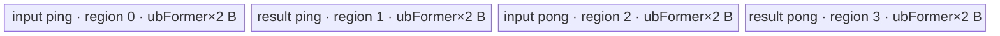

# InplaceNanToNum 950 ACLNN 算子知识

## 算子速览

| 项目 | 内容 |
|---|---|
| 实际入口 | `aclnnInplaceNanToNumGetWorkspaceSize` + `aclnnInplaceNanToNum`，公开 ACLNN 两段式接口，无版本后缀 |
| 计算语义 | 将 `selfRef[i]` 的 NaN、`+Inf`、`-Inf` 分别替换为 `nan`、`posinf`、`neginf`，其余值保持不变，最终写回 `selfRef` 的原 view |
| 输入输出 | 一个输入/输出复用的 `selfRef`；公开文档支持 ND、rank≤8、非连续 Tensor；dtype 为 FLOAT16/FLOAT32/BFLOAT16 或整数/BOOL |
| 执行类型 | 空 Tensor：无 Device 节点；整数/BOOL：框架 `Contiguous→ViewCopy`；浮点：框架 `Contiguous→NanToNum(AIV_VECTOR)→ViewCopy`，核心语义仅一个 AIV Kernel |
| Kernel 路线 | R-001 空 Tensor；R-002 整数/BOOL恒等搬运；R-003 FP32 MicroAPI；R-004 FP16/BF16 升精度 MicroAPI |
| 核心资源 | API executor workspace；浮点节点固定申请 16 MiB operator workspace（Kernel 不读）；AIV 使用一个 `TBuf<VECCALC>`，内部为输入/结果各 ping-pong 的 4 个等长 UB 子区；无 `TQue`、无跨核 workspace 数据边 |
| 来源闭包 | source_closed：公开 Inplace 入口经 executor、NanToNum Host/Tiling/POD、AIV entry、ATVOSS scheduler、MicroAPI body 和 ascend950 构建接线闭合；`Contiguous/ViewCopy` 与 executor 执行是明确的框架边界 |
| 验证状态 | 已完成源码闭包检查；本次知识提取未执行编译、真机、数值或性能测试。 |

## 接口与语义

### 计算语义

对逻辑 view 中每个元素执行：

```text
selfRef[i] = nan     , if old(selfRef[i]) is NaN
           = posinf  , if old(selfRef[i]) is +Inf
           = neginf  , if old(selfRef[i]) is -Inf
           = old(selfRef[i]), otherwise
```

整数和 BOOL 不可能表示 NaN/Inf，API 实现因此不启动 `NanToNum` Kernel，只把连续化结果复制回原 view。浮点实现不是让 Kernel 直接读写同一 GM：`l0op::NanToNum` 先由 executor 分配同 shape/dtype 的连续临时输出，Kernel 写该临时 Tensor，随后 `ViewCopy` 才提交到 `selfRef`。这保证非连续 view 的写回语义，也把同址覆盖推迟到核心计算完成之后。

### 输入、输出与属性

| 参数 | shape/layout | dtype | 约束、默认值与语义 |
|---|---|---|---|
| `selfRef` | 公开契约为 ND，rank≤8；支持非连续 view；输入输出 shape 相同（同一对象） | 文档与实现：FLOAT16、FLOAT32、BFLOAT16、INT8、INT16、INT32、INT64、UINT8、BOOL | 必须非空指针；空 Tensor 成功短路；浮点按公式替换，整数/BOOL 原值写回 |
| `nan` | 标量属性 | C++ `float` | NaN 替换值；无默认值，由调用者显式提供 |
| `posinf` | 标量属性 | C++ `float` | `+Inf` 替换值；无默认值 |
| `neginf` | 标量属性 | C++ `float` | `-Inf` 替换值；无默认值 |
| `workspaceSize` | Host 输出 | `uint64_t*` | 空 Tensor 固定写 0；其它路径由 executor 汇总，浮点内部 NanToNum 节点请求 16 MiB |
| `executor` | Host 输出 | `aclOpExecutor**` | 第一段创建并转交；封装可选连续化、核心 Kernel 和最终 `ViewCopy` |
| `workspace` | Device 地址 | `void*` | 第二段传入，大小必须对应第一段结果；核心 `nan_to_num` entry 接收但不读取该参数 |
| `stream` | runtime stream | `aclrtStream` | `CommonOpExecutorRun` 在该 stream 上执行 executor 中的有序节点 |

公开 Markdown 与 API 实现一致地支持整数/BOOL 且不支持 FLOAT64；头文件 `selfRef` 注释却写“FLOAT64、FLOAT32、FLOAT16、BFLOAT16”，与同文件实际 `DTYPE_SUPPORT_LIST` 及公开 Markdown 不一致。工程复用应以公开参数表和执行校验为准，并把此头文件注释差异视为固定源码限制。

### 入口与版本

固定仓只公开无版本后缀的 `aclnnInplaceNanToNumGetWorkspaceSize`/`aclnnInplaceNanToNum`，不存在更高版本入口。第一段以 `selfRef` 同时作为 `ExecNanToNumGetWorkspaceSize(self, out)` 的输入和输出；第二段仅调用 `CommonOpExecutorRun`。公开产品表明确支持 Ascend 950PR/950DT；`NanToNum` OpDef、binary config、模块 CMake 和全局 binary config 都只把本仓 Kernel 接到 `ascend950`，故本卡覆盖 950。

## Host/Launcher 执行流程

### 参数校验与前处理

执行顺序如下：

1. `CREATE_EXECUTOR()` 创建 executor，失败返回 `ACLNN_ERR_INNER_CREATE_EXECUTOR`。
2. `CheckNotNull2Tensor(selfRef, selfRef)` 检查同一指针两次，空指针返回 `ACLNN_ERR_PARAM_NULLPTR`。
3. `CheckDtypeValid` 先要求当前 SoC 为 910B、910_93 或 `IsRegBase()`；950 是 `DAV_3510` RegBase。随后检查输入输出 dtype 相同（Inplace 天然相同）并检查固定 dtype 列表。
4. `CheckSameShape1In1Out` 检查同 shape 并通过 `OP_CHECK_MAX_DIM` 限制 rank≤8；Inplace 的同 shape 条件天然成立，rank 检查仍有效。
5. `CheckFormat` 对 storage format `FRACTAL_NZ` 只记录 warning，不返回失败；公开接口契约仍只承诺 ND。
6. 空 Tensor 直接令 `workspaceSize=0` 并释放 executor，不添加 Device 计算。
7. 非空路径无条件调用 `l0op::Contiguous(selfRef, executor)`；连续输入可由框架复用，非连续输入由框架物化为连续 Tensor。
8. 整数/BOOL 命中 `IsIntegralType(..., true)`，直接 `ViewCopy(selfContiguous, selfRef)` 并结束。
9. FLOAT16/BFLOAT16/FLOAT32 调用 `l0op::NanToNum`：executor 分配连续临时输出，添加一个 `NanToNum` AICore launcher；再调用 `ViewCopy(outResult, selfRef)` 写回原 view。
10. 任一 `Contiguous`、`NanToNum`、`ViewCopy` 返回空指针即返回 `ACLNN_ERR_INNER_NULLPTR`；launcher 添加失败也令 `l0op::NanToNum` 返回空指针。

### 参数、Workspace 与生命周期

`selfContiguous`、浮点 `outResult` 和各框架节点由 `uniqueExecutor` 持有；第一段末尾 `ReleaseTo(executor)` 把完整生命周期交给调用者。API 可见 `workspaceSize` 由 `uniqueExecutor->GetWorkspaceSize()` 汇总，因此连续化/写回所需临时区的最终合计公式属于 executor 框架边界。算子自有 Tiling 对浮点 `NanToNum` 节点令 `currentWorkspace[0]=16*1024*1024` 字节；`nan_to_num(x,y,workspace,tiling)` 保留 `workspace` ABI 参数但 Kernel body 不读取它，节点间实际数据经 executor 分配的 `outResult` GM Tensor 交接。

第二段的 `workspace`、`workspaceSize`、`executor` 只传给 `CommonOpExecutorRun`；该函数在调用者给定 `stream` 上运行第一段记录的顺序。成功前 `selfRef` 必须持续有效；浮点 `outResult` 至最终 `ViewCopy` 消费完才可释放，执行结束后 executor 管理的临时对象才可回收。

### 启动图与失败传播

```text
R-001: selfRef.IsEmpty
  Host short-circuit -> workspaceSize=0 -> no Device node

R-002: integral/bool
  F0 Contiguous(selfRef) [framework boundary, may be no-op/materialize]
    -> E0: selfContiguous GM tensor
  F1 ViewCopy(selfContiguous, selfRef) [framework boundary]

R-003/R-004: floating
  F0 Contiguous(selfRef) [framework boundary]
    -> E0: selfContiguous GM tensor
  K0 NanToNumAiCore / nan_to_num [AIV_VECTOR, blockDim=baseTiling.blockNum]
    input: selfContiguous; output: executor-owned outResult; POD: NanToNumTilingData
    workspace slice: operator request 16 MiB, body unused
    -> E1: outResult GM tensor, same logical shape/dtype, contiguous
  F1 ViewCopy(outResult, selfRef) [framework boundary]
```

所有节点由同一 executor 提交到同一 `stream`；`E0/E1` 的 owner 是 executor。前一节点添加失败时第一段立即返回，不会构成可执行 executor；运行期失败由 `CommonOpExecutorRun` 返回并阻断成功提交。框架实现的内部 event、临时 offset 及 `Contiguous/ViewCopy` 各自 Kernel 数在固定 API 边界不可见，不把 Host 书写顺序外推成额外同步原语。

## Route 与参数设计

### 分核与资源计算

以下公式只适用于浮点 R-003/R-004。令 `N=∏storage_shape[d]`（元素），`B=sizeof(T)*8`（bit），`C=PlatformAscendC::GetCoreNumAiv()`，`U=GetCoreMemSize(UB)`（byte）。本 DAG 为一个输入、一个直连输出、无临时计算 buffer，`MemOptCfg<LEVEL_2>` 推导 `BufferNum=4`：输入和结果各两个 ping-pong 子区。

```text
coreNum      = min(C, ceil(N * B / 32768))          # 32768 bit = 每核至少约 4 KiB 数据
blockFormer  = align_up(ceil(N / coreNum), 512)     # 源码实际以 512 个元素对齐
blockNum     = ceil(N / blockFormer)
blockTail    = N - (blockNum - 1) * blockFormer

alignFactor  = 256 * 8 / B                          # 元素；一个 256-byte repeat
rawTile      = floor(U * 8 / (BufferNum * B))       # 元素
ubFormer     = floor(rawTile / alignFactor) * alignFactor

ubLoopFormer = ceil(blockFormer / ubFormer)
ubLoopTail   = ceil(blockTail / ubFormer)
ubTailFormer = blockFormer - (ubLoopFormer - 1) * ubFormer
ubTailTail   = blockTail - (ubLoopTail - 1) * ubFormer
```

Host 要求平台 core 数非零、`U>=extraSize`（本算子 `extraSize=0`）且 `ubFormer!=0`。`blockNum` 被写成 launch `blockDim`。`coreNum` 是资源上限参与分块，但 Device 判断最后核使用的是 `blockNum`。空维不会进入该 Tiling：ACLNN 在 `selfRef->IsEmpty()` 处先行短路；若绕开公开入口，基础 Tiling 对任一 0 维返回失败。

### Route 选择

| 顺序 | Route | Key/模板 | 精确选择条件与优先级 | 不适用去向 |
|---:|---|---|---|---|
| 1 | R-001 空 Tensor | 无 TilingKey | `selfRef->IsEmpty()` | 非空进入 R-002 判断 |
| 2 | R-002 整数/BOOL恒等搬运 | 无 NanToNum key | 非空且 `IsIntegralType(DataType(selfRef->GetDataType()), true)`；前置 dtype 列表限定 INT8/16/32/64、UINT8、BOOL | 浮点进入 `l0op::NanToNum` |
| 3 | R-003 FP32 MicroAPI | `GET_TPL_TILING_KEY(1, TPL_FP32)`；`NanToNumDAG<float>` | 非空、非整数且 dtype=`DT_FLOAT`；Tiling 的 dtype `if/else if` 第三分支 | 其它 dtype 在 API 或 Tiling 失败 |
| 4 | R-004 FP16/BF16 升精度 MicroAPI | `GET_TPL_TILING_KEY(1, TPL_FP16)` / `GET_TPL_TILING_KEY(1, TPL_BF16)`；`NanToNumDAG<half/bfloat16_t>` | 非空、非整数且 dtype=`DT_FLOAT16` 或 `DT_BF16`；两 key 的 DAG、资源、同步、tail 相同，仅具体 16-bit 类型不同 | 其它 dtype 在 API 或 Tiling 失败 |

```text
if selfRef == nullptr: ACLNN_ERR_PARAM_NULLPTR
if platform not {910B, 910_93, RegBase} or dtype not API list: ACLNN_ERR_PARAM_INVALID
if rank > 8: ACLNN_ERR_PARAM_INVALID
if selfRef.IsEmpty(): R-001
selfContiguous = Contiguous(selfRef)
if IsIntegralType(dtype, includeBool=true): R-002
if dtype == FLOAT32: R-003, schMode=1, dType=TPL_FP32
if dtype == FLOAT16: R-004, schMode=1, dType=TPL_FP16
if dtype == BFLOAT16: R-004, schMode=1, dType=TPL_BF16
else: failure
```

### 模板/实现执行矩阵

| Route | key/selector | dtype/shape/platform 完整命中条件 | 执行拓扑与 Kernel 节点 | 实际模板/body | 内存与同步特征 | tail/fallback |
|---|---|---|---|---|---|---|
| R-001 空 Tensor | `selfRef->IsEmpty()` | API 校验已通过且元素域为空，950 | Host-only | `ExecNanToNumGetWorkspaceSize` 空分支 | workspace=0，无 Device buffer | 直接成功，无 fallback |
| R-002 整数/BOOL | `IsIntegralType(..., true)` | 非空，INT8/16/32/64、UINT8、BOOL，950 | `Contiguous→ViewCopy`，框架节点数不可见 | ACLNN executor framework | executor-owned 临时 Tensor；无 NanToNum POD/UB | ViewCopy 负责非连续 tail；空指针失败 |
| R-003 FP32 | `GET_TPL_TILING_KEY(1,TPL_FP32)` | 非空、FLOAT32、输入输出 storage shape/dtype 相同、950 | `Contiguous→K0(AIV)→ViewCopy` | `ElementwiseSch<1,NanToNumDAG<float>::OpDag>` → `NanToNumCustom<float>` | 4×`ubFormer×4` B TBuf；Mutex MTE2→V→MTE3；16 MiB workspace 参数未使用 | 最后一核/最后一 tile；MicroAPI mask；Tiling 失败无 fallback |
| R-004 FP16/BF16 | `GET_TPL_TILING_KEY(1,TPL_FP16/BF16)` | 非空、FLOAT16 或 BFLOAT16，其余同 R-003 | 同 R-003 | `ElementwiseSch<1,NanToNumDAG<half/bfloat16_t>::OpDag>` → `NanToNumCustom<T>` | 4×`ubFormer×2` B；计算寄存器为 float；同一 Mutex 图 | DMA pad + MicroAPI mask；Tiling 失败无 fallback |

### 隐藏性能 Guard

| Guard | Host/Tiling 条件 | Device/资源原因 | 影响 Route | 不满足时去向 | 源码符号 |
|---|---|---|---|---|---|
| 950 构建可达 | 公开 950 支持，且 OpDef/CMake/binary config 均为 `ascend950` | 只有 arch35 AIV body 被本仓接线 | R-003/R-004 | 本仓无其它平台 body | `NanToNum::NanToNum`、模块 `CMakeLists.txt` |
| dtype gate | API dtype 列表；核心 Tiling 只接受 FP16/BF16/FP32 | 整数不需要 NaN/Inf 比较；核心只实例化三类浮点 | 全部 | API invalid 或 R-002；核心无 fallback | `CheckDtypeValid`、`CalcInputDtype` |
| 空域 gate | API `self->IsEmpty()` | 基础 Tiling 明确拒绝 shape 中的 0 维，且 Device 循环假设至少一个 tile | R-001 vs 浮点 | R-001 成功短路 | `ExecNanToNumGetWorkspaceSize`、`ElewiseTiling` |
| 每核下限 | `coreNum=min(C,ceil(N*B/32768))` | 避免为少于 4 KiB 数据启用额外 AIV 核 | R-003/R-004 | 自动减少核数，无其它 Route | `ElewiseTiling` |
| 块对齐 | `blockFormer=align_up(ceil(N/coreNum),512)` 元素 | 固定分核粒度，最后一个 `blockTail` 吸收余量 | R-003/R-004 | 自动形成 tail 核 | `ElewiseTiling` |
| UB 可容纳 | `ubFormer=floor(((U*8)/(4*B))/alignFactor)*alignFactor != 0` | 4 个等长 buffer，tile 还需 256-byte repeat 对齐 | R-003/R-004 | `GRAPH_FAILED`，无 fallback | `GetMaxElemNum`、`DoTiling` |
| 模板调度模式 | `scheMode=DEFAULT_SCHEMODE=1` | Host 只生成 mode 1；虽然模板声明 mode 0/1，mode 0 对公开入口不可达 | R-003/R-004 | 无 mode 0 fallback | `GetScheMode`、`NanToNumTiling::SetTilingData` |
| 16-bit 精度路径 | `T!=float` | MicroAPI 比较和替换常量统一在 FP32 寄存器完成，再受控降精度 | R-004 | FLOAT32 使用 R-003 | `NanToNumCustom<T>` |

### POD/ABI

`EleBaseTilingData` 为自然 8-byte 对齐的标准字段序列；`NanToNumTilingData` 在其后追加三个 `float`。固定源码未使用 `#pragma pack`。由字段类型和声明顺序可得 `sizeof(EleBaseTilingData)=80`、`alignof=8`，`sizeof(NanToNumTilingData)=96`、`alignof=8`。

| 结构 | 字段 | 类型/位宽 | ABI 布局 | 单位 | Host/launcher producer | Device consumer | 边界 |
|---|---|---|---|---|---|---|---|
| `NanToNumTilingData.baseTiling` | `dim0` | `int64_t`/64 | offset 0 | 元素 | `AdaptEleBaseTilingData: dim0=∏shape` | 本 `ElementwiseSch` body 不读取 | 非空；乘法无显式溢出检查 |
| `NanToNumTilingData.baseTiling` | `coreNum` | `int32_t`/32 | offset 8 | AIV core | `static_cast<int32_t>(computed coreNum)` | 本 body 不读取 | 从平台 AIV core 数窄化，无显式越界检查 |
| `NanToNumTilingData.baseTiling` | `ubFormer` | `int32_t`/32 | offset 12 | 元素/tile | `GetMaxElemNum` 后窄化写入 | `Init` 决定 TBuf/region 长度；`Process` 决定整 tile | 必须非零；无显式 int32 越界检查 |
| `NanToNumTilingData.baseTiling` | `blockFormer` | `int64_t`/64 | offset 16 | 元素/core | 512 元素对齐的 `ceil(N/coreNum)` | `CalcBlockOffset` 与非尾核域 | 最后核有效域另由 tail 字段决定 |
| `NanToNumTilingData.baseTiling` | `blockNum` | `int64_t`/64 | offset 24 | 启动 block | `ceil(N/blockFormer)` | `Process` 判断 `GetBlockIdx()==blockNum-1`；Host 同值设 `blockDim` | 必须≥1；launch API 的窄化细节固定仓不可见 |
| `NanToNumTilingData.baseTiling` | `ubLoopOfFormerBlock` | `int64_t`/64 | offset 32 | tile loop/core | `ceil(blockFormer/ubFormer)` | 非最后核 `loopNum` | ≥1 |
| `NanToNumTilingData.baseTiling` | `ubLoopOfTailBlock` | `int64_t`/64 | offset 40 | tile loop/core | `ceil(blockTail/ubFormer)` | 最后核 `loopNum` | ≥1 |
| `NanToNumTilingData.baseTiling` | `ubTailOfFormerBlock` | `int64_t`/64 | offset 48 | 元素 | `blockFormer-(loops-1)*ubFormer` | 非最后核最终 `Run` 的 `tileLength` | `(0,ubFormer]` |
| `NanToNumTilingData.baseTiling` | `ubTailOfTailBlock` | `int64_t`/64 | offset 56 | 元素 | `blockTail-(loops-1)*ubFormer` | 最后核最终 `Run` 的 `tileLength` | `(0,ubFormer]` |
| `NanToNumTilingData.baseTiling` | `elemNum` | `int64_t`/64 | offset 64 | 元素 | `maxElemNum` | 本 body 不读取 | 等于 `ubFormer` |
| `NanToNumTilingData.baseTiling` | `scheMode` | `uint64_t`/64 | offset 72 | 枚举值 | `GetScheMode()=1` | 作为 Host tiling key 模板参数；运行时 body 不读取 | mode 0 声明存在但公开 Host 不生成 |
| `NanToNumTilingData` | `nan` | `float`/32 | offset 80 | 数值 | `SetAttr: *GetAttrPointer<float>(0)` | entry `SetVar<float,0>` → `NanToNumCustom` | 指针为空则 Tiling 失败 |
| `NanToNumTilingData` | `posinf` | `float`/32 | offset 84 | 数值 | `SetAttr: *GetAttrPointer<float>(1)` | entry `SetVar<float,1>` → `NanToNumCustom` | 指针为空则 Tiling 失败 |
| `NanToNumTilingData` | `neginf` | `float`/32 | offset 88 | 数值 | `SetAttr: *GetAttrPointer<float>(2)` | entry `SetVar<float,2>` → `NanToNumCustom` | 指针为空则 Tiling 失败；offset 92..95 为尾 padding |

### Route 源码闭包

| Route | Key/selector | Host/Tiling producer | POD/参数 | Kernel entry/router 节点 | Kernel body/直接依赖 | 构建接线 |
|---|---|---|---|---|---|---|
| R-001 空 Tensor | `self->IsEmpty()` | `op_api/aclnn_nan_to_num.cpp::ExecNanToNumGetWorkspaceSize` | 无 | 无 | 无 | 公开 API 与模块共同构建 |
| R-002 整数/BOOL | `IsIntegralType(...,true)` | 同上 | executor 参数，框架 ABI | `Contiguous/ViewCopy` 框架边界 | 固定接口头声明，内部实现边界 | 公开 API 与框架库 |
| R-003 FP32 | symbolic key `(1,TPL_FP32)` | `NanToNumTiling::RunTiling/SetTilingData` + `ElewiseBaseTiling::DoTiling` | `NanToNumTilingData` | `nan_to_num<1,TPL_FP32>` | `ElementwiseSch` + `NanToNumCustom<float>` + `Vec::CopyIn/Out` | `CMakeLists`、OpDef、ascend950 binary config |
| R-004 FP16/BF16 | symbolic keys `(1,TPL_FP16/BF16)` | 同 R-003，对应 dtype 分支 | 同一 POD | `nan_to_num<1,TPL_FP16/BF16>` | `ElementwiseSch` + `NanToNumCustom<half/bfloat16_t>` | 同 R-003 |

## Kernel 实现

### 公共执行流程

浮点两 Route 共享单核心 Kernel 图。APT 编译器依据 `NanToNum` 模板声明为 `(schMode,dType)` 生成实例；Host 永远令 `schMode=1`，按 dtype 选择三种 `dType`。entry 注册 POD、声明 `KERNEL_TYPE_AIV_ONLY`、创建 `TPipe`，把三个 float 属性写入 DAG Var，随后 `sch.Init(x,y)` 和 `sch.Process()`。

`ElementwiseSch::Init` 以 `blockFormer*GetBlockIdx()*sizeof(T)` 绑定每核输入/输出 GM 基址，并一次性 `InitBuffer` 一个 TBuf。`Process` 为该核选择 former/tail 的 loop 数和尾长，整 tile 与尾 tile 都递归执行 DAG：`Vec::CopyIn<T>` → `NanToNumCustom<T>` → `Vec::CopyOut<T>`。ping/pong 由 `i&1` 选择，buffer 所有权以 `Mutex::Lock/Unlock<PIPE_MTE2/PIPE_V/PIPE_MTE3>` 在搬入、向量计算、搬出之间传递。

### Route R-001：空 Tensor Host 短路

#### 适用条件

##### 选择证据

| 层级 | 文件 | 符号 | 源码谓词/参数 | 结果/下一跳 |
|---|---|---|---|---|
| API | `math/nan_to_num/op_api/aclnn_nan_to_num.cpp` | `ExecNanToNumGetWorkspaceSize` | 参数校验后 `if (self->IsEmpty())` | `workspaceSize=0`，释放 executor，返回成功 |

#### Device 数据流

##### 函数级调用链

```text
aclnnInplaceNanToNumGetWorkspaceSize
  -> ExecNanToNumGetWorkspaceSize(selfRef,...,out=selfRef)
    -> selfRef.IsEmpty() -> executor without Device computation
aclnnInplaceNanToNum
  -> CommonOpExecutorRun(empty computation graph)
```

##### 源码等价伪码

```text
# 伪码
validate(selfRef, dtype, rank)
if selfRef.is_empty:
    workspace_size = 0
    return SUCCESS
```

#### 内存与数据搬运

##### 资源与搬运表

| 层级/缓冲区 | offset/地址公式 | extent/容量公式 | dtype/layout | producer | consumer | owner/lifetime | 对齐/复用 |
|---|---|---|---|---|---|---|---|
| API workspace | N/A | 0 B | N/A | API first stage | second stage | caller/executor | 无复用 |
| GM/UB | N/A | 0 | `selfRef` 原 dtype/view | 无 Device producer | 无 | caller | 不搬运 |

##### 分层内存布局

N/A：该 Route 无 AIV、dynamic UB、NDDMA buffer 或通信 window。

##### 字节账与复用顺序

```text
UB_total = 0
dynamic_ub = N/A
workspace_total = 0
```

| 复用子区 | 写入者 | 读取者/消费点 | 下一次覆盖 | 同步或释放依据 | 安全条件 |
|---|---|---|---|---|---|
| N/A | 无 | 无 | 无 | Host 短路 | `selfRef->IsEmpty()` |

#### 同步、精度与尾块

##### 同步与数值边界表

| 阶段 | primitive/机制 | producer | consumer/等待点 | 保护对象 | 精度/尾块 |
|---|---|---|---|---|---|
| API | Host short-circuit | 参数校验 | API 返回 | executor | 空域无元素、无数值变化 |

#### 关键实现

##### 符号证据表

| 阶段 | 文件 | 符号/模板实例 | 实现事实 |
|---|---|---|---|
| Host/Tiling producer | `math/nan_to_num/op_api/aclnn_nan_to_num.cpp` | `ExecNanToNumGetWorkspaceSize` | 空域先于 Contiguous 和 NanToNum，workspace 固定为 0 |
| Kernel entry/router | N/A | N/A | 不启动 Kernel |
| Device body/helper | N/A | N/A | 不分配 UB、不读写 GM |

### Route R-002：整数/BOOL恒等搬运

#### 适用条件

##### 选择证据

| 层级 | 文件 | 符号 | 源码谓词/参数 | 结果/下一跳 |
|---|---|---|---|---|
| API | `math/nan_to_num/op_api/aclnn_nan_to_num.cpp` | `CheckDtypeValid` | dtype 位于 INT8/16/32/64、UINT8、BOOL 或三种浮点列表 | 通过 API dtype gate |
| API | 同文件 | `ExecNanToNumGetWorkspaceSize` | `IsIntegralType(DataType(self->GetDataType()), true)` | 添加 `ViewCopy(selfContiguous,selfRef)`，不调用 `l0op::NanToNum` |

#### Device 数据流

##### 函数级调用链

```text
aclnnInplaceNanToNumGetWorkspaceSize
  -> Contiguous(selfRef, executor)                 # framework boundary
  -> IsIntegralType(dtype, includeBool=true)
  -> ViewCopy(selfContiguous, selfRef, executor)   # framework boundary
aclnnInplaceNanToNum
  -> CommonOpExecutorRun(workspace, executor, stream)
```

##### 源码等价伪码

```text
# 伪码
src = contiguous(selfRef)
if dtype is integral_or_bool:
    view_copy(src, selfRef)  # 数值恒等，仅恢复原 view 布局
    return executor_workspace_size
```

#### 内存与数据搬运

##### 资源与搬运表

| 层级/缓冲区 | offset/地址公式 | extent/容量公式 | dtype/layout | producer | consumer | owner/lifetime | 对齐/复用 |
|---|---|---|---|---|---|---|---|
| `selfRef` GM | 原 view offset/stride | `N*sizeof(T)` 逻辑元素域 | 原 view | caller | Contiguous；最终 ViewCopy dst | caller，贯穿 API | 非连续映射由框架处理 |
| `selfContiguous` | 框架分配或复用，offset 不可见 | 框架决定 | 连续、原 dtype | Contiguous | ViewCopy | executor，至 ViewCopy 完成 | 框架可对连续输入做 no-op；细节不可见 |
| API workspace | 框架不可见 | `executor->GetWorkspaceSize()` | bytes | first stage | framework nodes | caller/executor | 固定仓未公开合计切片 |

##### 分层内存布局

N/A：该 Route 不可达 `NanToNum` AIV body；实际资源为框架连续化/写回临时 Tensor。

##### 字节账与复用顺序

```text
UB_total(NanToNum) = 0
dynamic_ub = N/A
workspace_total = executor->GetWorkspaceSize()  # 框架合计公式固定仓不可见
```

| 复用子区 | 写入者 | 读取者/消费点 | 下一次覆盖 | 同步或释放依据 | 安全条件 |
|---|---|---|---|---|---|
| `selfContiguous` | Contiguous | ViewCopy | executor 回收 | 同一 executor/stream 的节点依赖 | ViewCopy 完成前保持有效 |

#### 同步、精度与尾块

##### 同步与数值边界表

| 阶段 | primitive/机制 | producer | consumer/等待点 | 保护对象 | 精度/尾块 |
|---|---|---|---|---|---|
| Contiguous→ViewCopy | executor/stream ordering（内部 event 不可见） | Contiguous | ViewCopy | `selfContiguous` | 位级恒等；view tail 由框架处理 |
| ViewCopy→API完成 | `CommonOpExecutorRun` 返回 | ViewCopy | caller | `selfRef` | 不做 cast/round |

#### 关键实现

##### 符号证据表

| 阶段 | 文件 | 符号/模板实例 | 实现事实 |
|---|---|---|---|
| Host/Tiling producer | `math/nan_to_num/op_api/aclnn_nan_to_num.cpp` | `ExecNanToNumGetWorkspaceSize` | 整数/BOOL在核心算子前短路到 ViewCopy |
| Kernel entry/router | `common/inc/external/aclnn_kernels/contiguous.h` | `Contiguous`、`ViewCopy` | 固定仓只公开框架函数契约 |
| Device body/helper | N/A | framework boundary | 本逻辑 Route 无 NanToNum Device body |

### Route R-003：FP32 MicroAPI

#### 适用条件

##### 选择证据

| 层级 | 文件 | 符号 | 源码谓词/参数 | 结果/下一跳 |
|---|---|---|---|---|
| API | `math/nan_to_num/op_api/nan_to_num.cpp` | `IsAiCoreSupport` | dtype 位于 FLOAT/FLOAT16/BFLOAT16 | 分配 `outResult` 并添加 `NanToNum` AICore launcher |
| Tiling | `math/nan_to_num/op_host/arch35/nan_to_num_tiling_arch35.cpp` | `RunTiling` | `outputDtype==DT_FLOAT` | `dType=TPL_FP32`，`DoTiling<NanToNumDAG<float>::OpDag>` |
| Tiling | 同文件 | `SetTilingData` | `scheMode=1` | key=`GET_TPL_TILING_KEY(1,TPL_FP32)`，blockDim=`blockNum` |
| entry | `math/nan_to_num/op_kernel/nan_to_num_apt.cpp` | `nan_to_num<schMode,dType>` | `dType==TPL_FP32` | 实例化 `ElementwiseSch<1,NanToNumDAG<float>::OpDag>` |

#### Device 数据流

##### 函数级调用链

```text
NanToNumAiCore -> ADD_TO_LAUNCHER_LIST_AICORE(NanToNum, x, y, nan, posinf, neginf)
  -> Tiling4NanToNum -> NanToNumTiling::RunTiling -> ElewiseBaseTiling::DoTiling<float DAG>
  -> nan_to_num<1,TPL_FP32>(x,y,workspace,tiling)
    -> ElementwiseSch::SetVar<0/1/2>
    -> ElementwiseSch::Init(x,y)
    -> ElementwiseSch::Process
      -> ElementwiseSch::Run
        -> CopyIn -> Vec::CopyIn<float>
        -> RunNormalOp -> NanToNumCustom<float>
        -> CopyOut -> Vec::CopyOut<float>
  -> outResult GM edge, same stream
ViewCopy(outResult,selfRef)
```

##### 源码等价伪码

```text
# 伪码
core = GetBlockIdx()
gm_base_elem = blockFormer * core
loops = (core == blockNum-1) ? ubLoopOfTailBlock : ubLoopOfFormerBlock
last_count = (core == blockNum-1) ? ubTailOfTailBlock : ubTailOfFormerBlock

for tile in [0, loops):
    count = (tile == loops-1) ? last_count : ubFormer
    pp = tile & 1
    in_buf = input_region[pp]
    out_buf = result_region[pp]
    lock MTE2(in_buf)
    DataCopyPad(in_buf, x[gm_base_elem + tile*ubFormer], blockCount=1,
                blockLen=count*4 bytes, srcStride=0, dstStride=0, pad=false)
    unlock MTE2(in_buf)

    lock V(in_buf); lock V(out_buf)
    nan_v = Duplicate<float>(nan); pos_v = Duplicate<float>(posinf); neg_v = Duplicate<float>(neginf)
    vl = VECTOR_REG_WIDTH / 4
    for reg_chunk over ceil(count/vl):
        mask = UpdateMask<float>(remaining count)
        vin = DataCopy<float,DIST_NORM>(in_buf + reg_chunk*vl)
        m_nan = Compare<NE>(vin, vin, mask)
        m_pos = CompareScalar<EQ>(vin, +Inf, mask)
        m_neg = CompareScalar<EQ>(vin, -Inf, mask)
        vout = Select(nan_v, vin, m_nan)
        vout = Select(pos_v, vout, m_pos)
        vout = Select(neg_v, vout, m_neg)
        DataCopy<float,DIST_NORM_B32>(out_buf + reg_chunk*vl, vout, mask)
    unlock V inputs/result

    lock MTE3(out_buf)
    DataCopyPad(y[gm_base_elem + tile*ubFormer], out_buf,
                blockCount=1, blockLen=count*4 bytes, strides=0)
    unlock MTE3(out_buf)
```

#### 内存与数据搬运

##### 资源与搬运表

| 层级/缓冲区 | offset/地址公式 | extent/容量公式 | dtype/layout | producer | consumer | owner/lifetime | 对齐/复用 |
|---|---|---|---|---|---|---|---|
| input GM | `(blockFormer*core + tile*ubFormer)*4` B | `count*4` B | float/flat ND storage | Contiguous | MTE2 CopyIn | executor/caller | 有效 count，不读分核 padding |
| input ping/pong | region `0/2 × blockLen` | 每区 `ubFormer*4` B | float | MTE2 | V load | `ElementwiseSch` TBuf/Kernel | 两区交替；256-byte tile 对齐 |
| result ping/pong | region `1/3 × blockLen` | 每区 `ubFormer*4` B | float | V masked store | MTE3 CopyOut | 同一 TBuf/Kernel | 计算结果直接进入搬出区，无 temp |
| output GM `outResult` | 同 input 元素 offset | `count*4` B | float/contiguous | MTE3 | ViewCopy | executor，至 ViewCopy 完成 | 仅写有效 count |
| registers | register chunk index `loopIdx*vl` | `vl=VECTOR_REG_WIDTH/4` 个 float/lane | float RegTensor + 4 MaskReg | MicroAPI load/duplicate | compare/select/store | V scope | 源码未公开物理寄存器字节分配 |
| operator workspace | entry 参数 | 16 MiB | bytes | Tiling | Kernel ABI | runtime/executor | body 未读取，不作为跨节点数据边 |

##### 分层内存布局


##### 字节账与复用顺序

```text
blockLen = ubFormer * sizeof(float) = ubFormer * 4 B
UB_total = 4 * blockLen = 16 * ubFormer B
UB_total <= U，且 ubFormer 是 (256/4)=64 元素的倍数
dynamic_ub = N/A
workspace_total(operator request) = 16 * 1024 * 1024 B；Kernel body 使用量=0
```

| 复用子区 | 写入者 | 读取者/消费点 | 下一次覆盖 | 同步或释放依据 | 安全条件 |
|---|---|---|---|---|---|
| input ping/pong | `Vec::CopyIn` | `NanToNumCustom` | 同 parity 的下下个 tile | `Get/ReleaseTensor<VECIN>` 与 `Get/ReleaseTensor<VECCALC>` 的 Mutex | V 完成读取前 MTE2 不得覆盖 |
| result ping/pong | `NanToNumCustom` | `Vec::CopyOut` | 同 parity 的下下个 tile | V 与 MTE3 Mutex | MTE3 完成搬出前 V 不得覆盖 |
| `outResult` | K0 | ViewCopy | executor 回收 | 同一 executor/stream ordering | ViewCopy 完成前保持有效 |

#### 同步、精度与尾块

##### 同步与数值边界表

| 阶段 | primitive/机制 | producer | consumer/等待点 | 保护对象 | 精度/尾块 |
|---|---|---|---|---|---|
| GM→UB | `Mutex::Lock/Unlock<PIPE_MTE2>` | DataCopyPad | PIPE_V lock | input region | `blockLen=count*4`，pad disabled，count 可非对齐 |
| UB compute | `Mutex::Lock/Unlock<PIPE_V>` | MTE2 | V then MTE3 | input/result region | 全程 FP32；NaN 用 `x!=x`，Inf 用精确 bit-pattern float 比较；mask 限定有效 lane |
| UB→GM | `Mutex::Lock/Unlock<PIPE_MTE3>` | V store | DataCopyPad dst | result region | 仅 `count` 元素写出 |
| 核间 | N/A | 每核独立 GM slice | N/A | 分核地址域 | former 核固定 `blockFormer`；最后核使用 tail 字段，无重叠 |
| K0→ViewCopy | executor stream ordering | K0 | ViewCopy | `outResult` | 无 cast；写回原 view |

#### 关键实现

##### 符号证据表

| 阶段 | 文件 | 符号/模板实例 | 实现事实 |
|---|---|---|---|
| Host/Tiling producer | `math/nan_to_num/op_host/arch35/nan_to_num_tiling_arch35.cpp` | `RunTiling`、`SetTilingData` | FLOAT 选择 FP32 DAG/key，生成 block/tile/workspace/POD |
| Kernel entry/router | `math/nan_to_num/op_kernel/nan_to_num_apt.cpp` | `nan_to_num<1,TPL_FP32>` | AIV-only，POD attrs→Vars，初始化并运行 scheduler |
| Device body/helper | `math/nan_to_num/op_kernel/arch35/nan_to_num_dag.h` | `NanToNumCustom<float>` | FP32 load、三类 mask、三级 Select、masked store |
| Device body/helper | `opbase/.../elewise/elewise_sch.h`、`util/vec.h`、`util/sync.h` | `ElementwiseSch`、`Vec::CopyIn/Out`、`Get/ReleaseTensor` | 分核/tile、GM offset、DataCopyPad、4区 ping-pong、pipe Mutex |

### Route R-004：FP16/BF16 升精度 MicroAPI

#### 适用条件

##### 选择证据

| 层级 | 文件 | 符号 | 源码谓词/参数 | 结果/下一跳 |
|---|---|---|---|---|
| API | `math/nan_to_num/op_api/nan_to_num.cpp` | `IsAiCoreSupport` | dtype 为 FLOAT16 或 BFLOAT16 | 添加 NanToNum AICore launcher |
| Tiling | `math/nan_to_num/op_host/arch35/nan_to_num_tiling_arch35.cpp` | `RunTiling` | `outputDtype==DT_FLOAT16` 或 `DT_BF16`，按此顺序判断 | `dType=TPL_FP16/BF16` 并选择对应 DAG |
| entry | `math/nan_to_num/op_kernel/nan_to_num_apt.cpp` | `nan_to_num<1,TPL_FP16/BF16>` | 对应编译期 dtype | `ElementwiseSch<1,NanToNumDAG<half/bfloat16_t>::OpDag>` |

#### Device 数据流

##### 函数级调用链

```text
NanToNumAiCore
  -> Tiling4NanToNum -> DoTiling<NanToNumDAG<T16>::OpDag>
  -> nan_to_num<1,TPL_FP16 or TPL_BF16>
    -> ElementwiseSch<1,NanToNumDAG<T16>::OpDag>::Init/Process
      -> Vec::CopyIn<T16>
      -> NanToNumCustom<T16>
         -> DIST_UNPACK_B16 load -> Cast<float,T16,castTrait0>
         -> FP32 Compare/CompareScalar/Select
         -> Cast<T16,float,castTrait1(CAST_RINT,NO_SAT)>
         -> DIST_PACK_B32 store
      -> Vec::CopyOut<T16>
  -> outResult -> ViewCopy(selfRef)
```

##### 源码等价伪码

```text
# 伪码；分核、tile、Mutex 与 R-003 相同，sizeof(T16)=2
for each core/tile:
    DataCopyPad(in16, GM, blockLen=count*2 bytes)
    nan_v,pos_v,neg_v = Duplicate<float>(attrs)
    vl = VECTOR_REG_WIDTH / 4
    for reg_chunk over ceil(count/vl):
        mask = UpdateMask<float>(remaining count)
        vin16 = DataCopy<T16,DIST_UNPACK_B16>(in16 + reg_chunk*vl)
        vin32 = Cast<float,T16>(vin16, ZEROING mask)
        m_nan = (vin32 != vin32)
        m_pos = (vin32 == float(+Inf bit-pattern 0x7f800000))
        m_neg = (vin32 == float(-Inf bit-pattern 0xff800000))
        vout32 = Select(m_nan,nan_v,vin32)
        vout32 = Select(m_pos,pos_v,vout32)
        vout32 = Select(m_neg,neg_v,vout32)
        vout16 = Cast<T16,float,NO_SAT,CAST_RINT,ZEROING>(vout32,mask)
        DataCopy<T16,DIST_PACK_B32>(out16 + reg_chunk*vl,vout16,mask)
    DataCopyPad(GM,out16,blockLen=count*2 bytes)
```

#### 内存与数据搬运

##### 资源与搬运表

| 层级/缓冲区 | offset/地址公式 | extent/容量公式 | dtype/layout | producer | consumer | owner/lifetime | 对齐/复用 |
|---|---|---|---|---|---|---|---|
| input GM | `(blockFormer*core + tile*ubFormer)*2` B | `count*2` B | FP16/BF16 flat storage | Contiguous | MTE2 | executor/caller | 仅有效 count |
| input ping/pong | region `0/2 × blockLen` | 每区 `ubFormer*2` B | T16 | MTE2 | unpack load | scheduler TBuf | 交替复用 |
| result ping/pong | region `1/3 × blockLen` | 每区 `ubFormer*2` B | T16 | packed register store | MTE3 | scheduler TBuf | 计算结果直接搬出 |
| FP32 registers | chunk-local | `vl=VECTOR_REG_WIDTH/4` lanes | float | unpack+Cast/Duplicate | Compare/Select/downcast | V scope | 固定仓不可见物理字节；不计 UB |
| output GM | 同 input 元素 offset | `count*2` B | FP16/BF16 contiguous | MTE3 | ViewCopy | executor | masked/有效 count |
| operator workspace | entry 参数 | 16 MiB | bytes | Tiling | ABI only | runtime/executor | Kernel 未读 |

##### 分层内存布局



##### 字节账与复用顺序

```text
blockLen = ubFormer * 2 B
UB_total = 4 * blockLen = 8 * ubFormer B
UB_total <= U，且 ubFormer 是 (256/2)=128 元素的倍数
dynamic_ub = N/A
workspace_total(operator request) = 16 MiB；Kernel body 使用量=0
```

| 复用子区 | 写入者 | 读取者/消费点 | 下一次覆盖 | 同步或释放依据 | 安全条件 |
|---|---|---|---|---|---|
| input ping/pong | `Vec::CopyIn<T16>` | unpack load/Cast | 同 parity 的下下个 tile | MTE2/V Mutex | 完成 V 读取后才覆盖 |
| result ping/pong | packed masked store | `Vec::CopyOut<T16>` | 同 parity 的下下个 tile | V/MTE3 Mutex | 完成 MTE3 后才覆盖 |
| FP32 RegTensor | 当前 register chunk | Compare/Select/Cast | 下一 chunk | 单 V scope 顺序 | mask 避免尾 lane 提交 |

#### 同步、精度与尾块

##### 同步与数值边界表

| 阶段 | primitive/机制 | producer | consumer/等待点 | 保护对象 | 精度/尾块 |
|---|---|---|---|---|---|
| GM→UB | MTE2 Mutex + `DataCopyPad` | GM | V | input T16 region | `count*2` bytes，pad disabled |
| T16→FP32 | `DIST_UNPACK_B16` + `Cast` `castTrait0` | T16 UB | FP32 compare | input RegTensor | `MaskMergeMode::ZEROING`，尾 lane 清零/屏蔽 |
| FP32 replace | Compare/Select | FP32 vin + float attrs | downcast | float RegTensor | NaN/Inf 在 FP32 判定；替换属性保持 float 到最后 |
| FP32→T16 | `Cast` `castTrait1` | FP32 result | packed store | output RegTensor | `NO_SAT`、`CAST_RINT`、ZEROING；属性按目标 T16 舍入 |
| UB→GM | MTE3 Mutex + `DataCopyPad` | T16 result region | output GM | result region | 仅有效 count |
| 核/tile tail | former/tail POD + MicroAPI mask | Host Tiling | scheduler/MicroAPI | 地址域和 lane | 不读写无效分核 padding或尾 lane |

#### 关键实现

##### 符号证据表

| 阶段 | 文件 | 符号/模板实例 | 实现事实 |
|---|---|---|---|
| Host/Tiling producer | `math/nan_to_num/op_host/arch35/nan_to_num_tiling_arch35.cpp` | `RunTiling` | FP16/BF16 分别生成模板 dtype，资源公式相同 |
| Kernel entry/router | `math/nan_to_num/op_kernel/nan_to_num_apt.cpp` | `nan_to_num<1,TPL_FP16/BF16>` | AIV-only，实例化 half/bfloat16 DAG |
| Device body/helper | `math/nan_to_num/op_kernel/arch35/nan_to_num_dag.h` | `NanToNumCustom<T!=float>` | unpack、FP32比较/选择、RINT降精度、pack 与 mask |
| Device body/helper | `opbase/.../elewise/elewise_sch.h`、`util/vec.h`、`util/sync.h` | scheduler/copy/sync helpers | 2-byte GM offset、4区 UB 与 ping-pong pipe 协议 |

## 算子特定优化

### Trick T-001：结果直写搬出 ping-pong 子区

#### 触发与源码依据

- 适用 Route：R-003、R-004
- 触发条件：`NanToNumDAG<T>` 的唯一计算结果只被 `CopyOut` 消费，且显式选择 `MemOptCfg<MemLevel::LEVEL_2>`。
- Golden 来源：[`math/nan_to_num/op_kernel/arch35/nan_to_num_dag.h:120-129`](../../../../../../../cann-ops-raw/ascendc/ops-math/165d41f02a43a62324b434cb6bda7c533b14da3e/math/nan_to_num/op_kernel/arch35/nan_to_num_dag.h#L120-L129)

**官方源码（固定 Commit 连续逐字摘录）**：

```cpp
template <typename U>
struct NanToNumDAG {
    using OpCopyIn0 = Bind<Vec::CopyIn<U>, Placeholder::In0<U>>;
    using OpResult = Bind<
        NanToNumCustom<U>, OpCopyIn0, Placeholder::Var<float, PLACEHOLDER_INDEX_0>,
        Placeholder::Var<float, PLACEHOLDER_INDEX_1>, Placeholder::Var<float, PLACEHOLDER_INDEX_2>>;
    using OpCopyOut = Bind<Vec::CopyOut<U>, Placeholder::Out0<U>, OpResult>;
    using Outputs = Elems<OpCopyOut>;
    using MemCfg = MemOptCfg<MemLevel::LEVEL_2>;
    using OpDag = DAGSch<Outputs, void, MemCfg>;
```

#### 机制与设计原因

ATVOSS 的 LEVEL_2 统计对该三节点 DAG得到一个输入 MTE2、一个输出 MTE3、零 temp，二者各分配 ping/pong，因此 `BufferNum=4`。`RunNormalOp` 把 `NanToNumCustom` 的 dst 直接映射到随后 `CopyOut` 读取的 MTE3 buffer；没有第五个“计算临时结果”子区。Host 的 `bufferDivisor=BufferNum*B` 又把这一静态结果反向用于 `ubFormer` 上界，保证 `4*ubFormer*sizeof(T)<=U`。

#### 迁移边界

- 适用：单输入、单输出、逐元素结果仅由搬出节点消费的 AIV DAG。
- 前提：结果 dtype 与输出一致，计算无额外 `TempSize`，同步仍通过 scheduler 的 V→MTE3 buffer owner 转移。
- 失效：结果存在多个后继、需要持久中间量或算子声明 temp buffer 时，必须重新由 DAG 统计 `BufferNum`，不能硬编码 4。
- 未验证：本次知识提取未执行编译、真机、数值或性能测试。

#### 错误做法

固定仓未提供可验证反例；不得在未重新推导 DAG lifetime 时手工删减 temp 或 ping-pong 子区。

### Trick T-002：16-bit 输入在 FP32 寄存器完成特殊值判定与替换

#### 触发与源码依据

- 适用 Route：R-004
- 触发条件：模板 `T` 为 `half` 或 `bfloat16_t`，进入 `if constexpr (std::is_same_v<T,float>)` 的 `else` 分支。
- Golden 来源：[`math/nan_to_num/op_kernel/arch35/nan_to_num_dag.h:96-111`](../../../../../../../cann-ops-raw/ascendc/ops-math/165d41f02a43a62324b434cb6bda7c533b14da3e/math/nan_to_num/op_kernel/arch35/nan_to_num_dag.h#L96-L111)

**官方源码（固定 Commit 连续逐字摘录）**：

```cpp
for (uint16_t loopIdx = 0; loopIdx < loopNum; loopIdx++) {
    mask = MicroAPI::UpdateMask<float, MicroAPI::RegTraitNumOne>(count);
    // OpCopyIn
    MicroAPI::DataCopy<T, MicroAPI::LoadDist::DIST_UNPACK_B16>(
        vregInput16, (__ubuf__ T*)(srcAddr + loopIdx * vlSize));
    MicroAPI::Cast<float, T, castTrait0>(vregInput, vregInput16, mask);
    MicroAPI::Compare<float, CMPMODE::NE>(cmpMaskNan, vregInput, vregInput, mask);
    MicroAPI::CompareScalar<float, CMPMODE::EQ>(cmpMaskPosinf, vregInput, maxValue, mask);
    MicroAPI::CompareScalar<float, CMPMODE::EQ>(cmpMaskNeginf, vregInput, minValue, mask);
    MicroAPI::Select<float>(vregOutput, nanTensor, vregInput, cmpMaskNan);
    MicroAPI::Select<float>(vregOutput, posinfTensor, vregOutput, cmpMaskPosinf);
    MicroAPI::Select<float>(vregOutput, neginfTensor, vregOutput, cmpMaskNeginf);
    MicroAPI::Cast<T, float, castTrait1>(vregOutput16, vregOutput, mask);
    // OpCopyOut
    MicroAPI::DataCopy<T, MicroAPI::StoreDist::DIST_PACK_B32>(
```

#### 机制与设计原因

输入以 `DIST_UNPACK_B16` 装入后升为 float，NaN 通过自比较不等、正负无穷通过 FP32 bit-pattern 对应值比较，三个 float 属性也只广播一次并在 FP32 选择链中复用。最后用 `NO_SAT + CAST_RINT + ZEROING` 降回目标 16-bit 类型。这样比较和属性选择不需要为 FP16/BF16 各写一套特殊值常量，同时只在最终提交时发生属性降精度；`UpdateMask<float>` 保护最后 register chunk。

#### 迁移边界

- 适用：输入特殊值能精确提升到 FP32、替换属性以 float 提供、输出仍为 FP16/BF16 的逐元素替换。
- 前提：目标 cast 的 `CAST_RINT/NO_SAT` 语义符合接口；UB 仍存 T16，FP32 仅驻留寄存器。
- 失效：若接口要求保留更高精度属性、不同 rounding/saturation，或输入格式不是可 unpack 的 B16，必须修改 cast trait 与搬运分布。
- 未验证：本次知识提取未执行编译、真机、数值或性能测试。

#### 错误做法

固定仓未提供可验证反例；不能把三次 `Select` 重排为先判定 Inf 后判定 NaN而不重新证明 mask 优先级，亦不能把 `CAST_RINT` 默认为其它 rounding mode。

### Trick T-003：公开 Inplace 语义通过临时连续结果延迟提交

#### 触发与源码依据

- 适用 Route：R-003、R-004；R-002 也复用最终 ViewCopy 机制但没有核心计算临时输出。
- 触发条件：`aclnnInplaceNanToNumGetWorkspaceSize` 把 `selfRef` 同时传作通用实现输入/输出，且 dtype 为浮点。
- Golden 来源：[`math/nan_to_num/op_api/aclnn_nan_to_num.cpp:90-113`](../../../../../../../cann-ops-raw/ascendc/ops-math/165d41f02a43a62324b434cb6bda7c533b14da3e/math/nan_to_num/op_api/aclnn_nan_to_num.cpp#L90-L113)

**官方源码（固定 Commit 连续逐字摘录）**：

```cpp
// self如果非连续，需要转连续
auto selfContiguous = l0op::Contiguous(self, uniqueExecutor.get());
CHECK_RET(selfContiguous != nullptr, ACLNN_ERR_INNER_NULLPTR);

// 如果self的dtype为整形，则返回self的值。
if (IsIntegralType(DataType(self->GetDataType()), true)) {
  auto viewCopyResult = l0op::ViewCopy(selfContiguous, out, uniqueExecutor.get());
  CHECK_RET(viewCopyResult != nullptr, ACLNN_ERR_INNER_NULLPTR);
  *workspaceSize = uniqueExecutor->GetWorkspaceSize();
  uniqueExecutor.ReleaseTo(executor);
  return ACLNN_SUCCESS;
}

// 调用l0算子NanToNum进行计算
auto outResult = l0op::NanToNum(selfContiguous, nan, posinf, neginf, uniqueExecutor.get());
CHECK_RET(outResult != nullptr, ACLNN_ERR_INNER_NULLPTR);
```

#### 机制与设计原因

核心 `NanToNum` launcher 始终面对连续输入和 executor 新分配的连续输出，因此 AIV Kernel 可以使用一维线性分核、合并 DMA 与 ping-pong，而无需解释原 view stride，也不会在处理尚未读取的同址元素时提前覆盖输入。最终 `ViewCopy` 是唯一向 `selfRef` 原 view 提交的边；整数路径直接绕过无意义的特殊值判断。

#### 迁移边界

- 适用：公开 API 要求原地语义，但核心 Kernel 更适合连续、非别名输入输出的逐元素算子。
- 前提：executor 保证 `Contiguous→core→ViewCopy` 的同 stream 顺序，并持有临时 Tensor 至消费者完成。
- 失效：若必须零临时内存原地更新，或核心算法可安全解释任意 stride，需要设计另一 Route；不能直接删掉 ViewCopy 而保持非连续语义。
- 未验证：本次知识提取未执行编译、真机、数值或性能测试。

#### 错误做法

固定仓未提供可验证反例；源码明确显示浮点 `outResult` 后还需 `ViewCopy`，因此把 `l0op::NanToNum` 的临时输出直接视作 `selfRef` 已完成写回是错误的生命周期判断。

## 模板与实现对比

| 对比维度 | R-001 空 Tensor | R-002 整数/BOOL | R-003 FP32 | R-004 FP16/BF16 | 设计选择依据 |
|---|---|---|---|---|---|
| 命中条件/优先级 | 校验后最先判断 empty | 非空且 integral/bool | 非空 FLOAT32 | 非空 FLOAT16/BFLOAT16 | 先消除空域，再消除无需特殊值处理的 dtype |
| 模板与 dtype | 无 | 无 NanToNum template | `<1,TPL_FP32,float>` | `<1,TPL_FP16/BF16,T16>` | Host dtype 分支决定 key 与 DAG |
| 循环与分核 | 无 | 框架不可见 | 相同基础 elementwise 公式 | 同 R-003 | B 只改变 core/tile 容量 |
| Queue/TBuf/寄存器/dynamic UB/通信 window | 无 | 框架边界 | 4区 TBuf；FP32 RegTensor；无 TQue/dynamic UB | 4区 TBuf；T16+FP32 RegTensor | LEVEL_2 直连输出与 ping-pong |
| 内存总占用与复用 | 0 | executor 合计不可见 | `16*ubFormer` B | `8*ubFormer` B | 均为 `4*ubFormer*sizeof(T)` |
| 搬运/Vector/SIMT/NDDMA/通信 API | 无 | Contiguous/ViewCopy | DataCopyPad + FP32 MicroAPI | DataCopyPad + unpack/cast/FP32/pack | 仅 AIV_VECTOR，无 SIMT/NDDMA/通信 |
| 同步、精度与 tail | 无 | executor stream；位级恒等 | Mutex pipe；全 FP32；mask | Mutex pipe；FP32 compare，RINT降精度；mask | dtype 精度要求不同 |
| fallback/失败边界 | 成功短路 | 框架返回空则失败 | Tiling/launcher失败，无替代实现 | 同 R-003 | 固定仓无 AiCPU fallback |

## 平台差异

| 项目 | A2 | A3 | 950 |
|---|---|---|---|
| 支持状态 | 公开文档写支持，但固定 ops-math Commit 无 A2 Host/Tiling/Kernel/构建闭包 | 公开文档写支持，但固定 ops-math Commit 无 A3 Host/Tiling/Kernel/构建闭包 | 公开文档、OpDef、CMake、binary config 和 arch35 body 一致支持 |
| Host/Launcher | ACLNN platform gate 接受 910B，但底层正式实现固定仓不可见 | ACLNN platform gate 接受 910_93，但底层正式实现固定仓不可见 | RegBase gate；浮点添加本仓 `NanToNum` launcher |
| Kernel/资源 | 固定仓不可见 | 固定仓不可见 | AIV-only，ATVOSS LEVEL_2，4区 UB，三种浮点模板 |

## 限制与失败边界

- `selfRef` 为空指针、dtype 不在实现列表、平台不在 910B/910_93/RegBase、rank>8 时第一段失败；核心 Tiling 还要求输入输出 dtype/shape 相同、属性指针非空、平台 AIV core 数和 UB 可用量合法。
- 公开契约只承诺 ND；实现对 `FRACTAL_NZ` 仅 warning 而非显式拒绝，不能把 warning 推断为可靠支持。
- 头文件 Inplace 参数注释声称 FLOAT64，但公开 Markdown与实际校验不支持 FLOAT64；固定源码存在文档注释冲突，本卡不扩展到 FLOAT64。
- 基础 Tiling 的 shape 连乘、`ubFormer` 到 `int32_t`、`blockNum` 到 launch blockDim 没有显式溢出/窄化检查；只能沿用公开 rank/dtype 与平台资源范围，不能据此推断任意超大 Tensor 安全。
- 浮点核心节点固定请求 16 MiB workspace，但 entry 不读取；API 总 workspace 还包含 executor/连续化/写回需求，最终切片、offset 和框架内部同步固定仓不可见。
- `Contiguous`、`ViewCopy`、`CommonOpExecutorRun` 属允许的框架边界；其内部 Kernel 数、Route、UB、event 与失败清理细节不外推。
- A2/A3 的公开支持与 API gate 可见，但该固定 Commit 只接线 ascend950；因 Host/Tiling/Kernel 不闭合，不生成无后缀 A2/A3 正式卡。
- 本次知识提取未执行编译、单元测试、真机、数值或性能测试，也未调用 validator。

## 源码索引

### 链路索引

| 链路阶段 | 文件 | 关键符号 | 支撑内容 |
|---|---|---|---|
| 入口声明/约束 | `math/nan_to_num/docs/aclnnNanToNum&aclnnInplaceNanToNum.md` | `aclnnInplaceNanToNum*` 文档章节 | 公开平台、两段式原型、dtype/layout/rank/非连续语义 |
| 入口声明/约束 | `math/nan_to_num/op_api/aclnn_nan_to_num.h` | `aclnnInplaceNanToNumGetWorkspaceSize`、`aclnnInplaceNanToNum` | C ABI；同时暴露 FLOAT64 注释冲突 |
| 入口实现 | `math/nan_to_num/op_api/aclnn_nan_to_num.cpp` | `CheckDtypeValid`、`ExecNanToNumGetWorkspaceSize`、两个 Inplace 入口 | 校验、空域、整数、连续化、写回、executor |
| 入口实现 | `common/inc/op_api/level2_base.h` | `CheckNotNull2Tensor`、`CheckSameShape1In1Out` | 同 shape 与 rank≤8 的真实校验 |
| Launcher | `math/nan_to_num/op_api/nan_to_num.cpp` | `NanToNum`、`NanToNumAiCore` | 浮点 selector、临时输出分配、AICore launcher |
| Host/Tiling/Launcher | `math/nan_to_num/op_host/arch35/nan_to_num_tiling_arch35.cpp` | `NanToNumTiling::*`、`Tiling4NanToNum` | dtype/shape/attrs、基础 Tiling、key/block/workspace |
| POD | `math/nan_to_num/op_kernel/arch35/nan_to_num_tiling_struct.h` | `NanToNumTilingData` | base POD 与三个 float 属性顺序 |
| 模板 router | `math/nan_to_num/op_kernel/arch35/nan_to_num_struct.h` | `ASCENDC_TPL_ARGS_DECL/SEL(NanToNum)` | schMode/dtype 模板域 |
| Kernel entry/body | `math/nan_to_num/op_kernel/nan_to_num_apt.cpp` | `nan_to_num<schMode,dType>` | AIV-only entry、三 dtype 实例、DAG Vars |
| Kernel entry/body | `math/nan_to_num/op_kernel/arch35/nan_to_num_dag.h` | `NanToNumCustom`、`NanToNumDAG` | FP32/T16 MicroAPI、DAG、LEVEL_2 |
| 构建接线 | `math/nan_to_num/op_host/nan_to_num_def.cpp` | `NanToNum::NanToNum` | ascend950 AICore config 与 apt 文件 |
| 构建接线 | `math/nan_to_num/op_host/config/ascend950/nan_to_num_binary.json` | `op_list` | 三个浮点 dtype binary 规格 |
| 构建接线 | `math/nan_to_num/CMakeLists.txt` | `SUPPORT_COMPUTE_UNIT`、`SUPPORT_TILING_DIR` | ascend950 + arch35 活动模块接线 |
| POD/通用 Tiling | `pkg_inc/op_common/atvoss/elewise/elewise_base_struct.h` | `EleBaseTilingData` | base POD 字段、类型和顺序 |
| Host/Tiling/Launcher | `pkg_inc/op_common/atvoss/elewise/elewise_tiling.h` | `ElewiseBaseTiling::DoTiling` | DAG buffer 元数据到 Tiling 参数 |
| Host/Tiling/Launcher | `src/op_common/atvoss/elewise/elewise_tiling.cpp` | `ElewiseTiling`、`GetMaxElemNum`、`GetPlatformInfo` | 分核、tile、对齐、UB、POD producer |
| Kernel body | `pkg_inc/op_common/atvoss/elewise/elewise_sch.h` | `ElementwiseSch` | GM offset、TBuf、tile 循环、DAG 执行 |
| Kernel body | `pkg_inc/op_common/atvoss/util/dag.h` | `DAGSch` | LEVEL_2 BufferNum、buffer id 生成 |
| Kernel body | `pkg_inc/op_common/atvoss/util/node.h` | `DagNodeInfo::GetBufferNumLevel2` | 输入/输出/temp buffer 计数公式 |
| Kernel body | `pkg_inc/op_common/atvoss/util/vec.h` | `Vec::CopyIn`、`Vec::CopyOut` | DataCopyPad 参数 |
| Kernel body | `pkg_inc/op_common/atvoss/util/sync.h` | `GetTensor`、`ReleaseTensor` | MTE2/V/MTE3 Mutex 同步 |

### 实现复用检查

| 检查项 | 可复用事实 | 不得改变的约束 | 源码符号 |
|---|---|---|---|
| ABI/POD | 80-byte base 后接三个 float，总 96 byte | 字段顺序、位宽、offset、attrs 索引 0/1/2；Host 与 Device 结构必须同版 | `EleBaseTilingData`、`NanToNumTilingData` |
| 调用顺序 | `Contiguous→(integral:ViewCopy / float:NanToNum→ViewCopy)` | Inplace 最终写回不能早于核心输出完成；空域必须在基础 Tiling 前短路 | `ExecNanToNumGetWorkspaceSize` |
| workspace/内存 | 核心 4 等长 UB 区；operator workspace 请求 16 MiB | `BufferNum` 必须从 DAG 重算；不能把未使用的 workspace 参数删出 ABI | `DAGSch`、`ElementwiseSch::Init`、`SetTilingData` |
| 同步 | 输入/结果 ping-pong 经 MTE2→V→MTE3 Mutex 转移 | 同 parity buffer 在消费者完成前不得覆盖 | `GetTensor`、`ReleaseTensor` |
| 精度与尾块 | FP32 三级 Select；T16 unpack→FP32→RINT pack；former/tail + mask | Select 顺序、Inf bit-pattern、cast traits、有效 count/mask 不得擅改 | `NanToNumCustom`、`ElementwiseSch::Process` |
| 失败边界 | API/Tiling/launcher 任一失败即返回；无 AiCPU fallback | 不得把 A2/A3 缺失 body、FLOAT64 注释或 format warning当作正式支持 | `CheckDtypeValid`、`NanToNum`、`RunTiling` |