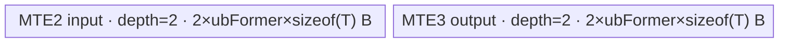

# InplaceNeg 950 ACLNN 算子知识

## 算子速览

| 项目 | 内容 |
|---|---|
| 实际入口 | `aclnnInplaceNegGetWorkspaceSize` + `aclnnInplaceNeg`，无版本后缀的最新公开 ACLNN 两段式接口 |
| 计算语义 | 对 `selfRef` 每个逻辑元素求相反数并提交回同一用户 Tensor 视图：`selfRef[i] = -selfRef[i]` |
| 输入输出 | 单个输入/输出别名 `selfRef`；ND、0～8 维、可空、可非连续；950 公开支持 INT8/INT32/INT64/FLOAT16/BFLOAT16/FLOAT32/DOUBLE/COMPLEX64/COMPLEX128 |
| 执行类型 | R-001、R-002 的核心 Neg 节点为单 AIV_VECTOR Kernel；R-003 为单 AICPU 节点；Contiguous/ViewCopy 是框架边界 |
| Kernel 路线 | R-001 五种原 dtype AIV MicroAPI；R-002 BF16→FP32→BF16 AIV；R-003 DOUBLE/COMPLEX AICPU fallback |
| 核心资源 | AIV 使用 GM、一个 `TBuf<TPosition::VECCALC>` 分片池、MicroAPI 寄存器、Mutex 管线与 16 MiB节点 workspace；AICPU 使用 GM 和 `ParallelFor`，OpDef 声明 100 B workspace |
| 来源闭包 | `source_closed`：公开 Inplace 入口、950 dtype 分发、Host/Tiling/POD、AIV entry/body、AICPU fallback、直接 atvoss 依赖与构建接线闭合；Contiguous/ViewCopy 和 AscendC primitive 内部按框架边界标注 |
| 验证状态 | 已完成源码闭包检查；本次知识提取未执行编译、真机、数值或性能测试。 |

## 接口与语义

### 计算语义

令 `N` 为 `selfRef` 逻辑 shape 的元素数，接口对每个 `i∈[0,N)` 执行 `selfRef[i] = -selfRef[i]`。公开接口的“原地”是用户可见 Tensor 对象和逻辑视图语义：Host 先把输入连续化，分配内部 Neg 输出，最后由 `ViewCopy` 提交回 `selfRef`。连续 950 场景中，`ViewCopy` 可把 workspace 输出的 storage 地址重定向到用户存储，使核心 Neg 节点直接写回；非连续场景会有框架布局转换节点。

FLOAT16/FLOAT32 与整数 AIV 路线在原 dtype 上调用 `MicroAPI::Neg`；BFLOAT16 先按 Cast mode 0 升为 FP32，FP32 取负，再按 mode 1 降回 BF16。DOUBLE、COMPLEX64、COMPLEX128 由 AICPU 对每个 C++ 元素执行一元负号。公开文档声明默认确定性实现。

### 输入、输出与属性

| 参数 | shape/layout | dtype | 约束、默认值与语义 |
|---|---|---|---|
| `selfRef` | ND；0～8 维；可为空、可非连续 | INT8、INT32、INT64、FLOAT16、BFLOAT16、FLOAT32、DOUBLE、COMPLEX64、COMPLEX128 | 非空指针；同一对象同时为输入与输出。实现对非 ND storage 只告警，公开契约仍限定 ND。 |
| `workspaceSize` | Host 标量输出 | `uint64_t*` | 第一段由 executor 汇总；空 Tensor 固定返回 0。AIV Neg 节点单独请求 16 MiB系统 workspace。 |
| `executor` | Host 输出句柄 | `aclOpExecutor**` | 第一段创建并移交，保存任务、内部 Tensor、地址关系与 workspace 生命周期。 |
| `workspace` | Device 字节缓冲区 | `void*` | 第二段输入；地址和大小必须与第一段返回的 executor 配套。 |
| `stream` | ACL runtime stream | `aclrtStream` | `CommonOpExecutorRun` 在该 stream 上提交 executor 内任务。 |

### 入口与版本

固定仓公开头文件与文档只声明无版本后缀的 `aclnnInplaceNegGetWorkspaceSize/aclnnInplaceNeg`，没有同语义更高版本。第一段直接复用 `aclnnNegGetWorkspaceSize(selfRef, selfRef, ...)`，但本卡只描述输入输出别名的 InplaceNeg，不把需独立输出对象的 `aclnnNeg` 合并为同一逻辑算子。

950 支持由公开文档的 Ascend 950PR/950DT 支持表、`Neg` OpDef 的 `ascend950` AICore config、950 binary JSON 的六种 AIV dtype 和 `CMakeLists.txt` 的 `ascend950→arch35` 接线共同证明。公开 API 余下 DOUBLE/两种 COMPLEX 由固定仓 AICPU 实现闭合。

## Host/Launcher 执行流程

### 参数校验与前处理

调用顺序如下：

1. `aclnnInplaceNegGetWorkspaceSize` 把 `selfRef` 同时传给 `aclnnNegGetWorkspaceSize` 的 `self/out`。
2. `CheckNotNull` 检查指针；950 因 `IsRegBase()` 使用含 BF16 的九 dtype 列表；`CheckPromoteType` 对同一 Tensor 为同 dtype；`CheckShape` 检查最大 8 维和相同 shape。
3. `selfRef->IsEmpty()` 时在任何 Device 任务入队前成功返回 `workspaceSize=0`。
4. 非空输入调用 `l0op::Contiguous`；连续输入只建 view，非连续输入按 stride 进入框架转换路线。
5. `l0op::Neg` 分配同 view shape、同 dtype 的 `negOut`。950 对 FLOAT/FLOAT16/INT32/INT8/BF16/INT64 优先入队 AICore Neg，对 DOUBLE/COMPLEX64/COMPLEX128 入队 AICPU Neg。
6. `l0op::Cast(negOut, selfRef.dtype)` 因源目标 dtype 相同直接返回 `negOut`，不会产生 Cast Device 节点。
7. `l0op::ViewCopy` 把结果提交回 `selfRef`；连续 workspace 输出可通过 `SetStorageAddr/AddTensorRelation` 直接绑定用户存储，其他布局走框架 copy。
8. 第一段返回 `executor->GetWorkspaceSize()`；第二段 `aclnnInplaceNeg` 调用 `CommonOpExecutorRun`。

### 参数、Workspace 与生命周期

用户拥有 `selfRef` 存储。executor 拥有连续化结果、`negOut`、布局转换参数和任务；`ReleaseTo(executor)` 后这些对象活到第二段 stream 提交完成。AIV Tiling 固定令 `workspace[0]=16*1024*1024` B，`neg` entry 接收 `workspace` 但 body 不读取；这是节点 runtime 契约，不是节点间数据边。AICPU OpDef 通过 `ApplyMathAicpuDefaultCfg` 声明 100 B workspace，CPU body 本身只从 context 取输入输出。

ACLNN 总 workspace 由 executor 汇总而非单一 `N` 公式决定：连续路线可重定向 `negOut` 到用户存储，非连续 Contiguous/ViewCopy 可能增加框架临时量。调用者必须保持 `workspace`、executor 与 `selfRef` 有效，直到所给 stream 上任务完成。

### 启动图与失败传播

```text
aclnnInplaceNegGetWorkspaceSize(selfRef)
  -> [N == 0] workspaceSize=0；无 Device 节点
  -> Contiguous(selfRef)                                  # 框架边界
  -> l0op::Neg(selfContiguous)
       -> R-001/R-002: ADD_TO_LAUNCHER_LIST_AICORE(Neg)
          -> neg<scheMode,dType>(x,y,workspace,tiling)    # 单 AIV Kernel
       -> R-003: ADD_TO_LAUNCHER_LIST_AICPU(Neg)
          -> NegCpuKernel::Compute                        # 单 AICPU 节点
  -> Cast(negOut,selfRef.dtype)                           # 同 dtype，Host no-op
  -> ViewCopy(negOut,selfRef)                             # 地址重定向或框架 copy
  -> executor.GetWorkspaceSize()

aclnnInplaceNeg(workspace,executor,stream)
  -> CommonOpExecutorRun(...,stream)
```

核心 Neg 节点的输入和输出逻辑 shape/dtype 一致；`negOut` 由 executor 持有到 ViewCopy 消费。所有任务属于同一 executor 并在传入 stream 上保持顺序。参数、Contiguous、Neg launcher、ViewCopy 或 Tiling 任一失败都会阻断后续构图/执行；AIV Tiling 失败不会自动转 AICPU，AICPU 只由 Host dtype selector 选择。

## Route 与参数设计

### 分核与资源计算

对 R-001/R-002，`ElewiseBaseTiling` 从输出 storage shape 合轴为 `N=∏dim`。令 `Cmax` 为 950 AIV core 数、`U` 为每核 UB 字节、`bmin/bmax` 为 DAG 最小/最大 dtype 字节数、`B` 为 DAG buffer 分片数：

```text
coreNum    = min(ceil(N * 8*bmin / 32768), Cmax)
blockFormer= align_up(ceil(N/coreNum), 512) elements
blockNum   = ceil(N/blockFormer)
blockTail  = N-(blockNum-1)*blockFormer
ubFormer   = align_down(floor(U/(B*bmax)), 256/bmin) elements
ubLoop     = ceil(blockElements/ubFormer)
ubTail     = blockElements-(ubLoop-1)*ubFormer
blockDim   = blockNum
```

R-001 的 `B=4` 且 `bmin=bmax=sizeof(T)`：F16 为 `coreNum≤ceil(N/2048)`、`UB_total=8*ubFormer` B；F32/I32 为 `ceil(N/1024)`、`16*ubFormer` B；I8 为 `ceil(N/4096)`、`4*ubFormer` B；I64 为 `ceil(N/512)`、`32*ubFormer` B。R-002 的 BF16 DAG含两个 FP32临时节点，`B=6,bmin=2,bmax=4`，故 `coreNum≤ceil(N/2048)`、`ubFormer=align_down(floor(U/24),128)`、`UB_total=24*ubFormer` B。R-003 不使用 AIV POD；AICPU `ParallelFor` 以 `NumElements()` 和 grain 1 分片。

### Route 选择

| 顺序 | Route | Key/模板 | 精确选择条件与优先级 | 不适用去向 |
|---:|---|---|---|---|
| 1 | R-001 原 dtype AIV | `(1,NEG_TPL_FP16/FP32/INT8/INT32/INT64)`；`NegNoCast<T>` | 950、非空且 dtype∈{FLOAT16,FLOAT32,INT8,INT32,INT64}；`IsAiCoreSupport` 优先为真 | BF16→R-002；DOUBLE/COMPLEX→R-003；其他参数失败 |
| 2 | R-002 BF16 升精度 AIV | `(1,NEG_TPL_BF16)`；`NegNeedCast<bfloat16_t>` | 950、非空、dtype=BFLOAT16 | DOUBLE/COMPLEX→R-003；其他参数失败 |
| 3 | R-003 AICPU | `DoCompute<double/complex<float>/complex<double>>`；无 key | 950、非空且 dtype∈{DOUBLE,COMPLEX64,COMPLEX128}；API允许但 AICore support 为假 | AICPU dispatch/执行失败，无 fallback |

```text
if selfRef == nullptr or dtype not in API list or rank > 8: fail
if N == 0: return workspaceSize=0
if dtype in {F16,F32,I8,I32,I64}: enqueue AIV NegNoCast<T>      # R-001
else if dtype == BF16: enqueue AIV NegNeedCast<bf16>           # R-002
else: enqueue AICPU NegCpuKernel<T>                             # R-003
Cast(result,same_dtype) -> no-op
ViewCopy(result,selfRef)
```

### 模板/实现执行矩阵

| Route | key/selector | dtype/shape/platform 完整命中条件 | 执行拓扑与 Kernel 节点 | 实际模板/body | 内存与同步特征 | tail/fallback |
|---|---|---|---|---|---|---|
| R-001 原 dtype AIV | Host `GET_TPL_TILING_KEY(1,dType)` 五个 key | 950、非空、五个原生 dtype、输入输出同 shape/dtype | 单 AIV `neg` | `ElementwiseSch<1,NegNoCast<T>::OpDag>`→`NegCustom<T>` | 2×MTE2 + 2×MTE3 分片；Mutex；16 MiB workspace | former/tail core、tile tail、MicroAPI mask；Tiling失败 |
| R-002 BF16 升精度 AIV | `(1,NEG_TPL_BF16)` | 950、非空、BF16、同 shape/dtype | 单 AIV `neg` | `CopyIn<bf16>→Cast<float,bf16,0>→NegCustom<float>→Cast<bf16,float,1>→CopyOut` | 2×输入 + 2×FP32 temp + 2×输出；Mutex；16 MiB | FP32 Neg，masked tail；Tiling失败 |
| R-003 AICPU | Host dtype switch | 950、非空、DOUBLE/COMPLEX64/COMPLEX128 | 单 AICPU Neg | `NegCpuKernel::Compute→DoCompute<T>→RangeNeg<T>` | worker 直接读写 GM shard；`ParallelFor` 完成同步 | 每 shard `[start,end)`；未知 dtype/ParallelFor失败 |

### 隐藏性能 Guard

| Guard | Host/Tiling 条件 | Device/资源原因 | 影响 Route | 不满足时去向 | 源码符号 |
|---|---|---|---|---|---|
| 空域提前返回 | `self->IsEmpty()` | 公共 Elewise Tiling拒绝 0 维并假定至少一次 tail | 全部 | 成功返回 0 workspace、无 Device 节点 | `aclnnNegGetWorkspaceSize` |
| API dtype | 950 使用含九 dtype 的 `dtype_support_list_afterV200` | 限定公开可达实现集 | 全部 | `ACLNN_ERR_PARAM_INVALID` | `CheckDtypeValid` |
| AICore优先分发 | `IsRegBase() && dtype∈{F32,F16,I32,I8,BF16,I64}` | 950 binary 只实例化六种 dtype | 全部 | DOUBLE/COMPLEX→AICPU | `l0op::IsAiCoreSupport/Neg` |
| 非空 AIV core | `Cmax>0` | `coreNum` 是除数和 launch 上界 | R-001/R-002 | `ElewiseTiling` 失败 | `GetPlatformInfo/ElewiseTiling` |
| UB tile | `U>=0` 且对齐后 `ubFormer>0` | pool 要容纳 `B*ubFormer*bmax` | R-001/R-002 | Tiling失败 | `GetMaxElemNum/ElewiseTiling` |
| 512元素分核 | `blockFormer=align_up(ceil(N/coreNum),512)` | scheduler 的 core base 和 tail POD 依赖此值 | R-001/R-002 | 无替代 Route | `ElewiseTiling` |
| MicroAPI tail | `loopNum=ceil(count/(VECTOR_REG_WIDTH/sizeof(T)))`；逐轮 `UpdateMask(count)` | 最后一寄存器无效 lane 不写回 UB/GM | R-001/R-002 | 固定实现无 fallback | `NegCustom<T>` |
| AICPU dtype | switch 含 F32/DOUBLE/F16/I32/I64/COMPLEX；公开 fallback只到三种 | 避免 BF16/INT8落入不支持的 CPU switch | R-003 | `KERNEL_STATUS_PARAM_INVALID` | `NegCpuKernel::Compute` |

### POD/ABI

`NegTilingData` 仅包装自然布局的 `EleBaseTilingData baseTiling`，`sizeof=80`、`alignof=8`；R-003 不读取该 POD。

| 结构 | 字段 | 类型/位宽 | ABI 布局 | 单位 | Host/launcher producer | Device consumer | 边界 |
|---|---|---|---|---|---|---|---|
| `NegTilingData.baseTiling` | `dim0` | `int64_t`/64 | offset 0，size 8 | 元素 | `ElewiseTiling`: storage shape 维度乘积 | 当前 scheduler 未读 | 0 维失败；乘法溢出保护固定仓不可见 |
| 同上 | `coreNum` | `int32_t`/32 | offset 8，size 4 | AIV core | `AdaptEleBaseTilingData`: 窄化 `coreNum` | 当前 scheduler 未读 | launch 取独立 `blockNum` |
| 同上 | `ubFormer` | `int32_t`/32 | offset 12，size 4 | 元素/tile | `GetMaxElemNum` 后窄化 | `Init/Process`: pool、`blockLen`、整 tile | 必须大于 0 |
| 同上 | `blockFormer` | `int64_t`/64 | offset 16，size 8 | 元素/core | 512元素向上对齐 | `CalcBlockOffset` | 尾核有效数可更小 |
| 同上 | `blockNum` | `int64_t`/64 | offset 24，size 8 | AIV block | `ceil(N/blockFormer)`；也传 `SetBlockDim` | `Process` 识别末核 | 必须与 blockDim 一致 |
| 同上 | `ubLoopOfFormerBlock` | `int64_t`/64 | offset 32，size 8 | tile loop | `ceil(blockFormer/ubFormer)` | 非末核 loopNum | 至少 1 |
| 同上 | `ubLoopOfTailBlock` | `int64_t`/64 | offset 40，size 8 | tile loop | `ceil(blockTail/ubFormer)` | 末核 loopNum | 至少 1 |
| 同上 | `ubTailOfFormerBlock` | `int64_t`/64 | offset 48，size 8 | 有效元素 | `blockFormer-(loops-1)*ubFormer` | 非末核末 tile | `1..ubFormer` |
| 同上 | `ubTailOfTailBlock` | `int64_t`/64 | offset 56，size 8 | 有效元素 | `blockTail-(loops-1)*ubFormer` | 末核末 tile | `1..ubFormer` |
| 同上 | `elemNum` | `int64_t`/64 | offset 64，size 8 | 元素 | `maxElemNum` | 当前 scheduler 未读 | 等于 producer 侧 ubFormer 的 int64 值 |
| 同上 | `scheMode` | `uint64_t`/64 | offset 72，size 8 | 调度枚举 | `GetScheMode()` 固定 1 | Host 用于生成编译期 key | 模板声明 mode 0/1，当前 Host 只产生 1 |

### Route 源码闭包

| Route | Key/selector | Host/Tiling producer | POD/参数 | Kernel entry/router 节点 | Kernel body/直接依赖 | 构建接线 |
|---|---|---|---|---|---|---|
| R-001 原 dtype AIV | 五个 `(1,dType)` key | `NegTiling::RunTiling/SetTilingData`；`ElewiseBaseTiling` | `NegTilingData/EleBaseTilingData` | `neg<scheMode,dType>` | `NegNoCast<T>/NegCustom<T>`；`ElementwiseSch/Vec/sync` | `neg_def.cpp`、950 JSON、CMake、opbase target |
| R-002 BF16 AIV | `(1,NEG_TPL_BF16)` | 同上，`DoTiling<NegNeedCast<bf16>>` | 同一 80 B POD，资源参数不同 | 同一 `neg` constexpr BF16 分支 | `NegNeedCast`、两个 `Vec::Cast`、`NegCustom<float>` | 同上 |
| R-003 AICPU | `IsAiCoreSupport=false` + CPU dtype switch | `l0op::NegAiCpu`；无 Tiling | CpuKernelContext；OpDef 100 B workspace | AICPU `Neg` task | `NegCpuKernel::Compute/DoCompute/RangeNeg` | AICPU OpDef；CMake glob `op_kernel_aicpu` |

## Kernel 实现

### 公共执行流程

三条 Route 均由 `l0op::Neg` 分配同 shape/dtype 的结果后选择一个核心节点；ACLNN Cast 因同 dtype消失，结果直接进入 ViewCopy。AIV 两条 Route 共享 `neg` entry、80 B POD、通用 Elewise 分核、单 `TBuf` pool 和 `CopyIn→DAG compute→CopyOut` 顺序；R-003 不经过 AIV Tiling。连续 Inplace 场景可在执行前把结果 storage 重定向为 `selfRef`，AIV 每个 tile 先完成 GM→UB 搬入再写回，AICPU 每个元素先读后写，二者都保持本 Route 的原地别名顺序。

### Route R-001：原 dtype AIV MicroAPI

#### 适用条件

##### 选择证据

| 层级 | 文件 | 符号 | 源码谓词/参数 | 结果/下一跳 |
|---|---|---|---|---|
| API | `math/neg/op_api/aclnn_neg.cpp` | `CheckDtypeValid` | 950 `IsRegBase()` 且 dtype在九类型列表 | 继续；否则参数失败 |
| Host selector | `math/neg/op_api/neg.cpp` | `IsAiCoreSupport/Neg` | dtype∈{F16,F32,I8,I32,I64} | `NegAiCore` |
| Tiling | `math/neg/op_host/arch35/neg_tiling_arch35.cpp` | `NegTiling::RunTiling` | dtype分支调用 `DoTiling<NegNoCast<T>>` | 生成 `(scheMode,dType)` key |
| Router | `math/neg/op_kernel/neg_apt.cpp` | `neg<scheMode,dType>` | `DTYPE_X` 非 BF16 | `ElementwiseSch<...,NegNoCast<DTYPE_X>>` |

#### Device 数据流

##### 函数级调用链

```text
NegAiCore -> ADD_TO_LAUNCHER_LIST_AICORE(Neg)
  -> NegTiling::RunTiling -> ElewiseBaseTiling::DoTiling<NegNoCast<T>::OpDag>
  -> neg<1,dType>(x,y,workspace,tiling)
     -> ElementwiseSch::Init(x,y)
     -> ElementwiseSch::Process
        -> CopyIn<T> -> NegCustom<T> -> CopyOut<T>
  -> ViewCopy(result,selfRef)
```

##### 源码等价伪码

```text
# 伪码
core = GetBlockIdx()
gmBase = core * blockFormer
loops, tail = core==blockNum-1 ? tailCoreFields : formerCoreFields
for tile in [0,loops):
    count = tile==loops-1 ? tail : ubFormer
    pp = tile & 1
    DataCopyPad(inPool[pp], x[gmBase + tile*ubFormer], count*sizeof(T))
    VL = VECTOR_REG_WIDTH/sizeof(T)
    for r in [0,ceil(count/VL)):
        mask = UpdateMask<T>(count)
        vin = load(inPool[pp] + r*VL)
        vout = MicroAPI::Neg(vin,mask)
        masked_store(outPool[pp] + r*VL,vout,mask)
    DataCopyPad(y[gmBase + tile*ubFormer], outPool[pp], count*sizeof(T))
```

#### 内存与数据搬运

##### 资源与搬运表

| 层级/缓冲区 | offset/地址公式 | extent/容量公式 | dtype/layout | producer | consumer | owner/lifetime | 对齐/复用 |
|---|---|---|---|---|---|---|---|
| GM input | `(blockFormer*core + tile*ubFormer)*sizeof(T)` | `count` elements | T/ND contiguous | Contiguous/user | CopyIn | caller/framework至 stream完成 | core区间不重叠 |
| MTE2 pool ping/pong | `bufId*blockLen` | 每片 `ubFormer*sizeof(T)` | T | DataCopyPad | NegCustom | TBuf；本 tile | 两片按 `tile&1` |
| RegTensor input/output | 每轮 `r*VL` | 各一向量寄存器 | T | MicroAPI DataCopy/Neg | masked store | VEC scope | mask保护尾 lane |
| MTE3 pool ping/pong | `bufId*blockLen` | 每片 `ubFormer*sizeof(T)` | T | NegCustom | CopyOut | TBuf；到 MTE3释放 | 两片按 parity |
| GM output | 同 input offset | `count` elements | T/ND contiguous | CopyOut | ViewCopy/user | executor→用户 | Inplace时可与 input别名 |
| node workspace | 参数地址 | 16 MiB | bytes | runtime | entry未读 | executor/caller | 非数据边 |

##### 分层内存布局



##### 字节账与复用顺序

```text
UB_total = 4 * ubFormer * sizeof(T)
UB_total <= U
dynamic_ub = N/A
workspace_total(core node) = 16 MiB system workspace
=> ubFormer = align_down(floor(U/(4*sizeof(T))),256/sizeof(T))
```

| 复用子区 | 写入者 | 读取者/消费点 | 下一次覆盖 | 同步或释放依据 | 安全条件 |
|---|---|---|---|---|---|
| input parity片 | CopyIn | NegCustom | 下一个同 parity tile | MTE2 `ReleaseTensor`→V `GetTensor` | 当前计算消费完成前不得覆盖 |
| output parity片 | NegCustom | CopyOut | 下一个同 parity tile | V `ReleaseTensor`→MTE3 `GetTensor` | 当前搬出完成前不得覆盖 |

#### 同步、精度与尾块

##### 同步与数值边界表

| 阶段 | primitive/机制 | producer | consumer/等待点 | 保护对象 | 精度/尾块 |
|---|---|---|---|---|---|
| GM→UB | `DataCopyPad` + MTE2 Mutex | CopyIn | NegCustom V lock | input片 | 只搬 `count*sizeof(T)`，pad细节由 primitive边界 |
| UB计算 | V Mutex + `UpdateMask` | input片 | NegCustom | input/output片 | 原 dtype Neg；末寄存器 masked |
| UB→GM | MTE3 Mutex + `DataCopyPad` | NegCustom | CopyOut | output片 | 只提交 count 元素 |
| 跨节点 | executor stream | Neg | ViewCopy | result GM | 同 dtype，无 ACLNN Cast节点 |

#### 关键实现

##### 符号证据表

| 阶段 | 文件 | 符号/模板实例 | 实现事实 |
|---|---|---|---|
| Host/Tiling producer | `math/neg/op_host/arch35/neg_tiling_arch35.cpp` | `RunTiling/SetTilingData` | dtype DAG、key、blockDim、16 MiB workspace |
| Kernel entry/router | `math/neg/op_kernel/neg_apt.cpp` | `neg<scheMode,dType>` | AIV-only；非 BF16实例选择 NoCast DAG |
| Device body/helper | `math/neg/op_kernel/arch35/neg_dag.h`；opbase scheduler | `NegNoCast/NegCustom/ElementwiseSch` | GM offset、tile、MicroAPI Neg、mask、CopyOut |

### Route R-002：BF16 升精度 AIV

#### 适用条件

##### 选择证据

| 层级 | 文件 | 符号 | 源码谓词/参数 | 结果/下一跳 |
|---|---|---|---|---|
| API/selector | `aclnn_neg.cpp`；`neg.cpp` | `CheckDtypeValid/IsAiCoreSupport` | 950且 dtype=BF16 | AICore |
| Tiling | `neg_tiling_arch35.cpp` | `RunTiling` | `outputDtype==DT_BF16` | `DoTiling<NegNeedCast<bf16>>`，key `(1,2)` |
| Router | `neg_apt.cpp` | `if constexpr IsSameType<DTYPE_X,bfloat16_t>` | 编译期 BF16 | BF16 Cast DAG |

#### Device 数据流

##### 函数级调用链

```text
NegAiCore -> NegTiling::RunTiling
  -> ElewiseBaseTiling::DoTiling<NegNeedCast<bfloat16_t>::OpDag>
  -> neg<1,NEG_TPL_BF16>
     -> ElementwiseSch<1,NegNeedCast<bfloat16_t>>::Process
        -> CopyIn<bf16>
        -> Vec::Cast<float,bf16,0>
        -> NegCustom<float>
        -> Vec::Cast<bf16,float,1>
        -> CopyOut<bf16>
```

##### 源码等价伪码

```text
# 伪码；core/tile循环与 R-001 相同
inBf16 = DataCopyPad(x[offset],count)
tmpF0 = Cast<float,bfloat16_t,RoundMode(0)>(inBf16,count)
for each FP32 vector register under UpdateMask(count):
    tmpF1 = MicroAPI::Neg(tmpF0,mask)
outBf16 = Cast<bfloat16_t,float,RoundMode(1)>(tmpF1,count)
DataCopyPad(y[offset],outBf16,count)
```

#### 内存与数据搬运

##### 资源与搬运表

| 层级/缓冲区 | offset/地址公式 | extent/容量公式 | dtype/layout | producer | consumer | owner/lifetime | 对齐/复用 |
|---|---|---|---|---|---|---|---|
| GM input/output | `(blockFormer*core+tile*ubFormer)*2` | count×2 B | BF16/ND | caller/CopyOut | CopyIn/user | stream | 可原地别名 |
| input ping/pong | pool分片 | 2×`ubFormer*4` B分配口径 | BF16视图，blockLen按max dtype | CopyIn | Cast0 | TBuf | 每片物理 stride `4*ubFormer` B |
| FP32 temp0 | pool temp片 | `ubFormer*4` B | FP32 | Cast0 | NegCustom | 当前 tile | 消费后可复用 |
| FP32 temp1 | pool temp片 | `ubFormer*4` B | FP32 | NegCustom | Cast1 | 当前 tile | 消费后可复用 |
| output ping/pong | pool分片 | 2×`ubFormer*4` B分配口径 | BF16视图 | Cast1 | CopyOut | TBuf | 每片物理 stride按max dtype |
| workspace | 参数 | 16 MiB | bytes | runtime | entry未读 | caller | 非数据边 |

##### 分层内存布局


##### 字节账与复用顺序

```text
UB_total = 6 * ubFormer * MaxDtypeBytes(4) = 24*ubFormer B
UB_total <= U
dynamic_ub = N/A
workspace_total(core node) = 16 MiB
=> ubFormer = align_down(floor(U/24),128)
```

| 复用子区 | 写入者 | 读取者/消费点 | 下一次覆盖 | 同步或释放依据 | 安全条件 |
|---|---|---|---|---|---|
| input/output parity片 | CopyIn/Cast1 | Cast0/CopyOut | 下个同 parity tile | MTE2/V/MTE3 Mutex | 生产者与消费者锁顺序不变 |
| temp0 | Cast0 | NegCustom | 下一 tile Cast0 | V `GetTensor/ReleaseTensor` | Neg完成前不得覆盖 |
| temp1 | NegCustom | Cast1 | 下一 tile Neg | V Mutex | Cast1完成前不得覆盖 |

#### 同步、精度与尾块

##### 同步与数值边界表

| 阶段 | primitive/机制 | producer | consumer/等待点 | 保护对象 | 精度/尾块 |
|---|---|---|---|---|---|
| CopyIn/Cast0 | MTE2→V Mutex | BF16 GM | Cast0 | input片 | count有效元素，mode 0升 FP32 |
| Neg | V Mutex + MicroAPI mask | Cast0 | NegCustom | temp0/temp1 | FP32取负；tail masked |
| Cast1/CopyOut | V→MTE3 Mutex | NegCustom | CopyOut | temp1/output片 | mode 1降 BF16；GM只写 count |
| 跨节点 | executor stream | Neg | ViewCopy | result | 不额外执行 ACLNN Cast |

#### 关键实现

##### 符号证据表

| 阶段 | 文件 | 符号/模板实例 | 实现事实 |
|---|---|---|---|
| Host/Tiling producer | `neg_tiling_arch35.cpp` | `DoTiling<NegNeedCast<bfloat16_t>>` | 六 buffer DAG参与 tile上界，key BF16 |
| Kernel entry/router | `neg_apt.cpp` | BF16 constexpr分支 | 只对 BF16选择 NeedCast |
| Device body/helper | `neg_dag.h`；opbase `dag/vec/sch` | `NegNeedCast/Vec::Cast/NegCustom<float>` | BF16边界、FP32计算、mode 1降精度 |

### Route R-003：DOUBLE/COMPLEX AICPU

#### 适用条件

##### 选择证据

| 层级 | 文件 | 符号 | 源码谓词/参数 | 结果/下一跳 |
|---|---|---|---|---|
| API | `aclnn_neg.cpp` | `CheckDtypeValid` | 950允许 DOUBLE/COMPLEX64/COMPLEX128 | 继续 |
| Host selector | `neg.cpp` | `IsAiCoreSupport/Neg` | 三种 dtype不在 AICore list | `NegAiCpu` |
| AICPU router | `neg_aicpu.cpp` | `NegCpuKernel::Compute` | dtype switch | `DoCompute<T>`；未知类型失败 |

#### Device 数据流

##### 函数级调用链

```text
l0op::Neg -> NegAiCpu -> ADD_TO_LAUNCHER_LIST_AICPU(Neg)
  -> NegCpuKernel::Compute
     -> NormalCheck(1 input,1 output)
     -> DoCompute<double|complex<float>|complex<double>>
        -> CpuKernelUtils::ParallelFor(N,1,shard)
           -> RangeNeg(start,end,input,out)
```

##### 源码等价伪码

```text
# 伪码
require one input and one output
require input.dtype == output.dtype
switch dtype:
  DOUBLE -> T=double
  COMPLEX64 -> T=complex<float>
  COMPLEX128 -> T=complex<double>
  otherwise -> PARAM_INVALID
ParallelFor(N,grain=1):
  for i in [start,end): out[i] = -input[i]
```

#### 内存与数据搬运

##### 资源与搬运表

| 层级/缓冲区 | offset/地址公式 | extent/容量公式 | dtype/layout | producer | consumer | owner/lifetime | 对齐/复用 |
|---|---|---|---|---|---|---|---|
| GM input | `input+i*sizeof(T)` | N elements | DOUBLE/C64/C128 contiguous | Contiguous | CPU worker | executor/user | shard区间由 ParallelFor分配 |
| GM output | `out+i*sizeof(T)` | N elements | 同 input | RangeNeg | ViewCopy/user | executor→用户 | 可与 input同地址，逐元素先读后写 |
| AICPU task workspace | runtime task | OpDef声明 100 B | bytes | AICPU框架 | body无显式读取 | executor | 具体内部布局固定仓不可见 |

##### 分层内存布局

N/A：该 Route 不使用 AIV UB/TQue/TBuf；operator-owned body 由 AICPU worker 直接遍历 GM，`ParallelFor` 内部 worker 栈和调度缓冲布局固定仓不可见。

##### 字节账与复用顺序

```text
UB_total = N/A
dynamic_ub = N/A
workspace_total(AICPU op contract) = 100 B
GM logical bytes = N*sizeof(T) input + N*sizeof(T) output（原地时物理别名）
```

| 复用子区 | 写入者 | 读取者/消费点 | 下一次覆盖 | 同步或释放依据 | 安全条件 |
|---|---|---|---|---|---|
| output/input别名元素 i | RangeNeg worker | 后续 ViewCopy/user | 当前任务后 | `out[i]=-input[i]` 先读后写；ParallelFor完成返回 | shard不得重叠；由 CpuKernelUtils保证，内部策略固定仓不可见 |

#### 同步、精度与尾块

##### 同步与数值边界表

| 阶段 | primitive/机制 | producer | consumer/等待点 | 保护对象 | 精度/尾块 |
|---|---|---|---|---|---|
| CPU分片 | `ParallelFor(ctx,N,1,shard)` | scheduler | `DoCompute` 返回 | GM shard | `[start,end)` 精确覆盖，无向量 padding |
| 元素计算 | C++ unary `-` | input element | output element | 当前 i | DOUBLE原精度；COMPLEX实部/虚部共同取反 |
| 跨节点 | executor stream/task完成 | AICPU Neg | ViewCopy | result GM | ParallelFor错误直接传播 |

#### 关键实现

##### 符号证据表

| 阶段 | 文件 | 符号/模板实例 | 实现事实 |
|---|---|---|---|
| Host/Launcher producer | `math/neg/op_api/neg.cpp` | `NegAiCpu/Neg` | AICore不支持时入队 AICPU |
| Kernel entry/router | `op_kernel_aicpu/neg_aicpu.cpp` | `NegCpuKernel::Compute` | dtype switch与错误终点 |
| Device body/helper | 同文件 | `DoCompute<T>/RangeNeg<T>` | 同 dtype检查、ParallelFor、逐元素一元负号 |

## 算子特定优化

### Trick T-001：BF16 只在 GM 边界保留 16 位，取负在 FP32 完成

#### 触发与源码依据

- 适用 Route：R-002
- 触发条件：950、非空、`selfRef.dtype==BFLOAT16`，Host 产生 `NegNeedCast<bfloat16_t>` key。
- Golden 来源：[`math/neg/op_kernel/arch35/neg_dag.h:67-77`](../../../../../../../cann-ops-raw/ascendc/ops-math/165d41f02a43a62324b434cb6bda7c533b14da3e/math/neg/op_kernel/arch35/neg_dag.h#L67-L77)

**官方源码（固定 Commit 连续逐字摘录）**：

```cpp
template <typename T>
struct NegNeedCast {
    // 通过Compute构造计算图
    using OpCopyIn0 = Bind<Vec::CopyIn<T>, Placeholder::In0<T>>;
    using Cast0 = Bind<Vec::Cast<float, T, 0>, OpCopyIn0>;
    using Neg0 = Bind<NegCustom<float>, Cast0>;
    using Cast1 = Bind<Vec::Cast<T, float, 1>, Neg0>;
    using OpCopyOut = Bind<Vec::CopyOut<T>, Placeholder::Out0<T>, Cast1>;
    // 指定输出节点
    using Outputs = Elems<OpCopyOut>;
    using OpDag = DAGSch<Outputs>;
};
```

#### 机制与设计原因

BF16 的 GM 搬入/搬出保持 2 B/元素，只在 UB DAG 内建立两个 FP32临时节点：mode 0 Cast 后调用 `NegCustom<float>`，最后 mode 1 Cast 回 BF16。这样显式固定了“升精度→取负→一次降精度”的数值顺序。DAG 元数据把 `MaxDtypeBytes=4` 和 `BufferNum=6` 传给 Host，令 `ubFormer` 按 24 B/元素物理池口径缩小，避免 FP32临时量超出 UB；不能把它误套成 NoCast 的四 buffer 公式。

#### 迁移边界

- 适用：BF16 输入输出同 shape/dtype 的逐元素一元算子，且希望只在 UB 内升精度。
- 前提：950 AIV、Cast mode 0/1语义不变、Host用实际 DAG `BufferNum/MaxDtypeBytes` 重新计算 tile。
- 失效：F16/F32/整数应走 R-001；DOUBLE/COMPLEX走 R-003；UB对齐后 tile为0则 Tiling失败。
- 未验证：本次知识提取未执行编译、真机、数值或性能测试。

#### 错误做法

固定仓未提供可验证反例；迁移时不得删除最终 Cast、交换 Cast/Neg 顺序，或继续用四 buffer 的 UB 上界。

## 模板与实现对比

| 对比维度 | R-001 原 dtype AIV | R-002 BF16 AIV | R-003 AICPU | 设计选择依据 |
|---|---|---|---|---|
| 命中条件/优先级 | 五种 AICore dtype | BF16专用 | DOUBLE/两种 COMPLEX | `IsAiCoreSupport`优先，CPU为 dtype fallback |
| 模板与 dtype | `NegNoCast<T>` | `NegNeedCast<bf16>`，FP32计算 | `DoCompute<T>` | 950 binary与 CPU switch |
| 循环与分核 | AIV core→tile→寄存器 | 同分核，FP32 VL | ParallelFor shard→元素 | execution family不同 |
| Queue/TBuf/寄存器/dynamic UB/通信 window | 4分片 TBuf + 2 RegTensor | 6分片 TBuf + FP32 RegTensor | 无 AIV UB | DAG存活节点和 max dtype |
| 内存总占用与复用 | `4*ubFormer*sizeof(T)` | `24*ubFormer` B | GM shard；100 B contract | dtype与升精度决定 |
| 搬运/Vector/SIMT/NDDMA/通信 API | DataCopyPad + MicroAPI Neg | 同 + 两次 Cast | CPU ParallelFor | 无 SIMT/NDDMA/通信 |
| 同步、精度与 tail | MTE2/V/MTE3 Mutex；原 dtype mask | 同步相同；FP32取负、BF16降精度 | worker完成；逐元素 | tail机制与执行族匹配 |
| fallback/失败边界 | Tiling失败，无 CPU替补 | Tiling失败，无 CPU替补 | CPU错误终止 | fallback仅由 Host dtype选择 |

## 平台差异

| 项目 | A2 | A3 | 950 |
|---|---|---|---|
| 支持状态 | 公开文档支持；固定 `math/neg` 树缺 arch32实现，未建本平台卡 | 公开文档支持；固定树缺 arch32实现，未建本平台卡 | 公开支持且 source_closed |
| Host/Launcher | CMake只给 `ascend310p→arch32` 信号，body不可见 | CMake给 `ascend910_93/910b→arch32` 信号，body不可见 | `IsRegBase` 六种 AIV + 三种 AICPU |
| Kernel/资源 | 固定仓不可见 | 固定仓不可见 | arch35 atvoss AIV或 AICPU ParallelFor |

## 限制与失败边界

- `selfRef` 为空指针返回 161001；dtype不支持或 rank>8 返回 161002。空 Tensor成功返回 0 workspace且不入队 Device 节点。
- 公开格式是 ND；实现遇到非 ND storage只记录 warning，后续行为仍受 Contiguous/ViewCopy框架约束，不能据此扩大公开格式契约。
- AIV shape合轴的 `int64_t` 乘法溢出检查、`ubFormer` 向 `int32_t` 窄化上界和整数最小值取负语义在固定仓没有额外说明；不得推测补齐。
- `DataCopyPad`、MicroAPI `Neg/UpdateMask`、Cast mode枚举的 primitive 内部细节属于固定工具链边界；本卡只保留可见调用顺序、dtype、mask和搬运长度。
- A2/A3公开支持与构建映射存在，但固定 `math/neg/` 没有 `arch32` Host/Tiling/POD/Kernel/config，不能从 950反推，故不生成 `inplace_neg.md`。
- 本次知识提取未执行编译、真机、数值或性能测试。

## 源码索引

### 链路索引

| 链路阶段 | 文件 | 关键符号 | 支撑内容 |
|---|---|---|---|
| 入口声明/约束 | `math/neg/docs/aclnnNeg&aclnnInplaceNeg.md` | `aclnnInplaceNeg*` | 产品、dtype、rank、非连续、确定性 |
| 入口声明/约束 | `math/neg/op_api/aclnn_neg.h` | 两段式原型 | C ABI与参数 |
| 入口实现 | `math/neg/op_api/aclnn_neg.cpp` | `CheckParams/aclnnInplaceNeg*` | 校验、空域、Contiguous/Neg/Cast/ViewCopy、executor |
| Host selector | `math/neg/op_api/neg.cpp` | `IsAiCoreSupport/NegAiCore/NegAiCpu/Neg` | AIV/AICPU dtype分发 |
| Cast no-op | `math/cast/op_api/cast.cpp` | `l0op::Cast` | 同 dtype直接返回，无 Device节点 |
| 框架前后处理 | `conversion/contiguous/op_host/op_api/contiguous.cpp` | `Contiguous/ViewCopy` | 连续化、地址重定向、非连续 fallback |
| 框架前后处理 | `conversion/view_copy/op_api/view_copy.cpp` | `ViewCopyAiCore/ViewCopyAiCpu` | 非连续 ViewCopy selector边界 |
| OpDef | `math/neg/op_host/neg_def.cpp` | `ops::Neg` | 950六 dtype与 ascend950 config |
| Host/Tiling | `math/neg/op_host/arch35/neg_tiling_arch35.cpp` | `NegTiling::RunTiling/SetTilingData` | dtype DAG、key、blockDim、workspace |
| POD | `math/neg/op_kernel/arch35/neg_tiling_struct.h` | `NegTilingData` | Device POD wrapper |
| 模板配置 | `math/neg/op_kernel/arch35/neg_struct.h` | `ASCENDC_TPL_ARGS_DECL/SEL` | scheMode/dType实例集合 |
| Device body | `math/neg/op_kernel/arch35/neg_dag.h` | `NegCustom/NegNoCast/NegNeedCast` | MicroAPI、Cast、DAG |
| Kernel entry | `math/neg/op_kernel/neg_apt.cpp` | `neg` | AIV-only entry/router |
| AICPU body | `math/neg/op_kernel_aicpu/neg_aicpu.cpp` | `Compute/DoCompute/RangeNeg` | DOUBLE/COMPLEX fallback |
| AICPU OpDef | `math/neg/op_kernel_aicpu/neg_aicpu_def.cpp` | `ops::Neg` | AICPU dtype与注册 |
| AICPU默认配置 | `common/inc/aicpu/aicpu_op_def.h` | `ApplyMathAicpuDefaultCfg` | so、workspace、format配置 |
| Binary config | `math/neg/op_host/config/ascend950/neg_binary.json` | `op_list` | 950六种 AIV binary |
| 构建接线 | `math/neg/CMakeLists.txt` | `SUPPORT_COMPUTE_UNIT/TILING_DIR` | ascend950/arch35与缺失arch32信号 |
| 构建接线 | `cmake/func.cmake` | `add_all_modules_sources/add_opbase_modules` | API/Tiling/AICPU glob与opbase link |
| 公共 POD | `opbase:.../elewise_base_struct.h` | `EleBaseTilingData` | 字段类型、顺序与ABI |
| 公共 Tiling | `opbase:pkg_inc/op_common/atvoss/elewise/elewise_tiling.h` | `ElewiseBaseTiling::DoTiling` | DAG资源参数与平台读取 |
| 公共 Tiling | `opbase:src/op_common/atvoss/elewise/elewise_tiling.cpp` | `ElewiseTiling/GetMaxElemNum` | 分核、tile、tail与Guard |
| 公共 scheduler | `opbase:pkg_inc/op_common/atvoss/elewise/elewise_sch.h` | `ElementwiseSch` | GM offset、TBuf、循环与调用顺序 |
| DAG资源 | `opbase:pkg_inc/op_common/atvoss/util/dag.h` | `DAGSch/BufferNum` | DAG实例、执行序与buffer总数 |
| DAG资源 | `opbase:pkg_inc/op_common/atvoss/util/buffer.h` | `MemLevel/BUF_PING_PONG` | LEVEL_2与ping/pong类型 |
| DAG资源 | `opbase:pkg_inc/op_common/atvoss/util/node.h` | `GetBufferNumLevel2` | 输入、输出和临时分片计数 |
| 搬运 helper | `opbase:pkg_inc/op_common/atvoss/util/vec.h` | `CopyIn/CopyOut/Cast` | DataCopyPad与Cast mode |
| 同步 helper | `opbase:pkg_inc/op_common/atvoss/util/sync.h` | `GetTensor/ReleaseTensor` | MTE2/V/MTE3 Mutex协议 |

每行只写一个文件，并确保该文件存在于 Frontmatter `sources`。

### 实现复用检查

| 检查项 | 可复用事实 | 不得改变的约束 | 源码符号 |
|---|---|---|---|
| ABI/POD | 80 B `NegTilingData` 与逐字段 producer/consumer | 字段顺序、位宽、单位；key与blockDim一致 | `NegTilingData/EleBaseTilingData` |
| 调用顺序 | `Contiguous→Neg→Cast(no-op)→ViewCopy`；AIV按 DAG顺序 | Inplace别名时必须先搬入当前 tile再写回 | `aclnnNegGetWorkspaceSize/ElementwiseSch::Run` |
| workspace/内存 | AIV四/六分片池、16 MiB节点workspace；AICPU 100 B contract | depth=2计入；BF16按max dtype 4 B分片 | `ElementwiseSch::Init/SetTilingData/ApplyMathAicpuDefaultCfg` |
| 同步 | MTE2/V/MTE3按 bufId Lock/Unlock；CPU ParallelFor完成返回 | 同 parity片未释放不得覆盖；stream保持节点顺序 | `GetTensor/ReleaseTensor/DoCompute` |
| 精度与尾块 | 原 dtype Neg或 BF16→FP32→BF16；mask tail | BF16 Cast mode与顺序不可改；CopyOut只写count | `NegNoCast/NegNeedCast/NegCustom` |
| 失败边界 | 空 Tensor成功；非法参数、Tiling、launcher、CPU执行失败各自终止 | 不把 AIV Tiling失败改成 AICPU fallback | `CheckParams/RunTiling/NegCpuKernel::Compute` |
