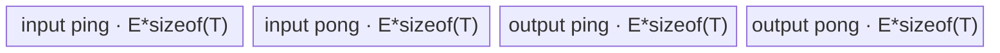
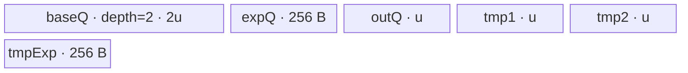

# InplacePowTensorScalar 950 ACLNN 算子知识

## 算子速览

| 项目 | 内容 |
|---|---|
| 实际入口 | `aclnnInplacePowTensorScalarGetWorkspaceSize` + `aclnnInplacePowTensorScalar`，公开 ACLNN 两段式原地接口；内部复用非原地 TensorScalar 建图函数，但把 `out` 绑定为 `self`。 |
| 计算语义 | 对 `self` 的每个逻辑元素原地写回 `self[i] = self_old[i] ^ exponent`；计算先按 950 Tensor/Scalar 规则得到中间 dtype `P`，最终 Cast/ViewCopy 回 `self.dtype`。 |
| 输入输出 | `self` 为 ND、rank≤8、可非连续，既是输入也是输出；`exponent` 为 `aclScalar`。公开 dtype 含浮点、整数和复数；整数 `P` 禁止负指数。 |
| 执行类型 | 空张量无 Device 节点；核心分支可能是单 AIV `Square`、单 AIV `Pow`、单 AICPU `Square` 或单 AICPU `Pow`。两种 AscendC entry 均显式 `KERNEL_TYPE_AIV_ONLY`，无 Cube/AIC/MIX_CV。通用 Contiguous/Cast/ViewCopy 是框架节点。 |
| Kernel 路线 | R-001 Square AIV；R-002/R-003 Square AICPU 串行/并行；R-004 Pow AIV 浮点；R-005 Pow AIV 整数；R-006/R-007 Pow AICPU 串行/并行。 |
| 核心资源 | Pow AIV 使用 GM、3 个 TQue、3 个 TBuf、寄存器及 16 MiB system workspace；Square AIV 使用 Elementwise 单 TBuf tensor pool 与 16 MiB system workspace；AICPU 使用 CPU worker 和 100 B 配置 workspace；完整 executor 另持有中间 tensor。 |
| 来源闭包 | `source_closed`：公开原地 API、950 Host 分支、Pow/Square L0 selector、两套 Tiling/POD、AIV entry/body、AICPU fallback 与构建接线闭合；executor、通用 Cast/Contiguous/ViewCopy 和 AscendC primitive 内部为框架边界。 |
| 验证状态 | 已完成源码闭包检查；本次知识提取未执行编译、真机、数值或性能测试。 |

## 接口与语义

### 计算语义

令 `x_i` 是调用前 `self` 的元素，`e` 是 Host `aclScalar exponent`，`P=InferTensorScalarDtype(self, exponent, self)`。非空输入的 executor 图语义为：

```text
x_contig = Contiguous(self)
x_P      = Cast(x_contig, P)
z_P[i]   = x_P[i] ^ CastScalar(e, P)   # Host 可改写为 Square
z_self   = Cast(z_P, self.dtype)
ViewCopy(z_self, self)                  # 最终原地提交
```

因此 Device 核心 Kernel 不直接覆盖调用者的 `self`：它写 executor 临时 `powOut/squareOut`，最后 `ViewCopy` 才把结果写回原始 view，避免非连续输入和读写别名破坏尚未消费的数据。950 的 scalar dtype 先经 `GetScalarDefaultDtype`：复数 scalar 归为 COMPLEX64，浮点 scalar 归为 FLOAT，整数保持原类型；随后 `CombineCategoriesWithComplex(self.dtype, scalarDefault)` 决定 `P`，COMPLEX32 再提升为 COMPLEX64。

### 输入、输出与属性

| 参数 | shape/layout | dtype | 约束、默认值与语义 |
|---|---|---|---|
| `self` | ND，rank≤8，可非连续；空 tensor 特判 | FLOAT、FLOAT16、BFLOAT16、DOUBLE、INT8、UINT8、INT16、INT32、INT64、COMPLEX64、COMPLEX128 | 输入/输出同一 `aclTensor`；必须可转换到 `P` 且 `P` 可转换回 `self.dtype`。 |
| `exponent` | `aclScalar`，无 tensor layout | 与 `self` 同一公开集合 | 与 `self` 不能形成不支持的 dtype 推导；`P` 为整数时值必须≥0；值必须能无溢出转换到 `P`。 |
| `workspaceSize`/`executor` | Host 输出 | `uint64_t*`/`aclOpExecutor**` | 第一段返回完整 executor 图的 workspace 和 owner；空 `self` 返回 0。 |
| `workspace`/`stream` | Device 地址/ACL stream | `void*`/`aclrtStream` | 第二段把第一段的 workspace/executor 交给 `CommonOpExecutorRun`；顺序与临时对象生命周期由 executor 保证。 |

### 入口与版本

固定版本只公开无版本后缀的 `aclnnInplacePowTensorScalar`，它是 950 实际支持的最新入口。原地第一段仅执行 `out=const_cast<aclTensor*>(self)`，再调用 `aclnnPowTensorScalarGetWorkspaceSize`；第二段独立调用 `CommonOpExecutorRun`。这属于代码复用，不把非原地 `aclnnPowTensorScalar`、TensorTensor、ScalarTensor、Grad 或其它 Pow 语义并入本卡。

公开文档产品表明确支持 Ascend 950PR/950DT；Pow 与 Square 的 OpDef、binary config、CMake 同时把活动 AICore 实现接到 `ascend950`/`mc62` 与 `arch35`。`SocVersion::ASCEND950` 不等于 `ASCEND310P/ASCEND910B/ASCEND910_93`，故 `CheckSupportPows` 在 950 必为 false，950 不会进入旧平台 `Pows` 实现。

## Host/Launcher 执行流程

### 参数校验与前处理

`aclnnInplacePowTensorScalarGetWorkspaceSize` 的真实顺序如下：

1. 把 `self` 作为 `out` 调用公共 TensorScalar 第一段；公共函数创建 executor，依次检查 `self/exponent/out` 非空、dtype 在公开集合内、950 dtype 提升有效、两 BOOL 禁止、`P` 可 Cast 到 `self.dtype`，并检查 `self.shape==out.shape` 与 rank≤8。
2. 非 ND storage format 只记录 warning；公开支持格式仍是 ND。
3. 空 `self` 直接返回 `workspaceSize=0` 和 executor，不添加 Device 节点。
4. 950 `IsRegBase()` 为 true：若 `P` 为整数且 `exponent<0` 则失败；`CheckNotOverflow` 对 FLOAT/FLOAT16/BF16、INT8/16/32/64、UINT8、COMPLEX64 检查 scalar 转换溢出。
5. 添加 `Contiguous(self)` 与 `Cast(...,P)`。随后计算 `canUseSquare`；950 不启用 `canNoUseOp`，所以即使 `e==1` 也建立 Pow 节点。
6. 命中 Square 时添加 `l0op::Square`，否则把 scalar 转为单元素 tensor并添加 `l0op::Pow`。结果再 Cast 为 `self.dtype` 并 `ViewCopy` 到 `self`。任一节点返回 null，第一段立即返回 `ACLNN_ERR_INNER_NULLPTR`。
7. `GetWorkspaceSize` 返回整个 executor 图所需 workspace，`ReleaseTo` 转移 owner。第二段在用户 stream 运行该图。

### 参数、Workspace 与生命周期

Host 核心分流为：

```text
P = InferTensorScalarDtype(self, exponent, self)
square = (float(exponent)==2) &&
         P in {FLOAT,FLOAT16,BF16,INT64,COMPLEX64,COMPLEX128}
if square: l0op::Square(x_P)
else:      l0op::Pow(x_P, ConvertToTensor(exponent,P))
```

`Square::IsAiCoreSupport` 在 950 对 `{FLOAT,FLOAT16,BF16,INT32,INT64}` 返回 true；本入口 Square 集合与其交集为 `{FLOAT,FLOAT16,BF16,INT64}`，复数转 AICPU。`Pow::IsAiCoreSupport` 在 950 对 `{FLOAT,FLOAT16,BF16,UINT8,INT8,INT16,INT32}` 返回 true，其余转 AICPU。

Pow AIV Tiling 写 `workspace[0]=16 MiB`；Square AIV 同样写 16 MiB system workspace。两者 entry 都拒绝 null workspace/user workspace，但 body 不读用户 slice。Pow AICPU `pow.json` 和 Square AICPU 公共 `ApplyMathAicpuDefaultCfg` 均配置 100 B workspace。完整 ACLNN executor 如何为 Contiguous/Cast/core/Cast/ViewCopy 拼接、对齐或复用 workspace 和中间 tensor offset，在固定框架源码中不可见，不能把单个核心节点的 16 MiB/100 B 当作 API 最终返回值。

### 启动图与失败传播

```text
aclnnInplacePowTensorScalarGetWorkspaceSize
  -> Contiguous(self_old) -> Cast(P)
  -> [Square AIV | Square AICPU | Pow AIV | Pow AICPU]
  -> Cast(self.dtype) -> ViewCopy(self)

aclnnInplacePowTensorScalar(workspace, size, executor, stream)
  -> CommonOpExecutorRun(all nodes on stream)
```

核心算子每条 Route 都只有一个 Device 节点；完整 ACLNN 图是多节点 executor。节点之间通过 executor 分配的 GM 临时 tensor交接：前一节点是 producer，后一节点是 consumer，owner 为 executor，至少存活到最后 consumer；同一 stream 的 executor 顺序提供可见性。第一段建图失败不返回可运行 executor；第二段运行失败由 `CommonOpExecutorRun` 返回并阻断后续有效消费。固定仓未公开框架内部的每条临时 tensor workspace offset、事件实现和 cleanup 细节。

## Route 与参数设计

### 分核与资源计算

Pow AIV 的 exponent tensor必为单元素，因此 priority 0 的 `PowTensorScalarTiling::IsCapable` 命中。令 `N=prod(self.storage_shape)`、平台 AIV 核数 `C`、平台 UB 字节 `U`：

```text
reserve = 8 KiB + 256 B + 256 B + powsApiTmpBuffer
nodes   = 5 + powsApiNode
u0      = floor((U-reserve)/nodes)
uBytes  = align_down(u0,512 B) if u0>=512,
          else align_down(u0,blockSize) if u0>=blockSize
E0      = uBytes/computeDtypeSize
coreElems = ceil(N/C)
E       = min(E0,max(coreElems,4096/baseDtypeSize))，若 E>=512/computeDtypeSize 再向下按该因子对齐
ubOuter = ceil(N/E); ubTail=N%E（0 改为 E）
blockFactor=ceil(ubOuter/C)
blockNum=ceil(ubOuter/blockFactor); blockTail=ubOuter%blockFactor（0 改为 blockFactor）
```

Square AIV 使用公共 `ElewiseBaseTiling`。其 DAG 是 `CopyIn<T> -> Mul<T>(x,x) -> CopyOut<T>`，编译期 tensor pool 为 4 个 `E*sizeof(T)` 子块（MTE2/MTE3 ping-pong）：

```text
Cuse = min(C,ceil(N*sizeof(T)*8/32768 bits))
blockFormer = align_up(ceil(N/Cuse),512 elements)
blockNum    = ceil(N/blockFormer)
blockTail   = N-(blockNum-1)*blockFormer
E           = align_down(floor(U/(4*sizeof(T))),256 B/sizeof(T))
former/tail loops = ceil(blockFormer|blockTail / E)
```

AICPU Pow 总是 `Y_ONE_ELEMENT`；`N<30720` 串行，反之 `ParallelFor`，每 worker区间互斥。AICPU complex Square 在 `N≤24000` 串行；`N>24000` 并行，`(24000,96000]` 最多 6 CPU、`(96000,192000]` 最多 8 CPU、`>192000` 使用可用 CPU，再扣公共预留核数。

### Route 选择

| 顺序 | Route | Key/模板 | 精确选择条件与优先级 | 不适用去向 |
|---:|---|---|---|---|
| 1 | R-001 Square AIV | Square key 1/2/3/5 | 950，`e==2`，`P∈{f16,bf16,f32,int64}` | Square AICPU 或 Pow |
| 2 | R-002 Square AICPU 串行 | `SquareCpuKernel` | `e==2`，`P∈{complex64,complex128}`，`N≤24000` | R-003 |
| 3 | R-003 Square AICPU 并行 | `SquareCpuKernel+ParallelFor` | 同 R-002，`N>24000` | 无 |
| 4 | R-004 Pow AIV 浮点 | Pow key 1001/2001/3001 | 未命中 Square，`P∈{f16,bf16,f32}`；单元素 exponent，priority 0 | R-005 或 AICPU |
| 5 | R-005 Pow AIV 整数 | Pow key 4001/5001/6001/7001 | 未命中 Square，`P∈{u8,s8,s16,s32}` 且 `e≥0`；单元素 exponent | AICPU/失败 |
| 6 | R-006 Pow AICPU 串行 | `NoBcastCompute/Y_ONE_ELEMENT` | 未命中 Square，`P∈{double,int64,complex64,complex128}`，`N<30720` | R-007 |
| 7 | R-007 Pow AICPU 并行 | 同上 + `ParallelFor` | 同 R-006，`N≥30720` | 无 |

```text
empty? -> success/no Device node
e==2 and P in {f16,bf16,f32,int64,c64,c128}?
  yes -> P in {f16,bf16,f32,int64}? R-001 : (N<=24000? R-002:R-003)
  no  -> P in {f16,bf16,f32}? R-004
         P in {u8,s8,s16,s32}? R-005
         otherwise             N<30720? R-006:R-007
```

### 模板/实现执行矩阵

| Route | key/selector | dtype/shape/platform 完整命中条件 | 执行拓扑与 Kernel 节点 | 实际模板/body | 内存与同步特征 | tail/fallback |
|---|---|---|---|---|---|---|
| R-001 | 1/2/3/5 | 950 + e=2 + P=f16/bf16/f32/i64 | 单 AIV `square` | `ElementwiseSch<0,SquareOp<T>::OpDag>` | 单 TBuf 四分区、Get/ReleaseTensor | former/tail block 和最后 UB tile |
| R-002 | AICPU complex | e=2 + P=c64/c128 + N≤24000 | 单 AICPU `Square` | `ComputeKernel<complex<T>>` | CPU直读写，无 AIV UB | 串行 `[0,N)` |
| R-003 | AICPU complex | R-002 + N>24000 | 单 AICPU `Square` | 同 R-002 + `ParallelFor` | worker区间互斥，join 后可见 | 最后一 worker end guard |
| R-004 | 1001/2001/3001 | 非 Square + P=f16/bf16/f32 | 单 AIV `pow` | `PowTensorScalarFloat<T,T>` | 3 Queue+3 TBuf；S/V events；MicroAPI/Power | `ubTail` + register mask |
| R-005 | 4001/5001/6001/7001 | 非 Square + P=u8/s8/s16/s32 + e≥0 | 单 AIV `pow` | `PowTensorScalarInteger<T,T>` | 同形 UB；SAT 控制寄存器；Power | `ubTail` + mask；非法负指数 Host 失败 |
| R-006 | AICPU Y scalar | 非 Square + P=double/i64/c64/c128 + N<30720 | 单 AICPU `Pow` | `SpecialCompute(Y_ONE_ELEMENT)` | CPU直接访问；`std::pow`/平方乘 | 串行 `[0,N)` |
| R-007 | AICPU Y scalar | R-006 + N≥30720 | 单 AICPU `Pow` | 同 R-006 + `ParallelFor` | 每 worker连续输出区间 | chunk end guard |

### 隐藏性能 Guard

| Guard | Host/Tiling 条件 | Device/资源原因 | 影响 Route | 不满足时去向 | 源码符号 |
|---|---|---|---|---|---|
| 950 Pows 禁用 | SoC 不等于 310P/910B/910_93 | 避免旧平台专用 Pows | 全部 | Square/Pow | `CheckSupportPows` |
| Square 特化 | `e==2 && P` 在六 dtype集合 | 用一次 Mul 或复数显式公式代替通用幂 | R-001..003 | Pow routes | `aclnnPowTensorScalarGetWorkspaceSize::canUseSquare` |
| Pow AiCore dtype | `IsRegBase && P` 在七 dtype列表 | 950 binary/entry只实例化七种 | R-004/005 | R-006/007 | `pow.cpp::IsAiCoreSupport` |
| singleton | `prod(expShape)==1` | scalar只读一次，无第二路逐 tile广播 | R-004/005 | priority 1（本 API 不可达） | `PowTensorScalarTiling::IsCapable` |
| Pow UB reserve | `U > reserve` 且 `E>0` | 5 个显式块与 Power临时节点必须装入 UB | R-004/005 | Tiling 失败；无 fallback | `PowTensorScalarTiling::DoOpTiling` |
| Square UB | `E=align_down(U/(4*sizeofT),256B/sizeofT)>0` | Elementwise tensor pool需四个同大子块 | R-001 | Tiling 失败 | `ElewiseTiling/GetMaxElemNum` |
| AICPU 并行阈值 | Pow `N>=30720`；Square complex `N>24000` | 避免小域 CPU 分片成本 | R-002/003/006/007 | 对应串行 Route | `NoBcastCompute/ComputeSquareKernel` |
| 空域 | `self.IsEmpty()` | 避免零元素 Tiling 除法和无效 launch | 全部 | Host success，无 Kernel | `aclnnPowTensorScalarGetWorkspaceSize` |

### POD/ABI

| 结构 | 字段 | 类型/位宽 | ABI 布局 | 单位 | Host/launcher producer | Device consumer | 边界 |
|---|---|---|---|---|---|---|---|
| `PowTensorScalarTilingData` | `blockNum` | int64/64 | 声明序0；宏展开 offset固定仓不可见 | block | `ceil(ubOuter/blockFactor)` | `SetBlockDim`/末核判断 | >0 |
| 同上 | `blockFactor` | int64/64 | 声明序1 | tile/core | `ceil(ubOuter/C)` | `beginIdx/endIdx` | >0 |
| 同上 | `blockTail` | int64/64 | 声明序2 | tile | `ubOuter%blockFactor`，0→blockFactor | 固定 body不直接读取 | inactive consumer |
| 同上 | `ubOuter` | int64/64 | 声明序3 | tile | `ceil(N/ubFactor)` | 末 tile 与 end clamp | >0 |
| 同上 | `ubFactor` | int64/64 | 声明序4 | element | UB推导 `E` | queue容量、GM步长、full tile | >0 |
| 同上 | `ubTail` | int64/64 | 声明序5 | element | `N%E`，0→E | 全局末 tile有效长度 | 1..E |
| 同上 | `totalSize` | int64/64 | 声明序6 | element | `N` | 固定 body不直接读取 | inactive consumer |
| 同上 | `ubSize` | int64/64 | 声明序7 | byte | `uBytes` | 六个 `InitBuffer` | 对齐且容纳 tile |
| `SquareTilingData.baseTiling` | `dim0` | int64/64 | offset0；总结构80 B，align8 | element | shape乘积 N | 调度元数据 | >0，空域 API已拦截 |
| 同上 | `coreNum` | int32/32 | offset8 | core | `Cuse` | 固定 scheduler未直接读取 | >0 |
| 同上 | `ubFormer` | int32/32 | offset12 | element/tile | `GetMaxElemNum`窄化写入 | tensor pool/blockLen/loop | 必须适配 int32 |
| 同上 | `blockFormer` | int64/64 | offset16 | element/core | 512元素对齐 | 核 GM byte offset | >0 |
| 同上 | `blockNum` | int64/64 | offset24 | block | `ceil(N/blockFormer)` | 末核选择 | >0 |
| 同上 | `ubLoopOfFormerBlock` | int64/64 | offset32 | loop | `ceil(blockFormer/E)` | 非末核循环 | >0 |
| 同上 | `ubLoopOfTailBlock` | int64/64 | offset40 | loop | `ceil(blockTail/E)` | 末核循环 | >0 |
| 同上 | `ubTailOfFormerBlock` | int64/64 | offset48 | element | former最后 tile | scheduler tail | 1..E |
| 同上 | `ubTailOfTailBlock` | int64/64 | offset56 | element | tail最后 tile | scheduler tail | 1..E |
| 同上 | `elemNum` | int64/64 | offset64 | element | `E` | 固定 scheduler未直接读取 | metadata |
| 同上 | `scheMode` | uint64/64 | offset72 | enum | `DEFAULT_SCHEMODE=1` | entry实例固定模板参数0；未读取 | inactive consumer |

### Route 源码闭包

| Route | Key/selector | Host/Tiling producer | POD/参数 | Kernel entry/router 节点 | Kernel body/直接依赖 | 构建接线 |
|---|---|---|---|---|---|---|
| R-001 | Square 1/2/3/5 | `square_tiling_arch35.cpp::RunTiling` | `SquareTilingData` | `square_apt.cpp::square` | `SquareOp` + `ElementwiseSch` | Square OpDef/binary/CMake |
| R-002/003 | Square AICPU | `square.cpp::IsAiCoreSupport` | CPU context + threshold arrays | `SquareCpuKernel::Compute` | `ComputeSquareKernel/ComputeKernel` | `square_aicpu_def.cpp` + default AICPU cfg |
| R-004 | Pow 1001/2001/3001 | `PowTensorScalarTiling::*` | `PowTensorScalarTilingData` | `pow_apt.cpp::pow` | `PowTensorScalarFloat` | Pow OpDef/binary/CMake |
| R-005 | Pow 4001/5001/6001/7001 | 同上 | 同上 | 同上 | `PowTensorScalarInteger` | 同上 |
| R-006/007 | Pow AICPU | `pow.cpp::IsAiCoreSupport` | CPU context + 30720阈值 | `PowCpuKernel::Compute` | `PowCompute/NoBcastCompute/SpecialCompute` | `pow.json` |

## Kernel 实现

### 公共执行流程

所有非空 Route 共享 `self_old -> Contiguous -> Cast(P) -> core -> Cast(self.dtype) -> ViewCopy(self)`。核心节点的输入临时 tensor在 core 完成前只读，核心输出在下游 Cast/ViewCopy 完成前有效；原始 `self` 最后才被覆盖。AIV entry 都先验证 workspace，设 system workspace，再声明 `KERNEL_TYPE_AIV_ONLY`。AICPU route由 L0 selector添加单个 `ADD_TO_LAUNCHER_LIST_AICPU` 节点。没有算子自有的跨核心 Kernel workspace边，也没有 Cube/MIX_CV 节点。

### Route R-001：Square AIV

#### 适用条件

##### 选择证据

| 层级 | 文件 | 符号 | 源码谓词/参数 | 结果/下一跳 |
|---|---|---|---|---|
| API Host | `aclnn_pow.cpp` | `canUseSquare` | `e==2 && P∈{f16,bf16,f32,i64,c64,c128}` | `l0op::Square` |
| L0 | `square.cpp` | `IsAiCoreSupport` | 950 + P∈{f16,bf16,f32,i32,i64} | Square AICore |
| Tiling | `square_tiling_arch35.cpp` | `SetTilingData` | P=f16/bf16/f32/i64 | key 1/2/3/5 |
| Router | `square_apt.cpp` | `square` | `TILING_KEY_IS(1\|2\|3\|5)` | `ElementwiseSch<0,SquareOp<T>::OpDag>` |

#### Device 数据流

##### 函数级调用链

```text
ADD_TO_LAUNCHER_LIST_AICORE(Square)
  -> square(x,tmpOut,workspace,tiling)
    -> ElementwiseSch::Init(x,tmpOut)
    -> ElementwiseSch::Process
      -> CopyIn<T> -> Vec::Mul<T>(src,src) -> CopyOut<T>
  -> downstream Cast -> ViewCopy(self)
```

##### 源码等价伪码

```text
base = blockIdx * blockFormer
loops,tail = blockIdx==blockNum-1 ? tailBlockFields : formerBlockFields
for tile in [0,loops):
  len = last ? tail : ubFormer; pingpong=tile&1
  DMA x[base+tile*ubFormer : +len] -> pool[input_slot(pingpong)]
  Mul(pool[result_slot], pool[input_slot], pool[input_slot], len)
  DMA pool[result_slot] -> tmpOut[base+tile*ubFormer : +len]
```

#### 内存与数据搬运

##### 资源与搬运表

| 层级/缓冲区 | offset/地址公式 | extent/容量公式 | dtype/layout | producer | consumer | owner/lifetime | 对齐/复用 |
|---|---|---|---|---|---|---|---|
| GM input/output | `(blockIdx*blockFormer+tileOffset)*sizeof(T)` | `len*sizeof(T)` | T/ND | upstream/DMA | Mul/downstream | executor core node | 仅有效 len提交 |
| `buf` tensor pool | `bufId*E*sizeof(T)` | `4*E*sizeof(T)` | byte pool→T | `InitBuffer` | scheduler | TPipe/Kernel | MTE2/MTE3 ping-pong四区 |
| input slot | compile-time id | `E*sizeof(T)` | T | CopyIn | Mul两次引用 | pool | duplicate input引用只同步一次 |
| result/output slot | compile-time id | `E*sizeof(T)` | T | Mul | CopyOut | pool | Get/ReleaseTensor保护 |
| registers | Vector primitive内部 | 固定仓不可见 | T | Mul load | Mul store | primitive调用 | tail由 count=len保护 |

##### 分层内存布局



##### 字节账与复用顺序

```text
UB_total = SquareOp::BufferNum * E * sizeof(T) = 4*E*sizeof(T) <= platformUB
dynamic_ub = N/A
workspace_total(Square node) = 16 MiB system workspace
```

| 复用子区 | 写入者 | 读取者/消费点 | 下一次覆盖 | 同步或释放依据 | 安全条件 |
|---|---|---|---|---|---|
| input ping/pong | CopyIn | Mul两个 src参数 | 下一个同 parity tile | VECIN/VECCALC Get/ReleaseTensor | 重复引用不重复释放 |
| output ping/pong | Mul | CopyOut | 下一个同 parity tile | VECCALC/VECOUT协议 | CopyOut完成后覆盖 |

#### 同步、精度与尾块

##### 同步与数值边界表

| 阶段 | primitive/机制 | producer | consumer/等待点 | 保护对象 | 精度/尾块 |
|---|---|---|---|---|---|
| CopyIn→Mul | `GetTensor/ReleaseTensor` | MTE2 | VECCALC | input slot | dtype T原精度，len为有效元素 |
| Mul→CopyOut | 同上 | VECCALC | MTE3 | output slot | `y=x*x`，无额外 Cast |
| core/tile tail | former/tail POD | Host Tiling | scheduler | GM范围 | 末核与末 tile单独长度 |

#### 关键实现

##### 符号证据表

| 阶段 | 文件 | 符号/模板实例 | 实现事实 |
|---|---|---|---|
| Host/Tiling producer | `square_tiling_arch35.cpp` | `SquareTiling::RunTiling` | dtype key、Elewise参数、blockDim、16 MiB |
| Kernel entry/router | `square_apt.cpp` | `square` keys 1/2/3/5 | AIV-only与模板实参 |
| Device body/helper | `square_dag.h`/opbase `elewise_sch.h` | `SquareOp/ElementwiseSch` | CopyIn→Mul→CopyOut、pool和tail |

### Route R-002：Square AICPU 串行

#### 适用条件

##### 选择证据

| 层级 | 文件 | 符号 | 源码谓词/参数 | 结果/下一跳 |
|---|---|---|---|---|
| API | `aclnn_pow.cpp` | `canUseSquare` | e=2，P=c64/c128 | Square |
| L0 | `square.cpp` | `IsAiCoreSupport` | complex不在 950 AiCore列表 | AICPU |
| AICPU | `square_aicpu.cpp` | `ComputeSquareKernel` | N≤24000 | serial `ComputeKernel` |

#### Device 数据流

##### 函数级调用链

```text
SquareCpuKernel::Compute -> SquareCheck -> SquareCompute
  -> ComputeSquare<complex<T>> -> ComputeSquareKernel
    -> ComputeKernel(input,output,0,N)
```

##### 源码等价伪码

```text
for i=0..N-1:
  out[i].real = x.real*x.real - x.imag*x.imag
  out[i].imag = 2*x.real*x.imag
```

#### 内存与数据搬运

##### 资源与搬运表

| 层级/缓冲区 | offset/地址公式 | extent/容量公式 | dtype/layout | producer | consumer | owner/lifetime | 对齐/复用 |
|---|---|---|---|---|---|---|---|
| CPU input/output | `i*sizeof(complex<T>)` | N elements | c64/c128 | executor | CPU loop/downstream | AICPU task | direct load/store |

##### 分层内存布局

N/A：AICPU 路线无 AIV UB；实际替代路径为 CPU tensor数据与标量寄存器。

##### 字节账与复用顺序

```text
UB_total=N/A; dynamic_ub=N/A; configured workspace=100 B
```

| 复用子区 | 写入者 | 读取者/消费点 | 下一次覆盖 | 同步或释放依据 | 安全条件 |
|---|---|---|---|---|---|
| output element | serial loop | downstream Cast | none | task completion | 每 i只写一次 |

#### 同步、精度与尾块

##### 同步与数值边界表

| 阶段 | primitive/机制 | producer | consumer/等待点 | 保护对象 | 精度/尾块 |
|---|---|---|---|---|---|
| serial complex | CPU loop | current iteration | task return | output | c64用float、c128用double；i<N |

#### 关键实现

##### 符号证据表

| 阶段 | 文件 | 符号/模板实例 | 实现事实 |
|---|---|---|---|
| Host/Tiling producer | `square.cpp` | `Square/SquareAiCpu` | complex fallback |
| Kernel entry/router | `square_aicpu.cpp` | `SquareCpuKernel::Compute/SquareCompute` | dtype dispatch |
| Device body/helper | 同上 | `ComputeKernel<complex<T>>` | 显式复数平方 |

### Route R-003：Square AICPU 并行

#### 适用条件

##### 选择证据

| 层级 | 文件 | 符号 | 源码谓词/参数 | 结果/下一跳 |
|---|---|---|---|---|
| AICPU | `square_aicpu.cpp` | `ComputeSquareKernel` | complex且N>24000；阈值 96000/192000调核数 | ParallelFor |

#### Device 数据流

##### 函数级调用链

```text
ComputeSquareKernel -> choose cores -> ParallelFor(total,per_unit_size)
  -> each worker ComputeKernel<complex<T>>(begin,end)
```

##### 源码等价伪码

```text
cores = available
if N<=96000: cores=min(cores,6)
else if N<=192000: cores=min(cores,8)
workers = min(max(1,cores-kResvCpuNum),N)
parallel disjoint [begin,end): same complex formula as R-002
```

#### 内存与数据搬运

##### 资源与搬运表

| 层级/缓冲区 | offset/地址公式 | extent/容量公式 | dtype/layout | producer | consumer | owner/lifetime | 对齐/复用 |
|---|---|---|---|---|---|---|---|
| worker input/output | `[begin,end)` | `end-begin` | c64/c128 | executor/worker | worker/downstream | AICPU task | output区间互斥 |

##### 分层内存布局

N/A：AICPU CPU worker路线，无 AIV UB。

##### 字节账与复用顺序

```text
UB_total=N/A; dynamic_ub=N/A; configured workspace=100 B
```

| 复用子区 | 写入者 | 读取者/消费点 | 下一次覆盖 | 同步或释放依据 | 安全条件 |
|---|---|---|---|---|---|
| output chunk | worker | downstream | none | ParallelFor join | chunks不重叠 |

#### 同步、精度与尾块

##### 同步与数值边界表

| 阶段 | primitive/机制 | producer | consumer/等待点 | 保护对象 | 精度/尾块 |
|---|---|---|---|---|---|
| workers | `ParallelFor` | CPU workers | task completion | output visibility | end界限保护尾 chunk |

#### 关键实现

##### 符号证据表

| 阶段 | 文件 | 符号/模板实例 | 实现事实 |
|---|---|---|---|
| Host/Tiling producer | `square_aicpu.cpp` | threshold arrays | complex三档阈值 |
| Kernel entry/router | 同上 | `ComputeSquareKernel` | core cap与ParallelFor |
| Device body/helper | 同上 | worker lambda/`ComputeKernel` | 区间公式与tail |

### Route R-004：Pow AIV 浮点

#### 适用条件

##### 选择证据

| 层级 | 文件 | 符号 | 源码谓词/参数 | 结果/下一跳 |
|---|---|---|---|---|
| API | `aclnn_pow.cpp` | branch tree | 非 Square；950 `CheckSupportPows=false` | `l0op::Pow` |
| L0 | `pow.cpp` | `IsAiCoreSupport` | P=f16/bf16/f32 | Pow AICore |
| Tiling | `pow_tensor_scalar_tiling_arch35.cpp` | `IsCapable/GetTilingKey` | exponent tensor元素数1 | 1001/2001/3001 |
| Router | `pow_apt.cpp` | `pow` | key | `PowTensorScalarFloat<T,T>` |

#### Device 数据流

##### 函数级调用链

```text
pow -> PowTensorScalarFloat<T,T>::Init
  -> scalar exponent load (BF16: DMA+Cast+V_S; other: scalar GM read) -> S_V
  -> Process -> per exponent specialization
     CopyBase -> {Duplicate/ShiftLeft/Sqrt/Div/Mul/Power/Cast} -> CopyPow
```

##### 源码等价伪码

```text
begin=blockIdx*blockFactor; end=min(begin+blockFactor,ubOuter)
e=float(exponent[0]); gm=begin*E
if e==0: Duplicate(1) once; DMA same tile to all assigned GM ranges
else for tile in [begin,end):
  len = tile==ubOuter-1 ? ubTail : E
  DMA x[gm:gm+len] -> baseQ
  e==1      : bitwise identity via ShiftLeft(...,0)
  e==0.5    : Sqrt
  e==-0.5   : 1/Sqrt
  e==2 or 3 : masked Mul chain
  e==-1/-2  : 1/x or 1/(x*x), DivSpecificMode
  otherwise : f32 direct Power; f16/bf16 cast f32 -> Power -> cast back
  DMA outQ有效len -> GM; gm += E
```

#### 内存与数据搬运

##### 资源与搬运表

| 层级/缓冲区 | offset/地址公式 | extent/容量公式 | dtype/layout | producer | consumer | owner/lifetime | 对齐/复用 |
|---|---|---|---|---|---|---|---|
| base/output GM | `tile*E` | len | T/ND | upstream/compute | compute/downstream | executor/Pow | DataCopyPad blockCount1，blockLen=len*sizeofT |
| `vecBaseQue` | UB | `2*uBytes` | T | CopyBase | compute | TPipe | depth2 |
| `vecExpQue` | UB | 256 B | T | BF16 exponent DMA | Cast | TPipe | depth1 |
| `vecPowQue` | UB | `uBytes` | T | compute | CopyPow | TPipe | depth1 |
| `tmp1/tmp2` | UB | each `uBytes` | float/temp | Cast/Power | Power/Cast | TPipe | generic path复用 |
| `tmpExp` | UB | 256 B | float | BF16 scalar Cast | scalar read | TPipe | only BF16 consumer |
| RegTensor | vector chunks | `ceil(len/(VREG/4))` iterations | f32/T | MicroAPI load | store | helper | `UpdateMask` tail |

##### 分层内存布局



##### 字节账与复用顺序

```text
explicit_UB = 5*uBytes + 512 B
reserved_bound = (5+powsApiNode)*uBytes + 8 KiB + 512 B + powsApiTmpBuffer <= U
dynamic_ub=N/A
workspace_total(Pow node)=16 MiB
```

| 复用子区 | 写入者 | 读取者/消费点 | 下一次覆盖 | 同步或释放依据 | 安全条件 |
|---|---|---|---|---|---|
| base queue slot | CopyBase | current compute | 下一同 parity tile | EnQue/DeQue/FreeTensor | compute完成后释放 |
| output queue | compute | CopyPow | 下一 tile | EnQue/DeQue/FreeTensor | GM提交后释放 |
| tmp1/tmp2 | Cast/Power | 下一计算阶段 | 下一 tile | 顺序调用 + S/V依赖 | 仅generic 16-bit path使用 |

#### 同步、精度与尾块

##### 同步与数值边界表

| 阶段 | primitive/机制 | producer | consumer/等待点 | 保护对象 | 精度/尾块 |
|---|---|---|---|---|---|
| BF16 exponent | queue + V_S | DMA/Cast | scalar读取 | expValue | BF16→f32 `CAST_NONE` |
| scalar→vector | S_V event | scalar expValue | Process vector路径 | exponent可见性 | 每核只读一次 |
| queue pipeline | TQue | DMA/compute | compute/DMA | UB slot | last global tile用ubTail |
| 16-bit generic | Cast/Power/Cast | f16/bf16 | output | math精度 | 先升f32；BF16回写 `CAST_RINT` |
| register tail | `UpdateMask`+ZEROING | valid lanes | store | 无效lane | mask按剩余size更新 |

#### 关键实现

##### 符号证据表

| 阶段 | 文件 | 符号/模板实例 | 实现事实 |
|---|---|---|---|
| Host/Tiling producer | `pow_tensor_scalar_tiling_arch35.cpp` | `PowTensorScalarTiling::*` | singleton、UB/core/tail与三 keys |
| Kernel entry/router | `pow_apt.cpp` | 1001/2001/3001 | 完整模板实参、AIV-only |
| Device body/helper | `pow_tensor_scalar_float.h` | `Init/Process/Compute*` | scalar同步、值特化、精度和tail |

### Route R-005：Pow AIV 整数

#### 适用条件

##### 选择证据

| 层级 | 文件 | 符号 | 源码谓词/参数 | 结果/下一跳 |
|---|---|---|---|---|
| API | `aclnn_pow.cpp` | `CheckPowTensorScalarExponet` | P为整数要求e≥0 | 继续或参数失败 |
| L0/Tiling | `pow.cpp`/scalar tiling | | P=u8/s8/s16/s32，exp tensor单元素 | key 4001/5001/6001/7001 |
| Router | `pow_apt.cpp` | integer keys | key匹配 | `PowTensorScalarInteger<T,T>` |

#### Device 数据流

##### 函数级调用链

```text
pow -> PowTensorScalarInteger<T,T>::Init -> scalar exponent GM read -> S_V
  -> Process -> CopyBase
    -> e=0 Duplicate(1); e=1 bit copy; e=2/3 MicroAPI Mul; else Power<T,INTRINSIC>
  -> CopyPow
```

##### 源码等价伪码

```text
e=int64(exponent[0]); assign core tile range as R-004
if e==0: materialize one all-ones UB tile and reuse for all assigned output tiles
else per tile:
  DMA valid len
  e==1 -> bitwise copy
  e==2/3 -> SAT bit60=0; masked multiply (u8/s8 widen to 16-bit); restore bit60=1
  otherwise -> Power<T,false,{INTRINSIC}>(x,T(e),len)
  DMA valid len to output
```

#### 内存与数据搬运

##### 资源与搬运表

| 层级/缓冲区 | offset/地址公式 | extent/容量公式 | dtype/layout | producer | consumer | owner/lifetime | 对齐/复用 |
|---|---|---|---|---|---|---|---|
| GM input/output | tile*E | len | integer T/ND | DMA/compute | compute/DMA | executor/Pow | blockLen=len*sizeofT |
| 3 queues | UB | `2u+256+u` | T | DMA/compute | compute/DMA | TPipe | base depth2 |
| 3 TBuf | UB | `u+u+256` | temp | Power/helper | compute | TPipe | 与R-004同物理公式 |
| registers | vector chunk | VREG/sizeof(widened T) | T/i16/u16 | MicroAPI | store | helper | mask tail；8-bit pack/unpack |

##### 分层内存布局


##### 字节账与复用顺序

```text
explicit_UB=5u+512 B
reserved_bound=(5+powsApiNode)*u+8 KiB+512 B+powsApiTmpBuffer<=U
workspace_total=16 MiB
```

| 复用子区 | 写入者 | 读取者/消费点 | 下一次覆盖 | 同步或释放依据 | 安全条件 |
|---|---|---|---|---|---|
| base/output slots | DMA/compute | compute/DMA | 下一 tile | TQue生命周期 | FreeTensor后覆盖 |
| SAT control bit60 | square/cube helper | integer Mul模式 | helper结束恢复 | 显式 `SetCtrlSpr(...,1)` | helper所有出口必须恢复 |

#### 同步、精度与尾块

##### 同步与数值边界表

| 阶段 | primitive/机制 | producer | consumer/等待点 | 保护对象 | 精度/尾块 |
|---|---|---|---|---|---|
| scalar exponent | S_V | GM scalar read | vector Process | expValue | int64保存，generic再Cast到T |
| square/cube | SAT bit + mask ZEROING | helper | helper exit | arithmetic mode | u8/s8 widen，乘后与255并pack |
| tile | Queue + `UpdateMask` | DMA/compute | store | valid lanes | 全局末 tile用ubTail |

#### 关键实现

##### 符号证据表

| 阶段 | 文件 | 符号/模板实例 | 实现事实 |
|---|---|---|---|
| Host/Tiling producer | `aclnn_pow.cpp`/scalar tiling | integer检查/`GetTilingKey` | 非负约束与四 keys |
| Kernel entry/router | `pow_apt.cpp` | 4001..7001 | integer模板映射 |
| Device body/helper | `pow_tensor_scalar_integer.h` | `Process/ComputeSquare/ComputeCube` | 快速指数、SAT、mask与Power |

### Route R-006：Pow AICPU 串行

#### 适用条件

##### 选择证据

| 层级 | 文件 | 符号 | 源码谓词/参数 | 结果/下一跳 |
|---|---|---|---|---|
| API/L0 | `aclnn_pow.cpp`/`pow.cpp` | generic branch/`IsAiCoreSupport` | 非Square，P=double/i64/c64/c128 | Pow AICPU |
| AICPU | `pow_aicpu.cpp` | `PowCompute/NoBcastCompute` | exponent元素数1，N<30720 | `Y_ONE_ELEMENT` serial |

#### Device 数据流

##### 函数级调用链

```text
PowCpuKernel::Compute -> kcalls[P][P][P] -> PowCompute
  -> NoBcastCompute -> SpecialCompute(Y_ONE_ELEMENT,0,N)
    -> per element PowImpl(x[i],exponent[0],out[i])
```

##### 源码等价伪码

```text
for i=0..N-1:
  if P integral: e>=0已由Host保证；PowiImpl平方乘
  else: out[i]=static_cast<P>(std::pow(x[i],e))
```

#### 内存与数据搬运

##### 资源与搬运表

| 层级/缓冲区 | offset/地址公式 | extent/容量公式 | dtype/layout | producer | consumer | owner/lifetime | 对齐/复用 |
|---|---|---|---|---|---|---|---|
| input/output | i | N / 1 exponent | P/ND | executor | CPU loop/downstream | AICPU task | exponent[0]只读复用 |

##### 分层内存布局

N/A：AICPU CPU loop，无 AIV UB。

##### 字节账与复用顺序

```text
UB_total=N/A; dynamic_ub=N/A; configured workspace=100 B
```

| 复用子区 | 写入者 | 读取者/消费点 | 下一次覆盖 | 同步或释放依据 | 安全条件 |
|---|---|---|---|---|---|
| exponent[0] | executor | all iterations | none | task lifetime | read-only |
| output[i] | loop | downstream | none | task return | each i once |

#### 同步、精度与尾块

##### 同步与数值边界表

| 阶段 | primitive/机制 | producer | consumer/等待点 | 保护对象 | 精度/尾块 |
|---|---|---|---|---|---|
| serial math | CPU loop | iteration | task return | output | std::pow按P；i<N |

#### 关键实现

##### 符号证据表

| 阶段 | 文件 | 符号/模板实例 | 实现事实 |
|---|---|---|---|
| Host/Tiling producer | `pow.cpp` | `Pow/PowAiCpu` | backend selector与launch |
| Kernel entry/router | `pow_aicpu.cpp` | `Compute/kcalls` | P/P/P dispatch |
| Device body/helper | 同上 | `PowCompute/NoBcastCompute/SpecialCompute/PowImpl` | scalar index和数学 |

### Route R-007：Pow AICPU 并行

#### 适用条件

##### 选择证据

| 层级 | 文件 | 符号 | 源码谓词/参数 | 结果/下一跳 |
|---|---|---|---|---|
| AICPU | `pow_aicpu.cpp` | `NoBcastCompute` | Y_ONE_ELEMENT且N≥30*1024 | ParallelFor |

#### Device 数据流

##### 函数级调用链

```text
NoBcastCompute -> max_core_num=max(1,GetCPUNum(ctx))
  -> per_unit_size=CeilMultiple(N,max_core_num)
  -> ParallelFor -> SpecialCompute(Y_ONE_ELEMENT,start,end)
```

##### 源码等价伪码

```text
parallel for disjoint [start,end):
  for i=start..end-1: PowImpl(x[i],exponent[0],out[i])
```

#### 内存与数据搬运

##### 资源与搬运表

| 层级/缓冲区 | offset/地址公式 | extent/容量公式 | dtype/layout | producer | consumer | owner/lifetime | 对齐/复用 |
|---|---|---|---|---|---|---|---|
| worker input/output | `[start,end)` | chunk | P/ND | executor/worker | worker/downstream | task | disjoint output，共享只读 exponent |

##### 分层内存布局

N/A：AICPU CPU worker路线，无 AIV UB。

##### 字节账与复用顺序

```text
UB_total=N/A; dynamic_ub=N/A; configured workspace=100 B
```

| 复用子区 | 写入者 | 读取者/消费点 | 下一次覆盖 | 同步或释放依据 | 安全条件 |
|---|---|---|---|---|---|
| output chunk | worker | downstream | none | ParallelFor completion | chunks不重叠 |

#### 同步、精度与尾块

##### 同步与数值边界表

| 阶段 | primitive/机制 | producer | consumer/等待点 | 保护对象 | 精度/尾块 |
|---|---|---|---|---|---|
| workers | `ParallelFor` | CPU workers | join/task return | output visibility | end保护尾 chunk；同R-006精度 |

#### 关键实现

##### 符号证据表

| 阶段 | 文件 | 符号/模板实例 | 实现事实 |
|---|---|---|---|
| Host/Tiling producer | `pow_aicpu.cpp` | threshold/max_core | 30720分流 |
| Kernel entry/router | 同上 | `NoBcastCompute` | ParallelFor launch |
| Device body/helper | 同上 | worker lambda/`SpecialCompute` | 区间、scalar复用和tail |

## 算子特定优化

### Trick T-001：指数 2 在 Host 改写为 Square

#### 触发与源码依据

- 适用 Route：R-001、R-002、R-003
- 触发条件：`float(exponent)==2`，且 950 的 `P` 属 `{FLOAT,BF16,FLOAT16,INT64,COMPLEX64,COMPLEX128}`。
- Golden 来源：[`math/pow/op_api/aclnn_pow.cpp:427-450`](../../../../../../../cann-ops-raw/ascendc/ops-math/165d41f02a43a62324b434cb6bda7c533b14da3e/math/pow/op_api/aclnn_pow.cpp#L427-L450)

**官方源码（固定 Commit 连续逐字摘录）**：

```cpp
  aclTensor* powOut = nullptr;
  bool canUseSquare =
      static_cast<float>(exponent->ToFloat()) == SQUARE_EXP &&
      (!IsRegBase() ||
       (IsRegBase() && (selfCast->GetDataType() == op::DataType::DT_FLOAT ||
                                                   selfCast->GetDataType() == op::DataType::DT_BF16 ||
                                                   selfCast->GetDataType() == op::DataType::DT_FLOAT16 ||
                                                   selfCast->GetDataType() == op::DataType::DT_INT64 ||
                                                   selfCast->GetDataType() == op::DataType::DT_COMPLEX64 ||
                                                   selfCast->GetDataType() == op::DataType::DT_COMPLEX128)));
```

#### 机制与设计原因

Host 在建立 executor 时直接把通用 Pow 核心换成 Square。AIV Square 的 DAG 只需一次 `Mul(x,x)`，不装载 exponent tensor，也不预留 Power临时节点；复数 AICPU 则使用显式实部/虚部公式而非 `std::pow`。这改变的是核心计算和 UB 需求，但最终 Cast/ViewCopy 与原地语义不变。

#### 迁移边界

- 适用：指数能够在 Host 精确判断为 2，且 dtype 在源码白名单。
- 前提：Square 的溢出/复数语义与目标 `x^2` 一致；仍保留最终 dtype Cast。
- 失效：其它指数或 950 白名单外 dtype必须走 R-004～R-007。
- 未验证：本次知识提取未执行编译、真机、数值或性能测试。

#### 错误做法

不要把所有 dtype 的指数 2 都强制改写为 Square；源码明确在 950 缩小白名单，例如 INT32 留在 Pow integer body。固定仓未提供额外可验证反例。

### Trick T-002：Pow AIV 按 scalar 值在 Device 内短路

#### 触发与源码依据

- 适用 Route：R-004、R-005
- 触发条件：浮点 `e∈{0,1,0.5,-0.5,2,3,-1,-2}` 或整数 `e∈{0,1,2,3}`；整数已通过非负 Host guard。
- Golden 来源：[`math/pow/op_kernel/arch35/pow_tensor_scalar_float.h:76-116`](../../../../../../../cann-ops-raw/ascendc/ops-math/165d41f02a43a62324b434cb6bda7c533b14da3e/math/pow/op_kernel/arch35/pow_tensor_scalar_float.h#L76-L116)

**官方源码（固定 Commit 连续逐字摘录）**：

```cpp
    __aicore__ inline void Process()
    {
        int64_t beginIdx = cBlockIdx * tilingData->blockFactor;
        int64_t endIdx = (cBlockIdx + 1) * tilingData->blockFactor;
        endIdx = endIdx > tilingData->ubOuter ? tilingData->ubOuter : endIdx;
        int64_t realEndIdx = tilingData->ubOuter - 1;
        int64_t curDataLength = tilingData->ubFactor;
        int64_t gmOffset = beginIdx * curDataLength;

        if (expValue == 0.0f) {
            LocalTensor<T1> dstLocal = vecPowQue.AllocTensor<T1>();
            ComputeZeros(dstLocal, tilingData->ubFactor);
```

#### 机制与设计原因

scalar 每核只读取一次，随后整个核的 tile循环使用同一分支。`e=0` 甚至只生成一次全 1 UB tile并重复 CopyOut；其它常见指数换成 Copy、Sqrt/Div 或一至两次 Mul，避免每 tile 调用通用 `Power`。Host Tiling仍按 Power最坏临时需求预留，保证 fallback安全。

#### 迁移边界

- 适用：所有元素共享同一 scalar且精确比较值安全。
- 前提：尾 tile仍用 `ubTail`，16-bit浮点需遵守源码升/降精度，整数 Mul需恢复 SAT bit。
- 失效：未列值必须调用 `Power<...,INTRINSIC>`，不能近似匹配。
- 未验证：本次知识提取未执行编译、真机、数值或性能测试。

#### 错误做法

若把 `e=0` 的全 1 UB tile复用到超过 `ubTail` 的 GM范围，会覆盖逻辑尾部；源码每次 `CopyPow`仍传真实 `curDataLength`。

### Trick T-003：最终 ViewCopy 延迟原地覆盖

#### 触发与源码依据

- 适用 Route：全部非空 Route
- 触发条件：原地入口把 `out` 绑定为 `self`，公共建图先产生临时结果，最后 ViewCopy。
- Golden 来源：[`math/pow/op_api/aclnn_pow.cpp:462-488`](../../../../../../../cann-ops-raw/ascendc/ops-math/165d41f02a43a62324b434cb6bda7c533b14da3e/math/pow/op_api/aclnn_pow.cpp#L462-L488)

**官方源码（固定 Commit 连续逐字摘录）**：

```cpp
  auto castOut = l0op::Cast(powOut, out->GetDataType(), uniqueExecutor.get());
  CHECK_RET(castOut != nullptr, ACLNN_ERR_INNER_NULLPTR);

  auto viewCopyResult = l0op::ViewCopy(castOut, out, uniqueExecutor.get());
  CHECK_RET(viewCopyResult != nullptr, ACLNN_ERR_INNER_NULLPTR);

  *workspaceSize = uniqueExecutor->GetWorkspaceSize();
  uniqueExecutor.ReleaseTo(executor);

  return ACLNN_SUCCESS;
}

aclnnStatus aclnnInplacePowTensorScalarGetWorkspaceSize(const aclTensor *self,
                                                        const aclScalar *exponent,
                                                        uint64_t *workspaceSize,
                                                        aclOpExecutor **executor) {
  auto out = const_cast<aclTensor*>(self);
```

#### 机制与设计原因

核心 Kernel写临时输出而不是边读边覆盖 `self`，最后统一 ViewCopy回原 view。这样非连续 view可以复用通用 Contiguous/core/Cast路径，也避免核心 tile尚未读取的数据被提前覆盖；代价是 executor中存在临时 tensor和最终搬运。

#### 迁移边界

- 适用：需要支持非连续输入的原地逐元素算子。
- 前提：executor保证 producer→Cast→ViewCopy顺序，临时 tensor活到最后 consumer。
- 失效：若改为直接原地 Kernel，必须重新证明输入输出别名、tile顺序和非连续 stride正确性。
- 未验证：本次知识提取未执行编译、真机、数值或性能测试。

#### 错误做法

不能因 API 名含 Inplace 就把核心 `powOut/squareOut` 指针直接等同 `self`；固定源码明确先分配核心输出，最后 ViewCopy。

## 模板与实现对比

| 对比维度 | R-001 Square AIV | R-002/003 Square AICPU | R-004 Pow float AIV | R-005 Pow integer AIV | R-006/007 Pow AICPU | 设计选择依据 |
|---|---|---|---|---|---|---|
| 命中条件/优先级 | e=2且P为四种AIV dtype | e=2且P为complex | 非Square，P=f16/bf16/f32 | 非Square，P=u8/s8/s16/s32 | 其它AICPU P | 先Host代数特化，再backend dtype |
| 模板与 dtype | Elementwise DAG keys 1/2/3/5 | complex CPU模板 | scalar float keys1001..3001 | scalar integer keys4001..7001 | kcalls P/P/P | binary实例集合 |
| 循环与分核 | AIV core×UB tile | serial/CPU chunks | AIV core×scalar tile | 同左 | serial/CPU chunks | N与资源 |
| Queue/TBuf/寄存器/dynamic UB/通信 window | 单TBuf四分区+Vector regs | 无AIV UB | 3 Queue+3 TBuf+regs | 同左+SAT控制 | 无AIV UB | body真实资源 |
| 内存总占用与复用 | 4E*sizeofT | direct CPU tensor | explicit 5u+512及Power reserve | 同左 | direct CPU tensor | 算法临时需求 |
| 搬运/Vector/SIMT/NDDMA/通信 API | CopyIn/Mul/CopyOut | CPU load/store | DataCopyPad+MicroAPI/Power | 同左，8bit widen/pack | std::pow/PowiImpl | 指数/dtype特化 |
| 同步、精度与 tail | tensor pool协议，P精度 | ParallelFor join | Queue+S/V；16bit升f32 | Queue+SAT+mask | ParallelFor join | backend协议 |
| fallback/失败边界 | complex→AICPU | 无 | non-AIV dtype→AICPU | 负指数Host失败 | dispatch缺项失败 | 不存在未知key fallback |

## 平台差异

| 项目 | A2 | A3 | 950 |
|---|---|---|---|
| 支持状态 | 公开文档称支持，但固定仓实现闭包缺失 | 公开文档称支持，但固定仓实现闭包缺失 | 公开文档、OpDef、binary与CMake一致支持 |
| Host/Launcher | API selector可见，部分 dtype声称走 AiCore | 同 A2；另可达旧 `Pows` | `Pows`禁用；Square/Pow AIV或AICPU闭合 |
| Kernel/资源 | Pow/Square 非arch35 AiCore Host/Tiling/body未随固定仓发布 | 同左，无法形成source_closed | arch35 AIV + AICPU完整闭合 |

## 限制与失败边界

- `self`/`exponent` 空指针、unsupported dtype、两 BOOL、推导失败、`P` 不能转回 `self.dtype`、rank>8均在第一段失败。950 整数 `P` 的负 exponent失败；可检查类型的 exponent转换溢出也失败。
- 空 `self` 返回 workspace 0 且无 Device节点。非 ND storage format仅 warning，但公开契约只支持 ND。
- INT32 公开文档给出 shape与 exponent值组合的超时范围；这是运行限制，不改变 Host Route。文档还说明指数2且输入INT8时，仅结果在 `(-2048,1920)` 范围保证精度无误差。
- Pow/Square AIV entry的 workspace或user workspace为 null时直接 return，未知 TilingKey无 fallback。Pow scalar Tiling在固定源码中未显式检查 `ubFactor==0` 后再做取模/除法，平台 UB与Power reserve必须保证其为正。
- `PowTensorScalarTilingData` 宏展开的精确 `sizeof/alignof/offsetof`、executor全图 workspace offset/复用、通用 Contiguous/Cast/ViewCopy实现、`CommonOpExecutorRun`内部调度和 AscendC `Power` primitive内部算法属于固定仓不可见边界。
- A2/A3 虽由公开文档声明支持，但固定仓 Pow/Square CMake和OpDef只接 950 arch35；L0 selector在非 950 可达的 AiCore Host/Tiling/body缺失，所以不生成无后缀卡。
- 本次知识提取未执行编译、单元测试、真机、数值或性能测试。

## 源码索引

### 链路索引

| 链路阶段 | 文件 | 关键符号 | 支撑内容 |
|---|---|---|---|
| 入口声明/约束 | `math/pow/docs/aclnnPowTensorScalar&aclnnInplacePowTensorScalar.md` | 产品/参数/限制表 | 950公开支持、接口与限制 |
| 入口声明 | `math/pow/op_api/aclnn_pow.h` | `aclnnInplacePowTensorScalar*` | C ABI |
| 入口实现 | `math/pow/op_api/aclnn_pow.cpp` | `Infer*/Check*/GetWorkspaceSize` | 原地复用、dtype、分支与图 |
| L0 selector | `math/pow/op_api/pow.cpp` | `IsAiCoreSupport/Pow` | Pow AIV/AICPU分流 |
| Pow Host/Tiling | `math/pow/op_host/arch35/pow_tiling_arch35.h` | POD/classes | Pow scalar POD与模板 |
| Pow Host/Tiling | `math/pow/op_host/arch35/pow_tiling.cpp` | `TilingPrepareForPow` | AIV core、UB、block、VReg |
| Pow Host/Tiling | `math/pow/op_host/arch35/pow_tiling_arch35.cpp` | `PowTilingBase` | dtype size和16 MiB |
| Pow Host/Tiling | `math/pow/op_host/arch35/pow_tensor_scalar_tiling_arch35.cpp` | `PowTensorScalarTiling` | singleton、key、分核和UB |
| Pow Kernel | `math/pow/op_kernel/pow_apt.cpp` | `pow` | AIV-only entry/router |
| Pow body | `math/pow/op_kernel/arch35/pow_tensor_scalar_float.h` | `PowTensorScalarFloat` | 浮点scalar管线 |
| Pow body | `math/pow/op_kernel/arch35/pow_tensor_scalar_integer.h` | `PowTensorScalarInteger` | 整数scalar管线 |
| Pow AICPU | `math/pow/op_kernel_aicpu/pow_aicpu.cpp` | `PowCpuKernel` | dispatch、串并行、数学 |
| Pow 构建 | `math/pow/op_kernel_aicpu/pow.json` | `Pow.opInfo` | AICPU runner/workspace |
| Pow 构建 | `math/pow/op_host/pow_def.cpp` | `OpDef Pow` | 950 dtype/opFile |
| Pow 构建 | `math/pow/op_host/config/ascend950/pow_binary.json` | binary list | 七种950 binary |
| Pow 构建 | `math/pow/CMakeLists.txt` | support units | ascend950/mc62+arch35 |
| Square L0 | `math/square/op_api/square.cpp` | `Square/IsAiCoreSupport` | Square backend分流 |
| Square Host | `math/square/op_host/arch35/square_tiling_arch35.cpp` | `SquareTiling` | keys/POD/workspace |
| Square Kernel | `math/square/op_kernel/square_apt.cpp` | `square` | AIV-only router |
| Square body | `math/square/op_kernel/arch35/square_dag.h` | `SquareOp` | CopyIn→Mul→CopyOut |
| Square POD | `math/square/op_kernel/arch35/square_tiling_struct.h` | `SquareTilingData` | POD nesting |
| Square AICPU | `math/square/op_kernel_aicpu/square_aicpu.cpp` | `SquareCpuKernel` | complex公式与并行 |
| Square AICPU构建 | `math/square/op_kernel_aicpu/square_aicpu_def.cpp` | `OpDef Square` | AICPU注册 |
| Square 构建 | `math/square/op_host/square_def.cpp` | `OpDef Square` | 950 AIV dtype/opFile |
| Square 构建 | `math/square/op_host/config/ascend950/square_binary.json` | binary list | 五种950 binary |
| Square 构建 | `math/square/CMakeLists.txt` | support units | ascend950/mc62+arch35 |
| 公共 AICPU | `common/inc/aicpu/aicpu_op_def.h` | `ApplyMathAicpuDefaultCfg` | Square 100 B配置 |
| Square POD依赖 | opbase `elewise_base_struct.h` | `EleBaseTilingData` | 字段/ABI |
| Square Tiling依赖 | opbase `elewise_tiling.h` | `ElewiseBaseTiling` | DAG资源公式入口 |
| Square Tiling依赖 | opbase `elewise_tiling.cpp` | `ElewiseTiling` | core/tile/tail公式 |
| Square Device依赖 | opbase `elewise_sch.h` | `ElementwiseSch` | tensor pool、循环和同步 |
| Square DAG依赖 | opbase `dag.h` | `DAGSch::BufferNum/GetBufferIds` | compile-time buffer数与ID |
| Square DAG依赖 | opbase `node.h` | `GetBufferNumLevel*` | input/output ping-pong和临时区计数 |
| Square Vector依赖 | opbase `vec.h` | `Vec::Mul` | `AscendC::Mul`调用 |

每行只写一个文件，并确保该文件存在于 Frontmatter `sources`。

### 实现复用检查

| 检查项 | 可复用事实 | 不得改变的约束 | 源码符号 |
|---|---|---|---|
| ABI/POD | Pow scalar与Square Elewise POD可复用 | 字段顺序、int32窄化、元素/字节单位不可改 | 两套 TilingData |
| 调用顺序 | Contiguous→Cast→core→Cast→ViewCopy | ViewCopy必须最后覆盖self；失败阻断后续 | `aclnnPowTensorScalarGetWorkspaceSize` |
| workspace/内存 | Pow/Square AIV各16 MiB；AICPU 100 B | 不能等同 executor总workspace；UB depth和四区pool不可漏算 | `GetWorkspaceSize/RunTiling/default cfg` |
| 同步 | Pow Queue+S/V；Square tensor pool；AICPU join | buffer消费前不可覆盖，最终节点需等core完成 | Device body helpers |
| 精度与尾块 | 16-bit Pow升f32、BF16 RINT；Square按T；AICPU按P | `ubTail`、former/tail、worker end与SAT恢复不可改 | `Process/ElementwiseSch/ComputeKernel` |
| 失败边界 | Host dtype/负指数/溢出、unknown key、AICPU dispatch | 不得把缺失 backend当fallback；空域不launch | `Check*`/routers/`Compute` |

- [Power（数学计算）](../../../../apis/simd_api/adv_api/math_compute/power_interface/power.md)
- [SetCtrlSpr](../../../../apis/simd_api/basic_api/special_register_access/set_ctrl_spr_isasi.md)
