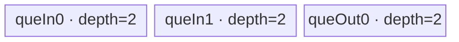

# InplacePowTensorTensor 950 ACLNN 算子知识

## 算子速览

| 项目 | 内容 |
|---|---|
| 实际入口 | `aclnnInplacePowTensorTensorGetWorkspaceSize` + `aclnnInplacePowTensorTensor`，公开 ACLNN 两段式接口；固定仓未见更高版本入口。 |
| 计算语义 | 对广播域逐元素计算 `self[i] = self_old[i] ^ exponent[i]`；原地语义由把 `self` 同时作为 out 并最终 `ViewCopy` 写回实现，不调用 `l0op::InplacePow`。 |
| 输入输出 | `self` 为输入/输出，`exponent` 为输入；ND，秩不超过 8，支持非连续 Tensor，广播结果 shape 必须等于 `self` 的 view shape。 |
| 执行类型 | 组合图：框架 `Contiguous`/`ViewCopy` 边界 + 可选 Cast AIV/AICPU 节点 + 一个 Pow 节点；Pow 在支持 dtype 上为 AIV_VECTOR + NDDMA，其他公开 dtype 为 AICPU scalar/parallel fallback。无 Cube/AIC/MIX_CV 节点。 |
| Kernel 路线 | R-001/R-002：浮点 `DOUBLE_FLOAT_TECH`，分别为 NDDMA 无外循环/有外循环；R-003/R-004：整数 `INTRINSIC`，分别为 NDDMA 无外循环/有外循环；R-005：AICPU fallback。每条路线再以 `Cxyz` 表示三个 Cast 节点是否物化。 |
| 核心资源 | Pow AIV：3 个 depth=2 的 `TQue`、Power stack temporary、寄存器、16 MiB Pow workspace；R-005 使用 AICPU 输入/输出 GM 与 CPU 线程分片。复合 executor 还持有 Contiguous/Cast 临时 Tensor。 |
| 来源闭包 | source_closed：公开入口、原地复用、Pow Host/Tiling/POD、950 router、NDDMA helper、Power primitive、AICPU fallback、Cast 选择与构建接线均已定位；Contiguous/ViewCopy 与 executor 分配器按框架边界标注。 |
| 验证状态 | 已完成源码闭包检查；本次知识提取未执行编译、真机、数值或性能测试。 |

## 接口与语义

### 计算语义

令 `B = broadcast(self_old, exponent)`，接口要求 `shape(B) == self.view_shape`，有效输出域为 `0 <= i < numel(self)`：

```text
self_new[i] = pow(cast_promote(self_old)[broadcast_index_self(i)],
                  cast_promote(exponent)[broadcast_index_exponent(i)])
self <- cast_to_self_dtype(self_new)
```

`aclnnInplacePowTensorTensorGetWorkspaceSize` 在 `aclnn_pow_tensor_tensor.cpp:198-204` 将 `out` 设为 `const_cast<aclTensor *>(self)`，随后复用 `aclnnPowTensorTensorGetWorkspaceSize`。因此该接口与非原地入口共享 Contiguous→Cast→Pow→Cast→ViewCopy 图，但最终写回原 `self`；不得与 `l0op::InplacePow`（文件中注明仅供 logspace 特定场景）混为同一实现。

浮点 950 Pow body 对 FP16/BF16/FP32 选择 `PowerAlgo::DOUBLE_FLOAT_TECH`，以 FP32 双分量 log/exp 路径计算并处理零、负底数、NaN/Inf 等特殊值；整数 U8/S8/S16/S32 使用寄存器平方-乘算法，负指数的有符号整数遵循源码特殊分支：底数 `1` 为 `1`，底数 `-1` 按奇偶给 `±1`，其余给 `0`。

### 输入、输出与属性

| 参数 | shape/layout | dtype | 约束、默认值与语义 |
|---|---|---|---|
| `self` | ND，0–8 维；可非连续 | FLOAT、FLOAT16、BFLOAT16、DOUBLE、INT32、INT64、INT16、INT8、UINT8、BOOL、COMPLEX64、COMPLEX128 | 输入/输出；与 `exponent` 可做 `PromoteType`；当前 950 为 RegBase，BF16 允许。 |
| `exponent` | ND，0–8 维；可非连续 | 同 `self` | 与 `self` 可广播；两者不能同时为 BOOL。 |
| `workspaceSize` | 标量 Host 输出 | `uint64_t` | executor 所有节点所需 Device workspace 总量；空 Tensor 快路径固定写 `0`。 |
| `executor` | Host 对象 | `aclOpExecutor *` | 第一段接口创建并转移所有权，保存复合节点、临时 Tensor 与启动顺序。 |
| `workspace` | Device 字节区 | opaque | 由调用方按第一段返回值分配，第二段交给 `CommonOpExecutorRun`。 |
| `stream` | ACL stream | `aclrtStream` | 所有 executor 节点在该 stream 上按记录顺序提交。 |

无显式属性。API 校验 `self/exponent` 非空、dtype 在支持表、`PromoteType` 有定义、提升 dtype 可转换回 `self.dtype`、两输入可广播且结果 shape 等于 `self.view_shape`。`FORMAT_FRACTAL_NZ` 仅记录 warning；公开契约是 ND。

### 入口与版本

固定 Commit `165d41f02a43a62324b434cb6bda7c533b14da3e` 的公开头文件仅声明当前两段式 `aclnnInplacePowTensorTensor`，文档产品表明确支持 Ascend 950PR/950DT。950 `Pow` OpDef 绑定 `opFile.value=pow_apt`，`CMakeLists.txt` 将 `ascend950` 映射到 `arch35`，binary config 提供七种同 dtype Pow 二进制。

原地入口只复用非原地 ACLNN 图，不复用源码中的 `l0op::InplacePow`；后者把输出绑定到 `exponent`，数学与别名语义都不同，不能纳入本卡。

## Host/Launcher 执行流程

### 参数校验与前处理

真实调用顺序如下：

1. `CREATE_EXECUTOR`；失败返回 `ACLNN_ERR_INNER_CREATE_EXECUTOR`。
2. `CheckParams(self, exponent, self)`：空指针、BF16 SoC、BOOL×BOOL、支持 dtype、`PromoteType`、广播与输出 shape；失败立即返回。
3. `CheckFormat` 对任一 FRACTAL_NZ 仅告警。
4. 任一输入为空时写 `workspaceSize=0`、释放 executor 所有权并成功返回；不加入 Pow/Cast 节点。
5. `promoteType = PromoteType(self.dtype, exponent.dtype)`。
6. `l0op::Contiguous(self)`、`l0op::Cast(..., promoteType)`；Cast 在 dtype 相等时原样返回，不创建节点。
7. `l0op::Contiguous(exponent)`、`l0op::Cast(..., promoteType)`。
8. `l0op::Pow` 分配广播 shape、`promoteType` 的输出；950 七种 `{FP16,BF16,FP32,U8,S8,S16,S32}` 走 AiCore，否则走 AICPU。
9. `l0op::Cast(powOut, self.dtype)`；相同 dtype 时 no-op。
10. `l0op::ViewCopy(castOut, self)` 完成真正写回。
11. `workspaceSize = executor->GetWorkspaceSize()` 并把 executor 所有权转给调用方。
12. 第二段 `CommonOpExecutorRun(workspace, workspaceSize, executor, stream)` 按图提交；任一节点加入 launcher 失败都会在建图阶段返回空指针并阻断后续节点。

### 参数、Workspace 与生命周期

`selfContiguous`、`selfCasted`、`exponentContiguous`、`exponentCasted`、`powOpOut`、`castOut` 都由 executor 管理；Cast no-op 时对象别名上游 Tensor。其逻辑 extent 由 view shape 与 dtype 决定，物理 workspace offset、跨节点复用和 allocator 对齐属于固定仓不可见的 executor 框架边界，不得假定为连续拼接。

Pow AIV Host Tiling 明确请求一个 `16 * 1024 * 1024` 字节 workspace slice。Kernel 入口要求总 workspace 与 `GetUserWorkspace(workspace)` 均非空，随后 `SetSysWorkspace`；Pow body 不显式读写 `userWS`。R-005 的 `pow.json` 声明 AICPU `workspaceSize=100`。复合图的最终总量只能由 `executor->GetWorkspaceSize()` 取得，调用方从第一段返回后持有 workspace 到第二段异步提交完成。

### 启动图与失败传播

```text
API GetWorkspaceSize
  -> F0 Contiguous(self)             [框架边界；可返回原 Tensor]
  -> Cx Cast(self -> promoteType)     [dtype 相同则无节点]
  -> F1 Contiguous(exponent)          [框架边界；可返回原 Tensor]
  -> Cy Cast(exponent -> promoteType) [dtype 相同则无节点]
  -> P  Pow(Cx/F0, Cy/F1 -> powOut)   [R-001...R-005 中恰一条]
  -> Cz Cast(powOut -> self.dtype)    [dtype 相同则无节点]
  -> F2 ViewCopy(castOut -> self)     [框架边界；完成原地提交]
  -> CommonOpExecutorRun(..., stream)
```

用 `Cxyz` 表示 `Cx/Cy/Cz` 的物化位；每位为 `1` 当且仅当该 Cast 的源、目的 dtype 不同。因此同一 Pow body 下的不同启动拓扑不会被误合并：例如 `R-001/C000` 是两个输入和输出均同 dtype，`R-001/C101` 是 self 先提升、exponent 已是提升 dtype、Pow 后再降回 self dtype。Cast 的 950 `l0op::Cast` 先查 RegBase AiCore pair 表，不支持的 pair 才进入 AICPU；任一 `ADD_TO_LAUNCHER_LIST_*` 失败返回 `nullptr`，ACLNN 建图随即停止。节点共享一个 ACL stream，stream 顺序提供 producer→consumer 可见性；executor 拥有所有中间 Tensor，直到执行结束才可回收。

## Route 与参数设计

### 分核与资源计算

Pow AIV 的 `TilingPrepareForPow` 从平台读取 AIV core 数 `C`、UB 字节数 `U`、block size 与 vector length。`GetPowerTmpBufferFactorSize(true,true,isInt,sizeof(T))` 在 950/DAV_3510 给出：FP32 `powApiNode=3`，FP16/BF16 `powApiNode=6`，整数 `powApiNode=0`，`powApiTmpBuffer=0`。

令 `b=sizeof(T)`，Host compute divisor（bit/输出元素）为：

```text
FP16/BF16: 96 + 6*2*8 = 192 bit  => 24 byte/element
FP32:      192 + 3*4*8 = 288 bit => 36 byte/element
U8/S8:      48 + 0       = 48 bit =>  6 byte/element
S16:         96 + 0      = 96 bit => 12 byte/element
S32:        192 + 0      = 192 bit=> 24 byte/element

rawElem = U*8 / divisor
alignElem = 256*8 / dtypeBits
maxElem = floor(rawElem / alignElem) * alignElem
```

`DimensionCollapse` 先向左补 1，再按两输入广播 flag 合并相邻等价轴；广播轴输入 stride 写 0，输出为连续 stride。`GetBlockSplitFactor` 从最内轴向外累乘，找到不超过 `maxElem` 的内域，得到 `ubSplitAxis/ubFormer/ubOuter/ubTail`；`fusedProduct = product(outputDims[0:ubSplitAxis]) * ubOuter`。初始 `blockFormer=ceil(fusedProduct/C)`，`blockNum=ceil(fusedProduct/blockFormer)`。因 `preferMultiCore=true`，若未用满核，模板按 128 元素递减 `maxElem`、到 512 边界停止，再以 128 向上对齐重算，最后 `blockTail=fusedProduct-(blockNum-1)*blockFormer`。

`axisInsideUB = shapeLen - ubSplitAxis`；不超过 5 产生 schedule key `100`，否则 `1100`。最终 key 为 `opKey*100000000000000 + (1000000 + scheduleKey)`。

### Route 选择

| 顺序 | Route | Key/模板 | 精确选择条件与优先级 | 不适用去向 |
|---:|---|---|---|---|
| 1 | R-001 浮点 NDDMA 无循环 | opKey 1/2/3 + inner `1000100` | `promoteType` 为 FP16/BF16/FP32，Pow 走 950 AiCore，且合轴后 `shapeLen-ubSplitAxis <= 5` | R-002 或非浮点路线 |
| 2 | R-002 浮点 NDDMA 有循环 | opKey 1/2/3 + inner `1001100` | 同上，但 `shapeLen-ubSplitAxis > 5` | 非浮点路线 |
| 3 | R-003 整数 NDDMA 无循环 | opKey 4/5/6/7 + inner `1000100` | `promoteType` 为 U8/S8/S16/S32，Pow 走 950 AiCore，且 `axisInsideUB <= 5` | R-004 或 R-005 |
| 4 | R-004 整数 NDDMA 有循环 | opKey 4/5/6/7 + inner `1001100` | 同上，但 `axisInsideUB > 5` | R-005 |
| 5 | R-005 AICPU fallback | `kcalls[src][exp][out]` | `IsRegBase()` 且 promote dtype 不在 `{FP32,FP16,BF16,S32,S16,S8,U8}`；典型为 DOUBLE/INT64/COMPLEX64/COMPLEX128 | dtype 三元组不在 `kcalls` 时参数失败 |

```text
empty input -> success, no device node
nonempty:
  promoteType = PromoteType(self.dtype, exponent.dtype)
  materialize Cx/Cy only where source dtype != promoteType
  if promoteType in {FP32, FP16, BF16, S32, S16, S8, U8}:
      opKey = exact same-dtype triple map
      innerKey = 1000100 if axisInsideUB <= 5 else 1001100
      choose R-001/R-002 for float family, R-003/R-004 for integer family
  else:
      choose R-005 through AICPU
  materialize Cz only where promoteType != self.dtype
  always ViewCopy to self
```

### 模板/实现执行矩阵

| Route | key/selector | dtype/shape/platform 完整命中条件 | 执行拓扑与 Kernel 节点 | 实际模板/body | 内存与同步特征 | tail/fallback |
|---|---|---|---|---|---|---|
| R-001 | `100000001000100`/`200000001000100`/`300000001000100` | 950；同 dtype Pow；`axisInsideUB<=5` | `Cxyz` 可选 Cast → 单 Pow AIV → ViewCopy | `PowF16/PowBf16/PowF32NddmaWithoutLoops::Process`，`Power<T,false,DOUBLE_FLOAT_TECH>` | 两个 VECIN + 一个 VECOUT，均 depth=2；5D MultiCopy 或连续 DataCopyPad；Power 用 3 段 FP32 stack temporary | 每核最后 loop 用 `ubTail`；最后核用 `blockTail` |
| R-002 | `...1001100` 三个浮点 key | 950；同 R-001；`axisInsideUB>5` | 同上 | 对应 `NddmaWithLoops` body | 外层逐 NDDMA product 循环，内层 5D MultiCopy | 同 R-001 |
| R-003 | `400/500/600/700000001000100` 对应四个整数 key | 950；U8/S8/S16/S32；`axisInsideUB<=5` | 同上 | `Pow{U8,S8,S16,S32}NddmaWithoutLoops`，`Power<T,false,INTRINSIC>` | 三个 depth=2 Queue；寄存器平方-乘；S16/S32 有 V→S 读最大指数与 S→V 事件 | mask 保护寄存器尾 lane；负指数特殊值 |
| R-004 | 四个整数 `...1001100` key | 950；同 R-003；`axisInsideUB>5` | 同上 | 对应 `NddmaWithLoops` body | R-003 计算 + R-002 NDDMA 外循环 | 同 R-003 |
| R-005 | AICPU `kcalls` | promote dtype 不走 AiCore且三元组注册 | 可选 Cast → 单 AICPU Pow → 可选 Cast → ViewCopy | `PowCpuKernel::Compute/PowCompute/NoBcastCompute/BcastCompute` | 无 AIV UB；GM 直接索引；25K/30K 阈值触发 `ParallelFor` | 空输入成功；未知 dtype tuple 返回 `KERNEL_STATUS_PARAM_INVALID` |

### 隐藏性能 Guard

| Guard | Host/Tiling 条件 | Device/资源原因 | 影响 Route | 不满足时去向 | 源码符号 |
|---|---|---|---|---|---|
| 950 AiCore dtype | `CheckType(promoteType,AICORE_DTYPE_950_SUPPORT_LIST)` | Pow binary 只注册七种同 dtype body | R-001...R-004 | R-005 | `math/pow/op_api/pow.cpp::IsAiCoreSupport` |
| 合轴后秩 | `shapeLen<=8` | POD 数组与 broadcast helper 固定 8 维 | R-001...R-004 | Tiling `GRAPH_FAILED` | `DoDimensionCollapse` |
| NDDMA 维数 | `shapeLen-ubSplitAxis<=5` | 单次 `MultiCopyParams<T,5>` 可覆盖 | R-001/R-003 | R-002/R-004 | `BroadcastGetScheduleKey` |
| UB 有效容量 | `maxElem>0` 且 `U>0` | 3 个 DB Queue 与 Power 临时区必须同时容纳 tile | R-001...R-004 | Tiling `GRAPH_FAILED` | `BroadcastGetMaxElemNum/DoBrodcastTiling` |
| 多核偏好 | `preferMultiCore && blockNum<C` | 牺牲 tile 大小提高 `fusedProduct` 并行切分 | R-001...R-004 | 保留初始切分 | `DoBrodcastTiling` |
| broadcast 缓存 | `inputStride[splitAxis]==0` 且已跨过最初双缓冲轮次 | 广播输入在 depth=2 Queue 槽中复用，省去重复 NDDMA | R-001...R-004 | 每轮重载 | 各 `CopyIn0/CopyIn1` |
| Pow workspace 指针 | `workspace!=nullptr && GetUserWorkspace(workspace)!=nullptr` | entry 在创建 `TPipe` 前硬返回 | R-001...R-004 | 无输出写入 | `math/pow/op_kernel/pow_apt.cpp::pow` |
| AICPU 并行阈值 | 一般广播 `numel>=25*1024`；同形/单元素广播 `>=30*1024` | 小域避免线程分片开销 | R-005 | 单线程循环 | `PowCpuKernel::BcastCompute/NoBcastCompute` |

### POD/ABI

`PowTensorTensorTilingData` 字段全为 `int64_t`；固定主仓给出字段顺序，宏生成后的 `sizeof/alignof/offsetof` 实体定义属于 `register/tilingdata_base.h` 构建依赖，在本固定源码集合不可见，因此不猜测偏移。

| 结构 | 字段 | 类型/位宽 | ABI 布局 | 单位 | Host/launcher producer | Device consumer | 边界 |
|---|---|---|---|---|---|---|---|
| `PowTensorTensorTilingData` | `blockFormer` | int64/64 | 顺序 1；精确 offset 固定仓不可见 | UB-loop/core | `set_blockFormer(BroadcastTilingData.blockFormer)` | `Process` 非末核 loop 数、初始 axes index | `>0` |
| 同上 | `ubFormer` | int64/64 | 顺序 2 | split-axis elements | `set_ubFormer` | tile 正常长度、GM offset | 256-byte repeat 对齐推导 |
| 同上 | `ubOuter` | int64/64 | 顺序 3 | loop count | `set_ubOuter` | axes 更新与 broadcast cache 周期 | `ceil(dim/ubFormer)` |
| 同上 | `ubTail` | int64/64 | 顺序 4 | elements | `set_ubTail` | split-axis 最后 loop 有效长度 | `1..ubFormer` |
| 同上 | `blockTail` | int64/64 | 顺序 5 | UB-loop/core | `set_blockTail` | 最后 block 的 loop 数 | `1..blockFormer` |
| 同上 | `shapeLen` | int64/64 | 顺序 6 | axes | 合轴后 `dims.back().size()` | NDDMA 维数与 loop 配置 | `1..8`；空域在 API 前返回 |
| 同上 | `ubSplitAxis` | int64/64 | 顺序 7 | axis index | `GetBlockSplitFactor` | axes、stride、NDDMA 配置 | `[0,shapeLen)` |
| 同上 | `dimProductBeforeUbInner` | int64/64 | 顺序 8 | fused loop count | `fusedProduct` | `BroadcastGetAxesIndices` 除法基数 | 正数 |
| 同上 | `elemNum` | int64/64 | 顺序 9 | elements/Queue slot | `maxElem` | 三个 `InitBuffer` 容量 | Host UB 上界 |
| 同上 | `input0Dims[8]` | int64×8 | 顺序 10 | elements/axis | 合轴后 `dims[0]`，余位初始化 0 | NDDMA config | 仅 `[0,shapeLen)` 活跃 |
| 同上 | `input1Dims[8]` | int64×8 | 顺序 11 | elements/axis | `dims[1]` | 仅作为 ABI 保留；当前 Pow body不直接读该数组 | inactive 字段仍须保持顺序 |
| 同上 | `outputDims[8]` | int64×8 | 顺序 12 | elements/axis | `dims[2]` | axes update、NDDMA loop size | 仅活动轴有效 |
| 同上 | `input0Strides[8]` | int64×8 | 顺序 13 | elements | `strides[0]` | GM offset与broadcast判定 | broadcast axis 为 0 |
| 同上 | `input1Strides[8]` | int64×8 | 顺序 14 | elements | `strides[1]` | 同上 | broadcast axis 为 0 |
| 同上 | `outputStrides[8]` | int64×8 | 顺序 15 | elements | `strides[2]` | UB offset、Power `calCount`、CopyOut offset | 连续输出 stride |

### Route 源码闭包

| Route | Key/selector | Host/Tiling producer | POD/参数 | Kernel entry/router 节点 | Kernel body/直接依赖 | 构建接线 |
|---|---|---|---|---|---|---|
| R-001 | 3 个浮点 `...1000100` | `PowTensorTensorTiling::DoOpTiling` | `PowTensorTensorTilingData` | `pow_apt.cpp::pow` | `Pow*WithoutLoops` + opbase `BroadcastNddmaWithoutLoop` + asc-devkit `PowFComputeImpl` | `math/pow/CMakeLists.txt` + `pow_binary.json` |
| R-002 | 3 个浮点 `...1001100` | 同上 | 同上 | 同上 | `Pow*WithLoops` + `BroadcastNddmaWithLoop` + `PowFComputeImpl` | 同上 |
| R-003 | 4 个整数 `...1000100` | 同上 | 同上 | 同上 | `Pow*WithoutLoops` + `BroadcastNddmaWithoutLoop` + `PowIComputeImpl` | 同上 |
| R-004 | 4 个整数 `...1001100` | 同上 | 同上 | 同上 | `Pow*WithLoops` + `BroadcastNddmaWithLoop` + `PowIComputeImpl` | 同上 |
| R-005 | `kcalls` dtype tuple | `l0op::Pow/PowAiCpu` | AICPU context，非 Pow tiling POD | `REGISTER_CPU_KERNEL("Pow",PowCpuKernel)` | `PowCompute/NoBcastCompute/BcastCompute/PowImpl` | `op_kernel_aicpu/pow.json` + 通用 CMake AICPU 收集 |

## Kernel 实现

### 公共执行流程

非空输入的公共图先由可选 `Cxyz` Cast 子图把两输入变成相同 `promoteType`，再启动一个 Pow 节点。950 AiCore entry 固定参数 `(base, exponent, y, workspace, tiling)`，先校验 workspace、注册 `KERNEL_TYPE_AIV_ONLY`、构造单个 `TPipe`，按 key 实例化 14 个 tensor-tensor 类之一；未知 key 没有 else 错误分支，因 Host 在无合法 dtype key 时已 `GRAPH_FAILED`。Pow 完成后可选 `Cz` 降回 `self.dtype`，最后 ViewCopy 写回。

Cast 子图的节点存在性由 dtype 相等判断；950 `l0op::Cast` 在 RegBase AiCore pair 表中选择 Cast AIV，否则选择 Cast AICPU。Cast 节点的临时 Tensor 由 executor 持有，且与 Pow 节点通过同 stream 排序。其独立 policy/Tiling/POD/Kernel 由 `math/cast` 直接依赖闭合；本卡只保留影响 InplacePow 的节点存在性、dtype 与顺序，不把 Cast 误写成 Pow Route。

### Route R-001：浮点 NDDMA 无外循环

#### 适用条件

##### 选择证据

| 层级 | 文件 | 符号 | 源码谓词/参数 | 结果/下一跳 |
|---|---|---|---|---|
| API | `math/pow/op_api/aclnn_pow_tensor_tensor.cpp` | `aclnnInplacePowTensorTensorGetWorkspaceSize` | `out=const_cast(self)` | 复用非原地图 |
| L0 | `math/pow/op_api/pow.cpp` | `IsAiCoreSupport/Pow` | RegBase 且 dtype 为 FP16/BF16/FP32 | `PowAiCore` |
| Tiling | `pow_tensor_tensor_tiling_arch35.cpp` | `SetOpKey/GenerateTilingKey` | opKey 1/2/3，schedule 100 | 对应 `...1000100` |
| Router | `math/pow/op_kernel/pow_apt.cpp` | `pow` | `TILING_KEY_IS` 精确 key | `Pow{F16,Bf16,F32}NddmaWithoutLoops` |

#### Device 数据流

##### 函数级调用链

```text
CommonOpExecutorRun(stream)
  -> optional Cast nodes Cx/Cy
  -> pow(base, exponent, y, workspace, tiling)
    -> Pow{F16,Bf16,F32}NddmaWithoutLoops::Init
    -> Process
      -> CopyIn0 -> BroadcastNddmaWithoutLoop
      -> CopyIn1 -> BroadcastNddmaWithoutLoop
      -> Compute2 -> Power<T,false,DOUBLE_FLOAT_TECH>
      -> CopyOut3 -> DataCopyPad
  -> optional Cast Cz
  -> ViewCopy(..., self)
```

##### 源码等价伪码

```text
# 伪码；所有 offset/length 为元素，DataCopy blockLen 为字节
loopNum = (blockIdx == blockNum-1) ? blockTail : blockFormer
axes = decode(blockFormer*blockIdx, outputDims, splitAxis, dimProductBeforeUbInner)
for u in [0, loopNum):
    if u != 0: mixed_radix_increment(axes, outputDims, splitAxis, ubOuter)
    split = (axes[splitAxis] == ubOuter-1) ? ubTail : ubFormer
    n = split * outputStrides[splitAxis]
    for each input k:
        slot = inQk.alloc()
        if inputStride[k][splitAxis] != 0 or u <= 1 or
           ((blockIdx*blockFormer+u) % ubOuter) <= 1:
            gm = sum(axes[a]*inputStride[k][a]) +
                 axes[splitAxis]*inputStride[k][splitAxis]*ubFormer
            if outputStride[splitAxis] == inputStride[k][splitAxis]:
                DataCopyPad(slot, inputGM[gm], blockCount=1,
                            blockLen=split*inputStride[k][splitAxis]*sizeof(T))
            else:
                DataCopy<T,5>(slot, inputGM[gm], loopSize/srcStride/dstStride from POD)
        inQk.enqueue(slot)
    x=inQ0.dequeue(); e=inQ1.dequeue(); out=outQ.alloc()
    Power<T,false,DOUBLE_FLOAT_TECH>(out,x,e,n)
    free x/e; outQ.enqueue(out)
    out=outQ.dequeue()
    outGm = sum(axes[a]*outputStride[a]) + axes[splitAxis]*outputStride[splitAxis]*ubFormer
    DataCopyPad(outputGM[outGm], out, blockCount=1, blockLen=n*sizeof(T))
    outQ.free(out)
```

#### 内存与数据搬运

##### 资源与搬运表

| 层级/缓冲区 | offset/地址公式 | extent/容量公式 | dtype/layout | producer | consumer | owner/lifetime | 对齐/复用 |
|---|---|---|---|---|---|---|---|
| input GM 0/1 | `BroadcastGetGmOffset(axes,inputStride,splitAxis,ubFormer)` | 原 Tensor storage | T/ND | API/Cast | CopyIn0/1 | caller/executor | stride 0 表广播 |
| `queIn0` slot | Queue allocator | `elemNum*sizeof(T)`，depth 2 | T/flat UB | NDDMA/DataCopyPad | Power | `TPipe`，到 `FreeTensor` | 双缓冲；广播槽可跨轮保留 |
| `queIn1` slot | 同上 | 同上 | T/flat UB | 同上 | Power | 同上 | 同上 |
| `queOut0` slot | Queue allocator | 同上 | T/flat UB | Power | CopyOut | 同上 | depth 2 |
| Power stack | `PopStackBuffer<TPosition::LCM>` | `3*align(calCount,32)*sizeof(float)`；Host 按 `powApiNode` 计入 | FP32 临时三分区 | Power | log/exp/special-case | primitive 调用期 | high/low/log 分区；high 后复用为 exp |
| output GM | `BroadcastGetGmOffset(axes,outputStride,...)` | `n*sizeof(T)` | T/ND | CopyOut | Cast/ViewCopy | executor | 只写有效 tail |
| Pow workspace | runtime slice | 16 MiB | bytes | executor | entry 系统 workspace | executor 到 stream 完成 | body 不显式用 userWS |

##### 分层内存布局


##### 字节账与复用顺序

```text
queue_bytes = 3 * 2 * elemNum * sizeof(T)
power_tmp   = 3 * elemNum * sizeof(float)  # elemNum 已按 256B repeat 对齐
FP16/BF16 UB_total = 12*elemNum + 12*elemNum = 24*elemNum <= U
FP32 UB_total      = 24*elemNum + 12*elemNum = 36*elemNum <= U
dynamic_ub = N/A；AIV 由 TPipe/stack buffer 使用静态 UB
workspace_total(Pow node) = 16 MiB
```

| 复用子区 | 写入者 | 读取者/消费点 | 下一次覆盖 | 同步或释放依据 | 安全条件 |
|---|---|---|---|---|---|
| broadcast input Queue slot | NDDMA | Power | 同 depth 槽两轮后再覆盖 | EnQue→DeQue→FreeTensor；双缓冲轮换 | 仅 stride=0 且缓存条件跳过 CopyIn 时复用旧槽 |
| `tmpHigh` | log high | exp result | 下一 Power chunk | 函数内顺序 | special-case 在覆盖后只需 exp 值 |
| input/output Queue | CopyIn/Power | Power/CopyOut | `FreeTensor` 后 | Queue 协议 | calCount 不超过 slot 容量 |

#### 同步、精度与尾块

##### 同步与数值边界表

| 阶段 | primitive/机制 | producer | consumer/等待点 | 保护对象 | 精度/尾块 |
|---|---|---|---|---|---|
| GM→UB→Vector | TQue EnQue/DeQue | CopyIn | Compute | input slot | NDDMA 仅填有效 `n` 元素 |
| Power float | stack + SIMD register mask | log/exp stages | special-case stage | FP32 temporary | FP16/BF16 load 升为 FP32；`alignCount=ceil(n/32)*32`；store mask 只提交 n |
| Vector→GM | TQue + DataCopyPad | Power | CopyOut | output slot | blockLen=`n*sizeof(T)`，不写 padding |
| core tail | POD former/tail | Host Tiling | Process | 每核 loop 域 | 最后 core 用 `blockTail`，最后 split 用 `ubTail` |

#### 关键实现

##### 符号证据表

| 阶段 | 文件 | 符号/模板实例 | 实现事实 |
|---|---|---|---|
| Host/Tiling producer | `math/pow/op_host/arch35/pow_tensor_tensor_tiling_arch35.cpp` | `DoOpTiling` | dtype key、Power temporary 因子、BroadcastTiling 与 POD 写入 |
| Kernel entry/router | `math/pow/op_kernel/pow_apt.cpp` | `pow` | 三个无循环浮点 key 到类实例 |
| Device body/helper | `math/pow/op_kernel/arch35/pow_f32_nddma_without_loops.h` | `Process/CopyIn*/Compute2/CopyOut3` | 循环、缓存 guard、5D NDDMA、Power 与 tail |
| Device body/helper | `opbase/.../broadcast_utils.h` | `BroadcastNddmaWithoutLoop` | 连续搬运或 `DataCopy<T,5>` 参数 |
| Device body/helper | `asc-devkit/.../power_3510_impl.h` | `PowFComputeImpl/ProcessSpecialCaseForPowF` | 三分区 FP32 log/exp 与特殊值 |

### Route R-002：浮点 NDDMA 有外循环

#### 适用条件

##### 选择证据

| 层级 | 文件 | 符号 | 源码谓词/参数 | 结果/下一跳 |
|---|---|---|---|---|
| Tiling | opbase `broadcast_tiling_base.cpp` | `BroadcastGetScheduleKey` | `axisInsideUB>5` | schedule `1100` |
| Router | `pow_apt.cpp` | `pow` | 三个浮点 `...1001100` | 对应 WithLoops 类 |

#### Device 数据流

##### 函数级调用链

```text
pow -> Pow{F16,Bf16,F32}NddmaWithLoops::Process
  -> CopyIn0/1 -> BroadcastNddmaWithLoop
     -> for nddmaProduct: DataCopy<T,5>
  -> Compute2 -> Power<T,false,DOUBLE_FLOAT_TECH>
  -> CopyOut3
```

##### 源码等价伪码

```text
执行 R-001 的 core/UB-loop；若输入在 splitAxis 需要广播：
params5 = last-five-axes(loopSize, inputStride, outputStride)
nddmaProduct = product(outputDims[splitAxis+1 : shapeLen-5]) * split
for i in [0, nddmaProduct):
    idx = mixed_radix(i, outer-inside-UB axes)
    ubOff = dot(idx, outputStride)
    gmOff = baseGm + dot(idx, inputStride)
    DataCopy<T,5>(ub[ubOff], gm[gmOff], params5)
随后 Power 与 CopyOut 与 R-001 相同。
```

#### 内存与数据搬运

##### 资源与搬运表

| 层级/缓冲区 | offset/地址公式 | extent/容量公式 | dtype/layout | producer | consumer | owner/lifetime | 对齐/复用 |
|---|---|---|---|---|---|---|---|
| NDDMA outer indices | `BroadcastGetNddmaOffset` | 最多 3 个 index（8-5） | int64/register | loop | MultiCopy | 调用栈 | 不占 TPipe UB |
| Queue/Power/output | 同 R-001 | 同 R-001 | 同 R-001 | 同 R-001 | 同 R-001 | 同 R-001 | 同 R-001 |

##### 分层内存布局


##### 字节账与复用顺序

```text
UB_total 与 R-001 相同；NDDMA 外循环只改变搬运次数和 offset，不新增 UB slice。
workspace_total(Pow node) = 16 MiB
```

| 复用子区 | 写入者 | 读取者/消费点 | 下一次覆盖 | 同步或释放依据 | 安全条件 |
|---|---|---|---|---|---|
| Queue 与 Power temporary | 同 R-001 | 同 R-001 | 同 R-001 | 同 R-001 | 外循环所有 5D copy 完成后才 EnQue |

#### 同步、精度与尾块

##### 同步与数值边界表

| 阶段 | primitive/机制 | producer | consumer/等待点 | 保护对象 | 精度/尾块 |
|---|---|---|---|---|---|
| 多次 NDDMA | 单函数顺序后 EnQue | 每个 `DataCopy<T,5>` | Power DeQue | 完整 UB tile | outer index 覆盖全部 `n` 元素 |
| Power/tail | 同 R-001 | 同 R-001 | 同 R-001 | 同 R-001 | 同 R-001 |

#### 关键实现

##### 符号证据表

| 阶段 | 文件 | 符号/模板实例 | 实现事实 |
|---|---|---|---|
| Host/Tiling producer | opbase `broadcast_tiling_base.cpp` | `BroadcastGetScheduleKey` | 超过 5 个 UB 内轴选 loop key |
| Kernel entry/router | `math/pow/op_kernel/pow_apt.cpp` | `pow` | WithLoops key 分支 |
| Device body/helper | `math/pow/op_kernel/arch35/pow_f32_nddma_with_loops.h` | `CopyIn0/CopyIn1` | 调用 `BroadcastNddmaWithLoop` |
| Device body/helper | opbase `broadcast_utils.h` | `BroadcastNddmaWithLoop` | outer product、三维 index、最后五维 MultiCopy |

### Route R-003：整数 NDDMA 无外循环

#### 适用条件

##### 选择证据

| 层级 | 文件 | 符号 | 源码谓词/参数 | 结果/下一跳 |
|---|---|---|---|---|
| L0 | `math/pow/op_api/pow.cpp` | `AICORE_DTYPE_950_SUPPORT_LIST` | U8/S8/S16/S32 | PowAiCore |
| Tiling | `pow_tensor_tensor_tiling_arch35.cpp` | `SetOpKey/GetComputeMap` | opKey 4/5/6/7、schedule 100 | 四个整数无循环 key |
| Router | `pow_apt.cpp` | `pow` | 精确 key | `Pow{U8,S8,S16,S32}NddmaWithoutLoops` |

#### Device 数据流

##### 函数级调用链

```text
pow -> Pow{U8,S8,S16,S32}NddmaWithoutLoops::Process
  -> BroadcastNddmaWithoutLoop(input0/input1)
  -> Power<T,false,INTRINSIC>
     -> GetMaxLoop (S16/S32: ReduceMax + V_S; 8-bit: fixed bit count)
     -> S_V event
     -> PowIComputeImpl -> repeated squaring + special cases
  -> DataCopyPad(output)
```

##### 源码等价伪码

```text
沿用 R-001 的 NDDMA/core/tail 地址网络。
if sizeof(T)==1: maxLoop=8
else:
    maxExp=ReduceMax(exponent[0:n]); wait V_S; maxLoop=bits(T)-clz(maxExp)
signal/wait S_V
for each vector chunk under UpdateMask:
    base=load(x); exp=load(e); result=1
    repeat maxLoop:
        if exp&1: result*=base
        exp >>= 1; base*=base
    override exp==0 or base==1 with 1
    signed only: exp<0 and base!=-1 -> 0；base==-1 -> parity ? -1 : 1
    masked store result
```

#### 内存与数据搬运

##### 资源与搬运表

| 层级/缓冲区 | offset/地址公式 | extent/容量公式 | dtype/layout | producer | consumer | owner/lifetime | 对齐/复用 |
|---|---|---|---|---|---|---|---|
| 3 个 Queue | 同 R-001 | 每个 slot `elemNum*sizeof(T)`，depth=2 | integer/flat | NDDMA/Power | Power/CopyOut | TPipe | 总计 `6*elemNum*sizeof(T)` |
| RegTensor | vector chunk | `VL/sizeof(convT)` lane；8-bit 转 16-bit | integer registers | LoadSrcData | repeated squaring | SIMD scope | UpdateMask 尾保护 |
| Power stack | PopStackBuffer 返回但整数 body不读 | Host `powApiNode=0` | N/A | primitive wrapper | N/A | 调用期 | 不计额外 tile bytes |

##### 分层内存布局


##### 字节账与复用顺序

```text
UB_total = 6*elemNum*sizeof(T)
U8/S8: 6*elemNum <= U
S16: 12*elemNum <= U
S32: 24*elemNum <= U
dynamic_ub = N/A
workspace_total(Pow node) = 16 MiB
```

| 复用子区 | 写入者 | 读取者/消费点 | 下一次覆盖 | 同步或释放依据 | 安全条件 |
|---|---|---|---|---|---|
| output Queue 首元素（S16/S32） | `ReduceMax` | scalar `GetValue(0)` | Pow result | V→S event wait | 读取后才进入 vector compute |
| Queue slots | 同 R-001 | 同 R-001 | 同 R-001 | Queue 协议 | 同 R-001 |

#### 同步、精度与尾块

##### 同步与数值边界表

| 阶段 | primitive/机制 | producer | consumer/等待点 | 保护对象 | 精度/尾块 |
|---|---|---|---|---|---|
| exponent max | `ReduceMax` + V_S flag | Vector reduce | scalar `GetValue` | `dstTensor[0]` | S16/S32 only |
| scalar loop bound→vector | S_V flag | scalar maxLoop | `PowIComputeImpl` | loop bound visibility | all integer routes |
| 8-bit conversion | `DIST_UNPACK_B8`/Cast，Pack store | UB load | 16-bit register compute | 8-bit input/output | no saturation flag in pack path；整数溢出遵循寄存器 dtype |
| tail | `UpdateMask<ConvType>(calCount)` | loop counter | load/store | final vector lanes | 无效 lane 不写出 |

#### 关键实现

##### 符号证据表

| 阶段 | 文件 | 符号/模板实例 | 实现事实 |
|---|---|---|---|
| Host/Tiling producer | `pow_tensor_tensor_tiling_arch35.cpp` | `GetComputeMap` | integer divisor 与 key |
| Kernel entry/router | `pow_apt.cpp` | `pow` | 四个 integer no-loop 类 |
| Device body/helper | 各 `pow_{u8,s8,s16,s32}_nddma_without_loops.h` | `Compute2` | `Power<T,false,INTRINSIC>` |
| Device body/helper | asc-devkit `power_3510_impl.h` | `GetMaxLoop/GetPowICompute/PowIComputeImpl` | 事件、平方-乘、负指数与 mask |

### Route R-004：整数 NDDMA 有外循环

#### 适用条件

##### 选择证据

| 层级 | 文件 | 符号 | 源码谓词/参数 | 结果/下一跳 |
|---|---|---|---|---|
| Tiling | opbase `broadcast_tiling_base.cpp` | `BroadcastGetScheduleKey` | integer 且 `axisInsideUB>5` | schedule 1100 |
| Router | `pow_apt.cpp` | `pow` | 四个 integer `...1001100` | WithLoops 类 |

#### Device 数据流

##### 函数级调用链

```text
pow -> Pow{U8,S8,S16,S32}NddmaWithLoops::Process
  -> BroadcastNddmaWithLoop(input0/input1)
  -> Power<T,false,INTRINSIC>
  -> DataCopyPad(output)
```

##### 源码等价伪码

```text
CopyIn 使用 R-002 的 outer-product + 5D MultiCopy；
Compute 使用 R-003 的 maxLoop、事件、寄存器平方-乘与特殊值；
CopyOut/core/tail 与 R-001 相同。
```

#### 内存与数据搬运

##### 资源与搬运表

| 层级/缓冲区 | offset/地址公式 | extent/容量公式 | dtype/layout | producer | consumer | owner/lifetime | 对齐/复用 |
|---|---|---|---|---|---|---|---|
| NDDMA outer indices | 同 R-002 | 最多 3 index | int64/register | loop | MultiCopy | 调用栈 | 无额外 UB |
| Queue/RegTensor | 同 R-003 | 同 R-003 | integer | 同 R-003 | 同 R-003 | 同 R-003 | 同 R-003 |

##### 分层内存布局



##### 字节账与复用顺序

```text
UB_total 与 R-003 相同；NDDMA 外循环不新增 UB。
workspace_total(Pow node) = 16 MiB
```

| 复用子区 | 写入者 | 读取者/消费点 | 下一次覆盖 | 同步或释放依据 | 安全条件 |
|---|---|---|---|---|---|
| Queue/output scratch | 同 R-003 | 同 R-003 | 同 R-003 | 同 R-003 | 所有 NDDMA 子拷贝先完成 |

#### 同步、精度与尾块

##### 同步与数值边界表

| 阶段 | primitive/机制 | producer | consumer/等待点 | 保护对象 | 精度/尾块 |
|---|---|---|---|---|---|
| NDDMA | 顺序 MultiCopy 后 EnQue | outer loop | Power | 完整 tile | 最后五维由 params，外维由显式 loop |
| Integer Power | 同 R-003 | 同 R-003 | 同 R-003 | 同 R-003 | 同 R-003 |

#### 关键实现

##### 符号证据表

| 阶段 | 文件 | 符号/模板实例 | 实现事实 |
|---|---|---|---|
| Host/Tiling producer | `pow_tensor_tensor_tiling_arch35.cpp` | `GenerateTilingKey` | integer opKey + loop schedule |
| Kernel entry/router | `pow_apt.cpp` | `pow` | 四个 WithLoops 类 |
| Device body/helper | 各 integer `*_with_loops.h` | `Process/CopyIn*/Compute2` | NDDMA loop + integer Power |

### Route R-005：AICPU fallback

#### 适用条件

##### 选择证据

| 层级 | 文件 | 符号 | 源码谓词/参数 | 结果/下一跳 |
|---|---|---|---|---|
| L0 | `math/pow/op_api/pow.cpp` | `IsAiCoreSupport` | 950 promote dtype 不在七种 AiCore list | `PowAiCpu` |
| AICPU router | `op_kernel_aicpu/pow_aicpu.cpp` | `PowCpuKernel::Compute` | `kcalls[in0][in1][out]` 存在 | 对应 `PowCompute<TIn1,TIn2,TOut>` |
| AICPU body | 同上 | `PowCompute` | 同形或任一输入单元素 | `NoBcastCompute`，否则 `BcastCompute` |

#### Device 数据流

##### 函数级调用链

```text
CommonOpExecutorRun
  -> optional Cast Cx/Cy
  -> AICPU PowCpuKernel::Compute
    -> kcalls dtype dispatch
    -> PowCompute
      -> NoBcastCompute -> SpecialCompute -> PowImpl
      or BcastCompute -> Bcast::GetBroadcast{X,Y}Index -> PowImpl
  -> optional Cast Cz
  -> ViewCopy(self)
```

##### 源码等价伪码

```text
validate 2 inputs/1 output; find kcalls[input0.dtype][input1.dtype][output.dtype]
if input data size is zero: success
if same shape or one input has one element:
    type = SAME_SHAPE / X_ONE_ELEMENT / Y_ONE_ELEMENT
    if outNum >= 30Ki: ParallelFor(outNum, ceil(outNum/cpuNum))
    else serial
    index inputs according to type and PowImpl
else:
    build Bcast(shape0,shape1)
    if outNum >= 25Ki: ParallelFor(outNum, ceil(outNum/max(1,cpuNum-2)))
    else serial
    for i: PowImpl(in0[bcastX(i)],in1[bcastY(i)],out[i])
PowImpl: noninteger uses std::pow and cast；integer uses exponentiation by squaring plus negative-exp special case
```

#### 内存与数据搬运

##### 资源与搬运表

| 层级/缓冲区 | offset/地址公式 | extent/容量公式 | dtype/layout | producer | consumer | owner/lifetime | 对齐/复用 |
|---|---|---|---|---|---|---|---|
| AICPU input/output | direct pointer or broadcast index | Tensor NumElements | registered TIn/TOut | Cast/API | PowImpl | executor/caller | 无 AIV UB |
| `Bcast` mapper | logical flat index→source index | shape metadata | host CPU object | constructor | loop | kernel call | 仅一般广播 |
| AICPU workspace | config value | 100 bytes | opaque | launcher | AICPU runtime | executor | 实际内部用途固定仓不可见 |

##### 分层内存布局

N/A：R-005 不使用 AIV UB/TQue；执行介质是 AICPU 可见的输入输出 GM 与 CPU 栈/线程分片，AICPU runtime 私有内存布局固定仓不可见。

##### 字节账与复用顺序

```text
UB_total = N/A
dynamic_ub = N/A
workspace_total(Pow AICPU config) = 100 bytes
```

| 复用子区 | 写入者 | 读取者/消费点 | 下一次覆盖 | 同步或释放依据 | 安全条件 |
|---|---|---|---|---|---|
| output index i | PowImpl | 后续 Cast/ViewCopy | stream 后续节点 | executor stream 顺序 | ParallelFor 分片区间不重叠 |

#### 同步、精度与尾块

##### 同步与数值边界表

| 阶段 | primitive/机制 | producer | consumer/等待点 | 保护对象 | 精度/尾块 |
|---|---|---|---|---|---|
| CPU parallel | `CpuKernelUtils::ParallelFor` | shard lambda | API return | disjoint `[start,end)` | per-unit ceil split，尾 shard 由框架截断 |
| floating/complex | `std::pow` + `static_cast<TOut>` | scalar operands | output store | one element | Eigen half 单独先转 float；complex→int16 取 real |
| integer | `PowiImpl` | scalar operands | output store | one element | 负指数特殊规则；正指数平方-乘 |
| node ordering | ACL stream/executor | AICPU Pow | Cast/ViewCopy | output GM | producer 失败阻断 consumer |

#### 关键实现

##### 符号证据表

| 阶段 | 文件 | 符号/模板实例 | 实现事实 |
|---|---|---|---|
| Host/Tiling producer | `math/pow/op_api/pow.cpp` | `PowAiCpu` | AICPU launcher 与输出 shape/dtype |
| Kernel entry/router | `math/pow/op_kernel_aicpu/pow_aicpu.cpp` | `PowCpuKernel::Compute/kcalls` | dtype 三层 dispatch与错误终点 |
| Device body/helper | 同上 | `PowCompute/NoBcastCompute/BcastCompute/PowImpl` | 广播、并行阈值、计算与空域 |

## 算子特定优化

### Trick T-001：stride-0 广播输入按双缓冲周期缓存

#### 触发与源码依据

- 适用 Route：R-001...R-004。
- 触发条件：当前输入在 `ubSplitAxis` 的 stride 为 0，且已越过每个 `ubOuter` 周期最初两个 Queue 槽。
- Golden 来源：[`math/pow/op_kernel/arch35/pow_f32_nddma_without_loops.h:78-84`](../../../../../../../cann-ops-raw/ascendc/ops-math/165d41f02a43a62324b434cb6bda7c533b14da3e/math/pow/op_kernel/arch35/pow_f32_nddma_without_loops.h#L78-L84)

**官方源码（固定 Commit 连续逐字摘录）**：

```cpp
if ((tilingDataPtr_->input0Strides[tilingDataPtr_->ubSplitAxis] != 0) ||
    (ubLoopIdx <= 1 ||
     (AscendC::GetBlockIdx() * tilingDataPtr_->blockFormer + ubLoopIdx) % tilingDataPtr_->ubOuter <= 1)) {
```

#### 机制与设计原因

合轴把广播轴 stride 写成 0；同一 `ubOuter` 周期内该输入 tile 不变。Queue depth 为 2，所以每个周期先填两个物理槽，后续轮次跳过 NDDMA，`AllocTensor` 轮回到已保存广播值的槽。非广播输入始终重载。该机制减少 GM→UB 搬运；安全性依赖 depth=2、周期谓词和 Queue 的固定轮换，不能单独复制其中一个条件。

#### 迁移边界

- 适用：逐元素广播算子、split 轴 stride=0、Queue 槽能跨轮保值。
- 前提：950 NDDMA、depth=2、每周期前两轮必填、消费者不修改 input slot。
- 失效：stride 非 0 时必须每轮 CopyIn；改变 Queue depth 或 allocator 轮换时必须重推缓存条件。
- 未验证：本次知识提取未执行编译、真机、数值或性能测试。

#### 错误做法

仅按 stride=0 无条件跳过首次 CopyIn 会让 Queue 读取未初始化槽；固定源码以“每周期前两个槽必填”作为可验证反例边界。

### Trick T-002：Host 把 Power 临时节点精确折入 tile divisor

#### 触发与源码依据

- 适用 Route：R-001...R-004。
- 触发条件：950 `GetPowerTmpBufferFactorSize(true,true,isTypeInt,sizeof(T))` 返回浮点 live-node 数，Host 将其换算为 bit/element 加到两套 compute divisor。
- Golden 来源：[`math/pow/op_host/arch35/pow_tensor_tensor_tiling_arch35.cpp:146-158`](../../../../../../../cann-ops-raw/ascendc/ops-math/165d41f02a43a62324b434cb6bda7c533b14da3e/math/pow/op_host/arch35/pow_tensor_tensor_tiling_arch35.cpp#L146-L158)

**官方源码（固定 Commit 连续逐字摘录）**：

```cpp
AscendC::GetPowerTmpBufferFactorSize(true, true, isTypeInt, baseTypeSize, powApiNode, powApiTmpBuffer);
broadcastTilingParams.ubSize = broadcastTilingParams.ubSize - static_cast<int64_t>(powApiTmpBuffer);
```

#### 机制与设计原因

通用 broadcast 模板原 divisor 只覆盖 3 个 depth=2 Queue；Pow 浮点 primitive 还要三个 FP32 临时分区。950 返回 FP32 3、FP16/BF16 6 个“输入 dtype 大小”节点，换算后恰好补足 12 byte/element；整数返回 0，因为 intrinsic 走寄存器。由 Host 在 `maxElem` 计算前计入，可防止仅按 Queue 容量选出过大的 tile。

#### 迁移边界

- 适用：调用无显式 shared buffer、由 `PopStackBuffer` 获取 temporary 的 advanced API。
- 前提：平台架构与 PowerConfig 相同，`powApiNode/powApiTmpBuffer` 来自匹配版本 tiling API。
- 失效：切换 Power 算法、显式 shared buffer 或不同架构时必须重新调用配套 tiling API。
- 未验证：本次知识提取未执行编译、真机、数值或性能测试。

#### 错误做法

只用 `3*2*sizeof(T)` 计算 tile 会漏掉浮点 Power 的三段 FP32 temporary，造成 UB 上界错误。

### Trick T-003：一般广播与简单广播使用不同 AICPU 并行阈值

#### 触发与源码依据

- 适用 Route：R-005。
- 触发条件：同形/单元素广播在 `numel>=30Ki` 并行；一般广播在 `numel>=25Ki` 并行且保留两个 CPU core。
- Golden 来源：[`math/pow/op_kernel_aicpu/pow_aicpu.cpp:329-354`](../../../../../../../cann-ops-raw/ascendc/ops-math/165d41f02a43a62324b434cb6bda7c533b14da3e/math/pow/op_kernel_aicpu/pow_aicpu.cpp#L329-L354)

**官方源码（固定 Commit 连续逐字摘录）**：

```cpp
if (data_num >= kParallelDataNum) {
  uint32_t max_core_num =
      std::max(min_core_num, aicpu::CpuKernelUtils::GetCPUNum(ctx) - 2);
```

#### 机制与设计原因

一般广播每个输出都需两次 broadcast index 映射，源码用更低阈值启动并行，并把可用 CPU 数减 2；简单路径直接线性寻址，阈值更高且可用全部 CPU。两条路径都用 `CeilMultiple(data_num,max_core_num)` 产生 shard 粒度。

#### 迁移边界

- 适用：AICPU elementwise 且一般广播索引成本显著。
- 前提：使用相同 `CpuKernelUtils::ParallelFor` 与独立输出区间。
- 失效：输出小于对应阈值时保持串行；不得把两个阈值互换。
- 未验证：本次知识提取未执行编译、真机、数值或性能测试。

#### 错误做法

固定仓未提供可验证的性能反例；源码只证明两类路径采用不同阈值和 core 预算。

## 模板与实现对比

| 对比维度 | R-001/R-002 浮点 | R-003/R-004 整数 | R-005 AICPU | 设计选择依据 |
|---|---|---|---|---|
| 命中条件/优先级 | 七种 AiCore list 中的 FP16/BF16/FP32 | 同 list 中 U8/S8/S16/S32 | list 外且 AICPU tuple 注册 | L0 先 AiCore 后 AICPU |
| 模板与 dtype | `DOUBLE_FLOAT_TECH`，dtype/loop 专类 | `INTRINSIC`，dtype/loop 专类 | C++ dtype 三元模板 | 精度与硬件 primitive 能力 |
| 循环与分核 | AIV block→UB loop→Power chunk | 同左 + exponent bit loop | CPU serial/ParallelFor shard | UB、shape 与工作量阈值 |
| Queue/TBuf/寄存器/dynamic UB/通信 window | 3 DB Queue + 3 FP32 temporary + registers | 3 DB Queue + integer RegTensor | 无 AIV UB | Power 算法不同 |
| 内存总占用与复用 | 24 B/elem（16-bit）或 36 B/elem（FP32） | `6*sizeof(T)` B/elem | GM direct + 100 B config workspace | Host divisor精确覆盖 |
| 搬运/Vector/SIMT/NDDMA/通信 API | NDDMA + DataCopyPad + SIMD log/exp | NDDMA + DataCopyPad + repeated squaring | direct pointer + broadcast mapper | `axisInsideUB` 决定 NDDMA loop |
| 同步、精度与 tail | Queue；FP32 temporary；register mask | Queue + V_S/S_V；register mask | ParallelFor join | 最后核/最后 tile 单独长度 |
| fallback/失败边界 | key/UB/shape失败不进 Kernel | 同左 | tuple缺失参数失败 | 无 Cube/CV fallback |

## 平台差异

| 项目 | A2 | A3 | 950 |
|---|---|---|---|
| 支持状态 | 公开文档写支持，但本任务未发布 A2 | 公开文档写支持；固定 `math/pow` 缺 AiCore Host/Tiling/Kernel闭包，未建无后缀卡 | 公开支持且 source_closed |
| Host/Launcher | 固定仓 `l0op::Pow` 有旧平台选择，但实际 Pow body不在任务固定范围内 | `IsAiCoreSupport` 对常用 dtype 返回 true，然而主 CMake/OpDef不接 A3 | RegBase 七 dtype AiCore，其余 AICPU |
| Kernel/资源 | 固定仓不可见 | 固定仓不可见 | arch35 NDDMA + AIV Power；AICPU fallback |

## 限制与失败边界

- 广播结果必须等于 `self` shape；因此 exponent 可广播到 self，但 self 不能通过广播扩张。两输入秩都不超过 8。
- 两输入不能同时为 BOOL；非 A3/A2 老产品的 BF16 限制不适用于 950。
- AIV Route 只接受两输入和输出已由 ACLNN Cast 成相同的七种 dtype；Tiling 中找不到精确三元组即 `GRAPH_FAILED`。
- Pow entry 对空 workspace/user workspace 直接返回；必须使用第一段接口返回的总 workspace，不能自行只分配逻辑输出字节数。
- AICPU `pow.json` 未列 BF16，BF16 在 950 强制走 AiCore；未知 `kcalls` dtype tuple 返回参数错误。
- INT32 文档给出 shape 与指数值的超时边界；这是公开约束，不代表数值错误或 Host 拒绝条件。
- Contiguous/ViewCopy、executor 中间 Tensor 的物理 workspace offsets、allocator alignment 与释放时点是允许的框架边界；固定源码只证明逻辑 owner/lifetime 和 stream 顺序，未公开具体 offset。
- TilingData 注册宏生成后的 `sizeof/alignof/offsetof` 在固定源码集合不可见，正文保留字段顺序、位宽、producer/consumer，不推测 ABI 偏移。
- 本次知识提取未执行编译、单元测试、真机、数值或性能测试。

## 源码索引

### 链路索引

| 链路阶段 | 文件 | 关键符号 | 支撑内容 |
|---|---|---|---|
| 入口声明/约束 | `math/pow/docs/aclnnPowTensorTensor&aclnnInplacePowTensorTensor.md` | 产品表、Inplace 参数与错误码 | 950 公开支持、原地契约、dtype/shape/确定性 |
| 入口声明/约束 | `math/pow/op_api/aclnn_pow_tensor_tensor.h` | 两段式函数声明 | ABI 符号 |
| 入口实现 | `math/pow/op_api/aclnn_pow_tensor_tensor.cpp` | `CheckParams/aclnnInplacePowTensorTensorGetWorkspaceSize` | 校验、复合图、原地复用、executor |
| Host/Launcher | `math/pow/op_api/pow.cpp` | `IsAiCoreSupport/PowAiCore/PowAiCpu/Pow` | 950 dtype 分流与 Pow launcher |
| Host/Launcher | `math/cast/op_api/cast.cpp` | `l0op::Cast` | 可选 Cast no-op、950 AiCore/AICPU 分流 |
| Host/Tiling/Launcher | `math/pow/op_host/arch35/pow_tiling.cpp` | `TilingPrepareForPow/TilingForPow` | core/UB/platform 与模板 registry |
| Host/Tiling/Launcher | `math/pow/op_host/arch35/pow_tiling_arch35.h` | `PowTensorTensorTilingData` | POD 字段与 key 注册 |
| Host/Tiling/Launcher | `math/pow/op_host/arch35/pow_tiling_arch35.cpp` | `GetShapeAttrsInfo/GetWorkspaceSize` | dtype size、16 MiB workspace |
| Host/Tiling/Launcher | `math/pow/op_host/arch35/pow_tensor_tensor_tiling_arch35.cpp` | `DoOpTiling/PostTiling` | dtype key、Power tmp、BroadcastTiling、POD |
| Host/Tiling/Launcher | opbase `broadcast_tiling_base.h` | `BroadcastTilingParams/Data` | 参数与中间结构 |
| Host/Tiling/Launcher | opbase `broadcast_tiling.cpp` | `DimensionCollapse/DoBrodcastTiling` | 合轴、UB/core/tail 公式 |
| Kernel entry/body | `math/pow/op_kernel/pow_apt.cpp` | `pow` | AIV-only router 与 14 个 tensor-tensor key |
| Kernel entry/body | `math/pow/op_kernel/arch35/pow_f32_nddma_without_loops.h` | `PowF32NddmaWithoutLoops` | 无循环代表 body |
| Kernel entry/body | `math/pow/op_kernel/arch35/pow_f32_nddma_with_loops.h` | `PowF32NddmaWithLoops` | 有循环代表 body |
| Kernel entry/body | opbase `broadcast_utils.h` | broadcast/NDDMA helpers | axes、offset、5D MultiCopy 与外循环 |
| Kernel entry/body | asc-devkit `power_tiling_impl.cpp` | `GetPowerTmpBufferFactorSizeArch3510` | 950 Power temporary 因子 |
| Kernel entry/body | asc-devkit `power_3510_impl.h` | `PowerCommonImpl/PowFComputeImpl/PowIComputeImpl` | Power SIMD 实体、精度、事件与 tail |
| Kernel entry/body | `math/pow/op_kernel_aicpu/pow_aicpu.cpp` | `PowCpuKernel` | AICPU dtype、广播、并行与数值路径 |
| 构建接线 | `math/pow/op_kernel_aicpu/pow.json` | `Pow.opInfo` | AICPU engine/so/workspace |
| 构建接线 | `math/pow/CMakeLists.txt` | `SUPPORT_COMPUTE_UNIT` | ascend950→arch35 |
| 构建接线 | `math/pow/op_host/config/ascend950/pow_binary.json` | Pow binaries | 七种 950 同 dtype binary |

### 实现复用检查

| 检查项 | 可复用事实 | 不得改变的约束 | 源码符号 |
|---|---|---|---|
| ABI/POD | 9 个 scalar + 6 个 8 元素数组的字段顺序与全 int64 位宽 | Host/Device 使用同一注册类；inactive 数组尾位不得假定有效 | `PowTensorTensorTilingData` |
| 调用顺序 | Contiguous→可选 Cast×2→Pow→可选 Cast→ViewCopy | 原地写回只能在 Pow 读完 self 后发生 | `aclnnPowTensorTensorGetWorkspaceSize` |
| workspace/内存 | Pow AIV 16 MiB；Queue 与 Power tmp divisor可复用 | executor 总 workspace 不能用 Pow 单节点值替代；depth=2 必须计倍数 | `GetWorkspaceSize/GetComputeMap` |
| 同步 | Queue producer/consumer、integer V_S/S_V、同 stream 节点顺序 | broadcast cache 依赖 Queue 轮换；scalar 读必须等待 V_S | `CopyIn*/GetMaxLoop` |
| 精度与尾块 | 浮点 DoubleFloat、整数 intrinsic、former/tail POD | 不得把 FP16/BF16 当原 dtype log/exp；不得全长 CopyOut tail | `PowerConfig/Process` |
| 失败边界 | Host key、UB、shape失败；AICPU tuple缺失；entry null workspace | 不得给 unknown key/AICPU tuple臆造 fallback | `GetOpKey/DoBrodcastTiling/PowCpuKernel::Compute/pow` |
