```mermaid
block-beta
  columns 5
  matA["matAQueue VECIN · depth=2 · 2×B×32B"]:1
  matL["matLQueue VECOUT · depth=2 · 2×B×32B"]:1
  left["matLeftQueue · depth=2 · 2×align32(4B)"]:1
  right["matRightQueue · depth=2 · 2×align32(4B)"]:1
  result["matResultQueue · depth=2 · 2×align32(4B)"]:1
```

```mermaid
block-beta
  columns 5
  matA["matAQueue VECIN · depth=2 · 2×align32(4B)"]:1
  matL["matLQueue VECOUT · depth=2 · 2×align32(4B)"]:1
  left["matLeftQueue · depth=2 · 2×B×32B"]:1
  right["matRightQueue · depth=2 · 2×B×32B"]:1
  result["matResultQueue · depth=2 · 2×B×32B"]:1
```

# LinalgCholesky A2/A3 ACLNN 算子知识

## 算子速览

| 项目 | 内容 |
|---|---|
| 实际入口 | `aclnnLinalgCholeskyGetWorkspaceSize` + `aclnnLinalgCholesky`，公开 ACLNN 两段式接口，无同名更高版本 |
| 计算语义 | 对实对称正定矩阵批次逐矩阵分解；`upper=false` 写下三角因子，`upper=true` 写上三角因子，实数情形共轭转置退化为转置 |
| 输入输出 | `self/out` 为同 shape、同 dtype、ND，公开 dtype 为 FLOAT/BFLOAT16，rank 2–8，最后两维为 `N×N`，`N<=8192` |
| 执行类型 | 算子自有 `Cholesky` 节点为 `AIV_VECTOR`：Tiling 取 `GetCoreNumAiv()`，body 仅用 MTE/Vector/Scalar；BF16 前后 Cast 是通用框架前后处理节点，A2/A3 body 不在本固定仓中 |
| Kernel 路线 | R-001：key 1 下三角逐列；R-002：key 2 上三角逐行；空 Tensor 为 Host 短路、无 Kernel |
| 核心资源 | 单个 Cholesky Kernel；GM 输入/临时输出、5 个 depth=2 的 `TQue`、Scalar 缩放因子、固定 16 MiB system workspace；kernel 不读写 workspace 内容但拒绝空指针 |
| 来源闭包 | source_closed：公开 ACLNN→校验/Contiguous/Cast→`l0op::Cholesky`→Tiling/POD→key router→两条 FP32 AIV body→Cast/ViewCopy；通用 Contiguous/Cast/ViewCopy 的内部 workspace/Kernel 细节作为框架前后处理边界显式标出 |
| 验证状态 | 已完成源码闭包检查；本次知识提取未执行编译、真机、数值或性能测试。 |

## 接口与语义

### 计算语义

令 `self` 的 shape 为 `[B0,...,Bk-1,N,N]`，`M=Π Bj`（无 batch 轴时 `M=1`）。每个 AIV core 负责若干独立矩阵。R-001 按列生成下三角 `L`，使实数矩阵满足 `A=L·L^T`；第 `i` 列先求每个目标行与已生成前缀的点积，再计算残差、检查主元大于 0、乘 `1/sqrt(pivot)`。R-002 是转置方向的逐行实现，生成上三角 `U`。Kernel 只写被选三角；`Cholesky` OpDef 为临时输出声明 `.InitValue(0)`，但实际清零任务由框架生成，固定仓未展开该任务。

公开文档要求输入实对称正定；API 不检查对称性，Device 仅在每个对角主元/Schur 残差处执行 `ascendc_assert(value>0)`。因此“对称”是调用者前提，“正定”在计算进行中以主元断言失败。

### 输入、输出与属性

| 参数 | shape/layout | dtype | 约束、默认值与语义 |
|---|---|---|---|
| `self` | ND；rank 2–8；`[...,N,N]` | 公开 FLOAT、BFLOAT16 | 非连续允许；必须与 `out` 同 dtype/shape/storage format；`N<=8192`；非空时检查方阵 |
| `upper` | Host 标量 | BOOL | `false`（OpDef 默认）：下三角/key 1；`true`：上三角/key 2 |
| `out` | 与 `self` 同 shape、同 storage format；非连续允许 | 与 `self` 相同 | 最终由 `ViewCopy` 提交；未选三角依赖 `Cholesky` 临时输出的零初始化 |
| `workspaceSize` | Host 输出标量 | `uint64_t*` | 空 Tensor 写 0；否则为 executor 所有前后处理临时量与 Cholesky 16 MiB system workspace 的框架总和 |
| `executor` | Host 输出对象 | `aclOpExecutor**` | 第一段创建并转移所有权；第二段消费其中排好的任务 |
| `workspace` | Device 字节区 | `void*` | 由调用者按第一段大小申请；Cholesky entry 要求其切片非空，但 body 不消费内容 |
| `stream` | runtime stream | `aclrtStream` | 第二段交给 `CommonOpExecutorRun`，维持 executor 任务顺序 |

### 入口与版本

固定 Commit 只公开无版本后缀的 `aclnnLinalgCholesky` 两段接口，因此它是 A2/A3 实际支持的最新公开版本。公开产品表同时标记 Atlas A2、A3 训练/推理系列支持，标记 Ascend 950PR/950DT 不支持。

公开文档声明 FLOAT/BFLOAT16；实现 `GetDtypeSupportList` 在 `DAV_2201` 与 `DAV_3510` 还接受 FLOAT16。知识卡按公开契约不把 FLOAT16 扩为正式支持 dtype。实现对 BF16/FLOAT16 都先转 FP32，内部 `Cholesky` OpDef、binary config 与模板实例均仅为 FP32。

## Host/Launcher 执行流程

### 参数校验与前处理

`aclnnLinalgCholeskyGetWorkspaceSize` 的真实顺序如下：

1. `CREATE_EXECUTOR()`；失败返回 `ACLNN_ERR_INNER_CREATE_EXECUTOR`。
2. `CheckParams` 依次检查 `self/out` 非空、dtype 相同且在当前架构列表、storage format 相同且 `self` 非私有格式、`self` rank 不超过 8 且不少于 2、`self/out` shape 相同；失败分别收口到 `ACLNN_ERR_PARAM_NULLPTR` 或 `ACLNN_ERR_PARAM_INVALID`。
3. `self->IsEmpty()` 时写 `workspaceSize=0`、交出 executor 并返回；此短路发生在方阵和 `N<=8192` 检查前。
4. 非空时读取最后两维，要求相等且 `N<=8192`。
5. `l0op::Contiguous(self)` 建立连续输入。FLOAT 直接进入核心；BF16 追加 `l0op::Cast(...,DT_FLOAT)`。
6. `l0op::Cholesky` 按连续输入的 shape/dtype 分配临时输出，并通过 `ADD_TO_LAUNCHER_LIST_AICORE` 加入核心节点。
7. 对核心结果调用 `l0op::Cast(...,out dtype)`；FLOAT→FLOAT 在 `Cast` L0 中直接返回输入，不产生 Cast 任务，BF16 产生 FP32→BF16 任务。
8. `l0op::ViewCopy` 将逻辑结果写到可能非连续的 `out`，然后以 `uniqueExecutor->GetWorkspaceSize()` 返回总 workspace。

头文件注释中的 Transpose 节点与本 Commit 的 `.cpp` 实现不一致：实现没有调用 Transpose。正式链路以可执行 `.cpp` 为准。

### 参数、Workspace 与生命周期

Host Tiling 以原始连续 FP32 核心输入 shape 生产：`N=last_dim`，`M=Π leading_dims`，`blockSize=min(N,256)`，`blockNum=ceil(N/blockSize)`，`blockDim=min(platformAivCoreNum,M)`。`tilingPrepareTiling` 的 core producer 是 `PlatformAscendC::GetCoreNumAiv()`；返回 0 直接 `GRAPH_FAILED`。

`CholeskyTiling::Init` 为核心节点申请固定 `16*1024*1024` 字节 system workspace。Kernel entry 只检查 `workspace!=nullptr`，类初始化和计算均不绑定该地址，因此该切片在算子 body 中无读写；其 owner、实际基址切片与释放由 executor 框架管理。Contiguous/Cast/ViewCopy 的中间 tensor、额外 workspace、别名选择与释放规则不在 Cholesky 目录展开，第一段只暴露最终 `GetWorkspaceSize()`。

### 启动图与失败传播

空 Tensor：`GetWorkspaceSize` 直接成功并返回 0；executor 中无 Cholesky 节点。

FLOAT 非空路径：

```text
self --Contiguous(可能别名或框架搬运)--> fp32 contiguous
  --Cholesky[单 AIV kernel, key 1/2, blockDim=min(AIV cores,M), ws=16 MiB]--> fp32 temp
  --Cast(fp32→fp32，L0 直接返回，无 Device 节点)--> same temp
  --ViewCopy(框架节点/可能退化为拷贝)--> out
```

BFLOAT16 非空路径：

```text
self --Contiguous--> bf16 contiguous
  --Cast(bf16→fp32，通用前处理)--> fp32 temp-in
  --Cholesky[单 AIV kernel, key 1/2]--> fp32 temp-out
  --Cast(fp32→bf16，通用后处理)--> bf16 temp
  --ViewCopy--> out
```

所有节点由同一 executor 提交给第二段传入的 stream；任一 L0 返回空指针，第一段立即返回 `ACLNN_ERR_INNER_NULLPTR`，后续节点不加入 executor。第二段直接返回 `CommonOpExecutorRun` 的状态。固定仓可闭合 Cholesky 节点及其 16 MiB slice；通用前后处理节点的逐 Kernel blockDim/POD/内部 workspace extent 固定仓未在本算子链路中暴露。

## Route 与参数设计

### 分核与资源计算

设 `C=GetCoreNumAiv()`、`M=matrixNumCount`、`N=matSizeN`：

```text
blockDim = min(C, M)
matrix p on core b: p = b + blockDim*k, k>=0, p<M
matrix GM base (fp32 elements) = p*N*N
B = blockSize = min(N,256)
blockNum = ceil(N/B)                 # POD 写入但 Device 不使用
columnBufferSize = B*32 bytes
rowBufferSize = ceil(B*4/32)*32 bytes
```

Device 循环计算 `loopTimes=M/blockDim` 并令 `k=0..loopTimes`，最后用 `p<M` 过滤整除时多出的迭代。不存在 former/tail core 两套 POD；尾差由这一 guard 处理。单矩阵内部不跨 core 并行，所有列/行严格串行，以保证后续点积可读取已写回 GM 的因子前缀。

### Route 选择

| 顺序 | Route | Key/模板 | 精确选择条件与优先级 | 不适用去向 |
|---:|---|---|---|---|
| 1 | R-001 下三角逐列 | key 1；`Cholesky<float>::InitTril/ProcessTril` | `upper==false`；`GetTilingKeyVal` 的 `else` | `upper==true` 去 R-002 |
| 2 | R-002 上三角逐行 | key 2；`Cholesky<float>::InitTriu/ProcessTriu` | `upper==true` | 无其它 key；router 静默结束 |

```text
if self.IsEmpty(): no kernel
else if upper == true: SetTilingKey(2) -> InitTriu -> ProcessTriu
else: SetTilingKey(1) -> InitTril -> ProcessTril
```

### 模板/实现执行矩阵

| Route | key/selector | dtype/shape/platform 完整命中条件 | 执行拓扑与 Kernel 节点 | 实际模板/body | 内存与同步特征 | tail/fallback |
|---|---|---|---|---|---|---|
| R-001 下三角逐列 | key 1 | A2/A3；公开 FLOAT/BF16；非空方阵；`upper=false`；内部核心 dtype FP32 | 前后处理后单 Cholesky AIV 节点 | `Cholesky<float>::ProcessTril`、`FirstColumn`、`SecondToNColumn`、`ProcessColumnDotProduct` | 纵向标量按 32B padded lane 搬运；MTE2→V、V→S、V→MTE3、MTE3→S；最大 UB 38,912B | `B<=256`；每列末块 `count=min(...)`；未知 key 无输出 |
| R-002 上三角逐行 | key 2 | 同上但 `upper=true` | 前后处理后单 Cholesky AIV 节点 | `Cholesky<float>::ProcessTriu`、`FirstRow`、`SecondToNRow`、`ProcessRowDotProduct` | 行数据连续，历史列向量按 32B padded lane；同一硬事件序列；最大 UB 53,248B | 同样的块尾 `count` 与未知 key 终点 |

### 隐藏性能 Guard

| Guard | Host/Tiling 条件 | Device/资源原因 | 影响 Route | 不满足时去向 | 源码符号 |
|---|---|---|---|---|---|
| 平台公开支持 | A2/A3 产品表为 `√` | 实现同时有 910B/910_93 config | 两者 | 950 公开为 `×`，不发布 950 卡 | `docs/aclnnLinalgCholesky.md` 产品表 |
| AIV core 可用 | `GetCoreNumAiv()>0` | `blockDim` 直接来自 AIV 核数 | 两者 | Tiling `GRAPH_FAILED` | `tilingPrepareTiling` |
| 矩阵块上限 | `B=min(N,256)` | 限制五个 depth=2 Queue 的单 buffer 容量及 DMA `uint16_t blockCount` | 两者 | `N>256` 分多块，无独立 fallback | `CholeskyTiling::Init` |
| API 尾轴上限 | `N<=8192` | 源码注释说明更大会有超时风险 | 两者 | `ACLNN_ERR_PARAM_INVALID` | `aclnnLinalgCholeskyGetWorkspaceSize` |
| 32B lane padding | 下三角纵向搬运或上三角历史列搬运 | `blockLen=4B` 的离散标量在 UB 中按 32B lane 放置，Vector 长度扩大为元素数×8 | R-001 主路径、R-002 点积 | 连续方向使用单 block 搬运 | `FirstColumn`、`ProcessColumnDotProduct`、`ProcessRowDotProduct` |
| 正定主元 | 每个 `A11/residual>0` | `1/sqrt(value)` 必须有正实数 | 两者 | Device `ascendc_assert` | `FirstColumn`、`FirstRow`、`ComputeScaleFactor` |
| workspace 指针 | `workspace!=nullptr` | entry 在解析 POD 前检查 | 两者 | entry 直接 return、无输出 | `cholesky` |

### POD/ABI

| 结构 | 字段 | 类型/位宽 | ABI 布局 | 单位 | Host/launcher producer | Device consumer | 边界 |
|---|---|---|---|---|---|---|---|
| `CholeskyCompileInfo` | `coreNum` | `uint32_t`/32 | 单字段；固定仓可见声明，框架 compile-info 序列化的 `sizeof/alignof/offsetof` 不可见 | AIV core | `tilingPrepareTiling: GetCoreNumAiv()` | `CholeskyTiling::Init` 取最小核数 | 必须大于 0 |
| `CholeskyTilingData` | `matSizeN` | `uint32_t`/32 | 声明顺序第 1；生成结构的 `sizeof/alignof/offsetof` 固定仓不可见 | 元素/行列 | `set_matSizeN(static_cast<uint32_t>(last dim))` | `GetTilingData`；全部矩阵地址、循环 | API 保证 `N<=8192` |
| `CholeskyTilingData` | `matrixNumCount` | `uint64_t`/64 | 声明顺序第 2；精确 offset 固定仓不可见 | 矩阵个数 | leading dims 的 `uint64_t` 连乘 | core 到 batch 映射、断言消息 | 空 Tensor不启动；可见代码未做乘法溢出检查 |
| `CholeskyTilingData` | `blockSize` | `uint32_t`/32 | 声明顺序第 3；精确 offset 固定仓不可见 | 元素 | `min(N,256)` | Queue 字节数、外层 blockStart 与 leftBlock 分块 | 非空时 `1..256` |
| `CholeskyTilingData` | `blockNum` | `uint32_t`/32 | 声明顺序第 4；精确 offset 固定仓不可见 | block | `N<=256?1:ceil(N/B)` | `GetTilingData` 读入成员后不再使用 | inactive 字段；迁移时仍须保持 ABI |

### Route 源码闭包

| Route | Key/selector | Host/Tiling producer | POD/参数 | Kernel entry/router 节点 | Kernel body/直接依赖 | 构建接线 |
|---|---|---|---|---|---|---|
| R-001 下三角逐列 | key 1 / `upper=false` | `cholesky_tiling.cpp::GetTilingKeyVal/RunBigKernelTiling` | `CholeskyTilingData` 四字段 | `cholesky.cpp::cholesky` key 1 branch | `cholesky.h::InitTril/ProcessTril/FirstColumn/SecondToNColumn/ProcessColumnDotProduct/ComputeScaleFactor` | 910B、910_93 `cholesky_binary.json` + `ascendc_config.json::Cholesky` |
| R-002 上三角逐行 | key 2 / `upper=true` | 同上 | 同一 POD | `cholesky.cpp::cholesky` key 2 branch | `cholesky.h::InitTriu/ProcessTriu/FirstRow/SecondToNRow/ProcessRowDotProduct/ComputeScaleFactor` | 同上 |

## Kernel 实现

### 公共执行流程

`cholesky(self,out,workspace,tiling)` 先拒绝空 workspace，再解析 POD，构造一个 `TPipe`。两条 key 都实例化 `Cholesky<float>`，所以 API BF16 在进入核心前已升到 FP32。每个 core 以 `p=blockIdx+blockDim*k` 轮转 batch；矩阵之间没有共享地址。单矩阵内，第 0 列/行先生成，随后 `index=1..N-1` 串行读取临时 `outGM` 的历史三角区域并写下一列/行。

通用 Cast 是 BF16 路径的精度边：A2/A3 `Cast` L0 对 BF16↔FP32 选择 `ADD_TO_LAUNCHER_LIST_AICORE`，但该平台的 Cast body/POD/binary 接线不在此固定仓；它是前后处理而非 Cholesky 核心算法。950 的 `cast_apt` 明确 `KERNEL_TYPE_AIV_ONLY` 不能被反推为 A2/A3 body 证据。

### Route R-001：下三角逐列

#### 适用条件

##### 选择证据

| 层级 | 文件 | 符号 | 源码谓词/参数 | 结果/下一跳 |
|---|---|---|---|---|
| API | `op_api/aclnn_linalg_cholesky.cpp` | `aclnnLinalgCholeskyGetWorkspaceSize` | 非空、方阵、`N<=8192`；`upper` 原样传入 | `l0op::Cholesky(...,upper)` |
| Host/Tiling | `op_host/cholesky_tiling.cpp` | `GetTilingKeyVal` | `upper==false` 的 `else` | key 1 |
| Router | `op_kernel/cholesky.cpp` | `cholesky` | `TILING_KEY_IS(1)` | `Cholesky<float>::InitTril`→`ProcessTril` |

#### Device 数据流

##### 函数级调用链

```text
ADD_TO_LAUNCHER_LIST_AICORE(Cholesky)
  -> cholesky(self_fp32, temp_out_fp32, workspace, tiling)
    -> Cholesky<float>::InitTril
    -> Cholesky<float>::ProcessTril
      -> FirstColumn
      -> for index=1..N-1: SecondToNColumn
        -> ProcessColumnDotProduct
        -> ComputeScaleFactor (仅 blockStart==0)
  -> optional Cast(fp32→bf16) -> ViewCopy(out)
```

##### 源码等价伪码

```text
# 伪码；所有地址单位除注明外均为 fp32 元素
for p = blockIdx; p < M; p += blockDim:
  base = p*N*N
  inv = 1/sqrt(A[base]) after assert(A[base] > 0)
  for bs in range(0,N,B):
    count=min(B,N-bs)
    paddedA[r*8] = A[base+(bs+r)*N], r=0..count-1
    paddedA *= inv over count*8 lanes
    L[base+(bs+r)*N] = paddedA[r*8]
  for i in 1..N-1:
    scale = undefined
    for bs in range(0,N-i,B):
      count=min(B,N-i-bs); paddedSum[0:count*8]=0
      paddedA[r*8] = A[base+(i+bs+r)*N+i]
      for ls in range(0,i,B):
        len=min(B,i-ls)
        left = L[base+i*N+ls : +len]
        for r in 0..count-1:
          right = L[base+(i+bs+r)*N+ls : +len]
          paddedSum[r*8] += ReduceSum(left*right, len)
      paddedL = paddedA-paddedSum
      if bs==0: assert(paddedL[0]>0); scale=1/sqrt(paddedL[0])
      paddedL *= scale over count*8 lanes
      L[base+(i+bs+r)*N+i] = paddedL[r*8]
```

#### 内存与数据搬运

##### 资源与搬运表

| 层级/缓冲区 | offset/地址公式 | extent/容量公式 | dtype/layout | producer | consumer | owner/lifetime | 对齐/复用 |
|---|---|---|---|---|---|---|---|
| GM `matAGM` | `p*N*N`，列元素 `+(row*N+i)` | `N*N`/matrix（SetGlobalBuffer 可见 extent 仅 `N*N`） | fp32 row-major ND | Contiguous/Cast | First/Second column | executor temp；kernel 只读 | batch base 在调用地址外加 `p*N*N` |
| GM `outGM` | 同一 matrix base；写 `(row*N+i)` | `N*N`/matrix | fp32 row-major，下三角有效 | 当前列 | 后续列点积、Cast/ViewCopy | Cholesky temp；跨列存活 | 相反三角依赖 output InitValue(0) |
| `matAQueue` VECIN | UB allocator | depth 2 × `B*32` bytes | fp32，纵向标量每 32B 一 lane | `DataCopyPad` | `Sub/Muls` | InitTril→kernel end；LocalTensor 跨 block 循环复用 | 32B padded |
| `matLQueue` VECOUT | UB allocator | depth 2 × `B*32` bytes | fp32 padded | `Duplicate/Sub/Muls` | `DataCopyPad` out | `SecondToNColumn` alloc/free | 与每次 blockStart 复用 |
| `matLeftQueue` VECIN | UB allocator | depth 2 × `align32(B*4)` bytes | fp32 contiguous | history row DMA | `Mul` | 每列 alloc/free | leftBlock 覆盖前由后续 MTE2_V 等待 |
| `matRightQueue` VECIN | UB allocator | depth 2 × `align32(B*4)` bytes | fp32 contiguous | history target-row DMA | `Mul` | 每列 alloc/free | 每 row/leftBlock 覆盖 |
| `matResultQueue` VECIN | UB allocator | depth 2 × `align32(B*4)` bytes | fp32 | `Mul/ReduceSum` | Scalar GetValue | 每列 alloc/free | ReduceSum 原地覆写同 tensor |
| core workspace | executor slice | 16 MiB | byte array | Host Tiling/system | entry 仅判空 | executor | body 不绑定、不读写 |

##### 分层内存布局



##### 字节账与复用顺序

```text
UB_total_R001 = 4*B*32 + 6*align32(4*B)
at B=256: 4*256*32 + 6*1024 = 38,912 bytes
Host 未读取 UB 容量，也未显式验证 UB_total；B=256 是源码固定上界
dynamic_ub = N/A（非 SIMT）
workspace_total(core slice) = 16*1024*1024 bytes
workspace_total(ACLNN) = executor framework total，固定仓未公开闭式公式
```

| 复用子区 | 写入者 | 读取者/消费点 | 下一次覆盖 | 同步或释放依据 | 安全条件 |
|---|---|---|---|---|---|
| `matALocal` | 当前 A 列块 MTE2 | `Sub/Muls` | 下一 `blockStart` | `PIPE_MTE2_V`、前次 `PIPE_V_MTE3/PIPE_MTE3_S` | 搬出完成后覆盖 |
| `matLLocal` | `Duplicate` + 累加 + `Sub/Muls` | GM copy-out | 下一 `blockStart` | `PipeBarrier<PIPE_ALL>`、`PIPE_V_MTE3` | 点积与搬出完成 |
| `matResultLocal` | `Mul` 后 `ReduceSum` 原地 | `GetValue(0)` | 下一行/leftBlock | `PIPE_V_S` 在 scalar 交接后 | Scalar 已读取归约值 |
| `matLeft/RightLocal` | 历史 L 的 DMA | `Mul` | 下一 leftBlock/row | 右路 DMA 后 `PIPE_MTE2_V` 同时覆盖前置 left DMA | 两路搬入均对 Vector 可见 |

#### 同步、精度与尾块

##### 同步与数值边界表

| 阶段 | primitive/机制 | producer | consumer/等待点 | 保护对象 | 精度/尾块 |
|---|---|---|---|---|---|
| GM→UB | `MTE2_V SetFlag/WaitFlag` | `DataCopyPad` | Vector `Muls/Mul/Sub` | 当前 A/left/right block | 列标量右 pad 7 个 fp32 lane；count<=256 |
| Vector→Scalar | `V_S SetFlag/WaitFlag` | `ReduceSum`/LocalTensor write | `GetValue` 与 scalar 累加 | 归约主元/点积 | 全部 fp32；无混合精度累加 |
| 点积→残差 | `PipeBarrier<PIPE_ALL>` | 多个 Mul/ReduceSum 累加 | `Sub` | `matLLocal` | left tail 为 `min(B,i-leftStart)` |
| UB→GM | `V_MTE3` 后 `MTE3_S` | Vector 结果/DataCopyPad | 下一 block scalar/最终退出 | 当前列有效标量 | 仅每个 32B lane 第 1 个 fp32 写回 |
| batch | 无跨核同步 | 每 core 独立矩阵 | 无等待 | 不重叠的 `p*N*N` | guard `p<M` 处理尾 core/多余迭代 |

#### 关键实现

##### 符号证据表

| 阶段 | 文件 | 符号/模板实例 | 实现事实 |
|---|---|---|---|
| Host/Tiling producer | `math/cholesky/op_host/cholesky_tiling.cpp` | `Init/RunBigKernelTiling/GetTilingKeyVal` | AIV 核数、B<=256、16 MiB、key 1 |
| Kernel entry/router | `math/cholesky/op_kernel/cholesky.cpp` | `cholesky` key 1 | FP32 模板、workspace 判空、下三角 body |
| Device body/helper | `math/cholesky/op_kernel/cholesky.h` | `InitTril/ProcessTril/FirstColumn/SecondToNColumn/ProcessColumnDotProduct/ComputeScaleFactor` | 列向 32B padding、历史行点积、scale 复用、tail 与硬事件 |

### Route R-002：上三角逐行

#### 适用条件

##### 选择证据

| 层级 | 文件 | 符号 | 源码谓词/参数 | 结果/下一跳 |
|---|---|---|---|---|
| API | `op_api/aclnn_linalg_cholesky.cpp` | `aclnnLinalgCholeskyGetWorkspaceSize` | 与 R-001 相同，`upper=true` | `l0op::Cholesky(...,true)` |
| Host/Tiling | `op_host/cholesky_tiling.cpp` | `GetTilingKeyVal` | `if (upper==true)` | key 2 |
| Router | `op_kernel/cholesky.cpp` | `cholesky` | `TILING_KEY_IS(2)` | `Cholesky<float>::InitTriu`→`ProcessTriu` |

#### Device 数据流

##### 函数级调用链

```text
ADD_TO_LAUNCHER_LIST_AICORE(Cholesky)
  -> cholesky(self_fp32, temp_out_fp32, workspace, tiling)
    -> Cholesky<float>::InitTriu
    -> Cholesky<float>::ProcessTriu
      -> FirstRow
      -> for index=1..N-1: SecondToNRow
        -> ProcessRowDotProduct
        -> ComputeScaleFactor (仅 blockStart==0)
  -> optional Cast(fp32→bf16) -> ViewCopy(out)
```

##### 源码等价伪码

```text
# 伪码；地址为 fp32 元素
for p = blockIdx; p < M; p += blockDim:
  base=p*N*N; inv=1/sqrt(A[base]) after assert
  for bs in range(0,N,B):
    count=min(B,N-bs)
    row=A[base+bs : +count]; row*=inv; U[base+bs : +count]=row
  for i in 1..N-1:
    for bs in range(0,N-i,B):
      count=min(B,N-i-bs); sum[0:count]=0
      a=A[base+i*N+i+bs : +count]
      for ls in range(0,i,B):
        len=min(B,i-ls)
        paddedLeft[r*8]=U[base+(ls+r)*N+i]
        for c in 0..count-1:
          paddedRight[r*8]=U[base+(ls+r)*N+(i+bs+c)]
          sum[c]+=ReduceSum(paddedLeft*paddedRight,len*8)
      u=a-sum
      if bs==0: assert(u[0]>0); scale=1/sqrt(u[0])
      u*=scale; U[base+i*N+i+bs : +count]=u
```

#### 内存与数据搬运

##### 资源与搬运表

| 层级/缓冲区 | offset/地址公式 | extent/容量公式 | dtype/layout | producer | consumer | owner/lifetime | 对齐/复用 |
|---|---|---|---|---|---|---|---|
| GM `matAGM` | `p*N*N+i*N+i+blockStart` | `N*N`/matrix | fp32 row-major | pre-Cast/Contiguous | row routines | executor temp | 当前行连续 |
| GM `outGM` | `p*N*N+i*N+i+blockStart` | `N*N`/matrix | fp32，上三角有效 | current row | later column-history point products | Cholesky temp | 相反三角依赖 InitValue(0) |
| `matAQueue` VECIN | UB allocator | depth 2 × `align32(B*4)` | fp32 contiguous | A row DMA | `Sub/Muls` | InitTriu→end | 32B capacity alignment |
| `matLQueue` VECOUT | UB allocator | depth 2 × `align32(B*4)` | fp32 contiguous | residual/scale | GM row output | per row alloc/free | block tail count |
| `matLeftQueue` VECIN | UB allocator | depth 2 × `B*32` | fp32，历史列 32B/lane | strided DMA | Mul | per row alloc/free | pad lanes zero |
| `matRightQueue` VECIN | UB allocator | depth 2 × `B*32` | fp32，历史列 32B/lane | strided DMA | Mul | per row alloc/free | 每 output column 覆盖 |
| `matResultQueue` VECIN | UB allocator | depth 2 × `B*32` | fp32 padded | Mul/ReduceSum | scalar | per row alloc/free | 原地归约 |
| core workspace | executor slice | 16 MiB | byte array | Host | entry 判空 | executor | body 不使用 |

##### 分层内存布局



##### 字节账与复用顺序

```text
UB_total_R002 = 4*align32(4*B) + 6*B*32
at B=256: 4*1024 + 6*256*32 = 53,248 bytes
dynamic_ub = N/A（非 SIMT）
workspace_total(core slice) = 16*1024*1024 bytes
```

| 复用子区 | 写入者 | 读取者/消费点 | 下一次覆盖 | 同步或释放依据 | 安全条件 |
|---|---|---|---|---|---|
| `matALocal` | 当前 A 行块 MTE2 | Sub/Muls | 下一 `blockStart` | `PIPE_MTE2_V`、`PIPE_V_MTE3/MTE3_S` | 输出搬完 |
| `matLLocal` | Duplicate/点积累加/Sub/Muls | GM copy-out | 下一 block | `PipeBarrier<PIPE_ALL>` 与 MTE3 事件 | 所有 c 的归约完成 |
| `matLeft/RightLocal` | 历史 U 列 DMA | `Mul(len*8)` | 下一 leftBlock/column | `PIPE_MTE2_V` | padding lane 为 0，只有真实 lane 贡献 |
| `matResultLocal` | Mul/ReduceSum 原地 | GetValue(0) | 下一 column | `PIPE_V_S` | scalar 消费后覆盖 |

#### 同步、精度与尾块

##### 同步与数值边界表

| 阶段 | primitive/机制 | producer | consumer/等待点 | 保护对象 | 精度/尾块 |
|---|---|---|---|---|---|
| 连续行搬入 | `MTE2_V` | one-block `DataCopyPad` | Vector | A row block | `blockLen=4*count` bytes；末块 count |
| 历史列搬入 | `MTE2_V` | `blockCount=len, blockLen=4B, srcStride=(N-1)*4B` | Mul/ReduceSum | padded left/right | Vector 长度 `len*8`，pad lane 为 0 |
| 点积→残差 | `PIPE_ALL` | scalar 累加回写 | Sub | sum LocalTensor | fp32 顺序累加；无 BF16 核内运算 |
| UB→GM | `V_MTE3`、`MTE3_S` | Muls/DataCopyPad | 下一 block/退出 | contiguous U row | 只写 count 个有效元素 |
| 主元 | `V_S` + assert | residual first element | scalar sqrt | scale | 每行仅首块计算 scale，后续块复用 |

#### 关键实现

##### 符号证据表

| 阶段 | 文件 | 符号/模板实例 | 实现事实 |
|---|---|---|---|
| Host/Tiling producer | `math/cholesky/op_host/cholesky_tiling.cpp` | `GetTilingKeyVal` | `upper=true` 生产 key 2 |
| Kernel entry/router | `math/cholesky/op_kernel/cholesky.cpp` | `cholesky` key 2 | FP32 上三角模板调用 |
| Device body/helper | `math/cholesky/op_kernel/cholesky.h` | `InitTriu/ProcessTriu/FirstRow/SecondToNRow/ProcessRowDotProduct/ComputeScaleFactor` | 连续行输出、padded 历史列点积、tail 与同步 |

## 算子特定优化

### Trick T-001：按 256 元素分块并为离散列元素构造 32B lane

#### 触发与源码依据

- 适用 Route：R-001 全部列搬运；R-002 历史列点积。
- 触发条件：矩阵非空；`B=min(N,256)`；搬运方向在 row-major GM 中不连续。
- Golden 来源：[`math/cholesky/op_kernel/cholesky.h:168-175`](../../../../../../../cann-ops-raw/ascendc/ops-math/165d41f02a43a62324b434cb6bda7c533b14da3e/math/cholesky/op_kernel/cholesky.h#L168-L175)

**官方源码（固定 Commit 连续逐字摘录）**：

```cpp
for (uint32_t blockStart = 0; blockStart < matSizeN_; blockStart += blockSize_) {
    uint32_t count = (matSizeN_ - blockStart) > blockSize_ ? blockSize_ : (matSizeN_ - blockStart);

    DataCopyExtParams copyParamsMatALocal{static_cast<uint16_t>(count), sizeof(T),
                                          static_cast<uint32_t>((matSizeN_ - 1) * sizeof(T)), 0, 0};
    DataCopyPadExtParams<T> padParamsMatALocal{true, 0, BASIC_BLOCK / sizeof(T) - 1, 0};
    DataCopyPad(matALocal, matAGM[offset + blockStart * matSizeN_], copyParamsMatALocal, padParamsMatALocal);
```

#### 机制与设计原因

每个 GM 列标量是一个 4B block，源间隔为 `(N-1)*4B`；`rightPadding=32/4-1=7` 把每个标量落在独立 32B lane。这样一个 `DataCopyPad` 描述 `count` 个离散行，不需要 Scalar 逐元素 GM load。Vector 计算必须相应使用 `count*32/sizeof(float)=count*8` lane，CopyOut 再以 `blockCount=count, blockLen=4B, srcStride=0, dstStride=(N-1)*4B` 只提交每 lane 的首元素。`B<=256` 同时界定 UB 和 `uint16_t blockCount`。

#### 迁移边界

- 适用：row-major 矩阵上对列片段做逐元素 Vector 运算、且 DMA 支持 block+stride+padding。
- 前提：padding lane 明确置零或不影响结果；Vector 长度和 Scalar 索引必须乘 8；UB 以 32B/逻辑元素计费。
- 失效：连续行应改用单 block `blockLen=count*sizeof(T)`，否则会无谓放大 UB/Vector 工作量。
- 未验证：本次知识提取未执行编译、真机、数值或性能测试。

#### 错误做法

不能把 padded LocalTensor 当作连续 `count` 个 fp32；R-001 的有效值索引是 `r*8`，错用 `r` 会混入 padding。固定仓未提供独立错误实现或性能反例。

### Trick T-002：主元缩放因子跨同一列/行的所有块复用

#### 触发与源码依据

- 适用 Route：R-001 `FirstColumn/SecondToNColumn`；R-002 `FirstRow/SecondToNRow`。
- 触发条件：`blockStart==0` 时计算 `1/sqrt(pivot)`；同一 index 后续 `blockStart>0`。
- Golden 来源：[`math/cholesky/op_kernel/cholesky.h:178-195`](../../../../../../../cann-ops-raw/ascendc/ops-math/165d41f02a43a62324b434cb6bda7c533b14da3e/math/cholesky/op_kernel/cholesky.h#L178-L195)

**官方源码（固定 Commit 连续逐字摘录）**：

```cpp
if (blockStart == 0) {
    T A11 = matALocal.GetValue(0);
    if (matrixNumCount_ > 1) {
        ascendc_assert(A11 > 0.0f,
                       "(Batch element %d): The factorization could not be completed because the input is not "
                       "positive-definite (the leading minor of order 1 is not positive-definite).\n",
                       offsetPrefix);
    } else {
        ascendc_assert(A11 > 0.0f,
                       "The factorization could not be completed because the input is not positive-definite "
                       "(the leading minor of order 1 is not positive-definite).\n");
    }
    inv_sqrt_A11_ = T(1 / sqrt(A11));
    Muls(matALocal, matALocal, inv_sqrt_A11_, count * BASIC_BLOCK / sizeof(T));
} else {
    Muls(matALocal, matALocal, inv_sqrt_A11_, count * BASIC_BLOCK / sizeof(T));
}
```

#### 机制与设计原因

Cholesky 同一列/行的所有元素共享对角主元的逆平方根。源码只在首块读取 residual、等待 V→S、断言并做一次 Scalar `sqrt/div`，随后把 Scalar 保存在成员或局部变量中；每个块只执行 `Muls`。这减少重复 Scalar 开方，也避免回读刚写入 GM 的对角值。`SecondToNColumn/Row` 对每个 `index` 重新建立局部 scale，不能跨 index 复用。

#### 迁移边界

- 适用：多个 tile 共享同一归一化标量，且首 tile 必然包含生成该标量的元素。
- 前提：tile 按 `blockStart=0,B,...` 严格串行；scale 生命周期覆盖该 index 的全部 tile；正定断言先于使用。
- 失效：tile 并行化或首 tile 不含 pivot 时，必须增加显式 producer→consumer 同步/广播，不能沿用局部 Scalar。
- 未验证：本次知识提取未执行编译、真机、数值或性能测试。

#### 错误做法

把每个块都从 GM 回读对角因子会增加搬运并改变 producer→consumer 依赖；把 scale 跨列/行复用则数值语义错误。固定仓没有性能百分比或真机反例。

## 模板与实现对比

| 对比维度 | R-001 下三角逐列 | R-002 上三角逐行 | 设计选择依据 |
|---|---|---|---|
| 命中条件/优先级 | `upper=false`, key 1 | `upper=true`, key 2 | 唯一属性直接决定，无 fallback |
| 模板与 dtype | `Cholesky<float>::ProcessTril` | `Cholesky<float>::ProcessTriu` | 核心统一 FP32；BF16 在框架 Cast 边界处理 |
| 循环与分核 | batch 轮转；列 index 串行；列尾分块 | batch 轮转；行 index 串行；行尾分块 | 已生成三角区域必须先写 GM 再被后续 index 读取 |
| Queue/TBuf/寄存器/dynamic UB/通信 window | 两个 column Queue + 三个 row Queue；Scalar scale | 两个 row Queue + 三个 column Queue；Scalar scale | 不使用 TBuf、dynamic UB、通信 window |
| 内存总占用与复用 | `4B*32+6align32(4B)`，最大 38,912B | `4align32(4B)+6B*32`，最大 53,248B | 离散方向按 32B/lane 占用更大 |
| 搬运/Vector/SIMT/NDDMA/通信 API | 纵向 `DataCopyPad`；`Duplicate/Mul/ReduceSum/Sub/Muls` | 行连续 copy + 历史列 padded copy；同组 Vector API | 两者均 AIV_VECTOR，无 SIMT/NDDMA/通信 |
| 同步、精度与 tail | MTE2_V、V_S、PIPE_ALL、V_MTE3、MTE3_S；FP32；count tail | 同左 | 相同 pipeline 协议，不同地址/Vector 长度 |
| fallback/失败边界 | 非正定 assert；未知 key/空 workspace 无输出 | 同左 | 无 Device fallback |

## 平台差异

| 项目 | A2 | A3 | 950 |
|---|---|---|---|
| 支持状态 | 公开支持；`ascend910b` config | 公开支持；`ascend910_93` config | 公开 README/API 文档明确不支持；虽然 OpDef、binary config、全局 compute_units 含 `ascend950`，构成实现信号与公开发布状态冲突，故不发布 |
| Host/Launcher | 与 A3 共用 ACLNN、Tiling；dtype selector 的可见架构分支为 DAV_2201 | 与 A2 共用源码和同名 binary | 不进入本卡；不得由 `DAV_3510`/ascend950 接线反推公开支持 |
| Kernel/资源 | 同一 `Cholesky<float>` body，AIV 核数运行时读取 | 同一 body；差异仅实际 `GetCoreNumAiv()` 返回值 | 固定仓存在同一 binary 名实现信号，但公开冲突优先 |

## 限制与失败边界

- 公开 dtype 是 FLOAT/BFLOAT16；实现额外接受 FLOAT16，但文档未公开，不能据此承诺。BF16 的 Cholesky 数值运算在 FP32 完成，最后降回 BF16；Cast round mode 的 A2/A3 Device body 固定仓不可见。
- API 不验证输入对称性；非正定在 Device 主元处 assert。固定源码没有公开这些 assert 如何映射为第二段 ACLNN 状态码。
- 空 Tensor 在方阵检查前短路；因此可见实现不会对空输入执行最后两维相等与 `N<=8192` 检查。
- `matrixNumCount` 使用 `uint64_t` 连乘且无显式溢出检查；`matSizeN` 从 shape 末维窄化为 `uint32_t`，公开 `N<=8192` 限制覆盖非空正常入口。
- `blockNum` 被 Host 生产并由 Device 读入，但实际算法不使用。ABI 迁移时不能因此删除字段。
- `SetGlobalBuffer` 可见 extent 是单个 `N*N`，实际地址再加 batch offset；固定源码未展示该 extent 是否参与运行时边界检查。
- 核心固定申请 16 MiB workspace 但 body 只判空；不能在复用实现时擅自传空指针或删除 Host workspace，除非同时修改 entry/ABI。
- TQue 声明 depth=2，但算法没有 `EnQue/DeQue`，每个 Queue 同时只持有一个 LocalTensor；字节账仍必须按两份物理容量计算。
- 头文件注释含 Transpose，实际 `.cpp` 没有；以 `.cpp` 为准。测试目录的手写 `CholeskyTilingData` 仅有两个 32 位字段，与正式四字段 POD 不一致，不是发布 ABI 证据。
- A2/A3 通用 Contiguous/Cast/ViewCopy 的内部 POD、逐 Kernel workspace 与 body 不在本逻辑算子固定源码闭包中；本卡仅把其可见顺序、dtype/shape 边和失败传播作为框架前后处理边界。
- 本次知识提取未执行编译、单元测试、真机、数值或性能测试。

## 源码索引

### 链路索引

| 链路阶段 | 文件 | 关键符号 | 支撑内容 |
|---|---|---|---|
| 入口声明/约束 | `math/cholesky/docs/aclnnLinalgCholesky.md` | 产品表、原型、参数表 | A2/A3 公开支持、950 不支持、公开 dtype/shape |
| 入口声明/约束 | `math/cholesky/op_host/op_api/aclnn_linalg_cholesky.h` | 两段式声明 | API ABI 与注释链路 |
| 入口实现 | `math/cholesky/op_host/op_api/aclnn_linalg_cholesky.cpp` | `CheckParams`、两段接口 | 实际校验顺序、空域、Cast/Cholesky/ViewCopy、executor |
| 直接依赖 | `math/cast/op_api/cast.cpp` | `IsAiCoreSupport`、`Cast` | BF16↔FP32 选择 AiCore launcher；同 dtype 无任务 |
| Host/Launcher | `math/cholesky/op_host/op_api/cholesky.cpp` | `l0op::Cholesky`、`CholeskyAiCore` | 临时输出与核心 launcher |
| OpDef | `math/cholesky/op_host/cholesky_def.cpp` | `ops::Cholesky` | FP32 ND、output InitValue(0)、平台实现信号 |
| Host/Tiling/Launcher | `math/cholesky/op_host/cholesky_tiling.h` | `CholeskyCompileInfo/CholeskyTilingData` | POD 声明顺序与字段类型 |
| Host/Tiling/Launcher | `math/cholesky/op_host/cholesky_tiling.cpp` | `CholeskyTiling` | core/block/workspace/key/POD producer |
| Kernel entry/body | `math/cholesky/op_kernel/cholesky.cpp` | `cholesky` | workspace guard 与 key router |
| Kernel entry/body | `math/cholesky/op_kernel/cholesky.h` | `Cholesky<float>` 全部方法 | Queue、循环、DMA、Vector、同步、精度、tail |
| 构建接线 | `math/cholesky/op_host/config/ascend910b/cholesky_binary.json` | `Cholesky_3ec...` | A2 FP32 ND binary 接线 |
| 构建接线 | `math/cholesky/op_host/config/ascend910_93/cholesky_binary.json` | `Cholesky_3ec...` | A3 FP32 ND binary 接线 |
| 构建接线 | `scripts/kernel/binary_config/ascendc_config.json` | `Cholesky` | 910B/910_93/950 compute unit 实现信号与 auto_sync |

每行只写一个文件，并确保该文件存在于 Frontmatter `sources`。

### 实现复用检查

| 检查项 | 可复用事实 | 不得改变的约束 | 源码符号 |
|---|---|---|---|
| ABI/POD | `N/M/B/blockNum` 四字段可直接驱动两 route | 字段顺序、32/64/32/32 位、`blockNum` 即使 inactive 也保留；生成 ABI offset 固定仓不可见 | `CholeskyTilingData`、`GetTilingData` |
| 调用顺序 | Contiguous→可选升精 Cast→Cholesky→降精 Cast→ViewCopy | BF16 不得直接进入 `Cholesky<float>`；空域短路在方阵检查前 | `aclnnLinalgCholeskyGetWorkspaceSize` |
| workspace/内存 | B<=256 与五个 depth=2 Queue 的公式可复用 | core workspace 16 MiB、entry 非空 guard、32B padded lane 地址与最大 UB | `Init/InitTril/InitTriu/cholesky` |
| 同步 | 四个硬事件 helper + 点积后 `PIPE_ALL` | GM/UB/Scalar producer-consumer 次序；单矩阵 index 串行 | `PIPE_*`、`SecondToNColumn/Row` |
| 精度与尾块 | 核心统一 FP32，`count=min(...)`，scale 首块计算后复用 | BF16 前后 Cast；padded route Vector 长度/Scalar 索引乘 8；assert 后 sqrt | `FirstColumn/Row`、`Process*DotProduct`、`ComputeScaleFactor` |
| 失败边界 | Host 参数错误、L0 nullptr、Tiling failure、entry return、Device assert 可分别处理 | 不得将未知 key、空 workspace 或非正定静默视为成功输出 | `CheckParams`、`CholeskyTilingFunc`、`cholesky`、`ComputeScaleFactor` |

- [assert/ascendc_assert](../../../../apis/utils_api/tuning_interface/assert.md)
- [InitValue（OpParamDef）](../../../../apis/utils_api/prototype_register_management/op_param_def/init_value.md)
