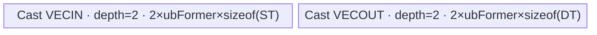

# Log2 950 ACLNN 算子知识

## 算子速览

| 项目 | 内容 |
|---|---|
| 实际入口 | `aclnnLog2GetWorkspaceSize` + `aclnnLog2`，公开 ACLNN 两段式接口；固定仓没有更高版本入口。 |
| 计算语义 | 对每个元素计算 `out[i] = log2(self[i])`。AIV `Log` 实际执行 `log(self[i]) * (1/log(2))`；AICPU 实数走 `std::log2`，复数走 `std::log(z)/log(2)`。 |
| 输入输出 | 相同 shape、ND；公开输入 `BOOL/INT8/INT16/INT32/INT64/UINT8/FLOAT16/BF16/FLOAT/DOUBLE/COMPLEX64/COMPLEX128`，输出为浮点或复数类型。复数输入只能投到复数输出。 |
| 执行类型 | 多节点、按 dtype/连续性裁剪：框架 `Contiguous`/`ViewCopy` 边界；核心 `Log` 为 `AIV_VECTOR` 或 AICPU；可选输出 `Cast` 为 `AIV_VECTOR` 或 AICPU。所有可达节点均无 Cube/AIC/MIX_CV。 |
| Kernel 路线 | R-001 AIV Log 无 Cast；R-002 AIV Log + Direct AIV Cast；R-003 AIV Log + Micro AIV Cast；R-004 AIV Log + AICPU Cast；R-005 AICPU Log 无 Cast；R-006 AICPU Log + Direct AIV Cast；R-007 AICPU Log + Micro AIV Cast；R-008 AICPU Log + AICPU Cast。 |
| 核心资源 | AIV Log：GM、ATVOSS LEVEL_2 动态 UB buffer 与寄存器；AIV Cast：双深度 `VECIN/VECOUT` Queue；AICPU：输入/输出 GM 与 CPU shard；每个实际 AICore 节点声明 16 MiB runtime workspace，ACLNN 总 workspace 由 executor 汇总。 |
| 来源闭包 | `source_closed`：公开 ACLNN → L0 selector → 950 Log/Cast Host/Tiling/POD → AIV/AICPU body → 950 构建接线已闭合；`Contiguous/ViewCopy` 与 executor 按 Skill 作为显式框架边界。 |
| 验证状态 | 已完成源码闭包检查；本次知识提取未执行编译、真机、数值或性能测试。 |

## 接口与语义

### 计算语义

令输入逻辑元素数为 `N = product(self.shape)`，则 `out[i] = log_2(self[i])`，`0 <= i < N`。950 AIV `Log` 接收属性 `base=2.0f, scale=1.0f, shift=0.0f`，Host 预计算 `invLnBase=1/log(2)`，Device 管线为 `float(self) → *1 → +0 → ln → *invLnBase → cast(self dtype)`。整数和 `BOOL` 的 L0 `Log` 输出固定为 `FLOAT`；其它类型保持输入 dtype，之后 ACLNN 可按 `out` dtype追加 Cast。输入小于零的实数、零、无穷与 NaN 的具体结果由 `MicroAPI::Log` 或 C++ 数学库语义决定，固定仓未增加域修正。

### 输入、输出与属性

| 参数 | shape/layout | dtype | 约束、默认值与语义 |
|---|---|---|---|
| `self` | ND，1–8 维；允许非连续；空 tensor 在 ACLNN Host 直接成功 | `BOOL, UINT8, INT8, INT16, INT32, INT64, FLOAT16, BF16, FLOAT, DOUBLE, COMPLEX64, COMPLEX128` | 950 属 `SocVersion::ASCEND910B..ASCEND910E` 范围，使用含 BF16 的 910B 支持表。 |
| `out` | 与 `self` shape 完全相同，ND | `FLOAT16, BF16, FLOAT, DOUBLE, COMPLEX64, COMPLEX128` | `CanCast(self.dtype, out.dtype)` 必须成立；复数输入不能转非复数。 |
| `workspaceSize` | 标量 Host 输出 | `uint64_t` | 空 tensor 为 0；其余由 `aclOpExecutor::GetWorkspaceSize()` 汇总。 |
| `executor` | Host 对象 | `aclOpExecutor**` | 第一段创建并转移所有节点、临时 tensor 和 workspace 生命周期。 |
| `workspace` | Device 地址 | byte buffer | 第二段由 `CommonOpExecutorRun` 绑定给 executor 中的任务。 |
| `stream` | ACL runtime stream | `aclrtStream` | 节点按 executor 在同一 stream 的依赖顺序提交。 |

### 入口与版本

公开文档明确支持 Ascend 950PR/950DT、A2、A3；本卡只覆盖 950。`aclnnLog2GetWorkspaceSize` 调用唯一公共实现 `aclnnLog2Common`，不合并同文件中的 `aclnnInplaceLog2`。固定版本没有 `aclnnLog2V2` 等新入口。950 `Log` OpDef 只把 AICore 配置注册到 `ascend950`，`CMakeLists.txt` 以 `SUPPORT_COMPUTE_UNIT "ascend950" "mc62"` 和 `arch35` Tiling 接线，故该公开入口到 950 实现闭合。

## Host/Launcher 执行流程

### 参数校验与前处理

调用顺序为：`CheckNotNull2Tensor` → `CheckDtypeValid` → `CanCast(self.dtype,out.dtype)` → `CheckSameShape1In1Out` → 创建 executor → 对 NZ storage format 仅告警 → 空 tensor 直接返回。非空时 `l0op::Contiguous(self)` 建立连续输入；`l0op::Log(..., 2,1,0)` 按输入 dtype 选择 AICore 或 AICPU；`l0op::Cast(logOut,out.dtype)` 在 dtype 相同处直接返回原 tensor，否则按 950 pair selector 选择 AICore/AICPU；最后 `l0op::ViewCopy(castOut,out)`。任何节点返回空指针都会立即返回对应 ACLNN 内部错误，不再添加后续节点。

### 参数、Workspace 与生命周期

`selfContiguous`、`logOut`、可选 `castOut` 都由 `uniqueExecutor` 分配并持有到第二段执行结束。950 AICore Log Tiling 写 `workspace[0]=16,777,216` bytes；AICore Cast Tiling 同样写 16 MiB。ACLNN 不把两者简单相加，而由 `uniqueExecutor->GetWorkspaceSize()` 根据任务与临时 tensor 统一规划，固定源码未公开 executor 的最终 offset 分配。AICPU task space由 `internal::AicpuTaskSpace` 持有。空 tensor 不创建 Device 节点且返回 workspace 0。

### 启动图与失败传播

```text
self
  -> [可选 Contiguous 框架节点]
  -> LogAiCore(AIV) 或 LogAiCpu(AICPU)
  -> [dtype 不同：CastAiCore(AIV) 或 CastAiCpu(AICPU)]
  -> ViewCopy 框架节点
  -> out
```

| 节点 | Host 添加函数 | entry/body | grid/POD | 输入→输出 | workspace/ordering/失败 |
|---|---|---|---|---|---|
| N0 | `l0op::Contiguous` | 框架边界 | executor 决定 | `self`→连续临时 tensor | 先于 N1；失败使 `selfContiguous==nullptr`。 |
| N1A | `LogAiCore` | `log`→`LogKernel<1,2,U>`→`ElementwiseSchWithScalar::Process` | `blockDim=blockNum`; `EleBaseTilingData32B` | 连续 `U`→同 dtype `logOut` | AIV_ONLY；16 MiB runtime workspace；失败阻断后续。 |
| N1B | `LogAiCpu` | `LogCpuKernel::Compute`→`LogCompute*` | AICPU task；属性 `base/scale/shift` | 整数/BOOL→F32；DOUBLE/complex 保持 dtype | 与 N2/N3 同 executor 顺序；AICPU 返回非 OK 阻断。 |
| N2A | `CastAiCore` | `cast<0>`→`CastDirect` 或 `CastMicro` | `blockDim=blockNum`; `CastTilingData` | `logOut`→目标 dtype | AIV_ONLY；16 MiB runtime workspace；只在 dtype 不同时存在。 |
| N2B | `CastAiCpu` | AICPU `Cast` | AICPU attrs | `logOut`→目标 dtype | 只在 950 AICore pair 不支持时存在。 |
| N3 | `l0op::ViewCopy` | 框架边界 | executor 决定 | 临时结果→用户 `out` | 最后提交；失败在第一段即返回空指针。 |

节点间介质都是 executor 所有的 GM 临时 tensor，extent 为 `N*sizeof(edge dtype)`、ND 连续 layout；producer 完成后 consumer 才可见，N3 完成前临时 tensor 不可释放。固定仓将具体 stream event 与 workspace slice offset封装在 executor 边界，未暴露显式 event。

## Route 与参数设计

### 分核与资源计算

AIV Log 先合轴为 `dim0=N`。令 `Bmin` 为 DAG 最小 dtype 位宽（FP16/BF16 路线 16，FP32 路线 32），`Cplat` 为 AIV 核数：`coreNum=min(Cplat,ceil(N*Bmin/32768))`；`blockFormer=align_up(ceil(N/coreNum),512)` 元素；`blockNum=ceil(N/blockFormer)`。该 Log2 DAG 在 LEVEL_2 下具有 2 个 ping/pong输入区、2 个 ping/pong输出区和 2 个交替计算区，`BufferNum=6`，最大 dtype 4 bytes，因此 `ubFormer=floor((UB*8)/(6*32), align=2048/Bmin)` 元素，UB 总量 `6*ubFormer*4` bytes。

AIV Cast 令输入/输出位宽为 `Bin/Bout`，`ubFormer=floor(((UB-128)*4)/(Bin+Bout), align=VLbits/Bin)`；`coreNum=min(Cplat,ceil(N*Bin/32768))`，`blockFormer=align_up(ceil(N/coreNum),8)`。Direct 与本任务可达 Micro 路线均有 `VECIN`/`VECOUT` 两个 depth=2 Queue，总 UB 为 `2*ubFormer*sizeof(src)+2*ubFormer*sizeof(dst)`，128-byte reserve 保证对齐余量。

### Route 选择

| 顺序 | Route | Key/模板 | 精确选择条件与优先级 | 不适用去向 |
|---:|---|---|---|---|
| 1 | R-001 AIV/no-cast | Log `GET_TPL_TILING_KEY(1,2)` | `self∈{F16,BF16,F32}` 且 `out.dtype=self.dtype` | R-002/3/4 |
| 2 | R-002 AIV/direct-cast | Log key + Cast `GET_TPL_TILING_KEY(0)` | `self∈{F16,BF16,F32}`，目标不同且 pair 为 `{F16→F32/BF16, BF16→F16/F32, F32→F16/BF16}` | R-003/4 |
| 3 | R-003 AIV/micro-cast | 同上 | `self→out` 为 `F32→C64` (`MIRCRO_INOUT`) 或 `BF16→C64` (`MIRCRO_CAST_INTER`) | R-004 |
| 4 | R-004 AIV/AICPU-cast | Log key + AICPU Cast | `self∈{F16,BF16,F32}`、dtype 不同，且 pair 不在 950 AICore Cast 表 | 失败 |
| 5 | R-005 AICPU/no-cast | AICPU attrs `2,1,0` | `self∈{U8,I8,I16,I32,I64,BOOL}` 且 `out=F32`；或 `DOUBLE/C64/C128` 且 out 与内部 dtype 相同 | R-006/7/8 |
| 6 | R-006 AICPU/direct-cast | AICPU Log + Direct Cast | 内部 F32→F16/BF16，或内部 DOUBLE→F32/BF16 | R-007/8 |
| 7 | R-007 AICPU/micro-cast | AICPU Log + Micro Cast | 整数/BOOL 的内部 F32→C64 | R-008 |
| 8 | R-008 AICPU/AICPU-cast | 两个 AICPU task | AICPU Log 内部 dtype 与目标不同，且 pair 不在 950 AICore Cast 表 | 失败 |

```text
if self is empty: no Device route
else if self.dtype in {F16,BF16,F32}:
  launch AIV Log<schMode=1,attrWork=2,U>
  if internal dtype == out.dtype: R-001
  else if pair uses CastDirect: R-002
  else if pair uses CastMicro: R-003
  else: R-004
else:
  launch AICPU Log2
  if internal dtype == out.dtype: R-005
  else if pair uses CastDirect: R-006
  else if pair uses CastMicro: R-007
  else: R-008
```

### 模板/实现执行矩阵

| Route | key/selector | dtype/shape/platform 完整命中条件 | 执行拓扑与 Kernel 节点 | 实际模板/body | 内存与同步特征 | tail/fallback |
|---|---|---|---|---|---|---|
| R-001 | `(1,2)` | 950、非空、F16/BF16/F32、同 dtype 输出 | AIV Log | `LogScaleNotOneShiftNotZeroLnbaseNotOne<U>` | 6 个 `ubFormer*4` ATVOSS buffer，Mutex pipe 同步 | mask + tail tile；失败终止 |
| R-002 | `(1,2)` + Cast 0 | R-001 输入，Direct pair | AIV Log→AIV Cast | `CastDirect<ST,DT>` | Log LEVEL_2 UB；Cast depth=2 queues | 两节点各自 former/tail |
| R-003 | `(1,2)` + Cast 0 | F32/BF16→C64 | AIV Log→AIV Cast | `CastMicro<MIRCRO_INOUT/CAST_INTER>` | Cast queue + RegTensor/Interleave | `UpdateMask` 控制寄存器尾部 |
| R-004 | `(1,2)` + AICPU selector | 其它合法 AIV-Log 输出 pair | AIV Log→AICPU Cast | `LogKernel` + AICPU Cast | GM 边；stream/task ordering | Cast 不支持则第一段失败 |
| R-005 | AICPU Log2 condition | 非 AIV 输入且内部 dtype=out | AICPU Log | `LogComputeIntegr`/`LogCompute` | CPU shard，无 AIV UB | shard `[start,end)` 精确尾部 |
| R-006 | AICPU + Cast 0 | F32→F16/BF16 或 DOUBLE→F32/BF16 | AICPU Log→AIV Cast | `CastDirect` | AICPU GM→AIV queues | Cast tail tile |
| R-007 | AICPU + Cast 0 | 内部 F32→C64 | AICPU Log→AIV Cast | `CastMicro<MIRCRO_INOUT>` | 寄存器把实数与 0 虚部交织 | mask tail |
| R-008 | 两个 AICPU selector | 其它合法 pair | AICPU Log→AICPU Cast | 两个 AICPU bodies | executor GM 临时边 | AICPU错误阻断 |

### 隐藏性能 Guard

| Guard | Host/Tiling 条件 | Device/资源原因 | 影响 Route | 不满足时去向 | 源码符号 |
|---|---|---|---|---|---|
| 空 tensor | `self->IsEmpty()` | AIV Tiling 明确拒绝零维元素 | 全部 | workspace 0、无 launch | `aclnnLog2Common` |
| AIV Log dtype | `IsAiCoreSupport(self)` 仅 F16/BF16/F32 | 950 OpDef 与 DAG仅实例化三类 | R-001–4 | AICPU R-005–8 | `l0op::IsAiCoreSupport` |
| Log2 attrWork | `scale≈1 && shift≈0 && invLnBase≈1` 为假 | `1/log(2) != 1`，必须保留乘倒数节点 | R-001–4 | 固定命中 attrWork=2 | `LogTiling::SetAttr` |
| Log UB | `ubFormer>0` 且 `UB*8 >= 6*32*alignFactor` | LEVEL_2 六块最大宽度 buffer | R-001–4 | Tiling失败 | `ElewiseTiling/GetMaxElemNum` |
| 4 KiB/核 | `coreNum=ceil(N*Bmin/32768)` | 避免每核过小；再受平台核数上限 | R-001–4 | 自动减少 blockDim | `ElewiseTiling` |
| Cast pair | pair 必须存在 `castMap` | 决定 Direct/Micro/AICPU | R-002/3/6/7 | AICPU或失败 | `CastTiling::GetShapeAttrsInfo` |
| Cast UB reserve | `UB>128` | 两个 depth=2 queue并保留四个32-byte对齐余量 | R-002/3/6/7 | Tiling失败 | `CastTiling::GetUbFormer` |
| AICPU并行阈值 | 整数/BOOL `N>35*1024`；DOUBLE `N>60*1024`；complex `N>18*1024` | shard开销与 dtype 计算量分级 | R-005–8 | 单 shard | `NeedParallel/LogComputeIntegr` |

### POD/ABI

| 结构 | 字段 | 类型/位宽 | ABI 布局 | 单位 | Host/launcher producer | Device consumer | 边界 |
|---|---|---|---|---|---|---|---|
| `EleBaseTilingData32B` | `dim0` | `int64_t/64` | sizeof=32, align=8, offset=0 | 元素 | `AdaptEleBaseTilingData32B: N` | scheduler ctor | 非空，乘积溢出保护固定仓不可见 |
| 同上 | `coreNum` | `int32_t/32` | offset=8 | AIV 核 | `ElewiseTiling: coreNum` | 计算 `blockFormer` | `[1,Cplat]` |
| 同上 | `ubFormer` | `int32_t/32` | offset=12 | 元素/tile | `GetMaxElemNum` | `Process/blockLen` | 必须大于0 |
| 同上 | `scalarData[0..3]` | `float/32` | offset=16 | 无量纲 | `SetScalar(attrScale)=1` | Var0/Muls | 活跃 |
| 同上 | `scalarData[4..7]` | `float/32` | offset=20 | 输入单位 | `SetScalar(attrShift)=0` | Var1/Adds | 活跃 |
| 同上 | `scalarData[8..11]` | `float/32` | offset=24 | 无量纲 | `SetScalar(1/log(2))` | Var2/Muls | 活跃 |
| 同上 | `scalarData[12..15]` | `char[4]` | offset=28 | N/A | 零初始化 | 不读取 | inactive |
| `CastTilingData` | `blockNum` | `int64_t/64` | 宏序列化；精确 offsetof 固定仓不可见 | 核 | `DoOpTiling` | `Process` last-block | >0 |
| 同上 | `ubFormer` | `int64_t/64` | 同上 | 元素 | `GetUbFormer` | Queue容量/loop | >0 |
| 同上 | `blockFormer` | `int64_t/64` | 同上 | 元素/核 | `align_up(ceil(N/core),8)` | GM base | 尾核可短 |
| 同上 | `ubLoopOfFormerBlock` | `int64_t/64` | 同上 | loop | Host ceil-div | `Process` | former核 |
| 同上 | `ubLoopOfTailBlock` | `int64_t/64` | 同上 | loop | Host ceil-div | `Process` | tail核 |
| 同上 | `ubTailOfFormerBlock` | `int64_t/64` | 同上 | 元素 | Host余数 | `Process` | former核末tile |
| 同上 | `ubTailOfTailBlock` | `int64_t/64` | 同上 | 元素 | Host余数 | `Process` | tail核末tile |
| 同上 | `regCopyInStep` | `int64_t/64` | 同上 | 元素/寄存器步 | `GetUbCopyStep` | `CastMicro` | Direct不读取 |
| 同上 | `regCopyOutStep` | `int64_t/64` | 同上 | 元素/寄存器步 | `GetUbCopyStep` | `CastMicro` | Direct不读取 |
| 同上 | `ubFormerRegLoop` | `int64_t/64` | 同上 | vector loop | Host ceil-div | `CastMicro::Process` | Micro活跃 |
| 同上 | `ubTailOfFormerRegLoop` | `int64_t/64` | 同上 | vector loop | Host ceil-div | tail寄存器循环 | Micro活跃 |
| 同上 | `ubTailOfTailRegLoop` | `int64_t/64` | 同上 | vector loop | Host ceil-div | tail核尾循环 | Micro活跃 |

### Route 源码闭包

| Route | Key/selector | Host/Tiling producer | POD/参数 | Kernel entry/router 节点 | Kernel body/直接依赖 | 构建接线 |
|---|---|---|---|---|---|---|
| R-001 | Log `(1,2)` | `log_tiling_arch35.cpp::RunTiling` | `EleBaseTilingData32B` | `log_apt.cpp::log/LogKernel` | `log_dag.h::LogCustom` + ATVOSS scheduler | `math/log/CMakeLists.txt` |
| R-002 | Log + Direct Cast | 上述 + `cast_tiling.cpp` | 两个 POD | `log`→`cast<0>` | `CastDirect::{Init,Process,CopyIn,Compute,CopyOut}` | Log/Cast 950 CMake/OpDef |
| R-003 | Log + Micro Cast | 同上 | 两个 POD | `log`→`cast<0>` | `CastMicro::ComputeInOut/ComputeCastInter` | 同上 |
| R-004 | Log + AICPU Cast | Log Tiling + Cast L0 selector | Log POD + AICPU attrs | `log`→AICPU Cast task | Log AIV body + Cast AICPU body | 同上 |
| R-005 | AICPU selector | `log.cpp::LogAiCpu` | attrs `base,scale,shift` | `REGISTER_CPU_KERNEL(Log)` | `LogCpuKernel::Compute/LogCompute*` | AICPU OpDef |
| R-006 | AICPU + Direct Cast | AICPU attrs + Cast Tiling | Cast POD | AICPU task→`cast<0>` | AICPU Log + `CastDirect` | 同上 |
| R-007 | AICPU + Micro Cast | 同上 | Cast POD | AICPU task→`cast<0>` | AICPU Log + `CastMicro::ComputeInOut` | 同上 |
| R-008 | 两个 AICPU selector | `LogAiCpu` + `CastAiCpu` | 两组 attrs | 两个 AICPU tasks | `log_aicpu.cpp` + Cast AICPU | AICPU OpDefs |

## Kernel 实现

### 公共执行流程

AIV Log 所有路线共享：每个 block 以 `blockFormer*blockIdx` 定位 GM，按 `ubFormer` 切 tile；ATVOSS依次执行 CopyIn、升到 FP32、乘 scale、加 shift、FP32 Log、乘倒数底数、按 RINT 降回 U、CopyOut。buffer ID由 LEVEL_2 DAG编译期分配，`Mutex::Lock/Unlock<PIPE_MTE2/PIPE_V/PIPE_MTE3>`建立 MTE2→V→MTE3 与 ping/pong复用顺序。AICPU Log按连续 `[start,end)` shard直接写内部输出。可选 Cast只消费完整 `logOut` GM tensor；无跨节点 UB。

### Route R-001：AIV Log、同 dtype 输出

#### 适用条件

##### 选择证据

| 层级 | 文件 | 符号 | 源码谓词/参数 | 结果/下一跳 |
|---|---|---|---|---|
| API | `math/log/op_api/aclnn_log2.cpp` | `aclnnLog2Common` | 非空；属性固定 `(2,1,0)` | L0 Log |
| L0 | `math/log/op_api/log.cpp` | `IsAiCoreSupport/LogAiCore` | dtype F16/BF16/F32 | AICore Log |
| Tiling | `math/log/op_host/arch35/log_tiling_arch35.cpp` | `SetAttr/RunTiling` | `invLnBase!=1` | key `(1,2)` generic DAG |
| API Cast | `math/cast/op_api/cast.cpp` | `Cast` | `internal dtype==out dtype` | 返回同一 tensor，无 Cast launch |

#### Device 数据流

##### 函数级调用链

```text
LogAiCore -> log<1,2>(x,y,workspace,tiling)
  -> LogKernel<1,2,U>
    -> ElementwiseSchWithScalar::Init(x,y)
    -> Process
      -> Run: Vec::CopyIn<U>
      -> Vec::Cast<float,U,CAST_NONE>
      -> Vec::Muls<float>(1)
      -> Vec::Adds<float>(0)
      -> LogCustom<float>: DataCopy -> MicroAPI::Log -> DataCopy
      -> Vec::Muls<float>(1/log(2))
      -> Vec::Cast<U,float,CAST_RINT>
      -> Vec::CopyOut<U>
```

##### 源码等价伪码

```text
base = blockIdx * blockFormer
loops, tail = blockIdx==blockNum-1 ? tail-core values : former-core values
for tile in [0, loops):
  len = tile==loops-1 ? tail : ubFormer
  u = GM_x[base + tile*ubFormer : +len]
  f = float(u); f *= 1.0; f += 0.0
  for register chunk: f = ln(f), masked by remaining len
  f *= 1/log(2)
  GM_y[...] = cast_rint<U>(f), only len valid elements
```

#### 内存与数据搬运

##### 资源与搬运表

| 层级/缓冲区 | offset/地址公式 | extent/容量公式 | dtype/layout | producer | consumer | owner/lifetime | 对齐/复用 |
|---|---|---|---|---|---|---|---|
| GM x | `(blockIdx*blockFormer+tileOffset)*sizeof(U)` | `len*sizeof(U)` | U/ND连续 | N0 | CopyIn | executor/input | tail按len |
| VECIN ping/pong | buffer id × `ubFormer*4` | 各 `ubFormer*4` | 物理按最大F32宽度 | MTE2 | first calc | ATVOSS/单tile | 双缓冲 |
| VECCALC 0/1 | buffer id × `ubFormer*4` | 各 `ubFormer*4` | F32 | DAG ops | next DAG op | ATVOSS/活跃节点区间 | 线性链交替覆盖 |
| VECOUT ping/pong | buffer id × `ubFormer*4` | 各 `ubFormer*4` | U存储于最大宽度槽 | final Cast | MTE3 | ATVOSS/单tile | 双缓冲 |
| GM y | 同 GM x 元素offset | `len*sizeof(U)` | U/ND连续 | CopyOut | optional ViewCopy | executor/temp | 只写有效len |

##### 分层内存布局


##### 字节账与复用顺序

```text
UB_total = 6 * ubFormer * 4 bytes <= platform UB
dynamic_ub = N/A
workspace_total(Log node) = 16,777,216 bytes runtime workspace
=> ubFormer = floor((UB*8)/(6*32), alignment=2048/Bmin elements)
```

| 复用子区 | 写入者 | 读取者/消费点 | 下一次覆盖 | 同步或释放依据 | 安全条件 |
|---|---|---|---|---|---|
| CALC 0/1 | 当前 DAG op | 下一 DAG op | 后续不再依赖时 | `GetTensor/ReleaseTensor<VECCALC>` | buffer ID活跃区间不重叠 |
| ping/pong | tile i MTE2/V/MTE3 | tile i consumer | tile i+2 | PIPE mutex + `i&1` | 同奇偶tile先释放 |

#### 同步、精度与尾块

##### 同步与数值边界表

| 阶段 | primitive/机制 | producer | consumer/等待点 | 保护对象 | 精度/尾块 |
|---|---|---|---|---|---|
| CopyIn→V | MTE2 mutex | `Vec::CopyIn` | calc `GetTensor` | VECIN ID | `len`控制搬运 |
| V chain | PIPE_V mutex | 每个 DAG op | 下一 op | CALC ID | F16/BF16先转F32；FP32保持F32 |
| Log | `UpdateMask<float>` | UB F32 | `MicroAPI::Log` | RegTensor lanes | 每轮递减remaining count，尾lane zeroing/不提交 |
| 降精度 | `CAST_RINT` | F32结果 | U输出 | VECOUT | F16/BF16舍入；F32同型无损 |
| V→CopyOut | MTE3 mutex | final DAG op | CopyOut | VECOUT ID | 只搬 `tailNum*sizeof(U)` |

#### 关键实现

##### 符号证据表

| 阶段 | 文件 | 符号/模板实例 | 实现事实 |
|---|---|---|---|
| Host/Tiling producer | `math/log/op_host/arch35/log_tiling_arch35.cpp` | `LogTiling::RunTiling` | 生成 `(1,2)`、POD、16MiB、blockDim |
| Kernel entry/router | `math/log/op_kernel/log_apt.cpp` | `log/LogKernel<1,2,U>` | AIV_ONLY，路由 generic DAG |
| Device body/helper | `math/log/op_kernel/arch35/log_dag.h` | `LogScaleNotOne.../LogCustom<float>` | FP32 Log、乘倒数、RINT与mask tail |

### Route R-002：AIV Log 后接 Direct AIV Cast

#### 适用条件

##### 选择证据

| 层级 | 文件 | 符号 | 源码谓词/参数 | 结果/下一跳 |
|---|---|---|---|---|
| L0 | `math/cast/op_api/cast.cpp` | `Cast/IsAiCoreSupport` | pair在REGBASE表 | `CastAiCore` |
| Cast Tiling | `math/cast/op_host/arch35/cast_tiling.cpp` | `castMap/GetUbFormer` | policy=`DIRECT_CAST` | key 0 |
| Router | `math/cast/op_kernel/cast_apt.cpp` | `cast<0>` | `templateId==DIRECT_CAST` | `CastDirect` |

#### Device 数据流

##### 函数级调用链

```text
R-001 Log node
  -> GM logOut edge, executor stream order
cast<0> -> CastDirect<ST,DT>::Init
  -> Process -> CopyIn(DataCopyPad) -> Compute(AscendC::Cast<DT,ST>) -> CopyOut(DataCopyPad)
```

##### 源码等价伪码

```text
produce logOut exactly as R-001
for each Cast core/tile:
  len = former or tail
  inQ = logOut[coreBase+offset : +len]
  outQ = Cast<DT,ST>(inQ, pairRoundMode, len)
  castOut[...] = outQ[0:len]
```

#### 内存与数据搬运

##### 资源与搬运表

| 层级/缓冲区 | offset/地址公式 | extent/容量公式 | dtype/layout | producer | consumer | owner/lifetime | 对齐/复用 |
|---|---|---|---|---|---|---|---|
| GM edge | 0 | `N*sizeof(ST)` | ST/ND | Log MTE3 | Cast MTE2 | executor | 两节点间不别名 |
| Cast inQ | depth slot | `2*ubFormer*sizeof(ST)` | ST | DataCopyPad | Cast | Cast `TPipe` | depth=2 |
| Cast outQ | depth slot | `2*ubFormer*sizeof(DT)` | DT | Cast | DataCopyPad | Cast `TPipe` | depth=2 |
| castOut | coreBase+tile | `len*sizeof(DT)` | DT/ND | Cast | ViewCopy | executor | tail有效len |

##### 分层内存布局



##### 字节账与复用顺序

```text
UB_total(Cast) = 2*ubFormer*(sizeof(ST)+sizeof(DT)) <= UB-128
workspace_total = Log 16MiB + Cast 16MiB，由executor可复用规划
```

| 复用子区 | 写入者 | 读取者/消费点 | 下一次覆盖 | 同步或释放依据 | 安全条件 |
|---|---|---|---|---|---|
| inQ slot | CopyIn tile i | Compute i | tile i+2 | `DeQue/FreeTensor` | depth=2 |
| outQ slot | Compute i | CopyOut i | tile i+2 | `DeQue/FreeTensor` | CopyOut完成 |

#### 同步、精度与尾块

##### 同步与数值边界表

| 阶段 | primitive/机制 | producer | consumer/等待点 | 保护对象 | 精度/尾块 |
|---|---|---|---|---|---|
| Log→Cast | executor stream dependency | Log node | Cast task | GM edge | 完整tensor可见 |
| Cast queue | TQue EnQue/DeQue | MTE2/V | V/MTE3 | depth slot | F32→F16/BF16为RINT；F16/BF16互转按policy |
| tail | `blockLen=tailNum*sizeof(T)` | Host POD | DataCopyPad | final tile | 不写padding |

#### 关键实现

##### 符号证据表

| 阶段 | 文件 | 符号/模板实例 | 实现事实 |
|---|---|---|---|
| Host/Tiling producer | `math/cast/op_host/arch35/cast_tiling.cpp` | `GetShapeAttrsInfo/DoOpTiling` | pair policy、核/tile/UB/POD |
| Kernel entry/router | `math/cast/op_kernel/cast_apt.cpp` | `cast<0>` | AIV_ONLY→`CastDirect` |
| Device body/helper | `math/cast/op_kernel/arch35/cast_impl.h` | `CastDirect::{Init,Process}` | depth=2、Cast round、former/tail |

### Route R-003：AIV Log 后接 Micro AIV Cast

#### 适用条件

##### 选择证据

| 层级 | 文件 | 符号 | 源码谓词/参数 | 结果/下一跳 |
|---|---|---|---|---|
| L0 | `math/cast/op_api/cast.cpp` | REGBASE pair表 | F32→C64或BF16→C64 | `CastAiCore` |
| Policy | `cast_struct.h` | `GetCastPolicy` | F32→C64=`MIRCRO_INOUT`; BF16→C64=`MIRCRO_CAST_INTER` | Micro router |
| Router | `cast_apt.cpp` | `cast<0>` | Micro id | `CastMicro` |

#### Device 数据流

##### 函数级调用链

```text
R-001 Log -> GM edge
cast<0> -> CastMicro::Init -> Process
  -> CopyIn -> ComputeInOut(F32→C64) or ComputeCastInter(BF16→C64)
  -> CopyOut
```

##### 源码等价伪码

```text
for each tile and register chunk:
  real = load(src, ldDist)
  if BF16: real = cast<float>(real)
  imag = 0
  interleaved = Interleave(real, imag)
  store complex64(interleaved), mask derived from remaining logical elements
```

#### 内存与数据搬运

##### 资源与搬运表

| 层级/缓冲区 | offset/地址公式 | extent/容量公式 | dtype/layout | producer | consumer | owner/lifetime | 对齐/复用 |
|---|---|---|---|---|---|---|---|
| GM edge | 0 | `N*sizeof(ST)` | F32/BF16 | Log | CastMicro | executor | node boundary |
| Micro inQ/outQ | core/tile | `2*ubFormer*sizeof(ST/DT)` | source/C64 | MTE2/V | V/MTE3 | TPipe | depth=2 |
| RegTensor | register-local | one vector chunk | real/interleaved | DataCopy/Cast | Interleave/Store | register scope | every loop overwritten |

##### 分层内存布局


##### 字节账与复用顺序

```text
UB_total = 2*ubFormer*(sizeof(ST)+8) <= UB-128
register_bytes = 编译器分配，固定仓只证明RegTensor生命周期
```

| 复用子区 | 写入者 | 读取者/消费点 | 下一次覆盖 | 同步或释放依据 | 安全条件 |
|---|---|---|---|---|---|
| queue slots | CopyIn/Compute | Compute/CopyOut | tile i+2 | TQue FreeTensor | depth=2 |
| registers | current reg loop | same loop store | next reg loop | `__VEC_SCOPE__`顺序 | mask保护尾部 |

#### 同步、精度与尾块

##### 同步与数值边界表

| 阶段 | primitive/机制 | producer | consumer/等待点 | 保护对象 | 精度/尾块 |
|---|---|---|---|---|---|
| BF16升精度 | Micro Cast ZEROING | load | Interleave | real lanes | BF16→F32 |
| 构造复数 | `Interleave(real,zero)` | real/zero regs | store | C64 lanes | 虚部精确0 |
| tail | `UpdateMask` | remaining count | store | final register | 仅有效复数元素 |

#### 关键实现

##### 符号证据表

| 阶段 | 文件 | 符号/模板实例 | 实现事实 |
|---|---|---|---|
| Host/Tiling producer | `math/cast/op_host/arch35/cast_tiling.cpp` | `GetUbCopyStep/DoOpTiling` | reg步长与循环数 |
| Kernel entry/router | `math/cast/op_kernel/cast_apt.cpp` | Micro分支 | 选择完整模板实参 |
| Device body/helper | `math/cast/op_kernel/arch35/cast_impl.h` | `ComputeInOut/ComputeCastInter` | real→complex布局与mask |

### Route R-004：AIV Log 后接 AICPU Cast

#### 适用条件

##### 选择证据

| 层级 | 文件 | 符号 | 源码谓词/参数 | 结果/下一跳 |
|---|---|---|---|---|
| L0 | `math/cast/op_api/cast.cpp` | `IsAiCoreSupport` | pair不在REGBASE表 | 检查AICPU列表 |
| L0 | 同上 | `CastAiCpu` | source/dst均被AICPU支持 | 添加AICPU Cast |

#### Device 数据流

##### 函数级调用链

```text
LogKernel<1,2,U> -> GM logOut
  -> CastAiCpu -> AICPU Cast kernel -> GM castOut
```

##### 源码等价伪码

```text
produce logOut with AIV FP32-log pipeline
for each AICPU shard i: castOut[i] = cast_to_requested_dtype(logOut[i])
```

#### 内存与数据搬运

##### 资源与搬运表

| 层级/缓冲区 | offset/地址公式 | extent/容量公式 | dtype/layout | producer | consumer | owner/lifetime | 对齐/复用 |
|---|---|---|---|---|---|---|---|
| logOut GM | 0 | `N*sizeof(U)` | U/ND | AIV Log | AICPU Cast | executor | 完整producer完成后读取 |
| castOut GM | 0 | `N*sizeof(out)` | output/ND | AICPU Cast | ViewCopy | executor | task结束前有效 |

##### 分层内存布局

N/A：Cast节点在 AICPU 执行，不使用 AIV UB；Log节点使用 R-001 布局。

##### 字节账与复用顺序

```text
UB_total = R-001 Log UB；AICPU Cast为N/A
workspace_total = executor动态汇总
```

| 复用子区 | 写入者 | 读取者/消费点 | 下一次覆盖 | 同步或释放依据 | 安全条件 |
|---|---|---|---|---|---|
| logOut GM | Log | AICPU Cast | Cast完成后 | executor task dependency | 不跨任务提前复用 |

#### 同步、精度与尾块

##### 同步与数值边界表

| 阶段 | primitive/机制 | producer | consumer/等待点 | 保护对象 | 精度/尾块 |
|---|---|---|---|---|---|
| AIV→AICPU | executor stream/task order | Log | Cast | GM edge | Cast规则由目标dtype决定 |
| shard tail | `[start,end)` | AICPU scheduler | scalar loop | tensor slice | `end<=N` |

#### 关键实现

##### 符号证据表

| 阶段 | 文件 | 符号/模板实例 | 实现事实 |
|---|---|---|---|
| Host/Tiling producer | `math/cast/op_api/cast.cpp` | `Cast/IsAiCoreSupport` | AICore失败后AICPU fallback |
| Kernel entry/router | 同上 | `CastAiCpu` | 添加AICPU Cast task |
| Device body/helper | `math/cast/op_kernel_aicpu/cast_aicpu.cpp` | AICPU Cast dispatch | dtype转换循环 |

### Route R-005：AICPU Log、同内部 dtype 输出

#### 适用条件

##### 选择证据

| 层级 | 文件 | 符号 | 源码谓词/参数 | 结果/下一跳 |
|---|---|---|---|---|
| L0 | `math/log/op_api/log.cpp` | `IsAiCoreSupport` | 非F16/BF16/F32 | `LogAiCpu` |
| AICPU | `log_aicpu.cpp` | `log_calls` | integer/BOOL→F32；DOUBLE/C64/C128同型 | 对应模板函数 |
| Cast L0 | `cast.cpp` | `Cast` | internal==out | 无Cast task |

#### Device 数据流

##### 函数级调用链

```text
LogAiCpu -> LogCpuKernel::Compute -> NormalCheck -> LogOpCheck
  -> log_calls[input][internalOutput]
    -> LogComputeIntegr<Tin,float> or LogCompute<T,T>
      -> shard_log -> Log2Compute / std::log2 loop
```

##### 源码等价伪码

```text
internal = F32 for integer/BOOL else input dtype
if N exceeds dtype threshold:
  grain = ceil_multiple(N, max(1, cpuCount-reserved))
  ParallelFor([0,N), grain, shard)
else shard(0,N)
shard(start,end):
  integer/BOOL/double: y[i]=cast_internal(std::log2(x[i]))
  complex: y[i]=std::log(x[i])/complex(log(2))
```

#### 内存与数据搬运

##### 资源与搬运表

| 层级/缓冲区 | offset/地址公式 | extent/容量公式 | dtype/layout | producer | consumer | owner/lifetime | 对齐/复用 |
|---|---|---|---|---|---|---|---|
| input GM | `start*sizeof(Tin)` | `(end-start)*sizeof(Tin)` | Tin/连续 | Contiguous | shard | executor | shard区间不重叠 |
| output GM | `start*sizeof(Tout)` | `(end-start)*sizeof(Tout)` | Tout/连续 | shard | ViewCopy | executor | 每元素单写者 |

##### 分层内存布局

N/A：AICPU scalar/shard 实现不使用 AIV UB、TQue 或动态 UB。

##### 字节账与复用顺序

```text
UB_total = N/A
dynamic_ub = N/A
workspace_total = AICPU task space + executor临时tensor，固定仓未给静态字节公式
```

| 复用子区 | 写入者 | 读取者/消费点 | 下一次覆盖 | 同步或释放依据 | 安全条件 |
|---|---|---|---|---|---|
| output shard | 单个 shard | ViewCopy | task结束后 | ParallelFor join/task completion | shard范围无交叠 |

#### 同步、精度与尾块

##### 同步与数值边界表

| 阶段 | primitive/机制 | producer | consumer/等待点 | 保护对象 | 精度/尾块 |
|---|---|---|---|---|---|
| ParallelFor | shard join | worker shards | task return | output GM | `[start,end)`精确覆盖 |
| integer | `std::log2`后cast F32 | scalar loop | output | element | 整数先进入数学库重载再F32 |
| complex | `std::log/log(2)` | scalar loop | output | element | 保持C64/C128 |

#### 关键实现

##### 符号证据表

| 阶段 | 文件 | 符号/模板实例 | 实现事实 |
|---|---|---|---|
| Host/Tiling producer | `math/log/op_api/log.cpp` | `Log/LogAiCpu` | dtype selector与AICPU attrs |
| Kernel entry/router | `math/log/op_kernel_aicpu/log_aicpu.cpp` | `LogCpuKernel::Compute/log_calls` | dtype映射与错误终点 |
| Device body/helper | 同上 | `LogCompute/LogComputeIntegr/Log2Compute` | shard、公式、阈值 |

### Route R-006：AICPU Log 后接 Direct AIV Cast

#### 适用条件

##### 选择证据

| 层级 | 文件 | 符号 | 源码谓词/参数 | 结果/下一跳 |
|---|---|---|---|---|
| Log L0 | `log.cpp` | `LogAiCpu` | 非AIV输入 | internal F32或DOUBLE |
| Cast L0 | `cast.cpp` | REGBASE表 | F32→F16/BF16或DOUBLE→F32/BF16 | `CastAiCore` Direct |

#### Device 数据流

##### 函数级调用链

```text
LogCpuKernel::Compute -> GM internal
  -> cast<0> -> CastDirect::Init/Process -> CopyIn/Cast/CopyOut
```

##### 源码等价伪码

```text
AICPU computes log2 into internal GM
AIV Cast tiles internal GM, applies pair-specific RoundMode, writes requested dtype
```

#### 内存与数据搬运

##### 资源与搬运表

| 层级/缓冲区 | offset/地址公式 | extent/容量公式 | dtype/layout | producer | consumer | owner/lifetime | 对齐/复用 |
|---|---|---|---|---|---|---|---|
| internal GM | 0 | `N*sizeof(F32/DOUBLE)` | ND | AICPU Log | Cast MTE2 | executor | task边 |
| Cast queues | tile | `2*ubFormer*(sizeof(ST)+sizeof(DT))` | ST/DT | MTE2/V | V/MTE3 | TPipe | depth=2 |

##### 分层内存布局


##### 字节账与复用顺序

```text
UB_total = 2*ubFormer*(sizeof(ST)+sizeof(DT)) <= UB-128
```

| 复用子区 | 写入者 | 读取者/消费点 | 下一次覆盖 | 同步或释放依据 | 安全条件 |
|---|---|---|---|---|---|
| depth slot | CopyIn/Compute | Compute/CopyOut | i+2 | FreeTensor | AICPU producer已完成 |

#### 同步、精度与尾块

##### 同步与数值边界表

| 阶段 | primitive/机制 | producer | consumer/等待点 | 保护对象 | 精度/尾块 |
|---|---|---|---|---|---|
| AICPU→AIV | executor ordering | Log | Cast | internal GM | 完整tensor可见 |
| Cast | TQue + `AscendC::Cast` | input queue | output queue | tile | RINT按policy；tail blockLen |

#### 关键实现

##### 符号证据表

| 阶段 | 文件 | 符号/模板实例 | 实现事实 |
|---|---|---|---|
| Host/Tiling producer | `math/cast/op_host/arch35/cast_tiling.cpp` | `DoOpTiling` | Direct Cast POD |
| Kernel entry/router | `math/cast/op_kernel/cast_apt.cpp` | `cast<0>` | AIV Direct |
| Device body/helper | `math/cast/op_kernel/arch35/cast_impl.h` | `CastDirect` | 双缓冲与tail |

### Route R-007：AICPU Log 后接 Micro AIV Cast

#### 适用条件

##### 选择证据

| 层级 | 文件 | 符号 | 源码谓词/参数 | 结果/下一跳 |
|---|---|---|---|---|
| Log | `log_aicpu.cpp` | `LogComputeIntegr` | integer/BOOL内部F32 | GM F32 |
| Cast | `cast_struct.h` | F32→C64 policy | `MIRCRO_INOUT` | AIV Micro |

#### Device 数据流

##### 函数级调用链

```text
LogComputeIntegr<T,float> -> GM F32
  -> CastMicro<MIRCRO_INOUT,float,complex64>::Process
    -> CopyIn -> ComputeInOut(real, zero-imag, interleave) -> CopyOut
```

##### 源码等价伪码

```text
for i: real[i]=float(log2(integer[i]))
for Cast tile/reg chunk: complex[i]=complex(real[i],0), masked tail
```

#### 内存与数据搬运

##### 资源与搬运表

| 层级/缓冲区 | offset/地址公式 | extent/容量公式 | dtype/layout | producer | consumer | owner/lifetime | 对齐/复用 |
|---|---|---|---|---|---|---|---|
| internal GM | 0 | `N*4` | F32 | AICPU Log | Micro Cast | executor | task边 |
| Micro queues | tile | `2*ubFormer*(4+8)` | F32/C64 | MTE2/V | V/MTE3 | TPipe | depth=2 |
| registers | vector chunk | compile-time | F32/interleaved | load | store | V scope | overwritten per loop |

##### 分层内存布局


##### 字节账与复用顺序

```text
UB_total = 24*ubFormer bytes <= UB-128
```

| 复用子区 | 写入者 | 读取者/消费点 | 下一次覆盖 | 同步或释放依据 | 安全条件 |
|---|---|---|---|---|---|
| queues/registers | 当前tile/chunk | same tile/chunk | i+2/next chunk | TQue与V scope | mask保护tail |

#### 同步、精度与尾块

##### 同步与数值边界表

| 阶段 | primitive/机制 | producer | consumer/等待点 | 保护对象 | 精度/尾块 |
|---|---|---|---|---|---|
| task edge | executor | AICPU Log | AIV Cast | GM F32 | 无额外cast损失至C64实部 |
| interleave | MicroAPI | real+zero | store | C64 layout | tail mask |

#### 关键实现

##### 符号证据表

| 阶段 | 文件 | 符号/模板实例 | 实现事实 |
|---|---|---|---|
| Host/Tiling producer | `math/cast/op_host/arch35/cast_tiling.cpp` | `GetUbCopyStep` | Micro步长/loop |
| Kernel entry/router | `math/cast/op_kernel/cast_apt.cpp` | Micro router | F32→C64实例 |
| Device body/helper | `math/cast/op_kernel/arch35/cast_impl.h` | `ComputeInOut` | 构造零虚部 |

### Route R-008：AICPU Log 后接 AICPU Cast

#### 适用条件

##### 选择证据

| 层级 | 文件 | 符号 | 源码谓词/参数 | 结果/下一跳 |
|---|---|---|---|---|
| Log L0 | `log.cpp` | `LogAiCpu` | 非F16/BF16/F32输入 | AICPU Log |
| Cast L0 | `cast.cpp` | `IsAiCoreSupport==false && IsAiCpuSupport` | 其它合法pair | AICPU Cast |

#### Device 数据流

##### 函数级调用链

```text
LogCpuKernel::Compute -> GM internal
  -> CastAiCpu -> AICPU Cast dispatch -> dtype-specific scalar/shard body -> GM castOut
```

##### 源码等价伪码

```text
parallel/scalar Log2 exactly as R-005
executor waits for internal GM
AICPU Cast converts each internal element to requested output dtype
```

#### 内存与数据搬运

##### 资源与搬运表

| 层级/缓冲区 | offset/地址公式 | extent/容量公式 | dtype/layout | producer | consumer | owner/lifetime | 对齐/复用 |
|---|---|---|---|---|---|---|---|
| internal GM | 0 | `N*sizeof(internal)` | ND | AICPU Log | AICPU Cast | executor | task边 |
| castOut GM | 0 | `N*sizeof(out)` | ND | AICPU Cast | ViewCopy | executor | 完成后释放 |

##### 分层内存布局

N/A：两个核心节点均为 AICPU，不使用 AIV UB。

##### 字节账与复用顺序

```text
UB_total = N/A
workspace_total = executor动态汇总；固定仓未公开AICPU task metadata字节数
```

| 复用子区 | 写入者 | 读取者/消费点 | 下一次覆盖 | 同步或释放依据 | 安全条件 |
|---|---|---|---|---|---|
| internal GM | Log task | Cast task | Cast完成后 | executor dependency | 不提前复用 |

#### 同步、精度与尾块

##### 同步与数值边界表

| 阶段 | primitive/机制 | producer | consumer/等待点 | 保护对象 | 精度/尾块 |
|---|---|---|---|---|---|
| task order | executor | AICPU Log | AICPU Cast | internal GM | Log结果先按内部dtype落地，再转换 |
| shards | AICPU scheduler | worker | join | disjoint ranges | `[start,end)`保护tail |

#### 关键实现

##### 符号证据表

| 阶段 | 文件 | 符号/模板实例 | 实现事实 |
|---|---|---|---|
| Host/Tiling producer | `math/log/op_api/log.cpp`, `math/cast/op_api/cast.cpp` | `LogAiCpu/CastAiCpu` | 两个AICPU task的attrs与顺序 |
| Kernel entry/router | `math/log/op_kernel_aicpu/log_aicpu.cpp` | `log_calls` | Log dtype dispatch |
| Device body/helper | `math/cast/op_kernel_aicpu/cast_aicpu.cpp` | Cast AICPU dispatch | 输出dtype转换 |

## 算子特定优化

### Trick T-001：Host 预计算倒数底数并用标量乘代替逐元素除法

#### 触发与源码依据

- 适用 Route：R-001–R-004。
- 触发条件：950 AICore Log，ACLNN固定 `base=2,scale=1,shift=0`；`invLnBase=1/log(2)` 使 `attrWork=2`。
- Golden 来源：[`math/log/op_host/arch35/log_tiling_arch35.cpp:103-114`](../../../../../../../cann-ops-raw/ascendc/ops-math/165d41f02a43a62324b434cb6bda7c533b14da3e/math/log/op_host/arch35/log_tiling_arch35.cpp#L103-L114)

**官方源码（固定 Commit 连续逐字摘录）**：

```cpp
float invLnBase = NearlyEqual(baseValue, -1.0f) ? 1.0f : 1.0f / log(baseValue);
float scale = scaleValueAttr == nullptr ? 1.0f : *scaleValueAttr;
float shift = shiftValueAttr == nullptr ? 0.0f : *shiftValueAttr;
attrInvLnBase = invLnBase;
attrScale = scale;
attrShift = shift;
if (NearlyEqual(scale, 1.0f) && NearlyEqual(shift, 0.0f) &&
    std::abs(invLnBase - 1.0f) < std::numeric_limits<float>::epsilon()) {
    attrWork = static_cast<uint64_t>(TPL_SCALE_IS_ONE_SHIFT_IS_ZERO_LNBASE_IS_ONE);
} else {
    attrWork = static_cast<uint64_t>(TPL_SCALE_NOT_ONE_SHIFT_NOT_ZERO_LNBASE_NOT_ONE);
}
```

#### 机制与设计原因

底数只依赖属性，Host 只计算一次 `log(2)` 与倒数；Device DAG把换底公式实现为 `MicroAPI::Log(x)` 后的 `Vec::Muls(invLnBase)`，避免每个元素重复计算 `log(base)` 或执行除法。三个标量按 `scale,shift,invLnBase` 顺序进入 POD，Device Var0/1/2必须保持相同顺序。

#### 迁移边界

- 适用：底数、scale、shift为Host可见标量的逐元素对数。
- 前提：950 AIV Vector、FP32中间计算、POD至少容纳三个float。
- 失效：自然对数且scale=1/shift=0会改走attrWork=1简化DAG；AICPU路线有自己的`Log2Condition`特化。
- 未验证：本次知识提取未执行编译、真机、数值或性能测试。

#### 错误做法

不得把 `invLnBase` 当作 `log(base)` 使用，也不得改变三个 `SetScalar` 的写入顺序；否则Device第三个 `Muls`的数学语义错误。固定仓未提供可验证的性能反例。

### Trick T-002：LEVEL_2 活跃区间复用与跨 tile ping/pong

#### 触发与源码依据

- 适用 Route：R-001–R-004 的 Log AIV 节点。
- 触发条件：`LogScaleNotOneShiftNotZeroLnbaseNotOne::MemCfg = MemOptCfg<LEVEL_2>`。
- Golden 来源：[`math/log/op_kernel/arch35/log_dag.h:107-119`](../../../../../../../cann-ops-raw/ascendc/ops-math/165d41f02a43a62324b434cb6bda7c533b14da3e/math/log/op_kernel/arch35/log_dag.h#L107-L119)

**官方源码（固定 Commit 连续逐字摘录）**：

```cpp
using OpCopyIn0Cast1 = Bind<Vec::Muls<T>, OpCopyIn0Cast, Placeholder::Var<T, PLACEHOLDER_INDEX_0>>;
using OpCopyIn0Cast2 = Bind<Vec::Adds<T>, OpCopyIn0Cast1, Placeholder::Var<T, PLACEHOLDER_INDEX_1>>;
using OpLogResult = Bind<LogCustom<T>, OpCopyIn0Cast2>;
using OpCopyIn0Cast3 = Bind<Vec::Muls<T>, OpLogResult, Placeholder::Var<T, PLACEHOLDER_INDEX_2>>;
using OpResultCast = Bind<Vec::Cast<U, T, CAST_MODE_RINT>, OpCopyIn0Cast3>;
using OpCopyOut = Bind<Vec::CopyOut<U>, Placeholder::Out0<U>, OpResultCast>;
using Outputs = Elems<OpCopyOut>;
using MemCfg = MemOptCfg<MemLevel::LEVEL_2>;
using OpDag = DAGSch<Outputs, void, MemCfg>;
```

#### 机制与设计原因

线性DAG只需两个交替计算区承接相邻生产者/消费者，而输入和输出分别保留ping/pong区；Host把 `BufferNum` 纳入 UB tile上界，Device用 `i&1` 与 PIPE mutex保证同一物理区不会提前覆盖。该设计不为每个 Muls/Adds/Log/Cast 物化独立 UB tensor。

#### 迁移边界

- 适用：单输入单输出、线性依赖且中间最大dtype可统一计费的AIV DAG。
- 前提：正确的节点活跃区间、buffer IDs、PIPE同步与Host `BufferNum`一致。
- 失效：出现分叉、多消费者或跨tile持久值时必须重新计算活跃节点与buffer数。
- 未验证：本次知识提取未执行编译、真机、数值或性能测试。

#### 错误做法

不能用逻辑输入dtype字节数替代 `MaxDtypeBytes=4` 计算UB；F16/BF16路线仍在FP32中间计算。固定仓未提供可验证反例。

## 模板与实现对比

| 对比维度 | R-001/2/3/4 AIV Log | R-005/6/7/8 AICPU Log | 设计选择依据 |
|---|---|---|---|
| 命中条件/优先级 | 输入F16/BF16/F32优先 | 其它公开输入 | L0 `IsAiCoreSupport` |
| 模板与 dtype | generic attrWork=2，内部F32 | integer/BOOL→F32，DOUBLE/complex同型 | 950 OpDef与AICPU map |
| 循环与分核 | AIV core→tile→register | CPU shard→scalar index | 平台执行资源 |
| Queue/TBuf/寄存器/dynamic UB/通信 window | LEVEL_2六块逻辑buffer；可选Cast depth=2 Queue | 无AIV UB；可选AIV Cast才有Queue | 节点执行族 |
| 内存总占用与复用 | Log `6*ubFormer*4`; Cast按src/dst双深度 | GM shards；task metadata不可见 | Host selector分别计费 |
| 搬运/Vector/SIMT/NDDMA/通信 API | MicroAPI Log、Cast、DataCopyPad | `std::log2/std::log`与AICPU ParallelFor | dtype能力 |
| 同步、精度与 tail | PIPE mutex/TQue/mask；F32中间 | ParallelFor join；内部dtype落地 | body差异 |
| fallback/失败边界 | Log Tiling失败或Cast转AICPU | 不支持dtype pair时报错 | selector与map |

## 平台差异

| 项目 | A2 | A3 | 950 |
|---|---|---|---|
| 支持状态 | 公开文档支持，但固定 `ops-math` 提交缺少A2 AICore Log源码闭包 | 公开文档支持，但固定提交缺少A3 AICore Log源码闭包 | 公开支持，源码闭合 |
| Host/Launcher | API可见；F16/F32/BF16会选AICore，但对应Host/Tiling未公开 | 同左 | arch35 Log/Cast Tiling + AICPU fallback |
| Kernel/资源 | 固定仓不可见，未发布无后缀卡 | 固定仓不可见，未发布无后缀卡 | AIV_ONLY LEVEL_2 + AICPU；无Cube |

## 限制与失败边界

- `self/out` 空指针、dtype不支持、不可Cast、shape不同分别在第一段返回参数错误；任何L0节点创建失败返回内部错误。
- 空 tensor绕过所有Device节点。AIV Elewise Tiling自身拒绝任一零维，因此不能删除ACLNN空域短路。
- AIV Log只闭合F16/BF16/F32；其它输入必须保留AICPU selector，不能强行实例化AIV。
- AIV中间计算为FP32，F16/BF16最后采用RINT；AICPU和可选后Cast可能引入第二次舍入。
- `workspaceSize`最终总值、各executor slice offset、Contiguous/ViewCopy内部路由与显式stream event属于固定仓框架边界；本卡不推测静态offset。
- A2/A3公开支持与当前开源AICore实现缺失并存，故本次未生成 `log2.md`。
- 本次知识提取未执行编译、单元测试、真机、数值或性能测试。

## 源码索引

### 链路索引

| 链路阶段 | 文件 | 关键符号 | 支撑内容 |
|---|---|---|---|
| 入口声明/约束 | `math/log/docs/aclnnLog2&aclnnInplaceLog2.md` | 产品支持/参数表 | 950公开性、dtype、shape、两段式接口 |
| 入口实现 | `math/log/op_api/aclnn_log2.cpp` | `aclnnLog2Common` | 校验、空域、launch graph、workspace |
| L0 selector | `math/log/op_api/log.cpp` | `Log/LogAiCore/LogAiCpu` | AIV/AICPU分流 |
| Host/Tiling/Launcher | `math/log/op_host/arch35/log_tiling_arch35.cpp` | `LogTiling::RunTiling` | key、POD、blockDim、workspace |
| Kernel entry/body | `math/log/op_kernel/log_apt.cpp` | `log/LogKernel` | AIV_ONLY router |
| Kernel entry/body | `math/log/op_kernel/arch35/log_dag.h` | `LogCustom/generic DAG` | MicroAPI、F32管线、tail |
| Kernel entry/body | `math/log/op_kernel_aicpu/log_aicpu.cpp` | `LogCpuKernel/log_calls` | AICPU dtype与parallel |
| OpDef | `math/log/op_host/log_def.cpp` | `ops::Log` | ascend950 AICore注册 |
| 构建接线 | `math/log/CMakeLists.txt` | `SUPPORT_COMPUTE_UNIT` | ascend950/arch35接线 |
| Cast selector | `math/cast/op_api/cast.cpp` | `Cast/IsAiCoreSupport` | 无操作/AIV/AICPU Cast |
| Cast Tiling | `math/cast/op_host/arch35/cast_tiling.cpp` | `CastTiling` | pair、UB、POD、blockDim |
| Cast POD | `math/cast/op_host/arch35/cast_tiling.h` | `CastTilingData` | Host→Kernel字段顺序与位宽 |
| Cast entry | `math/cast/op_kernel/cast_apt.cpp` | `cast<0>` | AIV_ONLY Direct/Micro router |
| Cast policy | `math/cast/op_kernel/arch35/cast_struct.h` | `GetCastPolicy` | dtype pair→Direct/Micro策略 |
| Cast body | `math/cast/op_kernel/arch35/cast_impl.h` | `CastDirect/CastMicro` | Queue、Vector、tail |
| Cast AICPU body | `math/cast/op_kernel_aicpu/cast_aicpu.cpp` | `CastCpuKernel/ExecuteCast` | AICPU dtype dispatch与ParallelFor |
| 直接依赖 | `pkg_inc/op_common/atvoss/elewise/elewise_base_struct.h` | `EleBaseTilingData32B` | Log POD ABI |
| 直接依赖 | `pkg_inc/op_common/atvoss/elewise/elewise_sch_with_scalar.h` | `ElementwiseSchWithScalar` | core/tile、buffer/sync |
| 直接依赖 | `src/op_common/atvoss/elewise/elewise_tiling.cpp` | `ElewiseTiling` | Host分核与UB公式 |

### 实现复用检查

| 检查项 | 可复用事实 | 不得改变的约束 | 源码符号 |
|---|---|---|---|
| ABI/POD | 32-byte Log POD + Cast macro POD | Log三个float顺序；Cast字段位宽/单位 | `EleBaseTilingData32B`, `CastTilingData` |
| 调用顺序 | Contiguous→Log→可选Cast→ViewCopy | producer失败必须阻断consumer | `aclnnLog2Common` |
| workspace/内存 | Log/Cast各声明16MiB runtime workspace | ACLNN总量必须由executor汇总，不能静态相加 | `RunTiling/PostTiling` |
| 同步 | Log PIPE mutex；Cast TQue；跨节点executor顺序 | ping/pong释放与GM可见性不能省略 | `ElementwiseSchWithScalar`, `CastDirect` |
| 精度与尾块 | Log FP32中间、乘invLn2、RINT降精度；mask tail | scale/shift/invLnBase顺序和有效len | `LogCustom/generic DAG` |
| 失败边界 | 空域短路、dtype selector、Tiling错误、AICPU map错误 | 不得把A2/A3缺失实现补成950实现 | API/L0/Tiling error paths |