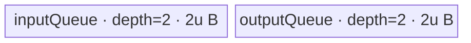

# LogicalNot 950 ACLNN 算子知识

## 算子速览

| 项目 | 内容 |
|---|---|
| 实际入口 | 公开两段式接口 `aclnnLogicalNotGetWorkspaceSize` + `aclnnLogicalNot`；不包含 `aclnnInplaceLogicalNot`。 |
| 计算语义 | 对每个元素先按 C++/Cast 语义归一化为 BOOL，再计算 `out[i] = 1` 当且仅当 `self[i] == 0`；最后把 BOOL 结果转换为 `out` dtype。 |
| 输入输出 | `self/out` shape 相同；公开 dtype 均为 BOOL、UINT8、INT8、INT16、INT32、INT64、FLOAT16、FLOAT、DOUBLE、BFLOAT16；文档格式为 ND，支持非连续 Tensor。 |
| 执行类型 | 非空域必有 `LogicalNot` AIV_VECTOR；非 BOOL 且非 DOUBLE 的输入/输出增加 Cast AIV_VECTOR；DOUBLE↔BOOL 增加 Cast AICPU；`Contiguous/ViewCopy` 是可选框架节点。无 Cube/AIC/MIX_CV。 |
| Kernel 路线 | R-001 核心取反；R-002/R-003 输入 BOOL 归一化；R-004～R-008 输出 dtype 恢复。公开启动图是 `可选 R-002 或 R-003 -> R-001 -> 可选 R-004...R-008`。 |
| 核心资源 | R-001 使用单个 `TBuf<VECCALC>` 划成 6 个等长子区；Cast AIV 使用双缓冲 `TQue` 与按模板可选 `TBuf`；AICPU Cast 使用框架 CPU 分片；中间 Tensor 和 AICPU task storage 由 executor workspace 管理。 |
| 来源闭包 | `source_closed`：公开 ACLNN、executor 任务图、LogicalNot Host/Tiling/POD/AIV body、所有可达 BOOL Cast AIV/AICPU body、公共 atvoss 调度与构建接线均闭合；`Contiguous/ViewCopy` 保留为 Skill 允许的框架边界。 |
| 验证状态 | 已完成源码闭包检查；本次知识提取未执行编译、真机、数值或性能测试。 |

## 接口与语义

### 计算语义

令 `b[i] = bool(self[i])`。整数和浮点零（含正负零）得到 `false`，非零得到 `true`；DOUBLE 路线由 AICPU `static_cast<bool>` 实现，其余非 BOOL 路线由 AIV `CompareScalar(x, 0, EQ)` 后反选实现。核心节点接收 0/1 字节并计算：

```text
h = Cast<half>(b)
t = h + (-1.0)
a = Abs(t)
r = Cast<int8_t>(a)
out = Cast<requested_dtype>(r)
```

由于 `b∈{0,1}`，`abs(b-1)` 恰为逻辑非。核心 Kernel 不直接处理原始数值 dtype；类型归一化和结果恢复是 ACLNN 语义的一部分。

### 输入、输出与属性

| 参数 | shape/layout | dtype | 约束、默认值与语义 |
|---|---|---|---|
| `self` | 与 `out` shape 相同；公开格式 ND；连续或非连续 | BOOL、UINT8、INT8、INT16、INT32、INT64、FLOAT16、FLOAT、DOUBLE、BFLOAT16 | 必填；非 BOOL 先转 BOOL。连续 Tensor 超过 8 维只告警，非连续 Tensor 超过 8 维报参数无效。 |
| `out` | 与 `self` shape 相同；公开格式 ND；连续或非连续 | 同 `self` 的公开集合，且不要求与 `self` dtype 相同 | 必填；BOOL 结果转到此 dtype，数值仅为 0 或 1。 |
| `workspaceSize` | 标量指针 | `uint64_t*` | 第一段由 executor 的中间 Tensor 最大复用分配和 AICPU task storage 计算。 |
| `executor` | Host 对象 | `aclOpExecutor**` / `aclOpExecutor*` | 第一段创建并移交，第二段消费；包含拓扑排序后的 launcher。 |
| `workspace` | Device 地址 | 字节区 | `workspaceSize>0` 时不得为空；owner 是调用者，切片地址由 executor 更新。 |
| `stream` | ACL runtime stream | `aclrtStream` | 所有 launcher 使用同一传入 stream；第二段仅提交，调用者决定何时同步。 |

### 入口与版本

固定仓只公开一个非原地版本族：`aclnnLogicalNotGetWorkspaceSize` 负责校验、建 executor 和返回 workspace，`aclnnLogicalNot` 调用 `CommonOpExecutorRun`。公开文档明确 950（Ascend 950PR/950DT）支持；`LogicalNot` OpDef 仅给 `ascend950` 注册 AICore 配置，目录 CMake 把 `ascend950` 映射到 `arch35`，binary config 只实例化 BOOL ND 输入输出。未发现更高版本入口。原地接口虽同文件存在，但不是本卡逻辑算子。

## Host/Launcher 执行流程

### 参数校验与前处理

执行顺序如下：

1. `CheckNotNull(self,out)`；空指针返回 `ACLNN_ERR_PARAM_NULLPTR`。
2. 独立检查 `self/out` dtype 是否位于十种公开类型集合；失败返回 `ACLNN_ERR_PARAM_INVALID`。
3. 要求 shape 相等。两者均连续时维数大于 8 只告警；任一非连续时分别执行最大 8 维校验。
4. `self->IsEmpty()` 时立即成功，不创建 Contiguous/Cast/LogicalNot/ViewCopy launcher；这是零 Kernel 路线。
5. `self` storage format 非 ND 仅告警。`l0op::Contiguous` 将非连续输入变连续，失败为 `ACLNN_ERR_INNER_NULLPTR`。
6. `l0op::Cast(...,DT_BOOL)`：输入已为 BOOL 时返回原 Tensor，不加 launcher；950 其它类型按 R-002/R-003 加 launcher。
7. `l0op::LogicalNot` 分配同 shape BOOL 中间 Tensor并加入 R-001。
8. `l0op::Cast(...,out_dtype)`：`out` 为 BOOL 时返回 R-001 结果，否则按 R-004～R-008 加 launcher。
9. `l0op::ViewCopy(resultCasted,out)` 把连续结果交给用户 `out`；非连续恢复的具体 Kernel 是框架边界。

### 参数、Workspace 与生命周期

`CREATE_EXECUTOR()` 拥有所有中间 `aclTensor` 描述、launcher 和依赖图。第一段 `GetWorkspaceSize()` 对排序后的中间 Tensor 调用 `MaxAllocator`，再加 `workspaceDeviceAicpuMem_`；故 workspace 是随 shape、连续性、输入/输出 dtype 和是否出现 AICPU Cast 变化的运行时值，不等于每个 AIV Tiling 中固定上报的 16 MiB system workspace 之和。第二段先校验 `executor` 及 `workspaceSize>0 => workspace!=nullptr`，再绑定中间 Tensor 地址并运行拓扑图。中间边的逻辑 extent 均为 `N=shape_size` 个元素：输入归一化结果和 R-001 结果为 `N` 字节 BOOL，结果恢复为 `N*sizeof(out_dtype)` 字节；框架 allocator 决定实际 offset 和安全复用时点。

### 启动图与失败传播

```text
empty(self) -> success, no launcher

non-empty:
  [optional framework Contiguous]
    -> input BOOL: alias
       input non-BOOL/non-DOUBLE: R-002 Cast AIV
       input DOUBLE: R-003 Cast AICPU
    -> R-001 LogicalNot AIV
    -> output BOOL: alias
       output FLOAT16/INT32: R-004 Cast AIV
       output UINT8/INT8: R-005 Cast AIV
       output FLOAT/BFLOAT16: R-006 Cast AIV
       output INT16/INT64: R-007 Cast AIV
       output DOUBLE: R-008 Cast AICPU
    -> [optional framework ViewCopy]
```

每个 AIV 节点的 blockDim 由各自 Tiling POD 的 `blockNum` 产生；AICPU 节点由 AICPU task runtime 以 `ParallelFor` 划分 CPU 区间。`aclOpExecutor::Run` 按依赖图拓扑序逐 launcher 调用 `Launch()`；任一 launcher 返回非成功即 `break`，后续节点不启动。所有节点绑定同一 stream；跨 AIV/AICPU/框架节点的可见性由该 executor/stream 提交协议承担。固定源码未暴露 runtime 最终 event 实现，但 producer→consumer 依赖与失败阻断在 executor 图中闭合。

## Route 与参数设计

### 分核与资源计算

设 `N=∏shape[d]`、950 AIV 核数为 `Cplat`、UB 字节数为 `U`。

R-001：DAG 的 `MaxDtypeBytes=2`、`MinDtypeBytes=1`、`BufferNum=6`。因此 `ubFormer=align_down(U/12,256)` 元素；`core=min(Cplat,ceil(N/4096))`；`blockFormer=align_up(ceil(N/core),512)` 元素；`blockNum=ceil(N/blockFormer)`；最后核元素数 `blockTail=N-(blockNum-1)*blockFormer`。former/tail 核各自再按 `ubFormer` 计算 loop 与末 loop 有效长度。Tiling 仅在非空域调用，且拒绝任一零维。

Cast AIV：令输入/输出位宽为 `s,d`、向量位宽 `V=GetVRegSize()*8`、`A=V/s`。所有模板先取 `core=min(Cplat,ceil(N*s/32768))`，再令 `blockFormer=align_up(ceil(N/core),8)`。UB tile 为：

- R-002：`ubFormer=align_down(4*(U-192)/(s+13),A)`；
- R-004/R-005：`ubFormer=align_down(4*(U-128)/(s+d),A)`，其中 R-004 `s=8`，R-005 实际两端均 8 bit；
- R-006/R-007：`ubFormer=align_down(4*(U-160)/(s+d+m),A)`，`s=8`，中间位宽 `m=16` 或 `32`。

各公式为 Host 保守容量；Device 实际字节账见逐 Route。`U` 小于对应 reserve、`ubFormer==0`、core 为零或 shape 非正均使 Tiling 失败。

### Route 选择

| 顺序 | Route | Key/模板 | 精确选择条件与优先级 | 不适用去向 |
|---:|---|---|---|---|
| 0 | 空域 | 无 launcher | `self->IsEmpty()` | 直接成功 |
| 1 | R-002 输入 AIV 归一化 | `CastDstBool<ST>` | 非空且 `self.dtype∈{UINT8,INT8,INT16,INT32,INT64,FLOAT16,FLOAT,BFLOAT16}`；`IsRegBase` 支持表命中 | BOOL 跳过；DOUBLE 到 R-003 |
| 2 | R-003 输入 AICPU 归一化 | `CastTask<double,bool>` | 非空且 `self.dtype==DOUBLE`；RegBase AICore 支持表未含 DOUBLE→BOOL，AICPU 表命中 | 失败返回空指针 |
| 3 | R-001 核心取反 | key `101`，`ElementwiseSch<0,LogicalNotDag<int8_t>::OpDag>` | 每个非空调用无条件恰好一次 | Tiling/launch 失败阻断输出 Cast |
| 4 | R-004 输出 Direct Cast | `CastDirect<int8_t,half/int32_t>` | `out.dtype∈{FLOAT16,INT32}` | 继续下一输出族 |
| 5 | R-005 输出 Through | `CastThrough<uint8_t/int8_t>` | `out.dtype∈{UINT8,INT8}` | 继续下一输出族 |
| 6 | R-006 输出 Two Cast（half 中间） | `CastTwo<int8_t,half,float/bfloat16_t>` | `out.dtype∈{FLOAT,BFLOAT16}` | 继续下一输出族 |
| 7 | R-007 输出 Two Cast（int32 中间） | `CastTwo<int8_t,int32_t,int16_t/int64_t>` | `out.dtype∈{INT16,INT64}` | 继续下一输出族 |
| 8 | R-008 输出 AICPU | `CastTask<bool,double>` | `out.dtype==DOUBLE`；RegBase AICore 支持表未含 BOOL→DOUBLE | BOOL 跳过；失败阻断 ViewCopy |

```text
if empty: success
else:
  pre = alias(self) if BOOL
        R-003 if DOUBLE
        R-002 otherwise
  core = R-001(pre)
  post = alias(core) if out is BOOL
         R-008 if out is DOUBLE
         R-004/R-005/R-006/R-007 by output dtype otherwise
  ViewCopy(post,out)
```

### 模板/实现执行矩阵

| Route | key/selector | dtype/shape/platform 完整命中条件 | 执行拓扑与 Kernel 节点 | 实际模板/body | 内存与同步特征 | tail/fallback |
|---|---|---|---|---|---|---|
| R-001 | `101` | 950、非空、BOOL→BOOL | 单 AIV | `ElementwiseSch<0,LogicalNotDag<int8_t>::OpDag>` | 6×`2*ubFormer` 字节统一 TBuf；Mutex 管线锁 | former/tail 核和末 tile 有效长度 |
| R-002 | Cast policy id 2 | 八种非 BOOL/non-DOUBLE 输入→BOOL | 单 AIV，后接 R-001 | `CastDstBool<ST>` | 双缓冲输入/输出队列 + mask + zero TBuf | 最后核/末 tile 改 DMA blockLen 与 Vector count |
| R-003 | L0 AICore miss、AICPU hit | DOUBLE→BOOL | 单 AICPU，后接 R-001 | `CastTask<double,bool>` | 无 AIV UB；CPU `ParallelFor` | `[start,end)` 严格覆盖 `N` |
| R-004 | policy id 1 | BOOL→FLOAT16/INT32 | 单 AIV | `CastDirect<int8_t,half/int32_t>`，round NONE | 双缓冲输入/输出队列 | 同上 |
| R-005 | policy id 3 | BOOL→UINT8/INT8 | 单 AIV | `CastThrough<uint8_t/int8_t>` | 双缓冲队列，Vector `Copy` | 同上 |
| R-006 | policy id 5 | BOOL→FLOAT/BFLOAT16 | 单 AIV | `CastTwo<int8_t,half,float/bfloat16_t>` | 双缓冲队列 + 单 mid TBuf | BF16 第二 Cast 为 RINT；末 tile 有效 count |
| R-007 | policy id 5 | BOOL→INT16/INT64 | 单 AIV | `CastTwo<int8_t,int32_t,int16_t/int64_t>` | 双缓冲队列 + 单 mid TBuf | 两次 round NONE |
| R-008 | L0 AICore miss、AICPU hit | BOOL→DOUBLE | 单 AICPU | `CastTask<bool,double>` | 无 AIV UB；CPU `ParallelFor` | `[start,end)` 严格覆盖 `N` |

### 隐藏性能 Guard

| Guard | Host/Tiling 条件 | Device/资源原因 | 影响 Route | 不满足时去向 | 源码符号 |
|---|---|---|---|---|---|
| 空域短路 | `self->IsEmpty()` | 避免公共 Elewise/ Cast Tiling 对零 shape 的拒绝和 `loopNum-1` 下溢 | 全部 | 直接成功，无写入任务 | `CalculateResult` |
| 950 Cast 设备分流 | `IsRegBase(curArch)` 且 pair 在 `REGBASE_AICORE_DTYPE_SUPPORT_LIST` | 只有已实例化 policy 才可进入 `cast` AIV | R-002/R-004～R-007 | DOUBLE↔BOOL 到 AICPU；不支持 pair 失败 | `IsAiCoreSupport` |
| R-001 UB | `align_down(U/12,256)>0` | 6 个、每个按 half 最大宽度分配的子区 | R-001 | Tiling 失败 | `GetMaxElemNum`、`DAGSch::BufferNum` |
| Cast UB reserve | `U>192/128/160` 且所得 tile 非零 | mask/常量/queue 对齐或中间 TBuf | R-002/R-004～R-007 | Tiling 失败 | `CastTiling::GetUbFormer` |
| 分核最小工作量 | R-001 `ceil(N/4096)`；Cast `ceil(N*s/32768)` | 减少极小核片；再受 AIV 核数上限限制 | 所有 AIV | 至少一核，非法为 Tiling 失败 | `ElewiseTiling`、`CastTiling::DoOpTiling` |
| 末 tile | `i==loopNum-1` | DMA blockLen 与 Vector count 只能覆盖有效元素 | 所有 AIV | 无 fallback，使用 tail 字段 | 各 `Process` |
| workspace 空指针 | R-001 entry 要求 `workspace` 和 `GetUserWorkspace(workspace)` 非空 | Kernel 入口显式 guard；16 MiB system workspace 由 Tiling 上报 | R-001 | Kernel 直接 return，不写输出 | `logical_not` |

### POD/ABI

| 结构 | 字段 | 类型/位宽 | ABI 布局 | 单位 | Host/launcher producer | Device consumer | 边界 |
|---|---|---|---|---|---|---|---|
| `EleBaseTilingDataV2` | `dim0` | `int64_t/64` | offset 0；结构 size 80、align 8 | 元素 | `ElewiseTiling: ∏shape` | R-001 不读取 | 非空正数 |
| `EleBaseTilingDataV2` | `coreNum` | `int32_t/32` | offset 8 | AIV 核 | `Adapt...: static_cast<int32_t>(core)` | R-001 不读取 | 从平台核数裁剪 |
| `EleBaseTilingDataV2` | `ubFormer` | `int32_t/32` | offset 12 | 元素/tile | `Adapt...` 从 `int64_t` 窄化 | `Init`、`Process` | 必须非零；固定仓无显式窄化溢出 guard |
| `EleBaseTilingDataV2` | `blockFormer` | `int64_t/64` | offset 16 | 元素/普通核 | `align_up(ceil(N/core),512)` | `CalcBlockOffset` | 最后核实际长度由 tail 字段限定 |
| `EleBaseTilingDataV2` | `blockNum` | `int64_t/64` | offset 24 | 核 | `ceil(N/blockFormer)` | entry blockDim、`Process` 最后核判断 | `>=1` |
| `EleBaseTilingDataV2` | `ubLoopOfFormerBlock` | `int64_t/64` | offset 32 | loop | `ceil(blockFormer/ubFormer)` | 普通核 `Process` | `>=1` |
| `EleBaseTilingDataV2` | `ubLoopOfTailBlock` | `int64_t/64` | offset 40 | loop | `ceil(blockTail/ubFormer)` | 最后核 `Process` | `>=1` |
| `EleBaseTilingDataV2` | `ubTailOfFormerBlock` | `int64_t/64` | offset 48 | 元素 | `blockFormer-(loops-1)*ubFormer` | 普通核末 loop | `(0,ubFormer]` |
| `EleBaseTilingDataV2` | `ubTailOfTailBlock` | `int64_t/64` | offset 56 | 元素 | `blockTail-(loops-1)*ubFormer` | 最后核末 loop | `(0,ubFormer]` |
| `EleBaseTilingDataV2` | `elemNum` | `int64_t/64` | offset 64 | 元素 | `maxElemNum` | R-001 不读取 | 等于 tile 上限 |
| `EleBaseTilingDataV2` | `scheMode` | `uint64_t/64` | offset 72 | 枚举 | `GetScheMode()=1` | entry 固定实例 `<0UL>`，不读取 | inactive |
| `CastTilingData` | `blockNum` | `int64_t/64` | 宏生成；精确 `sizeof/alignof/offsetof` 固定仓不可见 | 核 | `CastTiling::DoOpTiling` | 各 Cast `Process` | `>=1` |
| `CastTilingData` | `ubFormer` | `int64_t/64` | 同上 | 元素/tile | `GetUbFormer` | 各 Cast `Init/Process` | 对齐到 `V/s` |
| `CastTilingData` | `blockFormer` | `int64_t/64` | 同上 | 元素/普通核 | `align_up(ceil(N/core),8)` | 各 Cast `Init` | 最后核由 tail 限定 |
| `CastTilingData` | `ubLoopOfFormerBlock` | `int64_t/64` | 同上 | loop | `DoOpTiling` | 各 Cast `Process` | `>=1` |
| `CastTilingData` | `ubLoopOfTailBlock` | `int64_t/64` | 同上 | loop | `DoOpTiling` | 各 Cast `Process` | `>=1` |
| `CastTilingData` | `ubTailOfFormerBlock` | `int64_t/64` | 同上 | 元素 | `DoOpTiling` | 各 Cast `Process` | 有效末 tile |
| `CastTilingData` | `ubTailOfTailBlock` | `int64_t/64` | 同上 | 元素 | `DoOpTiling` | 各 Cast `Process` | 有效末 tile |
| `CastTilingData` | `regCopyInStep` | `int64_t/64` | 同上 | 元素/寄存器 loop | 相关 BOOL policy 的 mode 为 `BUTT`，producer 写 0 | R-002/R-004～R-007 不读取 | inactive |
| `CastTilingData` | `regCopyOutStep` | `int64_t/64` | 同上 | 元素/寄存器 loop | 同上，写 0 | 不读取 | inactive |
| `CastTilingData` | `ubFormerRegLoop` | `int64_t/64` | 同上 | loop | `oneLoopCopyInBitSize==0`，写 0 | 不读取 | inactive |
| `CastTilingData` | `ubTailOfFormerRegLoop` | `int64_t/64` | 同上 | loop | 写 0 | 不读取 | inactive |
| `CastTilingData` | `ubTailOfTailRegLoop` | `int64_t/64` | 同上 | loop | 写 0 | 不读取 | inactive |

### Route 源码闭包

| Route | Key/selector | Host/Tiling producer | POD/参数 | Kernel entry/router 节点 | Kernel body/直接依赖 | 构建接线 |
|---|---|---|---|---|---|---|
| R-001 | key 101 | `logical_not_tiling_arch35.cpp::RunTiling` + opbase `ElewiseTiling` | `EleBaseTilingDataV2` | `logical_not_apt.cpp::logical_not` | `LogicalNotDag`、`ElementwiseSch`、`Vec`、DAG buffer/sync helpers | LogicalNot CMake + ascend950 binary JSON |
| R-002 | Cast policy id 2 | `CastTiling` | `CastTilingData` | `cast_apt.cpp::cast<id>` | `CastDstBool<ST>` | Cast 950 binary JSON |
| R-003 | AICPU map | `l0op::Cast` AICPU launcher | Tensor desc/attrs，无 AIV POD | AICPU runtime `Cast` | `CastCpuKernel::Compute`、`CastTask<double,bool>` | `cast_aicpu_def.cpp` |
| R-004 | policy id 1 | `CastTiling` | `CastTilingData` | `cast<id>` | `CastDirect<int8_t,half/int32_t>` | Cast 950 binary JSON |
| R-005 | policy id 3 | `CastTiling` | `CastTilingData` | `cast<id>` | `CastThrough<uint8_t/int8_t>` | Cast 950 binary JSON |
| R-006 | policy id 5 | `CastTiling` | `CastTilingData` | `cast<id>` | `CastTwo<int8_t,half,float/bfloat16_t>` | Cast 950 binary JSON |
| R-007 | policy id 5 | `CastTiling` | `CastTilingData` | `cast<id>` | `CastTwo<int8_t,int32_t,int16_t/int64_t>` | Cast 950 binary JSON |
| R-008 | AICPU map | `l0op::Cast` AICPU launcher | Tensor desc/attrs，无 AIV POD | AICPU runtime `Cast` | `CastCpuKernel::Compute`、`CastTask<bool,double>` | `cast_aicpu_def.cpp` |

## Kernel 实现

### 公共执行流程

非空调用的核心顺序固定为输入归一化、R-001、输出恢复。AIV 节点都把 `GetBlockIdx()` 映射到连续区间 `blockIdx*blockFormer`，再以 tile loop 顺序执行 GM→UB、Vector、UB→GM；最后核和最后 tile 使用独立 POD 字段。不同节点之间不共享 UB，只通过 executor workspace 中的 GM Tensor 边交接。AICPU 节点同样写入完整中间 Tensor，随后 R-001 或 ViewCopy 才消费。executor 使用拓扑排序顺序逐个 `Launch`，失败即停止。

### Route R-001：atvoss BOOL 核心取反

#### 适用条件

##### 选择证据

| 层级 | 文件 | 符号 | 源码谓词/参数 | 结果/下一跳 |
|---|---|---|---|---|
| API | `math/logical_not/op_api/aclnn_logical_not.cpp` | `CalculateResult` | 非空，输入 Cast 后 | 调 `l0op::LogicalNot` |
| L0 | `math/logical_not/op_api/logical_not.cpp` | `LogicalNotAiCore` | 无二级 selector | 加 `LogicalNot` AICore launcher |
| Tiling | `.../logical_not_tiling_arch35.cpp` | `RunTiling` | `DoTiling<LogicalNotDag<int8_t>::OpDag>` 成功 | key 101，blockDim=`blockNum` |
| Router | `.../logical_not_apt.cpp` | `logical_not` | workspace/userWS 非空且 key 101 | 实例化 `ElementwiseSch`；未知 key 无输出 |

#### Device 数据流

##### 函数级调用链

```text
LogicalNotAiCore -> logical_not(xBool,yBool,workspace,tiling)
  -> ElementwiseSch::Init(x,y)
  -> ElementwiseSch::Process
    -> Run: Vec::CopyIn<int8_t>
    -> Vec::Cast<half,int8_t,0>
    -> Vec::Adds<half>(-1.0)
    -> Vec::Abs<half>
    -> Vec::Cast<int8_t,half,0>
    -> Vec::CopyOut<int8_t>
```

##### 源码等价伪码

```text
base = blockIdx * blockFormer
loops = lastBlock ? ubLoopOfTailBlock : ubLoopOfFormerBlock
tail  = lastBlock ? ubTailOfTailBlock : ubTailOfFormerBlock
for tile in [0, loops):
  len = tile == loops-1 ? tail : ubFormer
  pp = tile & 1
  DMA x[base + tile*ubFormer : +len] -> inputBuf[pp]
  h  = Cast<half>(input, CAST_NONE, len)
  t  = Adds(h, -1.0h, len)
  a  = Abs(t, len)
  r  = Cast<int8_t>(a, CAST_NONE, len)
  DMA r[0:len] -> y[base + tile*ubFormer : +len]
```

#### 内存与数据搬运

##### 资源与搬运表

| 层级/缓冲区 | offset/地址公式 | extent/容量公式 | dtype/layout | producer | consumer | owner/lifetime | 对齐/复用 |
|---|---|---|---|---|---|---|---|
| GM x/y | `blockIdx*blockFormer + tile*ubFormer` | `len` 有效元素 | BOOL 按 int8 字节、ND | 前序 Cast/CopyIn；R-001 | R-001；后序 Cast | executor Tensor；跨节点至 consumer 完成 | DMA `blockCount=1, blockLen=len` 字节 |
| TBuf id 0/4 | `id*blockLen` | 每区 `2*ubFormer` 字节 | 输入 int8 视图 | CopyIn | Cast0 | 当前 ping/pong tile | id 0/4 双缓冲 |
| TBuf id 2 | `2*blockLen` | `2*ubFormer` 字节 | half/int8 重解释 | Cast0 或 Abs | Adds 或 Cast1 | 计算节点释放后复用 | ping/pong 共用 temp |
| TBuf id 3 | `3*blockLen` | `2*ubFormer` 字节 | half | Adds | Abs | Abs 读取后可覆盖 | temp |
| TBuf id 1/5 | `id*blockLen` | 每区 `2*ubFormer` 字节 | Cast1 int8 视图 | Cast1 | CopyOut | 当前 ping/pong tile | VECCALC→MTE3 同区交接 |

##### 分层内存布局


##### 字节账与复用顺序

```text
blockLen = ubFormer * MaxDtypeBytes = 2*ubFormer
UB_total = BufferNum * blockLen = 6 * 2*ubFormer = 12*ubFormer bytes
UB_total <= U because ubFormer = align_down(U/12, 256)
dynamic_ub = N/A
workspace_total = executor(MaxAllocator(intermediate tensors)) + AICPU task storage
```

| 复用子区 | 写入者 | 读取者/消费点 | 下一次覆盖 | 同步或释放依据 | 安全条件 |
|---|---|---|---|---|---|
| id2 | Cast0 | Adds | Abs 输出 | `GetTensor/ReleaseTensor<VECCALC>` 的 `PIPE_V` Mutex | Adds 已释放 Cast0 输入 |
| id3 | Adds | Abs | 下一 tile Adds | 同一 Mutex 协议 | Abs 已消费 |
| id1/5 | Cast1 | CopyOut | 后续同 pp tile | VECCALC release 后 MTE3 lock | CopyOut 完成后才复用 |
| id0/4 | CopyIn | Cast0 | 后续同 pp tile | MTE2 release 后 V lock | Cast0 消费完成 |

#### 同步、精度与尾块

##### 同步与数值边界表

| 阶段 | primitive/机制 | producer | consumer/等待点 | 保护对象 | 精度/尾块 |
|---|---|---|---|---|---|
| CopyIn→Vector | `Mutex::Lock/Unlock<PIPE_MTE2/PIPE_V>` | MTE2 | Cast0 | id0/4 | `DataCopyPad` 无 padding，blockLen=`len` 字节 |
| Vector chain | `PIPE_V` buffer ownership | 上一节点 | 下一节点 | id2/id3 | int8→half；`-1`、Abs 均在 half；再无舍入 Cast 回 int8 |
| Vector→CopyOut | `PIPE_V/PIPE_MTE3` | Cast1 | MTE3 | id1/5 | 仅写 `len` 个有效字节 |
| tail | POD former/tail fields | Host | `Process` | GM/UB 有效域 | 非末 loop 用 `ubFormer`，末 loop 用 `tail`；空域已 Host 短路 |

#### 关键实现

##### 符号证据表

| 阶段 | 文件 | 符号/模板实例 | 实现事实 |
|---|---|---|---|
| Host/Tiling producer | `logical_not_tiling_arch35.cpp` + opbase `elewise_tiling.cpp` | `RunTiling`、`ElewiseTiling` | key、block、tile、loop、workspace 生产 |
| Kernel entry/router | `logical_not_apt.cpp` | `logical_not` | AIV-only、key 101 到调度器 |
| Device body/helper | `logical_not_dag.h`、opbase `elewise_sch.h/vec.h/sync.h` | `LogicalNotDag`、`ElementwiseSch::Run` | DAG 顺序、6 区内存、DMA、Vector、Mutex、tail |

### Route R-002：输入 AIV CastDstBool

#### 适用条件

##### 选择证据

| 层级 | 文件 | 符号 | 源码谓词/参数 | 结果/下一跳 |
|---|---|---|---|---|
| API | `aclnn_logical_not.cpp` | `CalculateResult` | `self.dtype!=BOOL` | 调 `l0op::Cast(...BOOL)` |
| L0 | `math/cast/op_api/cast.cpp` | `IsAiCoreSupport` | RegBase pair 命中且不是 DOUBLE→BOOL | AICore Cast |
| Host | `cast_tiling.cpp` | `castMap` 查表 | dst BOOL 对应 policy id 2 | `CastDstBool<ST>` |
| Router | `cast_apt.cpp` | `cast<id>` | `templateId==CAST_TEMPLATE_DST_BOOL` | AIV body |

#### Device 数据流

##### 函数级调用链

```text
l0op::Cast -> cast<id> -> CastDstBool<ST>::Init/Process
  -> CopyIn -> CompareScalar(EQ zero) -> Select(zeroTensor, trueValue=1) -> CopyOut
```

##### 源码等价伪码

```text
for each core/tile:
  DMA ST input[len] -> inQueue(depth=2)
  zeroMask = (input == ST(0))
  boolOut = select(zeroMask, zeroTensor, int8(1))
  DMA boolOut[len] -> GM
```

#### 内存与数据搬运

##### 资源与搬运表

| 层级/缓冲区 | offset/地址公式 | extent/容量公式 | dtype/layout | producer | consumer | owner/lifetime | 对齐/复用 |
|---|---|---|---|---|---|---|---|
| input queue | core/tile offset | `2*ubFormer*sizeof(ST)` | ST | DMA | Compare | TPipe；tile 生命周期 | InitBuffer count 2 |
| output queue | 同元素 offset | `2*ubFormer` | int8 BOOL | Select | DMA | TPipe | count 2 |
| maskBuf | 0 | `align_up(ceil(ubFormer/8),32)` | bit mask | CompareScalar | Select | Kernel 全程 | 独立 TBuf |
| boolZeroBuf | 0 | `ubFormer` | int8 | Init Duplicate(0) | Select | Kernel 全程 | 跨 tile 复用 |

##### 分层内存布局


##### 字节账与复用顺序

```text
UB_actual = 2*u*sizeof(ST) + 2*u + align_up(ceil(u/8),32) + u
Host bound: u = align_down(4*(U-192)/(s+13), V/s)
dynamic_ub = N/A
workspace edge = N bytes BOOL to R-001
```

| 复用子区 | 写入者 | 读取者/消费点 | 下一次覆盖 | 同步或释放依据 | 安全条件 |
|---|---|---|---|---|---|
| input queue slots | CopyIn | Compare | 下一同槽 tile | EnQue/DeQue/FreeTensor | consumer 已 Free |
| output queue slots | Select | CopyOut | 下一同槽 tile | EnQue/DeQue/FreeTensor | DMA 已 Free |
| boolZeroBuf | Init | 每 tile Select | 不覆盖 | Kernel 生命周期 | 只读常量 |

#### 同步、精度与尾块

##### 同步与数值边界表

| 阶段 | primitive/机制 | producer | consumer/等待点 | 保护对象 | 精度/尾块 |
|---|---|---|---|---|---|
| GM→UB→V | TQue | DMA | Compare | input slot | 比较原 dtype 的精确零；NaN 比较不等于零 |
| V→GM | TQue | Select | DMA | output slot | 零映射 0，所有非零映射 1 |
| tail | `DataCopyPad` + count | Host POD | 每末 tile | GM 有效域 | blockLen=`len*sizeof(ST)`/`len` |

#### 关键实现

##### 符号证据表

| 阶段 | 文件 | 符号/模板实例 | 实现事实 |
|---|---|---|---|
| Host/Tiling producer | `math/cast/op_host/arch35/cast_tiling.cpp` | `GetShapeAttrsInfo/GetUbFormer/DoOpTiling` | policy、UB、block/tail |
| Kernel entry/router | `math/cast/op_kernel/cast_apt.cpp` | `cast<id>` | id 2 到 `CastDstBool` |
| Device body/helper | `math/cast/op_kernel/arch35/cast_impl.h` | `CastDstBool<ST>` | Compare+Select、buffer、DMA、tail |

### Route R-003：输入 AICPU DOUBLE→BOOL

#### 适用条件

##### 选择证据

| 层级 | 文件 | 符号 | 源码谓词/参数 | 结果/下一跳 |
|---|---|---|---|---|
| L0 | `math/cast/op_api/cast.cpp` | `IsAiCoreSupport/Cast` | RegBase list 不含 DOUBLE→BOOL，AICPU dtype 集合包含两端 | `CastAiCpu` |
| AICPU | `cast_aicpu.cpp` | `SetDoubleMap` | map `[DT_DOUBLE][DT_BOOL]` | `CastTask<double,bool>` |

#### Device 数据流

##### 函数级调用链

```text
CastAiCpu -> CastCpuKernel::Compute
  -> ValidateTensors -> ValidateDataType -> SetMap
  -> ExecuteCast -> CpuKernelUtils::ParallelFor -> CastTask<double,bool>
```

##### 源码等价伪码

```text
workers = clamp(CPUNum-reserved, 1, N)
ParallelFor(0,N, grain=N/workers):
  for i in [start,end): out[i] = static_cast<bool>(in[i])
```

#### 内存与数据搬运

##### 资源与搬运表

| 层级/缓冲区 | offset/地址公式 | extent/容量公式 | dtype/layout | producer | consumer | owner/lifetime | 对齐/复用 |
|---|---|---|---|---|---|---|---|
| AICPU input/output | element `i` | input `8N` B、output `N` B | double→bool | prior boundary | AICPU/R-001 | executor tensors | 每线程不重叠区间 |
| AIV UB | N/A | N/A | N/A | N/A | N/A | AICPU 直接访问 Tensor 数据 | 无伪造 UB |

##### 分层内存布局

N/A：该节点在 AICPU 上以 framework Tensor 数据和 CPU 分片执行，不使用 AIV UB。

##### 字节账与复用顺序

```text
UB_total = N/A
dynamic_ub = N/A
workspace_total includes output N bytes + framework AICPU task storage; exact aligned offset由executor运行时分配
```

| 复用子区 | 写入者 | 读取者/消费点 | 下一次覆盖 | 同步或释放依据 | 安全条件 |
|---|---|---|---|---|---|
| BOOL intermediate | AICPU Cast | R-001 | R-001 完成后 allocator 可复用 | executor graph dependency | Cast 成功且全区间完成 |

#### 同步、精度与尾块

##### 同步与数值边界表

| 阶段 | primitive/机制 | producer | consumer/等待点 | 保护对象 | 精度/尾块 |
|---|---|---|---|---|---|
| CPU 分片 | `ParallelFor` | worker | task completion | `[start,end)` | `static_cast<bool>`；零为 false，非零含 NaN 为 true |
| 跨节点 | executor 拓扑/stream | AICPU Cast | R-001 launcher | BOOL GM Tensor | 无未覆盖 tail |

#### 关键实现

##### 符号证据表

| 阶段 | 文件 | 符号/模板实例 | 实现事实 |
|---|---|---|---|
| Host/Tiling producer | `math/cast/op_api/cast.cpp` | `Cast/CastAiCpu` | AICPU fallback 和 launcher |
| Kernel entry/router | `math/cast/op_kernel_aicpu/cast_aicpu.cpp` | `CastCpuKernel::Compute` | 校验、map、并行分片 |
| Device body/helper | 同上 | `CastTask<double,bool>` | 每元素静态转换 |

### Route R-004：输出 AIV Direct Cast

#### 适用条件

##### 选择证据

| 层级 | 文件 | 符号 | 源码谓词/参数 | 结果/下一跳 |
|---|---|---|---|---|
| Policy | `cast_struct.h` | BOOL→FLOAT16/INT32 entries | id 1，source map int8，round NONE | `CastDirect` |
| Router | `cast_apt.cpp` | `templateId==DIRECT_CAST` | map type specialization | AIV |

#### Device 数据流

##### 函数级调用链

```text
cast<id> -> CastDirect<int8_t,half/int32_t>::Init/Process
  -> CopyIn -> AscendC::Cast(dst,src,CAST_NONE,len) -> CopyOut
```

##### 源码等价伪码

```text
for core/tile: DMA int8[len] -> inQ; Cast<DT,int8>(NONE,len) -> outQ; DMA -> GM
```

#### 内存与数据搬运

##### 资源与搬运表

| 层级/缓冲区 | offset/地址公式 | extent/容量公式 | dtype/layout | producer | consumer | owner/lifetime | 对齐/复用 |
|---|---|---|---|---|---|---|---|
| inQ | core/tile | `2u` B | int8 | DMA | Cast | TPipe | depth 2 |
| outQ | core/tile | `2u*sizeof(DT)` | half/int32 | Cast | DMA | TPipe | depth 2 |

##### 分层内存布局


##### 字节账与复用顺序

```text
UB_actual = 2u*(1+sizeof(DT))
Host bound = u=align_down(4*(U-128)/(8+d),V/8)
workspace edge = N*sizeof(DT)
```

| 复用子区 | 写入者 | 读取者/消费点 | 下一次覆盖 | 同步或释放依据 | 安全条件 |
|---|---|---|---|---|---|
| inQ/outQ slots | DMA/Cast | Cast/DMA | 下一同槽 tile | EnQue/DeQue/FreeTensor | queue 顺序 |

#### 同步、精度与尾块

##### 同步与数值边界表

| 阶段 | primitive/机制 | producer | consumer/等待点 | 保护对象 | 精度/尾块 |
|---|---|---|---|---|---|
| Cast | TQue + `RoundMode::CAST_NONE` | int8 0/1 | half/int32 | queue slot | 0/1 精确表示；tail count=`len` |

#### 关键实现

##### 符号证据表

| 阶段 | 文件 | 符号/模板实例 | 实现事实 |
|---|---|---|---|
| Host/Tiling producer | `cast_tiling.cpp` | `DoOpTiling` | direct UB/block/tail |
| Kernel entry/router | `cast_apt.cpp` | `cast<id>` | id 1 |
| Device body/helper | `cast_impl.h` | `CastDirect<int8_t,half/int32_t>` | queues、Cast、DMA |

### Route R-005：输出 AIV Through

#### 适用条件

##### 选择证据

| 层级 | 文件 | 符号 | 源码谓词/参数 | 结果/下一跳 |
|---|---|---|---|---|
| Policy | `cast_struct.h` | BOOL→UINT8/INT8 entries | id 3 | `CastThrough<DT>` |

#### Device 数据流

##### 函数级调用链

```text
cast<id> -> CastThrough<uint8_t/int8_t>::Process -> DataCopyPad -> Copy<DT> -> DataCopyPad
```

##### 源码等价伪码

```text
for core/tile: DMA bytes -> inQ; vector Copy(len) -> outQ; DMA bytes -> GM
```

#### 内存与数据搬运

##### 资源与搬运表

| 层级/缓冲区 | offset/地址公式 | extent/容量公式 | dtype/layout | producer | consumer | owner/lifetime | 对齐/复用 |
|---|---|---|---|---|---|---|---|
| inQ/outQ | core/tile | 各 `2u` B | uint8/int8 字节 | DMA/Copy | Copy/DMA | TPipe | 各 depth 2 |

##### 分层内存布局



##### 字节账与复用顺序

```text
UB_actual = 4u bytes
Host bound = u=align_down((U-128)/4,V/8)
workspace edge = N bytes
```

| 复用子区 | 写入者 | 读取者/消费点 | 下一次覆盖 | 同步或释放依据 | 安全条件 |
|---|---|---|---|---|---|
| queue slots | DMA/Copy | Copy/DMA | 下一同槽 tile | EnQue/DeQue/FreeTensor | 完成后复用 |

#### 同步、精度与尾块

##### 同步与数值边界表

| 阶段 | primitive/机制 | producer | consumer/等待点 | 保护对象 | 精度/尾块 |
|---|---|---|---|---|---|
| Through | Vector `Copy` | BOOL byte | signed/unsigned byte | queue | 位模式 0/1 不变；tail DMA 仅 `len` B |

#### 关键实现

##### 符号证据表

| 阶段 | 文件 | 符号/模板实例 | 实现事实 |
|---|---|---|---|
| Host/Tiling producer | `cast_tiling.cpp` | `GetUbFormer/DoOpTiling` | id 3 容量 |
| Kernel entry/router | `cast_apt.cpp` | `cast<id>` | Through 分支 |
| Device body/helper | `cast_impl.h` | `CastThrough<DT>` | 字节 Copy、双队列、tail |

### Route R-006：输出 AIV Two Cast（half 中间）

#### 适用条件

##### 选择证据

| 层级 | 文件 | 符号 | 源码谓词/参数 | 结果/下一跳 |
|---|---|---|---|---|
| Policy | `cast_struct.h` | BOOL→FLOAT/BFLOAT16 | id 5，mid FLOAT16 | `CastTwo<int8_t,half,DT>` |

#### Device 数据流

##### 函数级调用链

```text
CastTwo::Compute -> Cast<half,int8_t>(NONE) -> Cast<float/bfloat16_t,half>(NONE/RINT)
```

##### 源码等价伪码

```text
mid[0:len] = Cast<half>(boolBytes, NONE)
out[0:len] = Cast<DT>(mid, DT==BF16 ? RINT : NONE)
```

#### 内存与数据搬运

##### 资源与搬运表

| 层级/缓冲区 | offset/地址公式 | extent/容量公式 | dtype/layout | producer | consumer | owner/lifetime | 对齐/复用 |
|---|---|---|---|---|---|---|---|
| inQ | core/tile | `2u` B | int8 | DMA | Cast1 | TPipe | depth 2 |
| mid TBuf | 0 | `2u` B | half | Cast1 | Cast2 | Kernel 全程、逐 tile 覆盖 | 单缓冲 |
| outQ | core/tile | `2u*sizeof(DT)` | float/bf16 | Cast2 | DMA | TPipe | depth 2 |

##### 分层内存布局


##### 字节账与复用顺序

```text
UB_actual = 2u + 2u + 2u*sizeof(DT)
Host conservative bound = u=align_down(4*(U-160)/(8+d+16),V/8)
workspace edge = N*sizeof(DT)
```

| 复用子区 | 写入者 | 读取者/消费点 | 下一次覆盖 | 同步或释放依据 | 安全条件 |
|---|---|---|---|---|---|
| mid TBuf | first Cast | second Cast | 下一 tile first Cast | 同一 `Compute` 顺序 | second Cast 已完成 |

#### 同步、精度与尾块

##### 同步与数值边界表

| 阶段 | primitive/机制 | producer | consumer/等待点 | 保护对象 | 精度/尾块 |
|---|---|---|---|---|---|
| two cast | 顺序 Vector API | int8 | half→DT | mid TBuf | FLOAT 为 NONE；BF16 最后 RINT；0/1 均精确；count=`len` |

#### 关键实现

##### 符号证据表

| 阶段 | 文件 | 符号/模板实例 | 实现事实 |
|---|---|---|---|
| Host/Tiling producer | `cast_tiling.cpp` | `GetUbFormer` id 5 | 三 dtype 位宽容量 |
| Kernel entry/router | `cast_apt.cpp` | TWO_CAST 分支 | 两个 round mode |
| Device body/helper | `cast_impl.h` | `CastTwo<int8_t,half,DT>` | mid 生命周期、两次 Cast |

### Route R-007：输出 AIV Two Cast（int32 中间）

#### 适用条件

##### 选择证据

| 层级 | 文件 | 符号 | 源码谓词/参数 | 结果/下一跳 |
|---|---|---|---|---|
| Policy | `cast_struct.h` | BOOL→INT16/INT64 | id 5，mid INT32，round 均 NONE | `CastTwo<int8_t,int32_t,DT>` |

#### Device 数据流

##### 函数级调用链

```text
CastTwo::Compute -> Cast<int32_t,int8_t>(NONE) -> Cast<int16_t/int64_t,int32_t>(NONE)
```

##### 源码等价伪码

```text
mid32 = Cast<int32>(boolBytes,NONE,len)
out   = Cast<DT>(mid32,NONE,len)
```

#### 内存与数据搬运

##### 资源与搬运表

| 层级/缓冲区 | offset/地址公式 | extent/容量公式 | dtype/layout | producer | consumer | owner/lifetime | 对齐/复用 |
|---|---|---|---|---|---|---|---|
| inQ | core/tile | `2u` B | int8 | DMA | Cast1 | TPipe | depth 2 |
| mid TBuf | 0 | `4u` B | int32 | Cast1 | Cast2 | Kernel 全程 | 单缓冲 |
| outQ | core/tile | `2u*sizeof(DT)` | int16/int64 | Cast2 | DMA | TPipe | depth 2 |

##### 分层内存布局


##### 字节账与复用顺序

```text
UB_actual = 2u + 4u + 2u*sizeof(DT)
Host conservative bound = u=align_down(4*(U-160)/(8+d+32),V/8)
workspace edge = N*sizeof(DT)
```

| 复用子区 | 写入者 | 读取者/消费点 | 下一次覆盖 | 同步或释放依据 | 安全条件 |
|---|---|---|---|---|---|
| mid TBuf | first Cast | second Cast | 下一 tile | `Compute` 顺序 | consumer 完成 |

#### 同步、精度与尾块

##### 同步与数值边界表

| 阶段 | primitive/机制 | producer | consumer/等待点 | 保护对象 | 精度/尾块 |
|---|---|---|---|---|---|
| two cast | 顺序 API + TQue | int8 0/1 | int32→int16/int64 | mid/queue | 全部整数精确；tail=`len` |

#### 关键实现

##### 符号证据表

| 阶段 | 文件 | 符号/模板实例 | 实现事实 |
|---|---|---|---|
| Host/Tiling producer | `cast_tiling.cpp` | `GetUbFormer` id 5 | mid 32-bit 容量 |
| Kernel entry/router | `cast_apt.cpp` | TWO_CAST 分支 | 类型映射 |
| Device body/helper | `cast_impl.h` | `CastTwo<int8_t,int32_t,DT>` | 两次整数 Cast、tail |

### Route R-008：输出 AICPU BOOL→DOUBLE

#### 适用条件

##### 选择证据

| 层级 | 文件 | 符号 | 源码谓词/参数 | 结果/下一跳 |
|---|---|---|---|---|
| L0 | `math/cast/op_api/cast.cpp` | `IsAiCoreSupport/Cast` | RegBase list 不含 BOOL→DOUBLE；AICPU 支持 | AICPU |
| AICPU | `cast_aicpu.cpp` | `SetBoolMap` | `[DT_BOOL][DT_DOUBLE]` | `CastTask<bool,double>` |

#### Device 数据流

##### 函数级调用链

```text
CastAiCpu -> CastCpuKernel::Compute -> ExecuteCast -> ParallelFor -> CastTask<bool,double>
```

##### 源码等价伪码

```text
parallel for i in [0,N): outDouble[i] = static_cast<double>(inBool[i])
```

#### 内存与数据搬运

##### 资源与搬运表

| 层级/缓冲区 | offset/地址公式 | extent/容量公式 | dtype/layout | producer | consumer | owner/lifetime | 对齐/复用 |
|---|---|---|---|---|---|---|---|
| AICPU input/output | i | `N` B / `8N` B | bool→double | R-001 | AICPU/ViewCopy | executor tensors | worker 区间不重叠 |
| AIV UB | N/A | N/A | N/A | N/A | N/A | AICPU 路径 | N/A |

##### 分层内存布局

N/A：AICPU 直接访问框架 Tensor 数据。

##### 字节账与复用顺序

```text
UB_total = N/A
dynamic_ub = N/A
workspace includes 8N-byte result tensor and AICPU task storage; exact offset runtime-determined
```

| 复用子区 | 写入者 | 读取者/消费点 | 下一次覆盖 | 同步或释放依据 | 安全条件 |
|---|---|---|---|---|---|
| DOUBLE intermediate | AICPU | ViewCopy | ViewCopy 完成后 | executor dependency | task success |

#### 同步、精度与尾块

##### 同步与数值边界表

| 阶段 | primitive/机制 | producer | consumer/等待点 | 保护对象 | 精度/尾块 |
|---|---|---|---|---|---|
| CPU Cast | ParallelFor | R-001 BOOL | ViewCopy | output ranges | 0/1 到 double 精确；无尾遗漏 |

#### 关键实现

##### 符号证据表

| 阶段 | 文件 | 符号/模板实例 | 实现事实 |
|---|---|---|---|
| Host/Tiling producer | `math/cast/op_api/cast.cpp` | `CastAiCpu` | fallback launcher |
| Kernel entry/router | `cast_aicpu.cpp` | `SetBoolMap/Compute` | BOOL→DOUBLE map |
| Device body/helper | 同上 | `CastTask<bool,double>` | 分片静态转换 |

## 算子特定优化

### Trick T-001：BOOL 专用 DAG 用 half 中间计算规避通用逻辑指令依赖

#### 触发与源码依据

- 适用 Route：R-001。
- 触发条件：所有非空调用；输入已被 ACLNN 前置 Cast 归一化为 BOOL。
- Golden 来源：[`math/logical_not/op_kernel/arch35/logical_not_dag.h:24-39`](../../../../../../../cann-ops-raw/ascendc/ops-math/165d41f02a43a62324b434cb6bda7c533b14da3e/math/logical_not/op_kernel/arch35/logical_not_dag.h#L24-L39)

**官方源码（固定 Commit 连续逐字摘录）**：

```cpp
using ConstValue = MAKE_CONST(float, -1.0);
using OpCopyIn0 = Bind<Vec::CopyIn<T>, Placeholder::In0<T>>;
using OpCast0 = Bind<Vec::Cast<half, T, 0>, OpCopyIn0>;
using OpAdds = Bind<Vec::Adds<half>, OpCast0, ConstValue>;
using OpAbs = Bind<Vec::Abs<half>, OpAdds>;
using OpCast1 = Bind<Vec::Cast<T, half, 0>, OpAbs>;
using OpCopyOut = Bind<Vec::CopyOut<T>, Placeholder::Out0<T>, OpCast1>;
```

#### 机制与设计原因

输入严格是 0/1，因此 `abs(half(x)-1)` 与逻辑非完全等价。DAG 把数据升为 half 后用 `Adds` 和 `Abs`，再降回 int8；`count` 来自当前 tile 有效长度，常量来自编译期 `MAKE_CONST(-1.0)`，两个 Cast 的 round mode 都是 0/`CAST_NONE`。这让整个核心保持单个 AIV Kernel，并允许 atvoss 对链式临时量做统一内存规划。

#### 迁移边界

- 适用：输入已被严格规范为 0/1 的逐元素布尔取反。
- 前提：950、BOOL 字节存储、half 能精确表示 0/1、atvoss DAG/Vector API 可用。
- 失效：原始非 BOOL 数值不得直接进入 R-001，必须先走 R-002/R-003；否则 `abs(x-1)` 不等价于逻辑非。
- 未验证：本次知识提取未执行编译、真机、数值或性能测试。

#### 错误做法

把 R-001 直接接到原始整数/浮点输入会改变语义；固定 ACLNN 源码明确先 Cast 到 BOOL。固定仓未提供其它可验证反例。

### Trick T-002：LEVEL_2 DAG 复用把五级 Vector 链压入六个统一子区

#### 触发与源码依据

- 适用 Route：R-001。
- 触发条件：`MemCfg=MemOptCfg<LEVEL_2>`，线性 DAG 的最大临时存活数为 2。
- Golden 来源：[`pkg_inc/op_common/atvoss/elewise/elewise_sch.h:45-52`](https://gitcode.com/cann/opbase/blob/d574f5571391390f8b619c6a134b65c819842318/pkg_inc/op_common/atvoss/elewise/elewise_sch.h#L45-L52)

**官方源码（固定 Commit 连续逐字摘录）**：

```cpp
InitInputArgs<0>(args...);
pipePtr->InitBuffer(buf, tilingData->ubFormer * ElemDag::MaxDtypeBytes * ElemDag::BufferNum);
tensorPool = buf.Get<uint8_t>();
blockLen = tilingData->ubFormer * ElemDag::MaxDtypeBytes;
```

#### 机制与设计原因

公共 DAG 分析得到一对输入 ping/pong、一对输出 ping/pong和两个共享 temp，共 6 区；每区统一按最大 dtype half 分配。Cast0/Abs 交替使用 id2，Adds 使用 id3，最后 Cast 直接写 output id1/5，避免为五个 Vector 结果各自物化一块 UB。Host 用完全相同的 `BufferNum*MaxDtypeBytes=12 B/element` 推导 tile，内存账与 Device 分区一致。

#### 迁移边界

- 适用：依赖图和存活区间等价的线性 Elementwise DAG。
- 前提：不能破坏 `GetTensor/ReleaseTensor` 的 MTE2/V/MTE3 Mutex 协议；中间最大 dtype 仍为 2 字节。
- 失效：增加分叉、延长中间值生命周期或引入更宽 dtype 后，必须让 DAG 重新计算 `BufferNum/MaxDtypeBytes`，不得沿用 12 B/element。
- 未验证：本次知识提取未执行编译、真机、数值或性能测试。

#### 错误做法

固定仓未提供可验证反例；从源码可确定的禁止边界是不得在 consumer 释放前覆盖 id2/id3。

### Trick T-003：BOOL 输出恢复按 dtype 选择 Copy、单 Cast、双 Cast 或 AICPU

#### 触发与源码依据

- 适用 Route：R-004～R-008。
- 触发条件：`out.dtype!=BOOL`，由 RegBase pair 支持表和 `castMap` 决定。
- Golden 来源：[`math/cast/op_api/cast.cpp:380-392`](../../../../../../../cann-ops-raw/ascendc/ops-math/165d41f02a43a62324b434cb6bda7c533b14da3e/math/cast/op_api/cast.cpp#L380-L392)

**官方源码（固定 Commit 连续逐字摘录）**：

```cpp
if (self->GetDataType() == dstDtype) {
    return self;
}
auto outTensor = executor->AllocTensor(self->GetViewShape(), dstDtype, self->GetStorageFormat());
if (IsAiCoreSupport(self, dstDtype)) {
    return CastAiCore(self, dstDtype, outTensor, executor);
} else {
    CHECK_RET(IsAiCpuSupport(self, dstDtype), nullptr);
    return CastAiCpu(self, dstDtype, outTensor, executor);
}
```

#### 机制与设计原因

BOOL 输出时完全消除 Cast 节点；同位宽 8-bit 输出走 `Copy`；FLOAT16/INT32 走一次 Cast；FLOAT/BFLOAT16/INT16/INT64 走硬件支持的两段 Cast；DOUBLE 仅在 AICPU fallback。这样每个 dtype 只承担其必要的转换链，并把 unsupported AIV pair 明确导向 AICPU，而不是在 Kernel 内留运行时分支。

#### 迁移边界

- 适用：结果值域已知为 0/1 的 dtype 恢复。
- 前提：必须复用当前 RegBase 支持表、policy round mode 与 `castMap`；DOUBLE 不得误发到无实例化的 AIV BOOL pair。
- 失效：新增 dtype 或平台必须重新验证 AICore pair、binary config、policy 和 fallback。
- 未验证：本次知识提取未执行编译、真机、数值或性能测试。

#### 错误做法

强制 BOOL↔DOUBLE 走 AIV 会在当前 RegBase L0 支持表中 miss；正确终点是 AICPU Cast。

## 模板与实现对比

| 对比维度 | R-001 核心 | R-002/R-003 输入归一化 | R-004～R-008 输出恢复 | 设计选择依据 |
|---|---|---|---|---|
| 命中条件/优先级 | 所有非空 | BOOL alias；DOUBLE AICPU；其它 AIV | BOOL alias；DOUBLE AICPU；其它按 policy | L2 固定顺序 + L0 dtype selector |
| 模板与 dtype | atvoss int8→half→int8 | `CastDstBool<ST>` / CPU static cast | Direct/Through/Two/CPU | 硬件 pair 与值域 |
| 循环与分核 | AIV 512 元素核对齐、256 元素 tile 对齐 | Cast AIV 8 元素核对齐、V/s tile 对齐；AICPU ParallelFor | 同左 | 各公共框架资源模型 |
| Queue/TBuf/寄存器/dynamic UB/通信 window | 单 TBuf 六分区、无 TQue | AIV 双 TQue+mask/zero；AICPU N/A | AIV 双 TQue+可选 mid；AICPU N/A | DAG 内存复用或专用 Cast 类 |
| 内存总占用与复用 | `12u` B | R-002 精确公式；R-003 framework Tensor | R-004～R-007 精确公式；R-008 framework Tensor | Host reserve/位宽公式 |
| 搬运/Vector/SIMT/NDDMA/通信 API | DataCopyPad、Cast、Adds、Abs | CompareScalar、Select 或 CPU loop | Copy/Cast 或 CPU loop | 无 SIMT/NDDMA/通信 |
| 同步、精度与 tail | Mutex 管线；half 精确 0/1；POD tail | TQue/ParallelFor；零比较语义 | TQue/ParallelFor；BF16 RINT | 只处理有效 `len` |
| fallback/失败边界 | 未知 key/workspace null 无输出 | DOUBLE 到 AICPU；unsupported 失败 | DOUBLE 到 AICPU；unsupported 失败 | executor 失败即阻断后续 |

## 平台差异

| 项目 | A2 | A3 | 950 |
|---|---|---|---|
| 支持状态 | 公开文档写支持，但固定 `math/logical_not/` 无 A2 Host/Tiling/Kernel/构建闭包，未发布本次无后缀卡 | 同 A2 | 公开文档、OpDef `ascend950`、CMake、binary config、Host 和 Kernel 一致支持 |
| Host/Launcher | 固定仓不可见 | 固定仓不可见 | ACLNN executor + arch35 Tiling；BOOL Cast 直接依赖按 RegBase/AICPU 分流 |
| Kernel/资源 | 固定仓不可见 | 固定仓不可见 | R-001 AIV atvoss；Cast AIV/AICPU；无 Cube/AIC/MIX_CV |

## 限制与失败边界

- 本卡只覆盖非原地 `aclnnLogicalNot`；不得把 `aclnnInplaceLogicalNot` 的 alias/lifetime 语义并入。
- 公开文档称维度 0～8；实现对“self/out 均连续且维数 >8”仅告警并继续，对非连续 Tensor 则严格最多 8 维。复用时应按公开约束构造输入。
- 公开格式为 ND；实现仅对 `self` 非 ND 告警，未在本层强制 `out` 格式相同。不得据此扩展公开契约。
- 空 Tensor 在 ACLNN 层直接成功；公共 R-001/R-002 Tiling 本身拒绝零元素，因此 direct Host 调用不能省略空域 guard。
- R-001 entry 在 workspace 或 user workspace 为空时静默 return；调用者必须使用第一段返回的 workspace，且 `workspaceSize>0` 时地址非空。
- `EleBaseTilingDataV2::ubFormer` 从 `int64_t` 窄化为 `int32_t`，固定源码无显式溢出 guard；实际值受平台 UB 限制。
- `CastTilingData` 由外部 `TILING_DATA_FIELD_DEF` 宏生成；固定源码能确认字段顺序、类型和 producer/consumer，但宏展开后的精确 `sizeof/alignof/offsetof` 固定仓不可见。
- `Contiguous/ViewCopy` 的具体 selector、Kernel、workspace 切片是允许的框架边界；本卡只闭合其在 ACLNN 图中的顺序、输入输出与失败传播。
- executor 中间 Tensor 的最终 workspace offset 由运行时 `MaxAllocator` 决定，AICPU task storage 也由框架加入；固定源码不提供一个与 shape/dtype 无关的常量总字节数。
- 本次知识提取未执行编译、真机、数值或性能测试。

## 源码索引

### 链路索引

| 链路阶段 | 文件 | 关键符号 | 支撑内容 |
|---|---|---|---|
| 入口声明/约束 | `math/logical_not/docs/aclnnLogicalNot&aclnnInplaceLogicalNot.md` | 产品表、函数原型 | 950 支持、语义、dtype/shape/layout、错误 |
| 入口声明/约束 | `math/logical_not/op_api/aclnn_logical_not.h` | `aclnnLogicalNot*` | 公开签名和调用图 |
| 入口实现 | `math/logical_not/op_api/aclnn_logical_not.cpp` | `CheckParams/CalculateResult/aclnnLogicalNot*` | 校验、空域、节点顺序、workspace |
| 入口实现 | `math/logical_not/op_api/logical_not.cpp` | `LogicalNotAiCore/LogicalNot` | L0 分配和 launcher |
| Host/Tiling/Launcher | `math/logical_not/op_host/logical_not_def.cpp` | `LogicalNot` OpDef | BOOL ND、ascend950 配置 |
| Host/Tiling/Launcher | `math/logical_not/op_host/arch35/logical_not_tiling_arch35.cpp` | `RunTiling/TilingPrepare` | 950 平台资源、key、POD、workspace |
| Kernel entry/body | `math/logical_not/op_kernel/logical_not_apt.cpp` | `logical_not` | AIV entry、router、workspace guard |
| Kernel entry/body | `math/logical_not/op_kernel/arch35/logical_not_dag.h` | `LogicalNotDag` | 计算 DAG 和 LEVEL_2 |
| 构建接线 | `math/logical_not/CMakeLists.txt` | `SUPPORT_COMPUTE_UNIT/TILING_DIR` | ascend950→arch35 |
| 构建接线 | `math/logical_not/op_host/config/ascend950/logical_not_binary.json` | `LogicalNot` entry | BOOL ND 950 binary |
| 入口实现 | `math/cast/op_api/cast.cpp` | `IsAiCoreSupport/Cast` | 950 AIV/AICPU dtype 分流 |
| Host/Tiling/Launcher | `math/cast/op_host/arch35/cast_tiling.cpp` | `CastTiling` | policy、UB、POD、block/tail |
| Kernel entry/body | `math/cast/op_kernel/arch35/cast_struct.h` | BOOL 相关 `CAST_POLICY_DEFINE` | Direct/DstBool/Through/Two 模板映射 |
| Kernel entry/body | `math/cast/op_kernel/arch35/cast_impl.h` | `CastDirect/CastDstBool/CastThrough/CastTwo` | AIV buffer、Vector、DMA、tail |
| Kernel entry/body | `math/cast/op_kernel/cast_apt.cpp` | `cast<id>` | AIV router |
| 构建接线 | `math/cast/op_host/config/ascend950/cast_binary.json` | BOOL 相关 dtype pair | BOOL 相关 950 AIV binary 接线 |
| Kernel entry/body | `math/cast/op_kernel_aicpu/cast_aicpu.cpp` | `CastCpuKernel/CastTask` | DOUBLE↔BOOL AICPU |
| 构建接线 | `math/cast/op_kernel_aicpu/cast_aicpu_def.cpp` | `REGISTER_CPU_KERNEL` | Cast AICPU 注册 |
| Host/Tiling/Launcher | `pkg_inc/op_common/atvoss/elewise/elewise_base_struct.h` | `EleBaseTilingDataV2` | R-001 ABI |
| Host/Tiling/Launcher | `pkg_inc/op_common/atvoss/elewise/elewise_tiling.h` | `ElewiseBaseTiling::DoTiling` | DAG 资源转 tiling 参数 |
| Host/Tiling/Launcher | `src/op_common/atvoss/elewise/elewise_tiling.cpp` | `ElewiseTiling` | R-001 公式与失败边界 |
| Kernel entry/body | `pkg_inc/op_common/atvoss/elewise/elewise_sch.h` | `ElementwiseSch` | block/tile、buffer、调用链 |
| Kernel entry/body | `pkg_inc/op_common/atvoss/util/dag.h` | `DAGSch` | BufferNum/MaxDtypeBytes |
| Kernel entry/body | `pkg_inc/op_common/atvoss/util/node.h` | `GetBufferNumLevel2` | 六区字节账 |
| Kernel entry/body | `pkg_inc/op_common/atvoss/util/buffer.h` | `GenerateBufferIdOrder` | id 与 ping/pong/temp 复用 |
| Kernel entry/body | `pkg_inc/op_common/atvoss/util/vec.h` | `Cast/Adds/Abs/CopyIn/CopyOut` | AscendC API 参数 |
| Kernel entry/body | `pkg_inc/op_common/atvoss/util/sync.h` | `GetTensor/ReleaseTensor` | MTE2/V/MTE3 Mutex |
| Host/Tiling/Launcher | `src/nnopbase/composite_op/aclnn_engine/op_executor.cpp` | `GetWorkspaceSize/Run/CommonOpExecutorRun` | workspace、拓扑顺序、失败传播 |

### 实现复用检查

| 检查项 | 可复用事实 | 不得改变的约束 | 源码符号 |
|---|---|---|---|
| ABI/POD | R-001 的 80B POD；Cast 的 12 个 `int64_t` 字段序列 | 字段顺序、位宽、元素/字节单位；inactive reg 字段仍需写零 | `EleBaseTilingData`、`CastTilingData` |
| 调用顺序 | 输入归一化→R-001→输出恢复→ViewCopy | 非 BOOL 原始值不可跳过前 Cast；launcher 失败必须阻断后续 | `CalculateResult`、`aclOpExecutor::Run` |
| workspace/内存 | 中间 Tensor 可由 executor 最大复用；各 AIV 节点 UB 独立 | R-001 6 子区与 12u 字节账；Cast queue depth、TBuf 和 reserve | `GetWorkspaceSize`、各 `InitBuffer` |
| 同步 | R-001 Mutex；Cast TQue；跨节点 executor/stream | 不得在 Release/Free 或 task 完成前覆盖 producer | `sync.h`、各 queue 调用、`Run` |
| 精度与尾块 | 先 bool 化；R-001 half 链；BF16 RINT；其余 0/1 精确 | 末 tile API count/DMA blockLen 必须使用 tail，不能处理 padding lane | `LogicalNotDag`、Cast policies、`Process` |
| 失败边界 | 空域短路；unsupported Cast pair、Tiling/launch 失败均返回 | unknown key、workspace null、AICPU map miss 不得伪造 fallback | `CalculateResult`、entries、`CastCpuKernel` |